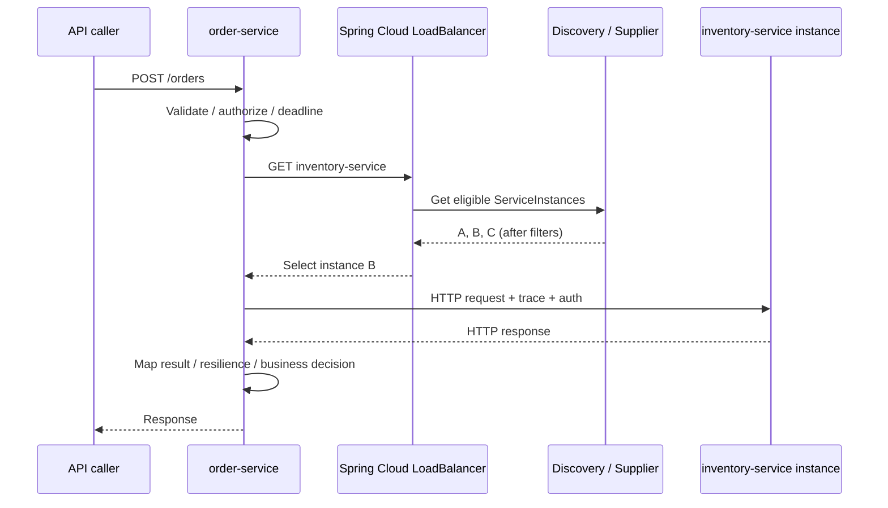
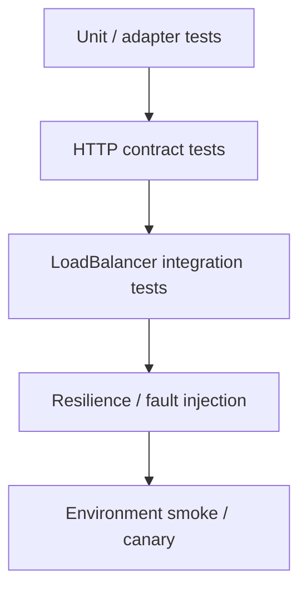

# Checklist for Designing, Testing, and Operating Service Calls

A call from `order-service` to `inventory-service` may be a single HTTP client line in code, yet for reliable operation, many decisions must align: whether the service ID is consistent, which replicas discovery returns, how LoadBalancer picks targets, which connection pool the HTTP client uses, whether timeouts fit within the business deadline, whether retries are safe, whether tokens carry the right audience, and whether operations has enough telemetry to diagnose failures.

Spring Cloud LoadBalancer handles **caller-side `ServiceInstance` selection**. It is one component along the path—it does not replace HTTP contracts, security, connection management, resilience, observability, or backend processing capacity. Therefore, designing a service call must be treated as an end-to-end decision.

This article belongs to the **Design Choices** chapter of the Spring Cloud LoadBalancer module. It provides a checklist for design reviews, implementation reviews, pre-release testing, and production operations, alongside examples for `RestClient`, `WebClient`, `OpenFeign`, sample configuration, acceptance criteria, and an ADR template so teams can record decisions.

## 1. Start from business goals and SLOs

Before choosing an algorithm or HTTP client, answer **what this call must guarantee for users and the system**.

For example, `order-service` needs to read inventory to show remaining stock. A brief glitch might tolerate cached data for a few seconds. Yet when confirming an order, inventory must be checked against the latest business rules; returning stale data can cause overselling. For the same downstream, two use cases may need different timeouts, fallbacks, and retries.

| Design question | Details to lock down | Example |
|---|---|---|
| Purpose of the call? | Read, write, command, query, workflow, or streaming. | GET to read stock; POST to reserve. |
| Criticality? | Critical path, optional enrichment, or background task. | Stock check sits on the checkout critical path. |
| Latency SLO? | p50/p95/p99 and overall deadline. | p95 under 300 ms for read operations. |
| Availability/error budget? | Allowed error rate, which fallbacks are safe. | Allow cached read if inventory briefly fails. |
| Data correctness? | Consistency, freshness, duplicate effects. | Never use cached stock to authorize writes. |
| Traffic? | Average/peak RPS, concurrency, bursts, payload size. | 200 RPS normal, 800 RPS burst for 10 seconds. |
| Failure modes? | No instance, slow instance, 4xx/5xx, network, auth, overload. | Instance dies during scale-down. |
| Who owns the API? | Team/provider, contract version, escalation. | Inventory team owns OpenAPI contract. |

### Classify operations before setting retries/fallbacks

| Operation | Idempotent? | Is default retry safe? | Typically appropriate fallback |
|---|---|---|---|
| GET product detail | Usually yes. | Possible, if transient error and deadline remains. | Short-lived cache if business allows. |
| GET inventory availability | Usually yes in HTTP semantics, though data changes fast. | Can be bounded to a couple of attempts. | Can report "unknown" instead of claiming in-stock. |
| PUT replacing state by resource ID | Can be idempotent per contract. | Conditional; must handle concurrency/versioning. | Usually never fake success. |
| POST creating payment/charge | Usually non-idempotent without contract support. | Do not retry blindly. | Fail closed or query operation status. |
| POST with idempotency key and server dedup | Safely retryable per contract. | Bounded attempts with the same key. | Return known/in-progress status. |
| Event publish | Depends on delivery semantics. | Can be at-least-once; consumer must deduplicate. | Outbox/retry queue per design. |

**Never use the HTTP method name as sole proof of idempotency.** A GET can carry side effects due to flawed API design; a POST can be idempotent when paired with proper operation keys and deduplication.

## 2. Map the path of a logical operation

Every design review should diagram the request flow clearly enough to spot timeout, retry, and identity layers:



This is a logical diagram. In practice, HTTP client filters/interceptors may invoke LoadBalancer while building the request, and retries may repeat instance selection; one call does not always correspond to exactly one selection.

### Spell out the boundaries

- **Logical operation:** the business task the caller wants to complete.
- **HTTP attempt:** one request transmission to downstream; retries can create multiple attempts.
- **ServiceInstance selection:** one LoadBalancer pick of an endpoint from the eligible list.
- **Connection acquisition:** acquiring/reusing a socket from the HTTP pool once a remote endpoint is chosen.
- **Backend execution:** the request reaching the target handler/service.
- **Final outcome:** the ultimate result received by the business caller after mapping/fallback.

These counts are not identical. For instance, one logical operation may have two attempts: the first selects instance A and hits connection refused; the next selects instance B and succeeds. Counting only successful responses hides that the first attempt happened.

## 3. Service ID and discovery checklist

The service ID is the logical name callers use to locate instance lists. It must stay stable and consistent across client declarations, discovery providers, per-service configuration, and telemetry.

| Item | Review question | Acceptance criteria |
|---|---|---|
| Naming | Does the service ID follow consistent lowercase, hyphenation, and naming conventions? | One canonical name, independent of individual pod hostnames. |
| Ownership | Which team/provider owns the service ID and API contract? | Defined owner, escalation path, and versioning. |
| Discovery source | Eureka, Consul, Kubernetes, SimpleDiscoveryClient, or custom supplier? | Explicit authoritative source and refresh behavior. |
| Registration | When do instances register and deregister? | Readiness/registration/draining defined. |
| Address | Does the instance URI carry accurate scheme, host, port, and path? | Callers can connect to the advertised endpoint. |
| Metadata | Do zone, version, weight, tenant, or protocol metadata have a contract? | Keys/values validated with fallbacks. |
| Empty list | When no eligible instance exists, how does the caller behave? | Intentional domain error/503/fallback. |
| Multi-caller | Do all caller replicas share a consistent discovery view? | Metrics/logs exist to spot diverging views. |
| Stale instances | Can deregistered instances still be picked during propagation/cache windows? | Graceful draining, proper TTL/refresh, and timeouts. |

### Readiness and draining checklist

An instance should only be selected when genuinely ready for traffic. Designs must separate:

- **Liveness:** process is alive; restart when unrecoverable.
- **Readiness:** instance can serve business traffic.
- **Startup:** application finished initializing dependencies and required warm-up.
- **Deregistration/draining:** stop accepting new requests, finish bounded in-flight work, then exit process.

Do not use liveness in place of readiness if a process can stay alive before reaching databases/config. Do not tie readiness to too many optional downstreams if one auxiliary failure would pull the entire cluster out of rotation.

### Discovery and LoadBalancer caching

Caching instance lists cuts discovery query costs while letting callers see slightly older topology than the registry. When picking TTL/refresh settings, balance:

1. How fast new or dead instances must be noticed.
2. Load capacity of the registry/discovery provider.
3. Number of caller replicas and service IDs.
4. Impact of stale endpoints while cache entries remain valid.
5. Behavior when cache refresh fails.

Never set an ultra-short TTL just to mask an undiagnosed routing bug. Separate LoadBalancer cache, discovery client cache, DNS cache, and HTTP connection pools; each solves a different problem.

## 4. ServiceInstance selection and routing policy checklist

Algorithms should match workload topology, capacity, and semantics.

| Policy | Suitable when | Risks/limitations |
|---|---|---|
| Round robin | Instances roughly uniform, similar request costs, simple distribution desired. | Does not balance active work or latency; counters/state may be local per caller context. |
| Random | Simple selection needed, high request volume, no ordering required. | Small samples can skew; no exact ratio guarantees. |
| Weighted | Instances differ in capacity or canary/gradual rollout desired. | Weights must track capacity and metrics; wrong weights cause overload. |
| Zone-aware/locality | Reducing cross-zone latency/cost with clear topology. | Can overload small zones; needs fallback when local zone saturates. |
| Hint/metadata-based | Selecting specific versions, tenants, protocols, or capabilities. | Overly tight filters can shrink eligible list to one or zero. |
| Sticky/affinity | Stateful sessions or partition ownership required. | Hot keys, skew, complex failover; ill-suited if state is already externalized without affinity need. |
| Least outstanding/custom | Reliable load telemetry and well-tested algorithm exist. | Laggy/noisy metrics, state concurrency, and selection complexity. |

### Mandatory questions

- How many instances remain **after all suppliers/filters**?
- Does each caller process keep local algorithm state or share it?
- Do requests share session/tenant/hash keys?
- Do instances vary in capacity, zone, or version?
- Does a proxy/mesh/ingress perform an extra layer of load balancing?
- When an instance is removed, how are in-flight requests handled?
- If selection fails, does the caller fall back to another service? Is that business-safe?

**Never require equal request counts across all instances** when workloads vary, affinity is intentional, or backend latency/capacity differs. Evaluate SLOs, utilization, queueing, and policy contracts instead.

## 5. Checklist for choosing RestClient, WebClient, or OpenFeign

Pick a client by **execution model and application needs**, not annotation count or whichever library feels newer.

| Criterion | RestClient | WebClient | OpenFeign |
|---|---|---|---|
| Model | Blocking, fluent API. | Reactive/non-blocking, fluent API. | Declarative proxy, typically blocking. |
| Typical return type | Direct DTO/ResponseEntity. | Mono/Flux or reactive types. | Direct DTO/ResponseEntity. |
| Suitable apps | Spring MVC, blocking services, sync workers. | WebFlux, streaming, fan-out/reactive composition. | Codebases using declarative interfaces and Feign ecosystem. |
| LoadBalancer | `@LoadBalanced RestClient.Builder` when properly integrated. | `@LoadBalanced WebClient.Builder` when properly integrated. | Spring Cloud OpenFeign LoadBalancer integration. |
| Customization | Request factory, interceptors, message converters. | Connector, filters, codecs, Reactor operators. | Feign config, encoder/decoder, interceptors, capabilities. |

### Quick selection rules

- Use **RestClient** for synchronous calls in Spring MVC or background workers without reactive composition.
- Use **WebClient** when the app is already reactive, needing non-blocking I/O, streaming, or combining multiple publishers.
- Use **OpenFeign** when existing systems already have Feign config, observability, retry/fallback, and team familiarity; keep it if support policies and SLOs are met.
- For new declarative clients, consider **Spring HTTP Service Interface** (`@HttpExchange`) over RestClient/WebClient to decouple contracts from transport; verify version and LoadBalancer wiring.

Never put `WebClient.block()` on an event loop to mimic RestClient. Never rewrite an entire MVC app to reactive just because one downstream client can return a `Mono`.

### Example LoadBalanced builder configuration

RestClient:

```java
@Configuration(proxyBeanMethods = false)
class InventoryClientConfiguration {

    @Bean
    @LoadBalanced
    RestClient.Builder inventoryRestClientBuilder() {
        return RestClient.builder();
    }
}

@Bean
InventoryGateway inventoryGateway(
        @LoadBalanced RestClient.Builder builder) {
    RestClient client = builder.clone()
            .baseUrl("http://inventory-service")
            .build();
    return new InventoryGateway(client);
}
```

WebClient:

```java
@Configuration(proxyBeanMethods = false)
class InventoryReactiveClientConfiguration {

    @Bean
    @LoadBalanced
    WebClient.Builder inventoryWebClientBuilder() {
        return WebClient.builder();
    }
}

@Bean
InventoryReactiveGateway inventoryReactiveGateway(
        @LoadBalanced WebClient.Builder builder) {
    WebClient client = builder.clone()
            .baseUrl("http://inventory-service")
            .build();
    return new InventoryReactiveGateway(client);
}
```

These are illustrative configuration snippets; real projects need imports, gateway classes, matching dependencies, and versions. Use `builder.clone()` to build separate clients when downstreams differ in timeouts, auth, or pools. **Never** hardcode a fixed pod URL if client-side LoadBalancer is intended.

### OpenFeign example

```java
@FeignClient(name = "inventory-service")
public interface InventoryClient {
    @GetMapping("/api/products/{id}")
    ProductView find(@PathVariable("id") String id);
}
```

OpenFeign requires its starter dependency and matching scanning enabled. A fixed URL in the annotation or client properties can bypass LoadBalancer; inspect the effective target/delegate at runtime.

## 6. HTTP contract and domain semantics checklist

Lock down the HTTP contract before picking timeouts and retries:

| Contract element | What to define | Example |
|---|---|---|
| Method/path | Method, path, versioning, and path variables. | `GET /api/products/{id}`. |
| Query/headers | Required/optional, encoding, trace/correlation. | `X-Correlation-Id`, `Accept`. |
| Request body | Schema, validation, content type, size. | JSON reservation request. |
| Success | Status codes and response schema. | `200 ProductView`, `201 Reservation`. |
| Client errors | Meaning of 400/401/403/404/409/422. | 404 means product does not exist. |
| Transient errors | 429/502/503/504 and retry semantics. | 503 may retry once on GET. |
| Error body | Stable error code, message policy, correlation ID. | `INVENTORY_UNAVAILABLE`. |
| Idempotency | Key, deduplication, retention, duplicate response. | `Idempotency-Key` for reserve commands. |
| Compatibility | Additive fields, enum evolution, deprecation. | Adding optional fields without breaking older clients. |

### Normalize errors at the business gateway

HTTP clients represent failures differently: RestClient/RestTemplate throw `RestClientResponseException` subclasses, WebClient throws `WebClientResponseException` or request exceptions, Feign uses `FeignException` and custom `ErrorDecoder`s. Never couple business services directly to these exception types.

Example domain result:

```java
public sealed interface InventoryResult {
    record Available(ProductView product) implements InventoryResult {}
    record Missing(String productId) implements InventoryResult {}
    record Unavailable(String reason) implements InventoryResult {}
}
```

The gateway translates status/errors per contract; `404` can become `Missing`, `503` or connect timeout can become `Unavailable`. However, `401`/`403` errors must preserve security semantics; never map them to "product missing" or escalate privileges on fallback.

### Do not confuse HTTP errors with failures lacking an HTTP response

- **HTTP 503:** backend/proxy returned a status.
- **Connection refused:** TCP failed because remote refused the connection.
- **Connect timeout:** TCP did not establish in time.
- **Read/response timeout:** request may have reached the backend, yet caller received no response in time.
- **No ServiceInstance:** LoadBalancer had zero eligible endpoints to send to.
- **Pool acquire timeout:** caller failed to obtain a connection from the pool.

Errors may be wrapped in engine-specific exceptions; log the cause chain and classify at the gateway.

## 7. Timeout and deadline budget checklist

Never use a single timeout number for every phase. One logical operation can wait across:

```text
Inbound processing
  + token acquisition (if any)
  + discovery / instance selection
  + pool acquisition
  + TCP connect / TLS handshake (if new socket needed)
  + request write
  + response wait / body read
  + decode / mapping
  + retry backoff + subsequent attempts
```

### Four timeouts that usually must be separated

| Timeout | What does it limit? | Question to answer |
|---|---|---|
| Pool acquisition | Waiting for an available connection. | When the pool is full, how long does the caller wait before failing? |
| Connect | Establishing TCP/TLS per HTTP engine semantics. | If endpoint is unreachable or handshake lags, when do we stop? |
| Response/read | Waiting for response/bytes per transport. | If backend is slow or stream stalls, how do we handle it? |
| Overall deadline | Total operation time at chosen boundary. | How much time remains for retries and business processing? |

An illustrative budget example:

```text
API deadline from caller:         1500 ms
Reserved token acquisition:        100 ms
Downstream inventory budget:      1000 ms
  max pool acquire:                100 ms
  max connect:                     150 ms
  response budget:                 650 ms
Retry/backoff budget:              100 ms (if policy permits)
Mapping/response overhead:         100 ms
```

Do not sum all timeouts rigidly into a deadline when phases may be skipped (e.g., connection reuse skips connect). Instead, design an **overall budget** and keep every phase bound smaller than the remaining budget.

### Checklist

- [ ] Does the overall deadline derive from the caller/API contract?
- [ ] Does the deadline propagate/decrement across hops rather than resetting to a full timeout at every service?
- [ ] Is pool acquisition timeout configured separately?
- [ ] Do connect/TLS timeouts fit the network topology?
- [ ] Do read/response timeouts fit service times and streaming semantics?
- [ ] Is token acquisition accounted for inside the budget?
- [ ] Can retries/backoff finish within the deadline?
- [ ] When caller cancels/times out, how are downstream side effects handled?
- [ ] Are timeouts classified into distinct metrics/logs?

**Never set infinite timeouts** to hide displayed errors; hanging requests tie up threads, connections, pending queues, and every upstream caller's budget.

## 8. Retry and idempotency checklist

Retries help overcome transient failures, yet also multiply HTTP attempts and can worsen an overloaded system.

### Identify retry layers clearly

Retries can exist at:

1. HTTP transport (certain connection/reuse errors).
2. Spring Cloud LoadBalancer (same/next instance retries per policy).
3. Reactor `retryWhen` or Spring Retry.
4. Resilience libraries or business gateways.
5. Upstream API gateway/service mesh.

If multiple layers retry simultaneously, attempts multiply. For example, 2 attempts at each of three layers can generate far more calls than expected. Specify an **attempt budget for the entire logical operation**, not just individual library knobs.

### Reference retry matrix

| Outcome | Retry? | Conditions |
|---|---|---|
| 400/validation error | No | Input must be fixed. |
| 401 invalid token | Never loop endlessly | Bounded re-authorization only when cause is clear. |
| 403 insufficient permission | No | Same credentials will not gain permissions. |
| 404 resource missing | Usually no | Except intentional eventual-consistency contracts. |
| 409 conflict | Per business rules | May require re-reading state/resolving conflict. |
| 429 | Conditional | Honor `Retry-After`, quotas, and deadline. |
| 502/503/504 | Conditional | Idempotent request, bounded attempts, backoff/jitter. |
| Connect reset/refused | Conditional | Another healthy instance exists, deadline remains, safe operation. |
| TLS certificate/hostname error | No | Fix trust/certificate/hostname. |
| No ServiceInstance | Never hot-retry endlessly | Discovery/health must recover or safe fallback applies. |
| Pool acquire rejection | Usually do not retry immediately | Adding retries worsens queuing/overload. |

### Retry checklist

- [ ] Is the operation idempotent by contract?
- [ ] For writes, are idempotency keys/deduplication in place?
- [ ] Are retryable errors explicitly allowlisted?
- [ ] Does max attempts count the initial call or additional retries?
- [ ] Are exponential backoff and jitter configured appropriately?
- [ ] Is `Retry-After` honored when applicable?
- [ ] Under what policy can retries move to the next instance?
- [ ] Are 401/403/validation/TLS excluded from transient retries?
- [ ] Does the overall deadline cap all attempts/backoff?
- [ ] Are attempts per logical operation and retry success rate metered?

**Never retry indefinitely, and never use retries to mask discovery or health check bugs.** When all instances are overloaded, retries only add traffic.

## 9. Circuit breaker, bulkhead, and rate limit checklist

Resilience mechanisms handle different forms of pressure:

| Mechanism | What does it protect? | What does it not solve? |
|---|---|---|
| Timeout/deadline | Bounds wait time. | Does not reduce concurrency or roll back side effects. |
| Retry | Recovers from certain transient errors. | Does not make backends healthier; can amplify load. |
| Circuit breaker | Temporarily pauses calling a failing dependency. | Does not limit concurrent requests while CLOSED without a bulkhead. |
| Bulkhead | Caps concurrency/queues per dependency or operation. | Does not replace discovery/health or circuit breakers. |
| Rate limiter | Caps request rate per quota. | Does not guarantee latency if backend is congested by other callers. |
| Fallback | Provides defined alternative behavior. | Must never fake success or valid data without proof. |

### Resilience ordering must be intentional

A common structure is:

```text
Business operation
  -> Overall deadline
    -> Circuit breaker
      -> Bulkhead / concurrency limit
        -> Bounded retry + backoff
          -> LoadBalancer selection
            -> HTTP pool/connect/response
```

This is **one reference arrangement**, not the only right order. Placing retry inside vs. outside the circuit breaker changes whether the breaker counts individual attempts or logical operations. Placing the bulkhead before vs. after retry affects whether slots stay held during backoff. Choose based on protection goals, test in practice, and record in an ADR.

### Circuit breaker checklist

- [ ] Is the circuit breaker scoped appropriately by downstream/service ID or operation?
- [ ] Does the error predicate exclude caller errors (400/validation/401/403) from failure stats when appropriate?
- [ ] Are timeouts and connection failures classified consistently?
- [ ] Do sliding window, minimum calls, and failure/slow-call thresholds have sufficient samples?
- [ ] Does OPEN state configure wait duration and bounded half-open probes?
- [ ] Does fallback define clear data freshness and semantics?
- [ ] Are breaker state and rejected-call metrics alerted?

### Bulkhead and rate limit checklist

- [ ] Do concurrency limits match downstream capacity and HTTP pools?
- [ ] Does each critical service ID have its own limit rather than sharing one pool?
- [ ] Are queues bounded with timeouts?
- [ ] Can background jobs be starved by interactive traffic?
- [ ] Do rate limits distinguish tenants/API keys/users and contract quotas?
- [ ] When rejected, is status/error mapping explicit (e.g., 429/503 per contract)?

**Never put an unbounded queue** in front of a slow dependency. Long queues hold more requests while pushing latency past deadlines and inflating memory.

## 10. Connection pool and concurrency checklist

Pools belong to the **HTTP transport**. They may be organized per remote endpoint/route rather than by logical service ID. When LoadBalancer selects multiple instances directly, one service ID can map to multiple remote pools; when going through a proxy, the transport may see only one remote proxy.

### Parameters to record

| Parameter | Meaning | Design question |
|---|---|---|
| Max connections | Connection cap per pool/route or whole client per engine. | Enough concurrency for RPS/latency and backend capacity? |
| Max per route | Connection cap to one remote route (where transport supports). | Is a single instance throttled too low? |
| Pending acquire max | Max requests waiting for a connection. | Is the queue bounded with sufficient headroom? |
| Acquire timeout | Time waiting for a connection. | On pool saturation, fail fast or wait? |
| Max idle/lifetime | Managing idle sockets and connection age. | Aligned with server keep-alive/NAT/load balancer idle timeouts? |
| Connect timeout | Time to open TCP/TLS connections. | Distinguished from acquire timeout? |
| Response/read timeout | Waiting for response data. | Aligned with backend latency and streaming? |
| HTTP/2 stream limits | Streams per connection per peer/settings. | Does multiplexing change the socket-to-request ratio? |

### Estimating concurrency with Little's Law

In steady state:

```text
L ≈ λ × W

L: average in-flight operations
λ: average throughput (operations/second)
W: average time in system (seconds)
```

For example, `λ = 120 requests/s` and `W = 0.25 s` gives roughly `L = 30` average in-flight operations within **that measured scope**. This is an average estimate, not a formula to size max connections for p99; also account for bursts, multiple remote pools, HTTP/2 streams, backend concurrency, and headroom.

### Capacity checklist

- [ ] Estimated average, peak, burst RPS, and request service time.
- [ ] Separated pool max total from max per route/remote per HTTP engine.
- [ ] Accounted for caller replica counts: each pod holds its own pool, multiplying total connections.
- [ ] Verified downstream/database capacity handles all caller pools at max simultaneously.
- [ ] Bounded pending queues; acquire timeout smaller than overall deadline.
- [ ] Idle timeouts/lifetimes match server/proxy keep-alive settings.
- [ ] Verified whether HTTP/2 is active and monitored stream concurrency.
- [ ] Metrics exist for active/idle/pending/connection errors and server in-flight counts.
- [ ] Pool saturation load-tested before production.

**Never raise max connections just to drive pending gauges to 0.** If the backend/database is already saturated, enlarging pools pushes queuing onto the server and worsens p99 and error rates.

## 11. Security checklist: TLS, mTLS, and OAuth2

Service-to-service calls must verify **who the caller is, which API is called, and what permissions apply**. A service ID locates endpoints—it does not prove identity or authorization.

| Item | Review question | Acceptance criteria |
|---|---|---|
| TLS | Is the network path encrypted? | Certificate chain and hostname/SAN verified. |
| mTLS | Is mutual authentication required? | Trust/key rotation and identity mapping clear. |
| OAuth2 client credentials | With what identity does service call service? | Client registration, scope, and audience match resource server. |
| Token relay | Are user tokens forwarded? | Token validated, downstream audience fits, context matches request. |
| Authorization | What permissions does the API check? | Resource server validates issuer/audience/expiry/scope/permissions. |
| Secret management | Where are client secrets/private keys stored? | Secret manager, rotation, and least privilege. |
| Redirect/proxy | Could bearer tokens leak to another host? | Credential forwarding restricted to trusted destinations. |
| Logging | Are sensitive headers/bodies logged? | Authorization, cookies, secrets, and PII redacted. |
| Health probes | Do probe endpoints have separate auth/TLS? | Minimal credentials or controlled management network. |

### Two common token patterns

**Client credentials:** caller obtains an access token representing the service identity. Used when downstream needs service-level permissions rather than a logged-in user.

**Token relay/delegation:** caller forwards an authenticated user's token or performs token exchange. Relay only when downstream accepts the exact audience/scope; if audiences differ, use token exchange/delegation via the Authorization Server.

Never use client credentials to bypass user permissions, never pass ID tokens in place of API access tokens, and never cache raw user tokens in mutable singletons. In WebFlux, security context typically lives in Reactor Context; never copy thread-local servlet interceptors into reactive filters.

### Health endpoints are not business APIs

Health probes may run from a different HTTP client than business calls, so do not assume they carry OAuth2 bearer tokens. If readiness endpoints require auth, configure separate probe credentials/trust/network rules with minimal privileges. Never let false probe failures cause LoadBalancer to drop all instances, nor expose sensitive actuator endpoints publicly.

## 12. Observability and correlation checklist

When a call fails, operators must be able to answer:

1. Which logical operation failed?
2. Which service ID was called?
3. How many eligible instances did the supplier return?
4. Which instance did LoadBalancer pick on each attempt?
5. Which remote endpoint did the HTTP transport connect to?
6. Did the backend receive the request, what status did it return, and how long did it take?
7. Did retries, timeouts, circuit breakers, or fallbacks trigger?

### Three IDs to correlate

| ID | Scope | Purpose |
|---|---|---|
| Trace/correlation ID | One logical operation across services. | Locate all related traces/logs. |
| Attempt ID/index | Each HTTP attempt within the logical operation. | Distinguish retries and per-attempt failures. |
| Instance ID/remote endpoint | Target selected/connected. | Correlate client selection with backend inbound logs. |

Illustrative structured log example:

```text
traceId=ord-7182
operation=inventory-read
serviceId=inventory-service
eligibleCount=3
selectedInstance=inventory-2
attempt=1
httpStatus=200
durationMs=143
```

Not every field appears automatically in Spring Cloud LoadBalancer; add instrumentation/observation or controlled logging at the right boundary.

### Minimum metrics

| Metric | Meaning | Used to detect |
|---|---|---|
| Logical operation rate | Count of business operations. | Inbound traffic and effective throughput. |
| HTTP attempts per operation | Average HTTP calls per operation. | Retry amplification. |
| Client latency p50/p95/p99 | Caller-side duration. | Tail latency. |
| HTTP status/error class | HTTP outcomes and transport errors. | 4xx/5xx/connect/timeouts. |
| Selected instance distribution | Selections per instance. | Skew/routing anomalies. |
| Eligible instance count | Candidate count after filtering. | Discovery/health/zone issues. |
| Pool active/idle/pending | Transport pool state. | Pool saturation. |
| Backend inbound/latency | Requests received and server processing time. | Comparing selection to outcomes; spotting slow backends. |
| Circuit breaker/bulkhead state | Resilience state. | Rejections/fallbacks. |

### Cardinality and sensitive data

- Never put raw user IDs, session IDs, tokens, product IDs, or URL queries into metric labels.
- Instance IDs/pod IDs can create high cardinality during autoscaling; consider labeling by service/zone/role and keeping details in sampled traces/logs.
- Never log Authorization, Cookies, client secrets, private keys, or PII bodies.
- Trace sampling must capture rare failures and retries, not only successful calls.
- Alert on SLOs and symptoms rather than alerting simply because one instance gets more requests under a valid sticky/weighted policy.

## 13. Per-service configuration and environment management checklist

Not every downstream shares the same latency, auth, pool, or retry semantics. Per-service-ID configuration isolates policies, yet avoid building an unreadable pile of unowned properties.

### Settings commonly separated per downstream

- Connect/read/response timeouts and per-operation overall deadlines.
- Retryable statuses, max attempts, backoff, and retry-on-next-instance.
- Connection pool/concurrency limits and pending acquire budgets.
- Circuit breakers, bulkheads, and rate limits.
- OAuth2 client registration/audience/scope or mTLS identity.
- Zone/hint/metadata routing and health-check policies.
- Logging/metrics/trace attributes and alert thresholds.

Illustrative YAML example:

```yaml
spring:
  cloud:
    loadbalancer:
      retry:
        enabled: false
      clients:
        inventory-service:
          # Specific properties must be checked against your Spring Cloud version.
          retry:
            max-retries-on-same-service-instance: 0
            max-retries-on-next-service-instance: 1

app:
  downstream:
    inventory:
      connect-timeout: 300ms
      response-timeout: 700ms
      overall-deadline: 1s
      max-in-flight: 40
    payment:
      connect-timeout: 500ms
      response-timeout: 2s
      overall-deadline: 2500ms
      max-in-flight: 12
```

**Do not copy this block as complete production config.** Property namespaces and retry knobs change across Spring Cloud release trains, HTTP clients, and integrations. `app.downstream.*` entries are custom application properties; they only take effect when code binds and applies them. Always verify configuration metadata/version-specific docs and inspect effective runtime values.

### Configuration management rules

1. Every service ID has one canonical name, one owner, and one place defining defaults.
2. Defaults are safe; production overrides undergo review, audit, and rollback planning.
3. Secrets/tokens live in a secret manager, never committed to YAML.
4. Do not create per-instance profiles when discovery metadata can express the difference.
5. Avoid layered overrides from multiple sources that obscure effective values.
6. Add startup validation for nonsensical values (negative timeouts, max connections = 0, deadline shorter than backoff).
7. Record config version/hash on changes to correlate with metrics.

### Config review checklist

- [ ] Does every downstream have an owner and defaults?
- [ ] Are Spring-managed properties clearly distinguished from custom app properties?
- [ ] Are final runtime effective values verified?
- [ ] Do timeouts/retries/pools align with deadlines?
- [ ] Do any fixed URLs accidentally bypass service IDs?
- [ ] Are secrets kept out of repositories and logs?
- [ ] Do config changes have rollout, canary, and rollback steps?

## 14. Multi-layer testing checklist

No single test type proves a service call works from contract to production. Build a test pyramid:



### Unit/adapter tests

Verify input mapping, paths/queries/headers, DTOs, error translators, and business fallbacks. HTTP exchanges or gateway dependencies can be mocked, yet these tests do not prove TCP, discovery, or LoadBalancer algorithms.

### HTTP contract tests

Use MockWebServer/WireMock or contract fixtures to verify:

- HTTP method/path/query/body/headers.
- Success/error statuses and schemas.
- Encoding, media types, pagination, null/enum/date handling.
- Error mapping to domain results.
- Authorization headers attached properly (use dummy tokens; never log tokens).

### LoadBalancer integration tests

Use two or more HTTP servers on dynamic ports and `SimpleDiscoveryClient`/test suppliers:

- Service ID resolves to expected URIs.
- Multiple instances receive requests when policy permits.
- No-instance and one-instance-down are distinguished.
- Health/zone/hint/cache filters build the right eligible list.
- Fixed URLs do not accidentally bypass LoadBalancer.
- Selected instance correlates with backend inbound logs.

Never use `MockRestServiceServer` or mocked Feign interfaces as proof that LoadBalancer picked a `ServiceInstance`; those usually test request mapping/Java calls at a different layer.

### Resilience/fault-injection tests

Simulate under controlled conditions:

- 503/429/Retry-After.
- Slow backends, response timeouts, and overall deadlines.
- Connection refused, disconnects, and connect timeouts via fault proxies.
- Full pool pending queues / acquire timeouts.
- Instance removed from discovery, failing health probes.
- Expired tokens / invalid audience / insufficient scope.
- Retry attempts, circuit breaker open/half-open, bulkhead rejections.

Each fault test should vary **one primary variable**, enforce a finite deadline, and assert real attempt counts, status/cause, backend inbound counts, and resource cleanup.

### Smoke tests/canary

Verify networking, DNS/registry, TLS/mTLS, OAuth2, proxy/mesh, service IDs, and observability in a production-like environment. Never call real production dependencies from unit tests when contract fixtures suffice; keep smoke tests tightly scoped with safe credentials and data.

## 15. Load testing and capacity validation checklist

A service call cannot be declared production-ready simply because single unit tests return 200.

### Designing the workload

| Element | What to document |
|---|---|
| Traffic model | Constant VUs/closed-loop vs. constant arrival rate/open-loop. |
| Load shape | Warm-up, steady state, bursts, ramp-down, soak. |
| Payload | Request/response sizes, compression, streaming. |
| Topology | Caller replicas, backend replicas, zones, proxy/mesh. |
| Failure injection | One instance down/slow/503, stale registry, network faults. |
| Protocol | HTTP/1.1 vs. HTTP/2, TLS/mTLS, keep-alive. |
| Retries | Attempts per logical operation and retryable errors. |
| Metrics | p50/p95/p99, RPS, errors, pools, CPU/GC, backend in-flight. |

### Capacity checklist

- [ ] Load generator has enough CPU/network with no unintended dropped iterations?
- [ ] JVM, DNS, connection pools, and caches warmed up?
- [ ] Baseline measured with all instances healthy?
- [ ] Tested with one slow or removed instance?
- [ ] Measured behavior while discovery lists change?
- [ ] Located bottlenecks across caller pool, network, proxy, or backend?
- [ ] Checked backend databases/external dependencies?
- [ ] Tested retry storms and recovery after overload?
- [ ] Headroom exists for scale-up and traffic bursts?
- [ ] Do p99 and error rate stay within SLO when one instance drops?

### Do not optimize solely for raw RPS

If config A reaches higher raw RPS with rising errors/timeouts, while config B yields slightly lower successful throughput with p99 and success rates meeting SLOs, do not assume A is better. Compare **successful logical operations/s**, error rate, p95/p99, and resource cost together.

## 16. Operations and alerting checklist

Designs must cover what happens after deployment:

| Symptom/alert | Metrics/evidence | First action |
|---|---|---|
| No eligible instances | Eligible count = 0, discovery/health errors. | Check registry, readiness, supplier filters, service ID. |
| Abnormal traffic skew | Selected distribution and inbound requests per instance. | Compare candidates, sticky/zone/hint, proxies, and success-only bias. |
| Rising p95/p99 | Client/server latency, pool pending, backend in-flight. | Isolate queue/connect/response/backend phase. |
| Retry amplification | Attempts/logical operation, retry success rate. | Inspect retry layers, error classifier, backoff, and deadline. |
| Pool saturation | Active/pending/acquire timeouts. | Check per-remote pools, backend capacity, and concurrency. |
| Rising 401/403 | Auth error class, token endpoint metrics, resource-server logs. | Check issuer/audience/scope/registration; never relax permissions blindly. |
| Circuit breaker OPEN | Failure/slow-call rates, rejected calls. | Check dependency and error classification; verify fallback policy. |
| Stale instances | Registry vs. supplier list, refresh age. | Check propagation/cache/health and graceful draining. |
| Missing HTTP client metrics | Observation registry/meters/trace spans. | Check builder customizers, connectors, and instrumentation. |

### Minimal runbook for no-instance

1. Verify service ID and caller deployment.
2. Check whether the registry lists Ready instances.
3. Compare discovery results against the final supplier after filters/caches.
4. Check health probe path/status/TLS/credentials.
5. Check cache age and recent scale/register/deregister timestamps.
6. Check for URL overrides or custom child contexts.
7. If applying a workaround, set an expiration and rollback plan; never disable all security/health checks.

### Minimal runbook for high latency

1. Compare logical operation duration against HTTP attempt duration.
2. Inspect pool pending acquire counts before tuning response timeouts.
3. Check connect/TLS/response timeouts and remote destinations.
4. Correlate backend p95/p99, DB pools, CPU/GC, and in-flight requests.
5. Count retry attempts and backoff inside the deadline.
6. Re-test in canary with one single change.

## 17. Rollout, canary, and rollback

Changes to clients, selection algorithms, pools, retries, or timeouts can affect all traffic. Roll out according to risk:

1. **Local/unit/contract tests:** verify semantics first.
2. **Integration environment:** multiple instances, discovery/health/cache, network/TLS.
3. **Load/fault tests:** normal load, peaks, one-instance-down, and overload.
4. **Canary:** one caller replica or small traffic slice, watching SLOs and distribution.
5. **Progressive rollout:** expand once metrics remain steady over a sufficient window.
6. **Rollback:** restore prior config/client/policy if error budgets or latency breach thresholds.

### Canary criteria

- Error rate does not exceed defined thresholds.
- p95/p99 stays within SLOs.
- Selected-instance distribution matches policy.
- Retry attempts/logical operation do not spike abnormally.
- Pool active/pending and backend utilization retain headroom.
- OAuth2/TLS errors do not rise.
- Dashboards/traces/alerts continue receiving data.
- Zero duplicate writes or wrong business outcomes occur.

**Never roll out simultaneously** a new client library, new algorithm, bigger pool, and retry changes in one release if impacts cannot be isolated. Separate changes for clean rollbacks.

## 18. Design checklist by use-case category

One set of defaults cannot suit every operation. The table below is a starting point for team questions:

| Use case | Typically suitable client | Timeout/deadline | Retry/fallback | LoadBalancer notes |
|---|---|---|---|---|
| Detail read in MVC | RestClient or existing Feign. | Short deadline per caller API. | Bounded GET retries; cache if stale acceptable. | Multiple instances, accurate health/readiness. |
| Reactive fan-out across services | WebClient. | Overall deadline splitting budget across branches. | Per-branch retries; cancel unneeded branches. | Cap concurrency; avoid fan-out amplification. |
| Payment/charge | Sync or reactive client matching app. | Deadline per payment workflow. | Never retry blindly; idempotency keys and status queries. | Never fall back to payment success. |
| Background batch | RestClient/Feign or WebClient. | Deadline per job/record; can exceed interactive. | Queues/retries with backoff and DLQ where fitting. | Bulkheads stop batches starving interactive pools. |
| Event consumer calling downstream | Client matching consumer stack. | Deadline shorter than processing lease/visibility timeout. | At-least-once requires deduplication. | Retries must not let consumer lag grow unboundedly. |
| Streaming/SSE | WebClient or suitable streaming client. | Separate connect timeout; inactivity/overall policy per contract. | Avoid blind stream retries if events can drop; resume cursor. | Connection lifetime/HTTP2/idle proxy timeouts matter. |
| Multi-tenant/sharded data | Any client + routing policy. | Per operation. | Per consistency/partition semantics. | Metadata/tenant routing must be verified; avoid hot keys. |

### Example: inventory read vs. reservation write

**Inventory read** can use RestClient/Feign in MVC with a short timeout and one bounded retry on transient errors. If display APIs tolerate staleness, add a TTL cache with freshness metadata.

**Reservation write** needs an idempotency contract, deduplication, status queries, and never a fake-success fallback. If a timeout happens after backend commit before the caller receives the response, the caller must query status by operation key rather than firing an uncontrolled new POST.

### Example: reactive fan-out

If one request calls 10 services in parallel, potential concurrency multiplies fast. Enforce:

- a cap on concurrent branches;
- an overall deadline and per-branch budgets;
- cancellation of unneeded branches once sufficient results arrive;
- avoiding retrying all branches simultaneously;
- separating critical branches from optional enrichment;
- tracing every downstream call.

Non-blocking WebClient uses threads more efficiently, yet **does not create infinite capacity** in backends or connection pools.

## 19. Per-service policy design checklist

A downstream may need a custom policy, yet policies must stay understandable and governable:

| Attribute | Example value/meaning | Owner |
|---|---|---|
| Service ID | `inventory-service` | Platform/service registry owner |
| API contract | `/api/products/{id}`, error codes | Inventory team |
| HTTP client | RestClient/Feign/WebClient | Caller team |
| Discovery source | Kubernetes pod endpoints/Eureka | Platform team |
| Selection policy | Round robin or zone preference | Platform + service owners |
| Timeout budget | 1s overall, separate connect/read phases | Caller team |
| Retry policy | GET retry at most once on 503 | Caller + provider |
| Pool/bulkhead | Max in-flight 40 per caller | Caller/platform |
| Auth | client registration, audience, scope | Security + service owners |
| Health/readiness | Path, port, auth, thresholds | Provider/platform |
| Telemetry | Metrics, trace fields, alert SLOs | Caller/platform |

### Avoid policy drift

If 15 services each invent different retries/timeouts without convention, the platform team struggles to predict aggregate load. Define:

1. Safe **baseline defaults** by operation type.
2. An **exception policy** requiring justification and owner sign-off.
3. **Config schema/validation** to catch invalid values.
4. Unified **dashboard/alert conventions**.
5. A **review cadence** to prune obsolete overrides.

Never force identical timeouts on every downstream just to keep YAML uniform; consistent declaration and review matter more than identical numbers.

## 20. Sample design review checklist

Use this checklist in pull requests or architecture reviews. Mark each item **Pass / N/A / Needs decision** with supporting evidence.

### A. Contract and ownership

- [ ] Service ID, API owner, and endpoint contract are clear.
- [ ] Operation classified as read/write/idempotent/streaming.
- [ ] Status/error schemas, versioning, and compatibility defined.
- [ ] Caller knows behavior when resources are missing or downstream is unavailable.

### B. Discovery and routing

- [ ] Discovery provider and register/readiness/deregister lifecycle clear.
- [ ] Supplier/filter/cache chain verified.
- [ ] Selection algorithm fits capacity/topology.
- [ ] Zone/hint/sticky/tenant routing justified with fallbacks.
- [ ] No-instance and stale-instance behavior tested.
- [ ] URLs do not accidentally bypass LoadBalancer.

### C. Client and transport

- [ ] RestClient/WebClient/OpenFeign chosen for blocking/reactive needs.
- [ ] Actual HTTP engine/connector identified.
- [ ] Pool/per-route/concurrency limits appropriate.
- [ ] HTTP/1.1 vs. HTTP/2 and proxy/mesh topology clear.
- [ ] Builder/customizers/SSL/codecs/observation preserved.

### D. Timeouts and resilience

- [ ] Pool acquisition, connect, response, and overall deadline bounded.
- [ ] Retry layers inventoried; max attempts explicit.
- [ ] Idempotency/deduplication guaranteed for retried writes.
- [ ] Circuit breaker predicates/thresholds/fallbacks have clear semantics.
- [ ] Bulkheads/rate limits/queues bounded.
- [ ] Retries stay within deadline and do not cause storms.

### E. Security

- [ ] TLS/mTLS, hostname validation, and certificate rotation in place.
- [ ] OAuth2 client registration, issuer, audience, scope, and token lifecycle configured.
- [ ] Token relay matches user context and downstream trust boundaries.
- [ ] Health probes have appropriate credential/network policies.
- [ ] Logs/traces contain no tokens, secrets, cookies, or PII.

### F. Testing and operations

- [ ] Unit + HTTP contract + LoadBalancer integration tests present.
- [ ] Fault injection covers no-instance, slow responses, 503, connection failures, auth failures.
- [ ] Load tests cover multiple instances, peak/burst, and one-instance-down.
- [ ] Metrics/traces cover logical operations, attempts, selected instances, and backends.
- [ ] Alerts/runbooks/owners/escalation paths exist.
- [ ] Canary, rollback, and success criteria documented.

**Reviews should never be mere checkbox ticking.** Every critical item needs evidence such as test reports, config excerpts, dashboards, ADRs, or contract links; N/A items must state why.

## 21. Architecture Decision Record (ADR) template

ADRs help other teams understand why a policy was chosen and when to revisit it. A concise template:

```markdown
# ADR-0XX: Calling inventory-service via Spring Cloud LoadBalancer

## Status
Proposed | Accepted | Superseded

## Context
- Operation: GET inventory availability
- Caller: order-service (Spring MVC)
- Downstream: inventory-service, 3 instances across 2 zones
- SLO: p95 < 300 ms, overall deadline 800 ms
- Traffic: peak 250 RPS per caller replica

## Decision
- HTTP client: RestClient
- Resolution: service ID inventory-service
- Selection: round robin with zone preference fallback
- Timeout: pool/connect/response budgets within 800 ms deadline
- Retry: one bounded retry for selected transient errors on GET
- Security: OAuth2 client credentials, audience inventory-api
- Observability: traceId, attempt, selectedInstance, backend status

## Alternatives
- OpenFeign
- WebClient
- Direct Kubernetes Service URL
- Custom weighted selector

## Consequences
- Positive: client-side instance selection and explicit budgets
- Negative: caller owns discovery/LB configuration and pool tuning
- Risks: stale registry, per-caller state, retry amplification

## Validation
- Contract tests
- Multi-instance integration tests
- One-instance-down load test
- Canary SLO comparison

## Revisit when
- Traffic doubles
- Service moves zones
- API becomes streaming/reactive
- Spring Boot/Cloud major upgrade
```

This is a hypothetical example. Replace SLOs, traffic, auth, and topology with real project data. Keep secrets and sensitive internal addresses out of ADRs if shared broadly.

## 22. Incident decision table

When a metric degrades, never change multiple knobs at once:

| Symptom | Check first | Do not do immediately |
|---|---|---|
| No ServiceInstance | Discovery, readiness, supplier/filters, service ID. | Increase retries. |
| One instance gets nearly all requests | Eligible list, selection, affinity, proxies, metric semantics. | Swap round robin for random. |
| High p99, high pool pending | Per-remote pools, concurrency, backend capacity. | Just raise response timeout. |
| High p99, low pool pending, slow backend | Backend handlers/DB/CPU/network. | Blindly raise max connections. |
| Rising 401/403 | Token issuer/audience/scope, registration, resource-server logs. | Disable authentication. |
| Sudden spike in retry attempts | Error classifier, stacked retry layers, backoff/deadline. | Raise max retries. |
| Circuit breaker OPEN | Failure source, thresholds, slow calls, dependency health. | Repeatedly force breaker CLOSED. |
| Client metrics vanished | Builders/connectors/ObservationRegistry/registry. | Assume zero traffic. |
| URL fails to resolve after deploy | LoadBalancer on builder, service ID, effective URL. | Hardcode pod IPs. |

### One-variable-at-a-time rule

1. Record baseline and symptom.
2. Form a falsifiable hypothesis.
3. Make one minimal change in lab/canary.
4. Re-measure under the same workload and time window.
5. Compare success rate, p95/p99, attempts, pools, and backend utilization.
6. Roll back if results worsen or fail to confirm the hypothesis.

## 23. Anti-patterns to avoid

**Hardcoded pod IPs/URLs:** bypasses discovery and makes scaling/restarts brittle.

**Infinite timeouts:** holds resources and cascades hanging requests upstream to callers.

**Retrying every error:** retrying 4xx/auth/TLS/pool rejections or non-idempotent POSTs causes side effects and retry storms.

**Unbounded pools:** shifts pressure from caller onto backends and databases.

**Single shared circuit breaker across all downstreams:** one failing service can block healthy dependencies.

**Fake-success fallbacks:** returns business-invalid data just to keep dashboards green.

**Health probes hitting sensitive business endpoints:** probes fail on auth or optional dependencies, wrongly dropping all instances.

**Logging full Authorization/Cookie headers:** leaks credentials.

**Measuring only successful responses:** hides failed attempts, timeouts, and selection bias.

**Relying on round-robin order in completion logs:** concurrency and varying latencies reorder completion.

**Sharing one builder across all downstreams without separating policies:** timeouts/auth/pools easily bleed or get overwritten by customizers.

**Upgrading major versions without a compatibility matrix:** APIs, properties, HTTP engines, and behavior can shift simultaneously.

## 24. Final deployment checklist

Before merging/deploying, the implementer should ensure:

- [ ] ADR/decision note exists for client, service ID, selection policy, and resilience.
- [ ] HTTP contract is versioned with clear provider/consumer ownership.
- [ ] Discovery, health, cache, and zone/hint/sticky configurations reviewed.
- [ ] HTTP client and transport engine identified; dependencies/BOM compatible.
- [ ] Pools/concurrency/timeouts configured within a deadline budget.
- [ ] Retry/idempotency/circuit breaker/bulkhead/rate-limit policies are explicit.
- [ ] OAuth2/TLS/mTLS/secret management tested.
- [ ] Unit, contract, multi-instance, and fault-injection tests pass.
- [ ] Load tests prove SLOs at peak and with one-instance-down.
- [ ] Metrics/traces/logs/alerts correlate cleanly without exposing sensitive data.
- [ ] Runbooks updated for no-instance/latency/auth/retry/pool incidents.
- [ ] Canary, rollout thresholds, and rollback owner are clear.
- [ ] No hardcoded URLs, secrets, debug logs, or unused legacy properties remain.
- [ ] Config owner and post-deployment reviewer are assigned.

## 25. Summary

Designing service calls with Spring Cloud LoadBalancer means combining **service discovery and instance selection** with HTTP contracts, HTTP clients/transports, timeouts, retries, connection pools, resilience, security, and observability. No single algorithm or timeout set fits every downstream; decisions must begin with business semantics, SLOs, and capacity.

A solid design lets the team clearly answer: which service ID the caller targets, which instances the supplier provides, how policy picks destinations, how many times requests may retry, what the deadline is, what permissions tokens hold, how pools are bounded, and where dashboards/runbooks pinpoint root causes when failures happen.

**Using the checklist effectively:** apply it at three checkpoints—design review before coding, testing/rollout before release, and incident review in operations. Tie every key decision to measurable or testable evidence, document exceptions in ADRs, and revisit whenever traffic, topology, API contracts, or framework versions change.
