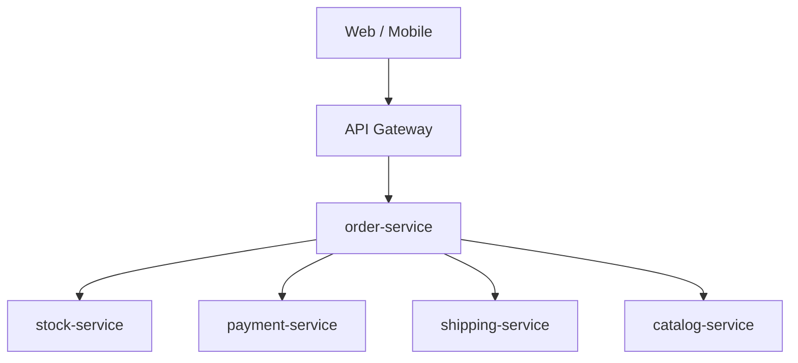

# System Design Exercises with Option Evaluation Criteria

## 1. Workshop objectives

When designing inter-microservice communication, the question is not simply "use Round Robin or Random?". First identify **which layer owns backend selection**, which instance list the caller sees, what availability and latency requirements apply, and whether operations has sufficient visibility and control over that policy.

This article belongs to the **Design Choices** chapter of the `SPRING_CLOUD_SERVICE_COMMUNICATION_LOAD_BALANCER` module. The module helps you understand Spring Cloud LoadBalancer's client-side load balancing: picking a `ServiceInstance` by service ID, discovery, health checks, and routing policies; practicing `RestClient`, `WebClient`, and OpenFeign integration, retry/timeout configuration, and error observability for reliable service-to-service communication.

After this workshop, you will be able to:

1. Analyze functional and non-functional requirements before picking a load balancing solution.
2. Compare Kubernetes Service, Spring Cloud LoadBalancer, gateways, and service meshes within their proper scopes.
3. Choose an HTTP client and supplier/LoadBalancer policy fitting the caller.
4. Design controlled health, timeout, retry, sticky/zone routing, and observability.
5. Use scoring matrices, disqualifying conditions, and ADRs to justify choices.
6. Propose rollout, testing, and rollback plans for an architectural decision.

**How to study:** Read the shared context, work through each case in groups, score options using the same criteria, and then compare against the reference solutions. No single answer fits every organization; a strong choice must state assumptions, trade-offs, and verification steps.

## 2. End-to-end system context

You are designing an e-commerce platform for an online store. Core services:

| Service | Responsibility | Common call style |
| --- | --- | --- |
| `api-gateway` | Receives public requests, authenticates, rate-limits, and routes | North–south |
| `order-service` | Creates orders, orchestrates ordering workflow | Calls stock/payment/shipping |
| `stock-service` | Reads and reserves inventory | GET and reserve commands |
| `payment-service` | Payments, refunds | POST with side effects |
| `shipping-service` | Calculates fees and creates shipments | GET/POST |
| `catalog-service` | Reads product details | GET, high traffic |

Existing environment:

- Java applications built on Spring Boot and Spring Cloud.
- Some workloads run on Kubernetes; some services integrate with systems outside the cluster.
- Service-ID discovery, Kubernetes Service DNS, or service mesh may be used depending on the environment.
- Critical services run multiple replicas; instances can scale, restart, or move zones.
- Callers need timeouts, bounded retries, and metrics/tracing.

### 2.1. Business diagram



### 2.2. Initial non-functional requirements

Numbers below are **assumptions for this exercise**, not Spring Cloud defaults:

| Attribute | Assumed requirement |
| --- | --- |
| Order placement availability | 99.9% monthly |
| Create-order API deadline | 2 seconds at p95, 4 seconds at p99 |
| Stock lookup | p95 under 150 ms within the same region |
| Payment | Must never create duplicate charges on timeout/retry |
| Scale | 2 to 20 replicas for high-traffic services |
| Failure | Must survive losing one replica or one zone |
| Routing | Some workloads need same-zone preference; not all requests need stickiness |
| Operations | Small ops team; needs explainable config and clean rollback |
| Observability | Track logical calls, HTTP status, latency, retries, instances, and no-instance |

Before picking a solution, confirm these assumptions with product/SRE. For example, "99.9% availability" must specify which API, which window, and which errors count; "p95 under 150 ms" must clarify whether measured at the caller or end-to-end.

## 3. Questions to answer before choosing technology

A design document should start with these questions:

| Question group | Must clarify | Design implication |
| --- | --- | --- |
| Topology | Same Kubernetes cluster, multi-cluster, VM, or hybrid? | Dictates discovery and network boundaries |
| Target address | Does caller see a VIP, DNS record, or individual Pods/instances? | Identifies who truly selects the backend |
| Service identity | Is the service ID stable and unique? | Child context and registry configuration |
| Routing | Round Robin, Random, zone, hint, weight, or sticky? | Supplier/algorithm selection |
| Health | Platform readiness or caller-side health probes? | Avoid conflicting status sources |
| Failure | When no instance exists, fail open or fail closed? | Dictates EmptyResponse, fallbacks, and alerts |
| Deadline | How much total time does the request have? | Allocates timeouts and retry budgets |
| Idempotency | Does the request have side effects? | Are retries allowed and which key is required? |
| Security | Where does TLS sit; is mTLS required? | Dictates endpoints and trust boundaries |
| Operations | Who owns policies and responds to incidents? | Limits number of orchestration layers |
| Compatibility | Which Boot/Cloud train, client, and discovery versions? | Prevents incompatible dependency mixes |

**Most important question:** When `order-service` calls `stock-service`, where does the caller's candidate list come from, and which layer picks the **final Pod**? If you cannot answer that, you lack enough facts to choose between Kubernetes Service and Spring Cloud LoadBalancer.

## 4. Architectural options to compare

### Option A — Kubernetes Service DNS/ClusterIP

Callers invoke a stable Service address, e.g., `http://stock-service.default.svc.cluster.local:8080`. The Kubernetes Service and cluster dataplane route connections to an eligible endpoint. Applications can use plain HTTP clients without `@LoadBalanced`.

**Suitable when:**

- Caller and provider share a cluster or have proper network routing.
- Standard Kubernetes discovery/service networking suffices.
- Callers do not need to pick Pods by metadata or request context.
- Operations wants to minimize in-app discovery mechanisms and caches.

**Limitations to check:**

- Callers lack Pod lists to apply custom zone/hint/weight policies.
- Distribution may happen at the connection/dataplane layer; never assume every HTTP request gets independent Round Robin.
- If L7 traffic splitting is needed, a gateway or service mesh may be required.

### Option B — Spring Cloud LoadBalancer with instance-aware discovery

Callers invoke a service ID like `http://stock-service/...` using `@LoadBalanced RestClient`, `WebClient`, or OpenFeign. `ServiceInstanceListSupplier` pulls instances from discovery; `ReactorServiceInstanceLoadBalancer` picks one instance.

**Suitable when:**

- Callers must select specific instances by metadata, zone, hint, sticky session, or custom algorithm.
- The discovery provider supplies each instance's host/port.
- Multiple environments or non-Kubernetes systems must share the same service-ID model.
- Development teams want policy control on the caller side.

**Costs and limitations:**

- Must operate discovery, caches, health/refresh, and supplier configs.
- Must monitor consistency between the registry and real network state.
- May pick Pods directly while a mesh/Kubernetes applies separate routing underneath.
- Per-service child contexts must be tested to prevent beans leaking across service IDs.

### Option C — Service mesh owning east–west routing

Applications call a service hostname; the mesh data plane enforces routing, mTLS, telemetry, traffic splits, timeouts/retries, or outlier detection via config. Depending on architecture, the data plane may use sidecars or an ambient/waypoint model.

**Suitable when:**

- Uniform policies are needed across multiple languages and runtimes.
- mTLS, workload identity, traffic splitting, or proxy-layer observability is needed.
- A platform team can operate the control plane/data plane.

**Costs and limitations:**

- Adds operational components, configuration, and debugging paths.
- Must verify which traffic actually traverses the proxy.
- Not all mesh modes offer identical L7 capabilities.
- Mesh retries can stack on top of client/gateway retries.

### Option D — Edge gateway paired with one explicit east–west choice

Gateway/Ingress accepts public traffic and routes to `order-service`. Internally, every caller uses **one designated mechanism** for downstream calls: Kubernetes Service, Spring Cloud LoadBalancer, or mesh.

This is often the real-world architecture: the gateway solves north–south; east–west is decided independently. A gateway does not automatically replace LoadBalancer inside `order-service`.

### 4.1. Overall comparison table

| Criterion | A: Kubernetes Service | B: Spring Cloud LB | C: Service mesh | D: Gateway + east–west choice |
| --- | --- | --- | --- | --- |
| Scope | Intra-cluster | Caller-side | Workload-to-workload | Edge and internal |
| Pod selection | Kubernetes dataplane | Caller if discovery returns Pods | Mesh dataplane | Depends on internal choice |
| Per-request policy | Limited in basic Service | Supplier/request context | L7 policies possible | Possible at chosen layer |
| Zone/metadata | Platform topology/policy | Customizable via metadata | Depends on mesh/config | Depends on east–west choice |
| mTLS | Not built into Service | Not built in | Common mesh feature | Gateway/mesh per config |
| Retry/timeout | Not a full Service feature | Caller-configurable | Proxy policy | Must assign one owner |
| Operations | Usually simplest in K8s | Adds discovery/config in apps | Requires platform team | Multiple layers; needs clear boundaries |
| Multi-platform | Network-dependent | Strong with unified discovery | Mesh-topology-dependent | Depends on each hop |

No column always wins. The table highlights trade-offs; scoring must reflect real requirements and team capability.

## 5. Choosing an HTTP client: RestClient, WebClient, or OpenFeign?

Load balancing and HTTP client programming APIs are related yet distinct decisions. All three can integrate with Spring Cloud LoadBalancer when configured properly.

| Client | Model | Consider when | Points to evaluate |
| --- | --- | --- | --- |
| `RestClient` | Blocking, fluent API | Spring MVC services or synchronous flows | Thread-per-request, transport timeouts, connection pools |
| `WebClient` | Reactive, non-blocking | Reactive flows or streaming/backpressure needed | Never block event loop; context/request data must propagate |
| OpenFeign | Declarative interface | Stable service-to-service APIs wanting clean interfaces | ErrorDecoder, Retryer, contract, timeouts, observability |

`RestClient` example using a service ID:

```java
@Configuration(proxyBeanMethods = false)
class HttpClientConfig {
    @Bean
    @LoadBalanced
    RestClient.Builder loadBalancedRestClientBuilder() {
        return RestClient.builder();
    }
}

@Service
class StockClient {
    private final RestClient client;

    StockClient(@LoadBalanced RestClient.Builder builder) {
        this.client = builder.build();
    }

    String find(String sku) {
        return client.get()
                .uri("http://stock-service/stocks/{sku}", sku)
                .retrieve()
                .body(String.class);
    }
}
```

OpenFeign example:

```java
@FeignClient(name = "stock-service")
interface StockFeignClient {
    @GetMapping("/stocks/{sku}")
    StockResponse find(@PathVariable("sku") String sku);
}
```

When a fixed URL is set on Feign—e.g., `@FeignClient(name="stock-service", url="https://stock.internal")`—requests usually go straight to that URL, bypassing service-ID discovery/LoadBalancer. Pick one clear model and test the actual path.

**Never pick WebClient merely because you heard it is faster.** If the app is blocking and the workload fits, RestClient can be simpler. If the system is already reactive end-to-end, WebClient avoids bouncing back and forth into blocking code. OpenFeign excels at declarative contracts, yet still demands resilience and observability design.

## 6. Option scoring matrix

Use this matrix for every case. Teams may adjust weights if they justify the changes before scoring.

| Criterion | Weight | Score 1 | Score 3 | Score 5 |
| --- | ---: | --- | --- | --- |
| Functional/routing fit | 20 | Missing core requirements | Meets most needs | Meets all needs with fallbacks |
| Availability/failover | 15 | No clear error handling | Failover exists with many caveats | Instance/zone loss behavior defined and tested |
| Latency/traffic locality | 10 | Misses SLO | Meets SLO under normal load | Proper locality/connection strategy and measured |
| Resilience/deadline | 15 | Unclear retries/timeouts | Limits exist, not end-to-end | Consistent deadline, retry, idempotency, circuit policy |
| Operational complexity | 10 | Too many mechanisms/vague owners | Operable with runbooks | Minimal mechanisms, clear ownership and rollback |
| Observability | 10 | Cannot see instance/errors | Basic metrics exist | Separates logical calls, attempts, instances, traces, no-instance |
| Security | 10 | Unclear trust boundaries | Basic TLS/identity | Clear TLS/mTLS, identity, secret lifecycle |
| Compatibility/upgrades | 10 | Unverified versions/APIs | Basic BOM/tests | Matrix, staged rollout, and rollback verified |
| **Total** | **100** | | | |

Score each option from 1 to 5. Weighted score:

\[
\text{Weighted score} = \sum_i \left(\frac{\text{score}_i}{5}\times\text{weight}_i\right)
\]

For example, scoring 4 on a criterion weighted 20 contributes `4/5 × 20 = 16` points. Maximum total score is 100.

### 6.1. Disqualifying conditions before scoring

Even a high-scoring option must be disqualified if it violates a mandatory constraint:

- Fails Java/Spring Boot/Spring Cloud compatibility matrix.
- Lacks a reliable instance source or cannot determine the actual destination.
- Retries can duplicate writes without idempotency.
- Lacks detection or handling for zero remaining instances.
- Fails mandatory security/mTLS requirements.
- Lacks enough error visibility to operate or roll back.
- Two layers both own traffic splitting/retries without a coordination model.

Separate **hard constraints** from tradable criteria. For example, higher operational cost may be acceptable to gain cross-workload mTLS, whereas never creating duplicate payments cannot be traded away.

## 7. Case study 1 — Choose Kubernetes Service or Spring Cloud LoadBalancer?

### Context

`order-service` and `stock-service` both run in one Kubernetes cluster in the same namespace. `stock-service` has 6 replicas. Callers only read stock; no Pod-metadata selection, no multi-cluster, and no sticky sessions are needed. Readiness probes and EndpointSlices are operated by the platform team.

Requirements:

- p95 under 150 ms inside the cluster.
- When a Pod loses readiness, new requests shift to healthy Pods.
- Small ops team wanting minimal per-app configuration.
- HTTP metrics and tracing needed at the caller.

### Exercise

1. Compare Option A (ClusterIP) against Option B (Spring Cloud LoadBalancer).
2. Diagram the request path and point out where the Pod is chosen.
3. Determine whether `order-service` needs `@LoadBalanced`.
4. Propose a test proving readiness/EndpointSlices affect traffic.
5. List conditions that would make you change this decision later.

### Reference solution

Option A is usually the sensible starting point: `order-service` calls Kubernetes Service DNS using a standard HTTP client. Kubernetes Service provides a stable address and the dataplane selects endpoints. Without Pod-metadata selection requirements, adding separate discovery/cache/LoadBalancer into every caller raises operational overhead without commensurate benefit.

`@LoadBalanced` is unnecessary for an HTTP client calling ClusterIP. A gateway/mesh can be added if matching policies are needed, not simply to make Kubernetes Service work.

Testing:

- Verify DNS/Service and EndpointSlice show 6 ready endpoints.
- Send requests via Service DNS; endpoints return `instanceId`.
- Flip one Pod to NotReady in staging; measure how soon new requests stop hitting it.
- Inspect HTTP statuses, p95, connection errors, and traces.
- Verify callers do not keep connections to drained Pods longer than policy allows.

**When to revisit:** If `order-service` needs zone preference from per-Pod metadata, direct per-instance discovery, or identical policies spanning Kubernetes and VMs, Spring Cloud LoadBalancer may pay off. In that case, verify discovery returns Pod endpoints rather than just ClusterIP.

### Case 1 rubric

| Item | Max score |
| --- | ---: |
| Correctly identifies north–south/east–west and Pod selection point | 4 |
| Explains why ClusterIP satisfies current requirements | 4 |
| States limitations of Service networking accurately | 3 |
| Proposes measurable readiness/failover tests | 5 |
| States conditions for revisiting the architecture | 4 |
| **Total** | **20** |

## 8. Case study 2 — Zone preference, health, and failover

### Context

`catalog-service` runs across two zones:

| Instance | Zone | Initial state |
| --- | --- | --- |
| `catalog-a1` | zone-a | Healthy |
| `catalog-a2` | zone-a | Healthy |
| `catalog-b1` | zone-b | Healthy |
| `catalog-b2` | zone-b | Healthy |

`order-service` runs in zone-a and needs lower cross-zone latency. However, if all zone-a instances fail, requests must still be served from zone-b. Discovery returns instances directly along with `zone` metadata.

### Exercise

1. Choose the supplier chain and algorithm.
2. Explain the difference between zone preference and hard zone isolation.
3. Trace what happens when A1 fails, then when all of zone-a fails.
4. Design cache/health refresh and timeouts.
5. Propose metrics proving locality and failover.

### Reference solution

One viable design:

```text
DiscoveryClient
  -> HealthCheckServiceInstanceListSupplier
  -> ZonePreferenceServiceInstanceListSupplier
  -> RoundRobinLoadBalancer
```

Health checks sit close to the instance source; zone preference filters the list already processed by the health supplier. Round Robin distributes across the preferred set. Confirm the exact supplier chain and builder API for your Spring Cloud version.

With zone preference, when same-zone instances exist, the supplier favors them. When none qualify, preference implementations may fall back to the full input list. **Preference is not hard isolation.** If cross-zone calls must be strictly forbidden, enforce a strict filter and return no-instance when the current zone has no targets.

Scenarios:

- A1 unhealthy while A2 healthy: zone-a requests keep only A2 in the preferred set.
- Both A1/A2 unhealthy: healthy list leaves B1/B2; verify zone preference fallback behavior in your implementation.
- B1/B2 also unhealthy: handle no-instance per chosen fail-open/fail-closed policy.
- A1 recovers: wait for health/discovery updates; new requests can return to zone-a.

Do not stack two cache layers without evaluation. Health suppliers may manage their own replay/result caching; stale caches can retain recently excluded instances. Measure failover time from when health/discovery spots the failure until new requests stop picking that instance.

Metrics:

- Request counts per zone/instance at the backend.
- Logical-call latency by caller zone and target zone.
- Health probe failures and available instance counts.
- No-instance/discard counts, HTTP errors, and connection timeouts.
- Cross-zone traffic ratio and network costs if available.

### Case 2 rubric

| Item | Max score |
| --- | ---: |
| Reasonable supplier chain and filter order | 4 |
| Distinguishes preference from isolation | 4 |
| Behavior on single-instance and full-zone loss | 4 |
| Verified cache/health/refresh interaction | 4 |
| Locality/failover metrics and SLOs | 4 |
| **Total** | **20** |

## 9. Case study 3 — Payment, retries, and idempotency

### Context

`order-service` calls `payment-service` to create transactions. Requests normally finish in 500 ms, yet occasionally upstream times out at 1 second after the payment provider already received and processed the command. Gateway, caller, and mesh all support configuring retries.

Requirements:

- Never create duplicate charges.
- Create-order API has a 4-second deadline.
- May encounter HTTP 503, connection resets, read timeouts, or no-instance.
- System must distinguish failures from instance selection, HTTP transport, and payment provider.

### Exercise

1. Should retries be enabled for POST create-payment?
2. Which layer owns retries and how many attempts?
3. Design the idempotency key and handling for unknown outcome states.
4. Allocate timeouts against the overall deadline.
5. List metrics/traces and fault test scenarios.

### Reference solution

Never blindly retry a payment-creation POST. A client timeout does not prove the server has not executed the transaction. A repeat call can create a second charge if the provider lacks idempotency.

Design:

1. `order-service` generates a stable `Idempotency-Key` per payment intent and sends the exact same key on every attempt.
2. `payment-service` persists key state atomically and returns the prior result when the same key is replayed.
3. Assign one layer to own payment request retries; other layers do not retry independently or share a combined budget.
4. Cap attempts, backoff, and deadlines. For example, a 4-second deadline must subtract internal processing, connect/read, backoff, and upstream hops—never simply set a 4-second read timeout per attempt.
5. On timeouts with unknown outcomes, the caller queries status by idempotency key or payment reference before issuing a new command.

No-instance and pre-send connection errors differ from read timeouts after the server received the request. Traces should record attempt, instance, status/error class, and correlation ID; never put tokens or sensitive idempotency keys into metric labels.

### Case 3 rubric

| Item | Max score |
| --- | ---: |
| Identifies risks of retrying write operations | 4 |
| Idempotency and unknown-outcome handling | 5 |
| Retry ownership and attempt caps | 4 |
| Sensible deadline/timeout allocation | 4 |
| Observability/fault tests | 3 |
| **Total** | **20** |

## 10. Case study 4 — Choosing clients and customization levels

### Context

The team operates three callers:

- `catalog-query-service`: WebFlux reactive, high-traffic catalog reads.
- `admin-service`: Spring MVC, synchronous calls to a few admin endpoints.
- `order-service`: many downstream APIs, stable interface contracts, wants less boilerplate.

Requirements:

- All must call by service ID.
- Some services use zone preference; others use default Round Robin.
- Per-client configuration must never leak to other clients.
- Clear timeouts and metrics are required.

### Exercise

1. Pick WebClient, RestClient, or OpenFeign for each caller.
2. Show where to declare `@LoadBalanced` and `@FeignClient`.
3. Design per-service-ID child contexts.
4. Describe how to test bean isolation and instance lists.
5. Identify when a custom `ReactorServiceInstanceLoadBalancer` is needed.

### Reference solution

| Caller | Potentially suitable choice | Reason |
| --- | --- | --- |
| `catalog-query-service` | WebClient | Reactive caller needing non-blocking I/O and streaming/backpressure where fitting |
| `admin-service` | RestClient | Synchronous Spring MVC flow, clean fluent API |
| `order-service` | OpenFeign | Many clear downstream contracts, declarative interfaces |

These choices match each application's execution model, not an absolute speed benchmark. Every client must integrate LoadBalancer properly when calling service IDs. A Feign client with a fixed URL can bypass discovery.

Register dedicated zone policies via `@LoadBalancerClient(name="catalog-service", configuration=...)`. Place child configs outside parent component scanning or ensure they do not become global beans. Write tests using `LoadBalancerClientFactory` to confirm:

- `catalog-service` uses the zone supplier/policy.
- `payment-service` and `shipping-service` keep their own or default configuration.
- `ServiceInstance.getServiceId()` matches the service ID.
- The parent context contains no child-only marker beans.

Only write a custom `ReactorServiceInstanceLoadBalancer` when algorithm needs cannot be met by Round Robin/Random or built-in suppliers. If you only need zone, hint, or health filtering, prefer supplier composition before writing custom algorithms.

### Case 4 rubric

| Item | Max score |
| --- | ---: |
| Picks client matching execution model | 4 |
| Accurate service-ID and LB integration config | 4 |
| Child context and bean isolation | 5 |
| Right customization level | 4 |
| Tests/metrics/timeouts | 3 |
| **Total** | **20** |

## 11. Capstone exercise — Complete design for the e-commerce system

Combine the four cases into one unified design. Teams get 60–90 minutes to prepare and 10 minutes to present.

### Required deliverables

1. **Architecture diagram:** north–south and east–west, gateway/Ingress/Service/mesh, and backend selection points.
2. **Decision matrix:** score A/B/C/D using Section 6 weights; document assumptions and hard constraints.
3. **Service-ID table:** caller, target service, HTTP client, discovery source, supplier chain, algorithm.
4. **Resilience budget:** per-hop timeouts, overall deadline, retry owner, attempts, idempotency.
5. **Failure matrix:** single instance loss, zone loss, discovery failure, stale cache, no-instance, HTTP 503, timeouts.
6. **Observability plan:** logical outcomes, attempts, latency percentiles, instance/zone, health, no-instance, and traces.
7. **Rollout plan:** staging, canary, traffic ramp, rollback triggers, and reversion steps.
8. **ADR:** decision, context, alternatives considered, consequences, and revisit conditions.

### Sample service-ID design table

| Caller | Target | Client | Discovery/endpoint source | Policy | Retry owner |
| --- | --- | --- | --- | --- | --- |
| `order-service` | `stock-service` | RestClient | Pod-aware discovery | Zone preference + health | Caller or LB, pick one |
| `order-service` | `payment-service` | OpenFeign | Service discovery | Round Robin/default | Payment client policy with idempotency |
| `catalog-query-service` | `catalog-service` | WebClient | Kubernetes Service DNS | Kubernetes/mesh | No default retry unless needed |
| `api-gateway` | `order-service` | Gateway route | Discovery `lb://` | Gateway LoadBalancer | Bounded gateway policy |

This table is **one illustrative option**, not a standard template. If a mesh owns traffic routing, update rows to prevent the same policy from running independently in both caller and proxy.

## 12. Architecture Decision Record (ADR) template

Use this template to record agreed team decisions:

```markdown
# ADR-NNN: Choosing load balancing mechanism for <service-id>

## Status
Proposed | Accepted | Rejected | Superseded

## Context
- Caller:
- Target service ID:
- Deployment topology:
- Discovery source:
- SLO/deadline:
- Routing constraints:

## Decision
- Who owns backend selection:
- HTTP client:
- ServiceInstanceListSupplier chain:
- LoadBalancer algorithm:
- Timeout/retry owner:
- Health/cache policy:
- Observability:

## Alternatives Considered
1. Kubernetes Service
2. Spring Cloud LoadBalancer
3. Service mesh
4. Hybrid

## Rationale
- Functional fit:
- Availability:
- Latency/locality:
- Operational cost:
- Security:
- Compatibility:

## Consequences and Risks
- ...

## Testing and Rollout
- ...

## Revisit Conditions
- ...
```

A good ADR tells readers **why** an option was chosen, what conditions invalidate the decision, and who owns operations. Writing only "use Round Robin because it is default" is not a complete design rationale.

## 13. Overall capstone rubric

| Criterion | Weight | Evidence for a high score |
| --- | ---: | --- |
| Requirements/topology analysis | 15 | Identifies north–south/east–west, endpoint sources, and owners |
| Option comparison | 15 | Captures real trade-offs without technology bias |
| Routing/discovery/suppliers | 15 | Clear service IDs, metadata, health, cache, and failover |
| Resilience/idempotency | 15 | Overall deadline, retry owner, safe write operations |
| Client integration | 10 | RestClient/WebClient/Feign fits execution model |
| Observability | 10 | Logical calls/attempts, latency, instances, traces, alerts |
| Deployment/rollback | 10 | Verified canary, stop thresholds, rollback |
| ADR and communication | 10 | Clear decisions, transparent assumptions, thorough consequences |
| **Total** | **100** | |

Score interpretation:

| Score | Assessment level |
| ---: | --- |
| 90–100 | Ready for implementation review; risks and verification are clear |
| 75–89 | Sound overall; some assumptions or operational details need clarification |
| 60–74 | Partially meets needs; lacks tests, observability, or failure handling |
| Below 60 | Insufficient basis to select an option |

**Disqualifying conditions:** Even with a high total score, the capstone fails if it retries payment POSTs without idempotency, leaves backend selection ownership unclear, lacks no-instance/failover policies, or lacks a rollback path for high-risk changes.

## 14. How to critique a design decision

When reviewing another group's proposal, do not just ask "why didn't you use technology X?". Ask with concrete scenarios:

1. If the registry returns a dead instance, how long until the system detects it and shifts traffic?
2. If an entire zone goes down, is cross-zone traffic allowed? Who decides?
3. If gateway, caller, and mesh all retry, what is the maximum number of requests hitting downstream?
4. If the client times out after payment recorded the transaction, how do you prevent duplicate charges?
5. If a service ID has a single instance pointing to a Kubernetes ClusterIP, what is Spring Cloud LoadBalancer actually selecting?
6. If `@LoadBalancerClient` config gets component-scanned into the parent context, which test catches it?
7. If LoadBalancer metrics report success while HTTP 503s spike, which dashboard reveals it?
8. If a Spring Cloud train upgrade alters properties or default suppliers, how do rollout and rollback work?

A strong critique brings **failure modes, evidence, and impact**. A weak critique relies solely on framework preferences.

## 15. Individual exercises and self-assessment questions

1. Design a service running strictly on Kubernetes. When do you not need Spring Cloud LoadBalancer in the caller?
2. Design a hybrid Kubernetes + VM system. Which discovery setup can provide one unified service ID?
3. If you need zone preference yet must strictly forbid cross-zone traffic, what policy replaces preference? When a zone is empty, what must the caller do?
4. When do sticky sessions fit, and should session data live locally inside a Pod?
5. When using reactive WebClient, why must you never call `block()` on the event loop inside a custom filter?
6. If OpenFeign has timeouts while the mesh also retries, how do you establish the retry owner and overall deadline?
7. How do you prove a new algorithm distributes properly via metrics without using Pod IP as a high-cardinality label?
8. When is a custom `ReactorServiceInstanceLoadBalancer` genuinely necessary?
9. Name three hard constraints that can disqualify an option despite a high weighted score.
10. Write a short ADR for `order-service` calling `stock-service` in your deployment environment.

## 16. References

- [Spring Cloud Commons — Spring Cloud LoadBalancer](https://docs.spring.io/spring-cloud-commons/reference/spring-cloud-commons/loadbalancer.html): suppliers, algorithms, zones, sticky sessions, health, retries, and metrics.
- [Spring Cloud OpenFeign](https://docs.spring.io/spring-cloud-openfeign/reference/): declarative client, timeouts, `Retryer`, and Micrometer.
- [Spring Cloud Gateway](https://docs.spring.io/spring-cloud-gateway/reference/): routes, discovery, and `lb://service-id`.
- [Kubernetes Services](https://kubernetes.io/docs/concepts/services-networking/service/): ClusterIP, headless Services, and EndpointSlices.
- [Istio traffic management](https://istio.io/latest/docs/concepts/traffic-management/): routing, traffic splitting, retries, and timeouts.
- [Spring Cloud supported versions](https://spring.io/projects/spring-cloud#overview): compatibility matrix across Spring Boot and Spring Cloud release trains.

**Conclusion:** Selecting a load balancing mechanism is a decision about **routing ownership, instance sources, failure behavior, and operational cost**. Use matrices to compare, hard constraints to rule out unsafe options, case studies to stress-test failures, and ADRs to preserve rationale. A choice is truly sound only when the team can prove it meets SLOs and stays operable when an instance, zone, or infrastructure layer fails.
