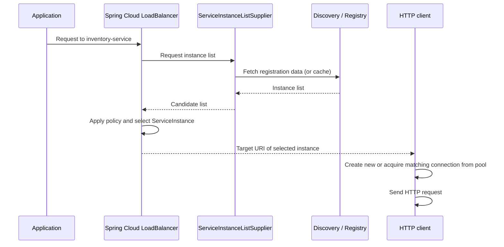

# ServiceInstance and the Information Used to Choose a Target

In a Spring Cloud system, a service often has multiple replicas running on different machines or containers. An application calls a service by a logical name such as `inventory-service`; Spring Cloud LoadBalancer needs to know which replicas can receive requests and the specific address of each replica. `ServiceInstance` is the Spring Cloud model used to represent such a replica.

Reading the information in `ServiceInstance` properly helps distinguish the service name from the instance address, understand which data is used to send requests versus which data only serves routing policies, and see how to inspect why LoadBalancer selects a specific target.

## 1. Where does ServiceInstance sit in the load-balancing flow?

Suppose the system has two replicas of `inventory-service`:

| Service ID | Instance ID | Host | Port | Zone |
|---|---|---|---:|---|
| `inventory-service` | `inventory-1` | `10.0.1.10` | 8080 | `zone-a` |
| `inventory-service` | `inventory-2` | `10.0.1.11` | 8080 | `zone-b` |

The application only needs to send requests to a logical URL:

```text
http://inventory-service/api/items/42
```

`inventory-service` is the service ID. Each row in the table is a `ServiceInstance` with its own endpoint. The overall processing flow is:

1. The HTTP client sends a request containing the service ID.
2. Spring Cloud LoadBalancer retrieves the list of `ServiceInstance`s through `ServiceInstanceListSupplier`.
3. Configured suppliers or policies may filter the list, for example removing unhealthy instances or preferring a nearby zone.
4. LoadBalancer chooses an instance from the candidate list.
5. The logical URL is transformed into a URI pointing to the host and port of the chosen instance; the HTTP client sends the request to that URI.



`ServiceInstance` is data describing a callable target. It is not a TCP connection, does not represent a request, and does not itself confirm that the application on that instance is healthy at the current moment.

## 2. Information fields of ServiceInstance

In Spring Cloud Commons, `org.springframework.cloud.client.ServiceInstance` defines the common contract for discovery implementations to provide instance information. Commonly used methods include:

| Method | Returned information | Role |
|---|---|---|
| `getServiceId()` | Logical name of the service | Identifies which service the instance belongs to |
| `getInstanceId()` | Instance identifier if provided by the implementation | Distinguishes registrations of the same service; may have no value |
| `getHost()` | Host or IP address | Host component of the endpoint |
| `getPort()` | Service port | Port component of the endpoint |
| `isSecure()` | Whether the endpoint uses a secure connection | Indicates a secure scheme such as HTTPS when building the URI |
| `getUri()` | URI of the instance | Represents the address with scheme, host, and port |
| `getMetadata()` | Map of string key/value pairs | Carries additional information for filters or routing policies |

`getInstanceId()` depends on the capabilities of the discovery implementation; you should not assume every registry provides a stable or permanently unique ID. If you need to identify a specific registration, clearly determine the ID convention of the registry in use.

### 2.1. Service ID and instance ID

The two ID types answer two different questions:

- **Service ID:** which logical service group does the application want to call? For example, `inventory-service`.
- **Instance ID:** which specific registration or replica is being described? For example, `inventory-1`.

One service ID can map to many instance IDs. When a container is replaced, the instance ID may change even though the service ID stays the same. Therefore, URLs in application code typically use the service ID; host, port, and instance ID are resolved at runtime.

### 2.2. Host, port, secure, and URI

Host and port identify the specific network endpoint. The host can be an IP address or a hostname resolvable in the runtime environment. The port is the port the instance advertises to clients.

`isSecure()` indicates whether the endpoint uses a secure connection. `getUri()` provides the instance URI, usually combining the scheme with the host and port. You should use the URI provided by `ServiceInstance` or LoadBalancer's URI reconstruction mechanism instead of manually concatenating address strings; manual concatenation easily gets the scheme, IPv6, or port wrong.

Example of two instances with the same service ID but different endpoints:

```text
inventory-service
  ├── http://10.0.1.10:8080  (inventory-1)
  └── https://inventory-2.internal:8443 (inventory-2)
```

In this example, the second instance uses HTTPS and an internal hostname. The client still calls the service by its logical name; the target URI is determined after choosing an instance.

### 2.3. Metadata

`getMetadata()` returns a string key/value map containing additional information provided by the registry or during instance registration. Some metadata can be used for routing:

```json
{
  "serviceId": "inventory-service",
  "instanceId": "inventory-1",
  "host": "10.0.1.10",
  "port": 8080,
  "secure": false,
  "metadata": {
    "zone": "zone-a",
    "region": "ap-southeast-1",
    "version": "v2",
    "traffic": "canary"
  }
}
```

Keys like `zone`, `region`, `version`, and `traffic` in the example are conventions chosen by the system; not all of them are standard fields of `ServiceInstance`. Different registries declare and propagate metadata differently. Applications must agree on key names, value types, and update behavior between where the instance is registered and where metadata is read.

Metadata is suitable for small, relatively stable routing data such as zone, version, or capability group. Do not put passwords, tokens, private keys, or personal data into metadata because this information may be stored in the registry and appear in logs or administration tools.

## 3. Where does Discovery create ServiceInstance from?

Spring Cloud LoadBalancer does not discover containers itself by scanning the network. It receives the instance list through `ServiceInstanceListSupplier`. A supplier can obtain data from a discovery client, static configuration, or another list source.

Some common sources:

| Source | How instance information is obtained | Points to note |
|---|---|---|
| Eureka | Clients register service ID, address, port, and metadata with Eureka Server | Registration status and heartbeats affect the returned instance list |
| Consul | Services register endpoints and metadata with Consul | Need to understand health checks and service passing status |
| Kubernetes | Service and EndpointSlice provide workload endpoint information | Addresses and ports can change when Pods are recreated |
| SimpleDiscoveryClient | Instance list is declared via application configuration | Suitable for simple environments or testing; data usually requires manual updates |

Discovery implementations convert registry data into `ServiceInstance` objects. You should not assume all registries share the same rules for instance ID, metadata, hostname, or health status. Check the adapter and configuration of the registry you are using if a field does not have the expected value.

For example, a registry may return an instance whose host is the current Pod address. When the Pod is replaced, the registry updates the endpoint; the service ID remains `inventory-service`, but the host or instance ID may change. The client needs to obtain the new instance list according to the supplier's refresh/cache mechanism.

## 4. Which information does LoadBalancer use to choose a target?

Not every field plays the same role. The information can be divided into three groups:

| Information group | Typical fields | How it is used |
|---|---|---|
| Identifying target group | `serviceId` | Retrieves the instance list of the right service |
| Address to connect to | `host`, `port`, `isSecure`, `uri` | Builds the endpoint after an instance is selected |
| Selection context | `instanceId`, `metadata` | Filtering, prioritizing, grouping, observability, or applying custom policies |

LoadBalancer needs a candidate list before making a selection. In a common configuration, `ServiceInstanceListSupplier` provides the list; chained suppliers can add caching, zone filtering, or health checks. Then, `ReactorServiceInstanceLoadBalancer` or the corresponding implementation selects one element.

### 4.1. Default policies do not automatically understand all metadata

`RoundRobinLoadBalancer` is a common default choice: requests take turns selecting the next instance in the candidate list. Spring Cloud also has a random-selection implementation. Round-robin or random policies do not automatically turn `weight`, `version`, or `traffic` metadata into routing rules.

For example, if the list has three instances and there is no filtering step, round-robin distributes selections across elements in list order. If you want to send requests only to `version=v2`, prefer `zone-a`, or distribute by weight, you need to configure a supplier or custom LoadBalancer to read the metadata and apply that rule.

### 4.2. Filtering or prioritizing by metadata

Suppose the application runs in `zone-a` and wants to prefer instances in the same zone. The following snippet illustrates how to produce a prioritized candidate list:

```java
static List<ServiceInstance> preferZone(
        List<ServiceInstance> instances,
        String preferredZone) {

    List<ServiceInstance> preferred = instances.stream()
            .filter(instance -> {
                Map<String, String> metadata = instance.getMetadata();
                return metadata != null
                        && preferredZone.equals(metadata.get("zone"));
            })
            .toList();

    return preferred.isEmpty() ? instances : preferred;
}
```

The function above keeps the full list if there are no instances in the preferred zone, avoiding service unavailability merely due to missing metadata. This is an illustrative function for the filtering step; in a real application, integrate the rule into a `ServiceInstanceListSupplier` or a custom LoadBalancer so all requests share the same policy.

If the requirement is to allow only a specific version, the fallback may need to be different: when no matching instance exists, the system should return an error or reject the request rather than silently routing to another version. The fallback decision depends on API and data compatibility requirements.

### 4.3. Health checks and metadata are two different mechanisms

Metadata describes attributes of an instance, such as belonging to `zone-a` or running `v2`. Metadata like `status=healthy` is only registration data; it can be stale if the registry has not been updated.

Health checks verify serving capability through a separate mechanism. Spring Cloud LoadBalancer has `HealthCheckServiceInstanceListSupplier` to check instances and exclude unhealthy instances from the supplied list. Exact configuration depends on the client type, Spring Cloud version, and the application's health endpoint.

In real deployments:

- Use an appropriate readiness/health endpoint to determine whether an instance should receive traffic.
- Choose a check interval and timeout short enough to remove failing instances promptly, while avoiding excessive probe load.
- Distinguish registration status in the registry from the health check results observed by the client.
- When a new instance starts up, avoid adding it to the traffic-receiving list before the application is ready.

Health checks do not replace request timeouts. An instance may be healthy at the most recent check and fail right afterward; the client still needs timeouts and error handling when sending requests.

## 5. Example of reading and using ServiceInstance

When low-level selection needs to be observed, an application can use `LoadBalancerClient` to request selecting an instance by service ID:

```java
@Service
class InventoryInstanceInspector {

    private final LoadBalancerClient loadBalancerClient;

    InventoryInstanceInspector(LoadBalancerClient loadBalancerClient) {
        this.loadBalancerClient = loadBalancerClient;
    }

    URI chooseTargetUri() {
        String serviceId = "inventory-service";
        ServiceInstance instance = loadBalancerClient.choose(serviceId);

        if (instance == null) {
            throw new IllegalStateException(
                    "No instance available for " + serviceId);
        }

        URI logicalUri = URI.create(
                "http://inventory-service/api/items/42");

        return loadBalancerClient.reconstructURI(instance, logicalUri);
    }
}
```

`choose(serviceId)` returns the selected instance or `null` if no suitable instance is available. `reconstructURI` uses the instance information to replace the logical URI's authority with the actual endpoint while preserving the request's path and query. This example is for understanding the mechanism and aiding diagnostics; typical applications should let a `@LoadBalanced` HTTP client handle selection and URI reconstruction on each call.

Example configuring `RestClient` with a LoadBalancer-enabled builder:

```java
@Configuration
class InventoryHttpConfiguration {

    @Bean
    @LoadBalanced
    RestClient.Builder loadBalancedRestClientBuilder() {
        return RestClient.builder();
    }
}
```

Using the service ID in the URL:

```java
@Service
class InventoryGateway {
    private final RestClient restClient;

    InventoryGateway(@LoadBalanced RestClient.Builder builder) {
        this.restClient = builder.build();
    }

    Item findItem(long id) {
        return restClient.get()
                .uri("http://inventory-service/api/items/{id}", id)
                .retrieve()
                .body(Item.class);
    }
}
```

In this case, business code only knows the service ID. Spring Cloud LoadBalancer selects the instance; the HTTP client uses the concrete endpoint to execute the request. TCP/TLS and connection pool management remain the HTTP client's responsibility.

## 6. Designing metadata for routing policies

Metadata is only useful when both the registering side and the routing side agree on its meaning. A simple convention might look like this:

| Key | Example value | Applicable policy |
|---|---|---|
| `zone` | `zone-a` | Prefer instances in the same deployment zone |
| `region` | `ap-southeast-1` | Restrict requests from crossing to another geographic region |
| `version` | `v2` | Select a version compatible with the caller |
| `traffic` | `stable`, `canary` | Control which instance group receives experimental traffic |
| `capability` | `read`, `write` | Choose instances capable of handling the request type |
| `weight` | `10` | Input for a custom weighted routing algorithm |

The keys above are design examples, not a mandatory key set or supported identically by every discovery provider. If using `weight`, you must clearly define the value domain, how missing/invalid values are handled, and how weights are normalized. Default round-robin does not read `weight` to distribute proportionally.

Some principles to make metadata easier to operate:

1. Use consistent key names between registering services and calling services; consider a prefix like `routing.zone` if multiple teams extend metadata together.
2. Use values from a clearly defined set, such as `stable` or `canary`, avoiding multiple spellings for the same meaning.
3. Define behavior when metadata is missing: ignore the criterion, use a fallback, or reject the request.
4. Keep metadata small and do not use it as a dynamic configuration store with high update frequency.
5. When changing metadata, ensure the registry and supplier cache update within an acceptable time.
6. Do not treat metadata as authentication proof or a security boundary; the caller must still authenticate and authorize at the application layer.

## 7. Common errors when reading or using ServiceInstance

| Symptom | Possible cause | How to check |
|---|---|---|
| No instance selected | Registry has no instances, wrong service ID, or supplier returns an empty list | Check the service ID, registration data, and the list returned by the supplier |
| Target URI has wrong host or port | Registry advertises an address unreachable from the caller, or host/port mapping is wrong | Check `getHost()`, `getPort()`, `getUri()`, and network connectivity from the caller |
| Request uses HTTP when HTTPS is needed | Secure field or scheme was registered incorrectly | Check `isSecure()`, the URI, and the instance's TLS configuration |
| Cannot filter by zone/version | Missing metadata, key case mismatch, or supplier has not applied the policy | Log relevant metadata and check supplier ordering |
| Stopped instance is still selected | Registry/cache not yet updated or health check has not excluded the instance | Check TTL/cache, heartbeat, health endpoint, and refresh interval |
| Canary traffic ratio is inaccurate | `traffic` or `weight` metadata is registered without an algorithm using it | Check the custom LoadBalancer and actual per-instance request statistics |
| Instance ID changes after every deployment | Instance is recreated or registry uses an ID tied to address/container | Check instance ID generation rules; do not use ephemeral IDs as long-lived business keys |

When investigating, log structured fields including service ID, instance ID (if present), host, port, secure, and permitted routing metadata. Avoid logging all metadata if the registry may contain internal information or sensitive data.

## 8. Hands-on practice: observing instance selection

You can use two instances of `inventory-service` to test each part of the model:

1. Register two instances with different host/port values and the same service ID.
2. Read the instance list provided by the discovery client; compare service ID, host, port, secure, and metadata.
3. Send multiple requests through an HTTP client with `@LoadBalanced`; record which instance receives each request.
4. Add `zone` metadata to each instance and implement a zone-preference filter in a supplier or custom LoadBalancer.
5. Stop an instance or fail its readiness check; observe how long it takes for the instance to be removed from the candidate list.
6. Update metadata or replace an instance in the registry; track how long the cache/supplier takes to reflect the new data.

When analyzing results, separate three events: whether the registry records the instance, whether the supplier includes the instance in the candidate list, and whether LoadBalancer selects that instance for a specific request. These three timings can differ due to caching, health checks, and filtering policies.

## 9. Principles for use in production systems

- Use the service ID as the target name in business code; let discovery supply concrete instances.
- Treat `ServiceInstance` as an endpoint description at selection time; do not hold onto an instance object indefinitely as a fixed address.
- Use host, port, secure, and URI to determine the connection target; use instance ID for observability and correlation when needed.
- Only use metadata when a policy is in place to read and apply it. Registering `zone`, `version`, or `weight` alone does not change the default algorithm.
- Combine registry state with appropriate health checks/readiness to reduce the chance of selecting an unservable instance.
- Define fallback behavior when metadata is missing or no suitable candidate exists.
- Monitor the list from the supplier and the selected instance to diagnose routing issues.

Once you distinguish service ID, instance ID, endpoint, and metadata, you can accurately understand the input data of Spring Cloud LoadBalancer, design appropriate target selection policies, and handle instance changes during operations more effectively.
