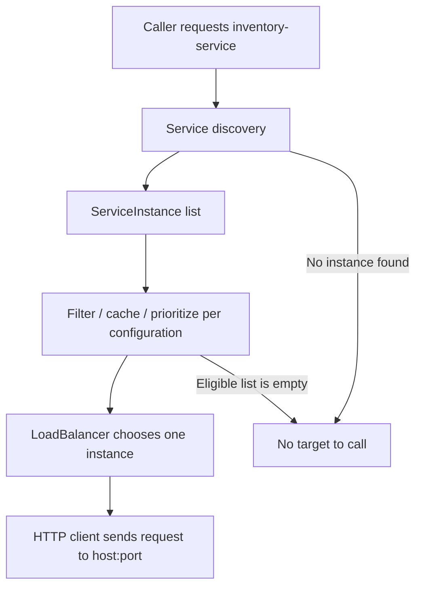
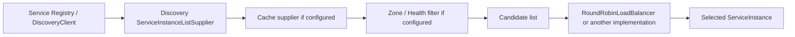

# The Boundary Between Service Discovery and Instance Selection

In a microservices system, `order-service` may need to call `inventory-service` running across multiple machines or containers. To send a request, the calling side needs to know which replicas are published and must select a specific replica for the current request.

These two tasks are closely related yet carry different responsibilities:

- **Service discovery** finds the list of instances known under a service ID.
- **Instance selection** chooses one instance from that list to receive the request.

Spring Cloud separates these two responsibilities through abstractions such as `DiscoveryClient`, `ServiceInstanceListSupplier`, and `ReactorLoadBalancer`. Understanding this boundary clearly helps identify whether a fault lies in the registry, instance data, list filters, or the selection algorithm.

## 1. From a service ID to a specific instance

Suppose `inventory-service` has three replicas:

| Service ID | Instance | Address |
| --- | --- | --- |
| `inventory-service` | Instance A | `10.0.1.11:8080` |
| `inventory-service` | Instance B | `10.0.1.12:8080` |
| `inventory-service` | Instance C | `10.0.1.13:8080` |

`order-service` specifies the service to call by logical name:

```text
http://inventory-service/api/stocks/BOOK-001
```

The service ID `inventory-service` identifies the target service group. It does not yet determine whether the request will go to A, B, or C. To send the request, the client needs a `ServiceInstance` containing the physical address of one replica.

Overall flow:



The result of discovery is a candidate set. The result of selection is one specific element from that candidate set. If only one valid instance exists, the chooser still performs selection, though the outcome can only be that sole instance.

## 2. What does service discovery do?

Service discovery provides the ability to look up instances by service ID. In a registry-based model, instances typically register their information at startup and update their status throughout their lifetime. Registration data can include service ID, host, port, security state, and metadata.

For example, when a replica of `inventory-service` starts up, it registers address `10.0.1.12:8080`. When the replica shuts down gracefully, it can deregister. Some registries also use heartbeats or leases to detect instances that stop updating their status. How registration, dead-instance detection, and update timing work depends on the discovery technology and system configuration.

In Spring Cloud, `DiscoveryClient` is the abstraction for an application to look up services. Example:

```java
import java.util.List;

import org.springframework.cloud.client.ServiceInstance;
import org.springframework.cloud.client.discovery.DiscoveryClient;
import org.springframework.stereotype.Component;

@Component
class InventoryDiscoveryInspector {

    private final DiscoveryClient discoveryClient;

    InventoryDiscoveryInspector(DiscoveryClient discoveryClient) {
        this.discoveryClient = discoveryClient;
    }

    List<ServiceInstance> findInventoryInstances() {
        return discoveryClient.getInstances("inventory-service");
    }
}
```

The snippet above only illustrates a lookup operation for observing the list. It does not perform load balancing itself. If the caller fetches this list and picks an element with its own code, the caller has taken on the selection responsibility as well and must solve issues such as distribution, filtering, caching, concurrency, and retries itself.

Discovery does not necessarily have to be a remote registry either. Spring Cloud can obtain instances from other sources, such as a static configuration list in certain deployments. What matters is having a source that supplies `ServiceInstance`s for a service ID.

## 3. ServiceInstance represents a replica

`ServiceInstance` is the abstraction describing a concrete instance. Commonly used information includes:

| Field | Meaning |
| --- | --- |
| `serviceId` | Name of the service the instance belongs to |
| `host` | Host or network address of the instance |
| `port` | Port on which the instance accepts connections |
| `secure` | Indicates whether the instance uses a secure connection per instance info |
| `uri` | URI constructed from the instance's connection info |
| `metadata` | Additional attributes supplied by the discovery source |
| `instanceId` | Instance identifier if supported by the implementation |

For example, three instances can be represented by distinct objects that all belong to the service ID `inventory-service`:

```text
ServiceInstance A
  serviceId = inventory-service
  host      = 10.0.1.11
  port      = 8080

ServiceInstance B
  serviceId = inventory-service
  host      = 10.0.1.12
  port      = 8080

ServiceInstance C
  serviceId = inventory-service
  host      = 10.0.1.13
  port      = 8080
```

Metadata can hold zone, application version, or custom system labels. LoadBalancer does not automatically interpret arbitrary metadata; to use metadata for filtering or routing, the application must configure a matching supplier or selection algorithm.

## 4. How does Spring Cloud LoadBalancer select an instance?

Spring Cloud LoadBalancer performs selection based on the supplied instance list. Responsibilities can be pictured across three components:

1. `ServiceInstanceListSupplier` provides the `ServiceInstance` list for a service ID. The supplier can pull the list from a discovery client or another source while combining configured caching and filters.
2. `ReactorLoadBalancer` receives the candidate list and decides which instance is selected for the request. Different implementations can apply different algorithms.
3. The HTTP client or LoadBalancer client uses the chosen instance to build the target address and send the request.

In Spring Cloud LoadBalancer integrations, selection is usually performed automatically when the client is configured as load-balanced, such as `RestClient.Builder` or `WebClient.Builder` with `@LoadBalanced`, or OpenFeign using a service name. Applications do not need to call `DiscoveryClient` and manually pick a replica in every business method.

### 4.1. Example selecting an instance via LoadBalancerClient

Spring Cloud Commons provides `LoadBalancerClient` for synchronous invocation styles. The example below illustrates the boundary between selection and target addressing:

```java
import java.net.URI;

import org.springframework.cloud.client.ServiceInstance;
import org.springframework.cloud.client.loadbalancer.LoadBalancerClient;
import org.springframework.stereotype.Component;

@Component
class InventoryInstanceChooser {

    private final LoadBalancerClient loadBalancerClient;

    InventoryInstanceChooser(LoadBalancerClient loadBalancerClient) {
        this.loadBalancerClient = loadBalancerClient;
    }

    URI chooseInventoryUri() {
        ServiceInstance instance =
                loadBalancerClient.choose("inventory-service");

        if (instance == null) {
            throw new IllegalStateException(
                    "No instance available for inventory-service");
        }

        URI logicalUri = URI.create(
                "http://inventory-service/api/stocks/BOOK-001");

        return loadBalancerClient.reconstructURI(instance, logicalUri);
    }
}
```

`choose("inventory-service")` asks LoadBalancer to select an instance according to configuration. `reconstructURI(...)` builds the target URI using the selected instance's info. This example is for understanding the API and inspecting selection results; in production applications already using an `@LoadBalanced` HTTP client, let the built-in interceptor handle instance selection and URI translation.

### 4.2. Round Robin is a selection algorithm, not discovery

`RoundRobinLoadBalancer` is the commonly used default implementation in Spring Cloud LoadBalancer. Given a stable list containing A, B, and C, consecutive selections from the same chooser can produce the sequence:

| Selection | Instance |
| --- | --- |
| 1 | A |
| 2 | B |
| 3 | C |
| 4 | A |
| 5 | B |
| 6 | C |

Round Robin only determines the next element in the list it receives. It does not register instances, query the registry to see which services exist, or verify by itself that the application inside an instance is processing business requests healthily.

Do not treat the table above as a guarantee of globally equal distribution across the entire system. Selection state is scoped per LoadBalancer instance/context on the caller side; multiple callers may have their own selection sequences. Processing time, concurrent request counts, and instance counts at any given moment can also differ.

Spring Cloud LoadBalancer also allows changing the implementation or configuring per service. Using a random algorithm or a custom algorithm remains a selection concern; the instance data source is still provided by the supplier.

## 5. ServiceInstanceListSupplier is an important boundary

`ServiceInstanceListSupplier` sits between the instance source and the selection algorithm. It supplies the candidate list to LoadBalancer and can be composed into a supplier chain to add behaviors.

Several behaviors can be configured in the supplier chain:

- **Fetching data from discovery:** the supplier uses `DiscoveryClient` or a reactive discovery client to obtain the instance list.
- **Caching the list:** reduces queries to the discovery source, at the trade-off that data may be stale for a period of time.
- **Zone filtering:** prefers instances in the same deployment zone when the application provides zone info and configures the appropriate supplier.
- **Health checks:** actively probes instances and filters out instances failing health conditions when using the corresponding health-check supplier.
- **Custom filtering or ordering:** applies metadata, versions, or system-specific policies.

Not every application enables all of these behaviors. The actual configuration determines the final list seen by the selection algorithm.

Example of how the layers can chain together:



An easy-to-miss point: the discovery client might return three instances, while the supplier after caching or filtering might pass only two instances to LoadBalancer. Therefore, when investigating why a replica is not chosen, check both the raw list from discovery and the list after the suppliers.

## 6. Health checks are not equivalent to service discovery

Discovery tells you which instances are published by the discovery source. Depending on the registry, that list may rely on registrations, heartbeats, leases, or platform-updated status. This differs from actively sending probes to each instance's health endpoint.

Spring Cloud LoadBalancer can be configured with a health-check supplier to probe instances and exclude unresponsive ones. This is an additional step while building the candidate list, not a default property you can assume in every application.

Three states must be distinguished:

1. **Registered:** the registry knows the instance and can return it in discovery results.
2. **Accepted by the supplier:** the instance remains in the list after caching and configured filters.
3. **Able to serve the request at send time:** connecting to the instance actually succeeds and the application can process the request.

These three states are not equivalent. An instance may be registered yet no longer listening; health checks may not have run yet or may not have detected it in time; an instance passing a probe can still fail immediately afterward. Health checks reduce the likelihood of picking a failing replica but do not offer an absolute guarantee.

## 7. Caching and freshness of the instance list

Applications do not have to query the registry from scratch on every request. The supplier can cache the instance list to reduce latency and load on the registry. Some discovery clients also maintain their own caches.

Caching improves performance but introduces update lag:

- A new instance may not appear yet in the list a caller uses.
- A stopped instance may remain in the cache for some time.
- An instance whose address just changed may not be visible to all callers at the same time.

Cache duration should be chosen based on topology update requirements, registry load, and the system's tolerance for stale data. Setting TTL too low can increase discovery queries; setting TTL too high can prolong the time callers keep seeing failed instances.

When a newly added replica receives no requests, check in sequence: whether the replica has registered, whether the discovery client sees it, whether the supplier cache has refreshed, whether filters exclude that replica, and whether the selection algorithm is picking from a list containing that replica.

## 8. Comparing responsibilities by component

| Component | Question it answers | What it is NOT primarily responsible for |
| --- | --- | --- |
| Service registry | Which instances are registered and what is their registration state? | Choosing a replica for each caller request |
| `DiscoveryClient` | How to look up instances by service ID? | Deciding which instance the next request goes to |
| `ServiceInstanceListSupplier` | Which candidate list is supplied to LoadBalancer? | Sending HTTP requests to the target application |
| `ReactorLoadBalancer` | Which instance is selected from the candidate list? | Registering/deregistering instances in the registry |
| HTTP client / LoadBalancer client | How to send the request to the chosen instance's URI? | Managing the lifecycle of the service registry |

A request can fail at any boundary. Having no instances from discovery is a data-source or registration issue. Having instances in discovery while the supplier returns an empty list is a cache/filter/health-check issue. Having a chosen instance while connection fails is an address, network, TLS, or process-state issue. Once an HTTP response arrives, analyze the status and business result.

## 9. Inspection procedure when a replica is not selected

Suppose you expect A, B, and C to all receive requests, yet observe only A and B being called. You can inspect in order:

1. Confirm C has started and registered under the correct service ID.
2. Use the discovery client or registry tooling to confirm the raw list includes C.
3. Inspect the list supplied by `ServiceInstanceListSupplier` after caching and filtering.
4. Check whether zone, health checks, and metadata cause C to be excluded or deprioritized.
5. Confirm which LoadBalancer algorithm is configured for the service ID and understand the scope of its selection state.
6. Record the actual instance selected on each request rather than inferring solely from server-side request counts.

During inspection, log the service ID, instance ID, host, port, necessary zone/metadata, timestamp, and trace ID. Do not log sensitive information in metadata or logs. For caching, log when the list was refreshed if possible so you can compare against when the replica registered or stopped.

## 10. End-to-end example: discovery finds three replicas, LoadBalancer picks one

Suppose the registry returns:

```text
inventory-service
  - 10.0.1.11:8080 (zone-a)
  - 10.0.1.12:8080 (zone-a)
  - 10.0.2.21:8080 (zone-b)
```

The supplier receives this list and may apply caching or zone preference depending on configuration. If the final candidate list still includes all three instances, `RoundRobinLoadBalancer` selects one instance in the chooser's round-robin order. The HTTP client sends the request to the selected instance's host and port.

If configured to prefer `zone-a` while the caller is in `zone-a`, the supplier may provide a prioritized list containing only the two instances in `zone-a`. In that case, the Round Robin algorithm chooses only from the list supplied by the supplier. Discovery still found all three; the change occurred at the candidate-list preparation step.

If instance `10.0.1.12:8080` stops working while the registry has not updated yet, it may still appear in the list. Caching or health checks affect how long it takes for that instance to be removed from the candidate list. This is why observing each layer matters instead of looking only at the Round Robin algorithm.

## 11. Self-check questions

1. What result does service discovery return when queried for `inventory-service`?
2. Why does calling `DiscoveryClient.getInstances(...)` not mean requests are already load balanced?
3. Where does `ServiceInstanceListSupplier` sit in the flow, and what behaviors can it add?
4. If the registry has three instances while the supplier provides only two, from which list will the Round Robin algorithm choose?
5. Why can an instance that is registered and passes health checks still fail when a real request is sent?
6. When a replica receives no requests, which layers will you check before concluding Round Robin is broken?

Remember the responsibility boundary: discovery finds instances by service ID; the supplier prepares the candidate list; LoadBalancer selects an instance; the HTTP client sends the request to that instance's real address. Separating these four steps makes designing and diagnosing client-side load balancing clearer.
