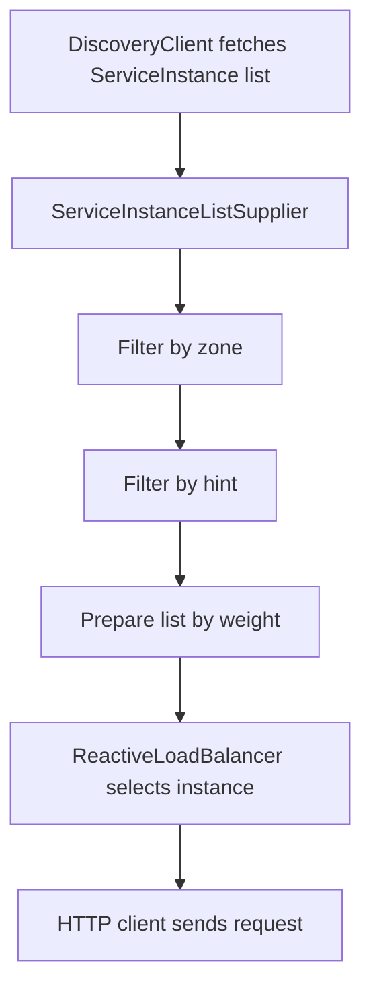

# Instance Metadata: Zone, Weight, and Routing Hints

## Objectives

When a service has multiple replicas (service instances), each replica may run in a different deployment zone, have different processing capacity, or serve a dedicated group of requests. With only an address list, a load balancer lacks enough information to prioritize instances suited to the request's location and purpose.

Spring Cloud LoadBalancer can use `ServiceInstance` metadata to filter or adjust the candidate list. This lesson focuses on three commonly used attributes:

- `zone`: deployment zone of the instance, used to prefer instances close to the caller.
- `weight`: relative weight, used to distribute requests according to capacity or desired ratios.
- `hint`: routing hint label, used to prioritize a group of instances based on request type.

After this lesson, you will be able to identify where metadata comes from, configure corresponding suppliers, combine multiple filters, and verify fallback behavior when no instance matches the criteria.

## 1. Where does metadata sit in the LoadBalancer model?

`ServiceInstance` represents a concrete deployment replica of a service. Beyond service ID, host, port, scheme, and security status, this object also contains metadata in the form of `Map<String, String>`. Metadata is typically registered alongside the instance in the service registry and mapped into `ServiceInstance` metadata by the discovery client.

For example, `inventory-service` has three replicas:

| Instance | Address | `zone` | `weight` | `hint` |
|---|---|---|---:|---|
| inventory-1 | `10.0.1.11:8080` | `zone-a` | `3` | `stable` |
| inventory-2 | `10.0.1.12:8080` | `zone-a` | `1` | `stable` |
| inventory-3 | `10.0.2.21:8080` | `zone-b` | `1` | `canary` |

These values are only examples. The service registry, deployment platform, or discovery configuration must actually provide that metadata; Spring Cloud LoadBalancer does not infer zone, weight, or canary labels from machine IPs on its own.

Metadata only takes effect when the corresponding `ServiceInstanceListSupplier` is configured. For example, adding `weight: "3"` in the registry while still using the default supplier does not automatically enable weighted load balancing. Similarly, the `zone` attribute does not automatically activate zone filtering without a zone-preference supplier.

Overall processing flow:



In a real configuration, suppliers can be chained as delegates. Each supplier performs one step on the list supplied by the preceding supplier.

## 2. Declaring metadata for a service instance

Metadata depends on the discovery implementation. With Eureka, metadata for the registering application can be declared via `eureka.instance.metadata-map`:

```yaml
eureka:
  instance:
    metadata-map:
      zone: zone-a
      weight: "3"
      hint: stable
```

A replica running in another zone or belonging to a canary group can register different metadata:

```yaml
eureka:
  instance:
    metadata-map:
      zone: zone-b
      weight: "1"
      hint: canary
```

`metadata-map` is configuration for each application registering with Eureka. Therefore, each group of instances needs values matching its deployment environment. In Kubernetes or Consul, metadata may come from their respective registration configurations; what matters is that the discovery client populates the required entries into `ServiceInstance.getMetadata()`.

The metadata map stores string values. For `weight`, enter a positive integer as a string, such as `"3"`. For `zone` and `hint`, standardize spelling between the registering side and caller-side configuration; avoid having instances in the same zone use different zone names due to typos or inconsistent conventions.

## 3. Zone-preferred routing

### 3.1. How does zone preference work?

Zone-based load balancing prefers instances in the same zone as the calling application. The goal is to reduce latency, cross-zone traffic, and data transfer costs across availability zones or data centers.

`ZonePreferenceServiceInstanceListSupplier` reads the caller's zone and the `zone` field in the `ServiceInstance` metadata. The supplier filters the list to keep instances in the same zone. If the caller's zone is not specified or no instance exists in that zone, the supplier returns the full list received from its delegate. This is a zone-preference mechanism, not a strict constraint forcing every request to stay in the same zone.

With Eureka, the discovery client integrates to read the zone from the calling instance's metadata configuration, such as `eureka.instance.metadata-map.zone`. With other discovery clients, you can set the zone explicitly using `spring.cloud.loadbalancer.zone`.

For example, when the calling application is in `zone-a`:

```yaml
spring:
  cloud:
    loadbalancer:
      zone: zone-a
      configurations: zone-preference
```

Instances `inventory-1` and `inventory-2` in `zone-a` will be preferred. The instance in `zone-b` can still become a candidate when no same-zone instance is available.

`zone-preference` is a built-in configuration for using `ZonePreferenceServiceInstanceListSupplier` with caching. If you need per-service-ID configuration or want to combine multiple policies, declare a supplier via `@LoadBalancerClient` as shown in Section 6.

### 3.2. When should you use zone preference?

Zone preference is useful when:

- Instances of the same service are deployed across multiple availability zones.
- Both caller and callee can determine their zones consistently.
- Cross-zone cost or latency is high enough that same-zone preference brings tangible benefits.
- The system still needs the ability to fall back to another zone when the local zone has no available instances.

Do not enable zone preference if zone metadata is incomplete or the caller's zone is undefined. In that situation, the supplier may return all instances and the policy fails to produce the expected effect. Also monitor the cross-zone request ratio to confirm that preference is actually working.

## 4. Distribution by weight

### 4.1. What does weight represent?

Weight represents the relative priority among instances. It can express relative serving capacity, desired traffic split, or an instance's participation level during a rollout phase.

Spring Cloud LoadBalancer provides `WeightedServiceInstanceListSupplier`. By default, the supplier reads and parses the value at metadata key `weight`. If an instance lacks this field, the default weight is `1`.

Example:

| Instance | Weight | Distribution meaning |
|---|---:|---|
| inventory-1 | 3 | Receives more distributed requests |
| inventory-2 | 1 | Receives a lower share |

With the two instances above, the weight ratio is 3:1. Over a sufficiently large number of requests, the first instance receives roughly three times as many requests as the second. This is a statistical ratio, not a guarantee that out of every four requests exactly three hit the first instance.

Weight is not a measure of CPU load or active in-flight requests. If you want weights to reflect current capacity, the system needs a process to update metadata or provide a custom `WeightFunction`. Setting a static weight of `3` does not make LoadBalancer monitor CPU and adjust it automatically.

### 4.2. Enabling weighted load balancing

You can enable the built-in configuration:

```yaml
spring:
  cloud:
    loadbalancer:
      configurations: weighted
```

Or create the supplier yourself via the builder:

```java
import org.springframework.cloud.loadbalancer.core.ServiceInstanceListSupplier;
import org.springframework.context.ConfigurableApplicationContext;
import org.springframework.context.annotation.Bean;

class WeightedLoadBalancerConfiguration {

    @Bean
    ServiceInstanceListSupplier weightedServiceInstanceListSupplier(
            ConfigurableApplicationContext context) {
        return ServiceInstanceListSupplier.builder()
                .withDiscoveryClient()
                .withCaching()
                .withWeighted()
                .build(context);
    }
}
```

In a custom configuration, `withWeighted()` adds `WeightedServiceInstanceListSupplier` to the supplier chain. You can pass a `WeightFunction` to compute weights using application rules rather than only reading the default metadata.

Illustrative example providing a custom weight-calculation function:

```java
return ServiceInstanceListSupplier.builder()
        .withDiscoveryClient()
        .withCaching()
        .withWeighted(instance -> {
            String value = instance.getMetadata().get("weight");
            return value == null ? 1 : Integer.parseInt(value);
        })
        .build(context);
```

This is only a simple metadata-reading example. In a real application, validate input data, handle malformed values, and decide how invalid weights should be handled before deploying.

### 4.3. When should you use weight?

Weight fits situations where instances have different resource specs, when rolling out a new instance group with a small fraction of traffic, or when traffic shares must be controlled according to measured capacity.

If the goal is a canary release, you can assign a low weight to the new instance group. However, weight only adjusts selection proportions within the candidate list; it does not replace data compatibility checks, error monitoring, or rollback mechanisms. When a canary instance has errors, you need health checks, metrics, and a procedure to remove it from the registry or candidate list.

## 5. Routing by hint

### 5.1. What is a hint?

A hint is a routing cue string carried with a request, such as `stable`, `canary`, `premium`, or `internal`. `HintBasedServiceInstanceListSupplier` uses the hint to filter instances whose `hint` metadata key matches the request's value.

By default, the supplier inspects the `X-SC-LB-Hint` request header. You can change the header name via `spring.cloud.loadbalancer.hint-header-name`. If the request lacks a hint header, the supplier falls back to the hint configured in properties. If no hint is present, the instance list is left unchanged.

Example configuring a default hint and a service-specific hint for `inventory-service`:

```yaml
spring:
  cloud:
    loadbalancer:
      hint:
        default: stable
        inventory-service: canary
```

In this example, `inventory-service` uses `canary` as its dedicated default hint; other service IDs use the `stable` hint unless configured individually.

### 5.2. Enabling hint-based filtering

You can build a supplier with `.withHints()`:

```java
import org.springframework.cloud.loadbalancer.core.ServiceInstanceListSupplier;
import org.springframework.context.ConfigurableApplicationContext;
import org.springframework.context.annotation.Bean;

class HintLoadBalancerConfiguration {

    @Bean
    ServiceInstanceListSupplier hintServiceInstanceListSupplier(
            ConfigurableApplicationContext context) {
        return ServiceInstanceListSupplier.builder()
                .withDiscoveryClient()
                .withCaching()
                .withHints()
                .build(context);
    }
}
```

When a hint needs to be specified for a request, the caller can send the default header:

```java
WebClient client = loadBalancedWebClientBuilder.build();

Mono<InventoryResponse> response = client.get()
        .uri("http://inventory-service/api/inventory/42")
        .header("X-SC-LB-Hint", "canary")
        .retrieve()
        .bodyToMono(InventoryResponse.class);
```

For this request, the supplier looks for instances with metadata `hint: canary`. The hint header is an input to instance selection; ensure the HTTP client is actually integrated with Spring Cloud LoadBalancer and the supplier includes `.withHints()`.

### 5.3. Hint fallback behavior

One point deserves special attention: if no instance has a matching `hint`, `HintBasedServiceInstanceListSupplier` returns the entire instance list from its delegate. It does not return an empty list by default.

Therefore, hints are a routing suggestion or preference mechanism. Never use hints as a security boundary, tenant data isolation, or a guarantee that requests reach only a specific group of instances. If strict isolation is required, implement a strict filtering policy with a custom supplier or separate service IDs and appropriate access controls.

Do not allow external users to send arbitrary hints to steer internal routing unless the application has a control policy. You can accept only an allowlisted set of values, or let an internal gateway/service decide the hint after authenticating the request.

## 6. Combining zone, weight, and hint

A service may need multiple policies simultaneously. For example, `inventory-service` wants to prefer same-zone instances, then filter by hint, and distribute by weight among the remaining group.

Spring Cloud LoadBalancer lets you build a supplier chain with `ServiceInstanceListSupplier.builder()`. Example dedicated configuration for `inventory-service`:

```java
import org.springframework.cloud.loadbalancer.core.ServiceInstanceListSupplier;
import org.springframework.context.ConfigurableApplicationContext;
import org.springframework.context.annotation.Bean;
import org.springframework.context.annotation.Configuration;
import org.springframework.cloud.loadbalancer.annotation.LoadBalancerClient;

@Configuration
@LoadBalancerClient(
        value = "inventory-service",
        configuration = InventoryServiceLoadBalancerConfiguration.class
)
class InventoryLoadBalancerClientConfiguration {
}

class InventoryServiceLoadBalancerConfiguration {

    @Bean
    ServiceInstanceListSupplier inventoryServiceInstanceListSupplier(
            ConfigurableApplicationContext context) {
        return ServiceInstanceListSupplier.builder()
                .withDiscoveryClient()
                .withCaching()
                .withZonePreference()
                .withHints()
                .withWeighted()
                .build(context);
    }
}
```

In this example, the supplier fetches instances from discovery, caches the list, applies zone preference and hints, and then adds weight handling. Verify the delegate ordering and actual behavior of the Spring Cloud version in use whenever modifying the supplier chain. The configuration class passed to `@LoadBalancerClient` should reside outside component-scan scope or omit `@Configuration` to avoid being applied as a global application-wide default.

`@LoadBalancerClient` binds the configuration specifically to the `inventory-service` service ID. Other service IDs continue using their own load balancer configurations. This scopes routing policies to a single service rather than altering the behavior of all outbound calls.

### 6.1. Understanding processing order

Suppose the caller is in `zone-a`, the request carries hint `stable`, and the registry returns the three instances from the table at the beginning of the lesson:

1. Discovery returns all three instances.
2. Zone preference retains `inventory-1` and `inventory-2` in `zone-a`.
3. The hint filter keeps instances with `hint: stable`.
4. The weighted supplier uses weights `3` and `1` of the remaining two instances.
5. `ReactiveLoadBalancer` selects one instance from the prepared list.

If no instance exists in `zone-a`, zone preference returns the original list so selection can proceed. If no instance matches the hint, the hint supplier likewise returns the list from its delegate. These fallbacks improve the likelihood of having a callable instance, which also means zone and hint attributes are not hard filters.

If business requirements demand a different policy order—for instance, filtering API version before applying weights—construct the supplier chain in that exact order and write tests for each edge case.

## 7. Metadata and deployment strategies

Metadata helps deploy multiple instance groups under the same service ID:

| Purpose | Suggested metadata | How it is used |
|---|---|---|
| Reduce cross-zone traffic | `zone` | Zone preference supplier |
| Distribute by capacity | `weight` | Weighted supplier |
| Separate stable/canary groups | `hint` | Hint-based supplier |
| Distinguish API versions | `API_VERSION` | Supplier supporting API version-based routing if configured |
| Group instances by custom attributes | Custom metadata | Custom `ServiceInstanceListSupplier` |

Not all metadata has a built-in reader. The keys `zone`, `weight`, and `hint` carry meaning for their respective suppliers. A custom key such as `regionGroup`, `tenantClass`, or `releaseRing` requires a custom supplier or custom routing policy to influence selection.

When using metadata for canary or blue/green deployments:

- Ensure all instances register the right labels before opening traffic.
- Adjust weights in small steps and observe actual request proportions.
- Monitor error rates, latency, and resource usage per instance group.
- Have a mechanism to remove failing instances from discovery or the candidate list.
- Check caching and metadata propagation times during rollouts or rollbacks.
- Do not treat hints as strict traffic isolation if the supplier still falls back to the full instance list.

## 8. Caching and metadata consistency

LoadBalancer can cache the instance list to reduce discovery queries. When an instance's metadata changes in the registry, clients may not see the change immediately due to caching or the discovery provider's refresh cycle.

Several points to check:

- **Metadata source**: verify that the discovery client returns all latest keys and values.
- **Caching**: choose a TTL matched to instance churn rate and rollout requirements. Avoid an overly long TTL if weights or hints change frequently.
- **Double caching**: if the discovery client already caches the list, consider disabling LoadBalancer caching to avoid two cache layers keeping data stale longer than expected.
- **Supplier order**: when configuring manually, place `CachingServiceInstanceListSupplier` right after the network-fetching supplier and before filtering suppliers.
- **Metadata formatting**: standardize letter casing, default values, and data formats across service instances.

If weights must change frequently based on live load, consider a controlled update mechanism. Continuous updates can defeat caching, cause routing oscillation, and add load to the service registry.

## 9. Observing and testing routing

You cannot conclude a policy works properly merely because the application starts successfully. Observe which instances actually receive requests and test scenarios where metadata does not match.

A simple approach is returning `instanceId`, zone, and release label in a demo environment response:

```java
@GetMapping("/debug/instance")
Map<String, String> instanceInfo() {
    return Map.of(
            "instanceId", instanceId,
            "zone", zone,
            "release", releaseLabel
    );
}
```

The `instanceId`, `zone`, and `releaseLabel` values here are application-specific configuration properties injected from the environment configuration. This endpoint should only be enabled in test environments or properly secured.

Recommended test matrix:

| Scenario | Outcome to verify |
|---|---|
| Caller in `zone-a`, same-zone instances exist | Candidate list prefers `zone-a` instances. |
| Caller has no zone | Supplier keeps all instances. |
| No same-zone instance exists | Supplier falls back to all instances. |
| Weights are `3` and `1` | Over a sufficiently large request sample, distribution reflects relative weights. |
| Instance declares no weight | Default weight is `1`. |
| Request hint is `canary`, matching instances exist | Only the hint-matching group remains after the hint filter. |
| Request hint has no matching instances | Supplier falls back to the delegate's list. |
| Metadata changes in registry | Client observes the change after the corresponding refresh/cache cycle. |

Use unit tests for suppliers to verify filtered lists, integration tests with the discovery provider to check real metadata, and smoke tests to confirm requests reach the right instances in deployed environments.

## 10. Common errors

| Symptom | Possible cause | How to check |
|---|---|---|
| Zone preference does not filter instances | Supplier not configured, caller zone not set, or `zone` metadata not returned by discovery | Check `spring.cloud.loadbalancer.zone` and `ServiceInstance.getMetadata()`. |
| Requests still cross to another zone | No same-zone instances exist, so supplier falls back to the full list | Check instance counts per zone and log the candidate list. |
| Weight does not alter distribution | Weighted supplier not enabled or metadata key is not `weight` | Check `spring.cloud.loadbalancer.configurations` or `.withWeighted()` and metadata values. |
| Instance ratios do not match expectations | Request sample is too small, stale cache, or weight does not reflect real capacity | Collect a longer metric sample and inspect metadata after discovery/cache. |
| Hint does not route requests to canary | `.withHints()` not enabled, header does not reach LoadBalancer, or metadata mismatch | Check `X-SC-LB-Hint`, `spring.cloud.loadbalancer.hint`, and the `hint` metadata key. |
| Invalid hint still calls other instances | No matching instances found, so supplier returns the original list | Review fallback requirements; use a custom supplier if strict filtering is needed. |

When debugging, record the service ID, hint used, caller zone, instance list, and key metadata of the selected instance. Avoid logging all headers or metadata if they might contain sensitive information.

## 11. Deployment checklist

- [ ] Registry supplies accurate `zone`, `weight`, and `hint` metadata for each instance.
- [ ] Caller has a clearly defined zone when zone preference is required.
- [ ] `ZonePreferenceServiceInstanceListSupplier` is enabled if zone preference is desired.
- [ ] `WeightedServiceInstanceListSupplier` is enabled if weights are used.
- [ ] `HintBasedServiceInstanceListSupplier` is enabled if hint-based routing is desired.
- [ ] Fallback behavior when zone or hint has no match is understood and tested.
- [ ] Hints are not used as an authentication mechanism or for tenant isolation.
- [ ] Caching and metadata refresh match rollout speed.
- [ ] Metrics/logs allow observing which instance actually receives requests.
- [ ] Tests cover weight distribution, zone fallback, and hint fallback.

## Conclusion

Metadata extends how Spring Cloud LoadBalancer selects a `ServiceInstance`. `zone` helps prefer replicas close to the caller, `weight` tunes relative distribution shares, and `hint` selects an instance group based on request characteristics. Each attribute requires its corresponding supplier, and metadata must be accurately supplied by the discovery client. Understand zone and hint fallback behavior clearly, manage caching when metadata changes, and observe actual outcomes so routing policies meet operational goals.

## References

- [Spring Cloud LoadBalancer — Weighted Load-Balancing](https://docs.spring.io/spring-cloud-commons/reference/spring-cloud-commons/loadbalancer.html#weighted-load-balancing)
- [Spring Cloud LoadBalancer — Zone-Based Load-Balancing](https://docs.spring.io/spring-cloud-commons/reference/spring-cloud-commons/loadbalancer.html#zone-based-load-balancing)
- [Spring Cloud LoadBalancer — Hints and Hint-Based Load-Balancing](https://docs.spring.io/spring-cloud-commons/reference/spring-cloud-commons/loadbalancer.html#spring-cloud-loadbalancer-hints)
- [Spring Cloud LoadBalancer — ServiceInstanceListSupplier and custom configuration](https://docs.spring.io/spring-cloud-commons/reference/spring-cloud-commons/loadbalancer.html)
