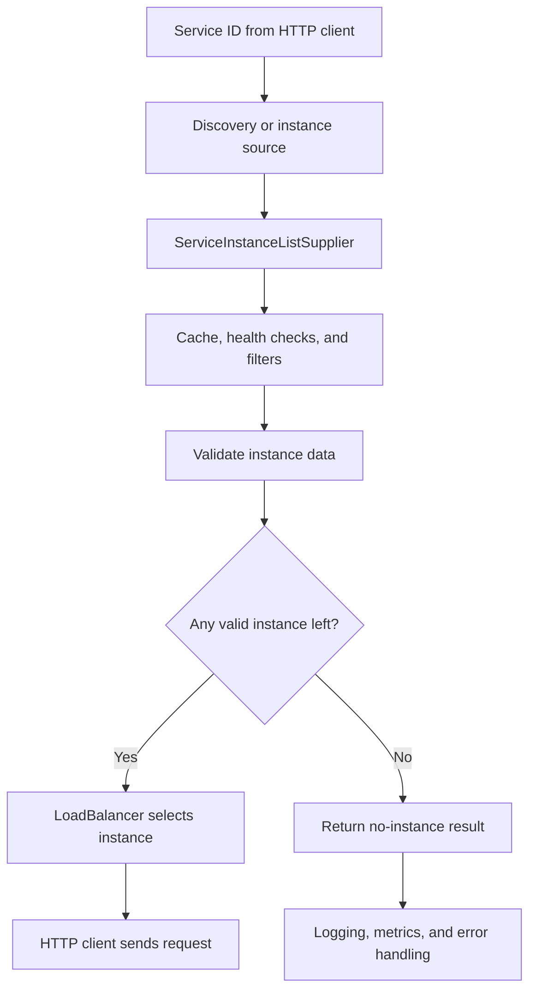

# Handling Empty Lists and Instances with Missing Information

Spring Cloud LoadBalancer selects a `ServiceInstance` from the instance list of the service ID the application is calling. A selection decision is only meaningful when the input list contains at least one valid instance and each instance has sufficient information to construct a connection target. In practice, the list may be empty because the service has not registered yet, discovery is failing, or filters removed all candidates. An instance may also appear in the registry while lacking host, port, or metadata required by the routing policy.

Without distinguishing these scenarios, an application can easily report generic errors, retry pointlessly, or send requests to an unreachable address. This article explains how to identify empty lists, validate `ServiceInstance` data, handle duplicate replicas, and design safe responses when no suitable instance remains.

## 1. Where is the instance list used?

In Spring Cloud LoadBalancer, `ServiceInstanceListSupplier` supplies the `ServiceInstance` list to the chooser. A supplier can obtain data from a discovery provider or another configuration source; composed suppliers can cache, filter by zone, check health, or apply request-based conditions.

Conceptual processing flow:



The diagram shows the conceptual steps. In real applications, data validation may live inside a custom supplier, a discovery integration layer, or a pre-call check before invoking a service. Not every project has a separate validator bean.

Two components must be distinguished:

- **Supplier** provides the candidate list that the load balancer will consider.
- **Load balancer** selects one instance from that list according to a policy such as round robin or random.

If the supplier returns an empty list, the load balancer has no candidate to choose. If the supplier returns an instance missing information, the selection algorithm may still pick that instance, yet the HTTP client cannot establish a connection properly.

## 2. Causes of an empty list

An empty list does not necessarily mean the target service has stopped running. It only indicates that at fetch time, the supplying source produced no instances for the queried service ID.

Common causes include:

| Cause | Signs to check |
|---|---|
| Service has not started or registered yet | Target application is not ready yet, registration has not completed, or the process just restarted. |
| Wrong service ID | Name in the URL or client annotation does not match the registered name. |
| Discovery provider returns no data | Connectivity, authentication, namespace, region, or discovery configuration issues. |
| Instance was removed from registry | Instance stopped, lease expired, or registration was revoked. |
| Health check excluded all candidates | Health endpoint failing, timeouts, or mismatched probe configuration. |
| Routing filters are too strict | No instance matches zone, version, metadata, or request criteria. |
| Cache has no data yet or stale data | Application just started, cache not populated yet, or data not refreshed. |
| Static instance source not configured | No discovery provider and no matching static instance list configured. |

When diagnosing, trace from the data source to the final list. First confirm discovery holds instances, then inspect each filtering step. If discovery returns three instances while the supplier ultimately returns an empty list, look for the filter or health check that eliminated those instances.

### 2.1. Wrong service ID and environment differences

The service ID is the lookup key in discovery. A small mistake such as using `inventory` when the registry registers `inventory-service` can produce an empty list even though the service is running.

Check simultaneously:

- The value in the HTTP client's URL.
- The name declared in `@FeignClient(name = "...")`, if using OpenFeign.
- The service name stored by the discovery provider.
- The namespace, region, or environment queried by the discovery client.
- Letter-casing normalization rules of the provider in use.

Do not arbitrarily convert every service ID to lowercase if your discovery provider follows its own convention. Apply the exact same normalization rule at registration and at lookup.

### 2.2. Filters can eliminate all instances

An initial list can be non-empty yet become empty after multiple conditions are applied. For instance, discovery returns four instances; health checks exclude two, the zone filter keeps only instances in `ap-southeast-1a`, and then the version filter removes the remaining instance.

To find the cause, observe element counts after each step:

```text
Returned by discovery            : 4
After health check               : 2
After zone filter                : 1
After version filter             : 0
Supplier result                  : 0
```

These are illustrative numbers. In a real system, you can record counts and rejections grouped by reason. Avoid logging only the final outcome as "empty list", because that obscures which step dropped the data.

## 3. Distinguishing an empty list, no emitted data, and source errors

With the reactive stream of `ServiceInstanceListSupplier`, three states must be distinguished:

| State | Meaning | Interpretation |
|---|---|---|
| Emits an empty list | Supplier returned a result, but with no candidates. | Discovery or filters yielded zero instances. |
| Completes without emitting a list | No element was emitted in the reactive stream. | Supplier produced no result; check implementation and integration. |
| Emits an error | Fetching the list failed. | Connection error, timeout, authentication failure, code bug, or provider error. |

For example, `Flux.just(Collections.emptyList())` represents emitting an empty list, whereas `Flux.empty()` completes without emitting any list. `Flux.error(...)` represents an error. These are distinct reactive signals and should not be collapsed into a single state in logs.

By contract, a supplier should emit valid lists; do not return `null` instead of a list or stream. If writing a custom supplier, ensure the no-instance case is represented by an empty list. If the data source encounters an error, preserve the error signal so the calling layer can record and handle the true cause.

Final HTTP client behavior when instance selection yields no result can vary by client type and integration version. Therefore, check how your current application maps this state to an exception or response. Do not assume every case throws the exact same specific exception.

## 4. Required fields in ServiceInstance

`ServiceInstance` describes an instance of a service. Fields commonly used when resolving a connection target include:

| Field | Role | Basic check |
|---|---|---|
| `serviceId` | Logical name of the service | Non-empty and matches the queried service. |
| `host` | Host or address of the target machine | Non-empty; resolvable and reachable from the calling environment. |
| `port` | Connection port | Within the valid TCP port range required by the application. |
| `uri` | Connection address built from instance info | Has a valid scheme and host. |
| `secure` | Indicates instance uses a secure connection | Must match the client's protocol and TLS configuration. |
| `metadata` | Additional info such as zone, version, instance ID | May be empty; only mandatory when routing policies require it. |

Not all metadata is mandatory. For example, if an application only picks instances via round robin, missing `zone` metadata may not prevent connectivity. However, if a policy requires matching the same zone, an instance missing `zone` cannot be evaluated under that rule.

Similarly, a syntactically valid host and port do not prove the endpoint is reachable. Data-structure validation and connectivity verification are two separate tasks. Network connectivity, firewalls, TLS, and application health must be observed at their appropriate layers.

## 5. Validating data before putting an instance into the candidate list

You should define a minimum set of conditions for every instance. For a typical HTTP service, basic conditions might be:

1. The instance object is not `null`.
2. Service ID has a value and matches the requested service.
3. Host is non-empty.
4. Port is within the range 1 to 65535.
5. The URI generated from the instance has a valid scheme and host.
6. Metadata required by the active routing policy has values.

Basic Java validation example:

```java
import java.net.URI;
import java.util.ArrayList;
import java.util.List;

import org.springframework.cloud.client.ServiceInstance;
import org.springframework.util.StringUtils;

static boolean isUsable(
        ServiceInstance instance,
        String requestedServiceId) {

    if (instance == null) {
        return false;
    }

    if (!StringUtils.hasText(instance.getServiceId())
            || !requestedServiceId.equals(instance.getServiceId())) {
        return false;
    }

    if (!StringUtils.hasText(instance.getHost())) {
        return false;
    }

    int port = instance.getPort();
    if (port < 1 || port > 65535) {
        return false;
    }

    try {
        URI uri = instance.getUri();
        return uri != null
                && uri.isAbsolute()
                && StringUtils.hasText(uri.getScheme())
                && StringUtils.hasText(uri.getHost());
    } catch (RuntimeException ex) {
        return false;
    }
}

static List<ServiceInstance> usableInstances(
        List<ServiceInstance> candidates,
        String requestedServiceId) {

    if (candidates == null) {
        throw new IllegalArgumentException(
                "ServiceInstance list must not be null");
    }

    List<ServiceInstance> result = new ArrayList<>();

    for (ServiceInstance candidate : candidates) {
        if (isUsable(candidate, requestedServiceId)) {
            result.add(candidate);
        }
    }

    return result;
}
```

This is an illustrative validation function for HTTP endpoints. Real applications should adjust service ID and protocol rules to the discovery provider and record rejection reasons instead of only returning `true/false`. If the provider exposes a stable instance ID or dedicated health status, add matching checks.

The function above preserves input list order. This helps when the selection policy relies on ordering, such as round robin. Do not arbitrarily reorder the list during data validation.

### 5.1. Categorizing reasons an instance is invalid

In production implementations, instead of returning only a boolean, categorize failures to aid diagnostics:

| Illustrative reason code | Condition |
|---|---|
| `NULL_INSTANCE` | Element in the list is null. |
| `MISSING_SERVICE_ID` | Service ID is empty. |
| `SERVICE_ID_MISMATCH` | Service ID does not match the request. |
| `MISSING_HOST` | Host is empty. |
| `INVALID_PORT` | Port is outside the valid range. |
| `INVALID_URI` | URI cannot produce a valid connection target. |
| `MISSING_REQUIRED_METADATA` | Missing metadata required by the routing policy. |
| `UNHEALTHY_INSTANCE` | Health check determined the instance is ineligible for requests. |

The codes above are an internal convention you can adopt, not a fixed Spring Cloud enum. Using stable codes makes dashboards and alerts easier to aggregate than parsing free-form log strings.

### 5.2. Optional metadata vs. mandatory metadata

Suppose an application prefers instances in the same zone as the calling service. If zone metadata is present, the filter can prefer the matching zone. If zone metadata is missing, a clear fallback policy is needed:

- Skip zone preference and continue with other valid instances.
- Exclude instances missing zone if partitioning is mandatory.
- Return a configuration error if routing rules cannot be guaranteed.

Do not assume every missing metadata field makes an instance invalid. Validation rules must reflect business requirements. If metadata only serves logging or display, its absence may warrant only a warning.

## 6. Handling duplicate instances

A list may contain the same instance multiple times due to duplicated registration entries, merged sources, or bugs in a custom supplier.

Example:

```text
inventory-1  -> 10.0.1.11:8080
inventory-2  -> 10.0.1.12:8080
inventory-1  -> 10.0.1.11:8080
inventory-3  -> 10.0.1.13:8080
```

If the list goes straight into round robin, the instance appearing twice can be picked more frequently. With random selection, duplicate entries also skew selection probabilities. This can produce unexpected load distribution.

Before deduplicating, define what constitutes the same instance:

- Prefer a stable instance ID issued by the discovery provider if available.
- Without a stable ID, use the combination of service ID, scheme, host, and port as the endpoint key.
- Do not use host alone as the key, since one machine can run multiple instances on different ports.
- If metadata affects routing or distinguishes two valid registrations, include that factor in the identity rule.
- Do not drop distinct instances simply because they reside on the same host.

Only deduplicate when entries represent the exact same target and routing role. Some systems intentionally use weights or custom policies to adjust distribution; do not strip intentionally generated entries before understanding that weighting model.

After deduplication, record the duplicate count and the involved data source. Deduplicating only masks the impact on the selection algorithm; it does not fix the root cause producing duplicate entries in the registry or supplier.

## 7. When all instances are excluded

After validation and filtering, a situation like this can occur:

```text
List from discovery          : 3
Records missing host         : 1
Records with wrong service ID: 1
Records failing health       : 1
Final valid list             : 0
```

At this point, the load balancer has no valid target to send requests to. The application must handle this explicitly instead of attempting to choose an invalid record.

One application-layer check:

```java
List<ServiceInstance> usable =
        usableInstances(candidates, "inventory-service");

if (usable.isEmpty()) {
    throw new IllegalStateException(
            "No usable instance for service inventory-service");
}

// Pass the valid list to the next selection step.
```

This is an example guard at the application layer or inside a custom list-processing component. Do not copy this snippet into every HTTP client to replace LoadBalancer integration; place validation at the component that owns the instance list.

### 7.1. Fail fast and appropriate responses

If no valid instance exists, terminate the call early with the service ID and cause. At the application's HTTP boundary, a temporarily unavailable downstream service is commonly mapped to `503 Service Unavailable`. The response structure should give clients enough information to know they can retry later, without exposing internal details such as hosts, sensitive metadata, or credentials.

Do not fall back to an unmanaged default IP address. Such fallback bypasses discovery, health checks, and security policies, while making failures harder to reproduce.

### 7.2. Bounded retries

If the list is empty because a service just started and has not registered yet, a delayed retry can help. However, continuous retries do not create new instances if the registry still holds no data.

When configuring retries, ensure you:

- Cap the attempt count and total wait duration.
- Use backoff, optionally adding jitter to prevent many clients retrying simultaneously.
- Retry only errors classified as transient.
- Do not repeatedly retry configuration errors such as wrong service ID or missing mandatory metadata.
- Consider request idempotency before re-sending write operations.
- Avoid stacked retries across multiple layers causing request amplification.

If an application must wait for target services to be ready before accepting traffic, consider readiness probes and deployment orchestration. Do not rely on per-request retries as the sole workaround for asynchronous startup.

### 7.3. Caching and stale data

Instance-list caching reduces discovery queries, yet cached data may lag behind recent changes. If an instance has stopped while still remaining in cache, the load balancer can keep selecting it until data refreshes.

When investigating an empty list or failing instances, check:

- Whether caching is enabled.
- How TTL or refresh intervals are configured.
- Whether the cache holds an empty list or stale entries.
- Whether the discovery provider returns fresh data.
- Whether multiple cache layers or stacked suppliers exist.

Do not automatically keep serving stale lists indefinitely when refreshes fail. If accepting stale data to improve availability, enforce a data-age limit and evaluate the risk of selecting stopped instances.

## 8. Observability and logging

To identify why the load balancer has no candidates, track instance counts through each step along with exclusion reasons. A structured log record could look like:

```text
serviceId=inventory-service
discoveredCount=4
validCount=2
duplicateCount=1
rejectedMissingHost=1
rejectedInvalidPort=0
rejectedUnhealthy=0
selectionResult=INSTANCE_AVAILABLE
```

When no instance remains:

```text
serviceId=inventory-service
discoveredCount=2
validCount=0
rejectedMissingHost=1
rejectedInvalidPort=0
rejectedUnhealthy=1
selectionResult=NO_INSTANCE
```

This is an illustrative format. Build dedicated metrics matching your system's observability conventions. Metrics should help answer:

- How many instances did discovery return?
- How many instances remained after each filter?
- How many instances were rejected for each reason?
- What is the frequency of empty lists per service ID?
- How long do discovery or suppliers take to return results?
- How long has it been since the last cache refresh?
- What timeout or connection-error rates occur for the selected instance?

Avoid using host, URI, or instance ID as high-cardinality metric labels across all systems. Log those details in controlled logs, while keeping aggregated metrics by service and reason so dashboards remain stable.

When logging, do not print full metadata if metadata may contain tokens, internal details, or sensitive data. Log only fields needed for diagnostics.

## 9. Testing edge cases

A test suite for a supplier or instance-filtering component should cover both normal lists and abnormal cases.

| Input | Expected outcome |
|---|---|
| List with multiple valid instances | Keep instances and preserve order per selected rule. |
| Empty list | Select no instance; return a clear no-candidate result. |
| List containing null elements | Exclude invalid elements and log reason, or raise error if violating internal contract. |
| Empty or mismatched service ID | Exclude instance and record reason. |
| Empty host | Exclude instance because no endpoint can be built. |
| Port outside valid range | Exclude instance. |
| Invalid URI | Exclude instance and flag source data to fix. |
| Missing optional metadata | Keep instance if policy does not require that metadata. |
| Missing mandatory metadata | Exclude instance or return configuration error per policy. |
| Two records with the same instance ID | Keep only one record per deduplication rule. |
| Two instances sharing host with different ports | Keep both if they are two independent endpoints. |
| Health check excludes all | Final list is empty; send no requests to unhealthy instances. |
| Supplier emits error | Preserve and observe source error; do not silently convert to a valid list. |
| Supplier completes without emitting a list | Handle as no emitted result, distinct from an empty list. |

For reactive suppliers, use Reactor Test to verify emitted, completion, and error signals. For pure validation functions, unit test each condition to ensure rule changes do not let incomplete instances slip through. Integration tests should confirm the HTTP client reacts properly both when no instances exist and when the discovery provider recovers data.

## 10. Practical diagnostic workflow

When encountering a no-instance error or unreachable request, proceed in order:

1. **Confirm the service ID:** compare the name in the request with the registered name in discovery.
2. **Check discovery:** query the provider and confirm registered instances exist.
3. **Check the supplier:** inspect lists emitted before and after caching, health checks, and filters.
4. **Validate data:** review service ID, host, port, URI, and mandatory metadata.
5. **Check duplicates:** determine whether duplicate entries skew distribution.
6. **Check connectivity:** for a valid selected instance, check DNS, network, firewall, TLS, and application state.
7. **Verify recovery:** confirm cache refreshes, healthy instances return to the list, and retries stop once the system stabilizes.

Some symptoms and investigation paths:

| Symptom | Investigation direction |
|---|---|
| Discovery returns an empty list | Service not registered yet, wrong service ID, or provider returning no data. |
| Discovery has instances but supplier is empty | Health check, zone, metadata, or filters removed all of them. |
| List has instances but requests fail immediately | Host, port, URI, or scheme is invalid. |
| One instance receives abnormally many requests | Duplicate entries, weight policy, or uneven candidate list. |
| Failing instance is still selected | Stale cache, health check not reflecting status yet, or endpoint just changed. |
| Only one environment fails | Differences in service ID, namespace, discovery endpoint, profile, or cache settings. |

## 11. Design principles

When building custom suppliers or filters, maintain these principles:

- Represent having no instances with an empty list per contract.
- Keep no-data, no-emission, and source-error states distinct.
- Validate minimum connectivity data before placing an instance into the candidate list.
- Require only metadata that the routing policy actually uses.
- Deduplicate by instance identifier or appropriate endpoint key, never host alone.
- Do not pick unmanaged fallback addresses on your own.
- Cap retries and set timeouts aligned with business deadlines.
- Record counts and rejection reasons so failures remain diagnosable.
- Test normal cases, empty lists, and incomplete instance data.

## 12. Conclusion

An empty list and a `ServiceInstance` missing information are two distinct problems. An empty list means no candidates exist at the data-supplying step; an instance missing information means a record exists yet cannot safely construct a connection target. Additionally, duplicate records can skew selection probabilities even when each individual record is valid.

When troubleshooting, inspect the discovery source, each filtering step, validity of service ID/host/port/URI, and policy metadata. When no suitable instance remains, terminate the call with a clear error, observe the cause, and perform bounded retries when failures are genuinely transient. This approach helps Spring Cloud LoadBalancer pick instances capable of serving requests and helps operations teams pinpoint causes when the candidate list changes.
