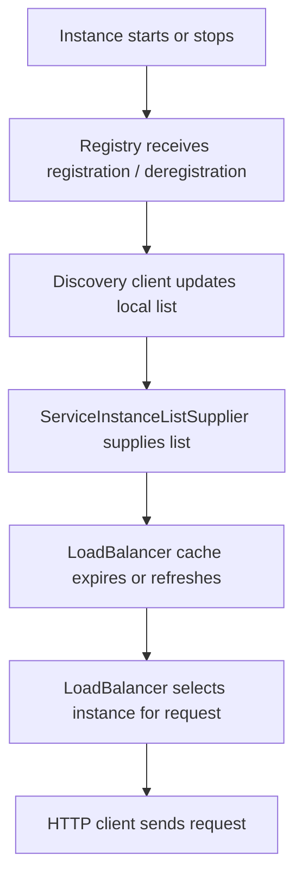

# Update Latency When Replicas Are Added or Removed

In a Spring Cloud system, the number of replicas (instances) of a service can change when deploying a new version, auto-scaling out, or scaling in resources. When a new instance appears or an old instance stops running, not all involved components necessarily observe that change at the exact same moment. Consequently, Spring Cloud LoadBalancer may continue sending requests to the old set of instances for a period of time.

This latency is the result of multiple steps: the instance starting up and registering, the registry updating its status, the discovery client refreshing its local list, and then `ServiceInstanceListSupplier` and LoadBalancer's cache supplying the list to requests. Understanding each step explains why scaling out does not increase traffic to the new instance immediately and why scaling in can sometimes still route requests to a removed instance.

## 1. The instance list changes across multiple layers

Applications calling a service typically use a service ID, such as `catalog-service`. The service ID represents the logical service; the registry stores instances currently registered under that name. Each instance carries information such as host, port, instance ID, and metadata.

A request is load-balanced based on the instance list LoadBalancer receives at selection time. With common discovery integrations, data passes through these layers:

1. **Instance lifecycle:** a new process starts, finishes initialization, and reaches a state ready to accept requests. When stopping, the instance must be marked unavailable or deregistered.
2. **Registry:** stores the registration state of instances. Changes only take effect once the registry receives a registration, status update, or deregistration.
3. **Discovery client:** the component in the calling application that queries the registry. Some integrations update via polling; others use watches or change notifications. The discovery client may retain a local copy of the registry.
4. **ServiceInstanceListSupplier:** supplies the `ServiceInstance` list to LoadBalancer. The supplier can pull data directly from the discovery client, filter by zone or health checks, and be wrapped by a cache.
5. **Spring Cloud LoadBalancer:** chooses an instance from the list returned by the supplier and hands the target address to the HTTP client.



Each layer has its own update schedule and data-retention policy. Therefore, you cannot assume that once the registry has changed, the very next request will definitely use the new list.

## 2. Sources of latency

### Registration and deregistration at the registry

When a new instance starts, it may take time to load configuration, connect to dependencies, open its listening port, and complete readiness checks before registering. Depending on the registry and integration, registration may be sent immediately or after another initialization step.

When an instance stops abruptly, the registry may not yet know the instance is gone. Some registries rely on heartbeats or leases; status transitions to unavailable only after a timeout expires. If an instance shuts down gracefully and deregisters successfully, the registry can update sooner.

### Discovery client data refresh

A discovery client may maintain a local registry list to reduce queries and avoid depending on a network round-trip for every instance lookup. If the integration uses a fetch interval, a change occurring right after a fetch may have to wait until the next cycle to appear in the local list.

Different integrations propagate changes differently. Therefore, consult the configuration and documentation of the registry in use, such as Eureka, Consul, or Kubernetes. There is no single refresh interval shared across all systems.

### Spring Cloud LoadBalancer cache

LoadBalancer retrieves the candidate list via `ServiceInstanceListSupplier`. When caching is enabled, `CachingServiceInstanceListSupplier` can retain results from the underlying supplier for a period of time. Even if the discovery client already sees the new instance, requests may still receive the old list if LoadBalancer's cache has not expired.

In common Spring Cloud LoadBalancer configurations, caching is enabled by default; the TTL is typically 35 seconds and default capacity is 256 entries. Verify actual values against your Spring Cloud version and the application's cache configuration. Caching can use Caffeine if that library is on the classpath; otherwise, Spring Cloud LoadBalancer uses its default cache implementation.

### Health checks and readiness

If the application configures `HealthCheckServiceInstanceListSupplier`, the candidate list can be filtered based on health-check results. Results only change after the next check runs and updates the list. A newly failing instance can still appear in the stale result until a check detects the failure.

LoadBalancer health checks are a supplemental mechanism and do not replace service registration or discovery client refreshes. They also only check the endpoint and conditions configured by the application. If a new instance is not yet in the discovery list, health checks cannot add that instance to the list on their own.

### Open connections in the HTTP client

LoadBalancer chooses an instance when resolving a request. Afterward, the HTTP client may use connection pooling or keep-alive connections according to its configuration. When an instance is removed, in-flight requests or already-open connections may persist for some time. Consequently, inspect both request lifecycle and connection pools when investigating errors after scale-in.

## 3. What happens when an instance is added?

Suppose `catalog-service` currently has two instances, `catalog-1` and `catalog-2`. The system scales out by adding `catalog-3`.

Before the change propagates to the discovery client and LoadBalancer cache, the candidate list may still contain only the two old instances. Requests continue to be distributed between `catalog-1` and `catalog-2`. Once the new list takes effect, `catalog-3` begins receiving requests according to the selection policy.

| Point in time | Registry | List LoadBalancer may see |
|---|---|---|
| Initially | `catalog-1`, `catalog-2` | `catalog-1`, `catalog-2` |
| `catalog-3` just started | May not be registered yet | `catalog-1`, `catalog-2` |
| Registry received registration | Has 3 instances | May still have only 2 instances due to stale discovery/cache |
| Discovery and cache updated | Has 3 instances | `catalog-1`, `catalog-2`, `catalog-3` |

This is why increasing the replica count at the deployment layer does not immediately distribute traffic to the new replica. During the convergence window, the two older instances may continue handling most of the traffic.

## 4. What happens when an instance is removed?

Suppose `catalog-2` needs to stop to deploy a new version. The registry may have already deleted or marked this instance unavailable, while the discovery client or LoadBalancer cache still holds the old address.

If LoadBalancer selects `catalog-2` during that window, the HTTP client can hit connection errors, timeouts, or errors from the stopped server. This is a stale-instance scenario. If a request was sent right before the instance stopped, the request can also fail mid-flight.

To reduce errors during scale-in, coordinate lifecycle steps:

1. Mark the instance as no longer ready to accept new requests or initiate deregistration per the platform's mechanism.
2. Wait for the change to propagate to the registry and relevant discovery clients.
3. Let in-flight requests finish within a defined drain timeout.
4. Stop the process after it has stopped receiving new requests and completed the drain phase.

The exact sequence and mechanism depend on the deployment platform. Stopping the process first and waiting for heartbeats to expire allows clients to keep picking the dead instance until status updates.

## 5. Tuning caching and update timing

You can adjust Spring Cloud LoadBalancer's cache TTL via the `spring.cloud.loadbalancer.cache.ttl` setting. The YAML example below sets a 5-second TTL and a capacity of 256 entries:

```yaml
spring:
  cloud:
    loadbalancer:
      cache:
        ttl: 5s
        capacity: 256
```

A shorter TTL lets LoadBalancer's cache re-fetch the list from the underlying supplier sooner. However, it does not force the registry or discovery client to update their data any earlier. If the discovery client still holds an old list, cache expiration only makes LoadBalancer re-read that exact same old data.

An overly short TTL can increase queries to the supplier, discovery client, or registry depending on cache architecture and integration. An overly long TTL lowers query load yet extends the window of using stale lists after instances change. Choose the TTL based on scaling frequency, registry load, discovery client refresh latency, and acceptable error levels.

If end-to-end latency needs tuning, examine all of these together:

- The discovery client's fetch interval, watch, or registry synchronization mechanism.
- The registry's heartbeat, lease, and registration expiration durations.
- Spring Cloud LoadBalancer's cache TTL.
- Refetch and health-check intervals if a health-checking supplier is configured.
- Drain times, timeouts, and connection pools of the HTTP client.

Do not mechanically drop every interval to the lowest possible value. Measure query counts, convergence times, and error rates before changing settings in production.

## 6. Estimating convergence time

You can use the following approximate model for analysis:

\[
T_{visible} \approx T_{registration} + T_{discovery} + T_{supplier-cache}
\]

Where:

- `T_registration`: time from when an instance changes state until the registry records the change.
- `T_discovery`: time for the discovery client to obtain the updated list.
- `T_supplier-cache`: wait time for the supplier/LoadBalancer cache to expire or refresh.

This is an analytical model, not an SLA guarantee. Steps can overlap; health checks, heartbeat expiry, and drain times can add latency or shift when an instance is treated as unavailable.

For example, the registry accepts a new instance after 1 second, the discovery client updates after up to 10 seconds, and the LoadBalancer cache has a 5-second TTL. If steps occur sequentially in a worst-case timing, the new list may take roughly 16 seconds to reach requests. If the discovery client only updates every 30 seconds, lowering the cache TTL from 5 seconds to 1 second cannot make the new list appear before the discovery client updates.

When an instance disappears abruptly, detection time can also depend on heartbeat or lease timeouts. That is why you should check registry configuration before concluding LoadBalancer's cache is the sole cause.

## 7. Monitoring and diagnosing latency

When a new instance receives no requests or a stopped instance is still called, correlate the same service ID across every layer:

1. Confirm when the instance reached readiness, registered, or started deregistration.
2. Check whether the registry recorded the new state; for abruptly lost instances, check heartbeat or lease expiry.
3. Check whether the calling application's discovery client sees the updated list.
4. Inspect the active `ServiceInstanceListSupplier`, health-check filters, and whether caching is enabled.
5. Record which instance LoadBalancer selected for failing requests, the request timestamp, and the connection error received.
6. Check HTTP client timeouts and connection pools if requests might be reusing previously opened connections.

The table below helps narrow down the layer quickly:

| Symptom | Layer to check first |
|---|---|
| New instance is in registry, but calling app does not see it | Discovery client and refresh/watch interval |
| Discovery client sees new instance, but requests still use old list | `ServiceInstanceListSupplier` and LoadBalancer cache |
| Stopped instance still appears in registry | Deregistration, heartbeat, or lease timeout |
| Registry and discovery removed instance, yet requests still fail against old address | Supplier cache, in-flight requests, and connection pool |
| New instance is selected, yet requests fail | Readiness, port, network, and HTTP client settings of the new instance |

Log the service ID, chosen instance ID or host/port, timestamp, and request outcome. During scale-out/scale-in testing, record timestamps at the registry, discovery client, and the first request using the new list. Those timestamps let you measure actual convergence time instead of guessing from configured TTLs.

## 8. Hands-on testing for scale-out and scale-in

You can test this behavior with a multi-instance service and a client calling by service ID:

1. Start two instances of `catalog-service` and confirm both appear in discovery.
2. Send continuous requests and log the selected instance.
3. Start a third instance, recording when the registry accepts the registration and when the client first picks the new instance.
4. Stop one instance via the deregistration/drain procedure, then track when it disappears from the list and the last request sent to that instance.
5. Repeat with different cache TTLs while keeping discovery settings fixed to observe LoadBalancer cache effects in isolation.
6. Compare convergence time, failed request counts, and discovery/registry query load.

Look at more than just the instance count in the registry. Inspect the list visible to the calling application itself and the instance LoadBalancer actually selects. Those two signals show whether changes have propagated to the right layer.

## 9. Takeaways

When replicas are added or removed, the instance list updates through a convergence process across application lifecycle, registry, discovery client, supplier, and LoadBalancer cache. TTL only controls caching duration at its respective layer; it does not shorten the update cycle of the registry or discovery client. To get new capacity into rotation quickly on scale-out and minimize errors on scale-in, coordinate refreshes, caching, health checks, deregistration, draining, and observability of selected instances in live requests.
