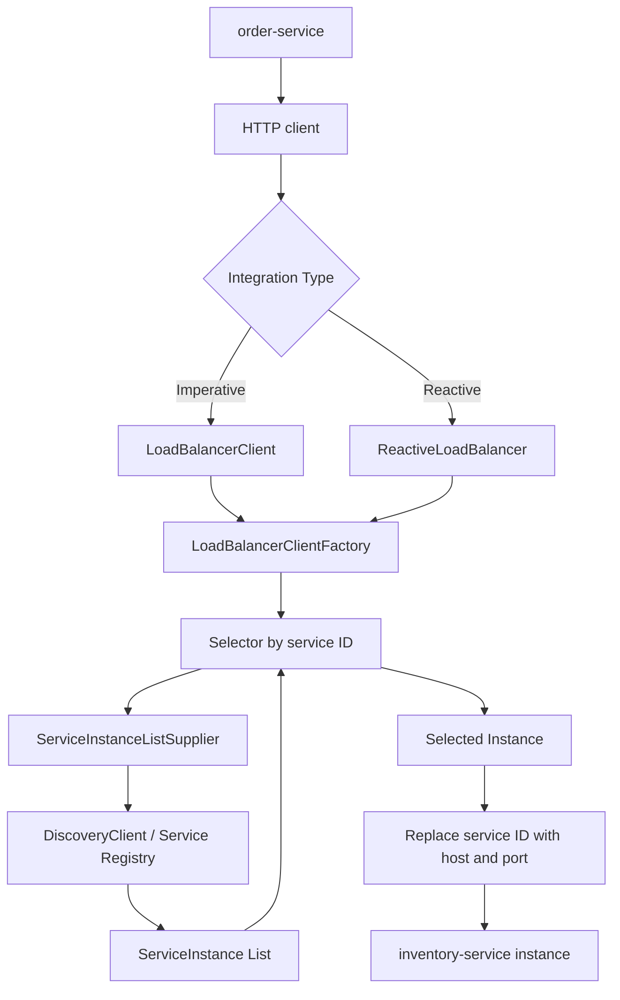

# LoadBalancerClient and ReactiveLoadBalancer: Roles and Differences

In Spring Cloud LoadBalancer, `LoadBalancerClient` and `ReactiveLoadBalancer` both participate in selecting a `ServiceInstance` for a request, but they serve two different integration models. `LoadBalancerClient` provides an imperative API for applications or HTTP clients to perform selection and send requests synchronously. `ReactiveLoadBalancer` is a reactive instance-selection contract that returns results as a `Mono<Response<T>>` so that selection can proceed asynchronously.

Understanding this boundary helps you choose the right integration for `RestClient`, `RestTemplate`, OpenFeign, and `WebClient`, while avoiding blocking the event loop during reactive processing. Both belong to the client-side load balancing architecture of the `SPRING_CLOUD_SERVICE_COMMUNICATION_LOAD_BALANCING` module: the calling application uses a service ID, LoadBalancer finds a suitable instance, and the HTTP client sends the request to the actual address.

## Learning Objectives

After this lesson, you will be able to:

- Describe the responsibilities of `LoadBalancerClient`, `BlockingLoadBalancerClient`, and `ReactiveLoadBalancer`.
- Explain the relationship between the imperative API and the underlying reactive instance selector.
- Trace the request flow through `ServiceInstanceListSupplier`, discovery, and the instance selector.
- Distinguish how LoadBalancer integrates with `RestClient`/`RestTemplate`/OpenFeign versus `WebClient`.
- Identify scenarios with no available instances, connection errors, and the risks of calling blocking APIs in a reactive flow.
- Choose the appropriate API and verify which actual instance receives a request.

## Two Abstractions Solving Two Needs

| Component | Primary Role | Processing Model | Typical Output |
|---|---|---|---|
| `LoadBalancerClient` | Application-facing API to choose an instance, execute a request, or reconstruct a URI for an instance | Imperative, blocking | `ServiceInstance` or the result of an execution operation |
| `BlockingLoadBalancerClient` | Blocking implementation of `LoadBalancerClient` in Spring Cloud LoadBalancer | Blocking | Waits for the selection result and returns the instance or executes the request |
| `ReactiveLoadBalancer<T>` | SPI defining how to select an item from a list of candidates | Reactive | `Mono<Response<T>>` |
| `ReactorServiceInstanceLoadBalancer` | Specialized abstraction for selecting a `ServiceInstance` in the Reactor ecosystem | Reactive | `Mono<Response<ServiceInstance>>` |

`LoadBalancerClient` sits at the API layer that imperative code can consume. It provides familiar operations such as `choose`, `execute`, and `reconstructURI`. In Spring Cloud LoadBalancer, the common implementation is `BlockingLoadBalancerClient`.

`ReactiveLoadBalancer<T>` defines the selection behavior. It accepts a `Request` and returns a `Mono<Response<T>>`. For service load balancing, type `T` is typically `ServiceInstance`. Implementations can be round robin, random, or a custom strategy. `RoundRobinLoadBalancer` and `RandomLoadBalancer` are common examples in this ecosystem.

The key point is that `LoadBalancerClient` and `ReactiveLoadBalancer` are not necessarily two independent load balancers. The blocking implementation can retrieve the reactive selector from a factory, invoke `choose`, wait for the result, and expose a synchronous API to the caller. This allows instance selection and candidate listing to share the same mechanism while each HTTP client maintains handling suited to its programming model.

## Position in the Overall Architecture

Suppose `order-service` calls `inventory-service`. The service ID is `inventory-service`; the registry might return two instances, for example `10.0.1.21:8081` and `10.0.1.22:8081`.



The general flow consists of these steps:

1. The application creates a request to a URI whose host is a service ID, such as `http://inventory-service/api/inventory/SKU-42`.
2. The HTTP client integration routes the request to the corresponding LoadBalancer component.
3. LoadBalancer looks up the configuration and selector associated with that service ID.
4. `ServiceInstanceListSupplier` provides the list of instances. This list may be retrieved from discovery, cached, or filtered by health, zone, or metadata.
5. The selector applies a policy, such as round robin, and returns a `ServiceInstance`.
6. The integration builds the target URI using the host, port, and security info of the selected instance.
7. The HTTP client sends the request over the active transport.

Discovery is responsible for finding and updating instance information. The supplier provides the list for a selection pass. The selector decides which instance is used. The HTTP client is responsible for sending the request. Separating these responsibilities makes it easier to pinpoint whether a failure lies in discovery, the candidate list, the selection policy, or the network connection.

## LoadBalancerClient: The Imperative API

`LoadBalancerClient` is the natural choice when service-calling code runs synchronously. Its API provides three groups of operations:

- `choose(serviceId)` selects a `ServiceInstance` for the service ID.
- `execute(serviceId, request)` selects an instance and executes the request-sending callback.
- `reconstructURI(instance, originalUri)` constructs the target URI based on the host, port, and attributes of the selected instance.

The interface also supports overloads that accept a request context or an already selected instance. These overloads are useful when an integration needs to pass additional request metadata, or when a caller wants to execute against a specific instance.

### Selecting an Instance Directly

The following example illustrates using the API to observe the selected instance. In a real application, you should let the HTTP client integration manage selection and request execution unless you have a specific reason for manual control.

```java
@Service
class InventoryInstanceInspector {

    private final LoadBalancerClient loadBalancerClient;

    InventoryInstanceInspector(LoadBalancerClient loadBalancerClient) {
        this.loadBalancerClient = loadBalancerClient;
    }

    String describeSelectedInstance() {
        ServiceInstance instance =
                loadBalancerClient.choose("inventory-service");

        if (instance == null) {
            return "No inventory-service instance available";
        }

        return instance.getHost() + ":" + instance.getPort();
    }
}
```

The result of `choose` depends on the instance list at the time of the call and the active selection policy. If no instance is available, your code must handle the missing-instance case instead of proceeding to construct a URI with an empty value.

### Reconstructing a URI for an Instance

When you need to build the target URI manually, use `reconstructURI` to apply the instance's address:

```java
ServiceInstance instance = loadBalancerClient.choose("inventory-service");

if (instance == null) {
    throw new IllegalStateException("No inventory-service instance available");
}

URI logicalUri = URI.create(
        "http://inventory-service/api/inventory/SKU-42");

URI physicalUri = loadBalancerClient.reconstructURI(instance, logicalUri);
```

`logicalUri` contains the service ID so LoadBalancer can identify the service. `physicalUri` contains the network address of the selected instance. Do not cache `physicalUri` permanently for subsequent requests, because instances can change as discovery updates, health checks remove an instance, or routing policies change.

### Execute and Lifecycle

`execute` allows `LoadBalancerClient` to orchestrate both instance selection and request execution. This is the foundation that lets blocking integrations feed information about the selected instance and request outcome into the lifecycle. During processing, lifecycle components can observe the start time, selection result, and completion outcome, thereby supporting metrics or instrumentation.

When an application only needs to make HTTP calls, prefer built-in integrations such as a load-balanced `RestClient` or OpenFeign. Calling `choose` and sending HTTP manually is only appropriate when you need special control or are building a custom adapter; if you do it yourself, you must handle URI construction, missing instances, timeouts, retries, and request observability on your own.

## ReactiveLoadBalancer: The Asynchronous Instance Selection SPI

`ReactiveLoadBalancer<T>` focuses on a single operation: accepting a `Request` and returning a `Mono<Response<T>>`.

```java
public interface ReactiveLoadBalancer<T> {
    Mono<Response<T>> choose(Request request);
}
```

With service discovery, `T` is typically `ServiceInstance`. `Request` can carry additional context for the selection decision, such as hint data or request-scoped metadata. `Response<T>` wraps the selection outcome; the caller must check whether the response has a server before using the returned instance.

### Retrieving a Selector by Service ID

In real configurations, a factory supplies the selector bound to each service ID. The example below focuses on the selection step to demonstrate the reactive return type:

```java
@Service
class ReactiveInventoryInstanceInspector {

    private final ReactiveLoadBalancer.Factory<ServiceInstance> factory;

    ReactiveInventoryInstanceInspector(
            ReactiveLoadBalancer.Factory<ServiceInstance> factory) {
        this.factory = factory;
    }

    Mono<String> describeSelectedInstance() {
        ReactiveLoadBalancer<ServiceInstance> loadBalancer =
                factory.getInstance("inventory-service");

        if (loadBalancer == null) {
            return Mono.error(new IllegalStateException(
                    "No LoadBalancer configured for inventory-service"));
        }

        return loadBalancer.choose(new DefaultRequest<>())
                .flatMap(response -> {
                    if (!response.hasServer()) {
                        return Mono.error(new IllegalStateException(
                                "No inventory-service instance available"));
                    }

                    ServiceInstance instance = response.getServer();
                    return Mono.just(
                            instance.getHost() + ":" + instance.getPort());
                });
    }
}
```

This snippet illustrates obtaining a selector for a service ID and handling the `Response` inside a reactive pipeline. In standard applications, you do not need to call the factory yourself just to send HTTP requests; `WebClient` has a built-in LoadBalancer filter that performs this step.

### Why Is the Result a Mono?

Instance selection may need to fetch a list from a supplier, await cached data, or apply reactive processing steps. Returning `Mono<Response<T>>` lets those steps participate in the same pipeline without forcing the caller to block a thread waiting for the result.

`ReactiveLoadBalancer` also keeps selection strategies decoupled from the HTTP transport. The selector only decides the instance. Sending the request, decoding the response, and handling HTTP errors remain the responsibility of `WebClient` or the calling component.

## Two Typical Integration Flows

### RestClient and OpenFeign: The Imperative Path

With `RestClient`, the builder is annotated with `@LoadBalanced` so that requests with a service ID host pass through the blocking integration. OpenFeign also has a blocking integration to select an instance before sending a request.

```java
@Configuration
class InventoryClientConfiguration {

    @Bean
    @LoadBalanced
    RestClient.Builder inventoryRestClientBuilder() {
        return RestClient.builder();
    }
}
```

```java
@Service
class InventoryGateway {

    private final RestClient restClient;

    InventoryGateway(@LoadBalanced RestClient.Builder builder) {
        this.restClient = builder.build();
    }

    InventoryDto find(String sku) {
        return restClient.get()
                .uri("http://inventory-service/api/inventory/{sku}", sku)
                .retrieve()
                .body(InventoryDto.class);
    }
}
```

Here, the code executes synchronously: the `find` method returns the DTO after the request finishes. The blocking integration uses `LoadBalancerClient` to choose an instance and adjust the request before the HTTP transport sends it.

### WebClient: The Reactive Path

With `WebClient`, the builder is annotated with `@LoadBalanced` to install a filter that resolves service IDs using the reactive LoadBalancer:

```java
@Configuration
class ReactiveInventoryClientConfiguration {

    @Bean
    @LoadBalanced
    WebClient.Builder inventoryWebClientBuilder() {
        return WebClient.builder();
    }
}
```

```java
@Service
class ReactiveInventoryGateway {

    private final WebClient webClient;

    ReactiveInventoryGateway(@LoadBalanced WebClient.Builder builder) {
        this.webClient = builder
                .baseUrl("http://inventory-service")
                .build();
    }

    Mono<InventoryDto> find(String sku) {
        return webClient.get()
                .uri("/api/inventory/{sku}", sku)
                .retrieve()
                .bodyToMono(InventoryDto.class);
    }
}
```

In this pipeline, the reactive filter resolves the service ID, asks the reactive selector to pick an instance, and forwards the request to the instance's address. The method returns a `Mono<InventoryDto>`, allowing the caller to compose it further with other reactive operators.

### Path Comparison Table

| Aspect | RestClient / OpenFeign | WebClient |
|---|---|---|
| Calling model | Imperative, usually blocking | Reactive, asynchronous |
| Integration abstraction | `LoadBalancerClient` | `ReactiveLoadBalancer` |
| Typical implementation | `BlockingLoadBalancerClient` | Reactive LoadBalancer filter and factory |
| Selection outcome | Awaited to obtain an instance before sending the request | `Mono<Response<ServiceInstance>>` within the pipeline |
| Application return style | DTO or synchronous result | `Mono<T>` / `Flux<T>` |
| Key caveat | Calling thread may be held during I/O | Avoid blocking the event loop with blocking operations |

`RestTemplate` also belongs to the imperative group and uses the blocking integration. OpenFeign is typically used with synchronous interfaces; if your system has custom configurations or different library versions, verify the corresponding integration in the dependencies you use.

## Factory, Per-Service Configuration, and Selection Strategies

Spring Cloud LoadBalancer supports per-service-ID configuration. `LoadBalancerClientFactory` manages LoadBalancer configuration contexts per service. As a result, `inventory-service` can use round robin while another service can use a custom policy or supplier.

Within each context, the primary components typically include:

- `ServiceInstanceListSupplier`: provides the instance list for the service ID.
- `ReactorServiceInstanceLoadBalancer`: makes the `ServiceInstance` selection decision for a request.
- Per-service LoadBalancer configuration: defines the supplier, selector, and related components.
- Lifecycle and instrumentation: observes selection as well as request outcomes when supported by the integration.

For example, a supplier might fetch the list from `DiscoveryClient`, wrap it with caching, or filter instances by zone. A round-robin selector then picks an element from the received list. When you want to change behavior, clarify whether you need to change the candidate list or the selection rule; those two changes belong to different responsibilities.

Do not create a shared default configuration expecting it to affect only one service. When per-service-ID customization is needed, use the per-service LoadBalancer configuration mechanism of your Spring Cloud version and verify that the context is bound to the exact service name. Also watch component scan boundaries so a per-service configuration does not accidentally become global.

## Handling Missing Instances and Request Errors

Having no available instances is a valid outcome that the application must anticipate. Depending on the integration and failure point, you may encounter a response with no server, an instance-not-found error, a connection failure, or an HTTP error. These cases should be classified separately:

| Scenario | Related Layer | How to Check |
|---|---|---|
| Registry has no instances | Discovery | Verify service ID and registration status |
| Supplier returns an empty list | `ServiceInstanceListSupplier` | Check cache, filters, health checks, and refresh timing |
| Selector finds no server | `ReactiveLoadBalancer` / `LoadBalancerClient` | Inspect the response or `choose` result before using the instance |
| Instance exists but cannot connect | HTTP transport / network | Check host, port, firewall, connect timeout, and process status |
| Instance returns an HTTP error | Target service | Check status code, response body, and retry policy |
| Request times out | HTTP client / upper-layer timeout | Compare connect timeout, response timeout, and total request budget |

With the reactive API, handle a response with no server directly inside the pipeline using `switchIfEmpty`, `flatMap`, or error handling appropriate for the response type of your version. With the blocking API, inspect the `choose` result and handle exceptions thrown by `execute`. Never assume that having a service ID guarantees an available instance.

Retries must be bounded and suited to the operation type. An inventory read request is usually safer to retry than a write operation with side effects. If retrying a write operation, consider an idempotency key or duplicate-processing protection. Also set both per-attempt and overall request timeouts so retries do not exceed your latency budget.

## Avoiding Blocking the Event Loop

A common design mistake is calling a blocking API from a `WebClient` pipeline, for example:

```java
// Avoid: block() blocks the thread running the reactive pipeline.
Mono<InventoryDto> result = reactiveGateway.find("SKU-42");
InventoryDto inventory = result.block();
```

In a reactive application, keep returning `Mono` or `Flux` and compose them with reactive operators. Do not call `LoadBalancerClient.choose` or `execute` inside a callback running on the event loop just to obtain an instance. Blocking can degrade concurrency, cause thread starvation, and increase latency for other requests.

If a legacy component only offers a blocking API, establish an intentional boundary on an appropriate scheduler and bound blocking resources. Do not use that approach to replace the entire reactive call path when a `WebClient` integration already supports reactive LoadBalancer.

Conversely, in an imperative flow, using `RestClient` or OpenFeign is appropriate when the application model is inherently synchronous. You do not need to rewrite the entire application to reactive just to use Spring Cloud LoadBalancer; choose the abstraction that matches your application's processing model and transport.

## Hands-on Exercise: Comparing the Two Abstractions

Perform this exercise on a topology consisting of `order-service` and two `inventory-service` instances.

1. Register two inventory instances under the same service ID `inventory-service`. Each instance returns a distinct identifier.
2. In `order-service`, inject a `LoadBalancerClient` bean and call `choose("inventory-service")` multiple times. Record the host, port, and instance ID.
3. Use a `@LoadBalanced` `RestClient` to call the inventory endpoint by service ID. Compare the instance logs with the results from step 2.
4. Inject a `ReactiveLoadBalancer.Factory<ServiceInstance>` and obtain the selector for `inventory-service`. Call `choose` inside a pipeline, handling the case where the response has no server.
5. Use a `@LoadBalanced` `WebClient` to call the same endpoint. Keep the `Mono` return type and do not call `block()` on the processing path.
6. Stop one instance. Observe changes from discovery, the supplier, and the selection results of both call paths after the data refreshes.
7. Stop both instances. Verify that both the blocking and reactive paths cleanly handle the no-server scenario.
8. Restart the instances, verify request recovery, and cross-check logs, metrics, or traces.

Record the timestamp when an instance stops, when the registry updates, when the supplier stops returning it, and the request outcomes. These timestamps may differ due to caching and health check intervals; a delay does not automatically mean the selector is malfunctioning.

## Self-Assessment Criteria

| Criterion | Achieved When |
|---|---|
| Distinguishing abstractions | You can explain that `LoadBalancerClient` is an imperative API and `ReactiveLoadBalancer` is a reactive instance-selection SPI |
| Understanding implementation relationship | You can state that the blocking implementation can delegate to the reactive chooser and await the result |
| Understanding request flow | You can trace service ID → supplier → instance list → selector → target URI → HTTP transport |
| Blocking integration | `RestClient` or OpenFeign calls succeed via service ID and log the receiving instance |
| Reactive integration | `WebClient` selects an instance within the pipeline without blocking the event loop |
| Error handling | You distinguish no available instance, connection failure, HTTP error, and timeout |
| Per-service configuration | You can identify where to change the supplier or strategy for a specific service ID |

## Common Mistakes

- **Using the wrong API for the processing model:** calling a blocking API inside a reactive pipeline blocks threads; use the reactive `WebClient` integration instead.
- **Assuming `ReactiveLoadBalancer` sends HTTP requests itself:** it only decides the selected element; transport still belongs to the HTTP client.
- **Assuming `LoadBalancerClient` is a registry:** it orchestrates selection and request execution; instance data comes from the supplier and discovery.
- **Ignoring empty responses:** always check whether a server is present before accessing `ServiceInstance`.
- **Caching physical URIs long-term:** hosts and ports can change with discovery, health checks, and configuration; resolve them per new request.
- **Customizing at the wrong layer:** to filter candidates, look at the supplier; to change selection logic, look at the load balancer implementation.
- **Skipping integration verification:** having the LoadBalancer dependency alone is not enough; the builder or client must be configured to go through the corresponding integration.

## Conclusion

`LoadBalancerClient` provides the imperative surface for synchronous applications to select instances, execute requests, and reconstruct URIs. `ReactiveLoadBalancer` provides the reactive contract to choose instances without forcing the pipeline to wait via blocking operations. Spring Cloud LoadBalancer connects both abstractions with suppliers, discovery, and per-service-ID selection strategies. By choosing the right integration path for `RestClient`, OpenFeign, or `WebClient`, you keep the request flow clear, handle failures intentionally, and maintain visibility into which instance actually serves each request.
