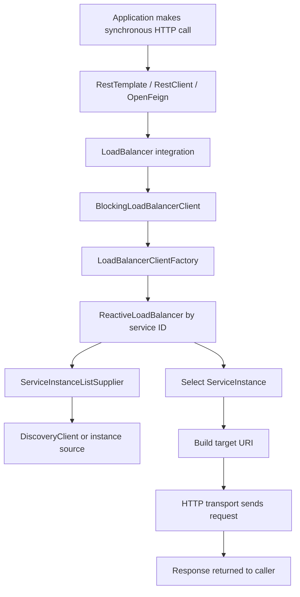
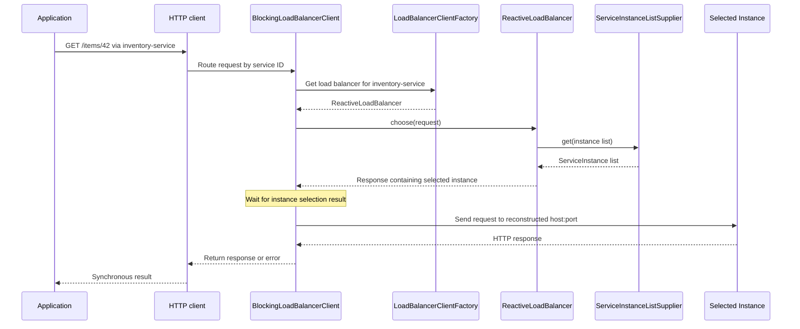

# BlockingLoadBalancerClient in Blocking Calls

In a synchronous HTTP call, the calling thread waits until it receives a response or encounters an error. Spring Cloud LoadBalancer supports this calling model through `BlockingLoadBalancerClient`, an implementation of the `LoadBalancerClient` abstraction in Spring Cloud Commons. This component finds a `ServiceInstance` for a service ID, transforms the logical URL into the selected instance's URL, and executes the request portion provided by the HTTP client.

The key point to understand is that `BlockingLoadBalancerClient` orchestrates instance selection and request execution on a blocking path. It does not open sockets itself or replace the HTTP transport. `RestTemplate`, `RestClient`, or an integrated client like OpenFeign remains responsible for sending the HTTP request and reading the response. This allows the application to call `http://inventory-service` in code while the actual request is sent to a concrete address such as `http://10.20.1.12:8080`.

## 1. Where Does BlockingLoadBalancerClient Fit in the Architecture?

Spring Cloud LoadBalancer separates several distinct roles:

| Component | Responsibility |
|---|---|
| `LoadBalancerClient` | Client-side abstraction for choosing an instance, executing a request by service ID, and reconstructing a URI for an instance. |
| `BlockingLoadBalancerClient` | Synchronous implementation of `LoadBalancerClient`; provides a blocking API for imperative integrations. |
| `ReactiveLoadBalancer` | Abstraction for selecting a `ServiceInstance` for a request; can use strategies such as round robin. |
| `ServiceInstanceListSupplier` | Supplies the instance list for a service ID, potentially combining discovery, caching, or health checks. |
| `DiscoveryClient` | Retrieves service instance information from a discovery source such as a registry or static configuration. |
| HTTP client / transport | Sends the request to the actual host and port, handling connections, TLS, timeouts, and responses. |

`BlockingLoadBalancerClient` is the bridge between synchronous APIs and Spring Cloud LoadBalancer's instance-selection mechanism. Underneath, it uses `LoadBalancerClientFactory` to obtain the load balancing components dedicated to the service ID and invokes `ReactiveLoadBalancer` to pick an instance. The selection result is awaited synchronously before the request proceeds.



This diagram shows the primary roles. Real-world configurations may also add caching, health checks, retries, lifecycle hooks, and request observability components.

## 2. Processing Flow of a Blocking Call

Suppose a client calls the logical URL:

```text
http://inventory-service/api/v1/items/42
```

The service ID is `inventory-service`. Discovery provides two instances:

| Instance | Host | Port |
|---|---|---:|
| `inventory-1` | `10.20.1.11` | 8080 |
| `inventory-2` | `10.20.1.12` | 8080 |

A synchronous call generally proceeds through the following steps:

1. The HTTP client receives a URL containing a service ID instead of a hostname directly resolvable via DNS.
2. The LoadBalancer integration extracts the service ID from the URL host and forwards the request to `BlockingLoadBalancerClient`.
3. `BlockingLoadBalancerClient` obtains the `ReactiveLoadBalancer` matching the service ID from `LoadBalancerClientFactory`.
4. The load balancer asks `ServiceInstanceListSupplier` for the instance list. The supplier may retrieve data from a discovery client or another source.
5. `ReactiveLoadBalancer` applies an instance-selection strategy. With the common default configuration, `RoundRobinLoadBalancer` alternates across eligible instances.
6. `BlockingLoadBalancerClient` waits for the selection result. Once a `ServiceInstance` is obtained, the logical URI is reconstructed into a URI containing the instance's host, port, and scheme.
7. The HTTP transport sends the request to the reconstructed URI, waits for the response, and returns the result to the caller.
8. Completion outcomes are passed through lifecycle hooks if the application has configured `LoadBalancerLifecycle`.



`BlockingLoadBalancerClient` can use `Mono.block()` to wait for the result from `ReactiveLoadBalancer`. This is the transition point from the reactive API of the instance-selection mechanism to the caller's imperative API. After an instance is selected, the HTTP client continues performing I/O using its own blocking model.

In the sequence diagram, the arrow from `BlockingLoadBalancerClient` to the instance represents the request callback executed with the selected instance. The HTTP transport resides inside that callback and is what actually establishes the network connection.

## 3. Two Core Operations: Choosing an Instance and Executing a Request

`LoadBalancerClient` provides the key operations:

- `choose(serviceId)` selects an instance for the service ID.
- `execute(serviceId, request)` selects an instance and then executes the request callback with that instance.
- `reconstructURI(instance, originalUri)` creates the target URI from the logical URI and instance information.

In application code, you should normally use an HTTP client integrated with `@LoadBalanced` so the framework invokes these operations automatically. The direct API is useful when understanding the mechanics or building a custom adapter.

An example illustrating instance selection and URI construction:

```java
import java.net.URI;

import org.springframework.cloud.client.ServiceInstance;
import org.springframework.cloud.client.loadbalancer.LoadBalancerClient;
import org.springframework.stereotype.Component;
import org.springframework.web.util.UriComponentsBuilder;

@Component
class InstanceInspector {

    private final LoadBalancerClient loadBalancerClient;

    InstanceInspector(LoadBalancerClient loadBalancerClient) {
        this.loadBalancerClient = loadBalancerClient;
    }

    URI chooseTarget(String itemId) {
        ServiceInstance instance =
                loadBalancerClient.choose("inventory-service");

        if (instance == null) {
            throw new IllegalStateException(
                    "No instance available for inventory-service");
        }

        URI logicalUri = UriComponentsBuilder
                .fromUriString("http://inventory-service/api/v1/items/{id}")
                .buildAndExpand(itemId)
                .toUri();

        return loadBalancerClient.reconstructURI(instance, logicalUri);
    }
}
```

This example only demonstrates instance selection and URI reconstruction. In a real application, you should not call `choose()` in one place and execute an independent request at another time if you need to ensure the request is tied to the exact instance selected. Use `execute()` or an HTTP client integration so selection and execution occur within the same processing flow.

When using `execute`, the callback receives the selected `ServiceInstance` and executes the request logic against that instance. `BlockingLoadBalancerClient` orchestrates the callback and lifecycle; the callback or HTTP transport actually sends the request.

## 4. Integration with RestTemplate

`RestTemplate` is a familiar imperative example. Annotate the bean with `@LoadBalanced` so Spring Cloud configures an interceptor that routes URLs containing a service ID through LoadBalancer:

```java
import org.springframework.boot.web.client.RestTemplateBuilder;
import org.springframework.cloud.client.loadbalancer.LoadBalanced;
import org.springframework.context.annotation.Bean;
import org.springframework.context.annotation.Configuration;
import org.springframework.web.client.RestTemplate;

@Configuration
class HttpClientConfiguration {

    @Bean
    @LoadBalanced
    RestTemplate inventoryRestTemplate(RestTemplateBuilder builder) {
        return builder.build();
    }
}
```

Using that bean in a gateway:

```java
import org.springframework.stereotype.Service;
import org.springframework.web.client.RestTemplate;

@Service
class InventoryGateway {

    private final RestTemplate restTemplate;

    InventoryGateway(RestTemplate inventoryRestTemplate) {
        this.restTemplate = inventoryRestTemplate;
    }

    String getItem(String itemId) {
        return restTemplate.getForObject(
                "http://inventory-service/api/v1/items/{id}",
                String.class,
                itemId);
    }
}
```

The LoadBalancer interceptor reads the `inventory-service` host, requests instance selection, reconstructs the URI, and continues through `RestTemplate`'s interceptor chain and request factory. If you use a plain `RestTemplate` not annotated with `@LoadBalanced`, this host is treated as a regular hostname and may trigger a DNS resolution error.

Do not instantiate `RestTemplate` with `new RestTemplate()` and assume it has the LoadBalancer interceptor. Use a bean configured in the Spring context and verify which bean is actually injected into your gateway.

## 5. Integration with RestClient and OpenFeign

`RestClient` is an imperative HTTP client introduced in Spring Framework 6.1. In Spring Cloud versions that support this integration, you can register a builder annotated with `@LoadBalanced`:

```java
import org.springframework.cloud.client.loadbalancer.LoadBalanced;
import org.springframework.context.annotation.Bean;
import org.springframework.context.annotation.Configuration;
import org.springframework.web.client.RestClient;

@Configuration
class RestClientConfiguration {

    @Bean
    @LoadBalanced
    RestClient.Builder loadBalancedRestClientBuilder() {
        return RestClient.builder();
    }
}
```

The gateway creates a client from the injected builder:

```java
import org.springframework.stereotype.Service;
import org.springframework.web.client.RestClient;

@Service
class InventoryRestClient {

    private final RestClient restClient;

    InventoryRestClient(RestClient.Builder loadBalancedRestClientBuilder) {
        this.restClient = loadBalancedRestClientBuilder
                .baseUrl("http://inventory-service")
                .build();
    }

    String getItem(String itemId) {
        return restClient.get()
                .uri("/api/v1/items/{id}", itemId)
                .retrieve()
                .body(String.class);
    }
}
```

This is still a synchronous call: `retrieve().body(...)` returns the result after the response is received and converted. Internal integration details can vary across Spring Cloud versions; use a Spring Cloud version compatible with your project's Spring Boot and Spring Framework versions.

With OpenFeign, declare the service name in `@FeignClient`:

```java
import org.springframework.cloud.openfeign.FeignClient;
import org.springframework.web.bind.annotation.GetMapping;
import org.springframework.web.bind.annotation.PathVariable;

@FeignClient(name = "inventory-service")
interface InventoryFeignClient {

    @GetMapping("/api/v1/items/{id}")
    String getItem(@PathVariable("id") String itemId);
}
```

When Spring Cloud OpenFeign is configured alongside Spring Cloud LoadBalancer, Feign uses a blocking load-balancing client to route calls by service ID. The application needs the corresponding LoadBalancer dependency on the classpath and a discovery configuration providing instances. Without load balancing integration, declaring `name` alone does not guarantee instance addresses can be resolved.

## 6. BlockingLoadBalancerClient and Reactive WebClient

`WebClient` is designed around the reactive model. Its typical LoadBalancer integration uses `ReactorLoadBalancerExchangeFilterFunction` or an equivalent filter function, rather than using `BlockingLoadBalancerClient` as the primary path.

```java
import org.springframework.cloud.client.loadbalancer.LoadBalanced;
import org.springframework.context.annotation.Bean;
import org.springframework.context.annotation.Configuration;
import org.springframework.web.reactive.function.client.WebClient;

@Configuration
class WebClientConfiguration {

    @Bean
    @LoadBalanced
    WebClient.Builder loadBalancedWebClientBuilder() {
        return WebClient.builder();
    }
}
```

Reactive call example:

```java
Mono<String> response = webClient.get()
        .uri("http://inventory-service/api/v1/items/{id}", itemId)
        .retrieve()
        .bodyToMono(String.class);
```

The `Mono` object represents a future result; the call does not need to block a thread waiting for the response. If you call `.block()` on top of it, the caller's thread waits for the result, but WebClient's filter function and LoadBalancer mechanism itself still belong to the reactive integration. Adding `.block()` does not turn WebClient into a client backed by `BlockingLoadBalancerClient`.

| Client | Calling Model | Typical LoadBalancer Integration |
|---|---|---|
| `RestTemplate` | Imperative, blocking | `LoadBalancerInterceptor` and `BlockingLoadBalancerClient` |
| `RestClient` | Imperative, blocking | Blocking integration for `RestClient` in supported Spring Cloud versions |
| OpenFeign | Imperative, blocking | Feign blocking load-balancing client, coordinating with `LoadBalancerClient` |
| `WebClient` | Reactive, non-blocking | `ReactorLoadBalancerExchangeFilterFunction` |

This distinction matters when designing applications. In WebFlux, you should not invoke blocking APIs or call `.block()` on an event-loop thread because doing so can stall other requests. If you must call a blocking library, offload the work to an appropriate scheduler or use a reactive client end-to-end.

## 7. What Happens When No Instances Exist or a Request Fails?

Instance selection and sending the HTTP request are two separate phases. Each phase has its own failure modes:

| Symptom | Phase | Meaning and Investigation |
|---|---|---|
| No matching instance | Discovery / selection | `ServiceInstanceListSupplier` did not provide a selectable instance; check service ID, instance registration, and health filters. |
| `UnknownHostException` | DNS / connection | The host is still being treated as a DNS hostname, meaning the client may not be going through the LoadBalancer integration or the returned instance uses an unresolvable hostname. |
| `Connection refused` | TCP connection | A host and port were resolved, but no process is accepting connections; check instance status and port. |
| Connect or read timeout | Connection / awaiting response | Target is slow, unreachable, or did not respond within the time limit; check network and HTTP client timeouts. |
| HTTP `4xx` or `5xx` | HTTP processing | An HTTP server, gateway, or proxy returned a response; check status, body, and server logs. |

If no instance is available, the request cannot be sent to the target service. Depending on the version and client integration, this situation is represented by an empty selection result or an exception at the integration layer. Do not rely on a specific exception message to detect failures across all clients; log the service ID, logical request URI, and instance selection result.

`BlockingLoadBalancerClient` does not guarantee an instance is alive simply because it appears in the list. If unhealthy instances must be excluded, configure a supplier with health checks or a discovery integration with appropriate health status filtering. If an instance stops right after being selected, the HTTP transport can still encounter a connection error.

## 8. Timeouts, Retries, and Request Lifecycle

With blocking calls, the calling thread waits during both instance selection and HTTP transport execution. Separate the different timeout budgets:

- **Connect timeout:** time limit for opening a connection to the instance's host and port.
- **Read timeout:** time limit for waiting for response data after connecting.
- **Overall timeout:** limit on total duration for an operation if supported by the HTTP client or application layer.
- **Caller-layer timeout:** time limit that an upstream controller, worker, or service waits for the gateway to complete.

Connect and read timeouts are usually configured on the request factory or HTTP client transport used by `RestTemplate`/`RestClient`, or through OpenFeign's corresponding options. `BlockingLoadBalancerClient` handles selection and request orchestration; do not assume changing a LoadBalancer timeout automatically configures network timeouts.

Retries are a separate policy. Trying another instance on a connection error may be desirable, but retries must be bounded in count, total duration, and eligible error types. Only retry idempotent operations or operations protected against duplicate processing; a write request may already have been processed by the server even if the client lost the response. Combining retries with overly long timeouts can hold threads for a long time and amplify load during system degradation.

Spring Cloud LoadBalancer provides extension points for retries and lifecycle hooks. Depending on the integration, retries may live inside an interceptor/client, a retry-aware load balancer, or OpenFeign's own configuration. Inspect your active client's configuration to see which layer actually performs retries and whether a new instance is re-selected.

## 9. Observing Calls to Pinpoint Errors

When investigating a request, record enough data to link the processing steps together:

- Logical service ID, e.g., `inventory-service`.
- Logical URI and reconstructed instance URI, masking query parameters or sensitive data if needed.
- Selected instance host and port.
- Instance selection duration, connection duration, and response duration if measurable separately.
- HTTP result or exception, along with correlation ID / trace ID.
- Retry count and the instance selected on each attempt.

Spring Cloud LoadBalancer offers `LoadBalancerLifecycle` to hook into selection start, request start, and request completion phases. You can use lifecycle hooks or appropriate instrumentation to capture this data without scattering manual logs across every gateway. Avoid logging tokens, cookies, credentials, or sensitive request payloads.

A practical diagnostic workflow:

1. Confirm whether the request actually passes through an HTTP client bean annotated with `@LoadBalanced`.
2. Verify that the service ID is correct and discovery returns instances.
3. Record the host and port of the selected instance.
4. If connection fails, check DNS (when the host is a hostname), network routing, port, and TLS.
5. If an HTTP response was received, check the status, response body, and server or gateway logs.
6. Cross-reference timeouts, retries, and traces to identify which phase consumed the time.

## 10. Key Takeaways for Using Blocking Calls

1. `BlockingLoadBalancerClient` implements the `LoadBalancerClient` abstraction for imperative integrations.
2. It looks up the load balancer by service ID, waits for `ReactiveLoadBalancer` to choose an instance, and orchestrates request execution.
3. It does not replace the HTTP transport; `RestTemplate`, `RestClient`, or Feign still sends requests and receives responses.
4. `@LoadBalanced` must be placed on the exact bean or builder that the gateway actually injects and uses.
5. `WebClient` has its own reactive integration path; calling `.block()` does not change the underlying integration type.
6. Network timeouts are configured on the HTTP transport; retries, health checks, and observability must be designed to match each client.
7. Avoid making blocking calls on event-loop threads in reactive applications.

Understanding the role of `BlockingLoadBalancerClient` lets you trace a request from a URL containing a service ID to a concrete instance, identifying which layer picks the instance and which layer performs I/O. This forms the basis for configuring HTTP clients properly, controlling timeouts and retries, and diagnosing inter-service communication errors.
