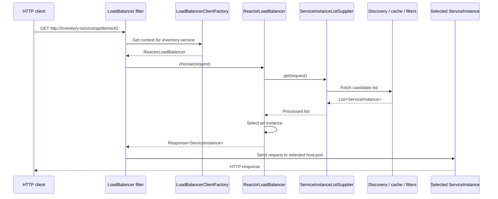
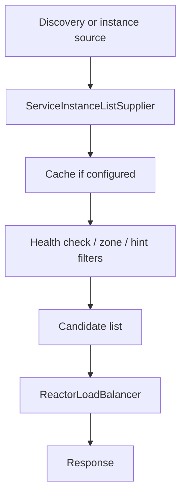

# ReactorLoadBalancer and ServiceInstance Selection Results

In client-side load balancing, the application sends a request to a service ID such as `inventory-service`. Before the request goes over the network, Spring Cloud LoadBalancer must obtain a list of instances capable of serving that service and choose one target instance. For reactive flows, the contract performing this selection is `ReactorLoadBalancer`; the selection result is represented by `Response<ServiceInstance>`.

Understanding these two types clearly separates three responsibilities that are often conflated: fetching candidate instances, selecting one candidate, and actually connecting to the selected instance. `ReactorLoadBalancer` handles selection; `ServiceInstanceListSupplier` provides the list; the HTTP client executes the request against the instance address in the result.

## 1. Where Does ReactorLoadBalancer Fit in the Architecture?

Spring Cloud LoadBalancer provides instance selection for integrated HTTP clients. Each service ID can have its own configuration and LoadBalancer beans inside a context managed by `LoadBalancerClientFactory`. The per-service-ID context contains the instance selector together with suppliers providing the instance list.

Key components:

| Component | Responsibility |
|---|---|
| `LoadBalancerClientFactory` | Creates and accesses LoadBalancer contexts per service ID. |
| `ReactorLoadBalancer<ServiceInstance>` | Accepts a selection request and returns the result as `Mono<Response<ServiceInstance>>`. |
| `ReactorServiceInstanceLoadBalancer` | Specialized contract for selecting a `ServiceInstance` in a reactive environment. |
| `ServiceInstanceListSupplier` | Supplies a list of `ServiceInstance` items; may read from discovery or apply caching, health checks, and filters. |
| `ServiceInstance` | Describes a concrete instance, typically including service ID, host, port, secure protocol flag, and metadata. |
| `Response<ServiceInstance>` | Carries the selected instance or indicates that no suitable instance is available. |

`ReactorLoadBalancer` focuses on the candidate-selection decision. It does not register services, start instances, or send HTTP requests. Those responsibilities belong to the discovery provider, supplier, and HTTP client, respectively.

## 2. Instance Selection Flow

When an HTTP client receives a URI using a service ID, such as `http://inventory-service/api/items/42`, the integration filter recognizes the host as a logical service name. The filter retrieves the LoadBalancer for `inventory-service`, creates a request context, and invokes `choose(...)`. The LoadBalancer retrieves the candidate list from the supplier and applies its selection algorithm.



Key steps:

1. **Identify the service ID.** The URI has host `inventory-service`, not an IP address or hostname of a specific replica.
2. **Retrieve the service-specific context.** `LoadBalancerClientFactory` provides the beans configured for this service ID.
3. **Request the candidate list.** `ServiceInstanceListSupplier` returns a list that may be filtered or refreshed based on the request context.
4. **Select a candidate.** `ReactorLoadBalancer` applies an algorithm such as round robin or random.
5. **Return the result.** The result indicates which instance was chosen or that no suitable instance exists.
6. **Send the request.** The HTTP client integration replaces the service ID with the selected instance's host, port, and scheme, then executes the request.

Successful selection only means LoadBalancer found a candidate from the available list. TCP connection, TLS, timeouts, and the HTTP response are only determined when the client actually communicates with that instance.

## 3. ReactorLoadBalancer and Reactivity

`ReactorLoadBalancer<T>` is a contract for choosing an object of type `T` using Reactor. In Spring Cloud LoadBalancer, the typical type is `ServiceInstance`, so the call looks like:

```java
Mono<Response<ServiceInstance>> result = loadBalancer.choose(request);
```

`Mono` represents an asynchronous result with at most one element. Selection may need to wait for the supplier to fetch the instance list, read from cache, or apply filtering steps. Therefore, the caller receives a publisher and continues processing the result using Reactor operators.

`ReactorServiceInstanceLoadBalancer` is the specialized variant for `ServiceInstance`. Built-in algorithms such as `RoundRobinLoadBalancer` and `RandomLoadBalancer` implement this contract. At the HTTP client layer, a filter usually calls LoadBalancer instead of the application manually picking a host and port.

The example below illustrates reading the result once you have a LoadBalancer for a service ID:

```java
Mono<ServiceInstance> chooseInstance(
        ReactorLoadBalancer<ServiceInstance> loadBalancer) {

    return loadBalancer.choose(new DefaultRequest<>())
        .flatMap(response -> {
            if (!response.hasServer()) {
                return Mono.error(new IllegalStateException(
                    "No available instance for inventory-service"));
            }

            return Mono.just(response.getServer());
        });
}
```

This is an example of the API shape and how to inspect the result. In real applications, the HTTP client integration typically manages retrieving the LoadBalancer by service ID and forwarding the request to the selected instance. Avoid calling `block()` inside a reactive flow just to unwrap the selection result; keep the processing chain as a `Mono` to avoid blocking the event loop.

## 4. ServiceInstanceListSupplier Provides the Candidate List

`ServiceInstanceListSupplier` decouples finding the instance list from the instance-selection algorithm. A supplier can obtain the list from a discovery client or a static/configured source, and then be wrapped by other suppliers for caching or filtering candidates.

Common suppliers include:

| Supplier / Feature Group | Role |
|---|---|
| `DiscoveryClientServiceInstanceListSupplier` | Fetches instances from a `DiscoveryClient` integrated with the registry. |
| `CachingServiceInstanceListSupplier` | Caches the list to reduce queries to the discovery source. |
| `HealthCheckServiceInstanceListSupplier` | Probes health endpoints and excludes unhealthy instances according to configuration. |
| `ZonePreferenceServiceInstanceListSupplier` | Prefers instances in the matching zone when zone metadata and configuration are provided. |
| `HintBasedServiceInstanceListSupplier` | Filters or prioritizes candidates based on request hints and corresponding metadata. |
| `SameInstancePreferenceServiceInstanceListSupplier` | Can prefer the previously selected instance based on context and configuration. |

Not every application enables all of these suppliers. The actual list depends on LoadBalancer configuration, the discovery source, and your Spring Cloud version. Decorator ordering also matters: for example, placing a cache before or after a filter can change which list gets cached and when it is refreshed.

General flow:



The supplier provides candidates, while the LoadBalancer algorithm decides which element from that list to select. An instance appearing in the list is not guaranteed to serve a request successfully at the exact moment of dispatch; health checks and discovery have latency, so the client still needs timeouts and connection error handling.

## 5. Response and the Returned ServiceInstance

The key result type is `Response<ServiceInstance>`. Callers typically check two methods:

- `hasServer()`: indicates whether the result contains a selected instance.
- `getServer()`: retrieves the `ServiceInstance` when the result has a server.

Two common response types:

| Response | Meaning | Handling |
|---|---|---|
| `DefaultResponse` | An instance was selected. | Retrieve `ServiceInstance` via `getServer()` and proceed to send the request. |
| `EmptyResponse` | No suitable instance was found in the provided list. | Map to a no-server error or a designed fallback mechanism. |

For example, when the registry has no instances registered for `inventory-service`, the supplier may return an empty list. The algorithm cannot pick a server and returns an empty instance response. Callers must check `hasServer()` before calling `getServer()`.

A `ServiceInstance` describes the connection target. Commonly used fields include:

| Field | Meaning |
|---|---|
| Service ID | Logical service to which the instance belongs. |
| Host | Hostname or IP address of the instance. |
| Port | Port the client should connect to. |
| Secure | Indicates whether the target URI should use a secure protocol. |
| Metadata | Additional details such as zone, version, or routing attributes. |

Example discovery list returning three instances:

| Service ID | Host | Port | Metadata zone |
|---|---|---:|---|
| `inventory-service` | `10.0.1.21` | 8080 | `zone-a` |
| `inventory-service` | `10.0.1.22` | 8080 | `zone-a` |
| `inventory-service` | `10.0.2.31` | 8080 | `zone-b` |

If the algorithm selects the second instance, the response contains the `ServiceInstance` with host `10.0.1.22` and port `8080`. The HTTP client uses that address to send the request. The caller should still retain the service ID in logs to correlate the selection with the original logical service.

## 6. Common Selection Algorithms

### 6.1. Round Robin

`RoundRobinLoadBalancer` rotates the selection position across the candidate list. Given a stable list of three instances A, B, and C, consecutive selections may yield A, B, C, A, B, C.

```text
List:          [A, B, C]
Pick position:  0  1  2  0  1  2
Result:         A  B  C  A  B  C
```

Round robin is useful when instances have comparable capacity and you want to distribute call counts evenly. It distributes by selection count, not by CPU usage, processing time, or in-flight requests. When the list changes, position calculation modulo list size also changes; do not assume strict ordering under concurrent requests.

### 6.2. Random

`RandomLoadBalancer` picks an element from the list at random. Over a large number of requests, distribution can approach uniform; in a small sample, one instance may receive several consecutive requests. Random does not automatically weight by CPU configuration or instance capacity.

### 6.3. Selecting by Custom Criteria

If you need to prioritize zone, metadata, version, or a specific subset of instances, consider filtering the list with an appropriate `ServiceInstanceListSupplier` before the selection algorithm runs. If the selection algorithm itself needs custom rules, you can provide a `ReactorServiceInstanceLoadBalancer` implementation.

Do not pack all discovery, health check, and selection logic into a single class. Separating these responsibilities simplifies testing, observability, and policy changes without tangling the request flow.

## 7. Configuring Algorithms per Service ID

Spring Cloud LoadBalancer lets you declare per-service configuration using `@LoadBalancerClient`. The following example changes the algorithm for `inventory-service` to random:

```java
@Configuration
@LoadBalancerClient(
    name = "inventory-service",
    configuration = InventoryLoadBalancerConfiguration.class
)
class InventoryClientLoadBalancerRegistration {
}
```

The configuration class used by LoadBalancer:

```java
class InventoryLoadBalancerConfiguration {

    @Bean
    ReactorLoadBalancer<ServiceInstance> inventoryLoadBalancer(
            Environment environment,
            LoadBalancerClientFactory factory) {

        String serviceId = environment.getProperty(
            LoadBalancerClientFactory.PROPERTY_NAME);

        return new RandomLoadBalancer(
            factory.getLazyProvider(
                serviceId, ServiceInstanceListSupplier.class),
            serviceId);
    }
}
```

This configuration follows Spring Cloud LoadBalancer's API pattern; ensure you use the proper dependencies and a Spring Cloud version compatible with your application. Keep `InventoryLoadBalancerConfiguration` outside the application's main component scan scope so the configuration only applies inside the intended LoadBalancer context. If placed inside global component scanning, its beans could affect other services.

If no custom algorithm is declared, Spring Cloud LoadBalancer's default configuration typically uses round robin. Check the per-service configuration and actual version in use before concluding which algorithm is active.

## 8. Missing Instances and Errors During Selection

Not all failures share the same root cause. Distinguish at least three scenarios:

| Scenario | Symptom | Investigation |
|---|---|---|
| No candidates | Supplier returns an empty list and the response has no server. | Check service ID, discovery registration, instance status, and supplier filters. |
| Failed to retrieve list | Publisher emits an error when accessing discovery or the supplier. | Check discovery source errors, timeouts, cache, and exceptions in the reactive chain. |
| Selected but connection failed | `ServiceInstance` exists, but the HTTP client hits connection refused, DNS, TLS, or timeout. | Check host/port, network, certificates, readiness, and instance response times. |

`EmptyResponse` means no instance was found to select; it is not synonymous with an HTTP `503` response returned by the target service. Depending on the integration and version, a no-server error may be turned into a client-side exception or an error response by an upstream gateway/controller. When diagnosing, explicitly record whether the error happened before or after an instance was selected.

Common root causes include:

- The service ID in the URI does not match the registered service name.
- Instances have not registered yet, were recently deregistered, or discovery is serving stale data.
- Health checks or zone/hint filters eliminated all candidates.
- The cache has not refreshed after a topology change.
- Metadata is missing or formatted differently from what the supplier expects.
- An instance was selected, but its host, port, or TLS configuration is unreachable from the caller.

Do not retry indefinitely when the list is empty or discovery is failing. Retries need bounds, backoff, and deadlines; if the topology has not changed, continuous retries only add load and obscure the root cause.

## 9. Request Context and Routing Policies

The `choose(request)` method accepts a request context so the algorithm or supplier can use additional information. In some configurations, the context can carry hints, request data, or metadata for instance preference. Request-aware suppliers can return different lists depending on the context.

For example, a request carrying hint `zone-a` can cause `HintBasedServiceInstanceListSupplier` to prioritize or filter instances carrying matching metadata, depending on configuration. Afterward, `RoundRobinLoadBalancer` can still distribute selections across the remaining list.

This shows that routing can consist of two stages:

1. **Candidate filtering:** decides which instances qualify based on zone, hint, health, or metadata.
2. **Instance selection:** applies round robin, random, or a custom algorithm to the remaining candidate set.

If no instance meets the criteria, the result can still be `EmptyResponse`, even when many instances are registered in the registry. Therefore, when debugging, inspect both the pre-filter and post-filter lists if your supplier configuration allows it.

## 10. Testing and Observing Selection Results

Tests should verify each layer's contract rather than testing only a final HTTP request:

- **Supplier:** verify the returned list, caching behavior, and health/zone/hint filters.
- **LoadBalancer:** with a fixed list, verify round robin or random according to algorithm characteristics; avoid writing order-dependent assertions under concurrent requests.
- **Response:** verify callers check `hasServer()` and handle missing-instance cases.
- **Integration:** send a request via service ID and verify it reaches the expected instance according to test discovery/configuration.
- **Failure paths:** simulate an empty list, a failing supplier, and an unreachable instance to verify all three cases are classified separately.

When observing in production, log the service ID, instance host/port or instance ID, algorithm, selection timestamp, candidate count if available, and request outcome. Correlate that data with trace/correlation IDs and response times to tell whether a failure occurred during discovery, selection, or transport. Do not log tokens, credentials, or sensitive request data.

## 11. Checklist When Working with ReactorLoadBalancer

- Identify the exact service ID and its corresponding LoadBalancer context.
- Understand where `ServiceInstanceListSupplier` sources its list and which decorators are active.
- Distinguish list filtering from the instance-selection algorithm.
- Handle `Response` by checking `hasServer()` before calling `getServer()`.
- Keep processing reactive; avoid blocking the event loop.
- Distinguish an empty list, supplier errors, and connection errors after an instance is selected.
- Choose round robin, random, or a custom algorithm based on real requirements; do not assume the algorithm automatically balances CPU or active request count.
- Configure timeouts, retries, and logging at the appropriate layer with clear deadlines and limits.

`ReactorLoadBalancer` decides which `ServiceInstance` to choose from the supplier-provided list and returns that decision via `Response`. Understanding this boundary makes configuring discovery, health checks, routing, and error handling in Spring Cloud LoadBalancer much easier to control.
