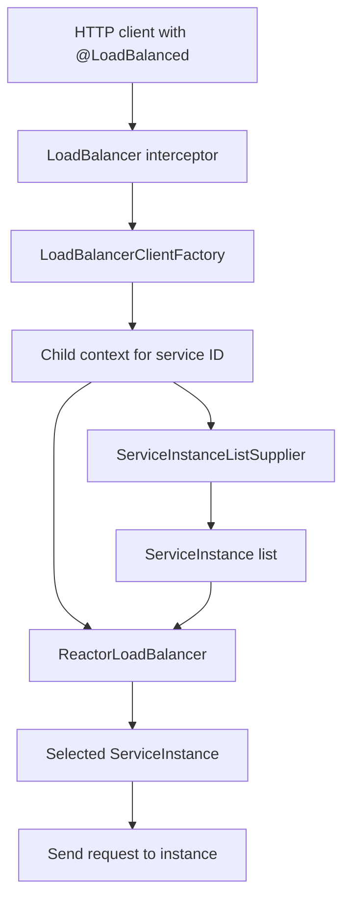
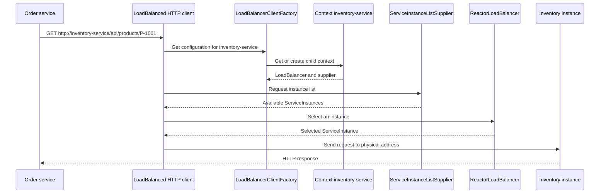

# LoadBalancerClientFactory and Per-Service-ID Contexts

In a multi-service system, each target service may require a different load balancing approach. `inventory-service` might use round robin, `payment-service` might prefer instances by zone, and `report-service` might need a distinct instance source or filter. If all services share a single global configuration, changing the strategy for one service can easily affect the others.

Spring Cloud LoadBalancer solves this with `LoadBalancerClientFactory`. The factory manages a **separate Spring context for each service ID**. Inside that context, the framework resolves `ReactorLoadBalancer`, `ServiceInstanceListSupplier`, and related components to serve requests for that specific service ID. This lets the application share a unified HTTP calling mechanism while configuring instance-selection policies independently per service.

## 1. Why Are Per-Service-ID Contexts Needed?

A service ID is the logical name a client uses to call a service, for example:

```text
http://inventory-service/api/products/P-1001
http://payment-service/api/payments/PAY-1001
```

In these two URLs, `inventory-service` and `payment-service` are not hostnames of specific machines. They are identifiers that Spring Cloud LoadBalancer uses to look up the corresponding `ServiceInstance` list and select one instance for the request.

Services can differ in:

- Discovery source and how the instance list is fetched.
- Instance-selection policy such as round robin or random.
- Instance list filters by zone, health check, hint, or metadata.
- Retry policy, lifecycle hooks, and request-related extension components.

If all configurations were placed in the main application context, beans could become shared global configuration. In that setup, a bean customized for `inventory-service` risks being applied to `payment-service` as well. Per-service contexts group beans under their respective service IDs and bound configuration scope.

## 2. Core Components in the Architecture

`LoadBalancerClientFactory` does not select instances itself. It creates and provides the context containing the components that perform instance selection.

| Component | Responsibility |
|---|---|
| `LoadBalancerClientFactory` | Manages child application contexts by service ID and retrieves beans from the corresponding context. |
| `LoadBalancerClient` / `BlockingLoadBalancerClient` | Provides blocking load-balanced call APIs for integrations that require them. |
| `ReactorLoadBalancer<ServiceInstance>` | Performs selection of a `ServiceInstance` from the available list. Example implementations include round robin and random. |
| `ServiceInstanceListSupplier` | Supplies the instance list for a service ID, potentially combining caching, health checks, or filters. |
| `LoadBalancerLifecycle` | Observes request phases and selection outcomes in lifecycle-aware integrations. |
| `@LoadBalanced` | Marks a builder or client to integrate with service ID resolution and instance selection. |

The relationship among these components can be visualized as follows:



`LoadBalancerClientFactory` routes lookups to the right set of beans for a given service ID. `ServiceInstanceListSupplier` supplies candidates, while `ReactorLoadBalancer` selects one candidate. Separating these roles allows changing instance sources or selection policies without rewriting HTTP calling logic.

## 3. LoadBalancerClientFactory and NamedContextFactory

`LoadBalancerClientFactory` is built on Spring Cloud's `NamedContextFactory` mechanism. This mechanism manages multiple child `ApplicationContext` instances, each bound to a name. For LoadBalancer, that name is the target service ID.

When an integration needs a LoadBalancer for `inventory-service`, the factory retrieves the context named `inventory-service`. If that context has not been created yet, the factory initializes it, links it to the application's parent context, and loads both default configuration and any custom configuration registered for that service ID. Subsequent calls reuse that context.

Illustrative diagram:

```text
Main ApplicationContext
│
├── Shared application beans
│
├── LoadBalancerClientFactory
│   │
│   ├── Context: inventory-service
│   │   ├── ReactorLoadBalancer<ServiceInstance>
│   │   ├── ServiceInstanceListSupplier
│   │   └── Extension beans for inventory-service
│   │
│   ├── Context: payment-service
│   │   ├── ReactorLoadBalancer<ServiceInstance>
│   │   ├── ServiceInstanceListSupplier
│   │   └── Extension beans for payment-service
│   │
│   └── Context: report-service
│       ├── ReactorLoadBalancer<ServiceInstance>
│       └── ServiceInstanceListSupplier
```

This is a conceptual diagram. The actual number and types of beans depend on your Spring Cloud version, installed starters, and application configuration.

Each child context has a parent-child relationship with the main context. Shared beans in the parent can be looked up from the child via Spring's hierarchy mechanism; beans registered specifically inside a child are scoped to that context. Thus, "isolated context" means per-service-ID configuration and beans are managed in a dedicated context, not that the child context completely loses visibility into shared parent beans.

Notable factory APIs include:

- `getInstance(serviceId, type)`: retrieves a bean of the requested type from the context for that service ID.
- `getLazyProvider(serviceId, type)`: obtains a lazy provider for a bean in that context; useful when the bean needs to be resolved after the context is ready.
- `LoadBalancerClientFactory.PROPERTY_NAME`: internal property name used to identify the service ID in the LoadBalancer context's environment.

Do not instantiate `LoadBalancerClientFactory` or child contexts manually in business code. Let Spring Cloud auto-configuration and annotations manage context lifecycles; only interact with the factory directly when writing intentional extension configurations.

## 4. Context Creation and Instance Selection Flow

Suppose an order service calls `inventory-service` through a `RestClient` annotated with `@LoadBalanced`. Conceptually, the processing flow is:

1. Application code sends a request to a logical URL with host `inventory-service`.
2. The client's interceptor recognizes that the request requires service ID resolution.
3. The LoadBalancer integration asks the factory for the beans for `inventory-service`.
4. The factory obtains the corresponding child context; if needed, the context is initialized from default and custom configurations.
5. `ServiceInstanceListSupplier` provides the list of `inventory-service` instances.
6. `ReactorLoadBalancer` applies the instance-selection strategy and returns the result.
7. The client replaces the logical host with the selected instance's address and sends the request.



This diagram simplifies internal calls; exact ordering among the interceptor, supplier, and load balancer can vary by HTTP client type and version. The important takeaway is that each service ID is resolved using the bean set of its corresponding context.

## 5. Registering Per-Service Configuration with @LoadBalancerClient

The `@LoadBalancerClient` annotation binds a configuration class to a service ID. For instance, an application may want `inventory-service` to use random load balancing while other services keep the default strategy.

Register the configuration on the application class:

```java
@SpringBootApplication
@LoadBalancerClient(
        name = "inventory-service",
        configuration = InventoryLoadBalancerConfiguration.class)
public class OrderApplication {

    public static void main(String[] args) {
        SpringApplication.run(OrderApplication.class, args);
    }
}
```

The custom configuration class provides a `ReactorLoadBalancer`:

```java
// Place this class in a package outside OrderApplication's component scan scope.
@Configuration(proxyBeanMethods = false)
public class InventoryLoadBalancerConfiguration {

    @Bean
    ReactorLoadBalancer<ServiceInstance> randomLoadBalancer(
            Environment environment,
            LoadBalancerClientFactory factory) {

        String serviceId = environment.getProperty(
                LoadBalancerClientFactory.PROPERTY_NAME);

        return new RandomLoadBalancer(
                factory.getLazyProvider(
                        serviceId, ServiceInstanceListSupplier.class),
                serviceId);
    }
}
```

`RandomLoadBalancer` chooses randomly from the instances returned by the supplier. The snippet above uses `serviceId` from the child context's environment so the factory fetches the `ServiceInstanceListSupplier` belonging to the configured service.

**Component scan note:** `InventoryLoadBalancerConfiguration` must reside outside the main application context's component scan scope. If this configuration class is scanned globally, its beans may be registered in the parent context and affect other service IDs. You can place the configuration class in a separate package outside the application's root package, and let `@LoadBalancerClient` load it solely into the context for `inventory-service`.

Commonly required imports for this example:

```java
import org.springframework.cloud.client.ServiceInstance;
import org.springframework.cloud.loadbalancer.core.RandomLoadBalancer;
import org.springframework.cloud.loadbalancer.core.ReactorLoadBalancer;
import org.springframework.cloud.loadbalancer.core.ServiceInstanceListSupplier;
import org.springframework.cloud.loadbalancer.support.LoadBalancerClientFactory;
```

Spring imports such as `@Bean`, `@Configuration`, `Environment`, and `@LoadBalancerClient` come from their respective Spring Framework and Spring Cloud packages in your project version.

## 6. Sharing a Default Configuration Across Multiple Service IDs

When multiple services need the same configuration, `@LoadBalancerClients` can declare a default configuration applied across LoadBalancer contexts. Individual service IDs can still have custom configurations via `@LoadBalancerClient`.

Example:

```java
// OrderApplication is in package com.example.order.
@SpringBootApplication
@LoadBalancerClients(
        defaultConfiguration = com.example.lbconfig.SharedLoadBalancerConfiguration.class)
public class OrderApplication {
    // main method
}
```

```java
// Package com.example.lbconfig is outside component scan package com.example.order.
package com.example.lbconfig;

@Configuration(proxyBeanMethods = false)
public class SharedLoadBalancerConfiguration {
    // Shared LoadBalancer configuration beans.
}
```

To customize `payment-service` specifically, you can also register:

Place the annotation below on the application class or the configuration class that registers LoadBalancer clients:

```java
@LoadBalancerClient(
        name = "payment-service",
        configuration = PaymentLoadBalancerConfiguration.class)
```

Here, `PaymentLoadBalancerConfiguration` provides beans dedicated to the `payment-service` context. Keep configurations clearly structured and verify version-specific ordering/precedence when the same bean type is declared in both default and per-service configurations. Avoid declaring two beans for the same purpose in the same context and expecting the framework to guess which one you want.

## 7. ServiceInstanceListSupplier in the Child Context

`ServiceInstanceListSupplier` determines which instance list feeds into the selection step. The initial source may come from `DiscoveryClient`, `ReactiveDiscoveryClient`, or a static list configured via `SimpleDiscoveryClient`. Additional suppliers can wrap that source to layer extra behavior.

| Supplier Group | Role |
|---|---|
| Discovery-based supplier | Fetches instances from a discovery client. |
| Configuration-based supplier | Supplies instances from configuration, useful for development or small setups. |
| Caching supplier | Caches the instance list to reduce repeated discovery queries. |
| Health-check supplier | Probes endpoint health according to configuration before returning instances. |
| Zone-preference supplier | Prefers instances in the same zone when metadata and configuration support it. |
| Hint-based supplier | Filters or prioritizes instances by request hints and matching metadata. |
| Same-instance / sticky-session supplier | Supports preferring the previous instance or affinity behavior per configuration. |

Not all suppliers are enabled automatically in every version. Some are optional or require additional configuration; verify your active configuration and supplier chaining order. For instance, misplacing a cache can delay health check updates, and a zone filter can yield an empty list if zone metadata does not match.

The factory ensures the supplier is resolved for the exact service ID. Consequently, `inventory-service` can use discovery and health checks while `report-service` uses a different instance list or filtering strategy without altering `payment-service`'s supplier.

## 8. Customizing Instance Selection Policies per Service

Suppose the architecture has three services:

| Service ID | Requirement | Suggested Configuration |
|---|---|---|
| `inventory-service` | Distribute requests fairly evenly across instances. | `RoundRobinLoadBalancer`. |
| `payment-service` | Pick randomly among eligible instances. | `RandomLoadBalancer`. |
| `report-service` | Prefer instances close to the caller's zone. | Zone-preference supplier combined with an appropriate strategy. |

Round robin and random are selection strategies, whereas zone preference is list filtering/prioritization behavior. They belong to different layers of the pipeline: the supplier determines the candidate set, and the load balancer picks one element from that set.

An example registering two separate policies:

```java
@SpringBootApplication
@LoadBalancerClients({
    @LoadBalancerClient(
        name = "inventory-service",
        configuration = InventoryLoadBalancerConfiguration.class),
    @LoadBalancerClient(
        name = "payment-service",
        configuration = PaymentLoadBalancerConfiguration.class)
})
public class OrderApplication {
}
```

`InventoryLoadBalancerConfiguration` can return `RoundRobinLoadBalancer`, while `PaymentLoadBalancerConfiguration` returns `RandomLoadBalancer`. Each configuration is loaded into the child context with the corresponding name.

Do not pick a strategy solely because its name sounds right. Round robin does not guarantee equal CPU load if requests have varying processing times; random does not guarantee even distribution over a short window either. Base your choice on workload characteristics, pool sizes, latency, health checks, and operational metrics.

## 9. Relationship Between Java Configuration and Per-Client Properties

Spring Cloud LoadBalancer supports global settings as well as certain client/service-ID-scoped properties. Per-client properties usually reside under the prefix:

```yaml
spring:
  cloud:
    loadbalancer:
      clients:
        inventory-service:
          # Place properties supported by your active version here.
```

This is a general layout showing configuration scoping. Specific property names, data types, and override behavior vary by version; consult the metadata or reference documentation for your project's release train before adding values.

Use Java configuration when you need to swap beans or algorithms, whereas properties suit parameters exposed by the framework such as health check timeouts, zones, retries, or caching. Do not assume every bean in the child context has a corresponding property.

When combining Java configuration and properties, verify which part creates a bean and which part tunes it. If Java config explicitly constructs a custom supplier or load balancer, a property intended to configure the default bean may no longer take effect as expected.

## 10. Common Mistakes When Working with Per-Service Contexts

| Symptom | Common Cause | How to Check |
|---|---|---|
| Per-service configuration affects every service | Custom configuration class was component-scanned into the parent context. | Move the configuration outside the scan package or exclude it from component scanning. |
| `ServiceInstanceListSupplier` not found | Supplier is not registered in the context, discovery/configuration source is missing, or custom config replaced the default bean. | Inspect auto-configuration conditions and beans inside the child context. |
| `serviceId` evaluates to `null` | Configuration is instantiated in the wrong context or lacks the property name supplied by the factory. | Verify the configuration is attached via `@LoadBalancerClient` and loaded inside the child context. |
| Two services unexpectedly share the same policy | Both receive the default configuration or the custom configuration is registered under the wrong name. | Compare the name in `@LoadBalancerClient` with the logical host in the request URL. |
| No instances remain after filtering | Supplier chain eliminated all instances due to health, zone, hint, or metadata mismatches. | Inspect the list before and after each supplier. |
| Duplicate beans or unclear which bean is active | Default and per-service configurations register conflicting bean types/names. | Check `@ConditionalOnMissingBean` conditions, qualifiers, and version-specific configuration behavior. |

The service ID in `@LoadBalancerClient(name = "...")` must match the logical host sent by the client. If you configure `inventory-service` but the URL calls `inventory`, the factory looks up the context named `inventory`, and your custom configuration may not be applied.

## 11. Observing and Verifying Per-Service-ID Configuration

When verifying custom configuration, test each service ID independently:

1. Record the logical host the client actually sends, e.g., `inventory-service`.
2. Verify `@LoadBalancerClient` uses that exact name and the configuration class is loaded into the child context.
3. Check which `ReactorLoadBalancer` and `ServiceInstanceListSupplier` are resolved in that context.
4. Verify the supplier returns an instance list before the load balancer picks one.
5. Send multiple observable requests, log the selected instances, and check whether the policy behaves as expected.
6. Repeat with a different service ID to ensure one service's configuration does not leak into another.

`LoadBalancerLifecycle` and HTTP client logging can help observe requests, selected instances, and execution outcomes, depending on the integration type. When enabling logs, prefer recording service ID, instance ID/host, status, and correlation ID; avoid logging tokens or sensitive payloads.

A simple verification is configuring `inventory-service` to use round robin and sending a sequence of requests to two local instances. If both instances are healthy and the supplier list is unfiltered, consecutive requests typically alternate between instances per the strategy. Observed behavior also depends on retries, concurrent requests, caching, health checks, and version specifics; do not treat a handful of requests as proof under all load conditions.

## 12. Checklist for Designing Per-Service LoadBalancer Configuration

- [ ] Service ID in `@LoadBalancerClient` matches the logical host of the request.
- [ ] Custom configuration class is excluded from component scanning in the main application context.
- [ ] Default configuration and per-service configuration have clear boundaries.
- [ ] `LoadBalancerClientFactory` manages contexts; `ReactorLoadBalancer` performs instance selection.
- [ ] `ServiceInstanceListSupplier` has a valid instance source and filters do not eliminate all candidates.
- [ ] Custom beans are registered in the intended child context.
- [ ] Java configuration and properties are verified against the active release train.
- [ ] At least two service IDs are tested independently to catch scope leakage.

Understanding the role of `LoadBalancerClientFactory` enables teams to organize per-service configuration in a controlled way. Each service ID can have its own supplier, algorithm, and hooks while HTTP-calling code keeps a consistent logical URL representation and API contract.
