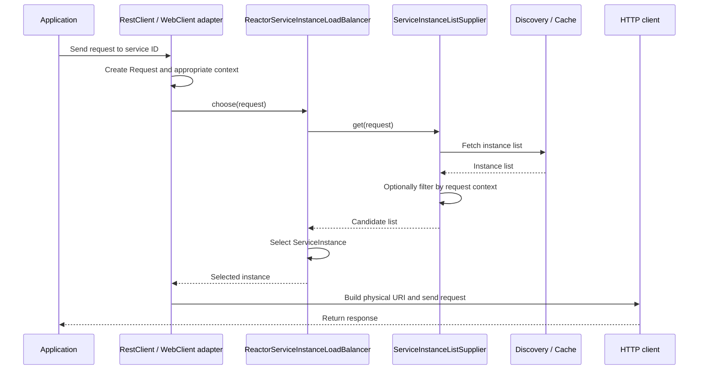

# Request, RequestDataContext, and Target Selection Inputs

Spring Cloud LoadBalancer does not rely solely on the service ID and the list of `ServiceInstance` objects. In certain scenarios, the instance-selection decision also depends on the outgoing request itself: its HTTP method, URI, headers, hint, or routing metadata added by the application. This data is passed through a `Request<T>` object so LoadBalancer components can inspect it when processing the request.

Understanding `Request`, `RequestDataContext`, and how request context flows through the stack enables building routing policies based on headers, API versions, or deployment zones, while avoiding confusion between target-selection metadata and the HTTP payload sent to the server.

## 1. Why Does LoadBalancer Need a Request Context?

In the basic calling pattern, the application specifies only the service ID:

```java
restClient.get()
        .uri("http://inventory-service/api/items/42")
        .retrieve()
        .body(Item.class);
```

If the policy is simply round-robin, LoadBalancer can pick an instance from the list without knowing any business details. However, real-world systems often require rules such as:

- Requests with header `X-Api-Version: v2` must only go to instances supporting API v2.
- Requests originating from a deployment zone prefer instances in the same zone to reduce latency.
- Read requests can be routed to a read-only instance pool, while write requests must go to writable instances.
- Requests carrying hint `canary` are routed to a canary instance group according to a defined policy.

To enforce such rules, the target-selection component needs access to the request's context. Spring Cloud LoadBalancer represents this input with `Request<T>`.

## 2. What Is Request<T>?

`org.springframework.cloud.client.loadbalancer.Request<T>` is a generic abstraction representing the request passed into LoadBalancer. It exposes its context through `getContext()`. The type parameter `T` allows the context to carry data suited to the client or routing policy.

Common types include:

| Type | Role |
|---|---|
| `Request<T>` | Common contract for LoadBalancer to receive a request along with its context |
| `DefaultRequest<T>` | Simple implementation wrapping an existing context |
| `RequestData` | Describes selected HTTP details such as headers, method, and URL |
| `RequestDataContext` | Context for requests with HTTP data; can also carry a hint |
| Custom context | Carries application-specific attributes, such as tenant or traffic group |

`Request<T>` is a wrapper around the context. It does not necessarily hold the full HTTP request body, nor is it the underlying `HttpServletRequest`, `ClientHttpRequest`, or WebFlux `ClientRequest` object itself.

Service ID and request context are two distinct inputs: the service ID identifies the target service group to look up; the context adds information about the current call so the supplier or LoadBalancer can filter and select within that group.

Example of a simple application-defined context:

```java
record RoutingContext(String tenant, String region, String apiVersion) {}

RoutingContext context = new RoutingContext(
        "tenant-a",
        "ap-southeast-1",
        "v2");

Request<RoutingContext> request = new DefaultRequest<>(context);
```

In this example, `DefaultRequest` holds the context so LoadBalancer components can read it via `request.getContext()`. How custom contexts are constructed and propagated into the call flow depends on the integration or extension your application implements.

## 3. RequestData and RequestDataContext

### 3.1. What HTTP Information Does RequestData Contain?

`RequestData` is an HTTP-layer request data model. Commonly used fields include:

| Field | Example | Use in Routing |
|---|---|---|
| HTTP method | `GET`, `POST`, `PUT` | Distinguish read and write requests where architecture permits |
| URL | `/api/items/42` | Classify API groups or paths |
| HTTP headers | `X-Api-Version: v2` | Select instances supporting a matching version or traffic group |

These fields help target-selection policies understand the outgoing request. `RequestData` is not a place to store responses and should not be treated as a full copy of the business payload. In particular, avoid designing routing rules that depend on reading large or streaming request bodies.

### 3.2. RequestDataContext Combines HTTP Data with Context

`RequestDataContext` is a specialized context in Spring Cloud Commons. It carries the call's `RequestData` and can provide a hint for custom suppliers or LoadBalancers to consume.

When the context is a `RequestDataContext`, processing components can read HTTP data as follows:

```java
if (request.getContext() instanceof RequestDataContext context) {
    RequestData clientRequest = context.getClientRequest();

    if (clientRequest != null) {
        HttpMethod method = clientRequest.getHttpMethod();
        URI url = clientRequest.getUrl();
        HttpHeaders headers = clientRequest.getHeaders();

        // Use method, URL, or headers as inputs to the target-selection policy.
    }

    String hint = context.getHint();
}
```

This snippet demonstrates reading the context; in production code, handle cases where the context is not a `RequestDataContext`, `clientRequest` is absent, or a header is missing. Do not assume every HTTP client type or every call path supplies the exact same context.

`RequestDataContext` is helpful when routing policies need visibility into HTTP attributes. If you only need a few application-computed attributes such as tenant or region, a custom context can be simpler and cleaner.

Once you have `RequestData`, the application or integration can attach a hint to the context before passing the request to LoadBalancer:

```java
RequestDataContext context = new RequestDataContext(requestData, "canary");
Request<RequestDataContext> request = new DefaultRequest<>(context);
```

This snippet shows the relationship between `RequestData`, hints, and `Request<T>`. In standard `@LoadBalanced` flows, the HTTP client integration constructs the request context; the application only needs to build a context manually when creating a custom call flow or extension.

### 3.3. What Is a Hint?

A hint is an extra routing value that can be attached to the request context. For example, an application might use `canary`, `stable`, or a processing group name to express the desired instance category.

Hints only take effect when a supplier or LoadBalancer is configured to read and apply them. Attaching a hint to the context does not alter the instance list by itself, nor does it teach the default round-robin algorithm what the hint means.

Never use hints as an authentication or authorization mechanism. If clients can supply hint values via headers, the server must verify the caller's permissions and accept only allowlisted values.

## 4. How Request Context Flows Through the LoadBalancer Architecture

General flow when an HTTP client integrates with Spring Cloud LoadBalancer:



Each component has a distinct role:

- **HTTP client adapter** receives the call from the application and turns the relevant details into a request context.
- **`Request<T>`** carries the context across the LoadBalancer call.
- **`ServiceInstanceListSupplier`** supplies the candidate list; a request-based supplier can read the context to filter the list.
- **LoadBalancer** selects one instance from the candidate list.
- **HTTP client** connects to the selected instance's endpoint and exchanges HTTP traffic.

Crucially, the supplier can receive the request. A supplier that only implements or uses a static list may ignore the context; when request-based routing is needed, use a supplier or custom configuration that handles `get(Request)`.

## 5. What Inputs Can Influence Target Selection?

The request context expands what information routing policies can use. However, data only affects the outcome when a component actively reads and applies it.

| Input | Example | Implementable Rule |
|---|---|---|
| Service ID | `inventory-service` | Identifies the target instance group to look up |
| HTTP method | `GET`, `POST` | Separates read/write pools if instances have different capabilities |
| URL/path | `/api/reports/**` | Selects an instance pool specialized for reporting |
| Version header | `X-Api-Version: v2` | Selects only instances supporting v2 |
| Zone header | `X-Preferred-Zone: zone-a` | Prefers instances in the same zone |
| Hint | `canary` | Filters or prioritizes a canary instance group |
| Custom context | tenant, region, capability | Applies system-specific policies |

Do not feed all request headers into target-selection logic. Pick only genuinely necessary fields with stable conventions and validated inputs.

### 5.1. Selecting Instances by API Version

Suppose the registry provides instances with metadata:

| Instance | `api-version` Metadata |
|---|---|
| `inventory-v1` | `v1` |
| `inventory-v2a` | `v2` |
| `inventory-v2b` | `v2` |

A request with header `X-Api-Version: v2` needs a candidate list containing only instances that support v2. Workflow:

1. Read the header from `RequestDataContext`.
2. Validate that the value belongs to the set of system-supported versions.
3. Retrieve the instance list from the delegate supplier.
4. Filter instances whose `api-version` metadata matches the requested version.
5. If no instance matches, apply an explicitly defined fallback.

Pseudocode for the filtering step:

```java
List<ServiceInstance> filterByApiVersion(
        List<ServiceInstance> instances,
        String requestedVersion) {

    if (requestedVersion == null || requestedVersion.isBlank()) {
        return instances;
    }

    return instances.stream()
            .filter(instance -> {
                Map<String, String> metadata = instance.getMetadata();
                return metadata != null
                        && requestedVersion.equals(metadata.get("api-version"));
            })
            .toList();
}
```

This helper illustrates the filtering rule. When integrating it into a `ServiceInstanceListSupplier`, guard against null metadata and handle empty results. If no v2 instance is available, do not silently route the request to v1 unless the API contract and business rules permit that fallback.

### 5.2. Selecting Instances by HTTP Method

A system may separate query-serving instances from write-handling instances. For example, metadata `capability=read` or `capability=write` is registered per instance.

Rules might be:

- `GET`, `HEAD` consider only instances with `capability=read` or `capability=read-write`.
- `POST`, `PUT`, `PATCH`, `DELETE` consider only instances with `capability=write` or `capability=read-write`.
- Unrecognized methods follow a default policy or are rejected per system requirements.

The HTTP method is a technical hint and does not always capture full business semantics. Some APIs use `POST` for queries or trigger side effects in seemingly read-only requests. Define instance capabilities by API contract rather than relying purely on HTTP methods in complex systems.

### 5.3. Selecting Instances by Tenant or Zone

If requests must route by tenant, region, or zone, establish a trusted source for that data. Tenant ID can be taken from an authenticated security context or internal application state; do not blindly trust an arbitrary header set by an end user.

For example, the application resolves that `tenant-a` belongs to `region-a`, and places `region-a` into a custom context. The supplier can prefer instances in the same region. If that region has no instances, policy can allow falling back to another region or return an error depending on latency, data locality, and availability requirements.

## 6. Request Context and ServiceInstanceListSupplier

`ServiceInstanceListSupplier` is the primary extension point when you want the candidate list to vary per request. A base supplier can supply the list from discovery or cache; a request-based supplier accepts `Request` to apply context-driven filtering.

The processing flow typically looks like:

```text
Request<T>
   |
   v
ServiceInstanceListSupplier.get(request)
   |
   v
Delegate supplier (discovery / cache)
   |
   v
Filter by hint / header / custom context
   |
   v
Candidate ServiceInstance list
   |
   v
ReactorServiceInstanceLoadBalancer.choose(request)
   |
   v
Selected ServiceInstance
```

When implementing a custom supplier, preserve these properties:

- Invoke the delegate with the current request so context is not dropped along the supplier chain.
- Return a newly filtered list rather than mutating a shared list returned by a cache or delegate.
- Explicitly handle unexpected context types, missing headers, and null metadata.
- Define behavior when the filtered list is empty.
- Avoid calling discovery or health endpoints synchronously per request if a dedicated supplier/cache is already present.
- Keep filters simple, fast, and observable.

Pseudocode illustrating how to structure the filter:

```java
// Pseudocode: placed inside a custom ServiceInstanceListSupplier.
Flux<List<ServiceInstance>> get(Request request) {
    return delegate.get(request)
            .map(instances -> {
                String version = readRequestedVersion(request);
                return filterByApiVersion(instances, version);
            });
}
```

This is pseudocode describing the processing flow, not a complete class you can copy verbatim. When implementing, extend or wrap a supplier using the API of your Spring Cloud version and ensure the supplier configuration is bound to the proper service ID.

## 7. Request Context Across Spring HTTP Clients

### 7.1. RestClient

`RestClient` can use a builder annotated with `@LoadBalanced`. The LoadBalancer integration handles URLs containing a service ID and creates a request context matching the active call path.

```java
@Configuration
class InventoryClientConfiguration {

    @Bean
    @LoadBalanced
    RestClient.Builder loadBalancedRestClientBuilder() {
        return RestClient.builder();
    }
}
```

Business logic code:

```java
@Service
class InventoryGateway {
    private final RestClient client;

    InventoryGateway(@LoadBalanced RestClient.Builder builder) {
        this.client = builder.build();
    }

    Item findItem(long id, String apiVersion) {
        return client.get()
                .uri("http://inventory-service/api/items/{id}", id)
                .header("X-Api-Version", apiVersion)
                .retrieve()
                .body(Item.class);
    }
}
```

The header is sent in the HTTP request and may be exposed inside request data to LoadBalancer components depending on the integration. For the header to actually influence instance selection, you must configure a supplier or policy that reads it; adding a header alone does not enable version filtering automatically.

### 7.2. WebClient

`WebClient` uses a `@LoadBalanced` builder to call a service ID:

```java
@Configuration
class InventoryWebClientConfiguration {

    @Bean
    @LoadBalanced
    WebClient.Builder loadBalancedWebClientBuilder() {
        return WebClient.builder();
    }
}
```

Example sending a request with a version header:

```java
Mono<Item> findItem(WebClient client, long id, String apiVersion) {
    return client.get()
            .uri("http://inventory-service/api/items/{id}", id)
            .header("X-Api-Version", apiVersion)
            .retrieve()
            .bodyToMono(Item.class);
}
```

With WebFlux, the request context is propagated through WebClient's filter/integration. When writing a custom filter or supplier, preserve context across the reactive chain and avoid blocking to read routing data.

### 7.3. OpenFeign

OpenFeign typically uses the name in `@FeignClient` as the service ID:

```java
@FeignClient(name = "inventory-service")
interface InventoryClient {

    @GetMapping("/api/items/{id}")
    Item findItem(
            @PathVariable long id,
            @RequestHeader("X-Api-Version") String apiVersion);
}
```

Feign can integrate with Spring Cloud LoadBalancer to select instances. Request data is passed through Feign's integration; how the context is built and which fields are populated depend on the active version and client configuration. If a policy needs custom data beyond what the integration provides, add an appropriate context-propagation mechanism rather than assuming every attribute of a Feign request automatically appears in `RequestDataContext`.

## 8. Request Context and Lifecycle Callbacks

Spring Cloud LoadBalancer can integrate `LoadBalancerLifecycle` to observe request phases: instance selection start, request execution start, and request completion. Callbacks receive request/response or completion contexts depending on the phase, helping applications gather operational telemetry.

Information that can be recorded includes:

- Service ID and selected instance.
- HTTP method or API group.
- Applied hint or routing group.
- Success/failure outcome and exception type.
- Selection duration and request execution duration if the integration provides the timing hooks.

Avoid putting tenant IDs, tokens, cookies, sensitive query parameters, or full header maps into metric labels. High-cardinality values inflate metric series, strain monitoring systems, and risk data exposure. Only record allowlisted, normalized fields needed for diagnostics.

## 9. Common Errors When Using RequestDataContext

| Symptom | Possible Cause | How to Check |
|---|---|---|
| Supplier does not see the expected header | Integration did not populate the header into context, header name typo, or request was built at a different layer | Inspect context type, `RequestData`, headers, and Spring Cloud version |
| Header is present but instance selection is unchanged | Supplier or LoadBalancer does not read the header; default algorithm ignores context | Verify the supplier implements/handles `get(request)` and inspect filter logic |
| Request fails when context is not `RequestDataContext` | Code casts directly without checking the context type | Use `instanceof`, handle null contexts, and define clear fallbacks |
| No instances remain after filtering | Hint/version value does not match metadata or no fallback is defined | Log normalized values and candidate lists before/after filtering |
| Request routed to wrong zone or tenant | Untrusted caller header was accepted without validation or metadata mapping is wrong | Establish trusted tenant/region sources and verify registry metadata |
| Reactive requests stall or throughput drops | Supplier/filter performs blocking operations or external calls on every request | Inspect threads, filter execution time, and apply proper caching |

When diagnosing, distinguish the created request context, the context received by the supplier, the post-filter candidate list, and the final selected instance. Observing only requests arriving at the server makes it difficult to tell whether a bug lies in context propagation or in target selection.

## 10. Design Principles for Request-Based Routing

- Include in the context only the data needed for target selection.
- Use `RequestDataContext` when you need HTTP method, URL, headers, or hints; use a custom context when the data is application-domain state.
- Check context type and null values before reading fields.
- Normalize and validate headers/hints before using them to filter instances.
- Never use caller-supplied values to bypass authentication or authorization.
- Keep suppliers/filters non-blocking and avoid querying the registry or health endpoints per request.
- Define a fallback when no matching instances exist, especially for API versions, tenants, and traffic groups.
- Pass the original request through when calling a delegate supplier so context is not lost along the chain.
- Record service ID, policy group, and selected instance using metrics/logs with bounded cardinality.
- Test missing contexts, malformed inputs, zero matching candidates, and slow registry updates.

Understanding `Request<T>` as the context carrier and `RequestDataContext` as an HTTP-aware context lets you extend Spring Cloud LoadBalancer to select instances based on per-request attributes. Routing behavior only changes when a supplier or LoadBalancer is configured to read that context and apply the corresponding rules.
