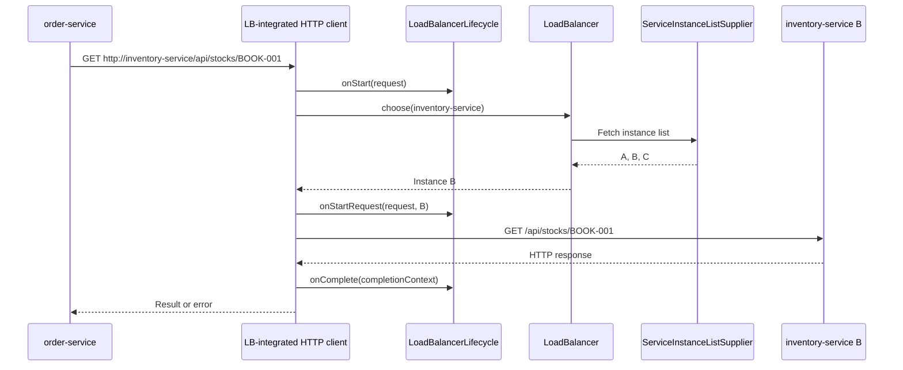

# LoadBalancerLifecycle and the Phases of a Service Call

When `order-service` calls `inventory-service` through Spring Cloud LoadBalancer, a request does not consist solely of "send" and "receive" moments. Before sending the request, the client side must identify the service ID, retrieve the replica list, select a `ServiceInstance`, and transform the logical URI into a physical instance URI. Only then does the client execute the HTTP call and receive a result or error.

**`LoadBalancerLifecycle`** is a callback mechanism for observing those key moments along the process. It is useful for structured logging, metrics, error diagnostics, and telemetry integration. To use it properly, understand the distinction between **starting load balancing**, **having selected an instance and preparing to send the request**, and **completing an execution pass**.

> Lesson scope: architecture and callbacks of Spring Cloud LoadBalancer in client-side HTTP communication. Exact type names and integration details depend on the Spring Cloud version and HTTP client in use. Code examples use `RequestDataContext`, `ResponseData`, and `ServiceInstance` to illustrate a common HTTP integration style.

## 1. Why Observe the LoadBalancer Lifecycle?

Suppose a client calls a logical address:

```text
GET http://inventory-service/api/stocks/BOOK-001
```

The system has three instances of `inventory-service`:

| Instance | Address | Role in Example |
| --- | --- | --- |
| A | `10.0.1.11:8080` | Replica capable of serving requests |
| B | `10.0.1.12:8080` | Replica capable of serving requests |
| C | `10.0.1.13:8080` | Replica capable of serving requests |

When a request fails, key questions arise:

- Did the client even start the instance-selection process?
- Did `ServiceInstanceListSupplier` provide any instances?
- Did LoadBalancer choose A, B, or C?
- Was the request handed to the HTTP client to send to the chosen instance?
- Was a response received, an exception thrown, or the call canceled before sending?

If you only log inside the controller of `inventory-service`, you cannot see calls that fail before reaching the server. If you only inspect HTTP status codes, you still do not know which instance was selected. `LoadBalancerLifecycle` callbacks fill in that visibility on the caller side.

## 2. Where LoadBalancerLifecycle Sits in the Request Flow

In a typical call, an HTTP client integrated with LoadBalancer interacts with the selection algorithm and the instance list supplier. Lifecycle observation callbacks fire around those steps.



The diagram depicts a **typical happy path** to show the relative placement of callbacks. Error branches, retries, timeouts, or cancellations can alter the sequence. Specifically, if no instance is found, no HTTP call is sent to a target instance; some integrations may skip the pre-request callback. Do not assume all three callbacks always fire exactly once in every scenario.

## 3. The LoadBalancerLifecycle Contract

`LoadBalancerLifecycle` is an interface parameterized with generic types representing the request context, response context, and selected server type. For HTTP calls in Spring Cloud, you commonly see:

```java
LoadBalancerLifecycle<RequestDataContext, ResponseData, ServiceInstance>
```

Meaning of the three type parameters:

| Type | Role |
| --- | --- |
| `RequestDataContext` | Request context passed by the LoadBalancer-integrated client into the lifecycle |
| `ResponseData` | Response data supplied at the completion stage, if available |
| `ServiceInstance` | Type representing the concrete selected instance |

Three core callbacks:

| Callback | Meaningful Moment | Notable Information |
| --- | --- | --- |
| `onStart(request)` | Start of a LoadBalancer execution pass | Initial request/context; selected instance is typically not known yet |
| `onStartRequest(request, lbResponse)` | After instance selection and before executing the call to the target | Selection outcome; can correlate service ID with a specific instance |
| `onComplete(completionContext)` | When the call finishes per the integrated client's mechanics | Completion status, LoadBalancer result, response, or exception if provided |

The interface also includes a `supports(...)` mechanism to check whether a lifecycle implementation matches the request, response, and server types used by the client. This matters when an application mixes multiple HTTP client types or multiple LoadBalancer usage patterns.

**Callbacks are observation points**, not an instance-selection API. Algorithms such as Round Robin or Random perform selection; `ServiceInstanceListSupplier` prepares the candidate list; `LoadBalancerLifecycle` receives notifications at points along the execution.

## 4. Callback onStart: Beginning a LoadBalancer Pass

`onStart(Request<RC> request)` is invoked when the LoadBalancer operation begins. Here, the application can record a new call and extract relevant details from the request context.

Examples of useful information:

- Target service ID, such as `inventory-service`.
- Trace ID or correlation ID to link related logs.
- HTTP method or sanitized path if present in the context.
- Start timestamp for measuring total pass duration.

**Do not log "request sent to instance B" at this stage.** Replica selection has not finished yet, so there is no basis to know the target instance. If discovery returns an empty list, the process may terminate without any HTTP connection to `inventory-service`.

Example of an appropriate log line:

```text
traceId=ac17... event=loadbalancer.start serviceId=inventory-service
```

This log only indicates that the caller started processing a LoadBalancer call; it **does not prove** that any replica received the request.

## 5. Callback onStartRequest: Instance Selected, About to Send Request

`onStartRequest(Request<RC> request, Response<T> lbResponse)` is invoked once the client has the LoadBalancer selection result and is preparing to execute the request against the target instance.

`lbResponse` is the **LoadBalancer selection response**, not the HTTP response from `inventory-service`. This is easy to confuse because both use the word "response."

On a successful selection, `lbResponse.getServer()` can provide the selected `ServiceInstance`. This information can be logged or attached to telemetry tags:

```text
traceId=ac17... event=loadbalancer.selected
serviceId=inventory-service instanceId=inventory-b host=10.0.1.12 port=8080
```

In this example, LoadBalancer selected instance B. However, this callback fires **before the actual HTTP call**, so you still cannot conclude that the TCP/TLS connection succeeded, the instance received the request, or the server processed the business logic.

When reading the selection outcome, handle the case where no valid server is present if the integration's API can reach this callback without one. Never call `getServer()` assuming an instance is always non-null. Also, if LoadBalancer exits early due to an empty list, some execution paths may skip `onStartRequest`.

## 6. Callback onComplete: Finishing the Call

`onComplete(CompletionContext<RES, T, RC> completionContext)` is triggered when the execution pass ends according to the LoadBalancer-integrated client's logic.

A completion context may provide:

- Completion status of the pass.
- Request/context attached to the call.
- LoadBalancer selection result and associated instance.
- Response from the actual call, if received and populated by the integration.
- Exception/cause if the process encountered an error and the integration supplies it.

Lifecycle statuses are typically described as `SUCCESS`, `FAILED`, and `DISCARD`. Interpret them **according to the integration's contract**, rather than mechanically equating them with HTTP status codes or business outcomes:

| Status | Correct Interpretation |
| --- | --- |
| Lifecycle reports `SUCCESS` | The call completed cleanly per integration rules; you still must inspect HTTP status and body to know if business logic succeeded |
| Lifecycle reports `FAILED` | The pass was recorded as failed; inspect the exception, status, and context to find the cause |
| Lifecycle reports `DISCARD` | The pass was discarded or could not proceed along an integration branch; check the specific reason, such as no available instance |

For example, `inventory-service` might return `HTTP 200` with a body containing `success=false` and `code=INSUFFICIENT_STOCK`. At the connection and HTTP exchange level, the call completed normally. At the business level, the request was still rejected. Lifecycle callbacks do not replace reading and interpreting the response body per the API contract.

Similarly, a `FAILED` status alone does not prove the server returned `500`: the failure could have happened before reaching the server, during connection establishment, while reading the response, or in the client layer.

## 7. Example Implementation of a Logging Lifecycle

The following example registers a Spring bean implementing `LoadBalancerLifecycle` for HTTP contexts. Callbacks are kept lightweight, recording only timing points and the instance. Detailed error analysis can live in the HTTP client layer, tracing, or application exception handlers.

```java
import org.slf4j.Logger;
import org.slf4j.LoggerFactory;
import org.springframework.cloud.client.ServiceInstance;
import org.springframework.cloud.client.loadbalancer.CompletionContext;
import org.springframework.cloud.client.loadbalancer.LoadBalancerLifecycle;
import org.springframework.cloud.client.loadbalancer.Request;
import org.springframework.cloud.client.loadbalancer.RequestDataContext;
import org.springframework.cloud.client.loadbalancer.Response;
import org.springframework.cloud.client.loadbalancer.ResponseData;
import org.springframework.stereotype.Component;

@Component
class InventoryLoadBalancerLifecycle implements
        LoadBalancerLifecycle<RequestDataContext, ResponseData, ServiceInstance> {

    private static final Logger log =
            LoggerFactory.getLogger(InventoryLoadBalancerLifecycle.class);

    @Override
    public void onStart(Request<RequestDataContext> request) {
        log.debug("loadbalancer.start");
    }

    @Override
    public void onStartRequest(
            Request<RequestDataContext> request,
            Response<ServiceInstance> lbResponse) {

        if (lbResponse != null && lbResponse.hasServer()) {
            ServiceInstance instance = lbResponse.getServer();
            log.debug("loadbalancer.selected serviceId={} host={} port={}",
                    instance.getServiceId(),
                    instance.getHost(),
                    instance.getPort());
        } else {
            log.debug("loadbalancer.selected no-server");
        }
    }

    @Override
    public void onComplete(
            CompletionContext<ResponseData, ServiceInstance, RequestDataContext> context) {
        log.debug("loadbalancer.complete status={}", context.getStatus());
    }
}
```

This example uses common Spring Cloud LoadBalancer types and callbacks. When applying it, verify API signatures against your Spring Cloud version and confirm that your client actually emits the corresponding lifecycle events. `@Component` registers the bean in the Spring context; effective scope depends on how the integration discovers lifecycle beans and the result of `supports(...)`.

The code intentionally avoids storing `startTime` in a field on the singleton bean. Many requests can run concurrently; a shared field would be overwritten and produce corrupted measurements. To measure duration, use an observability mechanism supporting per-request correlation, or store timestamps in a per-request context with clear cleanup.

## 8. Distinguishing Three Outcomes Often Conflated

Within a single call, at least three distinct outcomes must be kept separate:

| Outcome Type | Question It Answers | Example |
| --- | --- | --- |
| Instance selection result (`Response<ServiceInstance>`) | Which replica did LoadBalancer choose? | Instance B at `10.0.1.12:8080` |
| HTTP outcome | What status/body did the HTTP call receive, or what I/O error occurred? | `HTTP 503`, `HTTP 200`, read timeout |
| Business outcome | Was the requested action valid and accepted? | `INSUFFICIENT_STOCK`, `ORDER_ALREADY_CONFIRMED` |

Placing these outcomes side by side prevents false conclusions:

- "B was selected" **does not mean** B was reachable.
- "`HTTP 200` was received" **does not mean** business logic succeeded.
- "No replica was found" **does not mean** `inventory-service` returned `HTTP 404`; no HTTP request may have been sent at all.
- "`onComplete` ran" **does not guarantee** a valid response body or successful downstream business processing.

## 9. Abnormal Branches to Account For in the Lifecycle

Not every request follows the happy path shown at the start of the lesson. During incidents, observation points can shift:

| Scenario | What to Observe | Explanation |
| --- | --- | --- |
| Discovery returns no instances | Whether a start event fired; what the selection result was | No instance exists to send to; may terminate early |
| Supplier filters out all instances | Whether the post-filter list is empty | Discovery may hold data while LoadBalancer has zero candidates left |
| Instance selected but connection refused | Selected instance; connection exception | `onStartRequest` does not prove the HTTP request reached the server |
| HTTP client hits read timeout | Selected instance; elapsed time; root cause | Server may have received and processed the request while client missed the response |
| Downstream returns `503` | HTTP status, retry policy, instance | Valid HTTP response arrived; separate upstream error from lifecycle status |
| Caller cancels a reactive call | Whether request was canceled; whether integration emits completion callback | Subscription cancellation and network completion are not always identical |
| Retry shifts to another instance | Attempt count and instance per attempt | One business request can produce multiple selections or multiple HTTP sends |

**Do not expect invocation counts of `onStart`, `onStartRequest`, and `onComplete` to always match.** Frequency and call paths depend on the client, retry configuration, exception handling, and integration version. When building dashboards, clarify whether an event corresponds to a single **attempt**, an **instance selection**, or an end-to-end **business request**.

## 10. Retries Turn One Business Call into Multiple Attempts

Suppose `order-service` performs a single business call while configuration enables retries on connection errors:

```text
Business request: GET /api/stocks/BOOK-001
  Attempt 1: select instance A -> connection refused
  Attempt 2: select instance C -> HTTP 200
  Business result: response received from attempt 2
```

From a business perspective, there is one inventory check call. From an infrastructure perspective, there may be two instance selections and two request attempts. Dashboards should therefore separate:

- **Business requests:** total logical calls initiated by `order-service`.
- **LoadBalancer attempts/selections:** total selections and instance-call attempts, depending on which events the integration emits.
- **HTTP responses and connection errors:** HTTP calls completed or failed as seen by the client.

These numbers do not necessarily match when retries are enabled. Measuring error rate solely by failed attempt selections can make the system look worse than the caller's actual experience; conversely, looking only at final business outcomes can hide an instance that is constantly failing and forcing retries.

For write operations, retries must also account for idempotency. A timeout can happen after the server already executed the mutation; a client-side lifecycle failure does not prove the server never ran the operation.

## 11. Measuring Latency at Appropriate Milestones

The three lifecycle milestones form a relative timing model:

```text
T0                      T1                               T2
onStart                 onStartRequest                   onComplete
  |-----------------------|--------------------------------|
     Fetch list and          HTTP client executes call,
     select instance         receives response or error
```

On the normal path:

- **T0 → T1:** interval associated with fetching/supplying the instance list and picking a target; may include caching, filtering, or integration overhead.
- **T1 → T2:** interval associated with executing the call after an instance is selected; may include connection setup, server wait time, and client-side response handling.
- **T0 → T2:** lifecycle-observed processing time for that pass, not necessarily equal to total end-to-end business duration if extra steps or outer retries wrap it.

This is a **relative interpretation of milestones**, not a guarantee of a clean separation between pure discovery time and pure network time. In reactive applications, scheduling and asynchronous operators can influence when callbacks actually run. Use timers/observations that correlate per request instead of comparing raw wall-clock timestamps across unrelated requests.

If your project uses Micrometer or Spring Observability, leverage the metrics/tracing integration of your deployed version. Some Spring Cloud LoadBalancer versions provide lifecycles that collect statistics via Micrometer when the appropriate dependencies and configuration are enabled. Check metric names and tags per version rather than assuming every metric appears by default.

## 12. Responsibility Boundaries of Lifecycle and Practices to Avoid

`LoadBalancerLifecycle` is meant for **observing** progress, while other tasks belong elsewhere:

| Requirement | More Appropriate Component |
| --- | --- |
| Filtering replicas by zone, metadata, or health | `ServiceInstanceListSupplier` and configured suppliers/filters |
| Changing the replica selection algorithm | `ReactorLoadBalancer` / corresponding selector implementation |
| Managing registered instance lists | Discovery client and service registry |
| Timeouts, retries, and HTTP status handling policies | HTTP client, retry policy, and configured LoadBalancer integration |
| Classifying business errors from response bodies | Client adapter or business service layer |
| Recording timing milestones and selection outcomes | `LoadBalancerLifecycle`, metrics, and tracing |

Practices to avoid when writing callbacks:

1. **Avoid long blocking I/O** inside callbacks, especially on reactive pipelines; logging or metric export must be lightweight and async-friendly.
2. **Do not throw arbitrary exceptions** merely for telemetry, because an observer error can break real requests.
3. **Do not store per-request state in shared fields** of a singleton lifecycle without safe per-request correlation for concurrent traffic.
4. **Do not log full headers, tokens, or bodies**; log only necessary fields with sensitive data redacted.
5. **Do not replace business logic with callbacks**: `onComplete` is not the place to decide whether an order is valid or inventory is sufficient.
6. **Do not trigger ad-hoc retries inside callbacks**: retries need clear policies, overall time bounds, and idempotency handling.

Overly verbose logging in a lifecycle can increase latency and system load. Choose log levels, sampling, metric tags, and granularity aligned with your observability goals.

## 13. Practical Scenario: Analyzing a Failed Request

Suppose the system records:

```text
traceId=4a19... event=loadbalancer.start serviceId=inventory-service
traceId=4a19... event=loadbalancer.selected serviceId=inventory-service host=10.0.1.12 port=8080
traceId=4a19... event=loadbalancer.complete status=FAILED
traceId=4a19... event=http.error cause=ConnectException message=Connection refused
```

You can conclude:

1. The caller started handling a call to service ID `inventory-service`.
2. LoadBalancer selected instance `10.0.1.12:8080`.
3. The call failed at the connection step to the selected instance.
4. There is no basis to conclude `inventory-service` returned an HTTP error code or ran business logic.

Next diagnostic steps are checking the process and port on instance B, registration data in service discovery, cache staleness, health checks, and retry policies. If other instances are healthy, you can consider allowing the client to try another instance within strict bounds.

Another log set:

```text
traceId=5b20... event=loadbalancer.start serviceId=inventory-service
traceId=5b20... event=loadbalancer.selected serviceId=inventory-service host=10.0.1.13 port=8080
traceId=5b20... event=loadbalancer.complete status=SUCCESS
traceId=5b20... event=inventory.result httpStatus=200 businessCode=INSUFFICIENT_STOCK
```

In this example, the call finished normally at the HTTP layer as evaluated by the integration, yet business logic lacked sufficient stock. Switching instances or immediately retrying will not resolve a business error if all replicas read consistent data.

## 14. Self-Check Questions

1. How does `LoadBalancerLifecycle` differ from `ServiceInstanceListSupplier` and `RoundRobinLoadBalancer`?
2. Why can `onStart` not yet report the final host and port of the request?
3. In `onStartRequest`, is `lbResponse` the instance-selection result or the HTTP response from the server?
4. Does `onComplete` reporting a successful pass always mean business logic succeeded? Why or why not?
5. When a request finds no available instance, should you assume all three callbacks are always invoked?
6. Why might callback invocation counts not equal business request counts when retries are enabled?
7. If you want to filter out instances in other zones, should that logic live in the lifecycle or the supplier? Explain.
8. Which details should you collect from callbacks and the HTTP client to distinguish instance-selection failures, connection failures, and business errors?

Key takeaway: `onStart` marks the beginning of LoadBalancer processing; `onStartRequest` reveals the instance selection before the actual call; `onComplete` supplies context when the pass finishes. Reading these milestones alongside discovery data, HTTP exceptions, and business outcomes yields a much clearer picture of inter-service communication.
