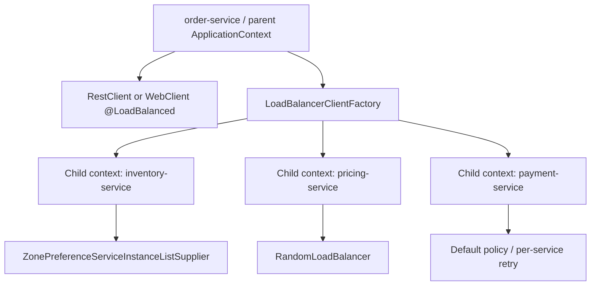

# Shared Configuration and Per-Service-ID Configuration

## Objectives

When a Spring application calls multiple internal services, each service may require a different load-balancing strategy. For example, `order-service` calls `inventory-service` frequently and wants to prefer instances in the same deployment zone, whereas `pricing-service` has equivalent instances and wants random selection. Retry limits and health-check intervals may also differ per service.

Spring Cloud LoadBalancer supports combining **shared configuration** with **per-service-ID configuration**. Understanding this scope properly helps avoid situations where changing configuration for one service unintentionally affects every HTTP client in the application.

After this lesson, you will be able to:

- Identify where the service ID is obtained from when using `RestClient`, `WebClient`, or OpenFeign.
- Distinguish between default properties `spring.cloud.loadbalancer.*` and per-service properties `spring.cloud.loadbalancer.clients.<clientId>.*`.
- Use `@LoadBalancerClient` and `@LoadBalancerClients` to declare instance-selection beans for one or more service IDs.
- Explain the per-service-ID Spring child context mechanism, lazy initialization behavior, and the risk of configuration bean leakage.
- Verify precedence order, global configuration exceptions, and scenarios involving an incorrect service ID or an empty instance list.

## 1. Why Is Per-Service-ID Configuration Needed?

Suppose a system has three target services:

| Service ID | Deployment Characteristics | Desired Policy |
|---|---|---|
| `inventory-service` | Multiple replicas across two zones | Prefer instances in the same zone as the caller |
| `pricing-service` | Instances with equivalent capacity | Randomly select an instance |
| `payment-service` | Payment operations require strict retry control | Restrict or disable LoadBalancer retries |

If everything is configured with a single shared policy, the system may fail to meet individual service requirements. For example, enabling retries for all calls can be unsuitable for payment operations that are not protected by an idempotency key. Conversely, disabling retries globally can reduce resilience for read operations that are safe to retry.

A **Service ID** is the logical name of the target service in discovery, such as `inventory-service`. It is not a Java class name, an HTTP client bean name, or the IP address of an instance. For LoadBalancer-integrated HTTP clients, the URL `http://inventory-service/api/items/42` is interpreted as a call to the service ID `inventory-service`. For OpenFeign, the name in `@FeignClient(name = "inventory-service")` also identifies the target service used to resolve instances.

When configuring per service ID, the application can still use a single `@LoadBalanced RestClient.Builder` or `@LoadBalanced WebClient.Builder` to call multiple services; policy selection is based on the service ID of each request.

## 2. Three Configuration Layers to Distinguish

| Configuration Layer | Declaration Method | Scope |
|---|---|---|
| Defaults via properties | `spring.cloud.loadbalancer.*` | Default values for services that use the corresponding property |
| Per-client property overrides | `spring.cloud.loadbalancer.clients.<clientId>.*` | Specific values for the specified service ID |
| Per-service bean configuration | `@LoadBalancerClient`, `@LoadBalancerClients` | `ServiceInstanceListSupplier`, `ReactorLoadBalancer`, and custom beans in the service ID's context |

The first two groups are value configurations. The third group changes the actual components that decide how the `ServiceInstance` list is retrieved and selected. They complement each other but are not synonymous: configuring a `health-check.interval` parameter does not necessarily enable health checks if no health-check supplier is present in the bean chain.

In the default configuration, Spring Cloud LoadBalancer typically uses `RoundRobinLoadBalancer` to select instances sequentially. When a service needs `RandomLoadBalancer`, zone preference, a weighted supplier, or a custom algorithm, the beans inside that service's dedicated context can be customized.

## 3. Per-Service Child Context Mechanism

Spring Cloud LoadBalancer uses `LoadBalancerClientFactory` to manage **one Spring child context per service ID**. These contexts isolate LoadBalancer configuration for each service while still allowing them to receive eligible beans from the parent context through Spring's standard mechanism.



By default, a child context is initialized **lazily** when that service ID receives its first load-balancing request. Eager initialization can be requested for critical services:

```yaml
spring:
  cloud:
    loadbalancer:
      eager-load:
        clients:
          - inventory-service
          - pricing-service
```

Eager loading helps surface some bean creation errors earlier, but it increases startup work. You should not add every service ID to the list without a clear reason.

**Key takeaway:** isolated contexts are why an application can use zone preference for `inventory-service` and random selection for `pricing-service`. However, if a bean intended for a single service is accidentally declared within the main application's component-scan scope, it can become a shared bean and affect other contexts.

## 4. Declaring Default Properties and Per-Service-ID Overrides

In Spring Cloud Commons 5.0.4, most LoadBalancer properties can be set at two levels:

- Default level: `spring.cloud.loadbalancer.<property>`.
- Single-service level: `spring.cloud.loadbalancer.clients.<clientId>.<property>`.

Example in `order-service`'s `application.yml`:

```yaml
spring:
  cloud:
    loadbalancer:
      health-check:
        initial-delay: 1s
        interval: 25s
      retry:
        enabled: true
        max-retries-on-next-service-instance: 1
      clients:
        inventory-service:
          health-check:
            interval: 10s
        pricing-service:
          health-check:
            interval: 45s
        payment-service:
          retry:
            enabled: false
```

Default values are **merged** with per-service values; the service ID's field takes higher precedence when the same property is declared at both levels.

| Property | `inventory-service` | `pricing-service` | `payment-service` |
|---|---|---|---|
| `health-check.initial-delay` | Inherits `1s` | Inherits `1s` | Inherits `1s` |
| `health-check.interval` | Overridden to `10s` | Overridden to `45s` | Inherits `25s` |
| `retry.enabled` | Inherits `true` | Inherits `true` | Overridden to `false` |
| `retry.max-retries-on-next-service-instance` | Inherits `1` | Inherits `1` | Not applicable when retry is disabled |

The example above illustrates **property merging**. The `health-check.*` values only perform periodic checks when `HealthCheckServiceInstanceListSupplier` is used. Retries also depend on the HTTP client type, accompanying libraries, and which errors are retryable. Therefore, having a property read does not necessarily mean the corresponding feature is fully enabled.

You can express a per-service property as a full path, for example:

```properties
spring.cloud.loadbalancer.health-check.interval=25s
spring.cloud.loadbalancer.clients.inventory-service.health-check.interval=10s
```

In this example, `inventory-service` uses a `10s` check interval if the health-check supplier is enabled; services without an override continue using `25s`.

### 4.1. Properties That Cannot Be Enabled Independently Per Service

Not every property can be enabled individually by declaring it under `clients.<clientId>`. The Spring Cloud LoadBalancer documentation identifies the following exceptions:

| Global Property | Rule |
|---|---|
| `spring.cloud.loadbalancer.enabled` | Enables or disables LoadBalancer for the entire application. |
| `spring.cloud.loadbalancer.retry.enabled` | Global retry toggle. When enabled globally, it can be disabled for a specific service; it cannot be re-enabled for an individual service if disabled globally. |
| `spring.cloud.loadbalancer.cache.enabled` | Global cache toggle. If enabled globally, `CachingServiceInstanceListSupplier` can be omitted from a custom configuration so a service does not use caching; caching cannot be enabled per service when disabled globally. |
| `spring.cloud.loadbalancer.stats.micrometer.enabled` | Enables or disables Micrometer LoadBalancer integration at the global level. |

The following example **cannot** enable retries for `inventory-service` if retries are disabled globally:

```yaml
spring:
  cloud:
    loadbalancer:
      retry:
        enabled: false
      clients:
        inventory-service:
          retry:
            enabled: true
```

If the requirement is to retry for `inventory-service` while disabling retries for `payment-service`, the right approach is to **enable the global retry gate** and declare `clients.payment-service.retry.enabled: false`, then verify the retry conditions of the HTTP client in use.

## 5. Configuring with `@LoadBalancerClient` and `@LoadBalancerClients`

Properties are suitable when adjusting values supported by the library. When you want to change the algorithm or supplier chain, declare bean configurations bound to the service ID.

Suppose `order-service` requires:

- `inventory-service`: fetch instances from discovery, enable caching, and prefer the same zone.
- `pricing-service`: use `RandomLoadBalancer` instead of round robin.
- Remaining services: keep the default LoadBalancer behavior.

### 5.1. Registering Two Per-Service Configurations

Create a registration class in a package scanned by the application:

```java
import org.springframework.cloud.client.loadbalancer.LoadBalanced;
import org.springframework.cloud.loadbalancer.annotation.LoadBalancerClient;
import org.springframework.cloud.loadbalancer.annotation.LoadBalancerClients;
import org.springframework.context.annotation.Bean;
import org.springframework.context.annotation.Configuration;
import org.springframework.web.client.RestClient;

@Configuration(proxyBeanMethods = false)
@LoadBalancerClients({
    @LoadBalancerClient(
        name = "inventory-service",
        configuration = InventoryLoadBalancerConfiguration.class
    ),
    @LoadBalancerClient(
        name = "pricing-service",
        configuration = PricingLoadBalancerConfiguration.class
    )
})
public class ServiceLoadBalancerRegistration {

    @Bean
    @LoadBalanced
    RestClient.Builder loadBalancedRestClientBuilder() {
        return RestClient.builder();
    }
}
```

`@LoadBalancerClients` is simply a way to group multiple `@LoadBalancerClient` annotations on one class. The `name` or `value` attribute of each annotation must match the **target service ID**. This configuration resides in the **calling** application, not necessarily in the service-providing application.

### 5.2. Per-Service Configuration for `inventory-service`

The class below is referenced from the annotation, but is **not marked with `@Configuration`** to prevent component scanning from registering it as a shared configuration:

```java
import org.springframework.cloud.loadbalancer.core.ServiceInstanceListSupplier;
import org.springframework.context.ConfigurableApplicationContext;
import org.springframework.context.annotation.Bean;

public class InventoryLoadBalancerConfiguration {

    @Bean
    ServiceInstanceListSupplier inventoryInstanceListSupplier(
            ConfigurableApplicationContext context) {
        return ServiceInstanceListSupplier.builder()
                .withDiscoveryClient()
                .withCaching()
                .withZonePreference()
                .build(context);
    }
}
```

The supplier chain above fetches the instance list from discovery, caches the list, and then prioritizes instances whose `zone` metadata matches the caller's zone. For this policy to work, the caller's zone (for example `spring.cloud.loadbalancer.zone`) and the `zone` metadata on target instances must be present.

Do not arbitrarily combine `withCaching()` with `withHealthChecks()`. The documentation recommends choosing the appropriate caching mechanism: the health-check supplier already has its own mechanism for storing and replaying results. When using caching in a chain, place it close to the supplier that fetches instances over the network, before suppliers that filter per request.

### 5.3. Per-Service Configuration for `pricing-service`

Replace the default algorithm with random selection:

```java
import org.springframework.cloud.client.ServiceInstance;
import org.springframework.cloud.loadbalancer.core.RandomLoadBalancer;
import org.springframework.cloud.loadbalancer.core.ReactorLoadBalancer;
import org.springframework.cloud.loadbalancer.core.ServiceInstanceListSupplier;
import org.springframework.cloud.loadbalancer.support.LoadBalancerClientFactory;
import org.springframework.context.annotation.Bean;
import org.springframework.core.env.Environment;

public class PricingLoadBalancerConfiguration {

    @Bean
    ReactorLoadBalancer<ServiceInstance> pricingLoadBalancer(
            Environment environment,
            LoadBalancerClientFactory factory) {
        String serviceId = environment.getProperty(
                LoadBalancerClientFactory.PROPERTY_NAME);
        return new RandomLoadBalancer(
                factory.getLazyProvider(serviceId, ServiceInstanceListSupplier.class),
                serviceId);
    }
}
```

`LoadBalancerClientFactory.PROPERTY_NAME` indicates the service ID of the child context being initialized. Do not hardcode `"pricing-service"` inside this bean: using the context property keeps the configuration properly reusable. `RandomLoadBalancer` still obtains the candidate list from `ServiceInstanceListSupplier`, then randomly picks one instance.

### 5.4. Sharing a RestClient While Keeping Separate Policies

With a `RestClient.Builder` bean annotated with `@LoadBalanced`:

```java
import org.springframework.cloud.client.loadbalancer.LoadBalanced;
import org.springframework.stereotype.Component;
import org.springframework.web.client.RestClient;

@Component
public class DownstreamServiceGateway {

    private final RestClient client;

    public DownstreamServiceGateway(@LoadBalanced RestClient.Builder builder) {
        this.client = builder.build();
    }

    public String checkInventory() {
        return client.get()
                .uri("http://inventory-service/actuator/health")
                .retrieve()
                .body(String.class);
    }

    public String checkPricing() {
        return client.get()
                .uri("http://pricing-service/actuator/health")
                .retrieve()
                .body(String.class);
    }
}
```

Both calls use the same HTTP client, but Spring Cloud LoadBalancer applies the policy according to the service ID in the URL: `inventory-service` uses zone preference, and `pricing-service` uses random selection. The classes above only describe the caller side; instances provided by discovery and endpoints on both target services are required for the example to run.

## 6. Default Bean Configuration for All Service IDs

When a group of custom LoadBalancer beans needs to apply across multiple services, `@LoadBalancerClients` also provides the `defaultConfiguration` attribute:

```java
@Configuration(proxyBeanMethods = false)
@LoadBalancerClients(
    defaultConfiguration = SharedLoadBalancerConfiguration.class,
    value = {
        @LoadBalancerClient(
            name = "inventory-service",
            configuration = InventoryLoadBalancerConfiguration.class
        )
    }
)
class LoadBalancerRegistrations {
}
```

This is an **alternative syntax illustration**, not a class to register simultaneously alongside `ServiceLoadBalancerRegistration` from the previous section. `SharedLoadBalancerConfiguration` represents a default bean configuration class that you define yourself. Per-service configurations such as `InventoryLoadBalancerConfiguration` are bound to their corresponding service IDs.

If a child context ends up with multiple beans of the same type (for example multiple `ServiceInstanceListSupplier` or multiple `ReactorLoadBalancer` beans) because both the default configuration and a per-service configuration register them, you must verify how auto-configuration selects beans. Do not assume every bean is automatically replaced merely because `@LoadBalancerClient` is present; design bean definitions to avoid ambiguity and test the actual context.

**Rule to prevent configuration leakage:** classes passed to `defaultConfiguration` or `@LoadBalancerClient`'s `configuration` should **not** have `@Configuration`, or must be placed outside the main component-scan scope. If they get scanned into the parent context, configuration intended for one service can affect other services.

## 7. Built-in Configurations and Per-Service Policies

If all services use the same strategy, the `spring.cloud.loadbalancer.configurations` property is a concise option. Several built-in configurations are supported by the documentation:

| Configuration Value | Meaning |
|---|---|
| `default` | Default supplier and load-balancing mechanism. |
| `weighted` | Uses the weighted supplier to consider `weight` metadata. |
| `zone-preference` | Prefers instances in the same zone, combined with caching per the built-in configuration. |
| `health-check` | Uses the supplier that checks instance health. |
| `same-instance-preference` | Prefers the previously selected instance if it is still available. |

Example enabling the weighted configuration at the default level:

```yaml
spring:
  cloud:
    loadbalancer:
      configurations: weighted
```

This is a preset configuration for LoadBalancer at the application's default scope. If only one service ID needs weighted selection, or if a combined chain such as zone + hint + weight is needed, a clearer approach is to declare `ServiceInstanceListSupplier` inside `@LoadBalancerClient(configuration = ...)` specifically for that service.

The property changes the supplier preset, while `ReactorLoadBalancer` decides the algorithm for selecting an instance from the resulting list. An application can use `RandomLoadBalancer` together with a zone-filtering supplier; these two responsibilities are not mutually exclusive.

## 8. Built-in Per-Service Configuration Maps

Some legacy properties already support mapping by service ID **without going through the `clients` branch**. Spring Cloud retains that mechanism for backward compatibility:

```yaml
spring:
  cloud:
    loadbalancer:
      hint:
        default: stable
        inventory-service: canary
      health-check:
        path:
          default: /actuator/health
          inventory-service: /internal/readiness
```

- `hint.default` is the default hint; `hint.inventory-service` applies specifically to `inventory-service` when the request does not provide a hint directly.
- `health-check.path.default` is the default health-check endpoint; `health-check.path.inventory-service` overrides the endpoint for `inventory-service`.
- Hints only perform filtering when the supplier chain includes `HintBasedServiceInstanceListSupplier`. Health-check paths are only used when the health-check supplier is active.

Do not treat hints as an authorization or tenant-isolation mechanism: if no instances match the hint, the default hint supplier may fall back to returning the instance list from its delegate. For strict partitioning requirements, a stricter filtering policy or separate service IDs are needed.

## 9. Distinguishing LoadBalancer Configuration from HTTP Client Configuration

Spring Cloud LoadBalancer solves the problem of **selecting a `ServiceInstance`**. Connection timeouts, response timeouts, and certain retry policies depend on the client sending the HTTP request.

| Concern | Appropriate Component |
|---|---|
| Selecting an instance by service ID | Spring Cloud LoadBalancer |
| Filtering instances in the same zone | `ZonePreferenceServiceInstanceListSupplier` |
| Random selection | `RandomLoadBalancer` |
| Limiting retry counts at the LoadBalancer layer | `spring.cloud.loadbalancer.retry.*`, when paired with appropriate retry integration |
| OpenFeign HTTP timeouts | `spring.cloud.openfeign.client.config.*` |
| RestClient/WebClient HTTP timeouts | Corresponding HTTP request factory or connector |
| Instance health-check endpoints and probes | Discovery provider / Spring Cloud LoadBalancer health-check supplier |

For OpenFeign, here is an example with a default configuration and a per-service configuration:

```yaml
spring:
  cloud:
    openfeign:
      client:
        config:
          default:
            connectTimeout: 2000
            readTimeout: 3000
          inventory-service:
            connectTimeout: 1000
            readTimeout: 1500
```

This is **OpenFeign-specific configuration**, not the `spring.cloud.loadbalancer.clients` namespace. When using `@FeignClient(name = "inventory-service")` with appropriate discovery/load-balancing integration, these Feign parameters control sending the HTTP request to the selected instance.

Do not put OpenFeign fields like `connectTimeout` or `readTimeout` under `spring.cloud.loadbalancer.clients.inventory-service` expecting them to configure `RestClient` or `WebClient`. Each HTTP client must have timeouts configured for the specific library being used.

When enabling retries, especially for `POST` requests that create orders or process payments, you must evaluate idempotency and the total number of attempts across all layers. Otherwise, combined retries in LoadBalancer, Feign, and the gateway may generate more requests than expected.

## 10. Hands-on Lab: Two Services, Two Policies

The goal is to demonstrate that a single caller application can use two distinct LoadBalancer policies.

### Step 1. Prepare Dependencies

A Spring Boot application using a compatible Spring Cloud Release Train, with the starter:

```xml
<dependency>
    <groupId>org.springframework.cloud</groupId>
    <artifactId>spring-cloud-starter-loadbalancer</artifactId>
</dependency>
```

If using `SimpleDiscoveryClient` for a demo environment, a static instance list can be configured. For production environments, use an appropriate discovery provider such as Eureka or Consul.

### Step 2. Declare Two Service IDs

For example, with four instances running on the ports below:

```yaml
spring:
  cloud:
    discovery:
      client:
        simple:
          instances:
            inventory-service:
              - uri: http://localhost:8081
              - uri: http://localhost:8082
            pricing-service:
              - uri: http://localhost:8091
              - uri: http://localhost:8092
```

This static configuration is suitable for testing instance-selection algorithms. To test zone preference, `zone` metadata must be added to the `ServiceInstance` objects via an appropriate discovery mechanism and the caller's zone must be set; you cannot verify that zone preference works from these two static URIs alone.

### Step 3. Register Per-Service Configurations

Apply `ServiceLoadBalancerRegistration`, `InventoryLoadBalancerConfiguration`, and `PricingLoadBalancerConfiguration` from section 5. Ensure the per-service configuration classes are not component-scanned into the parent context.

### Step 4. Distinguish Instances by Response

In the demo environment, have each instance return a simple identifier via a `GET /whoami` endpoint, such as `inventory-1`, `inventory-2`, `pricing-1`, or `pricing-2`. Send multiple requests from the caller to:

```text
http://inventory-service/whoami
http://pricing-service/whoami
```

Note: these are **internal URLs passed to an HTTP client annotated with `@LoadBalanced`**. A browser outside the discovery environment normally cannot resolve these service ID names directly.

### Step 5. Observe the Results

- For `pricing-service`, selection results should reflect the random algorithm; do not expect an exact 50/50 split over the first few requests.
- For `inventory-service`, if matching zone metadata is present, instances in the same zone are preferred. When no matching instance exists, the zone supplier can fall back to the full list.
- Changing `clients.inventory-service.health-check.interval` individually must not change the health-check value for `pricing-service`.
- Disabling retries for `payment-service` does not remove retry capability from other services when retries are enabled globally.

Results must be verified through logs/traces and responses from real instances. You cannot conclude that two policies work differently merely because the application started successfully.

## 11. Common Configuration Pitfalls

| Symptom | Possible Cause | How to Check |
|---|---|---|
| Per-service configuration is not applied | `@LoadBalancerClient(name = ...)` or `clients` key has the wrong service ID | Compare the URL/`@FeignClient(name)` with the name in discovery and the annotation. |
| One service's policy applies to all services | The per-service configuration class has `@Configuration` and was component-scanned into the parent context | Move the class outside the scan scope or remove `@Configuration` from the class referenced by the annotation. |
| Changed `health-check.interval` but no probes occur | Health-check supplier is not enabled | Inspect the actual `ServiceInstanceListSupplier` chain. |
| Enabling per-service retry still does not work | Global `retry.enabled` is `false`, retry support is missing, or the error is not retryable | Check the global gate, client integration, and retry policy. |
| Configuration changed but results remain stale | Instance list is cached or discovery has not refreshed | Check TTL, refresh interval, and registry status. |
| `No servers available` | Wrong service ID or discovery returned an empty list | Check `DiscoveryClient`, registered addresses, health checks, and LoadBalancer logs. |
| `NoUniqueBeanDefinitionException` | Multiple `ReactorLoadBalancer` or supplier beans found in one context | Inspect beans in the parent/child contexts and the default/override configuration. |
| OpenFeign timeout did not change | Misconfigured inside the LoadBalancer namespace | Move to `spring.cloud.openfeign.client.config.<name>`. |

## 12. Pre-Usage Checklist

1. The service ID must be consistent across discovery, load-balanced URLs, and `@LoadBalancerClient`.
2. Identify which properties should apply as defaults and which need overrides.
3. Review the global gate rules for `enabled`, `retry.enabled`, `cache.enabled`, and `stats.micrometer.enabled`.
4. Register per-service LoadBalancer beans only in the child context of the service that needs them.
5. Avoid letting per-service configuration classes be component-scanned into the parent context.
6. Verify the supplier chain, especially the position of cache or health-check suppliers.
7. Configure timeouts on the right HTTP client; control retries and business idempotency.
8. Test scenarios with a non-existent service ID, empty instance list, failing instances, and mismatched metadata.
9. Measure instance selection results, latency, and retry counts per service ID.
10. When upgrading Spring Cloud, re-check the property table and default behavior for the exact version in use.

## Conclusion

Spring Cloud LoadBalancer allows an application to use default settings for multiple services while overriding them when a specific service ID has distinct requirements. Properties under `spring.cloud.loadbalancer.clients.<clientId>.*` are merged with shared properties; `@LoadBalancerClient` and `@LoadBalancerClients` allow customizing suppliers or algorithms per child context. Distinguish properties from beans, understand global configuration exceptions, protect component-scan boundaries, and configure timeouts/retries at the appropriate layer so `ServiceInstance` selection remains stable and easy to diagnose.

## References

- [Spring Cloud LoadBalancer — Configuring Individual LoadBalancerClients](https://docs.spring.io/spring-cloud-commons/reference/spring-cloud-commons/loadbalancer.html#configuring-individual-loadbalancerclients)
- [Spring Cloud LoadBalancer — Passing Your Own Spring Cloud LoadBalancer Configuration](https://docs.spring.io/spring-cloud-commons/reference/spring-cloud-commons/loadbalancer.html#passing-your-own-spring-cloud-loadbalancer-configuration)
- [Spring Cloud LoadBalancer — Eager Loading, Algorithms, Cache and Suppliers](https://docs.spring.io/spring-cloud-commons/reference/spring-cloud-commons/loadbalancer.html)
- [Spring Cloud Commons — Common Abstractions and Retry](https://docs.spring.io/spring-cloud-commons/reference/spring-cloud-commons/common-abstractions.html)
- [Spring Cloud OpenFeign — Client Configuration and Timeout](https://docs.spring.io/spring-cloud-openfeign/reference/spring-cloud-openfeign.html)
