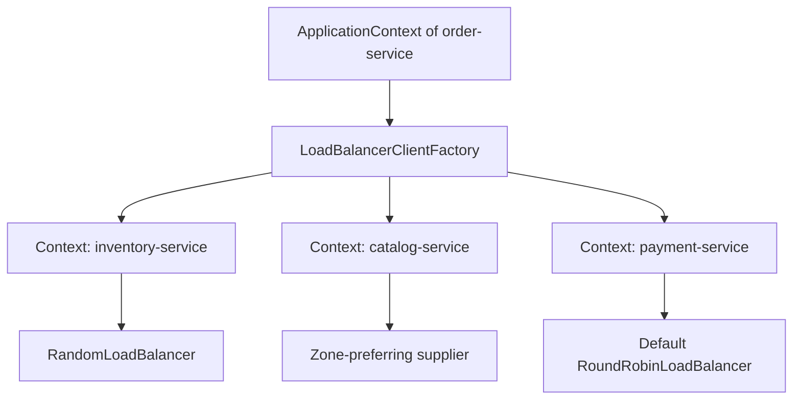
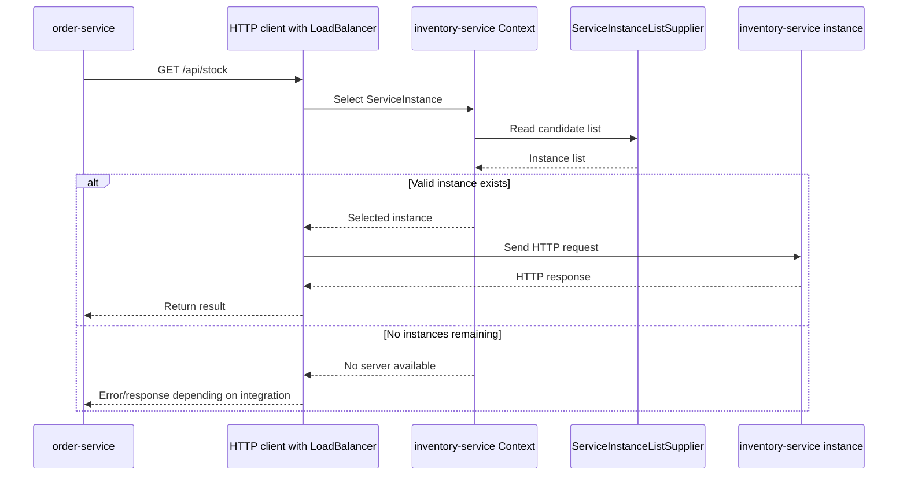

# @LoadBalancerClient and @LoadBalancerClients

In a microservices system, an application may call multiple different services, yet not every service requires the same request-distribution policy. For example, `order-service` wants to randomly select instances of `inventory-service`, prefer a specific zone when calling `catalog-service`, and use default round robin for `payment-service`. Spring Cloud LoadBalancer supports **per-service-ID configuration** through the `@LoadBalancerClient` and `@LoadBalancerClients` annotations.

This lesson belongs to the **Per-Service Configuration** section of the `SPRING_CLOUD_SERVICE_COMMUNICATION_LOAD_BALANCING` module. The focus is on binding a load balancer's configuration to the right service ID, controlling bean scope, and verifying the `ServiceInstance` selection policy. This configuration can be used alongside Spring Cloud LoadBalancer-integrated HTTP clients such as `RestClient`, `WebClient`, or OpenFeign, while discovery, health checks, retries, and timeouts are coordinated at the appropriate layers.

## 1. Why Configure LoadBalancer Per Service?

Suppose `order-service` calls three services:

| Service ID | Characteristics | Illustrated Requirement |
|---|---|---|
| `inventory-service` | Homogeneous instances handling inventory queries | Select an instance randomly. |
| `catalog-service` | Instances distributed across multiple zones | Prefer instances in the client's zone. |
| `payment-service` | Payment flow requires stability and observability | Keep the default round-robin algorithm, configuring timeout/retry at the client layer. |

If you replace a load balancer bean at the application scope without restricting it to a service, you may accidentally apply the same algorithm to all three. Conversely, declaring configuration **bound to a service ID** ensures each group of requests receives the right policy.

Three questions should be separated:

1. **Where do instances come from?** The discovery provider or source providing the `ServiceInstance` list.
2. **Which instances enter the candidate list?** `ServiceInstanceListSupplier` implementations can combine caching, health checks, and filters.
3. **Among the candidates, which instance is chosen?** A `ReactorServiceInstanceLoadBalancer` implementation, such as `RoundRobinLoadBalancer` or `RandomLoadBalancer`.

The two annotations in this lesson **bind configuration per service**; they do not register instances on their own, enable health checks automatically, or determine the retry policy of every HTTP client.

## 2. What Is @LoadBalancerClient?

`@LoadBalancerClient` declares a dedicated configuration for **a single client context**, identified by service ID.

Example:

```java
@SpringBootApplication
@LoadBalancerClient(
        name = "inventory-service",
        configuration = InventoryLoadBalancerConfiguration.class
)
public class OrderServiceApplication {

    public static void main(String[] args) {
        SpringApplication.run(OrderServiceApplication.class, args);
    }
}
```

Elements inside the annotation:

| Element | Meaning |
|---|---|
| `name` | Name of the client/service ID to receive the configuration, such as `inventory-service`. |
| `value` | Can be used as the client name per the annotation API; choose one consistent style. |
| `configuration` | One or more classes providing bean configuration for the specified service's load balancer. |

The name `inventory-service` must match the service ID used by the HTTP client when making calls, for example `http://inventory-service/api/items/123`. A policy bound to `inventory-service` does not automatically apply to requests sent to `catalog-service`.

### 2.1. Configuration Scope in ApplicationContext

Spring Cloud LoadBalancer uses `LoadBalancerClientFactory` to manage contexts by client name. You can think of each service ID as having a child context containing the load balancer bean and configuration components for that service.



The diagram illustrates logical scope; contexts may be initialized lazily as needed depending on Spring Cloud configuration. Beans in a child context can see eligible beans from the parent context, so placing a bean of the same type in the parent by mistake can affect dependency resolution or the use of default configuration.

**Important consequence:** a configuration class passed into `@LoadBalancerClient` should be kept out of the main application's component-scan scope if it contains beans specific to a single service. If that class is accidentally scanned and registered as global configuration, other services may suffer unintended side effects.

## 3. Example: Replacing Round Robin with Random for One Service

By default, Spring Cloud LoadBalancer usually uses `RoundRobinLoadBalancer` when no other selection configuration is provided. Suppose only `inventory-service` needs `RandomLoadBalancer`.

### 3.1. Declaring the Annotation on the Main Application

```java
package com.example.order;

import com.example.lbscoped.InventoryLoadBalancerConfiguration;
import org.springframework.boot.SpringApplication;
import org.springframework.boot.autoconfigure.SpringBootApplication;
import org.springframework.cloud.loadbalancer.annotation.LoadBalancerClient;

@SpringBootApplication
@LoadBalancerClient(
        name = "inventory-service",
        configuration = InventoryLoadBalancerConfiguration.class
)
public class OrderServiceApplication {

    public static void main(String[] args) {
        SpringApplication.run(OrderServiceApplication.class, args);
    }
}
```

In this example, the startup class resides in package `com.example.order`, so default component scanning starts from that package and its subpackages.

### 3.2. Declaring the Bean in a Dedicated Configuration Class

Create the class in package `com.example.lbscoped` — a package **outside** the default component-scan tree of `com.example.order`:

```java
package com.example.lbscoped;

import org.springframework.cloud.client.ServiceInstance;
import org.springframework.cloud.loadbalancer.annotation.LoadBalancerClient;
import org.springframework.cloud.loadbalancer.core.RandomLoadBalancer;
import org.springframework.cloud.loadbalancer.core.ReactorServiceInstanceLoadBalancer;
import org.springframework.cloud.loadbalancer.core.ServiceInstanceListSupplier;
import org.springframework.cloud.loadbalancer.support.LoadBalancerClientFactory;
import org.springframework.context.annotation.Bean;
import org.springframework.context.annotation.Configuration;
import org.springframework.core.env.Environment;

@Configuration(proxyBeanMethods = false)
public class InventoryLoadBalancerConfiguration {

    @Bean
    ReactorServiceInstanceLoadBalancer inventoryLoadBalancer(
            Environment environment,
            LoadBalancerClientFactory clientFactory) {

        String serviceId =
                environment.getProperty(LoadBalancerClientFactory.PROPERTY_NAME);

        return new RandomLoadBalancer(
                clientFactory.getLazyProvider(
                        serviceId, ServiceInstanceListSupplier.class),
                serviceId);
    }
}
```

In this configuration:

- `LoadBalancerClientFactory.PROPERTY_NAME` retrieves the name of the client currently being configured by the child context. Thanks to this, the example does not need to hardcode the service name inside the bean.
- `getLazyProvider(serviceId, ServiceInstanceListSupplier.class)` provides the corresponding supplier so the algorithm can read the candidate list.
- `RandomLoadBalancer` randomly picks an item from the valid list returned by the supplier.
- Returning `ReactorServiceInstanceLoadBalancer` ensures the bean properly represents the selection algorithm role.

Note: this snippet illustrates common Spring Cloud LoadBalancer APIs. Select a Spring Cloud release train compatible with your Spring Boot version and verify imports/APIs when applying it to a specific version.

When a request is sent to service ID `inventory-service` through a load-balancing-enabled client, that service's context can use `RandomLoadBalancer`. Requests to other services not bound to the same configuration continue using the beans and policies belonging to those services.

### 3.3. Why Not Build the Instance List Inside the Algorithm Itself?

The selector should not query Eureka/Consul directly or manually assemble host/port pairs. The candidate list is the responsibility of `ServiceInstanceListSupplier`. Separating these two steps lets you change the algorithm without altering discovery, caching, or health checks.

If instances can become unhealthy, use a health-aware supplier or an appropriate discovery health mechanism. Switching from round robin to random does not automatically remove failing instances.

## 4. @LoadBalancerClients for Declaring Multiple Services

When an application calls multiple services that need custom configuration, `@LoadBalancerClients` groups `@LoadBalancerClient` declarations in one place:

```java
package com.example.order;

import com.example.lbscoped.CatalogLoadBalancerConfiguration;
import com.example.lbscoped.InventoryLoadBalancerConfiguration;
import org.springframework.boot.autoconfigure.SpringBootApplication;
import org.springframework.cloud.loadbalancer.annotation.LoadBalancerClient;
import org.springframework.cloud.loadbalancer.annotation.LoadBalancerClients;

@SpringBootApplication
@LoadBalancerClients({
        @LoadBalancerClient(
                name = "inventory-service",
                configuration = InventoryLoadBalancerConfiguration.class
        ),
        @LoadBalancerClient(
                name = "catalog-service",
                configuration = CatalogLoadBalancerConfiguration.class
        )
})
public class OrderServiceApplication {
}
```

In this example:

- `inventory-service` uses the bean defined in `InventoryLoadBalancerConfiguration`.
- `catalog-service` uses the bean defined in `CatalogLoadBalancerConfiguration`.
- `payment-service` is not declared individually, so it continues using the defaults applicable to that service.

`CatalogLoadBalancerConfiguration` can configure a `ServiceInstanceListSupplier` to prefer instances matching the zone. This example focuses on **annotation declaration**; supplier details must be written to match your actual discovery source and library version.

### 4.1. Is @LoadBalancerClients Just Shorthand Syntax?

`@LoadBalancerClients` is a container annotation holding multiple `@LoadBalancerClient` declarations. Besides the list of individual clients, it also supports `defaultConfiguration` to provide default configuration for client contexts.

Example:

```java
@SpringBootApplication
@LoadBalancerClients(
        value = {
                @LoadBalancerClient(
                        name = "inventory-service",
                        configuration = InventoryLoadBalancerConfiguration.class
                ),
                @LoadBalancerClient(
                        name = "catalog-service",
                        configuration = CatalogLoadBalancerConfiguration.class
                )
        },
        defaultConfiguration = CommonLoadBalancerConfiguration.class
)
public class OrderServiceApplication {
}
```

`CommonLoadBalancerConfiguration` is used to declare shared configuration beans intended to apply across client contexts. The individual configurations for `inventory-service` and `catalog-service` still participate in configuring their respective contexts.

**Do not place the same load balancer or supplier bean in both the shared configuration and a per-service configuration while assuming one bean will always win.** The outcome depends on how contexts register beans, auto-configuration conditions, and the Spring Cloud version. If overrides are needed, explicitly design which bean types belong in shared configuration and which belong in per-service configuration, and verify the actual bean selected at startup.

## 5. How Do @LoadBalancerClient and @LoadBalancerClients Differ?

| Criterion | `@LoadBalancerClient` | `@LoadBalancerClients` |
|---|---|---|
| Declaration scope | One client/service ID name. | Multiple client/service ID names. |
| Per-service configuration | Pass class(es) via `configuration`. | Contains multiple `@LoadBalancerClient` entries, each able to point to its own class. |
| Shared default configuration | No `defaultConfiguration` attribute on this annotation itself. | Supports `defaultConfiguration` for client contexts. |
| Use case | One service needs a non-default policy. | An application calls multiple services needing different configurations or shared defaults. |
| Result | Configuration beans bound to the named service ID. | A set of per-service-ID declarations and default configuration (if specified). |

In an application where only one service needs custom load balancing, `@LoadBalancerClient` keeps the configuration concise. With multiple services needing different policies, `@LoadBalancerClients` makes declarations easier to inspect and manage.

## 6. Organizing Packages to Prevent Configuration Leakage into the Parent Context

A common mistake is placing a class like `InventoryLoadBalancerConfiguration` under a component-scanned package and adding `@Configuration`. When that happens, a bean intended solely for `inventory-service` can get registered in the parent context.

Safe structure in the example:

```text
src/main/java
└── com/example
    ├── order
    │   ├── OrderServiceApplication.java
    │   ├── api/
    │   └── gateway/
    └── lbscoped
        ├── InventoryLoadBalancerConfiguration.java
        ├── CatalogLoadBalancerConfiguration.java
        └── CommonLoadBalancerConfiguration.java
```

The main class is in `com.example.order`, while the `lbscoped` configuration classes live in a sibling package. `@LoadBalancerClient(configuration = ...)` still references those classes directly when constructing the corresponding contexts.

If the project places `@SpringBootApplication` in `com.example`, both branches can be scanned. In that case, move the configuration classes outside the scan base package, or define explicit scan filters. Do not assume that merely using `@LoadBalancerClient` will stop Spring from scanning a `@Configuration` class globally.

Several principles to keep:

1. A per-service configuration class should contain only beans genuinely meant for that service.
2. Avoid adding other stereotype annotations that cause the class to be scanned into the parent.
3. Do not create multiple competing instance-selection beans in the same context without explicit design.
4. Use class names that reflect the service or group of services the configuration serves.
5. Document why random, zone preference, or a specific policy is used so maintainers understand the decision.

## 7. How Are Annotations Used with RestClient, WebClient, and OpenFeign?

`@LoadBalancerClient` only defines the load-balancing configuration for a service ID. HTTP requests must pass through **a client integrated with Spring Cloud LoadBalancer** for the policy to take effect.

### 7.1. RestClient

```java
@Configuration(proxyBeanMethods = false)
class HttpClientsConfiguration {

    @Bean
    @LoadBalanced
    RestClient.Builder loadBalancedRestClientBuilder() {
        return RestClient.builder();
    }
}
```

Then the gateway uses that exact builder:

```java
@Service
class InventoryGateway {

    private final RestClient client;

    InventoryGateway(@Qualifier("loadBalancedRestClientBuilder")
                     RestClient.Builder builder) {
        this.client = builder.build();
    }

    String findStock(String sku) {
        return client.get()
                .uri("http://inventory-service/api/stock/{sku}", sku)
                .retrieve()
                .body(String.class);
    }
}
```

The URL uses `inventory-service` as the logical host. Spring Cloud LoadBalancer selects an instance based on the context with the matching service ID. Per-service configuration annotations do not alter `RestClient`'s contract: `body(String.class)` parsing, timeouts, and HTTP status handling remain the responsibility of the client and application.

### 7.2. WebClient

```java
@Configuration(proxyBeanMethods = false)
class ReactiveHttpClientsConfiguration {

    @Bean
    @LoadBalanced
    WebClient.Builder loadBalancedWebClientBuilder() {
        return WebClient.builder();
    }
}
```

When building a `WebClient` from this builder and calling `http://catalog-service/...`, load balancing can use the configuration context of `catalog-service`. A `WebClient` created directly via `WebClient.create()` will not automatically gain the same integration simply because the application declares `@LoadBalancerClients`.

### 7.3. OpenFeign

```java
@FeignClient(name = "inventory-service")
public interface InventoryClient {

    @GetMapping("/api/stock/{sku}")
    StockResponse getStock(@PathVariable("sku") String sku);
}
```

When OpenFeign is configured to integrate with Spring Cloud LoadBalancer and has an appropriate instance source, the name `inventory-service` is used to select the load-balancing context. If the Feign configuration specifies a fixed URL for the client, the path through discovery/load balancing may differ; verify how Feign is initialized in your project's version.

**Merely declaring the two annotations does not make every HTTP request load-balanced.** The application still needs the LoadBalancer dependency, an instance source, and the corresponding client integration.

## 8. Combining with ServiceInstanceListSupplier

A service may need list filtering before selection. For example, `catalog-service` prefers instances in the same zone, whereas `inventory-service` only needs the list from discovery.

A per-service supplier can be declared via the configuration class referenced by `@LoadBalancerClient`. Suppliers are commonly combined using a builder to fetch instances from discovery, then cache or filter them according to policy.

Conceptual supplier configuration example:

```java
@Configuration(proxyBeanMethods = false)
public class CatalogLoadBalancerConfiguration {

    @Bean
    ServiceInstanceListSupplier catalogSupplier(
            ConfigurableApplicationContext context) {

        return ServiceInstanceListSupplier.builder()
                .withDiscoveryClient()
                .withZonePreference()
                .withCaching()
                .build(context);
    }
}
```

Meaning of the builder chain:

- `withDiscoveryClient()`: fetches the instance list through the discovery client available in the application.
- `withZonePreference()`: applies zone-preference processing when the required zone data/configuration is present.
- `withCaching()`: adds instance-list caching.

Using the builder and decorator ordering must follow the API of the Spring Cloud version in use. When combining health-check or request-based suppliers, check initialization and filtering order in that version's documentation. Do not add redundant caching if the discovery provider already caches the list at another layer.

When a **hard constraint** on zone or metadata is needed, default zone preference may not be enough. You must write a custom filtering supplier and define how to handle the case where no matching instances remain after filtering. Do not treat zone preference as a guarantee of strictly single-zone routing.

## 9. Distinguishing Per-Service Configuration from Global Configuration

There are three scopes that are frequently confused:

| Scope | Example | Impact |
|---|---|---|
| Global configuration in parent context | A `ServiceInstanceListSupplier` bean registered by component scanning in the main application | Can affect bean construction or resolution across multiple client contexts. |
| Default configuration for clients | `@LoadBalancerClients(defaultConfiguration = ...)` | Client contexts receive the declared default configuration. |
| Configuration for a single client | `@LoadBalancerClient(name = "inventory-service", configuration = ...)` | Configuration bound to one specific service ID. |

Do not explain `@LoadBalancerClients(defaultConfiguration = ...)` as modifying every bean in the parent context. It is a mechanism for supplying configuration to client contexts; the effective scope of each bean still needs to be verified when combined with other configurations.

You should also distinguish per-service configuration from **per-request** configuration. A dedicated load balancer bean for `inventory-service` can be used across many requests to that service. If instance selection depends on request headers or attributes, you must use a request-context mechanism and a supplier/load balancer that supports it, rather than trying to mutate a singleton bean on each request.

## 10. Default Configuration, Fallbacks, and Empty Instance Lists

Annotations do not replace error-handling policies. For example, `inventory-service` declares `RandomLoadBalancer`, but the supplier returns an empty list: the algorithm still cannot pick an instance.

High-level flow:



If there are no candidates, the application should log the service ID, instance count, discovery status, filtering steps, and related connection errors. Depending on the client and integration, having no available instance may result in an exception or an error response (often 503 in many integrations). Check the specific version's behavior rather than assuming every client throws the same exception.

Retries and timeouts are typically configured on the HTTP client or retry coordination layer. Retries can select another instance under appropriate conditions, but they cannot fix an incorrect service ID or an always-empty discovery list. For write operations, evaluate idempotency before retrying.

## 11. Verifying Whether a Per-Service Configuration Works

After adding annotations, verify layer by layer instead of looking only at the final HTTP result.

### 11.1. Check the Service Name

Confirm that the following strings are consistent:

```text
@LoadBalancerClient(name = "inventory-service")
                    │
                    ├─ @FeignClient(name = "inventory-service")
                    ├─ http://inventory-service/api/stock
                    └─ service ID registered by discovery
```

If the name in the annotation does not match the outgoing service ID, that context's configuration may not be used.

### 11.2. Check Classpath and Instance Source

Ensure that:

- The project has the Spring Cloud LoadBalancer dependency matching the Spring Boot/Spring Cloud BOM.
- The discovery client or static instance source is fully configured.
- The calling client is actually integrated with load balancing.
- The supplier returns valid instances with the required host, port, and metadata.

Do not conclude the algorithm is wrong if the input list is empty or instances are unreachable.

### 11.3. Verify the Bean Selected Per Service

An integration test can inspect `LoadBalancerClientFactory`:

```java
@Autowired
LoadBalancerClientFactory factory;

@Test
void inventoryUsesRandomLoadBalancer() {
    ReactorServiceInstanceLoadBalancer loadBalancer =
            factory.getInstance(
                    "inventory-service",
                    ReactorServiceInstanceLoadBalancer.class);

    assertThat(loadBalancer)
            .isInstanceOf(RandomLoadBalancer.class);
}
```

This is an illustrative snippet placed inside a test class configured with Spring Test and AssertJ; appropriate imports, test dependencies, and context initialization must be added. Some release trains expose the bean under the `ReactorLoadBalancer<ServiceInstance>` interface; in that case, use the bean lookup API matching your version.

Checking the bean type confirms **the configuration was loaded properly into the context**. To verify behavior, add tests with a mock `ServiceInstance` list and multiple selections, while avoiding assertions on a fixed sequence when the algorithm is random.

### 11.4. Observe Logs and Metrics

During testing, monitor:

| Information | Purpose |
|---|---|
| Request service ID | Confirms requests enter the right client context. |
| Number of `ServiceInstance`s from supplier | Distinguishes missing candidates from algorithm issues. |
| Active load balancer type | Confirms random/round robin or custom implementation. |
| Selected instance | Compares outcomes against the expected policy. |
| Error rate and timeouts | Detects unhealthy instances or misconfigured client settings. |
| Retry count and cause | Distinguishes retried requests from initial requests. |

Randomness and concurrent connections mean actual distribution will not necessarily look even in small samples. Do not evaluate an algorithm based on only a few requests.

## 12. Common Configuration Pitfalls

| Symptom | Possible Cause | Resolution |
|---|---|---|
| Every service uses the same custom algorithm | The per-service configuration class was component-scanned into the parent context or `defaultConfiguration` is too broad | Move the configuration class outside the scan scope and inspect beans in each client context. |
| `inventory-service` still uses round robin | Service name mismatch, annotation not loaded, or load balancer bean not selected | Check the service ID, annotation on the main configuration class, and beans in the client factory. |
| Duplicate beans of the same type cause startup failure | Shared and per-service configurations define competing beans or multiple implementations exist | Audit `@Bean` definitions, bean creation conditions, and context scope. |
| Client cannot find instances | Discovery has no data yet, wrong service ID, or supplier filtered everything out | Check discovery, supplier, and metadata/health. |
| RestClient/WebClient does not use the custom algorithm | Builder lacks `@LoadBalanced` or client was created directly | Create/inject the proper load-balanced builder. |
| OpenFeign calls a fixed URL | Client was declared with `url` or target URL configuration | Check URL vs. service discovery mode in Feign configuration. |
| Zone filtering has no effect | Missing zone info, supplier not loaded, or preference mistaken for strict filtering | Check metadata, zone configuration, and instance lists before/after filtering. |
| Retries create extra load when a service fails | Multi-layer retries, unbounded attempts, or missing timeouts | Set an overall deadline, use retry with backoff, and observe outcomes. |

A configuration error can look like a network error. For example, `@LoadBalancerClient` is applied, but the instance in discovery has an unreachable host: the outcome is still a timeout or connection refused. Therefore, separate verifying **the loaded bean** from verifying **a working target connection**.

## 13. Principles for Organizing Configuration in Large Systems

As the number of services grows, apply these principles:

1. Declare `@LoadBalancerClient` only for services that genuinely need non-default behavior; do not create classes just to repeat round-robin configuration.
2. Use `@LoadBalancerClients` to consolidate multiple per-service configurations and avoid scattering annotations that are hard to track.
3. Place per-client configuration classes outside default component scanning or control scan filters explicitly.
4. Put shared policies into `defaultConfiguration` only when all clients should inherit that behavior.
5. Separate the selection-algorithm bean from the supplier providing/filtering the instance list.
6. Define behavior when no instances exist, when metadata is missing, and when discovery is unavailable.
7. Check Spring Boot/Spring Cloud compatibility via the BOM when using version-specific APIs.
8. Measure instance counts, selection latency, error rates, and retries to evaluate policy effectiveness.
9. Test scope boundaries: a per-service configuration must affect only the declared service ID.

### When Annotations Are Not Needed

If every service uses default configuration and has no custom filtering or selection requirements, the `spring-cloud-starter-loadbalancer` dependency, a `ServiceInstance` source, and properly integrated HTTP clients may be all you need. `@LoadBalancerClient`/`@LoadBalancerClients` are customization tools, not mandatory annotations for every application using LoadBalancer.

If the requirement is solely a timeout for `payment-service`, configure it on the corresponding HTTP client or Feign client instead of creating a load balancer just to set a timeout. If the requirement is a circuit breaker, integrate an appropriate fault-tolerance mechanism; client-context annotations do not provide circuit breaking on their own.

## 14. Conclusion

`@LoadBalancerClient` binds a load-balancing configuration class to **a single service ID**. `@LoadBalancerClients` groups multiple such declarations and supports `defaultConfiguration` for client contexts. This is the mechanism that lets an application apply different `ServiceInstance` selection algorithms and supplier chains per service while sharing Spring Cloud LoadBalancer abstractions.

The decisive factors in implementation are ensuring the service name matches the request name, keeping configuration classes in the proper context scope, and routing HTTP clients through LoadBalancer. After setup, verify the beans created per service, the input instance list, behavior when no candidates exist, and error observability. In doing so, per-service configuration can scale with the system without accidentally impacting other services.
