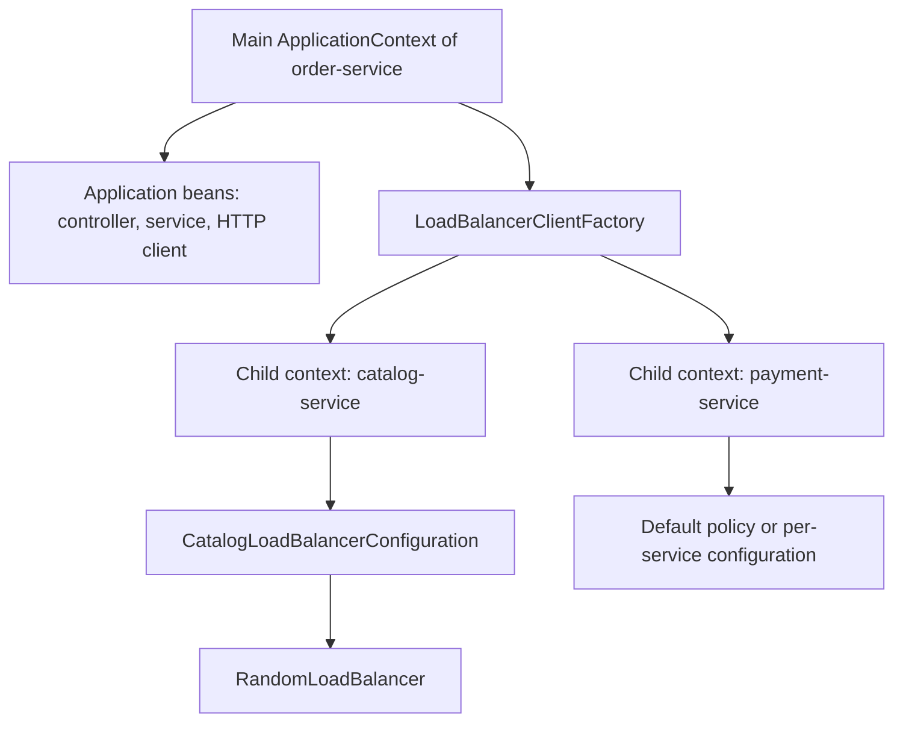

# Isolating Per-Service Configuration from Main Application Component Scanning

Spring Cloud LoadBalancer allows configuring how a `ServiceInstance` is selected separately for each **service ID**. For example, `catalog-service` can use a random selection algorithm, while `payment-service` continues using the default round-robin policy. For this configuration to work properly, the per-service LoadBalancer configuration class must be placed **outside the component-scan scope of the main Spring Boot application**, or you must ensure the class is not registered as a global configuration.

This is a **bean scoping** issue. The same Java class can be loaded into the `ApplicationContext` dedicated to a single service ID or accidentally scanned into the application's shared `ApplicationContext`. If a service-specific configuration appears in the shared context, its beans can become visible to other LoadBalancers, defeating the per-service configuration intent.

## 1. Why Must It Be Isolated from Component Scanning?

By default, `@SpringBootApplication` enables component scanning on the package containing the application class and its subpackages. Classes annotated with `@Configuration`, `@Component`, `@Service`, or equivalent stereotype annotations within this scope can be registered as beans in the main context.

Meanwhile, Spring Cloud LoadBalancer uses `LoadBalancerClientFactory` to manage configuration by client name, which here is the service ID. This factory can create a **dedicated child `ApplicationContext` per service ID** when needed. Configuration declared via `@LoadBalancerClient(name = ..., configuration = ...)` is applied to the corresponding child context.



A child context can look up beans from its parent context. Therefore, if `CatalogLoadBalancerConfiguration` is discovered by the main application's component scan, beans such as `ReactorLoadBalancer<ServiceInstance>` or `ServiceInstanceListSupplier` may appear in the parent context and affect multiple service IDs. Adding `@LoadBalancerClient` **does not automatically disable component scanning** for the class referenced in the `configuration` attribute.

The key rule is: **configuration specific to a LoadBalancer must be loaded by the designated service ID's context, not scanned as a global application configuration bean**.

## 2. Identifying Which Packages Are Being Scanned

Suppose the main application resides in package `com.example.orders`:

```java
package com.example.orders;

import org.springframework.boot.SpringApplication;
import org.springframework.boot.autoconfigure.SpringBootApplication;

@SpringBootApplication
public class OrderApplication {
    public static void main(String[] args) {
        SpringApplication.run(OrderApplication.class, args);
    }
}
```

Without customizing component scanning, classes in `com.example.orders` and subpackages such as `com.example.orders.client` are scanned. The **sibling** package `com.example.loadbalancer.config` lies outside that default scan scope.

A suitable directory layout:

```text
src/main/java/
└── com/example/
    ├── orders/
    │   ├── OrderApplication.java
    │   ├── client/
    │   │   └── CatalogHttpClient.java
    │   └── service/
    │       └── OrderService.java
    └── loadbalancer/
        └── config/
            └── CatalogLoadBalancerConfiguration.java
```

Note that **the package path**, not a folder name like `config`, determines whether a class gets scanned. If you move `OrderApplication` up to `com.example` or configure `@ComponentScan(basePackages = "com.example")`, `com.example.loadbalancer.config` can also be scanned. In that case, the layout above no longer creates the desired boundary.

## 3. Example: Configuring One Service with `@LoadBalancerClient`

Suppose `order-service` calls `catalog-service` and `payment-service`. The goal is for **only `catalog-service` to use `RandomLoadBalancer`**; the other service does not receive this configuration bean.

### Step 1: Declare the Configuration in a Package Outside the Scan Scope

Create class `CatalogLoadBalancerConfiguration` in package `com.example.loadbalancer.config`:

```java
package com.example.loadbalancer.config;

import org.springframework.cloud.client.ServiceInstance;
import org.springframework.cloud.client.loadbalancer.reactive.ReactorLoadBalancer;
import org.springframework.cloud.loadbalancer.core.RandomLoadBalancer;
import org.springframework.cloud.loadbalancer.core.ServiceInstanceListSupplier;
import org.springframework.cloud.loadbalancer.support.LoadBalancerClientFactory;
import org.springframework.context.annotation.Bean;
import org.springframework.context.annotation.Configuration;
import org.springframework.core.env.Environment;

@Configuration(proxyBeanMethods = false)
public class CatalogLoadBalancerConfiguration {

    @Bean
    ReactorLoadBalancer<ServiceInstance> catalogRandomLoadBalancer(
            Environment environment,
            LoadBalancerClientFactory clientFactory) {

        String serviceId = environment.getProperty(
                LoadBalancerClientFactory.PROPERTY_NAME);

        return new RandomLoadBalancer(
                clientFactory.getLazyProvider(
                        serviceId, ServiceInstanceListSupplier.class),
                serviceId);
    }
}
```

In this example:

- `LoadBalancerClientFactory.PROPERTY_NAME` provides the service ID of the child context being configured.
- `getLazyProvider(serviceId, ServiceInstanceListSupplier.class)` supplies the instance list via the active supplier mechanism for that service ID, typically backed by service discovery.
- `RandomLoadBalancer` picks a random instance from the candidate list. Random selection does not guarantee instances receive equal request counts over a short observation window.

`@Configuration` is still valid here **because the class lies outside the main context's component-scan scope**. Another option is to use a configuration class without `@Configuration`, while still providing `@Bean` methods for `@LoadBalancerClient` to register into the child context. The essential requirement is preventing the class from becoming a global configuration.

### Step 2: Bind the Configuration to the Right Service ID

Add `@LoadBalancerClient` to the startup class:

```java
package com.example.orders;

import com.example.loadbalancer.config.CatalogLoadBalancerConfiguration;
import org.springframework.boot.SpringApplication;
import org.springframework.boot.autoconfigure.SpringBootApplication;
import org.springframework.cloud.loadbalancer.annotation.LoadBalancerClient;

@SpringBootApplication
@LoadBalancerClient(
        name = "catalog-service",
        configuration = CatalogLoadBalancerConfiguration.class)
public class OrderApplication {
    public static void main(String[] args) {
        SpringApplication.run(OrderApplication.class, args);
    }
}
```

The annotation here registers the mapping **service ID → configuration class**. Referencing `CatalogLoadBalancerConfiguration.class` in the `configuration` attribute does not mean its package should be added to global component scanning.

### Step 3: Call the Service with a LoadBalancer-Integrated HTTP Client

For `RestClient`, the builder must be annotated with `@LoadBalanced`:

```java
package com.example.orders;

import org.springframework.cloud.client.loadbalancer.LoadBalanced;
import org.springframework.context.annotation.Bean;
import org.springframework.context.annotation.Configuration;
import org.springframework.web.client.RestClient;

@Configuration(proxyBeanMethods = false)
class HttpClientConfiguration {

    @Bean
    @LoadBalanced
    RestClient.Builder restClientBuilder() {
        return RestClient.builder();
    }
}
```

Business code can invoke the logical URL as follows:

```java
RestClient client = restClientBuilder.build();

String body = client.get()
        .uri("http://catalog-service/api/products/42")
        .retrieve()
        .body(String.class);
```

`catalog-service` is a **service ID**, not a fixed host address. When a request goes through a LoadBalancer-integrated builder, the child context for `catalog-service` uses `RandomLoadBalancer` to pick a `ServiceInstance` from the discovery list. For requests to `http://payment-service/...`, if no other custom configuration exists, Spring Cloud LoadBalancer uses the default configuration for that service ID (typically round-robin).

These examples assume the application has the Spring Cloud LoadBalancer dependency and an instance list source, such as an appropriate discovery client or static instance configuration. If no instances exist for the service ID, proper package separation alone will not make requests succeed.

## 4. Configuring Multiple Services While Keeping Them Isolated

When multiple service IDs require custom policies, use `@LoadBalancerClients` and maintain an appropriate configuration class for each service:

```java
@LoadBalancerClients({
    @LoadBalancerClient(
        name = "catalog-service",
        configuration = CatalogLoadBalancerConfiguration.class),
    @LoadBalancerClient(
        name = "inventory-service",
        configuration = InventoryLoadBalancerConfiguration.class)
})
```

This example assumes `InventoryLoadBalancerConfiguration` has been created separately with appropriate beans/policies and is also placed outside the shared scan scope. Each service ID is wired to its configuration; the same application can use multiple clients with different routing policies.

Not every service ID needs its own configuration class if the default policy already meets requirements. Specify per-service configuration only when you need to change specific behavior such as instance selection, metadata filtering, zone preference, or the `ServiceInstanceListSupplier` chain.

## 5. Common Configuration Mistakes

| Scenario | Possible Consequence | Resolution |
|---|---|---|
| Placing `CatalogLoadBalancerConfiguration` under `com.example.orders.config` and adding `@Configuration` | The class is component-scanned into the main context; beans meant for `catalog-service` may affect other clients | Move the class to a package outside the scan scope, or design it so it is not scanned into the main context |
| Placing `@SpringBootApplication` in `com.example` while per-service configurations sit under `com.example.loadbalancer` | The supposedly independent package still falls within the default scan scope | Check the startup class's package and restrict the scan scope |
| Using `@ComponentScan(basePackages = "com.example")` | Accidentally pulls the entire per-service configuration package into the parent context | Narrow the list of scanned packages or place configurations outside this package set |
| Adding `@Import(CatalogLoadBalancerConfiguration.class)` to the main application configuration | Registers the per-service configuration directly in the parent context | Reference the class only through `@LoadBalancerClient(configuration = ...)` |
| Not declaring the exact `name = "catalog-service"` | Requests to another service ID do not use the expected policy | Cross-check the service ID in the URL, registry, and annotation |
| Using `RestClient`/`WebClient` without a `@LoadBalanced` builder | The logical URL may be treated as a DNS hostname | Configure proper HTTP client integration; for OpenFeign, check the LoadBalancer dependency |
| Using `@FeignClient(configuration = ...)` expecting to change the Spring Cloud LoadBalancer policy | Confuses Feign configuration scope with instance-selection configuration | Use `@LoadBalancerClient` for LoadBalancer policies; Feign configuration only governs Feign-specific features |

One common misconception: adding `@Qualifier` or `@Primary` on a bean in the parent context does not cleanly solve per-service-ID isolation. Those annotations guide bean selection during dependency injection, but they do not move a bean into a LoadBalancer child context.

## 6. Verifying That Configuration Is Properly Isolated

After running the application, verify both **where beans are registered** and **instance-selection behavior**, because reading annotation code alone is not enough to catch every side effect of component scanning.

1. **Check scan scope:** confirm the package containing `OrderApplication` and any `scanBasePackages`/`@ComponentScan` values. Package `com.example.loadbalancer.config` must sit outside the main context's scan list.
2. **Check per-service registration:** confirm `@LoadBalancerClient` points accurately to `name = "catalog-service"` and `CatalogLoadBalancerConfiguration.class`.
3. **Check beans in the parent context:** the `catalogRandomLoadBalancer` bean should not be registered locally in the main application context; it belongs to the child context of `catalog-service`.
4. **Check the actual LoadBalancer:** from `LoadBalancerClientFactory`, retrieve the `ReactorLoadBalancer` bean for `catalog-service` and compare it with `payment-service`. The bean types should reflect the intended configuration.
5. **Check live requests:** run multiple `catalog-service` instances, invoke them via `RestClient`, `WebClient`, or OpenFeign using the service ID; observe selected instances and connection errors. Do not judge the correctness of `RandomLoadBalancer` from one or two isolated requests.

Example check of bean types (which can be placed temporarily in an application diagnostic check):

```java
ReactorLoadBalancer<?> catalogLoadBalancer =
        clientFactory.getInstance(
                "catalog-service", ReactorLoadBalancer.class);

ReactorLoadBalancer<?> paymentLoadBalancer =
        clientFactory.getInstance(
                "payment-service", ReactorLoadBalancer.class);

System.out.println(catalogLoadBalancer.getClass().getSimpleName());
System.out.println(paymentLoadBalancer.getClass().getSimpleName());
```

In the example configuration, the expected output is `RandomLoadBalancer` for `catalog-service` and `RoundRobinLoadBalancer` for `payment-service` if the second service has no other overrides. This is an application-level configuration check; do not leave console print statements in production request flows.

If both service IDs unexpectedly receive the same bean type, review component scanning and any configurations imported into the main context. If the LoadBalancer type is correct but instance selection is not as expected, inspect `ServiceInstanceListSupplier`, discovery results, health checks, cache TTL, and active routing policies. If requests fail to reach the service, check timeouts, retries, and HTTP client integration separately; those are operational layers distinct from bean registration scope.

## 7. When Should This Organization Pattern Be Used?

Isolating per-service configuration is useful when service IDs have different instance-selection requirements. For instance, a search service might prefer one zone, a payment service might filter instances by metadata, and a read service might use default round-robin. `@LoadBalancerClient` expresses that choice directly in the calling application's configuration.

In terms of code organization, you can think of the boundaries as follows:

| Configuration Type | Where to Place It? | Why? |
|---|---|---|
| Shared HTTP client, such as `@LoadBalanced RestClient.Builder` bean | Inside a scanned application package | Business components need to inject the builder |
| Policy specific to `catalog-service`, such as `RandomLoadBalancer` | In a per-service configuration outside the main scan scope | The bean belongs only to `catalog-service`'s child context |
| General application services, controllers, repositories | Inside a scanned application package | These beans serve the entire application |
| Policy specific to another service ID | In its own per-service class, outside the main scan scope | Prevents cross-client interference |

## 8. Key Takeaways

`@LoadBalancerClient(name = ..., configuration = ...)` is the mechanism for placing configuration into a **dedicated per-service-ID context** in Spring Cloud LoadBalancer. To keep that configuration from leaking to other services, the configuration class must lie outside the main application's component-scan scope or be designed so it is not registered in the main context. Always inspect the package of `@SpringBootApplication`, any expanded component-scan configuration, and related `@Import` declarations. Afterward, verify the LoadBalancer bean per service ID and test real requests to ensure each service uses the declared policy.
