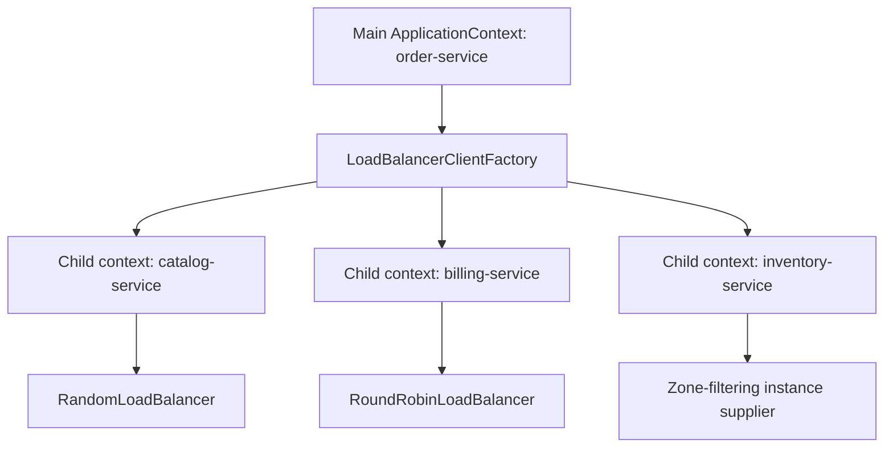
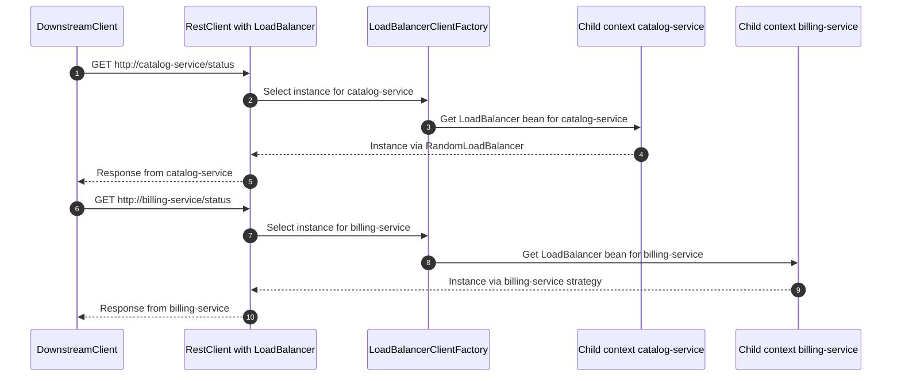

# Child Contexts, Per-Service Beans, and the Risk of Configuration Leakage

When an application calls multiple services using Spring Cloud LoadBalancer, not every service requires the same instance-selection policy. `catalog-service` might use random selection for experimentation, while `billing-service` keeps round robin and `inventory-service` needs instance filtering by deployment zone. Spring Cloud allows configuring per **service ID** via *child application contexts* and beans that take effect only within the corresponding service's context.

What matters is understanding **which context a bean is created in**. If a configuration intended solely for `catalog-service` is accidentally picked up by the main application's component scan, it can become a shared configuration and affect other services. This lesson explains how Spring Cloud LoadBalancer separates configuration scopes, how to write service-specific beans properly, and how to detect configuration leakage risks.

## 1. Why Is Per-Service Configuration Needed?

Suppose `order-service` calls the following three services:

| Service ID | Requirement | Illustrated Choice |
|---|---|---|
| `catalog-service` | Equivalent replicas; want to test random distribution | `RandomLoadBalancer` |
| `billing-service` | Replicas with equivalent capacity | Default `RoundRobinLoadBalancer` |
| `inventory-service` | Prefer instances in the same zone | Zone-filtering `ServiceInstanceListSupplier` chain |

All of them are called via logical URLs such as `http://catalog-service/api/products/42`. A LoadBalancer-integrated HTTP client receives the **service ID**, asks LoadBalancer to select a `ServiceInstance`, and then sends the HTTP request to that instance's host and port. The instance-selection policy can vary per service ID without changing the HTTP calling API.

Global configuration suits rules shared by all services. Per-service configuration suits cases where one service needs a specific algorithm, filter, supplier, or operational behavior. Without clear scope boundaries, a small change for one service can alter routing across the entire calling application.

## 2. Main ApplicationContext and Per-Service-ID Child Contexts

In a Spring Boot application, the main `ApplicationContext` (referred to as the **parent context** in this lesson) manages application beans such as controllers, services, HTTP client builders, and shared configurations. Spring Cloud LoadBalancer uses `LoadBalancerClientFactory` to manage dedicated contexts by client/service ID name.

Each child context holds the beans responsible for selecting instances for its corresponding service, for example:

- `ReactorLoadBalancer<ServiceInstance>`: strategy for choosing one instance.
- `ServiceInstanceListSupplier`: source and processing chain for the instance list.
- Helper beans for configuration, filters, or routing rules specific to that service.



`LoadBalancerClientFactory` uses the service ID as the name to look up or create the corresponding child context. These contexts have a parent–child relationship with the main context and can see certain beans from the parent. However, the beans configured directly inside each child context can differ, allowing two service IDs to use independent instance-selection algorithms.

An important consequence: **the same bean type does not imply the same object or the same scope**. The `ReactorLoadBalancer<ServiceInstance>` for `catalog-service` can be `RandomLoadBalancer`, while the bean of the same type for `billing-service` is `RoundRobinLoadBalancer`. Which bean Spring selects depends on the context of the service ID being processed.

A per-service context is typically created the first time that service is used, so the first call may incur additional initialization time. Spring Cloud LoadBalancer provides an eager-loading mechanism for services whose contexts should be created early; this is an operational option and does not change the context-isolation principle.

## 3. `@LoadBalancerClient` Binds Configuration to a Service ID

The `@LoadBalancerClient` annotation is the standard way to specify LoadBalancer configuration for a single service. Example:

```java
package com.example.orders;

import com.example.lbconfig.CatalogLoadBalancerConfiguration;
import org.springframework.boot.SpringApplication;
import org.springframework.boot.autoconfigure.SpringBootApplication;
import org.springframework.cloud.loadbalancer.annotation.LoadBalancerClient;

@SpringBootApplication
@LoadBalancerClient(
        name = "catalog-service",
        configuration = CatalogLoadBalancerConfiguration.class
)
public class OrderApplication {
    public static void main(String[] args) {
        SpringApplication.run(OrderApplication.class, args);
    }
}
```

Here:

- `name = "catalog-service"` identifies the service ID being configured.
- `configuration = CatalogLoadBalancerConfiguration.class` specifies the beans that this service's child context should receive.
- Other service IDs do not automatically use that custom configuration when the configuration class is scoped properly.

**Package note:** the `CatalogLoadBalancerConfiguration` class should be placed **outside the main application's component-scan scope**. In the example, `OrderApplication` is in `com.example.orders`, while the configuration class is in `com.example.lbconfig` and referenced via a normal Java import.

If multiple services are needed, multiple `@LoadBalancerClient` annotations can be declared using `@LoadBalancerClients`:

```java
@SpringBootApplication
@LoadBalancerClients({
        @LoadBalancerClient(
                name = "catalog-service",
                configuration = CatalogLoadBalancerConfiguration.class
        ),
        @LoadBalancerClient(
                name = "inventory-service",
                configuration = InventoryLoadBalancerConfiguration.class
        )
})
class OrderApplication {
}
```

When using this approach, each configuration class must be checked individually to ensure a bean for `catalog-service` is not loaded by the main application as a shared bean.

## 4. Declaring an Instance-Selection Bean for Only One Service

The following example switches `catalog-service`'s strategy to random selection while letting other services keep Spring Cloud LoadBalancer's default configuration.

Place the class in a package outside `com.example.orders`'s component-scan scope, such as `com.example.lbconfig`:

```java
package com.example.lbconfig;

import org.springframework.cloud.client.ServiceInstance;
import org.springframework.cloud.loadbalancer.core.RandomLoadBalancer;
import org.springframework.cloud.loadbalancer.core.ServiceInstanceListSupplier;
import org.springframework.cloud.loadbalancer.support.LoadBalancerClientFactory;
import org.springframework.cloud.client.loadbalancer.reactive.ReactorLoadBalancer;
import org.springframework.context.annotation.Bean;
import org.springframework.context.annotation.Configuration;
import org.springframework.core.env.Environment;

@Configuration(proxyBeanMethods = false)
public class CatalogLoadBalancerConfiguration {

    @Bean
    ReactorLoadBalancer<ServiceInstance> catalogLoadBalancer(
            Environment environment,
            LoadBalancerClientFactory clientFactory) {

        String serviceId = environment.getProperty(
                LoadBalancerClientFactory.PROPERTY_NAME);

        return new RandomLoadBalancer(
                clientFactory.getLazyProvider(
                        serviceId, ServiceInstanceListSupplier.class),
                serviceId);
    }
}
```

Inside the child context, `LoadBalancerClientFactory.PROPERTY_NAME` provides the current service name. Reading the service ID from the environment prevents bean initialization logic from hardcoding a repeated string literal. `getLazyProvider(serviceId, ServiceInstanceListSupplier.class)` provides the supplier for the right service and defers retrieving the bean until needed. `RandomLoadBalancer` uses the instance list returned by the supplier to choose a replica.

`RandomLoadBalancer` only changes **the instance-selection strategy**. It does not turn a DNS name into a registry on its own, perform health checks, configure retries, or configure HTTP client connect/read timeouts. Those capabilities require separate components or configurations, even though they all participate in the request-handling flow.

If `@LoadBalancerClient` is omitted or the configuration is not registered properly, the application may continue using the default algorithm, making a change appear applied while having no actual effect.

## 5. Configuring Suppliers Per Service

In addition to the selection algorithm, `ServiceInstanceListSupplier` can also be configured per service. The supplier provides the list of `ServiceInstance` objects from discovery and can be chained to add caching, health checks, zone preference, or other filters.

Conceptual example:

```text
catalog-service:
  DiscoveryClient → instance list → RandomLoadBalancer

inventory-service:
  DiscoveryClient → zone filter → RoundRobinLoadBalancer
```

This creates two distinct levels of responsibility:

1. **Supplier** determines the candidate list for the current service.
2. **LoadBalancer** selects one instance from that candidate list.

Therefore, if `inventory-service` only receives instances in the desired zone, round robin rotates through the **filtered list**. Conversely, a zone-unaware `RandomLoadBalancer` can still choose from the right zone if the supplier has already filtered out non-matching instances.

A `ServiceInstanceListSupplier` can be declared inside the corresponding service's configuration class. Example using discovery and caching:

```java
@Bean
ServiceInstanceListSupplier catalogInstanceSupplier(
        ConfigurableApplicationContext context) {

    return ServiceInstanceListSupplier.builder()
            .withDiscoveryClient()
            .withCaching()
            .build(context);
}
```

This snippet illustrates one way to construct a supplier. The application needs the corresponding imports, appropriate discovery dependencies, and a real instance source. You should only replace the default supplier when there is a clear requirement; building a new chain yourself can drop default filters, caching, or behaviors the system previously relied on.

**Supplier ordering matters.** Caching, health checks, and filters may observe data at different stages of the pipeline. Design the chain in the order supported by your Spring Cloud version and test with a changing instance list; do not assume every ordering produces equivalent results.

## 6. Risk of Configuration Leakage Due to Component Scanning

This is the most critical mistake when working with child contexts. Suppose `CatalogLoadBalancerConfiguration` is placed under a package that `@SpringBootApplication` scans:

```text
com.example.orders
├── OrderApplication.java
├── client
│   └── CatalogClient.java
└── config
    └── CatalogLoadBalancerConfiguration.java   ← component-scanned
```

If the class is annotated with `@Configuration`, component scanning can register its beans into the **main ApplicationContext**. When that happens, a bean meant exclusively for `catalog-service` risks becoming visible to other child contexts via the parent–child relationship or affecting default bean selection.

Possible symptoms:

- `billing-service` also uses the random algorithm even though only `catalog-service` was configured for random selection.
- A zone-filtering supplier intended for `inventory-service` leaves another service with insufficient candidates.
- A custom bean is initialized in the main context, where the child context's service-name property does not exist.
- The application fails with duplicate/ambiguous bean errors when adding multiple per-service configurations.
- Single-service tests pass, but multi-service integration reveals routing discrepancies.

The risk does not depend solely on the class name or `@Bean` annotation. The problem is **the configuration class being registered in the wrong ApplicationContext**. Beans can exist in both the parent context and a child context, making investigation by class name alone insufficient to determine actual scope.

### Safe Package Layout

Separate classes intended solely for `@LoadBalancerClient` from the application's component-scan area:

```text
com.example.orders
├── OrderApplication.java            ← @SpringBootApplication
├── client
│   └── CatalogClient.java
└── config
    └── RestClientConfiguration.java ← shared beans in parent

com.example.lbconfig                 ← outside orders component scan
├── CatalogLoadBalancerConfiguration.java
└── InventoryLoadBalancerConfiguration.java
```

The application can still reference the two classes under `com.example.lbconfig` via `@LoadBalancerClient`'s `configuration` attribute; Java imports and component scanning are two separate mechanisms. **Being referenced by an annotation does not mean it must be component-scanned.**

Another option is to use configurations that are not auto-scanned or adjust scan boundaries using appropriate Spring mechanisms. Whichever option you choose, verify that per-service configuration classes do not accidentally become a global bean source.

Do not try to solve configuration leakage by arbitrarily renaming beans. A bean placed in the wrong context can still cause out-of-scope effects even if its name does not collide. Fix the configuration registration location first.

## 7. Distinguishing Three Types of Configuration in an Application

| Type | Location / How Applied | Example | Intended Scope |
|---|---|---|---|
| Shared application configuration | Parent context via auto-configuration, component scan, regular `@Bean` | `@LoadBalanced RestClient.Builder` | Everywhere the corresponding builder is injected |
| Default LoadBalancer configuration | Spring Cloud LoadBalancer default configuration | Default `RoundRobinLoadBalancer` | Any service without a custom override |
| Per-service-ID LoadBalancer configuration | Child context via `@LoadBalancerClient` / `@LoadBalancerClients` | `RandomLoadBalancer` for `catalog-service` | Only the specified service ID |

Annotating `RestClient.Builder` with `@LoadBalanced` tells the client to invoke LoadBalancer when encountering a service ID. This builder bean usually lives in the parent context and can be shared across multiple services. Conversely, a custom `ReactorLoadBalancer<ServiceInstance>` or supplier placed in a child context determines the policy for a specific service. Do not confuse configuring **an HTTP client to use LoadBalancer** with configuring **the algorithm for one service**.

`@Primary` or `@Qualifier` helps Spring resolve multiple beans within a single context during dependency injection. They are not a substitute for placing configuration in the right named child context. A bean marked `@Primary` in the parent does not automatically mean "only for service X".

## 8. Request Flow with Multiple Configurations

Suppose the application has two static instance groups for testing:

```yaml
spring:
  cloud:
    discovery:
      client:
        simple:
          instances:
            catalog-service:
              - uri: http://localhost:8081
              - uri: http://localhost:8082
            billing-service:
              - uri: http://localhost:8091
              - uri: http://localhost:8092
```

The application creates a `@LoadBalanced` `RestClient.Builder` in the parent context:

```java
@Configuration(proxyBeanMethods = false)
class HttpClientConfiguration {

    @Bean
    @LoadBalanced
    RestClient.Builder loadBalancedRestClientBuilder() {
        return RestClient.builder();
    }
}
```

An application service uses the same builder to call two logical names:

```java
@Service
class DownstreamClient {

    private final RestClient restClient;

    DownstreamClient(@LoadBalanced RestClient.Builder builder) {
        this.restClient = builder.build();
    }

    String catalogStatus() {
        return restClient.get()
                .uri("http://catalog-service/status")
                .retrieve()
                .body(String.class);
    }

    String billingStatus() {
        return restClient.get()
                .uri("http://billing-service/status")
                .retrieve()
                .body(String.class);
    }
}
```

In this flow, calling `catalog-service` asks the factory to resolve `ReactorLoadBalancer` in the child context named `catalog-service` and uses the configured random strategy. For `billing-service`, the factory accesses a different child context; without a custom strategy bean, the default configuration can use round robin.



One HTTP client can call multiple service IDs while each service's instance-selection policy remains independent. The isolation lies in named child contexts, not in creating a separate HTTP client per service.

## 9. Verifying That Configuration Applies to the Right Scope

Reading annotations alone is not enough. A reliable verification checks both **actual beans** and **routing behavior**:

1. Start at least two replicas of `catalog-service` and two replicas of `billing-service`; have each replica return a distinct identifier.
2. Confirm discovery returns the right list for each service ID.
3. Inspect the configuration class and ensure it is not in a package scanned by the parent component scan.
4. Using `LoadBalancerClientFactory`, inspect the `ReactorLoadBalancer` bean created for each service ID and its actual implementation class.
5. Send multiple requests through the same `@LoadBalanced` client to `catalog-service` and `billing-service`.
6. Compare the selected implementation with the observed distribution. Do not use response arrival order as sole proof, especially when concurrency, retries, or instance list changes are involved.
7. Change `catalog-service`'s custom configuration and confirm `billing-service`'s selection/bean does not change unexpectedly.

You can write a targeted check by fetching beans from the factory:

```java
@Autowired
LoadBalancerClientFactory clientFactory;

void inspectPerServiceConfiguration() {
    ReactorLoadBalancer<?> catalog = clientFactory.getInstance(
            "catalog-service", ReactorLoadBalancer.class);
    ReactorLoadBalancer<?> billing = clientFactory.getInstance(
            "billing-service", ReactorLoadBalancer.class);

    System.out.println("catalog=" + catalog.getClass().getSimpleName());
    System.out.println("billing=" + billing.getClass().getSimpleName());
}
```

This is an illustrative check to run in a Spring application with the appropriate factory; do not keep `System.out.println` in production code. The expected result in the example is that `catalog-service` uses the random implementation while `billing-service` uses the default implementation when no custom configuration is set. Cross-check with your project's actual beans and properties, since other configurations can also alter defaults.

If all services unexpectedly use the same implementation, check component scanning, parent context beans, and default configuration annotations before suspecting discovery. If the implementation is right but instances are selected from the wrong zone, check `ServiceInstanceListSupplier` and instance metadata.

## 10. Impact on Retries, Timeouts, and Error Observability

Child contexts isolate the **instance-selection policy**, but that does not mean every setting related to HTTP requests lives inside that context. For example:

- **Timeouts** are usually tied to the HTTP client or transport: connect timeout and response/read timeout on `RestClient`, `WebClient`, Feign, or the underlying client. Creating a custom `RandomLoadBalancer` does not automatically change timeouts.
- **Retries** depend on the retry mechanism and enabled client integration. Some LoadBalancer properties can be set per service, but you must verify support and property names for your version; at the same time, avoid uncontrolled retries on non-idempotent operations.
- **Health checks** can be a supplier layer that filters instances, whereas platform readiness probes or the target application's health endpoint are separate mechanisms. Know which service ID each filter applies to.
- **Observability** should record the service ID, selected instance, duration, and request outcome. If all services fail together after changing a per-service configuration, that is a strong sign to inspect bean scope.

When a no-instance error occurs, determine what list **that service's** supplier returned. When requests go to the wrong instance, check the strategy and filters inside **the corresponding child context**. And when the right instance is selected but connection fails, inspect networking, TLS, timeouts, and client transport before blaming LoadBalancer.

## 11. Mistakes to Avoid

| Mistake | Consequence | Fix |
|---|---|---|
| Placing `@LoadBalancerClient` config class under a scanned package | Per-service bean may appear in parent and affect other services | Move the class outside component scan or configure an explicit exclude |
| Registering a custom `ReactorLoadBalancer` in the parent when intending only one service | Policy risks becoming the shared default | Register the bean in the service's child context using `@LoadBalancerClient` |
| Using a service ID that mismatches the discovery name | Instances not found or custom config not applied | Check the name in the annotation, call URL, and discovery source |
| Changing only the algorithm without checking the supplier | Selects from the wrong list, missing instances, or unfiltered candidates | Inspect the supplier and the candidate list after filtering |
| Using `@Primary` instead of isolating contexts | Bean still has an unintended scope | Fix where the configuration class is registered |
| Assuming per-service configuration automatically changes timeouts and retries | Connection errors or retries behave just as before | Configure explicitly on the HTTP client and corresponding retry layer |

## 12. Safe Per-Service Configuration Workflow

When adding a policy for a new service, follow this order:

1. Identify the exact service ID and that service's specific goal: algorithm, zone preference, health filter, or supplier.
2. Identify the bean to customize: `ReactorLoadBalancer<ServiceInstance>` or `ServiceInstanceListSupplier`.
3. Create a dedicated configuration class for the service, placed outside the main application's component scan.
4. Bind the class with `@LoadBalancerClient(name = "...", configuration = ...)` or `@LoadBalancerClients`.
5. Verify that services without custom configuration still use the default policy as designed.
6. Observe the actual implementation, instance list, and live requests in a multi-service test.
7. Once scoping is verified, tune operational options such as caching, health checks, retries, and timeouts for real requirements.

The most important boundary is between the **main ApplicationContext** and **per-service-ID child contexts**. `LoadBalancerClientFactory` lets each service have its own instance-selection bean or supplier; `@LoadBalancerClient` places configuration into the right context. When configuration classes are kept out of global component scanning and other services' behavior is verified, a change made for `catalog-service` stays properly scoped without affecting routing across the rest of the application.
