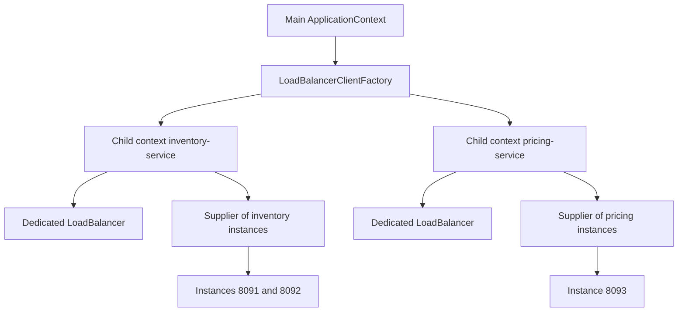
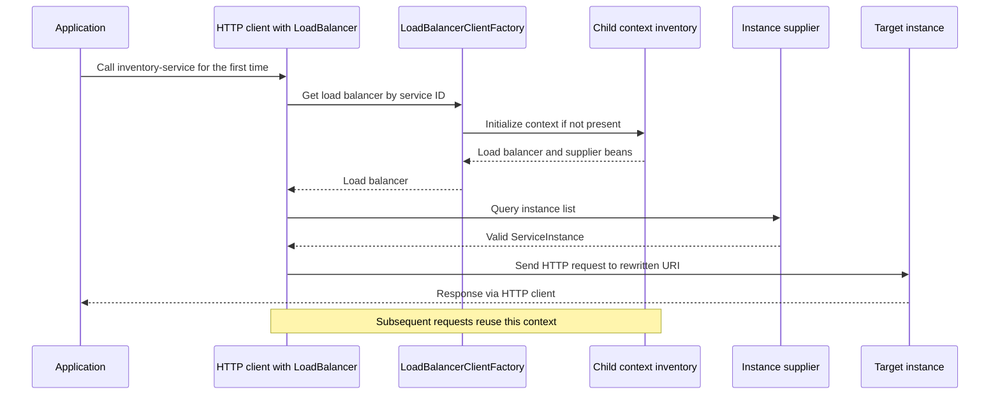
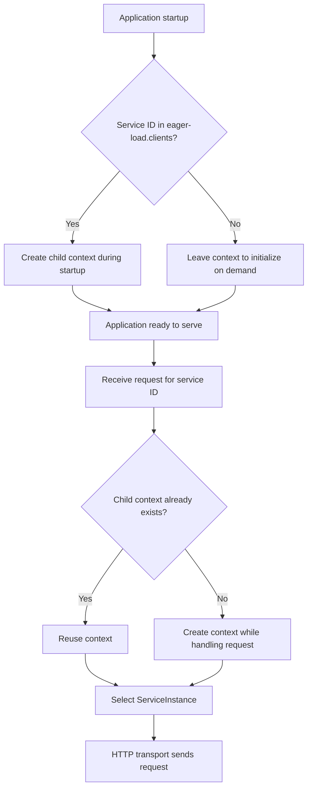

# Lazy Initialization on First Call and Eager Loading Configuration

In Spring Cloud LoadBalancer, each logical service name (**service ID**) can have its own configuration for retrieving and selecting a `ServiceInstance`. Normally, the framework initializes a service ID's load-balancing components only when that service is called for the first time (**lazy initialization**). To reduce initialization overhead appearing on the first request, you can instruct the framework to create these components early during startup (**eager loading**).

Eager loading **shifts when the LoadBalancer context is initialized**; it does not send HTTP requests on its own, create service replicas, guarantee addresses are ready in discovery, pre-open TCP/TLS connections, or change the instance-selection strategy. Understanding this boundary is essential for configuring it properly and evaluating its real impact.

## 1. Why Is There a Dedicated ApplicationContext per Service ID?

An application may need to call `inventory-service`, `pricing-service`, and `notification-service`. Each service has its own instance list, metadata, health checks, and routing policy. Spring Cloud LoadBalancer uses `LoadBalancerClientFactory` to manage **child ApplicationContexts** by service name. Inside each context reside the beans responsible for selecting an instance of that specific service ID.

| Component | Role |
|---|---|
| Main ApplicationContext | Holds controllers, services, HTTP clients, and shared application beans |
| `LoadBalancerClientFactory` | Manages/looks up contexts by service ID |
| Child context of `inventory-service` | Holds the load balancer and supplier applied to `inventory-service` |
| `ReactorServiceInstanceLoadBalancer` | Selects an instance per policy, such as round robin |
| `ServiceInstanceListSupplier` | Provides the instance list, optionally combining discovery, caching, or health checks |
| `DiscoveryClient` | Retrieves instance info from a registry or configured list |
| `ServiceInstance` | Data describing one replica: service ID, host, port, secure flag, and metadata |

Each **service ID**, not each instance, corresponds to one child context. For example, if `inventory-service` has three instances running on three different ports, all three instances belong to the same LoadBalancer configuration context for `inventory-service`. The context can be reused across a huge number of requests to that service ID.



The diagram depicts logical structure. Drawing two contexts does not imply both are already created when the main application context starts: creation timing depends on lazy or eager configuration.

## 2. Lazy Initialization: Created Only When First Needed

Under default behavior, Spring Cloud LoadBalancer typically **initializes child contexts on demand**. During the first call to `http://inventory-service/api/v1/items/42`:

1. The LoadBalancer-integrated HTTP client extracts `inventory-service` from the host in the logical URI.
2. The load-balancing mechanism asks `LoadBalancerClientFactory` for the instance-selection component of that service ID.
3. If the `inventory-service` context does not yet exist, the factory creates the child context and initializes the associated beans.
4. The load balancer fetches the list from `ServiceInstanceListSupplier` and picks one `ServiceInstance`.
5. The logical URI is rewritten with the instance's host/port, and the HTTP transport executes the request.
6. Subsequent requests reuse the created child context. The first call to `pricing-service` may still need to create another context.



### Why Can the First Request Be Slower?

Initializing a child context requires processing configuration and creating beans. That is one piece of work that can sit on the first request's critical path. However, first-request latency is also affected by many factors **not directly tied** to child context initialization:

| Latency Source | Example | Directly Solved by Eager Loading Child Context? |
|---|---|---|
| Creating child context | Binding configuration, creating load balancer/supplier | Yes, by moving it to startup |
| Discovery lookup | Querying registry or fetching instance list | Not guaranteed |
| DNS lookup | Resolving instance hostname | No |
| Opening network connection | TCP/TLS handshake, initializing connection pool | No |
| Server-side processing | Querying data, warming provider caches | No |
| Runtime activity | Class loading, JIT, GC, or other library initialization | Not guaranteed |

Therefore, **a slow first request alone is not enough proof** that lazy initialization is the cause. Measure or observe each phase separately.

## 3. Configuring Eager Loading for Critical Service IDs

The property used by Spring Cloud LoadBalancer is:

```properties
spring.cloud.loadbalancer.eager-load.clients[0]=inventory-service
spring.cloud.loadbalancer.eager-load.clients[1]=pricing-service
```

Equivalent YAML configuration:

```yaml
spring:
  cloud:
    loadbalancer:
      eager-load:
        clients:
          - inventory-service
          - pricing-service
```

`eager-load.clients` takes **a list of service IDs**. It is not a list of instance URLs. If `inventory-service` has two replicas on ports 8091 and 8092, the eager list only needs the single name `inventory-service`.

When the application starts, Spring Cloud LoadBalancer eagerly creates the listed child contexts. The first request to those service IDs can avoid context-creation work; unlisted service IDs continue operating lazily.



**Important:** creating a child context early does not mean target instances are already registered or have passed health checks. Depending on the supplier and discovery implementation, registry queries or cache population may happen at another time. Eager loading is also not a mechanism for sending warm-up requests to other applications.

## 4. Hands-on Example with SimpleDiscoveryClient and RestClient

We use three service processes to clearly observe per-service-ID configuration:

| Process | Address | Function |
|---|---|---|
| `inventory-service` replica 1 | `http://localhost:8091` | Serves `GET /api/v1/items/{id}` |
| `inventory-service` replica 2 | `http://localhost:8092` | Same endpoint, payload identifies the instance |
| `pricing-service` | `http://localhost:8093` | Second service to illustrate a separate context |

The client application runs on port 8080. The client must have the `spring-cloud-starter-loadbalancer` dependency and an appropriate web starter, managed by a Spring Cloud BOM compatible with Spring Boot. For example, `RestClient` requires Spring Framework 6.1 or newer (typically starting with Spring Boot 3.2).

### 4.1. Declaring Instance List and Eager Loading in the Same Profile

Create `application-lab.yml` for the **client application**:

```yaml
server:
  port: 8080

spring:
  application:
    name: gateway-demo
  cloud:
    discovery:
      client:
        simple:
          instances:
            inventory-service:
              - uri: http://localhost:8091
              - uri: http://localhost:8092
            pricing-service:
              - uri: http://localhost:8093
    loadbalancer:
      eager-load:
        clients:
          - inventory-service
          - pricing-service
```

The two properties serve different purposes:

- `spring.cloud.discovery.client.simple.instances` supplies instance URIs for each service ID. With this configuration, `SimpleDiscoveryClient` needs no external registry.
- `spring.cloud.loadbalancer.eager-load.clients` decides which service IDs have their LoadBalancer child contexts initialized early.

You cannot declare only `eager-load.clients` and expect the framework to spin up service replicas or know their hosts/ports automatically. Before testing LoadBalancer, verify that the endpoint at each URI is directly reachable from the client machine.

Start the client application with the profile:

```bash
java -jar gateway-demo.jar --spring.profiles.active=lab
```

### 4.2. Configuring a LoadBalancer-Integrated RestClient

The client application registers a `RestClient.Builder` annotated with `@LoadBalanced`:

```java
import org.springframework.cloud.client.loadbalancer.LoadBalanced;
import org.springframework.context.annotation.Bean;
import org.springframework.context.annotation.Configuration;
import org.springframework.web.client.RestClient;

@Configuration
class HttpClientConfiguration {

    @Bean
    @LoadBalanced
    RestClient.Builder loadBalancedRestClientBuilder() {
        return RestClient.builder();
    }
}
```

The gateway uses that exact builder to call the service ID:

```java
import org.springframework.beans.factory.annotation.Qualifier;
import org.springframework.stereotype.Service;
import org.springframework.web.client.RestClient;

@Service
class InventoryGateway {

    private final RestClient restClient;

    InventoryGateway(
            @Qualifier("loadBalancedRestClientBuilder")
            RestClient.Builder builder) {
        this.restClient = builder
                .baseUrl("http://inventory-service")
                .build();
    }

    String getItem(String itemId) {
        return restClient.get()
                .uri("/api/v1/items/{id}", itemId)
                .retrieve()
                .body(String.class);
    }
}
```

To test via the client application's port:

```java
import org.springframework.web.bind.annotation.GetMapping;
import org.springframework.web.bind.annotation.PathVariable;
import org.springframework.web.bind.annotation.RestController;

@RestController
class DemoController {

    private final InventoryGateway gateway;

    DemoController(InventoryGateway gateway) {
        this.gateway = gateway;
    }

    @GetMapping("/items/{id}")
    String item(@PathVariable String id) {
        return gateway.getItem(id);
    }
}
```

Run two provider replicas on ports 8091 and 8092, each returning an extra `instanceId` or `port` field to distinguish them. Then call several times:

```bash
curl http://localhost:8080/items/42
curl http://localhost:8080/items/42
curl http://localhost:8080/items/42
```

With the default round-robin policy and two ready instances, you can observe requests alternating between replicas. **Enabling eager loading does not change the round-robin rule**: the context is created earlier, while instance selection is still handled by the load balancer.

If you use a plain `RestClient` without going through the `@LoadBalanced` builder, `inventory-service` in the URL is treated as a DNS hostname. In that case, eager-loading the context will not make the client automatically use discovery's instance list.

## 5. Experiment Comparing Lazy and Eager

For a fair evaluation, keep providers, instance counts, timeouts, and network infrastructure constant; change only the context initialization setting on the client side.

1. Run two providers and confirm `http://localhost:8091` and `http://localhost:8092` are reachable.
2. Run the client in **lazy** mode by removing `spring.cloud.loadbalancer.eager-load` from the profile. Record startup-to-ready time and first-request latency.
3. Measure several subsequent requests after the context has been created.
4. Restart the client with **eager** loading for `inventory-service`. Repeat the measurements under equivalent conditions.
5. Run multiple iterations and compare trends. A single run can be skewed by JIT, DNS, caches, TCP connections, or provider processing time.

Measurement example on Linux/macOS:

```bash
curl -s -o /dev/null -w 'total=%{time_total}s\n' \
  http://localhost:8080/items/42
```

On Windows PowerShell:

```powershell
curl.exe -s -o NUL -w "total=%{time_total}s\n" http://localhost:8080/items/42
```

These commands measure **total time from the caller**, not context-creation time alone. To verify whether the context was created at startup or on the first request, add instrumentation for LoadBalancer bean/context lifecycle and combine it with tracing or logging configured for your version.

| Metric | Meaning |
|---|---|
| Startup-to-ready time | Eager may increase it due to pre-creating contexts |
| First-request latency | Lazy may incur extra child-context creation cost |
| Subsequent-request latency | Both modes already have the context; remaining differences require separate measurement |
| Memory and number of contexts created | Eager initializes even contexts that might never be used |

Do not interpret "first request is faster" as "all requests are faster". Eager loading is a trade-off that shifts cost from request time to startup.

## 6. Relationship to Per-Service Configuration

Separate contexts allow `inventory-service` and `pricing-service` to have different suppliers or instance-selection algorithms. Spring Cloud can bind configuration to a service name via `@LoadBalancerClient(name = "...", configuration = ...)`; eager loading only changes when the corresponding context is created.

For example, if an application calls `inventory-service` frequently but calls `pricing-service` very rarely, you can declare only:

```yaml
spring:
  cloud:
    loadbalancer:
      eager-load:
        clients:
          - inventory-service
```

Then the `inventory-service` context is created at startup, while the `pricing-service` context can still be created on its first request. This reduces startup time and memory usage compared to eager-loading every service ID the application might ever call.

**Note for custom configuration classes**: if using a configuration class for `@LoadBalancerClient`, prevent that class from accidentally being component-scanned by the main application context. If the configuration enters the parent context unintentionally, service-specific beans or strategies can affect multiple service IDs.

## 7. Eager Loading Does Not Replace Health Checks, Retries, or Timeouts

Eager-loading configuration addresses only context initialization:

- **Discovery:** the service name must have instances from a registry, static list, or another supplier. Eager loading does not register instances.
- **Health checks:** if an instance is unhealthy, discovery or a health-check supplier must exclude it per policy. Having a pre-created context does not prove an instance can serve requests.
- **Timeouts:** connection timeouts, read timeouts, and overall timeouts belong to the HTTP transport and calling layer. Eager loading does not alter these values.
- **Retries:** retries depend on HTTP client integration and configured policies, which may retry the same or another instance; eager loading does not enable retries.
- **Observability:** logs/metrics/traces are still needed for service ID, selected instance, request duration, exceptions, and retry counts.

With `RestClient`, `RestTemplate`, and OpenFeign, requests can follow a blocking model. `WebClient` typically uses a dedicated reactive integration path to select an instance. Eager-loading child contexts does not determine whether an HTTP client is blocking or reactive.

## 8. Common Pitfalls

| Symptom | Possible Cause | How to Check |
|---|---|---|
| First request is still slow after enabling eager | DNS, discovery lookup, TLS, connection pool, or slow provider | Measure each phase; do not assume all latency comes from the LoadBalancer context |
| Thought eager was enabled, yet context still builds on call | Typo in `clients`, wrong profile, or wrong property prefix | Compare service ID and runtime configuration values |
| Startup slows down after enabling eager for many services | Creating many contexts/beans before ready | Eager-load only frequently used service IDs with measured benefit |
| Bean creation errors appear at startup | Eager surfaces per-service configuration errors earlier | Inspect `@LoadBalancerClient` configuration classes and dependencies |
| No instances for a service ID | Registry/static list has no instances, or wrong name | Check discovery, registration, metadata, and instance list |
| `UnknownHostException` for logical name | HTTP client may not have LoadBalancer integration | Check the `@LoadBalanced` bean or injected builder |
| `Connection refused` on selected instance | Instance stopped, wrong port, or unreachable | Call `host:port` directly, check networking and health checks |

To isolate failures, follow the chain: **service ID → child context → instance list → selected instance → network connection → HTTP response**. Where it fails indicates whether to fix load-balancing configuration, discovery, or HTTP transport.

## 9. Memory Checklist

- [ ] Distinguish the per-service-ID child ApplicationContext from that service's `ServiceInstance` replicas.
- [ ] Know that lazy initialization is the common default and context-creation cost can appear on the first call.
- [ ] Configure `spring.cloud.loadbalancer.eager-load.clients` accurately with **service ID names**, not instance URIs.
- [ ] Verify the instance list separately via discovery or static configuration.
- [ ] Ensure the HTTP client uses proper `@LoadBalanced` integration.
- [ ] Measure startup and first-request times, separating context cost from DNS, TCP/TLS, discovery, and provider latency.
- [ ] Eager-load only necessary services; maintain health checks, timeouts, retries, and observability per client policy.

Understanding child-context lifecycles helps balance startup time against first-call latency in Spring Cloud LoadBalancer. For service IDs called immediately and frequently once the application is ready, eager loading can help; for rarely called services, lazy initialization avoids unnecessary startup cost.
