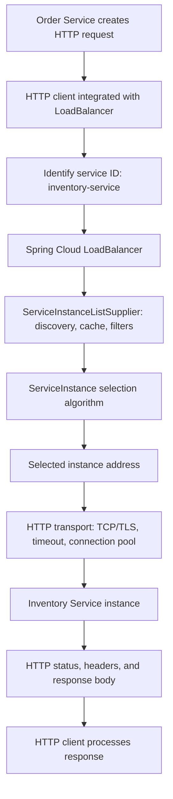
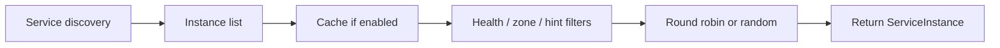

# Distinguishing LoadBalancer Configuration from HTTP Client Configuration

In a Spring Cloud microservices system, a request such as `GET http://inventory-service/api/items/42` typically passes through two independent yet cooperating configuration layers:

1. **Spring Cloud LoadBalancer configuration** decides which `ServiceInstance` entries are retrieved for service ID `inventory-service`, how they are filtered, and which instance is selected according to the strategy.
2. **HTTP client configuration** decides how to connect to the selected instance: connect timeout, response timeout, connection pool, TLS, headers, body decoding, and HTTP error handling.

When these two configuration layers get mixed up, developers easily form false expectations: changing the round-robin algorithm yet still hitting timeouts; increasing the read timeout yet failing to fix "no instance found" errors; or enabling retries at multiple layers causing a `POST` operation to be sent repeatedly without intending to.

This lesson focuses on the boundary and coordination between these two configuration layers when using **Spring Cloud LoadBalancer** with `RestClient`, `WebClient`, and OpenFeign. Examples use service ID `inventory-service`; class names and addresses are illustrative, not mandatory configurations for every application.

## 1. What Steps Does a Call Go Through?

Suppose `order-service` calls `inventory-service`, which has three replicas at `10.0.1.11:8080`, `10.0.1.12:8080`, and `10.0.1.13:8080`.



For example, LoadBalancer selects `10.0.1.12:8080`. The HTTP client then sends the request to that address over a connection managed by the client's own configuration. If fetching the candidate list fails, the request never reaches an instance; if the connection step fails, instance selection succeeded, while transport failed.

Keep this in mind: **LoadBalancer chooses where to send; the HTTP client decides how to send and receive.** Some policies such as retries, total deadlines, and circuit breakers may also belong to the business calling layer or a resilience library. They must be coordinated rather than assumed to be LoadBalancer's responsibility by default.

## 2. Responsibility Comparison Table

| Question to Solve | Spring Cloud LoadBalancer | HTTP Client / Calling Layer |
|---|---|---|
| Which instances does `inventory-service` have? | Discovery and `ServiceInstanceListSupplier`. | Does not decide the list on its own when using LoadBalancer. |
| Which instance is picked for this request? | `RoundRobinLoadBalancer`, `RandomLoadBalancer`, or custom strategy. | Uses the selected instance to execute the request. |
| Are zone or metadata preferred? | Supplier filters or prioritizes by zone, hint, or metadata. | May pass context/hint when integration supports it; does not change the algorithm itself. |
| Are unhealthy instances excluded? | Supplier/health checks and discovery source per configuration. | Still suffers connection errors during windows before health/discovery updates. |
| How long to wait to connect? | Not standard TCP connect timeout. | HTTP transport connect timeout. |
| How long to wait for a response? | Not HTTP transport read/response timeout. | Request read timeout, response timeout, and/or deadline. |
| How are connection pool, proxy, TLS configured? | Not the component managing HTTP transport sockets. | Transport configuration such as JDK HTTP client, Apache HttpClient, Reactor Netty, or Feign's client. |
| Adding Authorization, Content-Type, interceptors? | Not the job of instance selection. | HTTP client filters/interceptors and authentication layer. |
| Handling `404`, `409`, `429`, `503`? | Certain no-instance errors may be mapped by integration to exceptions/statuses. | Parses the actual HTTP response; application layer decides business handling. |
| Does a retry switch instances? | If LoadBalancer retry is enabled and policy allows re-selection. | HTTP client or business-layer retries follow their own conditions; do not automatically switch instances. |

Two common points of confusion: `ServiceInstanceListSupplier` can actively probe a health endpoint, yet that is part of the *candidate list* policy, not the read timeout for a business request. At the same time, an HTTP client can be configured to retry, yet an HTTP transport retry on its own does not necessarily re-run the `ServiceInstance` selection algorithm.

## 3. Configuration Scope: By Service ID or by HTTP Client?

Spring Cloud LoadBalancer typically creates separate configurations per **service ID**. `inventory-service` and `payment-service` can use different algorithms or suppliers even when both are called through one `@LoadBalanced RestClient.Builder` or `WebClient.Builder`.

An HTTP client has a different scope: a `RestClient`, `WebClient`, or Feign client is the object used to send requests. You can build a dedicated client for `inventory-service` with its own timeout; you can also share one builder and pass multiple service IDs in URIs. In the latter case, requests share the builder/client's transport configuration.

| Configuration Target | Typical Key / Scope | Example |
|---|---|---|
| LoadBalancer | Service ID | `@LoadBalancerClient(name = "inventory-service", ...)` |
| RestClient | `RestClient` or `RestClient.Builder` bean | Dedicated bean for inventory with its own connect/read timeouts. |
| WebClient | `WebClient` or `WebClient.Builder` bean | Dedicated bean for inventory using Reactor Netty and its own response timeout. |
| OpenFeign | Feign client name or context ID | `spring.cloud.openfeign.client.config.inventory-service` when the client has that name. |

The HTTP client bean name does not determine the service ID for LoadBalancer selection. With URI `http://inventory-service/...`, `inventory-service` is the service ID used to look up instances. For OpenFeign, the `name` attribute in `@FeignClient` is typically the service ID unless a fixed `url` is specified. The name used to apply Feign configuration must match the actual client identifier, especially when `contextId` is used.

## 4. Configuring LoadBalancer Per Service ID

### 4.1. Choosing a Custom Algorithm for One Service

Spring Cloud LoadBalancer lets you bind dedicated configuration to a service ID via `@LoadBalancerClient`. Example: calls to `inventory-service` use random selection, while services without custom configuration keep the application default.

```java
@Configuration
@LoadBalancerClient(
    name = "inventory-service",
    configuration = InventoryLoadBalancerConfiguration.class
)
class LoadBalancerRegistration {
}

// Keep this class outside the main application's component-scan scope.
class InventoryLoadBalancerConfiguration {

    @Bean
    ReactorLoadBalancer<ServiceInstance> inventoryLoadBalancer(
            Environment environment,
            LoadBalancerClientFactory factory) {

        String serviceId = environment.getProperty(
            LoadBalancerClientFactory.PROPERTY_NAME);

        return new RandomLoadBalancer(
            factory.getLazyProvider(
                serviceId, ServiceInstanceListSupplier.class),
            serviceId);
    }
}
```

In this example, `LoadBalancerClientFactory` manages the context for `inventory-service`. `RandomLoadBalancer` gets its candidate list from that service's `ServiceInstanceListSupplier`. It decides only which instance is chosen; it does not configure socket timeouts, TLS, or connection pools.

**Bean scope note:** `InventoryLoadBalancerConfiguration` should sit outside the main component scan or be structured so it is loaded only into this service's LoadBalancer context. If a per-service configuration accidentally becomes a global bean, it can affect multiple service IDs. Java imports are omitted to keep focus on configuration boundaries; when implementing, use APIs and dependencies matching your project's Spring Cloud version.

### 4.2. Configuring Instance Sources and Filters

A LoadBalancer policy typically includes a supplier chain:



Components such as `CachingServiceInstanceListSupplier`, `HealthCheckServiceInstanceListSupplier`, `ZonePreferenceServiceInstanceListSupplier`, and `HintBasedServiceInstanceListSupplier` belong to LoadBalancer's responsibilities. They affect **the selectable candidate set**. The ordering of suppliers/decorators matters because placing caching in a different position changes what gets cached and when filters run.

If you only want to lower `inventory-service`'s response timeout from 5 seconds to 2 seconds, you do not need to change the supplier. Conversely, if you want to prefer replicas in the same zone, adjusting HTTP client timeouts will not solve it; you must inspect the routing policy and instance metadata.

## 5. Configuring the HTTP Client with RestClient

`RestClient` is Spring Framework's synchronous (blocking) HTTP client. When integrated with Spring Cloud LoadBalancer, requests using a service-ID URI can be routed to the selected instance.

An illustrative configuration creates a LoadBalancer-enabled builder, then builds a dedicated `RestClient` for inventory:

```java
@Configuration
class RestClientsConfiguration {

    @Bean
    @LoadBalanced
    RestClient.Builder loadBalancedRestClientBuilder() {
        return RestClient.builder();
    }

    @Bean
    RestClient inventoryRestClient(
            @LoadBalanced RestClient.Builder builder) {

        SimpleClientHttpRequestFactory transport =
            new SimpleClientHttpRequestFactory();
        transport.setConnectTimeout(1_000);
        transport.setReadTimeout(3_000);

        return builder.clone()
            .baseUrl("http://inventory-service")
            .requestFactory(transport)
            .build();
    }
}
```

Usage example:

```java
@Service
class InventoryRestGateway {
    private final RestClient inventoryRestClient;

    InventoryRestGateway(RestClient inventoryRestClient) {
        this.inventoryRestClient = inventoryRestClient;
    }

    Item findItem(String id) {
        return inventoryRestClient.get()
            .uri("/api/items/{id}", id)
            .retrieve()
            .body(Item.class);
    }
}
```

Two separate decisions are made here:

- `@LoadBalanced` enables service-ID resolution on the builder, allowing requests to `http://inventory-service` to select instances via LoadBalancer.
- `SimpleClientHttpRequestFactory` sets the transport's connection and read wait limits in the example; `1_000` and `3_000` are in milliseconds.

`builder.clone()` creates an isolated client configuration, preventing changes to `baseUrl` or transport on a shared builder from affecting clients built later. Under high load, `SimpleClientHttpRequestFactory` can be replaced with a pooled transport and appropriate settings; transport selection belongs to HTTP client configuration.

Never assume every builder has LoadBalancer. A plain `RestClient.Builder` using `http://inventory-service` may try to resolve the hostname via DNS and fail if no matching DNS record exists. Proper Spring Cloud LoadBalancer integration and dependencies are required.

## 6. Configuring the HTTP Client with WebClient

`WebClient` supports reactive processing. To resolve service IDs, its builder needs the LoadBalancer filter integrated; meanwhile, connect/response timeouts can be managed by the Reactor Netty transport.

```java
@Configuration
class WebClientsConfiguration {

    @Bean
    @LoadBalanced
    WebClient.Builder loadBalancedWebClientBuilder() {
        return WebClient.builder();
    }

    @Bean
    WebClient inventoryWebClient(
            @LoadBalanced WebClient.Builder builder) {

        HttpClient httpClient = HttpClient.create()
            .option(ChannelOption.CONNECT_TIMEOUT_MILLIS, 1_000)
            .responseTimeout(Duration.ofSeconds(3));

        return builder.clone()
            .baseUrl("http://inventory-service")
            .clientConnector(new ReactorClientHttpConnector(httpClient))
            .build();
    }
}
```

Using this bean to call inventory:

```java
@Service
class InventoryReactiveGateway {
    private final WebClient inventoryWebClient;

    InventoryReactiveGateway(WebClient inventoryWebClient) {
        this.inventoryWebClient = inventoryWebClient;
    }

    Mono<Item> findItem(String id) {
        return inventoryWebClient.get()
            .uri("/api/items/{id}", id)
            .retrieve()
            .bodyToMono(Item.class);
    }
}
```

`CONNECT_TIMEOUT_MILLIS` is the connection-establishment wait limit; `responseTimeout` limits response wait time as defined by Reactor Netty. They are not timers covering the entire chain of discovery, instance selection, retries, backoff, and data processing. If the business operation has an overall deadline, enforce a limit at the appropriate calling layer, such as the `timeout(...)` operator in the Reactor chain and deadline propagation across downstream calls.

Using `ReactorClientHttpConnector` requires Reactor Netty on the classpath. If another HTTP transport is chosen, timeout, proxy, and TLS configuration change accordingly. LoadBalancer still focuses on selecting the `ServiceInstance`.

## 7. Configuring the HTTP Client with OpenFeign

OpenFeign lets you declare HTTP clients as interfaces. With proper LoadBalancer integration and no fixed target URL specified, `@FeignClient`'s `name` can serve as the service ID:

```java
@FeignClient(name = "inventory-service")
interface InventoryFeignClient {

    @GetMapping("/api/items/{id}")
    Item findItem(@PathVariable("id") String id);
}
```

Configuring dedicated connect/read timeouts for the Feign client named `inventory-service`:

```yaml
spring:
  cloud:
    openfeign:
      client:
        config:
          inventory-service:
            connectTimeout: 1000
            readTimeout: 3000
```

The values above are in milliseconds. They are **Feign HTTP client configuration** and do not change `RoundRobinLoadBalancer`, `ServiceInstanceListSupplier`, or instance metadata. Actual Feign options and engine also depend on the HTTP client dependency, custom configuration, and Spring Cloud OpenFeign version.

If declared as `@FeignClient(name = "inventory-service", url = "https://inventory.internal.example")`, the client has a fixed target URL and normally does not need Spring Cloud LoadBalancer instance selection for those calls. Therefore, check both `name` and `url` when requests do not go through LoadBalancer as expected. When `contextId` is used, the name under which Feign configuration applies can change depending on the declaration; do not derive configuration keys from the Java interface name alone.

## 8. Timeouts and Retries: Two Configuration Layers Sharing One Budget

Timeouts and retries are where the boundary between the two layers is confused most often:

| Mechanism | Typical Responsible Layer | What Is Limited or Repeated? |
|---|---|---|
| Connect timeout | HTTP transport | Time to establish a connection to the chosen `host:port`. |
| Read/response timeout | HTTP transport | Time waiting to read or receive a response, as defined by the HTTP engine. |
| Total request deadline | Business calling layer, reactive pipeline, or resilience library | Total time for instance selection, connection, execution, and possibly retries/backoff. |
| LoadBalancer retry | Spring Cloud LoadBalancer integration, when enabled and configured | May retry on the selected instance or pick a new instance depending on policy, error type, and version. |
| Feign/WebClient/RestClient retry | HTTP client or application layer | Resends the request per its own retry logic; re-selecting an instance depends on where retry sits in the pipeline. |
| Circuit breaker | Resilience library/calling layer | Temporarily blocks calls when failures exceed thresholds; not synonymous with instance-selection algorithms. |

Suppose the business deadline is 3 seconds. One attempt has a 0.5-second connect timeout and a 1-second response timeout; if two attempts plus a 0.2-second backoff are allowed, a simple worst-case sum is roughly 3.2 seconds, **exceeding the 3-second deadline**. Tuning individual timeouts alone is therefore insufficient: you must balance attempt count, wait durations, and the overall deadline. In practice, timeouts may not add linearly due to connection reuse, early failures, or overlapping phases, yet the time-budget problem remains.

When designing retries, check:

1. **Could the error be transient?** `502`, `503`, `504`, connection errors, and certain timeouts may suit retries; `400`, `401`, `403`, `404` usually require fixing the root cause rather than repeating the same request.
2. **Is the request safe to resend?** `GET`, `PUT`, and `DELETE` carry idempotent semantics in HTTP. `POST` can create duplicate transactions if the prior request was processed but the response was lost. For non-idempotent operations, require an idempotency key or server-side deduplication.
3. **Which layer performs the retry?** If Feign, LoadBalancer, and the application layer all retry, total call volume can grow exponentially. Maintain a single, clearly coordinated retry policy.
4. **Can a different instance be chosen?** This depends on whether the retry re-enters `choose()` along with LoadBalancer's retry configuration. HTTP transport retries alone do not guarantee switching instances.
5. **Is there time remaining?** Cap total duration; use exponential backoff and jitter where appropriate; honor `Retry-After` if returned and within the remaining deadline.

A particularly dangerous scenario is `POST /api/orders`: the server may create the order successfully, while the client times out before receiving the response. Here, a timeout does not prove the server never executed the operation. Retry decisions must rely on the business contract rather than timeouts or LoadBalancer algorithms alone.

## 9. Distinguishing Selection Errors, Transport Errors, and HTTP Errors

When investigating incidents, pinpoint which step failed before changing configuration:

| Symptom | First Component to Check | Meaningful Adjustment |
|---|---|---|
| `No servers available` or empty instance selection | Service ID, registry/discovery, supplier, health/zone/hint filters. | Fix instance source, metadata, and filters; raising read timeout does not create new instances. |
| Instance exists but `Connection refused` | Host, port, readiness, networking, listening server. | Fix address configuration and availability; switching random to round robin does not fix the root cause. |
| `Connect timeout` | DNS/routing, firewall, network, TCP handshake, connect timeout. | Inspect network path and connection-establishment limits. |
| `Read/response timeout` | Server processing time, network I/O, deadline, and HTTP transport. | Inspect latency, response timeout, optimize upstream; apply safe retry policy if appropriate. |
| HTTP `404` from upstream | Endpoint/path, resource ID, method, and API contract. | Fix URI or business logic; do not blame LoadBalancer for picking the wrong instance. |
| HTTP `429` or `503` from upstream | Rate limit/overload, `Retry-After`, upstream health. | Backoff, concurrency limits, capacity tuning, and bounded retries. |
| TLS handshake failure | HTTP transport, certificates, hostname, truststore, and proxy. | Fix TLS or client trust setup; not an instance-selection algorithm issue. |

A no-instance error may be surfaced by the integration as an exception or an error response such as `503`, depending on the client and version. Clearly distinguish a `503` caused by **failing to select an instance** from an actual `503` **returned by upstream after connecting**. Looking only at the outer status code may not be enough.

## 10. Designing Configuration for Multiple Services

Suppose `order-service` calls `inventory-service` and `payment-service` with different requirements:

| Target Service | LoadBalancer Policy | HTTP Client and Timeouts | Reason |
|---|---|---|---|
| `inventory-service` | Round robin; filter unhealthy instances if configured. | Shorter read timeout for inventory reads. | Reads should respond quickly and may use bounded retries if safe. |
| `payment-service` | Prefer zone or metadata if architecture requires. | Appropriate timeouts and authentication; transaction creation uses an idempotency key. | Prevents duplicate payment processing and protects transport security. |

You can share instance-selection components per service ID while creating separate HTTP client beans for different timeouts, base URLs, headers, TLS, or connection pools. Conversely, if multiple services share identical transport requirements, you can reuse a shared HTTP client configuration while still applying separate LoadBalancer configurations per service ID.

A manageable way to organize this is:

```text
LoadBalancer configuration (per service ID)
  inventory-service -> round robin + appropriate supplier
  payment-service   -> appropriate filtering / selection policy

HTTP client configuration (per client bean / Feign client)
  inventoryClient   -> baseUrl inventory-service, short read timeout
  paymentClient     -> baseUrl payment-service, dedicated timeout/TLS/auth

Business/resilience policy (per use case)
  readInventory     -> bounded GET retry
  createPayment     -> idempotency key, deadline, and ambiguous-outcome handling
```

This organization also clarifies where to place environment variables and secrets: service names, zones, and timeouts can live in application configuration; tokens, secrets, and private keys must go through proper secret management, never into logs or public configuration examples.

## 11. Verifying Boundaries with a Small Experiment

You do not need a massive system to verify configuration boundaries. Test with two `inventory-service` instances running on different ports that return their instance ID in the response.

1. Configure discovery or a static instance list so `inventory-service` points to two instances.
2. Call the same `GET /api/instance` endpoint repeatedly via a LoadBalancer-integrated client; observe instance IDs to confirm the selection policy is active.
3. Switch round robin to random for that specific service ID while keeping HTTP timeouts unchanged; observe the change in call distribution.
4. Make one instance respond slowly and lower the read/response timeout on the HTTP client; observe the timeout change while the candidate list and algorithm stay the same.
5. Temporarily remove all instances from the supplier or registry; verify how the system handles "no server available" as distinct from a timeout after a successful selection.
6. If testing retries, use an idempotent endpoint and cap attempts to avoid duplicating business operations.

When logging and recording metrics, include the service ID, selected instance (if any), selection time, supplier errors, connection time, response time, and HTTP status. Combine with a trace/correlation ID to tell whether failures happen before or after instance selection. Avoid logging credentials, tokens, or personal data; watch metric tag cardinality if recording hosts/instance IDs across many instances.

## 12. Checklist Before Making Fixes

- If you need to select replicas by discovery, health, zone, or algorithm: check **Spring Cloud LoadBalancer** and the service ID's supplier chain.
- If you need to adjust connect timeout, response timeout, TLS, proxy, or connection pool: check the actual **HTTP client/transport** in use.
- If you need configuration specifically for `inventory-service`: clarify whether you are changing **LoadBalancer configuration per service ID** or the **HTTP client bean/Feign client** for inventory.
- If the service ID is not resolved: check `@LoadBalanced` or corresponding integration, dependencies, `@FeignClient(name=...)`, and whether a fixed URL is declared.
- If retries do not switch instances: check where retry sits in the pipeline and LoadBalancer's retry policy; do not guess from HTTP attempt counts alone.
- If requests time out: examine the entire time budget, including discovery, instance selection, connection, response wait, and backoff.
- If you see `503`: determine whether it is a failure to select an instance or an HTTP response from upstream.
- If changing a policy for just one service: prevent the `@LoadBalancerClient` configuration class from being component-scanned into a global configuration.

Properly separating these two configuration groups leads to intentional `ServiceInstance` selection and more reliable HTTP communication. Spring Cloud LoadBalancer is responsible for **choosing the destination**; `RestClient`, `WebClient`, or OpenFeign is responsible for **transmitting the request and receiving the response**; the business calling layer combines both with appropriate deadlines, retries, idempotency, and error observability.
