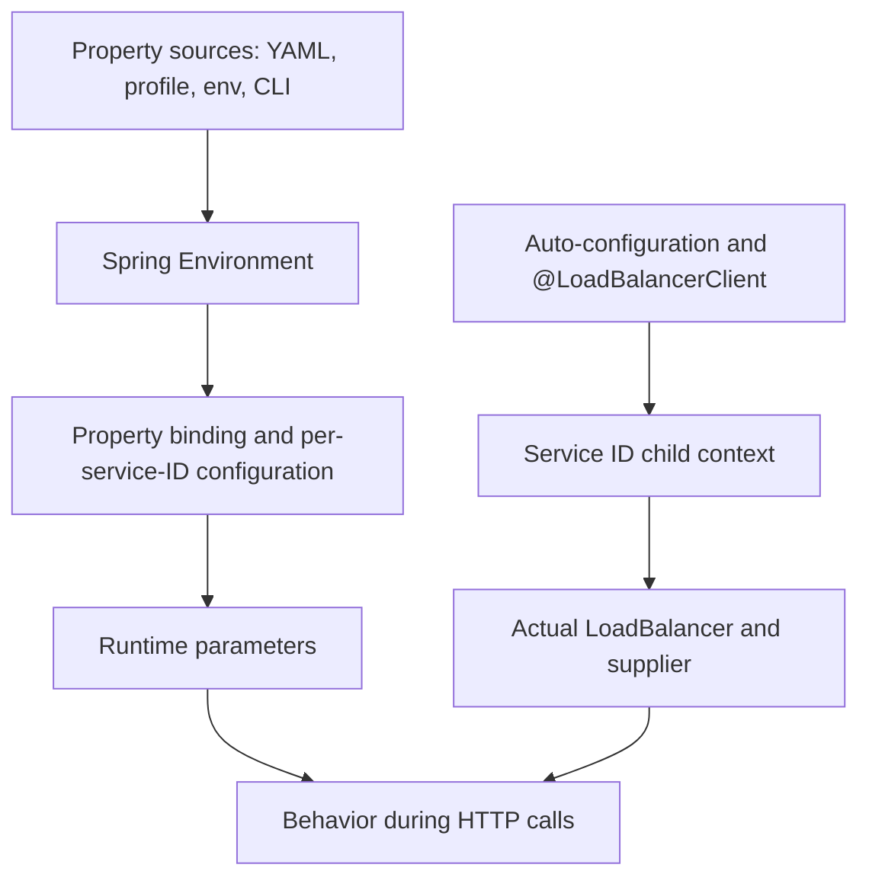

# Configuration Precedence and How to Verify Effective Values

When deploying Spring Cloud LoadBalancer, a change in `application.yml` does not guarantee requests behave as expected. Values can be overridden by a profile, environment variable, or command-line argument; a per-service-ID configuration can alter a shared setting; and a bean registered by the application can replace a default bean. To find the exact cause, inspect the **resolved property value**, the **actual beans in the service's context**, and **how `ServiceInstance` selection behaves when requests run**.

The running example throughout this lesson is an `order-service` calling `inventory-service` and `payment-service` by service ID. Spring Cloud LoadBalancer obtains instance lists from discovery or static configuration, then applies an instance-selection policy such as round robin or random. The goal is to understand which configuration applies to each service and how to prove it rather than relying solely on reading configuration files.

## 1. Three Kinds of Ordering to Distinguish

The phrase "configuration precedence" can refer to three different mechanisms:

| Mechanism | Question to Answer | Where to Check |
|---|---|---|
| Spring Boot **Property source precedence** | When the **same key** appears in multiple sources, which source determines the `Environment` value? | `/actuator/env`, `Environment`, property origin. |
| Spring Cloud LoadBalancer **Global vs. per-service settings** | For a property supporting per-service configuration, is the shared value or the value for `inventory-service` used? | `spring.cloud.loadbalancer...` structure, binding, and runtime behavior of your version. |
| **Bean resolution** in the child context | Which algorithm and supplier is the factory using for a specific service ID? | `LoadBalancerClientFactory`, `@LoadBalancerClient`, Condition Evaluation Report. |

These three mechanisms do not form a single linear precedence list. For example, a command-line argument can override a key in YAML, yet it will not swap a `RoundRobinLoadBalancer` bean to `RandomLoadBalancer` unless the framework provides a property to select algorithms that way.



## 2. How Does Spring Boot Choose the Value of the Same Property?

Spring Boot builds `Environment` from `PropertySource`s. When multiple sources supply the same property, the higher-precedence source wins. In a typical Boot application, the following common sources generally increase in priority from lowest to highest:

1. Base `application.yml`.
2. Profile-specific configuration file, such as `application-prod.yml`.
3. OS environment variables.
4. `SPRING_APPLICATION_JSON` data.
5. Command-line arguments in `--property=value` form.

This illustrates common sources. Spring Boot also supports test properties, system properties, config imports, external configuration outside the JAR, and other config data locations; the complete order depends on how the app is launched and the Boot version. When drawing a conclusion for a specific key, inspect the value's **origin** in `Environment` instead of relying only on a general list.

Suppose `application.yml` contains:

```yaml
spring:
  cloud:
    loadbalancer:
      cache:
        enabled: true
```

In `application-prod.yml`:

```yaml
spring:
  cloud:
    loadbalancer:
      cache:
        enabled: false
```

When running with the `prod` profile and no higher-precedence source, the resolved value is `false`. However, the command below overrides that key via a command-line argument:

```bash
java -jar order-service.jar \
  --spring.profiles.active=prod \
  --spring.cloud.loadbalancer.cache.enabled=true
```

In this run, the `Environment` value for `spring.cloud.loadbalancer.cache.enabled` is `true`. If a property is set across YAML, profiles, environment variables, and CLI, identify the winning source first before analyzing LoadBalancer.

## 3. Shared Configuration vs. Per-Service-ID Configuration

Spring Cloud LoadBalancer has shared parameters and certain parameters configurable per client/service ID. For properties that support per-client overrides in the version in use, the value tied to that service ID is applied to that service; services without a dedicated entry continue using the shared or library-default value.

Example illustrating retry limits:

```yaml
spring:
  cloud:
    loadbalancer:
      retry:
        enabled: true
        max-retries-on-next-service-instance: 1
      clients:
        inventory-service:
          retry:
            max-retries-on-next-service-instance: 2
```

In this example, the shared value of `max-retries-on-next-service-instance` is `1`, while `inventory-service` has its own value of `2`, provided the retry integration and current version support this override. `payment-service` has no separate branch, so it uses the shared setting per the running version's mechanism. The actual number of retried requests still depends on the HTTP client type, error conditions, other retry configurations, and whether the request is safe to resend.

**Distinguish two cases:**

- Two values in different sources for the **same key**, such as `spring.cloud.loadbalancer.retry.enabled` in YAML and CLI: Spring Boot resolves this using property source precedence.
- Two different keys because one includes `clients.inventory-service`, such as global retry config vs. per-service retry config for `inventory-service`: Spring Cloud LoadBalancer decides how to apply values per service ID. Spring Boot does not automatically treat those two keys as one overriding the other.

Not every property under `spring.cloud.loadbalancer` supports the `clients.<serviceId>` branch. When adding per-service settings, check the reference documentation and configuration metadata for your exact release train. A key invented by a developer may be read by `Environment` as a string yet never consumed by any bean.

## 4. Do Not Confuse Per-Service Properties with Per-Service Bean Configuration

Parameters such as retry limits, caching, or health checks can bind to configuration objects when supported by the framework. However, to change the instance-selection strategy, the application usually needs to register a dedicated `ReactorLoadBalancer<ServiceInstance>` for that service ID.

Spring Cloud LoadBalancer uses `LoadBalancerClientFactory` to manage child `ApplicationContext`s by service ID. `@LoadBalancerClient` registers a configuration class into the corresponding context; `@LoadBalancerClients(defaultConfiguration = ...)` declares default configuration for contexts when needed.

Example where the application wants only `inventory-service` to use random selection, while other services keep Spring Cloud LoadBalancer's defaults:

```java
@SpringBootApplication
@LoadBalancerClient(
        name = "inventory-service",
        configuration = InventoryLoadBalancerConfiguration.class)
public class OrderApplication {
    public static void main(String[] args) {
        SpringApplication.run(OrderApplication.class, args);
    }
}
```

The following configuration class must reside **outside the main application's component-scan scope**:

```java
@Configuration(proxyBeanMethods = false)
public class InventoryLoadBalancerConfiguration {

    @Bean
    ReactorLoadBalancer<ServiceInstance> inventoryLoadBalancer(
            Environment environment,
            LoadBalancerClientFactory clientFactory) {

        String serviceId = environment.getProperty(
                LoadBalancerClientFactory.PROPERTY_NAME);

        return new RandomLoadBalancer(
                clientFactory.getLazyProvider(
                        serviceId, ServiceInstanceListSupplier.class),
                serviceId);
    }
}
```

The classes involved in the example are `RandomLoadBalancer`, `ReactorLoadBalancer`, `ServiceInstanceListSupplier`, and `LoadBalancerClientFactory`. The snippet assumes a compatible Spring Cloud LoadBalancer dependency and corresponding Spring imports.

If `InventoryLoadBalancerConfiguration` gets component-scanned into the parent context, the algorithm bean may be registered globally by mistake. Then `payment-service` could also see the bean in the parent, causing bean resolution to violate the intended configuration boundary. Place per-service configuration classes in a package outside the package tree scanned by `@SpringBootApplication`, and reference them directly from `@LoadBalancerClient`.

Both a default configuration class and a per-service configuration class can supply beans of the same type. **Do not assume a "last-declared bean always wins" rule.** The outcome also depends on `@ConditionalOnMissingBean`, bean names, bean types, and how child contexts are created in your version. When overriding default behavior, define beans explicitly and verify which bean the factory actually returns.

## 5. Why Can the Same YAML File Yield Different Outcomes?

Consider three service IDs:

| Service ID | Configuration Source | Expected Value or Behavior |
|---|---|---|
| `inventory-service` | Global retry + `clients.inventory-service` branch + custom Java config | Receives per-service retry limits if supported; uses `RandomLoadBalancer` from its own child context. |
| `payment-service` | Global retry + default config | Receives shared values; uses the default algorithm when no other custom bean exists. |
| `report-service` | Global retry + custom Java config if declared | Shared values for non-overridden keys; algorithm/supplier per registered configuration. |

In the table above, retry count and selection algorithm are two independent dimensions. Retry determines when and how many times to resend under eligible conditions; the selection algorithm runs each time an instance is chosen. You cannot verify the instance-selection strategy merely by seeing `retry.enabled=true`.

Similarly, configuring `ServiceInstanceListSupplier` per service ID can add health checks, caching, or zone preference. The supplier changes **the candidate list**, while `ReactorLoadBalancer` decides **which instance is chosen from that list**. When only one healthy instance remains, both random and round robin pick that same instance; you cannot deduce which algorithm is active from that outcome.

## 6. Inspecting Property Values and Origins with Actuator

Spring Boot Actuator provides the `/actuator/env` endpoint to inspect property sources and `/actuator/configprops` to inspect configuration beans bound with `@ConfigurationProperties`.

In a **protected development environment**, you can configure:

```yaml
management:
  endpoints:
    web:
      exposure:
        include: health,info,env,configprops,conditions,beans
  endpoint:
    env:
      show-values: WHEN_AUTHORIZED
    configprops:
      show-values: WHEN_AUTHORIZED
```

The application needs the `spring-boot-starter-actuator` dependency. With `WHEN_AUTHORIZED`, seeing values depends on the access permissions configured by the application. If corresponding security is not configured, values may be masked or the endpoint may deny access. Do not expose these diagnostic endpoints publicly in production because they can reveal internal configuration structure.

Query a specific property:

```bash
curl -s http://localhost:8080/actuator/env/spring.cloud.loadbalancer.cache.enabled
```

The output can show the resolved value, the property sources containing the key, and their origins depending on the Boot version and visibility policy. When you see a value different from YAML, look for the winning source, such as command-line arguments, environment variables, or an active profile.

To view all sources and search for configuration keys when unsure of exact names:

```bash
curl -s http://localhost:8080/actuator/env
```

To inspect bound objects:

```bash
curl -s http://localhost:8080/actuator/configprops
```

Reading `configprops` lets you verify values bound into beans if that configuration type is registered by the framework. However, a property appearing in `/actuator/env` **does not prove** a LoadBalancer bean is using it. You still need to verify beans and runtime behavior.

## 7. Inspecting Actual Beans for Each Service ID

With Spring Cloud LoadBalancer, `LoadBalancerClientFactory` is the right place to query beans by service ID. The diagnostic code below is only for a development profile and should not print everything in production systems:

```java
@Component
@Profile("lb-diagnostics")
class LoadBalancerDiagnostics implements ApplicationRunner {

    private final LoadBalancerClientFactory clientFactory;

    LoadBalancerDiagnostics(LoadBalancerClientFactory clientFactory) {
        this.clientFactory = clientFactory;
    }

    @Override
    public void run(ApplicationArguments args) {
        for (String serviceId : List.of("inventory-service", "payment-service")) {
            ReactorLoadBalancer<?> loadBalancer =
                    clientFactory.getInstance(serviceId, ReactorLoadBalancer.class);
            ServiceInstanceListSupplier supplier =
                    clientFactory.getInstance(
                            serviceId, ServiceInstanceListSupplier.class);

            System.out.printf("serviceId=%s, loadBalancer=%s, supplier=%s%n",
                    serviceId,
                    loadBalancer == null ? "<missing>"
                            : loadBalancer.getClass().getName(),
                    supplier == null ? "<missing>"
                            : supplier.getClass().getName());
        }
    }
}
```

The example assumes Spring Boot, Spring Cloud, and `java.util.List` types are imported. Activate it with `--spring.profiles.active=lb-diagnostics` or combine this profile with your active environment profile.

`getInstance(serviceId, type)` asks the factory to resolve a bean in the service ID's context. Because contexts can be created on demand, running this check may actively initialize a context that has not yet been used. Keep this in mind during diagnostics and do not mistake it for evidence that an HTTP request actually called that service.

If `inventory-service` expects random selection yet logs show `RoundRobinLoadBalancer`, check the name in `@LoadBalancerClient`, the package containing the per-service configuration class, and any beans of the same type registered in the parent or child context.

Some LoadBalancer integrations wrap suppliers in multiple layers of caching, health checks, or filtering. The class name of the outermost bean shows the entry point, not the entire internal delegate chain. To know the final list, observe the supplier chain and real requests.

## 8. Auto-Configuration Conditions and Lazily Created Child Contexts

Spring Cloud LoadBalancer typically initializes per-service-ID contexts on first demand. Consequently, an application starting cleanly while `/actuator/beans` does not yet show an expected bean does not necessarily mean the configuration was ignored; the corresponding context may simply not have been created yet.

You can enable Spring Boot's debug report:

```bash
java -jar order-service.jar --debug
```

Or check `/actuator/conditions` to see why auto-configuration matched or did not match. When reading the report, distinguish auto-configuration classes in the main context from beans created specifically inside `inventory-service`'s context.

If contexts for certain services need to be prepared upfront, Spring Cloud LoadBalancer supports per-service-ID eager loading in versions that provide this feature:

```yaml
spring:
  cloud:
    loadbalancer:
      eager-load:
        clients:
          - inventory-service
          - payment-service
```

Eager loading can catch bean-initialization errors earlier, yet it does not guarantee discovery always has healthy instances or that requests will succeed. It also increases initialization cost at application startup. Use it only for a concrete operational reason.

## 9. Verifying Behavior with Real Requests

Three verification levels should be executed in order:

1. **Source value:** check `/actuator/env` to see where a key came from.
2. **Applied configuration:** check `/actuator/configprops`, beans returned by the factory, and the service ID's `@LoadBalancerClient` configuration.
3. **Runtime behavior:** send requests through a LoadBalancer-integrated HTTP client, observing selected instances, retries, timeouts, and status codes.

In a test environment, you can configure two static instances for one service ID:

```yaml
spring:
  cloud:
    discovery:
      client:
        simple:
          instances:
            inventory-service:
              - uri: http://localhost:8081
              - uri: http://localhost:8082
```

The two test servers should return an instance-identifying field, such as `instanceId: inventory-1` and `instanceId: inventory-2`. Send multiple consecutive requests through a `@LoadBalanced`-annotated `RestClient.Builder` or `WebClient.Builder` to observe distribution. Use the service ID in the URL, for example:

```http
GET http://inventory-service/api/debug/instance
```

With round robin and a stable instance list, consecutive selections typically alternate between instances. With random selection, results can repeat and an even split is not guaranteed over a small number of requests. Verification requires a sufficient sample size and must account for concurrent requests, retries, and supplier filters.

When testing timeouts, intentionally create a slow endpoint in the test environment and observe the timeout on the exact HTTP client in use. **Connect and read timeouts of `RestClient`, `WebClient`, or OpenFeign do not automatically align with Spring Cloud LoadBalancer retry parameters.** Each client has its own configuration mechanism; verify effective timeouts on the client, then verify whether retries actually occur under the configured conditions.

For `POST` requests that create data, retries can cause duplicate side effects if the API is not idempotent. Test write retries only in an isolated environment or with an appropriate idempotency mechanism.

## 10. Troubleshooting When Configuration Has No Effect

| Symptom | Hypothesis to Test | Verification Step |
|---|---|---|
| Edited `application.yml` yet runtime keeps old value | Profile, env var, or CLI overrides the key; app was not restarted. | Check `/actuator/env/{key}`, origin, and active profiles. |
| Set `clients.inventory-service...` yet `inventory-service` behavior unchanged | Property does not support per-client override in the running version or integration does not use it. | Check metadata/reference docs, binding, and real requests. |
| Wanted random yet factory returns round robin | Wrong service ID, missing `@LoadBalancerClient`, or config bean scanned into parent. | Print bean class per service ID; inspect annotations and packages. |
| `/actuator/beans` does not show the per-service bean | Child context not yet initialized or endpoint does not display that context. | Query the factory intentionally in a diagnostic environment and re-check. |
| Multiple instances exist yet traffic always hits one host | Supplier filters down to one instance, or health/zone/hint/sticky session dominates. | Observe supplier output list and selected instances. |
| Retries still occur unexpectedly | HTTP client or another infrastructure layer has its own retry. | Trace attempts at each layer, request IDs, and logs/traces. |
| `NoUniqueBeanDefinitionException` | Multiple beans of the same type exist in the resolving context. | Inspect bean definitions, qualifiers, and custom configuration. |
| Service ID looks right yet requests miss expected instances | Client uses a static URL or a builder without `@LoadBalanced`. | Inspect the actual client bean and resolved target address. |

Pay special attention that the service ID in `@LoadBalancerClient(name="inventory-service")`, the logical host `http://inventory-service`, and the `clients.inventory-service` branch must match consistently. Using `inventory` in one place creates a different context and configuration key from `inventory-service`.

When a service ID contains hyphens or special characters, place per-client configuration in YAML/Properties so key names remain clear. Converting keys containing hyphens into environment variables can lose character boundaries due to relaxed binding rules; verify the actual bound map key name instead of guessing variable naming.

## 11. Verification Workflow After Every Change

Suppose a team wants `inventory-service` to have a custom retry policy and use random selection, while `payment-service` keeps defaults. A repeatable verification workflow is:

1. Record the service ID, target configuration keys, and intended algorithm bean in the change.
2. Check dependencies/release train to confirm those properties and types are supported by that version.
3. Identify active profiles and potentially overriding configuration sources via `/actuator/env`.
4. Verify bound properties or values actually consumed by beans; do not stop at seeing the key in YAML.
5. Use `LoadBalancerClientFactory` to verify the LoadBalancer and supplier classes in `inventory-service`'s context.
6. Repeat bean inspection for `payment-service` to verify configuration scope.
7. Send requests to test instances and compare instance-selection metrics, retries, and timeouts against expectations.
8. Record the final configuration along with verification logs/traces, then disable unnecessary diagnostic endpoints or profiles.

**Key takeaway:** Property values in `Environment`, bean configuration in the child context, and request behavior are three distinct pieces of evidence. To confirm a Spring Cloud LoadBalancer configuration is effective for a service ID, you must connect all three pieces of evidence in the same running environment and library version.
