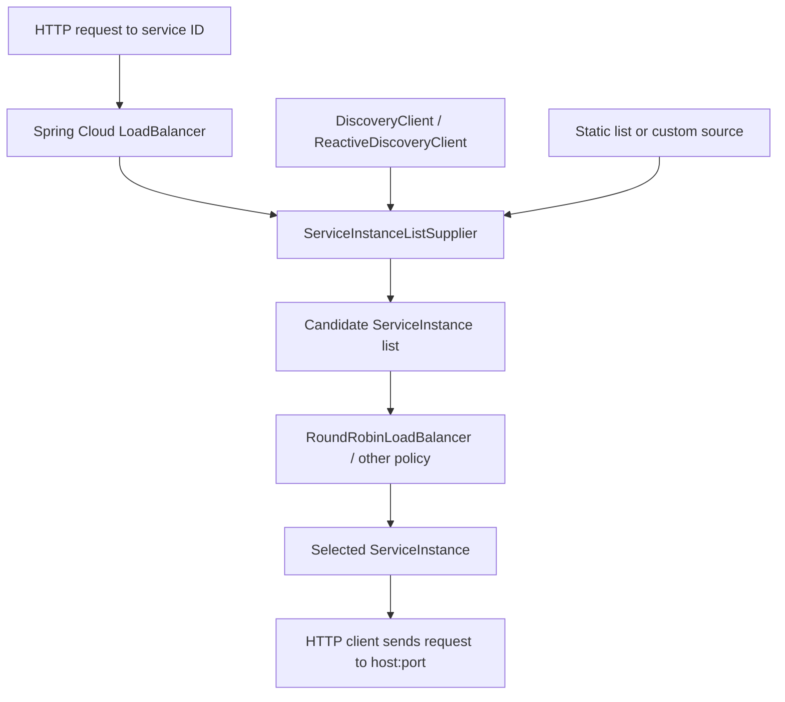
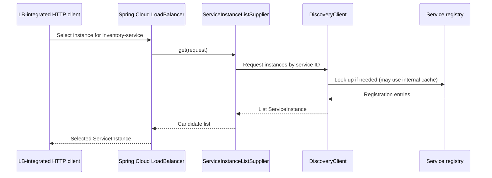
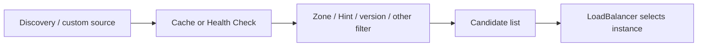

# Discovery Sources and Custom List Sources

In Spring Cloud LoadBalancer, a selection algorithm can only operate when it receives a **list of service instances** (`ServiceInstance`). That list can come from Eureka, Consul, Kubernetes, or a source supplied by the application itself. The component sitting between the data source and the algorithm is `ServiceInstanceListSupplier`.

This lesson in the **Instance Supplier Chain** chapter focuses on the question: *where does the candidate list originate, how is it updated, and when should you use a custom source?* This is the foundation for configuring Spring Cloud LoadBalancer to select a `ServiceInstance` by service ID, combining discovery, health checks, routing policies, and error handling when instances change.

## 1. Distinguishing the Instance Source from the Selection Algorithm

Suppose `order-service` needs to call `inventory-service` using a logical URL:

```text
http://inventory-service/api/items/42
```

At the time of the call, the candidate list might include:

| Service ID | Instance ID | Endpoint | Illustrative Metadata |
|---|---|---|---|
| `inventory-service` | `inventory-a` | `10.0.1.10:8080` | `zone=zone-a` |
| `inventory-service` | `inventory-b` | `10.0.1.11:8080` | `zone=zone-b` |

There are two separate decisions:

1. **The list source** returns which instances belong to `inventory-service` and can be considered.
2. **LoadBalancer** picks one instance from that list—for example, round-robin alternating between `inventory-a` and `inventory-b`.



`ServiceInstanceListSupplier` **does not send HTTP requests itself** and does not necessarily decide the final instance. It provides data for the selection process. A supplier can stand alone or sit inside a chain of multiple suppliers using delegation to cache, run health checks, or filter by zone or request context.

## 2. The ServiceInstanceListSupplier Contract

The `org.springframework.cloud.loadbalancer.core.ServiceInstanceListSupplier` interface represents an instance list source that Spring Cloud LoadBalancer can consume. Its core operations include:

| API | Role |
|---|---|
| `getServiceId()` | Returns the service ID this supplier is responsible for |
| `get()` | Returns a `Flux<List<ServiceInstance>>` to obtain the instance list |
| `get(Request request)` | Accepts additional request context; suppliers supporting request-based routing can use it |

A `ServiceInstance` contains `serviceId`, `instanceId`, `host`, `port`, `secure`, `uri`, and metadata. The source must provide addresses **actually reachable from the client side**. A container-internal address or `localhost` on another machine can cause connections to fail even if the instance appears valid in the list.

### 2.1. Flux Does Not Automatically Guarantee an Always-Fresh Data Source

`Flux<List<ServiceInstance>>` is a reactive type, but it does not inherently mean the list is continuously streamed from a registry or automatically updated whenever topology changes. For example, `Flux.just(list)` may emit only a single snapshot; discovery-backed or cached suppliers have different refresh mechanisms depending on implementation and configuration.

For a custom supplier, you must clearly define **when a snapshot is created**, **how often the source is re-read**, and **what data is used if the source fails**. Do not infer update frequency solely from the `Flux` return type.

### 2.2. Forwarding Request Context for Request-Based Routing

`get(Request request)` allows a supplier or decorator to inspect call details such as hints, headers, or custom data. For a pure instance source that does not depend on the request, returning the same list for different requests is appropriate. If you want to select an API version, region, or capability per request, you can add a decorator that reads `Request` and filters the list obtained from the underlying source.

Example of separation of responsibilities:

```text
Discovery source:      [a(v1), b(v2), c(v2)]
Request-based filter:  X-Api-Version = v2
Candidate list:        [b(v2), c(v2)]
Round-robin choice:    b or c
```

Merely registering metadata like `version=v2` does not guarantee that Spring Cloud LoadBalancer filters by version by default. A supplier or policy capable of reading that data is required.

## 3. Discovery Sources (Discovery-Backed Suppliers)

In a multi-microservice environment, instance addresses frequently change during scaling, deployments, or failures. Service discovery prevents callers from hardcoding host/port lists.

Spring Cloud provides abstractions such as `DiscoveryClient` (blocking) and `ReactiveDiscoveryClient` (reactive). Common LoadBalancer adapters include:

| Component | Data Source | Characteristics |
|---|---|---|
| `DiscoveryClientServiceInstanceListSupplier` | `DiscoveryClient` | Fetches the list from a blocking discovery client |
| `ReactiveDiscoveryClientServiceInstanceListSupplier` | `ReactiveDiscoveryClient` | Fetches the list from a reactive discovery client |
| `CachingServiceInstanceListSupplier` | Another supplier | Caches the list provided by its delegate; does not register services itself |

Specific discovery clients like Eureka or Consul translate registry data into `ServiceInstance` objects. With Kubernetes, how endpoints are fetched depends on the specific discovery integration and infrastructure; do not assume every Kubernetes cluster needs or uses a Eureka-style registry.

### 3.1. Data Flow from Registry to LoadBalancer



This diagram shows logical responsibilities; it does not mean **every HTTP request calls the registry over the network**. Either the discovery client or `CachingServiceInstanceListSupplier` may hold the list in memory and refresh it according to its own mechanism. Stacking multiple cache layers can cause topology updates to propagate more slowly than expected.

### 3.2. Configuring a Discovery-Based Supplier

Spring Cloud LoadBalancer provides a builder to construct a supplier chain. Example for a blocking `DiscoveryClient`:

```java
// Configuration exclusively for the inventory-service service ID.
public class InventoryLoadBalancerConfiguration {

    @Bean
    ServiceInstanceListSupplier inventorySupplier(
            ConfigurableApplicationContext context) {

        return ServiceInstanceListSupplier.builder()
                .withBlockingDiscoveryClient()
                .withCaching()
                .withZonePreference()
                .build(context);
    }
}
```

To apply that configuration specifically to `inventory-service`, declare it on the application configuration:

```java
@SpringBootApplication
@LoadBalancerClient(
        name = "inventory-service",
        configuration = InventoryLoadBalancerConfiguration.class)
public class OrderServiceApplication {
}
```

`@LoadBalancerClient` creates a dedicated configuration for the corresponding service ID through LoadBalancer's child context. Placing `InventoryLoadBalancerConfiguration` outside component scan scope or omitting `@Configuration` on the class, as in the example, prevents a single-service bean from being unintentionally registered into the application's shared context.

The builder above has three steps: reading the list from the blocking discovery client, caching the result, and then applying zone preference. `withZonePreference()` only takes effect when zone information is configured and instance metadata is compatible.

If a suitable `ReactiveDiscoveryClient` is available, you can use the reactive source with `.withDiscoveryClient()` on the builder. Choose the source type based on the actual discovery implementation and Spring Cloud version, not merely because the application uses `WebClient` or `RestClient`.

### 3.3. What Happens When the Registry Changes?

Suppose the registry holds `inventory-a` and `inventory-b`. When `inventory-a` stops or is deregistered, there is a delay before every caller sees a list containing only `inventory-b`. That lag can come from:

- The heartbeat interval or readiness state the registry uses to determine valid instances.
- Synchronization time for data to propagate from the registry to the discovery client.
- Cache TTL inside the discovery client or LoadBalancer.
- Refresh intervals of health checks or filters in the supplier chain.

Therefore, **an instance appearing in the list does not prove it is currently serving requests successfully**. The HTTP client still needs connect timeouts, response timeouts, appropriate retries, and error observability for reliable inter-service communication.

## 4. Static Sources with SimpleDiscoveryClient

Not every environment needs Eureka or Consul. For demos, integration tests, or systems with a few fixed endpoints, Spring Cloud Commons includes `SimpleDiscoveryClient`, which reads the instance list from configuration.

Example `application.yml`:

```yaml
spring:
  cloud:
    discovery:
      client:
        simple:
          instances:
            inventory-service:
              - uri: http://127.0.0.1:8081
              - uri: http://127.0.0.1:8082
```

When no registry-based discovery client is on the classpath, `SimpleDiscoveryClient` can use these URIs as instance information. `spring-cloud-starter-loadbalancer` enables HTTP clients annotated with `@LoadBalanced` to choose an endpoint for the logical service ID.

`RestClient` example:

```java
@Configuration
class ClientConfiguration {

    @Bean
    @LoadBalanced
    RestClient.Builder loadBalancedRestClientBuilder() {
        return RestClient.builder();
    }
}

@Service
class InventoryGateway {
    private final RestClient client;

    InventoryGateway(@LoadBalanced RestClient.Builder builder) {
        this.client = builder.build();
    }

    String getItem(long id) {
        return client.get()
                .uri("http://inventory-service/api/items/{id}", id)
                .retrieve()
                .body(String.class);
    }
}
```

The two `127.0.0.1` URIs are only suitable when both instances listen on the same host running the caller. In containers or Kubernetes, `127.0.0.1` refers to the current container/pod loopback; replace it with actually reachable host/port addresses.

**Strengths:** few moving parts, easy to run locally, and easy to control the list. **Limitations:** configuration does not automatically reflect scaling replicas up/down, registry failures, or address changes after rollouts. If instances change frequently, use real service discovery or a custom dynamic source.

## 5. Implementing a Custom ServiceInstanceListSupplier with a Fixed List

When the list must be generated from custom rules, or when you want to test LoadBalancer algorithms in a controlled environment, you can implement `ServiceInstanceListSupplier` directly instead of going through `DiscoveryClient`.

Example of a supplier providing two fixed instances:

```java
public final class FixedInventorySupplier
        implements ServiceInstanceListSupplier {

    private static final String SERVICE_ID = "inventory-service";

    private final List<ServiceInstance> instances = List.of(
            new DefaultServiceInstance(
                    "inventory-a", SERVICE_ID, "127.0.0.1", 8081, false),
            new DefaultServiceInstance(
                    "inventory-b", SERVICE_ID, "127.0.0.1", 8082, false));

    @Override
    public String getServiceId() {
        return SERVICE_ID;
    }

    @Override
    public Flux<List<ServiceInstance>> get() {
        return Flux.just(instances);
    }
}
```

Register the supplier in the per-service ID configuration:

```java
public class FixedInventoryLoadBalancerConfiguration {

    @Bean
    ServiceInstanceListSupplier inventorySupplier() {
        return new FixedInventorySupplier();
    }
}
```

Then attach `FixedInventoryLoadBalancerConfiguration.class` with `@LoadBalancerClient(name = "inventory-service", configuration = ...)` on the calling application, just like in the discovery example.

Here `DefaultServiceInstance` simply represents an endpoint. `isSecure=false` corresponds to HTTP. If using HTTPS, set `secure=true` properly and ensure the HTTP client trusts the server's TLS certificate. The supplier does not perform TLS handshakes or manage connection pools itself.

**Result:** every fetch receives the same two instances above; round-robin can still alternate between them, but the list does not change automatically when one process stops. If `inventory-a` goes down, the caller may still keep picking the failing endpoint. In static setups, you can add health checks or update the data source manually.

### 5.1. SimpleDiscoveryClient or a Custom Supplier?

If the goal is simply declaring a few URIs from configuration, `SimpleDiscoveryClient` is usually easier to maintain. Writing a custom supplier makes sense when the list must be fetched from an internal source lacking a discovery adapter, computed by custom rules, or updated via an application-managed snapshot mechanism.

When writing a new supplier, avoid putting round-robin algorithms or HTTP dispatch logic inside the source itself when existing LoadBalancer components already handle them.

## 6. Application-Managed Dynamic List Sources

A custom source does not have to be static. For example, an application may have an internal control plane that periodically publishes instances. The source can maintain an immutable snapshot and replace it whenever the control plane delivers a new list.

```java
public final class SnapshotInventorySupplier
        implements ServiceInstanceListSupplier {

    private static final String SERVICE_ID = "inventory-service";

    private final AtomicReference<List<ServiceInstance>> current =
            new AtomicReference<>(List.of());

    @Override
    public String getServiceId() {
        return SERVICE_ID;
    }

    @Override
    public Flux<List<ServiceInstance>> get() {
        return Flux.defer(() -> Flux.just(current.get()));
    }

    public void replaceSnapshot(List<ServiceInstance> updated) {
        List<ServiceInstance> copy = List.copyOf(updated);

        boolean wrongServiceId = copy.stream()
                .anyMatch(instance -> !SERVICE_ID.equals(instance.getServiceId()));

        if (wrongServiceId) {
            throw new IllegalArgumentException("Unexpected serviceId");
        }

        current.set(copy);
    }
}
```

Notable points:

1. `AtomicReference` lets one thread update the snapshot while many requests read it without concurrently mutating a shared `ArrayList`.
2. `List.copyOf` ensures the outer list cannot be mutated externally after the update (though it does not make `ServiceInstance` objects deeply immutable).
3. `Flux.defer` reads the snapshot upon subscription rather than locking in a fixed list when creating the publisher.
4. `replaceSnapshot` validates the service ID before publishing the new snapshot.

This covers the **list-reading side**. It does not yet include the component watching the control plane or handle source update failures. For production use, you need a separate lifecycle mechanism: periodically fetch the list or listen for events, validate the data, and then call `replaceSnapshot`. Avoid making blocking control-plane queries inside `get()` on every request.

### 6.1. Handling Snapshot Failures and Empty Lists

When an update fails, there are two common options:

- **Keep last-known-good:** continue serving the latest valid snapshot for a bounded period, track data age, and alert when expired. This improves availability at the risk of routing to instances that have stopped serving.
- **Fail closed:** return an empty list or raise an error when the snapshot is no longer trustworthy, especially when the list enforces version, tenant, data-region, or security boundaries.

No single policy fits every system. Define a maximum snapshot TTL, startup behavior before data arrives, staleness thresholds, and conditions permitting fallback. An empty list must be handled as an expected operational state, not an unexpected programming bug.

### 6.2. Validating Instance Data Quality

Before publishing a snapshot, verify:

| Attribute | Verification question |
|---|---|
| `serviceId` | Do all instances belong to the right service group? |
| `instanceId` | Are there duplicate registrations or unusually missing values? |
| `host` and `port` | Can the caller connect to this endpoint? Is the port valid? |
| `isSecure` | Does the HTTP/HTTPS scheme match the TLS server being served? |
| `metadata` | Are keys like `zone`, `version`, `weight` consistent? |
| Duplicate endpoint | Has the same `host:port` been included multiple times unintentionally? |

Duplicates in the list can cause one instance to be picked more often under round-robin even though weighted routing was never configured. If weighted distribution is needed, use `WeightedServiceInstanceListSupplier` or an explicitly designed weighting policy.

## 7. Ordering Sources and Decorators in the Supplier Chain

A discovery source or custom source is usually the starting point of the chain. Decorators receive the list from their delegate and transform how it is exposed to LoadBalancer.



Example chain using a discovery source, caching, and zone preference:

```java
ServiceInstanceListSupplier supplier = ServiceInstanceListSupplier.builder()
        .withBlockingDiscoveryClient()
        .withCaching()
        .withZonePreference()
        .build(context);
```

Place caching **right after the network-backed list source**, before request-dependent filters. If data already filtered for a specific request is cached under a key based only on service ID, other requests may receive the wrong candidate list.

Spring Cloud provides `HealthCheckServiceInstanceListSupplier` to probe endpoints returned by the source. This supplier has its own retention/update mechanism; for a typical health-check chain, you do not need to wrap it in `CachingServiceInstanceListSupplier` by default, as that can create two unnecessary cache layers. Whether to use caching or health checks depends on the nature of the source and list freshness requirements.

When using `ServiceInstanceListSupplier.builder()`, configure the entire chain in one place and inspect the resulting implementation. Avoid accidentally having two competing source beans for the same service ID or letting a service-specific configuration be component-scanned into the shared context.

## 8. Comparing List-Supplying Approaches

| Criterion | Discovery-backed | `SimpleDiscoveryClient` | Custom supplier |
|---|---|---|---|
| Source of truth | Registry or discovery integration | Application configuration | File, API, control plane, memory, custom rules |
| Topology updates | Handled by discovery/cache mechanisms | Usually tied to config changes | Built by the application itself |
| Best suited for | Microservices with dynamic scaling/deployments | Demos, local dev, few fixed endpoints | Specialized infrastructure, mocks, or custom policies |
| Operational cost | Requires registry or discovery integration | Low | Depends on source complexity |
| Typical risks | Registry/cache lag, stale instances | Outdated host/port | Update races, stale snapshots, unclear error handling |

**Selection rule:** if a reliable registry is already available, prefer built-in discovery adapters. If you just need to specify a few URIs locally or in tests, consider `SimpleDiscoveryClient`. Only write a custom supplier when list-sourcing or update-lifecycle requirements genuinely differ from what the framework already supports.

## 9. Common Errors and How to Investigate

| Symptom | Common cause | Where to check |
|---|---|---|
| `No instances available` | Wrong service ID, source returns empty list, registry sees no instances | Compare service ID in URL, `getServiceId()`, and list emitted by supplier |
| Stopped instance still selected | Cache/discovery not refreshed, static source unchanged, health check hasn't reflected it | Check TTL, refresh interval, registry status, and snapshot update timestamp |
| Only one instance receives most requests | Source returns partial list, duplicate entries, zone/hint filter, retries | Log list before/after filtering and the final selected instance |
| Client connects to wrong port or localhost | Source data contains endpoint unreachable from caller | Check `getHost()`, `getPort()`, container environment, and network routes |
| App has two sources with unstable behavior | Bean from per-service config scanned into shared context, duplicate config | Check `@LoadBalancerClient` and bean scope per service ID |
| List updated but requests haven't switched targets | Caching in discovery client, LoadBalancer, or custom source | Measure refresh timing at each cache layer; verify which source is actually active |
| Duplicate health checks or caches | Chain wraps multiple layers doing the same job | Inspect builder order and actual `ServiceInstanceListSupplier` bean |
| Custom supplier has occasional concurrency errors | Mutating shared list while requests read it | Use immutable snapshots, atomic updates, and concurrency tests |

When facing a connection error, separate three steps: **which instances the source returned**, **which instance LoadBalancer selected**, and **which endpoint the HTTP client connected to**. Reading only a timeout exception is not enough to conclude that discovery or the load-balancing algorithm is broken.

## 10. Hands-On Exercise: Swapping Sources and Observing Results

Test with two simple instances on ports `8081` and `8082` that each return their own hostname/instance ID:

1. Configure `SimpleDiscoveryClient` with two URIs and call `http://inventory-service/whoami` using a `@LoadBalanced` `RestClient`.
2. Send multiple sequential requests and record which instance handles each; with round-robin, observe alternation across active instances.
3. Stop the instance at `8081` while keeping the static configuration. Observe that requests may still be routed to the failing endpoint.
4. Replace static configuration with `FixedInventorySupplier`; confirm both sources yield the same endpoint set before adding new logic.
5. Try `SnapshotInventorySupplier`: update from two instances down to one, then observe both the returned list and actual requests.
6. In a discovery-enabled environment, use a `DiscoveryClient` source and observe how long it takes for a stopped instance to disappear from the list and the impact of caching.
7. Test empty lists, invalid metadata, unreachable hosts, source update failures, and recovery.

Recommended metrics to track: list size before/after filtering, list retrieval latency, snapshot/cache age, request count per instance, connect/response timeout errors, and retry counts. When logging or emitting metrics, avoid placing full sensitive metadata or internal addresses into high-cardinality metric labels.

## 11. Principles to Remember

- `ServiceInstanceListSupplier` supplies the **candidate list**; the LoadBalancer algorithm decides which instance is picked.
- Discovery sources are ideal when replicas scale up/down or change addresses frequently; `SimpleDiscoveryClient` is handy for static configurations.
- Custom suppliers must clearly define their data-update contract, source-failure handling, and behavior when no instances exist.
- `Flux` is a data-transfer abstraction; it does not automatically guarantee auto-refresh or health checks.
- Keep lists consistent and safe under concurrent reads; avoid mutating shared lists.
- If caching is used, place the cache close to the discovery source before request-based filters; avoid double-caching unnecessarily.
- Never assume an instance present in a registry is immediately reachable or healthy enough to serve requests.
- Use health checks, appropriate timeouts, retries, and per-instance metrics to handle lag during topology changes.
- Verify `@LoadBalancerClient` configuration scoping so each service ID uses the intended source and supplier chain.

Once you understand how discovery and custom sources produce `ServiceInstance` lists, you can decide whether to use a registry, static configuration, or a custom supplier—and accurately explain why Spring Cloud LoadBalancer succeeded or failed to select a target during inter-service communication.

## References

- [Spring Cloud Commons — Spring Cloud LoadBalancer](https://docs.spring.io/spring-cloud-commons/reference/spring-cloud-commons/loadbalancer.html): supplier mechanisms, caching, health checks, and per-service ID configuration.
- [Spring Cloud Commons — Common Abstractions](https://docs.spring.io/spring-cloud-commons/reference/spring-cloud-commons/common-abstractions.html): `DiscoveryClient`, `ReactiveDiscoveryClient`, and `SimpleDiscoveryClient`.
