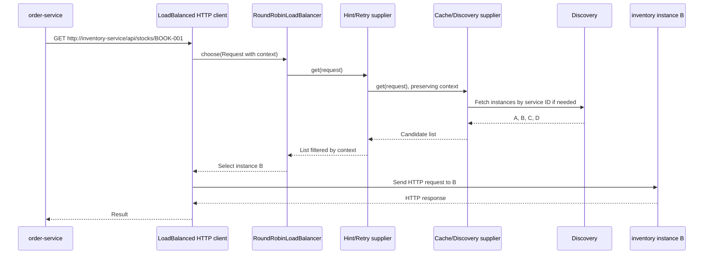

# Propagating Request Context Through Supplier Layers

In Spring Cloud LoadBalancer, **`ServiceInstanceListSupplier`** does more than return the list of replicas for a service ID. A supplier chain can also use information from the **current request** to decide which replicas are eligible candidates. For example, when calling `inventory-service`, a request from `zone-a` can prefer instances in `zone-a`, a request carrying a `canary` hint can be routed to a canary deployment, and a retry attempt can avoid the instance that just failed.

For these policies to work properly, request information must be propagated through every layer in the chain. If one layer accidentally calls the request-less overload or drops the context, inner layers may still return valid instance lists yet **lack the data required to perform request-based routing**.

This lesson belongs to the **Instance Supplier Chain** chapter of the `SPRING_CLOUD_SERVICE_COMMUNICATION_LOAD_BALANCING` module. We will move from the `Request` model and `ServiceInstanceListSupplier#get(Request)` to writing a decorator class, verifying context propagation, and applying it to analyze hints, sticky sessions, retries, health checks, and failure scenarios in inter-service communication.

## 1. Why an Instance List Alone Is Not Enough

Suppose `order-service` calls `inventory-service` using a logical URL:

```text
GET http://inventory-service/api/stocks/BOOK-001
```

Discovery provides four instances:

| Instance | Address | Illustrative Metadata |
| --- | --- | --- |
| A | `10.0.1.11:8080` | `zone=zone-a`, `track=stable` |
| B | `10.0.1.12:8080` | `zone=zone-a`, `track=canary` |
| C | `10.0.2.21:8080` | `zone=zone-b`, `track=stable` |
| D | `10.0.2.22:8080` | `zone=zone-b`, `track=canary` |

If only Round Robin is needed, LoadBalancer can select from whatever list the supplier returns. In many applications, however, **the candidate list depends on the request**:

- A request carrying a `zone-a` preference hint should try A or B first.
- A canary request may require instances with `track=canary`.
- A retry request after A fails may need to exclude A from the next selection.
- A request containing a session cookie may need to prefer the instance that served the previous request.

These examples are **policies that must be explicitly configured**. Merely having metadata present does not mean every supplier reads and applies it by default. Routing behavior only emerges when a supplier or selection algorithm actually interprets the context and acts on that data.

## 2. Two Ways to Retrieve a List from ServiceInstanceListSupplier

`ServiceInstanceListSupplier` is the abstraction supplying a `ServiceInstance` list for a service ID. Two core methods must be distinguished:

```java
Flux<List<ServiceInstance>> get();

Flux<List<ServiceInstance>> get(Request request);
```

The `get()` method returns the list without passing request context. The `get(Request request)` method allows a supplier to use information tied to a single instance-selection call. In Spring Cloud LoadBalancer versions that define this overload, the default implementation of `get(Request)` typically delegates to `get()`; thus, **having the overload does not automatically guarantee** that context is used.

| Method call | What does the supplier receive? | When is it appropriate? |
| --- | --- | --- |
| `get()` | No request object to inspect | Static lists, discovery fetches, or request-independent filters |
| `get(request)` | Can read request data, hints, or retry info depending on context type | Hint routing, sticky sessions, avoiding failed instances, request-specific policies |

A simple supplier that only reads from discovery can work identically through both paths. However, a supplier that depends on request context must clearly define how it handles `get(Request)` and how it behaves when context is absent.

**Key takeaway:** `ServiceInstanceListSupplier` returns a *candidate list*; it does not send HTTP requests. The selector (`ReactorLoadBalancer`, e.g., `RoundRobinLoadBalancer`) takes that list and picks a single `ServiceInstance`; only then does the HTTP client send the request to the actual host and port.

## 3. How Request Context Is Created and Passed

In Spring Cloud LoadBalancer, `org.springframework.cloud.client.loadbalancer.Request` wraps a context object. The exact context type **depends on the integration**—not every HTTP client creates the same data type across all versions.

Common types include:

- `RequestData`: represents essential HTTP details such as URI, method, and headers, depending on integration.
- `RequestDataContext`: holds request data plus extra context, such as hints, for HTTP flows supporting this type.
- Retry-related context: can supply prior-attempt info or the instance to avoid in corresponding retry integrations.

Distinguish the **business request** from the **LoadBalancer `Request`**: the object passed to the supplier is the context for **a single replica selection**. It is not necessarily the full server HTTP request, is not guaranteed to carry a body, and is not a business DTO like `CreateOrderRequest`.

Illustrative flow:



The diagram shows **one valid wiring**: the outer layer receives the context, forwards it to the delegate, and only afterward filters the list. Depending on how the chain is organized, there may be multiple cache, health-check, zone, hint, or retry layers, some of which do not need to inspect the request. What matters is that every forwarding layer preserves the context for any inner layer that needs it.

## 4. Decorators and Where Context Is Easily Lost

Suppliers can be chained by wrapping one supplier around another. This pattern is commonly called a **decorator** or *delegating supplier*:

```text
RoundRobinLoadBalancer
  └─ Hint-filtering supplier
       └─ Zone-preference supplier
            └─ Cache / discovery supplier
```

Suppose an outer layer receives `get(request)` but calls `delegate.get()` internally:

```java
// INCORRECT example when the delegate needs information from the current request.
@Override
public Flux<List<ServiceInstance>> get(Request request) {
    return delegate.get(); // context is dropped here
}
```

In that case, deeper suppliers never receive the request; if they rely on hints or retry metadata, behavior can change silently. The resulting instance list may still be non-empty, making the bug hard to spot with ordinary connectivity checks.

When forwarding context intact to the delegate, use the request-accepting path:

```java
@Override
public Flux<List<ServiceInstance>> get(Request request) {
    return delegate.get(request);
}
```

You should also handle contextless calls if the class supports `get()`:

```java
@Override
public Flux<List<ServiceInstance>> get() {
    return delegate.get();
}
```

This rule applies to forwarding layers. An upstream supplier that solely provides discovery lists does not have to understand or store request context. Problems arise when an intermediate layer expected to forward context to inner layers accidentally switches to the request-less path.

## 5. Example of a Supplier Filtering by Request Hint

In the following example, the goal is to prefer instances whose `zone` metadata matches a hint. To keep the code straightforward, the supplier returns **the original list if the hint is empty or no instances match**. That fallback is a policy choice of this example, not a mandatory rule for all systems.

```java
import java.util.List;

import org.springframework.cloud.client.ServiceInstance;
import org.springframework.cloud.client.loadbalancer.Request;
import org.springframework.cloud.client.loadbalancer.RequestDataContext;
import org.springframework.cloud.loadbalancer.core.DelegatingServiceInstanceListSupplier;
import org.springframework.cloud.loadbalancer.core.ServiceInstanceListSupplier;
import reactor.core.publisher.Flux;

class ZoneHintServiceInstanceListSupplier
        extends DelegatingServiceInstanceListSupplier {

    ZoneHintServiceInstanceListSupplier(ServiceInstanceListSupplier delegate) {
        super(delegate);
    }

    @Override
    public Flux<List<ServiceInstance>> get() {
        return delegate.get();
    }

    @Override
    public Flux<List<ServiceInstance>> get(Request request) {
        // Preserve context for inner suppliers in the chain.
        return delegate.get(request).map(instances -> {
            Object rawContext = request == null ? null : request.getContext();

            if (!(rawContext instanceof RequestDataContext context)) {
                return instances;
            }

            String hint = context.getHint();
            if (hint == null || hint.isBlank()) {
                return instances;
            }

            List<ServiceInstance> sameZone = instances.stream()
                    .filter(instance -> hint.equals(
                            instance.getMetadata().get("zone")))
                    .toList();

            // Fallback when no replica belongs to the desired zone.
            return sameZone.isEmpty() ? instances : sameZone;
        });
    }
}
```

In this code:

1. `delegate.get(request)` preserves context when retrieving candidates from inner layers.
2. `request.getContext()` is type-checked before reading HTTP data.
3. `context.getHint()` supplies the hint if the integration creates and passes it.
4. The supplier filters by `zone` metadata and returns the list for LoadBalancer selection.
5. If there is no hint or no match, the example policy keeps the original list.

This sample uses modern Java pattern-matching `instanceof` and `Stream.toList()`. In real implementations, verify the `RequestDataContext` API and how your client populates hints against your Spring Cloud version; not every client constructs this context type. On older Java versions, replace those constructs with traditional type checks and casts.

### 5.1. Creating the Supplier Chain for a Service

In Spring Cloud LoadBalancer, you can use the builder to initialize the discovery source and cache layer, then wrap them with a custom supplier:

```java
import org.springframework.cloud.loadbalancer.core.ServiceInstanceListSupplier;
import org.springframework.context.ConfigurableApplicationContext;
import org.springframework.context.annotation.Bean;

class InventorySupplierConfiguration {

    @Bean
    ServiceInstanceListSupplier inventorySupplier(
            ConfigurableApplicationContext context) {

        ServiceInstanceListSupplier delegate = ServiceInstanceListSupplier
                .builder()
                .withDiscoveryClient()
                .withCaching()
                .build(context);

        return new ZoneHintServiceInstanceListSupplier(delegate);
    }
}
```

This is an **illustrative configuration snippet** for the supplier bean. To apply it exclusively to `inventory-service`, bind the configuration to the service with `@LoadBalancerClient(name = "inventory-service", configuration = InventorySupplierConfiguration.class)` on the appropriate application configuration. Service-specific LoadBalancer configurations should sit outside general component scan scope if you do not want them applied more broadly than intended.

The example assumes the application already includes the Spring Cloud LoadBalancer dependency, a configured discovery source, and a LoadBalancer-integrated HTTP client. If your project already uses a different supplier chain, integrate the filter layer in a way compatible with that chain; avoid registering multiple competing beans without clear control over which bean is selected.

### 5.2. Hypothetical Results

With the four instances A, B, C, D from the start of the lesson:

| Context passed in | List returned by example supplier |
| --- | --- |
| Hint = `zone-a` | A, B |
| Hint = `zone-b` | C, D |
| Hint = `zone-x` | A, B, C, D (fallback) |
| No hint | A, B, C, D |
| No matching `RequestDataContext` | A, B, C, D |

If business policy mandates that every request targeting a zone must stay within that zone, falling back to the full list is inappropriate. In that case, define explicit behavior—such as returning an empty list or failing at the appropriate layer. Only choose strict exclusion when the system has accounted for the consequences of having zero eligible instances.

## 6. Hints Passed from the HTTP Client to the Supplier

Spring Cloud LoadBalancer provides hint-based routing mechanisms where `HintBasedServiceInstanceListSupplier` can use a hint from the request context or configuration to filter instances by metadata. How hints are extracted from HTTP headers and the exact header name must be verified against your version and HTTP integration; a common name in Spring Cloud documentation is `X-SC-LB-Hint`.

Example illustrating intent to target a specific zone:

```http
GET /api/stocks/BOOK-001 HTTP/1.1
Host: inventory-service
X-SC-LB-Hint: zone-a
```

For the header to actually influence instance selection, **all three conditions** must hold:

1. The HTTP client translates the request data or hint into the context consumed by LoadBalancer.
2. Intermediate supplier layers forward the context via `get(request)` to the layer that needs it.
3. A supplier in the chain knows how to interpret the hint and metadata, along with a clear fallback policy.

Simply adding a header to an HTTP request without those three conditions may not change replica selection. Some clients or call paths use different context types, so verify via logs or real integration tests.

A hint is a **routing suggestion**, not proof of authentication or authorization. Never use hints from untrusted user requests as an access control, tenant-separation, or data-isolation mechanism. For security- or compliance-sensitive requirements, permissions must be enforced at the proper layer and routing metadata must originate from a trusted source.

## 7. Retry-Related Context: Avoiding Failed Replicas

Retries introduce a special case: **one business call may correspond to multiple instance-selection calls**.

Example:

```text
Business request: GET /api/stocks/BOOK-001

Attempt 1:
  list: A, B, C
  selected: A
  outcome: Connection refused

Attempt 2:
  retry context: previously tried A
  desired candidate list: B, C
  selected: C
  outcome: HTTP 200
```

A retry-aware supplier can use attempt context to avoid an instance that already failed, if policy dictates and other eligible instances exist. In the Spring Cloud LoadBalancer ecosystem, suppliers like `RetryAwareServiceInstanceListSupplier` serve this use case. Actual behavior also depends on the retry integration, `retryOnSameServiceInstance`/`retryOnAllOperations` settings, or the equivalent mechanism in your version.

Separate responsibilities clearly:

- **Retry policy** decides whether to resend the request, when, how many times, and for which errors.
- **Request context** carries data needed for the next selection, such as the previous instance.
- **Retry-aware supplier** prepares the candidate list for the next selection attempt.
- **LoadBalancer** picks one instance from that list.

A supplier does not initiate a new business request just because it can filter instances. Conversely, if the retry integration fails to attach prior-instance context, a deeper supplier in the chain cannot know which replica to avoid.

For write operations, even when retrying against a different instance, you must still consider idempotency. A read timeout does not prove the server did not process the earlier attempt. Bound retry counts, use backoff, and enforce an overall deadline so retries do not amplify failures across remaining replicas.

## 8. Sticky Sessions and Call Context

Some applications need to prefer the same instance across related requests, such as when a session or temporary state resides on a single replica. Spring Cloud LoadBalancer provides components for instance preference or request-based sticky sessions, though they require proper configuration and an instance identifier carried by the request.

Example:

```text
Request 1: client sends routing cookie -> supplier prefers instance B
Request 2: client keeps cookie         -> supplier continues preferring B
```

This differs from pure Round Robin. If a supplier layer drops the cookie or request context, an inner sticky-session layer loses the basis for preferring B even though HTTP connectivity still works normally.

Sticky sessions also do not guarantee that a session will always be served by the same replica: instance B may crash, expire from registration, or be excluded by health checks. Application design should define how sessions fail over to another replica, or prefer storing session state in a shared store where appropriate.

## 9. Zones and Health Checks: Not Every Layer Needs to Read Context

A chain can combine several supplier types with differing degrees of request dependence:

| Layer | Primary information source | Needs request context? |
| --- | --- | --- |
| Discovery supplier | Registry or `DiscoveryClient` | Usually no |
| Cache supplier | Cached instance list | Usually needs no context to look up by service ID; be cautious if caching request-filtered results |
| Health check supplier | Instance health probe state | Usually filters by health status, not per request |
| Zone preference supplier | Client zone and instance metadata | Depends on implementation/config; may use application-level zone config |
| Hint-based supplier | Request-passed hint or fallback config | May need request context |
| Retry-aware supplier | Instance from previous attempt | Usually needs context supplied by retry mechanism |
| Request-based sticky supplier | Request routing data, e.g., cookie | May need request context |

**The fact that a layer does not read context** does not mean it may drop context when calling its delegate. A decorator receiving `get(request)` must preserve the propagation path if inner layers might need it.

In particular, consider **the ordering of caching and per-request filters**. If a cache stores a list already filtered for request A's hint and reuses it globally for request B, request B may inadvertently see only candidates intended for A. A safe design caches the baseline list at an appropriate scope, then applies request-dependent filters per selection. Exact placement depends on the builder and supplier chain in use; verify rather than assuming any order is equivalent.

## 10. What Happens When Context Is Lost?

Suppose `order-service` sends hint `zone-b`, but an intermediate decorator calls `delegate.get()` instead of `delegate.get(request)`. The system may exhibit symptoms such as:

| Symptom | Cause to investigate |
| --- | --- |
| Requests succeed but hit the wrong zone | Hint never reached the metadata-reading supplier, or fallback behaved unexpectedly |
| A canary request lands on stable | Header/hint was not converted into context by integration, or chain dropped context |
| Retries return to the just-failed instance | Retry context did not reach retry-aware supplier, or policy permits retrying same instance |
| Unstable sticky sessions | Cookie not passed/read properly, or preferred instance is no longer available |
| Differences across RestClient, WebClient, and OpenFeign | Each integration may construct different context types or take different code paths |

Do not jump to concluding that Round Robin or discovery is broken. When a request is misrouted despite a correct discovery list, inspect **the request context path through the supplier chain** first.

## 11. How to Observe and Test Context Propagation

A helpful practice is logging at explicit boundaries:

```text
traceId=72ab... serviceId=inventory-service
contextType=RequestDataContext hint=zone-b
supplier=discovery candidates=4
supplier=zone-hint candidates=2
selectedInstance=10.0.2.21:8080
```

The numbers in this log are illustrative. For a request with hint `zone-b`, the supplier narrows candidates to C and D before LoadBalancer selects one instance. If logs only show `selectedInstance`, it is hard to tell whether that instance was chosen by policy or by chance.

When logging, include service ID, supplier name, context type, normalized hint, candidate counts before/after filtering, selected instance, and trace ID. Avoid logging full headers, cookies, tokens, or sensitive details. Do not turn arbitrary user-supplied hint values into unbounded-cardinality metric labels.

### 11.1. Small Test Matrix

Using the four instances from the beginning of the lesson, you can design tests with expected outcomes:

| Input | Outcome to verify |
| --- | --- |
| Hint `zone-a` | Post-filter list contains only A, B |
| Hint `zone-b` | Post-filter list contains only C, D |
| Hint matches no zone | Documented fallback applies; does not silently pick another policy |
| Request lacks matching context | Consistent fallback behavior with no cast exceptions |
| Retry after A fails, B/C/D available | Retry-aware policy avoids A if configured to do so |
| One instance excluded by health check | Excluded instance does not appear in eligible list per config |
| Two concurrent requests with different hints | Context or filtered results of one request never leak to the other |

Write both unit tests for custom supplier classes and integration tests with real HTTP clients. Unit tests confirm `get(request)` filters accurately for a given context. Integration tests confirm that headers or client data actually become the context received by the supplier.

### 11.2. A Concrete Diagnostic Scenario

Suppose discovery holds A, B, C, D. The client sends hint `zone-b`, yet keeps selecting A. Investigate in order:

1. Is the client configured with `@LoadBalanced` or LoadBalancer integration properly for RestClient, WebClient, or OpenFeign?
2. Is the header or routing info converted into a request context type supported by the supplier?
3. Is `get(Request)` invoked at the outer layer, or only `get()`?
4. Does each decorator forward `request` to its delegate when needed?
5. Is the hint-using supplier positioned properly relative to caching, health checks, and other filters?
6. Is instance `zone` metadata accurate and consistent?
7. Does the fallback policy return all instances when there is no match?
8. Which candidate list did LoadBalancer ultimately receive, and which instance did it pick?

Across the same supplier chain, logging the **discovery list**, **post-filter list**, and **selected instance** separately helps distinguish data-configuration bugs from context bugs and algorithm bugs.

## 12. Safe Implementation Principles

When writing custom request-dependent suppliers, follow these principles:

1. **Preserve request context when forwarding:** use `delegate.get(request)` in layers that must forward; never accidentally replace it with `delegate.get()`.
2. **Validate context types:** contexts from blocking, reactive, or retry clients may differ; never perform unchecked casts.
3. **Define fallbacks explicitly:** when a hint is blank, metadata is missing, or the filtered list is empty, decide whether to return the original list or zero candidates.
4. **Avoid shared per-request mutable state:** suppliers are usually reused beans; never store the latest hint or chosen instance in a singleton's mutable field.
5. **Avoid blocking I/O in reactive pipelines:** list filtering steps should be lightweight and non-blocking.
6. **Minimize data stored in context:** carry only needed routing data; do not treat context as a bag for tokens, secrets, or entire business payloads.
7. **Protect routing integrity:** only accept hints controlled by trusted sources for policies with strict isolation requirements.
8. **Verify decorator order:** caching, health checks, zones, hints, and retries can yield different results when reordered.
9. **Understand retry scope:** retries can pick another instance, but not every request is safe to replay by default—especially writes.

## 13. End-to-End Flow Across Layers

Consider a request with hint `zone-b` and a supplier chain configured to preserve context:

```text
order-service
   |
   | GET http://inventory-service/api/stocks/BOOK-001
   | hint = zone-b
   v
LoadBalanced HTTP client
   |
   | Request(context = RequestDataContext(..., hint=zone-b))
   v
RoundRobinLoadBalancer
   |
   | get(request)
   v
ZoneHintServiceInstanceListSupplier
   |
   | delegate.get(request)  <-- preserves context
   v
Cache / Discovery supplier
   |
   | [A, B, C, D]
   v
ZoneHintServiceInstanceListSupplier
   |
   | filter metadata zone-b -> [C, D]
   v
RoundRobinLoadBalancer
   |
   | pick C or D
   v
HTTP client sends request to selected instance's host:port
```

If an intermediate layer drops context, filtering cannot see the hint. If all context propagates properly yet discovery returns an empty list, the issue lies in the instance source. If the post-filter list is right yet requests still fail to reach the server, check networking, timeouts, or replica status. Separating boundaries this way pinpoints root causes much faster than looking solely at the final HTTP status.

## 14. Knowledge Self-Check

1. How do `ServiceInstanceListSupplier#get()` and `get(Request)` differ in their input data?
2. Why can a decorator calling `delegate.get()` from inside `get(request)` break routing policies?
3. Does a hint in an HTTP header automatically control Spring Cloud LoadBalancer on its own? What additional conditions are required?
4. Why must you check the type of `request.getContext()` before reading hints or retry data?
5. In the zone-hint example, how does the fallback policy behave when no instance matches the hint? When should that fallback not be used?
6. During retries, what is the supplier's job and which component decides whether to resend the request?
7. Why can caching a per-request filtered list cause cross-talk between two requests with different hints?
8. If discovery returns four instances yet LoadBalancer only picks from an undesired zone, which points in the chain should you inspect?

Proper context propagation gives every supplier layer the information needed to enforce its policy: discovery knows the replicas, caching retains data within an appropriate scope, filters determine request-specific candidates, retry-aware suppliers account for prior attempts, and LoadBalancer selects a concrete `ServiceInstance`. Preserving `Request` across decorators is essential for these components to work together reliably.
