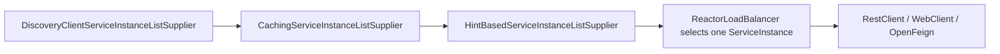
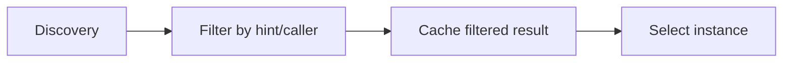
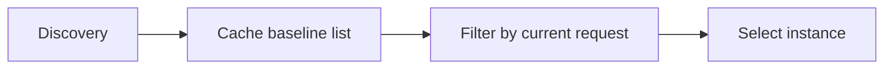

# Avoiding Accidental Caching of Per-Caller Filtered Lists

## Objectives

Spring Cloud LoadBalancer uses `ServiceInstanceListSupplier` to supply the list of `ServiceInstance` objects eligible to receive a request. To reduce service discovery queries, systems often cache the instance list. At the same time, other suppliers may filter the list using **per-request information**, such as a routing hint header, API version, or sticky-session cookie.

If caching is placed at the wrong position in the supplier chain, a list filtered for one request can be wrongly reused for another request, or request information may fail to reach the filter. As a result, requests hit the wrong instance group, canary policies behave erratically, sticky sessions break, or some callers fail to find a valid backend.

This lesson helps you:

- Distinguish instance data **shared per service ID** from routing data **dependent on the request**.
- Understand why `CachingServiceInstanceListSupplier` must sit immediately after the discovery-backed supplier.
- Analyze the risks of caching lists filtered by `HintBasedServiceInstanceListSupplier`, API-version suppliers, or custom filters.
- Build the supplier chain properly with `ServiceInstanceListSupplier.builder()` and `@LoadBalancerClient`.
- Design tests to catch cross-talk between two callers or two requests with different hints.
- Manage cache TTL, stale discovery data, health checks, and observability when issues arise.

## 1. Two Categories of Information to Separate

Suppose `order-service` calls `inventory-service`. The target service has three discovered replicas:

| Instance | Address | `hint` Metadata | `zone` Metadata |
|---|---|---|---|
| `inventory-stable-a` | `10.20.1.11:8080` | `stable` | `zone-a` |
| `inventory-stable-b` | `10.20.1.12:8080` | `stable` | `zone-a` |
| `inventory-canary-a` | `10.20.2.21:8080` | `canary` | `zone-b` |

The instance list retrieved from discovery is typically data **shared per service ID**:

```text
service ID: inventory-service
discovery result:
  [inventory-stable-a, inventory-stable-b, inventory-canary-a]
```

Meanwhile, the eligible instance set for a request may depend on information from **a specific caller or request**:

```text
Request A: X-SC-LB-Hint: stable
  -> [inventory-stable-a, inventory-stable-b]

Request B: X-SC-LB-Hint: canary
  -> [inventory-canary-a]
```

Both requests call `inventory-service`, yet their filtered lists differ. If a cache keys only on service ID while storing **post-filter results**, that cache lacks the information needed to distinguish request A from request B.

Therefore, establish a clear boundary:

- **Before per-request filtering:** you can cache the discovery instance list by service ID with an appropriate TTL.
- **After per-request filtering:** the list must be recomputed per request from the still-valid baseline list.

Do not think of "caller" as only a separate Java application. Two users passing through the same `order-service` instance can also generate two requests carrying different hints, API versions, or cookies; the same LoadBalancer child context must handle both accurately.

## 2. How Does the `ServiceInstanceListSupplier` Chain Work?

Spring Cloud LoadBalancer organizes instance supplying into a chain of suppliers. Each supplier either fetches a list from a source or processes the list provided by its inner delegate:



The meaning of that ordering:

1. `DiscoveryClientServiceInstanceListSupplier` retrieves the instance list for a service ID from discovery.
2. `CachingServiceInstanceListSupplier` holds the **list unfiltered by request**, reducing repeated discovery lookups.
3. `HintBasedServiceInstanceListSupplier` receives the current request, extracts the hint, and filters the cached list according to that request's hint.
4. `ReactorLoadBalancer` selects one instance from the final candidate set; the HTTP client sends the request to the selected instance.

Spring Cloud provides two fundamental call methods on the supplier interface:

```java
Flux<List<ServiceInstance>> get();

Flux<List<ServiceInstance>> get(Request request);
```

`get()` takes no request context. `get(Request request)` can pass data like hints, headers, or cookies into suppliers that support request-based handling. Some `DelegatingServiceInstanceListSupplier` implementations forward request-carrying calls to their delegates; `CachingServiceInstanceListSupplier` and `HealthCheckServiceInstanceListSupplier` receive special treatment because they belong ahead of request-based filtering.

Since Spring Cloud LoadBalancer 4.1.0, `spring.cloud.loadbalancer.call-get-with-request-on-delegates` was added to control forwarding `get(Request)` through delegates that do not override it themselves. In Spring Cloud Commons 5.0.4, the default is `true`; the cache supplier and health-check supplier remain exceptions. Do not try to tweak this flag to patch a misordered chain.

## 3. Where Does Placing Cache After a Filter Go Wrong?

### 3.1. Example of a Flawed Cache Design

Consider a custom cache keyed solely by service ID:

```java
// Pseudocode illustrating the WRONG approach, not real Spring Cloud code.
List<ServiceInstance> instancesFor(
        String serviceId, String requestHint) {
    return cache.computeIfAbsent(serviceId, id -> {
        List<ServiceInstance> discovered = discovery.getInstances(id);
        return filterByHint(discovered, requestHint);
    });
}
```

The first request carrying hint `stable` populates the cache with:

```text
cache["inventory-service"] = [inventory-stable-a, inventory-stable-b]
```

The next request carrying hint `canary` reads the cached entry under the same key and gets the stable list. If the canary request arrives first, the situation flips: the stable request gets the canary list. This is **cross-request contamination**: the outcome depends on request arrival order rather than the current request's context alone.

This example depicts a **custom cache bug** caused by an incomplete cache key. With the built-in `CachingServiceInstanceListSupplier`, wrong ordering can also prevent `get(Request)` from reaching the intended filter. Never claim every Spring Cloud version always reuses filtered lists identically to that pseudocode; the common point is that caching after per-request filtering violates the intended processing contract.

### 3.2. Wrong vs. Right Ordering

<escape>**Design error:**</escape> filter by request first, cache outside the filter.



When a cache key contains only `serviceId`, it cannot separate requests using different hints or API versions. Some supplier wrappings can also drop request data before the filter runs.

**Correct:** cache discovery data first, then filter afterward using the current request's context.



Pseudocode for the correct design:

```java
// Illustrative pseudocode: shared cache, filter runs per request.
List<ServiceInstance> instancesFor(
        String serviceId, String requestHint) {
    List<ServiceInstance> discovered = discoveryCache.get(serviceId);
    return filterByHint(discovered, requestHint);
}
```

In the correct model, request A and request B share the same snapshot of discovery instances while always getting distinct filtered results matching each request's hint. When discovery changes, the cache updates or expires according to its TTL/refresh policy.

## 4. Configuring the Supplier Chain Properly with Spring Cloud LoadBalancer

Spring Cloud provides `ServiceInstanceListSupplier.builder()` to declare a chain clearly. The example below binds a dedicated policy for `inventory-service` in the caller application:

```java
import org.springframework.cloud.loadbalancer.annotation.LoadBalancerClient;
import org.springframework.cloud.loadbalancer.core.ServiceInstanceListSupplier;
import org.springframework.context.ConfigurableApplicationContext;
import org.springframework.context.annotation.Bean;
import org.springframework.context.annotation.Configuration;

@Configuration(proxyBeanMethods = false)
@LoadBalancerClient(
        name = "inventory-service",
        configuration = InventorySupplierConfiguration.class
)
class LoadBalancerRegistration {
}

// This class is used only within the inventory-service child context.
// Do not annotate with @Configuration or place outside main component scanning.
class InventorySupplierConfiguration {

    @Bean
    ServiceInstanceListSupplier inventoryInstanceSupplier(
            ConfigurableApplicationContext context) {
        return ServiceInstanceListSupplier.builder()
                .withDiscoveryClient()
                .withCaching()
                .withHints()
                .build(context);
    }
}
```

Reading bottom-up as suppliers delegate inward: `withDiscoveryClient()` creates the list source, `withCaching()` wraps the discovery source, and then `withHints()` applies filtering at the outer layer. When a request arrives, the hint filter runs with that specific request's context.

If zone preference or weighting is also needed, you can extend it:

```java
return ServiceInstanceListSupplier.builder()
        .withDiscoveryClient()
        .withCaching()
        .withZonePreference()
        .withHints()
        .withWeighted()
        .build(context);
```

In the example above, caching remains adjacent to discovery. Zone preference, hints, and weighting process the candidate list after the cache. If your application needs strict ordering—for instance, a version filter before a hint filter—review each supplier's contract and test the actual delegate order.

**Do not place `InventorySupplierConfiguration` inside the parent context's component scan if annotated with `@Configuration`.** A bean intended for a single service ID could be registered outside its intended scope and affect other services. Spring Cloud recommends omitting `@Configuration` on classes passed to `@LoadBalancerClient` or keeping them outside the main component scan path.

### 4.1. Hint Headers and Instance Metadata

Suppose two stable instances register metadata `hint=stable` and one canary instance registers `hint=canary`. With Eureka, each instance can register:

```yaml
eureka:
  instance:
    metadata-map:
      hint: stable
```

The canary instance uses a similar configuration with `hint: canary`. On the caller side, `HintBasedServiceInstanceListSupplier` reads the `X-SC-LB-Hint` header by default, or uses the configured default hint when the request has no header. You can customize the header name via `spring.cloud.loadbalancer.hint-header-name`.

Note: hints are **routing suggestions**, not a security isolation mechanism. When no instance matches the hint, this supplier returns the entire delegate list by default. Hence, a request with a nonexistent hint can land on any instance; never rely on default hints to isolate tenants or sensitive data.

## 5. Which Filters Depend on the Request?

Not every supplier inspects the same kind of context. That determines how caching must be designed.

| Supplier or policy | Data inspected | Risk if cached at wrong layer |
|---|---|---|
| `HintBasedServiceInstanceListSupplier` | `X-SC-LB-Hint` header or hint in request context | Requests with different hints get the wrong instance group, or hints are ignored |
| `RequestBasedStickySessionServiceInstanceListSupplier` | Cookie containing previously chosen instance ID | Requests in one session are influenced by a previous session's choice |
| `ReactiveApiVersionServiceInstanceListSupplier` / `BlockingApiVersionServiceInstanceListSupplier` | API version from header, query param, path, or media type | `v2` requests get `v1` lists, or version info is lost |
| Custom per-caller supplier | Header, metadata, region, client group, or business context | Caller A's list gets reused for Caller B |
| `ZonePreferenceServiceInstanceListSupplier` | Configured or discovery-supplied zone | List becomes stale if caller zone actually varies per request |

In typical zone configurations, a caller application's zone is fixed to its deployment environment; however, if you write a **per-request** zone filter, the cache-before-filter rule still applies.

For API versions, behavior when no matching instance exists can differ from hints: under Spring Cloud's API-version-based routing configuration, the default supplier can return an empty list when no compatible instance is found, with its own fallback options. Never apply a single fallback assumption across all suppliers.

### 5.1. Why Distinguish `get()` and `get(Request)`?

Hint/cookie/version filters need request context. If you write a custom supplier and only implement:

```java
Flux<List<ServiceInstance>> get() {
    return delegate.get();
}
```

then this path has no idea which headers the request carries. For any custom supplier, decide explicitly:

1. Does the filter depend on the request? If yes, handle context in `get(Request request)` or whichever API your Spring Cloud version requires.
2. Does it forward the request properly to delegates that need request data?
3. Does the filter run **after** caching/health checks?
4. If the request lacks routing info, does the policy fall back to all instances, return empty, or raise an error?

Do not flip `spring.cloud.loadbalancer.call-get-with-request-on-delegates` just to make a test appear to pass. That flag alters how request context traverses delegates; verifying data flow and supplier placement is far more important.

## 6. Health Checks and Caching: Do Not Stack Arbitrarily

`HealthCheckServiceInstanceListSupplier` periodically checks instance health and maintains its own replay mechanism based on Reactor `Flux.replay()`. Spring Cloud documentation recommends that when using the health-check supplier, you can **omit `CachingServiceInstanceListSupplier`** to avoid two cache layers.

Example chain using health checks followed by hint filtering:

```java
return ServiceInstanceListSupplier.builder()
        .withDiscoveryClient()
        .withHealthChecks()
        .withHints()
        .build(context);
```

If using a blocking flow, you may need `withBlockingHealthChecks()` depending on your HTTP stack and health-check client setup. The health-check supplier must sit right after the discovery source, before request-based filtering suppliers—the exact same placement rule as the cache supplier.


Health checks only reduce the chance of picking a failing instance; they do not guarantee every request will succeed. An instance can crash right after the last probe. Timeouts, bounded retries, and HTTP-client observability are still required.

## 7. Configuring TTL and Avoiding Double Caching

For `CachingServiceInstanceListSupplier`, Spring Cloud LoadBalancer exposes these properties:

```yaml
spring:
  cloud:
    loadbalancer:
      cache:
        enabled: true
        ttl: 20s
        capacity: 256
```

In Spring Cloud Commons 5.0.4, the default LoadBalancer cache TTL is `35s` and default initial capacity is `256`. The snippet above illustrates lowering the TTL to `20s` so discovery changes are observed sooner. Real values should reflect instance churn rate, discovery load, and operational requirements.

When Caffeine is on the classpath, LoadBalancer can use a Caffeine-backed cache. If you set `spring.cloud.loadbalancer.cache.caffeine.spec`, that spec can override general properties like TTL and capacity. Do not expect edits to `cache.ttl` to take effect when a custom Caffeine spec dictates expiration.

Some discovery providers, such as Eureka, already maintain their own cache. Adding a LoadBalancer cache layer on top can extend how long stale instances remain visible. Spring Cloud documentation advises considering disabling LoadBalancer caching when the discovery client already caches:

```yaml
spring:
  cloud:
    loadbalancer:
      cache:
        enabled: false
```

Disabling the cache may increase reads through the discovery client; measure in practice. This is a **list-freshness** trade-off, distinct from the bug of **caching per-request filtered results**. A short TTL will not fix a broken cache key or misplaced supplier: while the TTL is active, requests can still be misrouted.

## 8. Hands-On with Two Callers and Two Hints

Goal: two callers or two requests targeting `inventory-service` receive distinct instance selections. You can practice with three instances returning their IDs via `/whoami`:

```text
inventory-stable-a -> /whoami returns "inventory-stable-a"
inventory-stable-b -> /whoami returns "inventory-stable-b"
inventory-canary-a -> /whoami returns "inventory-canary-a"
```

All instances must register in discovery under the same `inventory-service` service ID with `hint=stable` or `hint=canary` metadata as appropriate.

### 8.1. Creating the Caller Endpoint

In an application with Spring WebFlux and `spring-cloud-starter-loadbalancer`, create a `@LoadBalanced WebClient.Builder`:

```java
import org.springframework.cloud.client.loadbalancer.LoadBalanced;
import org.springframework.context.annotation.Bean;
import org.springframework.context.annotation.Configuration;
import org.springframework.web.reactive.function.client.WebClient;

@Configuration(proxyBeanMethods = false)
class HttpClientConfiguration {

    @Bean
    @LoadBalanced
    WebClient.Builder loadBalancedWebClientBuilder() {
        return WebClient.builder();
    }
}
```

Create a demo endpoint that accepts a hint and sends an outbound request:

```java
import org.springframework.cloud.client.loadbalancer.LoadBalanced;
import org.springframework.web.bind.annotation.GetMapping;
import org.springframework.web.bind.annotation.RequestParam;
import org.springframework.web.bind.annotation.RestController;
import org.springframework.web.reactive.function.client.WebClient;
import reactor.core.publisher.Mono;

@RestController
class InventoryProbeController {

    private final WebClient inventoryClient;

    InventoryProbeController(@LoadBalanced WebClient.Builder builder) {
        this.inventoryClient = builder
                .baseUrl("http://inventory-service")
                .build();
    }

    @GetMapping("/demo/inventory")
    Mono<String> probe(@RequestParam("hint") String hint) {
        // For demo only; validate/authorize hints in production.
        return inventoryClient.get()
                .uri("/whoami")
                .header("X-SC-LB-Hint", hint)
                .retrieve()
                .bodyToMono(String.class);
    }
}
```

Register the proper supplier chain from Section 4 with `withDiscoveryClient()`, `withCaching()`, and `withHints()`. With this demo endpoint, callers hit `/demo/inventory` on the caller application, which then dispatches outbound requests to the `inventory-service` service ID.

### 8.2. Sending Interleaved Requests

Assuming the caller application runs on `localhost:8080`:

```bash
curl "http://localhost:8080/demo/inventory?hint=stable"
curl "http://localhost:8080/demo/inventory?hint=canary"
curl "http://localhost:8080/demo/inventory?hint=stable"
curl "http://localhost:8080/demo/inventory?hint=canary"
```

Expected results:

| Request | Eligible instances after hint filter | Expected `/whoami` result |
|---|---|---|
| `hint=stable` #1 | `stable-a`, `stable-b` | Either of the two stable instances |
| `hint=canary` #1 | `canary-a` | `inventory-canary-a` |
| `hint=stable` #2 | `stable-a`, `stable-b` | Either of the two stable instances |
| `hint=canary` #2 | `canary-a` | `inventory-canary-a` |

With proper configuration, results **must never depend on the hint of the preceding request**. If the first canary request returns a stable instance, check whether the supplier includes `withHints()`, whether metadata matches, whether the header reaches LoadBalancer, and whether caching sits outside the request filter.

### 8.3. Testing an Unmatched Hint

Send an additional request:

```bash
curl "http://localhost:8080/demo/inventory?hint=unknown"
```

With the default `HintBasedServiceInstanceListSupplier`, finding no instance matching `unknown` causes the supplier to return the list received from its delegate. Thus this request **can still succeed** and hit either stable or canary. That is the hint supplier's fallback behavior, not evidence of a broken cache.

If business rules dictate that an `unknown` request must be rejected, validate hints at the boundary or build a strict filtering mechanism instead of relying on the hint supplier's default.

## 9. Test Matrix to Catch Cross-Request Interference

| Case | Test action | Assertion |
|---|---|---|
| Caller A before Caller B | Send stable then canary | Canary only hits instances with `canary` metadata |
| Caller B before Caller A | Send canary then stable | Stable only hits instances with `stable` metadata |
| Two concurrent callers | Send parallel stable/canary requests | Zero cross-request contamination once cache is warm |
| Cache hit | Repeat both request types within TTL | Each still filters accurately for the current request |
| Cache expiration | Wait past TTL, update discovery list | Fresh snapshot is fetched and filtered properly |
| Request without hint | Omit header or demo query | Applies default hint if configured; otherwise unfiltered |
| Unmatched hint | Send `unknown` | Understand full-list fallback of hint supplier |
| Multiple service IDs | Call `inventory-service` and `pricing-service` | Caches/lists never mix across service IDs |
| Strict custom filter | Filter by authorization or mandatory API version | Unmatched requests return empty/error per policy without leaking across groups |

When writing unit tests for a custom supplier, use a mock discovery list with at least two metadata groups and create two distinct `Request` instances. Call in both orders A→B and B→A, then run concurrently to rule out bugs that only surface after the cache is warmed. For integration tests, use a discovery provider or test instance list close enough to production config to verify metadata parsing.

Never test instance selection frequency using only a single request flow; caller-contaminated cache bugs typically surface only after another request has populated the cache.

## 10. Observing and Diagnosing Suspected Cache Misconfiguration

When investigating incidents, distinguish three root causes:

1. **Stale discovery:** the cache retains an instance list from a previous fetch while the registry has already changed.
2. **Filter bypassed:** the supplier chain or `get(Request)` path fails to deliver hints/cookies/versions to the filter.
3. **Wrongly cached filtered list:** a custom cache stores request-dependent candidate sets under a key missing full context.

Useful observability fields include service ID, post-discovery instance count, post-filter instance count per filter, cache hit/miss status, normalized hint or version, selected instance, and metadata refresh timestamp.

Example safe debug-level log in a test environment:

```text
service=inventory-service
requestHint=canary
discovered=3
filtered=1
selected=inventory-canary-a
```

Avoid logging access tokens, full cookies, user identifiers, or sensitive header values. For production traffic, prefer aggregated metrics and sampled traces; tags with many distinct values cause high cardinality.

Spring Cloud LoadBalancer provides `LoadBalancerLifecycle` to observe selection and request dispatch outcomes. With Spring Boot Actuator/Micrometer configured appropriately, you can track LoadBalancer metrics. These signals help identify whether requests fail due to missing instances, picking the wrong instance group, or connection failures after selection.

## 11. Common Errors and Remedies

| Symptom | Possible cause | Remedy |
|---|---|---|
| Canary requests sometimes pick stable after a stable request ran first | Cache or custom supplier stores filtered results by service ID | Move cache adjacent to discovery, filter per request afterward; fix custom cache keys |
| Hints do not change the list | Missing hint filter or lost request context | Add `withHints()`, check `get(Request)` and `X-SC-LB-Hint` header |
| Metadata changed yet requests still hit old group | Discovery/cache not refreshed yet | Check TTL, registry sync interval, and stacked cache layers |
| Instance list empty despite instances in registry | Strict filter excluded all instances, or discovery client targets wrong service ID | Log pre/post-filter counts; verify metadata and service ID |
| Wrong instance returned despite unmatched hint | Hint supplier fell back to full list | Likely default behavior; use a stricter policy if mandatory filtering is needed |
| Health checks and caching give unpredictable results | Improperly stacking `CachingServiceInstanceListSupplier` and `HealthCheckServiceInstanceListSupplier` | Prefer one appropriate refresh mechanism placed close to discovery |
| Single-request test passes yet production fails | Never tested interleaved and concurrent callers | Test A→B, B→A, concurrent requests, before/after TTL |

## 12. Supplier Chain Design Checklist

- [ ] Identify whether the instance source is `DiscoveryClient` or `ReactiveDiscoveryClient`.
- [ ] Place `CachingServiceInstanceListSupplier` right after the network-backed instance supplier.
- [ ] Place request-dependent suppliers such as hints, sticky sessions, or API versions **after** the cache.
- [ ] Never cache per-caller filtered results under a key containing only the service ID.
- [ ] If caching per-request results yourself, ensure the key includes every factor affecting the result and define a sound invalidation strategy.
- [ ] Do not combine caching and health-check suppliers arbitrarily; the health-check supplier has its own replay mechanism.
- [ ] Evaluate double caching if your discovery provider already caches.
- [ ] Verify `get(Request)` and request context propagation through custom suppliers.
- [ ] Test two different hints in both orders and under concurrent execution.
- [ ] Distinguish hint fallback from strict filtering policies that may return an empty list.
- [ ] Monitor discovery freshness, post-filter instance counts, and which instances actually receive HTTP requests.

## Conclusion

In Spring Cloud LoadBalancer, a service ID's instance list can be cached to reduce discovery overhead, while filtering by hints, API version, sticky sessions, or caller must be evaluated per **each request's context**. Consequently, `CachingServiceInstanceListSupplier` belongs right after the discovery source and before filtering suppliers. If using a health-check supplier, place it in that same position and consider omitting the extra cache supplier. Designing this boundary cleanly—paired with interleaved caller tests and pre/post-filter observability—prevents subtle routing bugs in systems with multiple instance groups.

## References

- [Spring Cloud Commons 5.0.4 — Spring Cloud LoadBalancer: Caching and Supplier Placement](https://docs.spring.io/spring-cloud-commons/reference/spring-cloud-commons/loadbalancer.html)
- [Spring Cloud Commons — Hint-Based Load-Balancing and Request-Based Sticky Session](https://docs.spring.io/spring-cloud-commons/reference/spring-cloud-commons/loadbalancer.html#hint-based-load-balancing)
- [Spring Cloud Commons — LoadBalancer Configuration Properties](https://docs.spring.io/spring-cloud-commons/reference/configprops.html)
- [Spring Cloud Commons — Passing Your Own LoadBalancer Configuration](https://docs.spring.io/spring-cloud-commons/reference/spring-cloud-commons/loadbalancer.html#passing-your-own-spring-cloud-loadbalancer-configuration)
