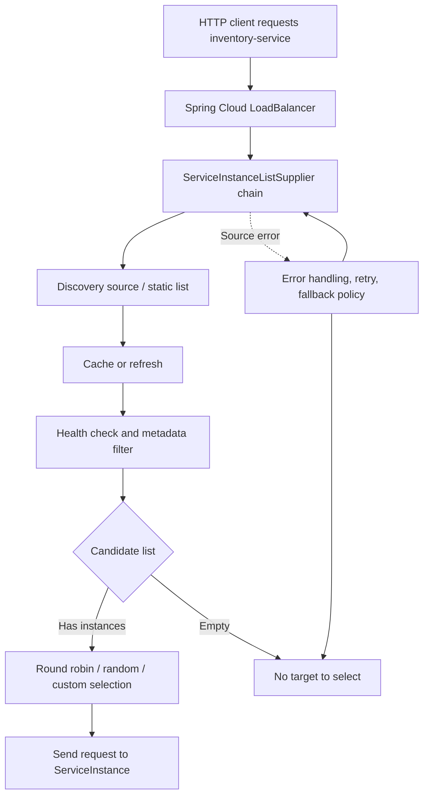

# Handling Errors, Empty Lists, and Recovering the Instance Source

In Spring Cloud LoadBalancer, selecting a `ServiceInstance` depends directly on the replica list provided by `ServiceInstanceListSupplier`. That list may flow through multiple layers: discovery queries, caching, health checks, filtering by zone or metadata, and per-request processing. When any layer returns an error, emits no data, or eliminates every replica, the client may be left with no target for its HTTP request.

This lesson belongs to the **Instance Supplier Chain** chapter of the `SPRING_CLOUD_SERVICE_COMMUNICATION_LOAD_BALANCING` module. Its goal is to recognize failure states in a supplier chain accurately, establish safe handling policies, and design recovery mechanisms so calls via `RestClient`, `WebClient`, or OpenFeign remain resilient when discovery or the instance set changes.

The core takeaway: **having no instances, emitting no data, and failing to query the source are three distinct scenarios**. How you handle them determines whether the load balancer fails fast, retries in a controlled manner, or uses fallback data.

## 1. Where Does the Supplier Chain Sit in the Selection Flow?

When a client requests `http://inventory-service/api/stock/sku-001`, Spring Cloud LoadBalancer must locate replicas for service ID `inventory-service`. A base `ServiceInstanceListSupplier` can retrieve the list from a discovery provider, while decorator suppliers layer on appropriate processing steps.



This is a conceptual diagram, not necessarily the exact decorator order of every version. Chain construction order must align with the supplier types, caching capabilities, and health-check requirements in the release train you are using.

A chain can start with **a valid discovery list yet end up empty**. For instance, discovery returns three instances, health checks drop two, and zone filtering drops the remaining one. Therefore, when troubleshooting failures, inspect both the source list and the list after each filtering step.

### 1.1. Division of Responsibilities

| Component | Responsibility | Issues to monitor |
|---|---|---|
| Discovery provider | Supplies registered instances | Unreachable registry, wrong service ID, stale data |
| Source supplier | Converts discovery or config data into an instance list | Source call errors, invalid entries, no list emitted |
| Decorator supplier | Caches, checks health, filters by zone or request criteria | Stale cache, filters eliminating all instances, predicate exceptions |
| Load balancer | Picks one instance from the candidate list | Empty list, selection algorithm has no target |
| HTTP client | Connects and sends requests to the chosen instance | DNS, connection refused, TLS, timeouts, HTTP 5xx |

**Failures occurring after instance selection**, such as connection timeouts, generally belong to the HTTP/network layer. Do not confuse them with discovery query failures merely because both cause the service call to fail.

## 2. Distinguishing Empty Lists, Empty Streams, and Errors

`ServiceInstanceListSupplier` returns `Flux<List<ServiceInstance>>`. With this reactive type, at least three states must be distinguished:

| Signal | Reactor example | Meaning |
|---|---|---|
| An empty list is emitted | `Flux.just(List.<ServiceInstance>of())` | Supplier returned a result, but zero candidates exist |
| Stream completes without emitting a list | `Flux.empty()` | No list snapshot was emitted at all |
| Stream emits an error | `Flux.error(new IllegalStateException("discovery unavailable"))` | Failed to obtain a result due to source or processing error |

Other states such as `Flux.never()`—which neither completes nor emits data—also require attention: without a timeout, the caller can hang indefinitely.

Several Reactor operators behave differently across these signals:

- `switchIfEmpty(...)` handles **a publisher that emits no elements**; it does not trigger on an emitted `List` of size 0.
- `filter(list -> !list.isEmpty())` strips empty lists from the stream, which can unintentionally turn "known zero instances" into "no snapshot emitted."
- `doOnError(...)` observes the error and preserves the error signal without fixing or swallowing it.
- `onErrorResume(...)` switches to a fallback publisher on error; if it always returns `List.of()`, the system loses the distinction between broken discovery and a service genuinely having no instances.
- `retryWhen(...)` retries only on matching error signals; a valid empty list does not trigger a retry on its own.
- `timeout(...)` produces an error when retrieving data exceeds the wait limit.

In Reactor, publishers must never emit `null`. A custom supplier implementation must emit non-null lists; when the source has no instances, emit an empty list per the contract rather than emitting `null` or returning `null` instead of a `Flux`.

## 3. Why Candidate Lists Become Empty

An empty list is a **data state**, not automatically a network error. Common causes include:

1. The service just started and has not finished registering with discovery.
2. The service ID in the request differs from the registered ID.
3. All instances stopped or were deregistered.
4. The registry uses a different namespace, zone, or environment from the client.
5. Health checks determined that no instance meets readiness criteria.
6. Suppliers filtering by metadata, zone, version, or sticky routing excluded every candidate.
7. The cache is not yet populated or is holding an empty result from a prior lookup.
8. Static instance lists were not configured properly in a registry-less environment.

Example filter trace:

```text
serviceId=inventory-service
discoveryCount=4
afterHealthCheck=3
afterZoneFilter=1
afterVersionFilter=0
selectionCandidates=0
```

This scenario should not be worked around by retrying directly against a guessed IP. Find out why the final filter dropped the remaining instance and decide whether that filter condition is genuinely mandatory.

### 3.1. Soft Preferences vs. Hard Constraints

Distinguish two categories of rules:

- **Soft preference:** prefer a same-zone instance when available; when none exists, eligible instances in other zones may be considered per policy.
- **Hard constraint:** calls may only hit instances belonging to a specific data region, security group, or compatible version; if none exist, an error must be returned.

Never apply cross-zone fallback or bypass mandatory metadata just to avoid an empty list. Any fallback policy must respect the service's data and business constraints.

## 4. Which Layer Produces Source Errors?

Errors can arise before or after an instance list is received:

| Location | Example | Appropriate action |
|---|---|---|
| Discovery request | Timeout talking to registry | Track errors and perform bounded retries if transient |
| Authentication | Bad credentials connecting to registry | Stop and report configuration error; retrying continuously won't help |
| Data mapping | Missing host/port, metadata parse failure | Log the offending record clearly and drop invalid candidates |
| Cache | Reading stale data, unable to refresh | Check snapshot age and reuse policy |
| Health check | Health endpoint slow or returning errors | Monitor instance status and tune probe settings appropriately |
| Filter | Predicate throws exception or mismatches metadata | Fix filter logic; do not drop mandatory rules silently |
| Client request | TCP timeout after instance selection | Handle in HTTP client/retry policy; do not classify as a discovery error |

A programming bug like `NullPointerException` inside a predicate should not be lumped together with transient timeouts and retried automatically. For configuration or programming bugs, retries only add load and obscure root-cause analysis.

## 5. Designing a Contract for Custom Suppliers

A custom supplier should adhere to these rules:

- Always return a valid publisher; never return `null`.
- Every emitted list must be non-null; each instance must have a valid host, port, and metadata required by routing policies.
- When no instances exist, emit an empty list so the selection layer clearly recognizes the state.
- Propagate source errors intact unless an approved recovery policy exists.
- Never silently replace an error with an empty list.
- If the supplier supports request-based routing, pass `Request` faithfully to its delegate.
- Never call `block()` inside a supplier's reactive processing pipeline.
- Avoid running slow synchronous discovery queries on an event loop if the source uses a blocking API.

When validation is needed, perform it at an explicit stage in the chain. Host/port and metadata checks should stay separate from round-robin/random selection. Valid data still does not prove the instance is currently serving: network connectivity and application health can change right after selection.

## 6. Example Decorator Observing Errors Without Hiding Root Causes

Below is an example decorator that passes data through unchanged while recording empty lists, non-emitting publishers, and exceptions. The snippet illustrates standard Spring Cloud LoadBalancer and Reactor APIs; verify exact signatures against your target version when integrating.

```java
import java.util.List;
import java.util.Objects;

import org.slf4j.Logger;
import org.slf4j.LoggerFactory;
import org.springframework.cloud.client.ServiceInstance;
import org.springframework.cloud.client.loadbalancer.Request;
import org.springframework.cloud.loadbalancer.core.ServiceInstanceListSupplier;

import reactor.core.publisher.Flux;

public final class ObservedInstanceSupplier
        implements ServiceInstanceListSupplier {

    private static final Logger log =
            LoggerFactory.getLogger(ObservedInstanceSupplier.class);

    private final ServiceInstanceListSupplier delegate;

    public ObservedInstanceSupplier(ServiceInstanceListSupplier delegate) {
        this.delegate = Objects.requireNonNull(delegate);
    }

    @Override
    public String getServiceId() {
        return delegate.getServiceId();
    }

    @Override
    public Flux<List<ServiceInstance>> get() {
        return observe(Flux.defer(delegate::get));
    }

    @Override
    public Flux<List<ServiceInstance>> get(Request request) {
        return observe(Flux.defer(() -> delegate.get(request)));
    }

    private Flux<List<ServiceInstance>> observe(
            Flux<List<ServiceInstance>> source) {

        return source
                .switchIfEmpty(Flux.defer(() -> {
                    log.warn(
                            "Supplier emitted no list: serviceId={}",
                            getServiceId());
                    return Flux.just(List.<ServiceInstance>of());
                }))
                .doOnNext(instances -> {
                    if (instances.isEmpty()) {
                        log.warn(
                                "No eligible instances: serviceId={}",
                                getServiceId());
                    }
                })
                .doOnError(error ->
                        log.error(
                                "Instance supplier failed: serviceId={}",
                                getServiceId(),
                                error));
    }
}
```

Here:

1. `Flux.defer` ensures `delegate.get()` or `delegate.get(request)` is invoked at subscription time and turns synchronous exceptions into reactive error signals.
2. `switchIfEmpty` converts the **no-snapshot-emitted case** into an empty list with a dedicated warning log. Applications can omit this conversion if non-emission should be treated as a contract violation.
3. `doOnNext` detects an emitted list with zero candidates.
4. `doOnError` logs the failure and **lets the error propagate** so the caller can apply its configured policy.
5. `get(Request request)` preserves request context for request-routing suppliers; calling `delegate.get()` in this branch would drop headers, hints, or selection context.

This example does not automatically add retries or caching. It works well for observability, especially before deciding whether fallback recovery is appropriate. In production, rate-limit warning logs to prevent log storms when many requests receive empty lists simultaneously.

## 7. Placing Error Handling at the Right Position in the Supplier Chain

A chain can combine a source supplier and multiple decorators. Before adding a recovery wrapper, determine exactly where it sits.

```text
Discovery source
    ↓
Data validation and record normalization
    ↓
Mandatory constraint filters
    ↓
Health checks / applicable decorators
    ↓
Final candidate-count and error observation
    ↓
LoadBalancer selects instance
```

This diagram shows logical design stages, not an assertion of mandatory ordering among built-in decorators. Caching and health-check suppliers have placement requirements inside the builder chain; follow the ordering recommended for your release train when wiring actual beans.

A crucial distinction is **pre-filter errors** versus **post-filter empty lists**:

- Discovery source returns an error: data retrieval failed; consider bounded retries or a qualifying cached snapshot.
- Discovery returns an empty list: may be a legitimate state while the service has not registered yet.
- Discovery returns instances yet filters drop them all: this is an outcome of filtering policy, not a discovery connection failure.
- Health checks yield zero instances: verify the health-check supplier's fallback behavior in your version before assuming it "always drops everything."

Placing `onErrorResume(error -> Flux.just(List.of()))` too early in the chain makes downstream layers see only an empty list and hides a registry timeout. Conversely, falling back to the full discovery list when a strict filter finds zero candidates can violate routing constraints.

## 8. Policies by Failure Category

No single recovery policy fits every situation:

| Scenario | Preferred behavior | What to avoid |
|---|---|---|
| Empty list after mandatory filter | Return no-instance result; log exclusion reason | Bypassing constraints to call an arbitrary replica |
| Slow registration of new service | Bounded retry with backoff and short deadline if business allows | Unbounded retries |
| Transient registry timeout | Bounded retry; consider fresh qualifying snapshot | Labeling it "service does not exist" |
| Wrong service ID / registry config | Fail and fix configuration | Blindly retrying on every request |
| Programming bug inside supplier | Log full exception and let error surface | Swallowing exception and pretending list is empty |
| Cache returns stopped instance | Refresh/evict per policy and check health | Serving stale data indefinitely |
| Zero instances after health checks | Inspect health and permitted failover policy | Forcing selection of a known unhealthy instance |
| HTTP timeout after selection | Handle timeout/retry in HTTP client with idempotency | Assuming discovery refresh always fixes the error |

Priorities depend on availability targets, zone rules, API versions, security requirements, and write-operation safety.

## 9. Retries and Timeouts with Explicit Time Budgets

Retries only help when the cause is likely to clear briefly, such as a transient registry disconnect. Retry only errors classified as transient.

Example reading **one snapshot** list from a supplier with a per-attempt timeout and at most two retries on timeout:

```java
import java.time.Duration;
import java.util.List;
import java.util.concurrent.TimeoutException;

import org.springframework.cloud.client.ServiceInstance;
import org.springframework.cloud.loadbalancer.core.ServiceInstanceListSupplier;

import reactor.core.publisher.Mono;
import reactor.util.retry.Retry;

static Mono<List<ServiceInstance>> loadOneSnapshot(
        ServiceInstanceListSupplier supplier) {

    return Mono.defer(() -> supplier.get()
                    .next()
                    .switchIfEmpty(
                            Mono.just(List.<ServiceInstance>of()))
                    .timeout(Duration.ofMillis(600)))
            .retryWhen(
                    Retry.backoff(2, Duration.ofMillis(100))
                            .maxBackoff(Duration.ofMillis(400))
                            .filter(error ->
                                    error instanceof TimeoutException))
            .timeout(Duration.ofSeconds(2));
}
```

Explanation:

- `next()` takes the **first snapshot** from `Flux<List<ServiceInstance>>`; this fits when a single selection needs one snapshot. If the supplier emits multiple lists over time, do not use this snippet to observe the entire stream.
- `switchIfEmpty` handles only the case where the publisher completes without emitting a snapshot.
- `timeout(Duration.ofMillis(600))` bounds how long each individual query can wait.
- `Retry.backoff(2, ...)` allows at most **two retries**—up to three total subscriptions if timeouts persist.
- Filtering on `TimeoutException` avoids retrying every exception indiscriminately. Production code can include discovery connection exceptions confirmed to be transient.
- The outer `timeout(Duration.ofSeconds(2))` enforces an overall deadline for the whole operation.

A valid empty list passes through without triggering retries. If you want to wait and retry while a service is still starting up and returning empty lists, design an explicit policy with a time cap, business condition, and clear status reporting. Never turn every empty result into an exception solely to trigger `retryWhen`.

**Note:** this example focuses on supplier snapshots. Post-selection HTTP connection timeouts and end-to-end business deadlines must be budgeted separately to prevent stacking multiple retry/timeout layers.

## 10. Fallback with a Last-Known Snapshot: Only Under Explicit Conditions

In some systems, a brief connection failure to the registry does not mean previously registered instances all stopped running. One recovery option is a **last-known-good snapshot**: retaining a copy of the latest valid list and using it temporarily when discovery fails.

However, a stale snapshot can also contain instances that stopped, moved zones, or lost eligibility. Therefore, enforce clear rules:

1. Only store snapshots that already passed data validation and mandatory routing checks.
2. Record the collection timestamp; cap snapshot age with an explicit TTL.
3. Only trigger fallback for approved error classes, such as transient discovery timeouts.
4. Never fall back when an empty list is the valid outcome of a hard-constraint filter.
5. Never use a snapshot to cross tenant, data-region, version, or security boundaries.
6. Monitor fallback usage counts and snapshot age to detect unrecovered discovery sources.
7. Once the source recovers, refresh the snapshot and stop using fallback.

Example policy logic (pseudocode):

```text
readSnapshot(serviceId, request)
    ├─ success, valid non-empty list
    │     └─ store snapshot + timestamp → return fresh list
    ├─ success, empty list
    │     └─ return empty list; never resurrect excluded replicas
    └─ transient discovery error
          ├─ last-known-good exists within TTL and still satisfies constraints → use temporarily
          └─ no qualifying snapshot → propagate error for caller handling
```

This is an **intentional custom mechanism**, not default behavior across every `ServiceInstanceListSupplier`. If the project already uses built-in caching, verify whether a custom fallback layer creates stacked caches. In particular, caching a discovery list does not mean the cached entries have been health-checked right now.

### 10.1. When Should You Fail Closed?

If the system restricts requests to instances of a specific tenant, region, or compliant version, serving an old snapshot could bypass that restriction. In that case, **zero qualifying candidates must reject the call**, even if that reduces availability for that request.

Failing closed is also appropriate when snapshot freshness cannot be proven, no reliable health signal exists, or routing permissions have changed.

## 11. Recovering Discovery Sources and Health Checks

When a supplier source fails, fix the **root cause** alongside per-request policies.

Common scenarios:

- **Temporary registry outage:** check endpoint, DNS, TLS, credentials, and discovery client timeouts; allow provider reconnect/refresh mechanisms to run.
- **Registry returns yet list stays empty:** verify whether target instances re-registered under the expected namespace and service ID.
- **Health checks keep dropping instances after recovery:** inspect readiness endpoints, probe intervals, and how the supplier receives updated instance lists.
- **Cache holds stale data:** inspect TTL, refresh intervals, eviction, and whether an empty list was cached.
- **Metadata filter yields zero candidates:** verify updated metadata, routing conditions, and whether fallback is permitted.

During recovery from failure, log both when the source emits its first valid snapshot and when the application begins selecting new instances successfully. Those two timestamps can differ because caches, health-check intervals, and filter layers take time to catch up.

### 11.1. Do Not Equate Health Checks with HTTP Reachability

An instance can pass a health check yet still fail on a business endpoint, or conversely have a misconfigured health path while serving business traffic fine. Health signals are one input to the supplier; actual HTTP failures must be observed and handled separately.

If a request selected an instance and got `Connection refused`, that is not an "empty list." Depending on version and integration, LoadBalancer/HTTP-client retries may re-select another instance; this requires proper retry budgets and idempotency safeguards.

## 12. Behavior of RestClient, WebClient, and OpenFeign

HTTP clients perform load balancing only when integrated with Spring Cloud LoadBalancer. How errors are surfaced when no instance can be selected depends on the client type and configuration.

| Client | Typical integration point | What to verify when no instance exists |
|---|---|---|
| `RestClient` | Builder annotated with `@LoadBalanced` | Exception/HTTP status, error mapping, and timeouts |
| `WebClient` | `@LoadBalanced WebClient.Builder` | Reactive error signal, HTTP status, and retry operators |
| OpenFeign | `@FeignClient(name = "inventory-service")` with LoadBalancer integration | Feign/client exceptions, retryer, and target URL config |

Across many Spring Cloud LoadBalancer paths, when the candidate list is empty, the algorithm returns `EmptyResponse` instead of a `ServiceInstance`. The integration layer above decides how to translate that into an exception or response—usually meaning "no instances available." Never assume every client throws the exact same exception class or returns the exact same status code.

When your application exposes an HTTP API and depends on downstream services, the edge layer may map "dependency unavailable" to `503 Service Unavailable` per API contract. Keep this mapping distinct from downstream business errors and authentication failures.

HTTP retries risk replaying write operations after the server processed the request if the client never received the response. For `POST` or non-idempotent operations, require idempotency keys or deduplication before enabling broad retries.

## 13. Logging, Metrics, and Tracing to Observe the Chain

Logging only a single `"No servers available"` message is rarely enough to diagnose failures. Collect signals across layers:

| Signal | Meaning | How to use |
|---|---|---|
| `serviceId` | Service being looked up | Group logs and metrics by target |
| `discoveryCandidateCount` | Instance count from source | Verify whether source has data |
| `postFilterCandidateCount` | Instance count after filtering | Pinpoint which step emptied the list |
| `supplierErrorType` | Timeout/auth/config/parse error | Decide between retry and config fix |
| `snapshotAge` | Age of cached/fallback data | Assess staleness |
| `fallbackUsed` | Whether last-known-good was used | Track cache-dependency risk |
| `supplierLatency` | Time spent obtaining list | Spot slow registries |
| `noInstanceCount` | Count of zero-candidate outcomes | Alert on availability degradation |
| `retryAttemptCount` | Number of source retries | Detect retry storms |
| `selectedInstance` | Selected target | Correlate connection errors (controlled logs) |

Example structured log:

```text
event=loadbalancer.supplier.result
serviceId=inventory-service
discoveryCandidateCount=3
postFilterCandidateCount=0
emptyReason=ZONE_FILTER
fallbackUsed=false
supplierLatencyMs=18
```

A source error differs from an empty list:

```text
event=loadbalancer.supplier.error
serviceId=inventory-service
errorType=DISCOVERY_TIMEOUT
retryAttempt=2
fallbackUsed=true
snapshotAgeMs=4200
```

Field names here are illustrative conventions, not mandatory default Spring Cloud metrics. Avoid putting raw URIs, instance IDs, individual trace IDs, or sensitive data into high-cardinality metric labels. You can record chosen target details in controlled logs or traces if data policy allows.

## 14. Testing Edge Cases with Reactor Test

For reactive suppliers, tests must verify both **emitted values** and **completion/error signals**. Baseline cases:

| Delegate input | Expected output of the observer decorator in Section 6 |
|---|---|
| `Flux.just(List.of(instanceA, instanceB))` | Preserves list without error |
| `Flux.just(List.of())` | Emits empty list and logs zero candidates |
| `Flux.empty()` | Emits empty list via `switchIfEmpty` with dedicated log |
| `Flux.error(exception)` | Propagates error unchanged for caller handling |
| `Flux.never()` | Emits nothing; configure timeout if bounded wait is required |
| Delegate supports custom `get(Request)` | Decorator forwards `Request` intact |
| Instance lacks mandatory metadata | Excluded by validation filter per policy |
| Cache stale past TTL | No fallback when no qualifying snapshot remains |

The test snippet below illustrates empty and error states. `FixedSupplier` is a simple stub to control emitted data:

```java
import java.util.List;

import org.springframework.cloud.client.ServiceInstance;
import org.springframework.cloud.loadbalancer.core.ServiceInstanceListSupplier;
import reactor.core.publisher.Flux;
import reactor.test.StepVerifier;

final class FixedSupplier implements ServiceInstanceListSupplier {

    private final Flux<List<ServiceInstance>> values;

    FixedSupplier(Flux<List<ServiceInstance>> values) {
        this.values = values;
    }

    @Override
    public String getServiceId() {
        return "inventory-service";
    }

    @Override
    public Flux<List<ServiceInstance>> get() {
        return values;
    }
}

// Example usage inside a test method:
var noEmission = new ObservedInstanceSupplier(
        new FixedSupplier(Flux.empty()));

StepVerifier.create(noEmission.get())
        .expectNextMatches(List::isEmpty)
        .verifyComplete();

var failure = new ObservedInstanceSupplier(
        new FixedSupplier(
                Flux.error(new IllegalStateException("registry down"))));

StepVerifier.create(failure.get())
        .expectErrorMessage("registry down")
        .verify();
```

This snippet requires the `reactor-test` dependency and project imports. It demonstrates stream assertions rather than a standalone Java file outside a test class. When testing retry policies, simulate a source failing a few times before recovering and assert the **subscription count**; when testing backoff timing, use `StepVerifier.withVirtualTime(...)` if the pipeline uses a compatible scheduler.

### 14.1. Testing Real Recovery

Alongside unit tests, maintain integration tests with a controllable target service and instance source:

1. Provide two valid instances and verify the client calls them by service ID.
2. Inject transient discovery failures; verify retries stay within budget.
3. Restore the source; verify the fresh list is picked up after refresh.
4. Make the supplier return an empty list; verify the client does not call guessed addresses.
5. Change metadata so a mandatory filter drops all instances; verify fallback does not break constraints.
6. When caching is enabled, test TTL and behavior after snapshot expiration.

Running a few successful happy-path requests is not enough to prove recovery under registry timeouts or stale caches.

## 15. Diagnostic Workflow When Production Reports No Instances

Follow this concise checklist:

1. **Verify service ID and client context:** do the URL, OpenFeign client name, profile, and namespace match the discovery source?
2. **Inspect the source:** did discovery return instances, return empty, time out, or fail authentication?
3. **Inspect the chain:** log instance counts before and after caching, health checks, and zone/metadata filters.
4. **Check snapshot state:** what is in the cache, and how long since it refreshed?
5. **Classify the failure:** is empty a valid result, did the publisher emit no snapshot, or did an exception occur?
6. **Review recovery policies:** are retries bounded, and did fallback trigger unintentionally?
7. **Check post-selection connectivity:** does a valid instance have working DNS/TLS/HTTP?
8. **Verify recovery:** once the target re-registers, do candidate lists and request success rates recover?

Three easily confused examples:

- **Registry has three instances, final supplier is empty:** check health/filters; increasing discovery retries probably will not help.
- **Registry times out, cache holds a fresh snapshot:** a TTL-bounded fallback can serve temporarily if policy allows, but log its usage.
- **Supplier has instances yet requests time out:** inspect HTTP client, network, and target service health rather than concluding the load balancer could not find a server.

## 16. Common Pitfalls

- Applying `onErrorResume(error -> Flux.just(List.of()))` to all exceptions, erasing source error details.
- Using `switchIfEmpty` expecting it to catch `Flux.just(List.of())`.
- Placing `retryWhen` after an operator that already swallowed every exception, then wondering why retries never fire.
- Omitting timeouts, letting non-emitting or hanging publishers stall calling threads.
- Applying unbounded retries to auth errors, wrong service IDs, or programming bugs.
- Serving stale snapshots indefinitely or ignoring tenant/zone/version constraints.
- Stacking multiple cache/health-check layers without checking the data source and decorator order.
- Ignoring `get(Request)` in custom suppliers, breaking request-aware routing context.
- Logging only `"no instance"` without pre/post-filter counts or error types.
- Putting all retry budgets on the HTTP client without accounting for discovery retry latency.

## 17. Operational Principles

To keep a supplier chain resilient and easy to diagnose:

1. Keep three signals distinct: empty list, non-emitting publisher, and publisher error.
2. Validate `ServiceInstance` data before passing candidates to selection algorithms.
3. Bound retries by error category, with backoff and an overall deadline.
4. Use fallback only when a sufficiently fresh snapshot satisfies every routing constraint.
5. Observe every filtering step to see why a candidate list became empty.
6. Preserve `Request` context in suppliers supporting request-based routing.
7. Separate discovery errors from post-selection HTTP connection errors.
8. Test errors, empty lists, timeouts, stale caches, and full recovery paths.
9. Configure supplier chains using the APIs and guidance of your BOM-managed Spring Cloud release train.

## 18. Conclusion

Error handling in `ServiceInstanceListSupplier` must stay grounded in **the chain's real root cause and signals**. An empty list can be a legitimate result of discovery or filtering; non-emission is a distinct publisher state; source errors must be recorded and retried or fallen back only when policy permits.

A sound recovery design bounds retries and timeouts, avoids masking programming bugs, sets explicit preconditions for stale-snapshot fallback, and respects routing constraints. Combining structured logs, metrics, and edge-case tests enables Spring Cloud LoadBalancer to select suitable `ServiceInstance` targets as sources fluctuate—while leaving clear diagnostic evidence whenever no instances are available.
