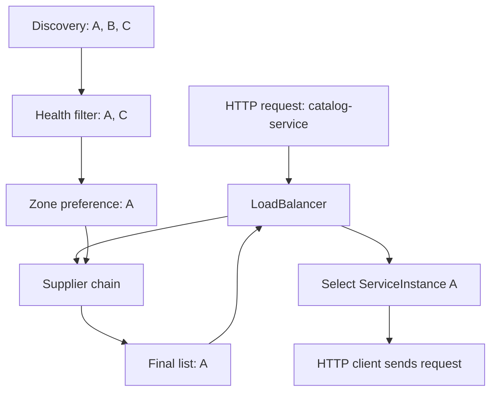

# Tracking the Candidate List Before and After Each Step

In Spring Cloud LoadBalancer, the load balancer can only choose a `ServiceInstance` from **the candidate list returned by `ServiceInstanceListSupplier`**. That list may have passed through multiple steps: fetching instances via service discovery, caching, health checks, zone preference, metadata filtering, or evaluating request context. If a request lands on the wrong instance, finds no instance, or keeps calling a stopped replica, you need to know **at which step the list changed** before tuning the selection algorithm.

This lesson focuses on observing the candidate list **before and after each step in the supplier chain**. The goal is to identify which instances were added, dropped, or retained, why that happened, and what information to record to diagnose inter-service communication across `RestClient`, `WebClient`, and OpenFeign.

## 1. Distinguishing the Supplier Chain from Instance Selection

When an application calls a logical URL such as `http://catalog-service/api/products/42`, Spring Cloud LoadBalancer resolves service ID `catalog-service`, asks `ServiceInstanceListSupplier` for usable instances, and only then selects one instance. `DiscoveryClient` provides instance data from the service discovery system; suppliers may process that data further before a selector such as `RoundRobinLoadBalancer` or `RandomLoadBalancer` runs.

Suppose an illustrative processing chain looks like this:



This diagram illustrates the processing principle and **does not dictate a default configuration order** for every application. Some systems apply caching before filtering, some have request-dependent filters, and some do not enable health checks. Inspect the actual supplier configuration before attributing a problem to a specific layer.

Two outcomes must never be confused:

- **Candidate list:** the set of `ServiceInstance` objects remaining after each supplier. A list may be empty or contain many instances.
- **Selected instance:** the single concrete instance picked by LoadBalancer for this call. Seeing only `catalog-2` in a request log does not prove other instances were filtered out of the list.

## 2. What Should Be Recorded at Each Boundary?

A useful observation record should answer four questions: which service ID the request is calling, which stage it is at, which instances are in the list, and how the list differs from the previous stage.

| Observation field | Example | Purpose |
|---|---|---|
| Service ID | `catalog-service` | Avoid mixing data from different services' child contexts |
| Stage | `discovery`, `health`, `zone`, `final` | Know which step produced the change |
| Request/trace ID | `req-7f21` | Correlate snapshots belonging to the same call when possible |
| Instance count | `3 → 2` | Spot steps that drop candidates |
| Instance identifier | `catalog-1@10.0.1.11:8080` | Compare membership before and after |
| Routing attributes | `zone=az-1`, `healthy=true` | Explain filtering or preference rules |
| Timestamp, duration | `10:12:35.420`, `4 ms` | Inspect latency, stale caches, and refresh intervals |

Use stable identifiers combining `instanceId` and, when needed, `host:port`; never compare counts alone. Two lists can both have two elements yet represent completely different instance sets. When comparing lists as sets, normalize identifiers and keep in mind that some instances may not declare an `instanceId`.

In production logs, avoid dumping unchecked full metadata: it can contain internal labels or sensitive details. Log only necessary fields, bound string lengths, sample under high traffic, and attach trace IDs in the format used by your tracing system.

## 3. Step-by-Step Snapshot Illustration

Suppose discovery returns three instances:

| Instance | Address | Zone | Simulated Health |
|---|---|---|---|
| `catalog-1` | `10.0.1.11:8080` | `az-1` | Healthy |
| `catalog-2` | `10.0.1.12:8080` | `az-1` | Unhealthy |
| `catalog-3` | `10.0.2.13:8080` | `az-2` | Healthy |

In an **illustrative** pipeline, the health filter removes `catalog-2`, and then a zone preference policy for `az-1` keeps `catalog-1` because a matching instance exists:

| Boundary | Before step | After step | Difference |
|---|---|---|---|
| Discovery | No list yet | `1, 2, 3` | Initialized 3 candidates |
| Health filter | `1, 2, 3` | `1, 3` | Dropped `2` after failed health check |
| Zone preference | `1, 3` | `1` | Kept `1` in `az-1` |
| Instance selection | `1` | Selected `1` | Picked from final list |

Numbers `1`, `2`, and `3` in the table abbreviate `catalog-1`, `catalog-2`, and `catalog-3`. Some zone-preference suppliers can **fall back to the full list** if no instance is found in the desired zone; they do not necessarily always narrow down to an empty list. Distinguish **exclusive filtering** from **preference with fallback** when interpreting results.

To compare two snapshots, you can define:

```text
removed = before - after
added   = after  - before
kept    = before ∩ after
```

This comparison tells you *what changed*, while the cause depends on that stage's policy and input data at that moment. For instance, `catalog-2` disappearing after the health filter could stem from a failed health probe, stale health status, or a misconfigured probe; snapshots alone cannot distinguish those three causes.

## 4. Observing Inside a Reactive Supplier Without Altering Behavior

`ServiceInstanceListSupplier` typically exposes `Flux<List<ServiceInstance>>` via `get()` and can handle `get(Request)` when the list depends on the request. To observe results, you can wrap a supplier in a **decorator** and use Reactor's `doOnNext` operator. This operator logs whenever a list is actually emitted without initiating a separate subscription.

The Java example below leaves data untouched and faithfully forwards both retrieval methods:

```java
import java.util.List;
import java.util.stream.Collectors;

import org.slf4j.Logger;
import org.slf4j.LoggerFactory;
import org.springframework.cloud.client.ServiceInstance;
import org.springframework.cloud.client.loadbalancer.Request;
import org.springframework.cloud.loadbalancer.core.ServiceInstanceListSupplier;
import reactor.core.publisher.Flux;

public final class ObservedServiceInstanceListSupplier
        implements ServiceInstanceListSupplier {

    private static final Logger log = LoggerFactory.getLogger(
            ObservedServiceInstanceListSupplier.class);

    private final String stage;
    private final ServiceInstanceListSupplier delegate;

    public ObservedServiceInstanceListSupplier(
            String stage, ServiceInstanceListSupplier delegate) {
        this.stage = stage;
        this.delegate = delegate;
    }

    @Override
    public String getServiceId() {
        return delegate.getServiceId();
    }

    @Override
    public Flux<List<ServiceInstance>> get() {
        return delegate.get().doOnNext(this::observe);
    }

    @Override
    public Flux<List<ServiceInstance>> get(Request request) {
        return delegate.get(request).doOnNext(this::observe);
    }

    private void observe(List<ServiceInstance> instances) {
        if (!log.isDebugEnabled()) {
            return;
        }

        String ids = instances.stream()
                .map(instance -> {
                    String id = instance.getInstanceId();
                    return (id == null ? "unknown" : id)
                            + "@" + instance.getHost()
                            + ":" + instance.getPort();
                })
                .collect(Collectors.joining(", "));

        log.debug("serviceId={} stage={} count={} instances=[{}]",
                getServiceId(), stage, instances.size(), ids);
    }
}
```

In this code, `observe()` is **read-only** on the list. It never removes, sorts, mutates elements, or calls `subscribe()`/`block()` directly. That matters because any operation creating an independent subscription could cause the supplier to execute multiple times, capture snapshots at different instants, or interfere with caching.

Overriding **both `get()` and `get(Request)`** is also essential. If the decorator only called `delegate.get()`, suppliers relying on request data to select candidates (such as request hints or retry-related filtering) would fail to receive the needed context.

The snippet checks `DEBUG` level to avoid string-formatting overhead when disabled. Even so, in high-throughput systems consider sampling, capping the number of logged elements, and keeping internal host lists out of public log channels.

## 5. Where Should Observation Points Sit in the Supplier Chain?

The decorator above observes only **the output of the supplier it wraps**. If you wrap only the outermost supplier, you see only the final list and cannot deduce which step dropped an instance. To inspect *before and after each step*, place observation points at the **boundaries between decorators**.

The wiring concept (pseudocode showing order; function names are illustrative):

```text
discovery = createDiscoverySupplier()
discovery = observe("after-discovery", discovery)

healthy = createHealthCheckSupplier(discovery)
healthy = observe("after-health", healthy)

zoned = createZonePreferenceSupplier(healthy)
zoned = observe("after-zone", zoned)

return zoned  // final supplier used by LoadBalancer
```

At the `after-discovery` and `after-health` boundaries, comparing the two lists shows whom the health filter excluded. Similarly, comparing `after-health` with `after-zone` reveals the zone policy's effect. The snippet above is **pseudocode**, not Spring Cloud's complete builder API; actual constructors and wrapper ordering must follow your library version, discovery client type, and bean registration approach.

If your application constructs suppliers with `ServiceInstanceListSupplier.builder()`, a simple starting point is wrapping the **builder's final product** to observe the final snapshot:

```java
@Bean
ServiceInstanceListSupplier observedSupplier(
        ConfigurableApplicationContext context) {
    ServiceInstanceListSupplier finalSupplier =
            ServiceInstanceListSupplier.builder()
                    .withDiscoveryClient()
                    .withCaching()
                    .build(context);

    return new ObservedServiceInstanceListSupplier(
            "after-final-supplier", finalSupplier);
}
```

This bean snippet assumes `@Bean`, `ConfigurableApplicationContext`, and `ServiceInstanceListSupplier` are imported, alongside Spring Cloud LoadBalancer dependencies and an appropriate discovery source. This example shows only the **end of the chain** and does not automatically instrument internal layers assembled by the builder. To observe internal boundaries, wrap decorators while constructing the chain or adjust your configuration mechanism to attach hooks at those points.

When registering a custom supplier for **a single service ID**, declare it in the configuration of `@LoadBalancerClient(name = "catalog-service", configuration = ...)` and keep that configuration class outside the main application's component scan scope. That way, instrumentation meant for `catalog-service` will not accidentally apply to every service ID in the application.

## 6. How Supplier Order and Caching Affect Snapshots

An application may combine `DiscoveryClientServiceInstanceListSupplier`, `CachingServiceInstanceListSupplier`, `HealthCheckServiceInstanceListSupplier`, and suppliers for zones, hints, or requests. Not all of them are enabled by default, and ordering depends on your configuration policy.

**Caching** can make observation misleading:

- While a cache entry is valid, fetching from an outer supplier can return cached data **without asking the inner discovery step to emit a new list**.
- When the cache expires or refreshes, outputs across boundaries can change even for the same service ID.
- Some caches or suppliers only run on specific subscriptions or refresh cycles. Hence, a missing log line at one stage does not prove that stage does not exist.

Example:

```text
12:00:00 registry       : [catalog-1, catalog-2, catalog-3]
12:00:00 after-cache    : [catalog-1, catalog-2]
12:00:06 after-cache    : [catalog-1, catalog-2, catalog-3]
```

If the registry has changed yet LoadBalancer still sees two instances, either the cache or the discovery client has not refreshed yet. To locate which layer is lagging, compare registry update timestamps, snapshots emitted by the discovery client, and post-cache snapshots. Lowering cache TTL **does not** shorten the registry/discovery client refresh cycle, nor does it guarantee an unhealthy instance is removed immediately without health checks or proper deregistration.

Pay close attention to the placement of **request-dependent** suppliers. Caching the final output after a hint filter or per-request attribute without distinguishing request context risks reusing one request's candidates for another request. When designing a chain, follow the ordering guidance for your Spring Cloud version—especially regarding caching, health checks, and per-request filtering.

## 7. Tracking a Single Request Across Concurrent Traffic

In real environments, requests to `catalog-service` run concurrently. An `after-health` log line and an `after-zone` log line printed close together in time **do not necessarily belong to the same request**. To correlate before/after snapshots reliably, propagate a correlation ID or tracing span across the call flow.

For synchronous flows like `RestClient`, you can use the request ID from your existing tracing/logging setup. For `WebClient` and Reactor, `ThreadLocal`-based MDC does not propagate automatically across reactive threads; use your application's context propagation or compatible instrumentation instead of reading MDC inside an arbitrary callback and assuming it is always accurate. OpenFeign likewise needs HTTP logs correlated with supplier logs via the corresponding trace context.

Maintain three independent observation groups:

1. **Supplier snapshots:** `serviceId`, `stage`, candidate counts, and candidate instance identifiers.
2. **Selection decision:** `serviceId`, chosen instance, selection policy, and zero-candidate outcomes when they occur.
3. **HTTP result:** target called, duration, timeouts or HTTP status codes, and retry count if enabled.

Only by linking these three groups can you distinguish: the supplier filtered out all candidates, LoadBalancer picked cleanly yet the instance was unreachable, or the HTTP client timed out despite a valid instance list.

## 8. Analyzing Common Failure Scenarios

| Symptom | Which snapshots to compare? | Hypotheses to check |
|---|---|---|
| `catalog-3` is in the registry yet requests never pick it | Registry → discovery → post-cache → final | Slow discovery refresh, stale cache, filtered out by zone/hint/health |
| List is empty right after discovery | Service ID → registry → discovery | Wrong service ID, missing registration, or discovery failure |
| Discovery has 3 instances yet 0 remain after health | Before and after health supplier | Health endpoint, readiness status, probe interval, probe timeout |
| Zero eligible instances after zone | Before/after zone and zone metadata | Mismatched zone declarations or strict filtering vs. fallback policy |
| Final supplier has 2 instances yet traffic mostly hits one | Final candidates → selected instance | Algorithm, sticky sessions, request distribution, retries, or small sample size |
| Still calling a stopped instance | Registry → discovery → cache → HTTP result | Deregistration, lease/heartbeat, stale cache, in-flight requests |
| Retry picks the just-failed instance again | Per-attempt snapshot → per-attempt selection | Presence/absence of prior-instance filtering and retry/avoid-previous-instance settings |

In particular, **a candidate list does not directly prove TCP reachability or HTTP success**. A `ServiceInstance` appearing in discovery only proves it is currently published; it does not guarantee the server at that host/port is ready to respond. Once the final supplier yields at least one candidate, if requests still fail, inspect LoadBalancer selection, timeouts, retry policies, and target-service logs.

## 9. Step-by-Step Observation Practice

A practical exercise is running `catalog-service` with three instances as in Section 3's table, then calling `http://catalog-service/...` from `order-service` using a LoadBalancer-integrated HTTP client.

1. **Record a baseline:** verify the registry and discovery both see all three instances. Enable `DEBUG` logging on the observation decorator in a test environment and capture snapshots before/after configured stages.
2. **Change health state:** make one instance return an unhealthy status and watch when it disappears from post-health snapshots; compare against discovery snapshots to confirm filtering works.
3. **Change zone:** alter metadata or the desired zone according to your setup; observe preference outcomes and fallback behavior when no instance matches the zone.
4. **Add and remove instances:** scale out a replica, then deregister one; compare timestamps across registry/discovery/cache and selection outcomes.
5. **Verify request-aware suppliers:** if the app uses hint or retry filtering, send two requests with different contexts and verify `get(Request)` preserves that distinction.
6. **Correlate with HTTP outcomes:** record the chosen instance, status/timeout, and retry count, then tie them back to the final candidate list for that call.

You can use the following tracking sheet during a run:

| Timestamp / trace | Discovery | After health | After zone | Selected instance | HTTP outcome |
|---|---|---|---|---|---|
| `t1 / req-101` | `1,2,3` | `1,3` | `1` | `1` | `200` |
| `t2 / req-102` | `1,2,3` | `1,3` | `1` | `1` | `200` |
| `t3 / req-103` | `1,2,3` | `1,3` | `1` | `1` | Timeout (check network/target) |

This table contains hypothetical data. In `req-103`, the candidate set stayed unchanged, so the timeout cannot simply be explained away as "the health filter dropped all instances." Capturing **before/after each step, the selected instance, and the HTTP outcome** narrows down the right layer.

## 10. Notes When Enabling Observability in Production

Logging every instance list on every request can generate massive log volume, especially with many instances and high request rates. Suppliers may replay lists periodically or across multiple subscriptions; log line counts do not map 1:1 to HTTP requests. Therefore, enable detailed logging in a controlled manner during diagnostics or apply sampling with a cap on logged instances.

For long-term telemetry, prefer metrics tagged with **service ID and stage** tracking candidate counts, supplier latency, and empty-list counts. Avoid using `instanceId` or `traceId` as standing metric labels since cardinality explodes rapidly; keep instance-level details in sampled logs or traces.

When adding custom observation decorators, preserve emitted data and `Request` context, and never call `.block()` or `.subscribe()` yourself just to measure. Never mutate lists returned by delegates directly. Scope supplier configuration to the per-service ID child context when targeting a single service so `catalog-service` logging and policies do not affect other services.

## 11. Takeaways

To understand why Spring Cloud LoadBalancer selects or skips an instance, observe **the candidate list at each `ServiceInstanceListSupplier` boundary**, then correlate it with the instance picked by LoadBalancer and the HTTP outcome. Wrapping suppliers with `doOnNext` records snapshots without triggering extra subscriptions; to see step-by-step changes, place decorators between stages rather than only around the final supplier. Always examine caching, health checks, zones, request context, and discovery lag before jumping to conclusions. Reliable observations must tie together the right service ID, timestamp, and corresponding request trace.
