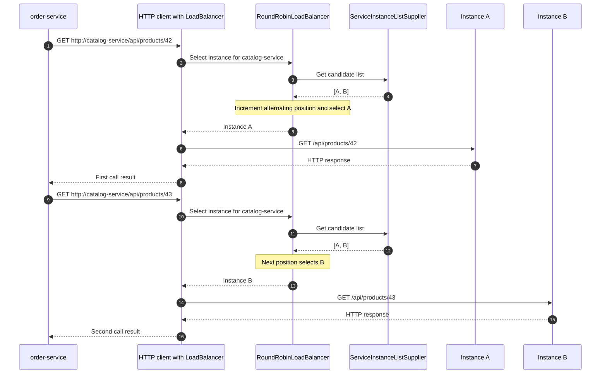

# Round-robin: alternating distribution and caller-side state

In a microservices system, a service ID can represent multiple replicas of the same service. For example, `catalog-service` has three instances A, B, C. When `order-service` calls `http://catalog-service/api/products/42` via an HTTP client integrated with Spring Cloud LoadBalancer, the application needs to decide **which instance receives the current request**. Round-robin solves this by selecting instances in turn around a cycle.

In Spring Cloud LoadBalancer, `RoundRobinLoadBalancer` is the alternating selection implementation commonly used by default when the application does not replace the algorithm with another LoadBalancer bean. The key point of **client-side load balancing** is that selection state lives in the **calling application**, associated with the LoadBalancer for that service ID, rather than having a shared counter on the target instances. Therefore, round-robin distributes *selections evenly at a single caller*, but does not by itself guarantee that every target server receives the exact same share of requests across the entire system.

## 1. How does round-robin work?

Suppose the discovery source returns a list in a fixed order:

```text
serviceId = catalog-service
instances = [A, B, C]
A = 10.0.0.11:8080
B = 10.0.0.12:8080
C = 10.0.0.13:8080
```

Round-robin maintains the current position and advances to the next position after each valid selection. When it reaches the last element, the position wraps back to the start of the list. Assuming the first turn selects A, an illustrative selection sequence is:

| Selection turn | Position in cycle | Selected instance | Final address |
|---:|---:|---|---|
| 1 | 0 | A | `10.0.0.11:8080` |
| 2 | 1 | B | `10.0.0.12:8080` |
| 3 | 2 | C | `10.0.0.13:8080` |
| 4 | 0 | A | `10.0.0.11:8080` |
| 5 | 1 | B | `10.0.0.12:8080` |
| 6 | 2 | C | `10.0.0.13:8080` |
| 7 | 0 | A | `10.0.0.11:8080` |

The idea for computing the position can be expressed simply as follows:

```text
index = nextPosition % numberOfCandidates
chosenInstance = candidates[index]
```

Where `nextPosition` is the next alternating position and `numberOfCandidates` is the number of instances in the current list. The actual Spring Cloud LoadBalancer implementation uses an atomic counter (`AtomicInteger`) and handles the index value to avoid negative indices. The formula above illustrates the circular principle, not the complete source code of the implementation.

**Do not assume the first turn always selects A.** `RoundRobinLoadBalancer` may start from a position initialized differently across calling application instances. What is expected when the list is stable is that subsequent selections proceed sequentially around the same cycle, rather than having a fixed starting point.

## 2. From service ID to instance: where does round-robin sit?

Round-robin does not directly discover servers on the network. It only selects an element from the **list of instances already provided**. Basic flow:

1. The application sends a request through `RestClient`, `WebClient`, or OpenFeign integrated with LoadBalancer, using a service ID such as `catalog-service`.
2. The LoadBalancer integration requests the selection of a `ServiceInstance` for that service ID.
3. `ServiceInstanceListSupplier` returns the list of instances from discovery or static configuration. This list may have already gone through caching, zone filtering, and health checks.
4. `RoundRobinLoadBalancer` takes the next position in its selection cycle and chooses an instance from the current candidate list.
5. The HTTP client replaces the logical host/port with the address of the selected instance, then establishes the connection and sends the request.



The diagram assumes the two selections occur sequentially, the list does not change, and the starting position in the example is A. In practice, the supplier may use caching so it does not necessarily query the registry every time; concurrent requests may complete in a different order than they were selected.

## 3. Selection state lives on the caller side

In Spring Cloud LoadBalancer, `LoadBalancerClientFactory` manages child contexts per service ID. The context for `catalog-service` can have a `RoundRobinLoadBalancer` with its own position counter. `billing-service` has a different child context and a different LoadBalancer. Therefore, selections to `billing-service` do not share the counter cycle of `catalog-service`.

Suppose an `order-service` process makes sequential calls:

```text
GET http://catalog-service/products/1
GET http://catalog-service/products/2
GET http://billing-service/invoices/1
GET http://catalog-service/products/3
```

If the `catalog-service` list is `[A, B]` and `billing-service` is `[X, Y]`, an illustrative outcome could be `A`, `B`, `X`, `A`. The request to `billing-service` does not alter the counter for `catalog-service`.

This state is **in-memory state per calling application process**. It is not a metric written in the service registry, nor is it automatically synchronized across JVMs or caller Pods. When the caller restarts, the LoadBalancer selection state in that process is reinitialized. If the caller is scaled to multiple replicas, each replica has an independent selection cycle.

```text
order-service replica 1
  ├── catalog-service: separate counter
  └── billing-service: separate counter

order-service replica 2
  ├── catalog-service: another separate counter
  └── billing-service: another separate counter
```

This is the core difference from a centralized load balancer: there is no system-wide alternating position automatically shared by Spring Cloud LoadBalancer across all callers. Discovery may provide the same set of instances to multiple callers, but the **instance selection counter** is still managed by each LoadBalancer on the caller side.

### Why is `AtomicInteger` used?

An application typically handles many concurrent requests. If multiple threads read, increment, and write a regular counter without synchronization, updates can be lost and multiple requests can accidentally use the same position. `AtomicInteger` enables safe position updates under contention across threads within the same LoadBalancer.

This ensures consistent selection position allocation under concurrent requests, but **does not force requests to arrive at the destination or complete in exact A → B → C order**. A request that selected A first might run longer and return a response after a request that selected B. Therefore, when debugging, it is necessary to distinguish *instance selection order* from *response reception order*.

## 4. One caller and multiple callers produce different results

If a single LoadBalancer consecutively performs 10 valid selections against a fixed list `[A, B, C]`, the total number of selections per instance will be nearly equal: each instance is selected 3 or 4 times. With a stable list of `n` candidates, the difference in **selection count** between any two instances is at most one after a sequence of full cycles plus remainder.

However, placing two replicas of the calling application side by side creates two selection cycles:

| Caller | `catalog-service` selections | Example sequence with A, B, C | Count per instance |
|---|---:|---|---|
| `order-service-1` | 7 | A, B, C, A, B, C, A | A=3, B=2, C=2 |
| `order-service-2` | 3 | C, A, B | A=1, B=1, C=1 |
| **Illustrative total** | **10** | Two independent cycles | **A=4, B=3, C=3** |

This is an example with assumptions about the starting point and list order. If both callers initialize at the same position and there are only a few requests, both may pick the same instance on the first few turns. If the discovery list or returned order differs between the two callers, the aggregate distribution can also skew further.

Round-robin has no knowledge of processing time, CPU, open connection count, or business load of each instance. For instances with vastly different capacities, nearly equal selection counts can still overload a weaker machine. When capacity-weighted proportions, zone conditions, or business specifics are needed, an appropriate selection strategy and supplier chain must be evaluated instead of treating round-robin as an adaptive load-balancing mechanism.

## 5. The instance list can change between selections

Round-robin selects by index in the **candidate list at the time of selection**. When discovery changes or the supplier re-filters the list, the two critical factors are **element count** and **element order**. The counter may continue incrementing while the modulo operation uses the new list size.

| Scenario | Candidate list | Consequence for round-robin |
|---|---|---|
| Stable | `[A, B, C]` for all turns | Distributes sequentially across the three instances |
| B removed due to failure | `[A, C]` | Next selection is based on the remaining two candidates |
| Scaled up with D | `[A, B, C, D]` | Cycle calculates over four candidates from the moment the new list is observed |
| Order changed | `[C, A, B]` | The same position can point to a different instance; logs may show repeated or skipped names |
| Zone filtering | `[A, C]` | Alternates only within the filtered set, never selecting B |
| No candidates | `[]` | No instance to select; the request enters the corresponding error handling branch |

This explains why **an absolute A → B → C sequence cannot be demanded** when instances are continuously created, terminated, or have their status updated. Maintaining a counter does not mean maintaining a fixed copy of the list.

### Impact of caching and health checks

`ServiceInstanceListSupplier` can fetch instances via `DiscoveryClient`, add caching, filter metadata, and perform health checks. If caching is used, the list may reflect registry state with a delay. If health checks are used, an instance that fails criteria can be excluded from the candidate set before round-robin selects.

One should not assume that round-robin checks health on its own or automatically removes an instance that just returned a 5xx error. The algorithm only knows the list it receives. To control candidate quality, discovery, health checks, caching, and filters must be designed to fit the system.

## 6. Experimenting with `SimpleDiscoveryClient` and `RestClient`

To observe round-robin clearly, you can build a lab with **two `catalog-service` processes** (ports 8081 and 8082) and **one `order-service` process** as the consumer. The example uses a Spring Boot version compatible with the chosen Spring Cloud release train and the `RestClient` API (Spring Framework 6.1 or later).

### Step 1: declare consumer dependencies

In Maven, you can declare the HTTP client and LoadBalancer starter:

```xml
<dependencies>
    <dependency>
        <groupId>org.springframework.boot</groupId>
        <artifactId>spring-boot-starter-web</artifactId>
    </dependency>
    <dependency>
        <groupId>org.springframework.cloud</groupId>
        <artifactId>spring-cloud-starter-loadbalancer</artifactId>
    </dependency>
</dependencies>
```

Spring Cloud versions must be managed by a BOM matching the Spring Boot version in use. This example assumes the project already has dependency management configured; merely copying the two dependencies into an arbitrary POM does not guarantee a successful build if the BOM or version is missing.

### Step 2: declare two static instances

In the **consumer**'s `application.yml`:

```yaml
spring:
  application:
    name: order-service
  cloud:
    discovery:
      client:
        simple:
          instances:
            catalog-service:
              - uri: http://localhost:8081
              - uri: http://localhost:8082
```

This list works when all processes run on the same machine. If the consumer runs in a container, `localhost` is the consumer's container; replace it with addresses the consumer container can actually reach.

### Step 3: start two provider replicas

The same provider application has an endpoint returning a distinct identifier:

```java
@RestController
class InstanceController {

    private final Environment environment;

    InstanceController(Environment environment) {
        this.environment = environment;
    }

    @GetMapping("/whoami")
    String whoami() {
        return "catalog@" + environment.getProperty("server.port", "unknown");
    }
}
```

Start the first replica with `server.port=8081`, and the second replica with `server.port=8082`. You can override `server.port` using command-line arguments `--server.port=8081` and `--server.port=8082` when running two separate processes. Before testing LoadBalancer, verify the direct URLs return two different values:

```bash
curl http://localhost:8081/whoami
curl http://localhost:8082/whoami
```

Expected results are `catalog@8081` and `catalog@8082`.

### Step 4: create an HTTP client integrated with LoadBalancer

In the consumer, define a builder annotated with `@LoadBalanced`:

```java
@Configuration(proxyBeanMethods = false)
class OutboundHttpConfiguration {

    @Bean
    @LoadBalanced
    RestClient.Builder loadBalancedRestClientBuilder() {
        return RestClient.builder();
    }
}
```

Then, inject the builder with the matching qualifier to call URLs by service ID:

```java
@Service
class CatalogApiClient {

    private final RestClient restClient;

    CatalogApiClient(@LoadBalanced RestClient.Builder builder) {
        this.restClient = builder.build();
    }

    String whoami() {
        return restClient.get()
                .uri("http://catalog-service/whoami")
                .retrieve()
                .body(String.class);
    }
}
```

Corresponding Spring imports such as `@Bean`, `@Configuration`, `@Service`, `@LoadBalanced`, `RestClient`, and `Environment` are required; the snippet focuses on the integration pattern. There is no need to declare `RoundRobinLoadBalancer` manually when using the default round-robin policy without overriding it with custom configuration.

### Step 5: observe multiple calls

In a test or lab runner component, call `CatalogApiClient.whoami()` multiple times sequentially:

```java
for (int i = 1; i <= 8; i++) {
    System.out.println(i + ": " + catalogApiClient.whoami());
}
```

A valid output might be:

```text
1: catalog@8081
2: catalog@8082
3: catalog@8081
4: catalog@8082
5: catalog@8081
6: catalog@8082
7: catalog@8081
8: catalog@8082
```

The output can also start from port 8082. Check what needs to be proven: **when the two-instance list remains unchanged and calls are sequential, the two addresses are selected alternately**. Do not tie the test to port 8081 always being selected first.

### Step 6: test changing the list

Stop the process on port 8082 while keeping the static `SimpleDiscoveryClient` configuration. At that point, address 8082 may still remain in the candidate list and some calls will fail to connect. This is predictable behavior: **round-robin does not automatically detect that a static address is dead**.

Next, remove entry 8082 from the configuration and restart the consumer according to the lab setup. Now, every selection with candidates points to 8081. With dynamic discovery, observe the time it takes for the registry and cache to refresh; stopping an instance does not necessarily inform all callers immediately.

## 7. Differences between selection, HTTP request, and response

An instance selection does not equate to a successful HTTP request. For example, round-robin selects A, but the connection to A times out. The selector made its decision even though the application did not receive a business result.

This leads to three distinct types of metrics:

| Metric | Meaning | Must they be equal? |
|---|---|---|
| Selections of A | How many times LoadBalancer chose A as the target | Not necessarily equal to successful responses from A |
| HTTP requests sent to A | How many times the client/transport actually attempted to send a request to A | Can be lower or higher than business calls depending on errors and retries |
| 2xx responses from A | How many requests were processed and returned successfully by A | Can differ from selection count due to timeouts, network errors, 4xx/5xx |

If a request encounters an error and retry is enabled, a **single business call** can result in multiple attempts or multiple instance selections. Retry may re-select the same instance or a different instance depending on the integration and retry configuration in use. In that case, the sequence of instances recorded per HTTP attempt no longer corresponds 1:1 to the number of times the user invoked the API.

Therefore, when evaluating round-robin, measure **selection counts** or client-side attempts alongside server-side **responses and latency**. Looking only at successful responses can cause the load-balancing algorithm to be wrongly accused of uneven distribution when the real cause is one instance being slower or failing more often.

## 8. Does round-robin preserve session affinity?

No. Round-robin distributes by selection turn, not based on user, session ID, cookies, or business data in the request. Two consecutive requests from the same user may be sent to two different instances.

If the system stores sessions locally in each instance's memory, routing consecutive requests between A and B can lead to lost state or inconsistent behavior. Common ways to handle this are:

- Design stateless services or store sessions in a shared store.
- Use an affinity/context-based routing mechanism if business requirements genuinely require the same target.
- Avoid confusing HTTP client connection pooling or keep-alive with LoadBalancer-level session stickiness guarantees.

Round-robin also has no concept of **weighted round-robin** by default: if one instance has twice the CPU of another, the standard alternating cycle still gives them roughly equal selection counts. A more suitable selection or distribution policy is needed if instance capacities differ significantly.

## 9. Round-robin in practice is affected by other layers

| Factor | Observable impact | What to check |
|---|---|---|
| Multiple caller replicas | Each process keeps its own selection cycle, no shared counter | Compare logs by `callerInstanceId` and `serviceId` |
| Per-service-ID LoadBalancer | Each service has its own policy/counter | Inspect `LoadBalancerClientFactory` and per-service configuration |
| Instance list changes | Modulo and position mapping shift, repeated/skipped names may appear | Log candidate list at selection time |
| Discovery cache | Stale list may persist for some duration | TTL, refresh mechanism, and registry |
| Health check / zone filter | Only post-filter instances participate in the cycle | Supplier chain, metadata, health status |
| Concurrency | Completion order differs from selection order | Timestamp both selection and response |
| Retry | One call can generate multiple selections | Retry count, retry same/different instance, idempotency |
| Heterogeneous instances | Selection distribution is nearly even, but processing time may skew | CPU, latency, connection saturation, error rate |

In Kubernetes environments, if a client calls a Kubernetes `Service` via DNS/ClusterIP without Spring Cloud LoadBalancer integration, Pod selection is performed by Kubernetes infrastructure. That is a different load-balancing path. Only when discovery supplies the appropriate instances and the HTTP client calls through LoadBalancer does Spring Cloud's `RoundRobinLoadBalancer` algorithm participate in target selection.

## 10. Observing and testing the algorithm properly

When verifying that round-robin is working, answer these questions in order:

1. **Does the client actually go through LoadBalancer?** With `RestClient` or `WebClient`, confirm the right `@LoadBalanced` bean is used; with OpenFeign, confirm Spring Cloud LoadBalancer integration is present and enabled.
2. **Is the Service ID correct?** The name in the URL or `@FeignClient(name = "...")` must match the name published by discovery.
3. **What list is the Supplier returning?** Check count, order, metadata, caching, and filters.
4. **Which implementation is selecting?** Confirm the per-service bean is indeed `RoundRobinLoadBalancer`, because `@LoadBalancerClient` configuration might have swapped the algorithm.
5. **At what scope are statistics collected?** Distinguish a single LoadBalancer in one caller, multiple caller replicas, and system-wide aggregates.
6. **Is there retry or concurrency?** Distinguish selections, HTTP attempts, and early/late responses.
7. **Are instances ready and capable?** A correct selection distribution can still exhibit uneven error rates and latency.

A meaningful test should verify the **algorithm independently of the network** using a fixed list and explicitly configured LoadBalancer; then test integration with the HTTP client and real providers. In algorithm tests, do not assert “instance A is always selected first”; instead test alternation, selection counts per instance, and behavior when the list changes.

When logging production errors, record `serviceId`, `callerInstanceId`, `selectedInstanceId` (or host/port), `requestId`, attempt count, and HTTP outcome if permitted by the system. These fields help identify cases where a caller selected the wrong instance, discovery held stale data, or an instance was selected normally but handled requests worse than others.

## 11. Common misconceptions

**“Round-robin guarantees every server always receives the exact same number of requests.”** The algorithm only alternates selections across the candidate list it sees; multiple independent callers, list changes, connection errors, and retries cause actual request counts on servers to differ.

**“Selecting in A → B → C order means responses must also come back in A → B → C order.”** A request selected earlier may take longer to process; concurrency changes response arrival order.

**“If an instance dies, the algorithm automatically skips it.”** Removing an instance requires updated discovery/health data or a supplier filter. Round-robin is not a health checker.

**“All service IDs in an application share one counter.”** Each per-service-ID LoadBalancer has its own selection state in its corresponding context.

**“All replicas of the calling application share a counter.”** Each caller process holds state in its own memory. There is no centralized round-robin counter automatically synchronized across callers.

**“Round-robin is sticky session or a latency-adaptive algorithm.”** Round-robin does not consider sessions or real-time instance load. When those traits are required, design an appropriate routing policy.

## 12. Practical conclusion

When `ServiceInstanceListSupplier` provides a stable list, `RoundRobinLoadBalancer` distributes selections sequentially across instances and retains selection position using **caller-side** state. Each service ID has its own LoadBalancer; each calling application process also has its own state, so results do not form a single cycle across the entire system.

To evaluate round-robin properly, observe the candidate list, the actual selected implementation, and the **instance selection counts** within the same caller/service ID scope. Only then compare HTTP attempts, error rates, latency, retries, and health checks. This separation helps distinguish whether the system has an issue in the algorithm, discovery data, connectivity, or target replica capacity.
