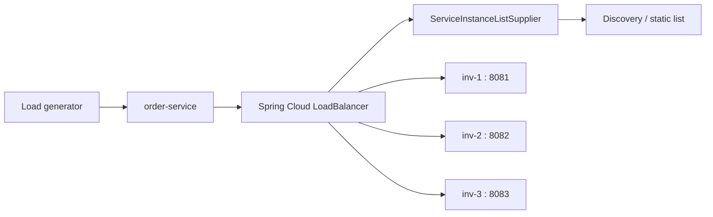

# Comparing round-robin and random with proper measurements

## 1. Context and goals

In the **Selection Algorithms** chapter of the `SPRING_CLOUD_SERVICE_COMMUNICATION_LOAD_BALANCING` module, Spring Cloud LoadBalancer selects a `ServiceInstance` for the service ID called by the application. The two basic selection methods are **Round Robin** (alternating) and **Random**. Both can integrate with `RestClient`, `WebClient`, or OpenFeign, and both rely on the instance list provided by `ServiceInstanceListSupplier`.

The learning question is not only “which algorithm distributes more evenly?” but also **which measurement allows answering the question properly**. An uncontrolled benchmark easily leads to wrong conclusions: Random can produce a skewed distribution in a small sample even when the algorithm is working correctly; Round Robin can divide *selection* counts evenly while still producing unequal *in-flight* request counts; errors, retries, and health checks can make the observed distribution look completely different from the initial distribution.

After this lesson, you will be able to:

1. Accurately describe Round Robin and Random over the same set of eligible instances.
2. Design a reproducible experiment holding topology, load, discovery, caching, and retries constant.
3. Measure **instance selection counts**, distribution skew, success rate, latency, and throughput in the right units.
4. Explain Random's statistical variance versus genuine signs of anomaly.
5. Compare results at low load, high load, and when the instance count changes.
6. Choose an algorithm based on operational goals rather than a single request-count chart.

## 2. What do the algorithms actually do?

Suppose `order-service` calls `http://inventory-service/api/inventory/ABC-1`. Discovery or a preconfigured list returns three instances:

| Instance | Example address | Assumed capacity |
|---|---|---|
| `inv-1` | `localhost:8081` | Equal |
| `inv-2` | `localhost:8082` | Equal |
| `inv-3` | `localhost:8083` | Equal |

The primary measurement target is how LoadBalancer picks one of the three instances, **before** the HTTP client starts connecting. The example keeps the list stable and disables retries.



### 2.1. Round Robin

`RoundRobinLoadBalancer` is Spring Cloud LoadBalancer's default in standard configurations. With a fixed list `[A, B, C]`, consecutive selections take the form:

```text
Request:  1  2  3  4  5  6  7  8  9
Instance: A  B  C  A  B  C  A  B  C
```

Simple mental model:

```text
instance = instances[position % instances.size()]
position = position + 1
```

This is a conceptual model of alternating behavior, not the library's source code. Given `N` selections and `m` stable instances, each instance receives roughly `N/m` turns; the maximum difference in selection counts between instances is 1 in the ideal sequential model.

**Counter scope matters:** Spring Cloud LoadBalancer creates a context per service ID inside each calling application. Multiple replicas of `order-service` do not necessarily share a cluster-wide Round Robin counter. Each process selects using its local state and the list it knows. Instance order changes, restarts, zone/health filtering, or retries can make the observed sequence differ from the ideal example.

### 2.2. Random

`RandomLoadBalancer` picks a random index from the currently available instance list. With three equivalent instances, each ideal selection has probability:

\[
P(A)=P(B)=P(C)=\frac{1}{3}.
\]

A completely valid sequence might look like:

```text
Request:  1  2  3  4  5  6  7  8  9
Instance: B  B  A  C  B  A  B  C  C
```

There are stretches where one instance appears repeatedly; that **does not by itself prove** the algorithm is buggy. If selections are independent, each instance has equal probability, and the list is stable, the count for instance `i` in `N` selections follows a marginal binomial distribution:

\[
X_i\sim\mathrm{Binomial}\left(N,\frac1m\right),\qquad
E[X_i]=\frac Nm,\qquad
SD(X_i)=\sqrt{N\frac1m\left(1-\frac1m\right)}.
\]

The `X_i` variables are not independent of one another because their sum is always `N`. This is the mathematical model for **equiprobable Random over a fixed candidate set**; if a supplier applies filtering, weights, or per-request list changes, a different model must be constructed.

### 2.3. Neither algorithm solves everything

| Question | Round Robin | Random |
|---|---|---|
| Selection rule | Alternates by position | Picks randomly over the list |
| When list is unchanged | Very even selection counts | Even **in expectation**, with variance |
| With only a few requests | Usually balanced right away | Can skew noticeably |
| Automatically measures CPU, queue, processing time? | No | No |
| Automatically removes failing instances? | No; depends on discovery/supplier/health check | Same |
| Automatically retries on connection error? | No; retry is a separate mechanism | Same |
| Automatically picks by zone, metadata, weight? | No; requires corresponding supplier/policy | Same |
| Usable with RestClient/WebClient/OpenFeign? | Yes | Yes |

**Distributing selection counts evenly does not equate to distributing work evenly.** If one instance processes more slowly or has lower capacity, the number of concurrent requests waiting on it can be higher even when both Round Robin and Random distribute call counts nearly equally.

## 3. Choosing metrics based on the question to answer

Before opening a benchmark tool, define the quantities to measure and how to interpret them:

| Question | Appropriate metric | Measurement source | Caveat |
|---|---|---|---|
| Does the algorithm select evenly? | `selection_count` per instance; share `n_i/N` | LoadBalancer selection events at the caller | Successful responses may miss failed selections |
| How large is the skew? | `max_relative_deviation`, coefficient of variation `CV` | `n_i` values after warm-up | Especially noisy when `N` is small |
| Are users getting good responses? | Success/error rate and latency p50, p95, p99 | Load generator and server | Must count errors/timeouts separately; avoid looking only at successful responses |
| Can it sustain the load? | Achieved throughput, RPS per instance, in-flight requests | Load generator, HTTP server, and metrics | Throughput depends on server, network, load, and client config |
| Is there local overload? | In-flight requests, queue length, CPU, memory, connections | Per-instance metrics | Neither algorithm uses these metrics natively |
| How does the system react to failures? | Failure rate, time to detect failure, retries, instances still in list | Logs, traces, discovery, health checks | Measure separately because test conditions have changed |

### 3.1. Distribution skew

Let `n_i` be the **selection count** for instance `i`, `N=\sum_i n_i`, and `m` be the number of eligible instances; under a uniform distribution, each instance is expected to receive `\mu=N/m`.

Each instance's share:

\[
s_i=\frac{n_i}{N}.
\]

Maximum relative deviation from the expected count:

\[
D_{\max}=\max_i\left(\frac{|n_i-\mu|}{\mu}\right).
\]

Coefficient of variation (using **population** standard deviation, because we are comparing all `m` instances in the target set):

\[
CV=\frac{\sqrt{\frac{1}{m}\sum_{i=1}^{m}(n_i-\mu)^2}}{\mu}.
\]

**Interpretation:** `CV=0` means all counts are equal. Higher `CV` means greater skew in selection counts. Use the same `N`, `m`, and experimental conditions when comparing; the `CV` of a few dozen requests should not be compared directly to the `CV` of tens of thousands of requests.

If the instance count changes mid-run, the expectation `N/m` **no longer applies intact**: you must split results into intervals with the same candidate set or track how often an eligible instance was selected within each interval.

### 3.2. Statistical example before measuring

With three instances and 3,000 selections, all healthy and an unchanged list:

- **Ideal Round Robin:** `(1000,1000,1000)`; `CV=0`.
- **Random:** the expectation for each instance is still `1000`, while the standard deviation under the binomial model is `\sqrt{3000(1/3)(2/3)}\approx25{,}82` selections.
- The reference range `1000\pm1{,}96\times25{,}82`, roughly `949–1051`, is **approximately 95% for the selection count of one specific instance** under the model's assumptions; it is not a simultaneous guarantee for all three instances at once.
- A **simulated illustrative** Random result, `(968,1009,1023)`, sums to 3,000 with `D_{\max}=3{,}2\%` and `CV\approx2{,}33\%`. It is consistent with ordinary randomness; it is not evidence of a broken algorithm.

The relative share variance of Random decreases roughly as `1/\sqrt{N}` as selections grow, holding `m` constant. Thus, using 10 or 20 requests to conclude which algorithm is “fairer” is insufficient.

## 4. Setting up a fair comparison environment

Use three identically configured `inventory-service` instances and one `order-service` as the caller. Eureka, Consul, or Kubernetes can be substituted, but for a reproducible baseline experiment, use `SimpleDiscoveryClient` with a static list. Include a Spring Cloud BOM compatible with your Spring Boot version and the `spring-cloud-starter-loadbalancer` dependency. The examples below assume a Spring Framework version supporting `RestClient`.

Table of factors to hold constant:

| Factor | Setting for both measurement runs |
|---|---|
| Instance count | 3 identical instances, same service ID |
| List / discoverability | Fixed during a run, no restarts or scaling |
| Client | Same `RestClient` code, same HTTP transport configuration |
| Retry | Disabled in baseline so each request maps to one selection |
| Health checks and filtering | Do not alter the list; verify all three instances are eligible |
| Caching / discovery | Use the same mechanism and refresh timing; with SimpleDiscoveryClient, LB cache can be disabled |
| Business latency | Endpoint returns a small payload without DB queries or external service calls |
| Warm-up | Include a warm-up phase and discard warm-up data when aggregating |
| Load | Same RPS, duration, concurrency, client, and host machine |
| Load generator | Run in a separate environment if possible; verify no bottleneck on the generator |

### 4.1. Stable instance list at the caller

Example `application.yml` for `order-service`:

```yaml
spring:
  application:
    name: order-service
  cloud:
    discovery:
      client:
        simple:
          instances:
            inventory-service:
              - uri: http://localhost:8081
                instance-id: inv-1
              - uri: http://localhost:8082
                instance-id: inv-2
              - uri: http://localhost:8083
                instance-id: inv-3
    loadbalancer:
      cache:
        enabled: false
      retry:
        enabled: false

server:
  port: 8080
```

The three `localhost` addresses only work when all three instances and the caller run in the **same network/host environment**. In Docker, Kubernetes, or when the caller is on another host, replace them with addresses the caller can actually reach.

This configuration isolates the instance-selection experiment. When using a real registry, confirm the list returned by discovery stays stable between runs; looking at YAML alone is not enough to know the final list the supplier receives.

### 4.2. Endpoint returning instance identity

In `inventory-service`, assign a distinct ID to each process, e.g. `app.instance-id=inv-1` for port 8081, `inv-2` for 8082, and `inv-3` for 8083:

```java
@RestController
class InventoryController {
    private final String instanceId;

    InventoryController(Environment environment) {
        this.instanceId = environment.getRequiredProperty("app.instance-id");
    }

    @GetMapping("/api/inventory/{sku}")
    InventoryReply get(@PathVariable String sku) {
        return new InventoryReply(sku, instanceId);
    }
}

record InventoryReply(String sku, String instanceId) {}
```

Run each process with a distinct `server.port` and `app.instance-id`, keeping `spring.application.name=inventory-service` identical. Example JVM options:

```text
Instance 1: -Dserver.port=8081 -Dapp.instance-id=inv-1
Instance 2: -Dserver.port=8082 -Dapp.instance-id=inv-2
Instance 3: -Dserver.port=8083 -Dapp.instance-id=inv-3
```

In `order-service`, declare a LoadBalancer-enabled builder and a benchmark endpoint that forwards the response body:

```java
@Configuration(proxyBeanMethods = false)
class InventoryClientConfiguration {
    @Bean
    @LoadBalanced
    RestClient.Builder loadBalancedRestClientBuilder() {
        return RestClient.builder();
    }
}

@RestController
class InventoryProbeController {
    private final RestClient client;

    InventoryProbeController(@LoadBalanced RestClient.Builder builder) {
        this.client = builder.build();
    }

    @GetMapping("/bench/inventory/{sku}")
    InventoryReply check(@PathVariable String sku) {
        return client.get()
                .uri("http://inventory-service/api/inventory/{sku}", sku)
                .retrieve()
                .body(InventoryReply.class);
    }
}

record InventoryReply(String sku, String instanceId) {}
```

`InventoryReply` in both applications is merely an illustrative DTO, typically residing in separate packages/projects or a shared contract module. Add the appropriate Spring imports and a Java version supporting `record`. When accessing `http://localhost:8080/bench/inventory/ABC-1`, the response includes `instanceId` indicating which instance **replied successfully**.

### 4.3. Running Round Robin and Random with the same methodology

**Run A — Round Robin:** keep Spring Cloud LoadBalancer's default configuration, without registering an overriding `ReactorLoadBalancer<ServiceInstance>` bean for `inventory-service`.

**Run B — Random:** add dedicated configuration for `inventory-service` as guided by Spring Cloud Commons:

```java
@Configuration(proxyBeanMethods = false)
@LoadBalancerClient(
        name = "inventory-service",
        configuration = InventoryRandomLoadBalancerConfiguration.class)
class InventoryRandomSelection {
}

class InventoryRandomLoadBalancerConfiguration {
    @Bean
    ReactorLoadBalancer<ServiceInstance> randomLoadBalancer(
            Environment environment,
            LoadBalancerClientFactory factory) {
        String serviceId =
                environment.getProperty(LoadBalancerClientFactory.PROPERTY_NAME);

        return new RandomLoadBalancer(
                factory.getLazyProvider(
                        serviceId, ServiceInstanceListSupplier.class),
                serviceId);
    }
}
```

Required imports include `org.springframework.cloud.loadbalancer.annotation.LoadBalancerClient`, `org.springframework.cloud.loadbalancer.core.RandomLoadBalancer`, `org.springframework.cloud.loadbalancer.core.ServiceInstanceListSupplier`, `org.springframework.cloud.loadbalancer.support.LoadBalancerClientFactory`, `org.springframework.cloud.client.ServiceInstance`, and `org.springframework.cloud.client.loadbalancer.reactive.ReactorLoadBalancer`. Verify exact imports/APIs against your chosen Spring Cloud Release Train.

To prevent custom configuration from applying to other service IDs, `InventoryRandomLoadBalancerConfiguration` is **not annotated with `@Configuration`** and is not picked up by component scan as a global configuration. `@LoadBalancerClient` loads it into the context corresponding to `inventory-service`.

You can put the two configuration variants into two separate profiles or run two corresponding caller builds. If using two profiles, verify the Round Robin profile does not register the Random bean, while the Random profile actually replaces `ReactorLoadBalancer`. **Do not assume** a YAML property like `spring.cloud.loadbalancer.algorithm=random` is an official property if the current Release Train does not publish that key.

For `WebClient` and OpenFeign, instance selection still happens through LoadBalancer when properly integrated, but measurements should keep **one fixed client type** within each experiment pair. Comparing `RestClient`/Round Robin against `WebClient`/Random mixes HTTP stack differences into algorithm differences.

## 5. Quick distribution check with sequential requests

This is a configuration verification step, **not a performance benchmark**. With PowerShell, call the endpoint 300 times and group by ID:

```powershell
$instanceIds = 1..300 | ForEach-Object {
    (Invoke-RestMethod "http://localhost:8080/bench/inventory/ABC-1").instanceId
}

$instanceIds | Group-Object | Sort-Object Name |
    Select-Object Name, Count
```

With Round Robin and a stable three-instance list without retries, you can expect roughly `100` successful responses from each instance. With Random, the numbers will fluctuate around 100. Verify that all 300 calls completed successfully; if any failed, the tallied response counts **no longer** equal the total number of selections.

You can run several separate batches to see that Random does not repeat the exact same distribution. Compute `CV` and `D_{\max}` using the formulas above. Do not draw conclusions about latency or load capacity from this sequential request script.

## 6. Steady-load measurement with k6

To evaluate under load, use a tool such as k6, Gatling, JMeter, or a benchmark tool capable of generating a controlled request rate. The example below uses k6 with **constant-arrival-rate** to maintain a fixed request rate; the lesson on algorithms does not depend specifically on k6.

The illustrative script below sends 50 requests per second for 5 minutes after the application has warmed up and separates HTTP errors from successful responses by instance ID.

```javascript
import http from "k6/http";
import { check } from "k6";
import { Counter } from "k6/metrics";

export const successfulResponsesByInstance =
    new Counter("successful_responses_by_instance");

export const options = {
    scenarios: {
        steady: {
            executor: "constant-arrival-rate",
            rate: 50,
            timeUnit: "1s",
            duration: "5m",
            preAllocatedVUs: 100,
            maxVUs: 250
        }
    },
    thresholds: {
        http_req_failed: ["rate<0.01"],
        "successful_responses_by_instance{instance:inv-1}": ["count>=0"],
        "successful_responses_by_instance{instance:inv-2}": ["count>=0"],
        "successful_responses_by_instance{instance:inv-3}": ["count>=0"]
    }
};

export default function () {
    const response = http.get(
        "http://localhost:8080/bench/inventory/ABC-1"
    );

    const ok = check(response, {
        "HTTP 200": (r) => r.status === 200
    });

    if (ok) {
        try {
            const instanceId = response.json("instanceId");
            if (instanceId) {
                successfulResponsesByInstance.add(1, {
                    instance: String(instanceId)
                });
            }
        } catch (e) {
            // Response missing valid JSON: keep parsing errors separate from HTTP errors.
        }
    }
}
```

Example run commands:

```bash
k6 run --summary-export=rr-summary.json bench.js
k6 run --summary-export=random-summary.json bench.js
```

Run each command after `order-service` has been started with the corresponding algorithm configuration, and perform **multiple independent runs**. `bench.js` here is an assumed filename for the script you save during practice, not a pre-created file provided by the lesson.

**How to read the output:** use built-in metrics such as `http_req_duration` (p50/p95/p99), `http_reqs`, `http_req_failed`, `iterations`, `dropped_iterations`; view per-instance counters via sub-metrics/tags in thresholds or export data to an analytics backend. `successful_responses_by_instance` counts **successful responses returned**, not all instance selections. In a baseline where every request succeeds with no retries, no timeouts, and 1 request per instance, it is a close enough proxy to analyze distribution. Once errors or retries appear, caller-side selection events must also be used.

A run with `dropped_iterations>0` means the generator could not sustain the configured rate. In that case, the comparison must record both **offered RPS** and **achieved RPS**, scale the generator capacity, or evaluate system limits before interpreting.

### 6.1. Capturing actual *selections*, including failed requests

When you want to know which instance the algorithm chose even when connections fail, instrument `order-service`. Spring Cloud LoadBalancer provides `LoadBalancerLifecycle` callbacks such as `onStart`, `onStartRequest`, and `onComplete`. You can log service ID, instance ID, selection timestamp, and outcome, then correlate via trace/correlation ID.

Per-instance selection counts must be recorded once LoadBalancer has chosen a `ServiceInstance`, before depending on the HTTP response. Use the exact same metrics/logs in both test runs; do not rely solely on request logs from healthy instances. If retries are enabled, record **attempts** per instance separately from **logical requests**, because one business request can produce multiple selections.

### 6.2. Performance metrics to include in the report

- **End-to-end latency:** p50, p95, p99, mean; measured from the load-generating caller through `order-service` to the final response. Include unit (ms) and sample count.
- **Throughput:** successful requests per second and total requests sent; also record error rate.
- **Per-instance throughput and in-flight:** reveals which instance is actually busier even if selection counts look equal.
- **HTTP client timings:** connect timeout, read/response timeout, connection pool, keep-alive, retry count; these factors easily mask algorithmic differences.
- **Resources:** CPU, GC, heap, thread count, and processing queue on each instance.
- **Candidate list:** supplier snapshots/logs at each stage, especially if discovery, caching, or health checks are enabled.

If latency data only includes successful requests, you may inadvertently exclude the slowest requests that timed out. Therefore, always publish timeout/error rates alongside latency percentiles, and account for failed requests separately.

## 7. Experiment design and error control

For reproducible results, follow the exact same sequence of steps for both variants:

1. **Check infrastructure:** all three instances are ready; identical binary and configuration (except port/instance ID); no traffic from other systems.
2. **Verify active algorithm:** observe the first few requests in each configuration; Round Robin alternates, Random has no fixed cycle. When needed, inspect the `ReactorLoadBalancer` bean for the corresponding service ID.
3. **Warm-up:** call the endpoint before the measurement window to stabilize class loading/JIT, connection pools, and active caches. Exclude warm-up data from the report.
4. **Distribution baseline:** run at least several thousand requests at low load, zero errors, zero retries; compute `CV` and `D_{\max}`.
5. **Target load:** run the same RPS and duration for both algorithms. Step up load gradually (e.g., 20, 50, 100 RPS) while both servers and generator retain headroom.
6. **Repeat:** at least three runs per variant; alternate test order across rounds, such as RR → Random → Random → RR, to reduce bias from environment warm-up or background load drift.
7. **Control measurement rounds:** reset or partition counters, align metric collection windows, record JDK/Spring versions, replica count, retry/timeout settings, and timestamps.
8. **Report:** output selection counts (if available), successful responses, error rate, p50/p95/p99, achieved RPS, dropped iterations, and per-instance resource metrics.

### 7.1. Open load vs. closed load

A generator using a *closed-loop* model typically sends the next request only after the previous request finishes. When the system slows down, the sending rate drops automatically, which can hide overload. k6's `constant-arrival-rate` schedules requests on a preset cadence, useful when testing the same **offered load**; you must still ensure the generator has enough VUs and monitor dropped iterations.

If the goal is purely to verify selection counts, a sequential call loop suffices. If the goal is to compare tail latency and throughput, use open load (by RPS) and optionally add a concurrency-limited experiment, but **do not mix** data from the two models to draw a single conclusion.

### 7.2. Random and statistical significance

Do not run each algorithm once and declare a variant with a 2 ms lower p95 “better”. Latency is affected by GC, CPU scheduler, connection reuse, network, and timing jitter. Across multiple runs, compare medians or distributions of the per-run metric; when needed, estimate confidence intervals via bootstrapping suited to the data structure rather than treating every request within a single run as strictly independent observations.

For Random's selection counts, use the binomial expectation and standard error as an initial baseline. For example, with three instances and 3,000 selections, a difference of a few dozen selections is normal. Only judge the algorithm biased after ruling out list changes, insufficient sample size, retries, weights, observation errors, and random variance.

## 8. Example results table and interpretation

The following table is **hypothetical data for practicing result interpretation**, not an executed benchmark:

| Algorithm | Total selections | `inv-1` | `inv-2` | `inv-3` | Selection `CV` | Error rate | p95 (ms) | Achieved RPS |
|---|---:|---:|---:|---:|---:|---:|---:|---:|
| Round Robin | 3,000 | 1,000 | 1,000 | 1,000 | 0% | 0% | 29 | 50 |
| Random | 3,000 | 968 | 1,009 | 1,023 | 2.33% | 0% | 28 | 50 |

**What can be concluded:** under the zero-error, fixed-list conditions of this hypothetical table, Round Robin splits selections evenly; Random fluctuates slightly within what the probability model allows. **What cannot yet be concluded:** that Random has better p95 performance or that the two algorithms have different load capacities, because the table represents a single run, a 1 ms difference is small, and there are no repetitions or confidence intervals.

If after five runs Round Robin consistently shows lower `CV` than Random on a stable three-instance set, that is an expected result regarding **selection count evenness**. To claim which algorithm is better for the application, you must examine p95/p99, throughput, error rate, and actual per-instance load.

### 8.1. When instances have unequal processing times

Suppose `inv-1` typically responds in 10 ms, `inv-2` in 50 ms, and `inv-3` in 100 ms. Both algorithms can still select the three instances at roughly a 1:1:1 ratio. At any instant, in-flight requests at `inv-3` can build up higher, and tail latency is dominated by the slow instance. Round Robin **does not avoid** slow instances automatically, and neither does Random.

In an advanced lesson, try a capacity-weighted supplier or an appropriate routing mechanism. When changing weights, stop using the `N/m` expectation: expected shares must be derived from the new weights/policy. Also distinguish weighted selection from the pure round-robin/random algorithms compared in this lesson.

### 8.2. When an instance fails

At the moment `inv-2` is stopped or marked unhealthy, test two separate scenarios:

1. **List not yet updated:** LoadBalancer still selects `inv-2` and the HTTP client may receive connection errors or timeouts. With retries disabled, errors are directly visible; successful response counts no longer reflect all selections.
2. **List updated:** the supplier only contains `inv-1` and `inv-3`. Round Robin alternates over the new set; Random picks randomly over the new set. Compare against a two-instance expectation for the **post-update phase**, rather than merging it with the three-instance period into a single calculation.

This lesson does not predict how long it takes to evict an instance from the list: that timing belongs to discovery, caching, and health checks. When enabling retries in a subsequent lesson, each logical request may re-select the same instance or pick another, so attempt metrics must be kept separate from request metrics.

## 9. Measurement mistakes that lead to wrong conclusions

| Mistake | Why it is wrong | How to fix |
|---|---|---|
| Using 10 requests to judge Random as skewed | Random variance on small samples is normal | Increase `N`, inspect expectation/error bars and multiple runs |
| Counting each successful response as a selection | Errors, timeouts, and retries drop or multiply selections | Instrument selections at the caller; count responses separately |
| Comparing 3 instances in RR vs. 2 in Random | Different candidate sets invalidate the expectation | Keep fixed or segment phases by list |
| Comparing different clients, load levels, or machines | Fails to isolate the algorithm variable | Hold config, binary, load, and environment identical |
| Enabling retries on only one run | Alters attempt counts and selected instances | Disable retries in baseline; measure retries in a separate test |
| Skipping warm-up | JIT/class loading/pools skew early measurements | Discard warm-up from results |
| Comparing average latency only | Averages hide slow requests and timeouts | Inspect p50, p95, p99, errors, and resources |
| Reading p99 with too few requests | Tail sample is tiny, huge variance | Increase sample size, repeat, and report uncertainty |
| Ignoring dropped iterations | Actual offered load is below target | Record offered and achieved RPS; scale generator capacity |
| Forgetting caller has multiple replicas | Round Robin counters are per-process/context, not global | Inspect per-caller and aggregate across replicas |
| Ignoring zone/health/hint/weights | Suppliers can filter or prioritize instances | Observe the eligible list and active policy |

## 10. End-to-end lab exercises

### Exercise 1 — Measure “fairness” at 30, 300, and 3,000 requests

Keep three instances healthy, retries off, and the same discovery list. Send 30, 300, and 3,000 requests sequentially for Round Robin and then Random. At each level, record successful requests, `n_i`, `CV`, and `D_{\max}`. Predict beforehand: Round Robin will have very low `CV` on a fixed list; Random will likely have higher relative skew at 30 and stabilize as counts grow.

Question: if Random sends 15/30 requests to one instance, is that a bug or a plausible outcome? Use the probability model to explain before checking the numbers.

### Exercise 2 — Compare latency at three load levels

Set 20, 50, and 100 RPS and measure both variants for the same duration with the same application code. Record achieved throughput, error rate, p50/p95/p99, and per-instance CPU. If the system fails to reach 100 RPS, identify whether the bottleneck is in the generator, caller, or inventory service. Do not declare a “winner/loser” from a single p95 value.

### Exercise 3 — Separate *selection* distribution from *outcome* distribution

Make `inv-2` return HTTP 503 for a portion of requests, **without changing the list** during the initial phase. Add instance-selection logging at the caller. Compare three series: instance selections, successful responses per instance, and error responses. Explain why looking only at successful requests makes the distribution appear uneven even though the algorithm still divides selections as designed.

### Exercise 4 — Controlled topology change

Stop `inv-3`, wait for discovery/health checks to reflect the change, then run a new measurement with two instances. Compare Round Robin and Random during the two-instance period, then restore `inv-3` and measure again. Note the timestamp when the list changed and explain why selections from periods with different instance counts must not be combined into a single `N/3` calculation.

## 11. Completion criteria and usage decisions

A satisfactory report should include:

- Service ID name, instance count, Spring Boot/Cloud version, HTTP client used, and how each algorithm was enabled.
- Evidence that both runs had the **same eligible instance list**, or separate analysis per interval when the list changed.
- Per-instance selection counts, total `N`, `CV`, `D_{\max}`, and an explanation of Random's stochastic error.
- Successful/failed response counts, throughput, p50/p95/p99, and dropped iterations.
- At least three runs per variant, along with load and environment conditions.
- A conclusion bounded by what was measured: selection evenness, response quality, and remaining confounding factors.

**Practical selection guidance:** Round Robin is usually an intuitive starting point for instances of similar capacity requiring even selection counts and a reasonably stable list. Random has simple behavior, even distribution **in expectation**, and is sometimes suitable when an ordered alternating cycle is unnecessary. If instances vary in capacity, zone optimization is needed, hot nodes must be avoided, or latency responsiveness is required, evaluate a more suitable policy/`ServiceInstanceListSupplier`; do not expect merely switching Round Robin to Random to solve those issues.

## References

- [Spring Cloud Commons — Spring Cloud LoadBalancer](https://docs.spring.io/spring-cloud-commons/reference/spring-cloud-commons/loadbalancer.html): default `RoundRobinLoadBalancer`, `RandomLoadBalancer`, `@LoadBalancerClient`, HTTP client integration, and supplier customization.
- [Spring Cloud — Projects and Release Train](https://spring.io/projects/spring-cloud/): selecting the Spring Cloud version compatible with Spring Boot.
- [k6 — Constant arrival rate](https://grafana.com/docs/k6/latest/using-k6/scenarios/executors/constant-arrival-rate/): generating load at a specified arrival rate.
- [k6 — Metrics](https://grafana.com/docs/k6/latest/using-k6/metrics/reference/): meanings of request, error, and latency metrics.

When cross-referencing Spring Cloud documentation, use the page for the **exact version branch** resolved by your application, because APIs or configuration properties may change across Release Trains. This lesson introduces a measurement methodology portable from `RestClient` to `WebClient` and OpenFeign, provided the HTTP client type stays fixed within each comparison.
