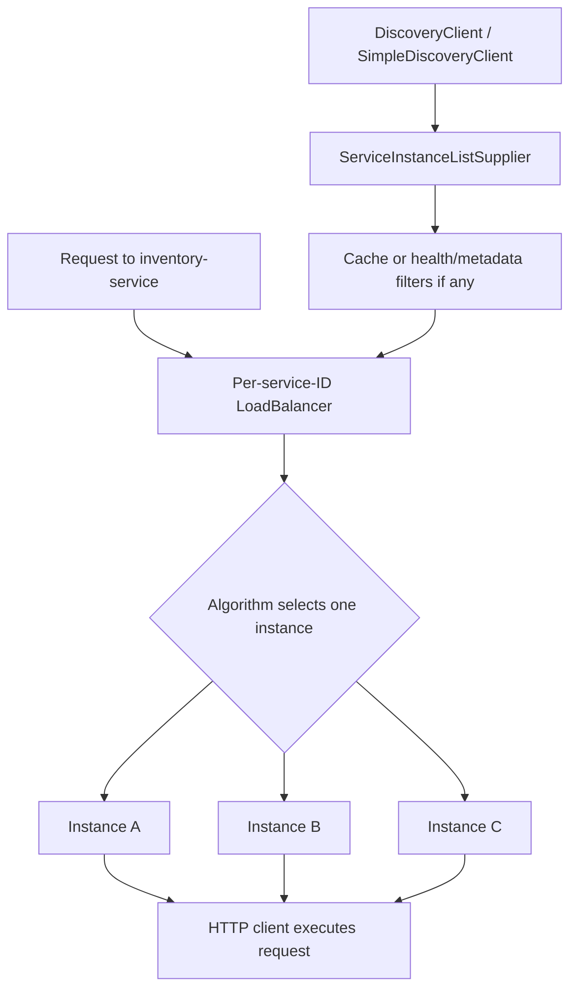
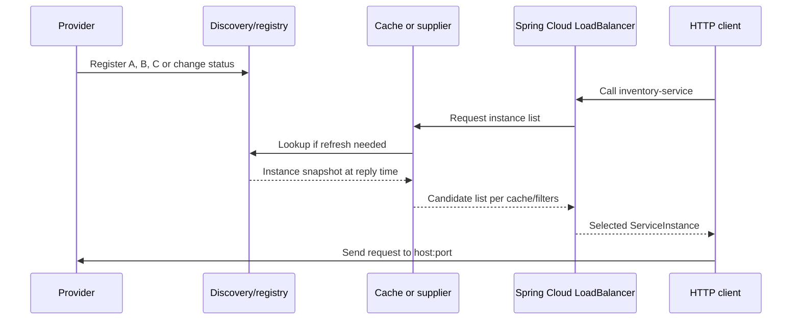

# Impact of replica count and continuously changing instance lists

In microservices systems, the number of replicas (**instances**) of a given service is not fixed. The deployment platform may add instances when load increases, remove instances when scaling down resources, replace failed instances, or rotate endpoints during a rolling update. Spring Cloud LoadBalancer selects a `ServiceInstance` on the client side for each selection, based on the **instance list visible to the client at that moment**. Consequently, when the list's count, order, or state changes, target selection results can change even when the HTTP calling code remains untouched.

This lesson focuses on the relationship between the instance list, algorithms like Round Robin or Random, discovery/cache/health-check mechanisms, and the resulting request distribution. The goal is to anticipate phenomena during scale-out and scale-in, handle errors when the list has not yet refreshed, and understand the limitations of selection algorithms in Spring Cloud LoadBalancer.

## 1. Instance list as seen from the client side

Suppose `order-service` calls `inventory-service` via the logical URL:

```text
http://inventory-service/api/v1/items/42
```

On the client side, a `ServiceInstanceListSupplier` supplies the instance list for service ID `inventory-service`:

| Service ID | Instance | Host:port | Example state |
|---|---|---|---|
| `inventory-service` | A | `10.0.1.11:8080` | Receiving requests |
| `inventory-service` | B | `10.0.1.12:8080` | Receiving requests |
| `inventory-service` | C | `10.0.1.13:8080` | May be added on scale-out |

These represent **one logical service**. LoadBalancer does not send a request simultaneously to the entire list; normally it picks **one** instance for a request attempt, and then the HTTP transport connects to the corresponding host and port.



Processing order in the supplier chain depends on configuration; the diagram merely depicts responsibilities. In Spring Cloud LoadBalancer, `RoundRobinLoadBalancer` and `RandomLoadBalancer` are common choices. They typically receive the **current list** from the supplier and select a position within it. The list can differ over time and across client replicas.

### Actual replica count vs. client-visible replica count

Let:

- `N_actual(t)`: number of instances actually running and capable of receiving requests at time `t`.
- `N_visible(t)`: number of instances in the list a client receives after discovery, caching, and filters at time `t`.

The two values are **not necessarily equal**. When a provider has just been added or stopped, new information takes time to propagate through the registry, watchers, caches, or health checks. One client may still see the old list while another already has the new list.

| Timestamp | Actual active instances | Client 1 sees | Client 2 sees |
|---|---|---|---|
| `t0` | A, B | A, B | A, B |
| `t1`: C just added | A, B, C | A, B | A, B, C |
| `t2`: info propagated | A, B, C | A, B, C | A, B, C |
| `t3`: B just stopped | A, C | A, B, C | A, C |

This example illustrates propagation delay without prescribing exact timings. How fast or slow propagation is depends on the discovery provider, caching, health probes, network connectivity, and deployment configuration.

## 2. Round Robin when instance count is fixed

**Round Robin** (sequentially around a cycle) picks the next position in the list and wraps back to the beginning after the last element. With a list of `n > 0` instances, the selected position can be visualized as:

\[
i = p \bmod n
\]

Where `p` is the incrementing selection counter and `i` is the zero-based index in the list. This is an **illustrative behavioral model**. Real implementations may use an atomic counter and initialize starting positions differently to prevent multiple clients from syncing in lockstep; you should not rely on the first request always picking the first element of the list.

For example, during a window where the list keeps the order `[A, B, C]`:

| Illustrative `p` value | `p % 3` | Selected instance |
|---:|---:|---|
| 0 | 0 | A |
| 1 | 1 | B |
| 2 | 2 | C |
| 3 | 0 | A |
| 4 | 1 | B |
| 5 | 2 | C |

Without filters, retries, list changes, or other configuration, many **consecutive selections on the same load balancer object** tend to spread evenly across instances in the list. That does not automatically mean successful request counts, connection counts, CPU, or processing times on the instances are completely equal.

Why?

- Requests have varying costs; a simple lookup is not equivalent to a request running a heavy database query.
- Requests can fail or be retried, causing selection counts to differ from completed business requests.
- An application can have multiple client replicas; each replica has its own counter and list. There is no global Round Robin counter across clients.
- Health, zone, sticky session, or metadata filters can cause candidate lists to differ between selections.
- Some clients reuse network connections, so **TCP connection** distribution is not **instance selection** distribution.

## 3. Scale out: from two to three instances

Initially, the client has the list:

```text
[A, B]
```

After the platform deploys instance C and discovery/supplier updates successfully:

```text
[A, B, C]
```

Assuming requests are selected in sequence by a continuous counter and existing instance order is preserved:

| Selection | List seen by client | `p` | List-based index | Instance |
|---|---|---:|---:|---|
| Before scale-out | [A, B] | 0 | 0 | A |
| Before scale-out | [A, B] | 1 | 1 | B |
| After scale-out | [A, B, C] | 2 | 2 | C |
| After scale-out | [A, B, C] | 3 | 0 | A |
| After scale-out | [A, B, C] | 4 | 1 | B |
| After scale-out | [A, B, C] | 5 | 2 | C |

The algorithm can bring C into the selection cycle as soon as the supplier starts returning a list containing C. Usually **no client restart is required** if discovery and supplier are configured to receive updates; with a static list read from ordinary configuration, adding C requires updating the configuration and a corresponding reload mechanism.

### Does load drop proportionally to instance count?

If total request rate to the service is `λ` requests/second, instances have equivalent capacity, and selection is nearly uniform, the average load by request count per instance is approximately:

\[
\text{requests/second/instance} \approx \frac{\lambda}{n}
\]

For example, with `λ = 120` requests/second: two instances may receive around 60 requests/second each, whereas three instances may receive around 40 requests/second. This is an **estimate of selection counts under ideal conditions**, not a performance guarantee. During scale-out, clients also need to learn about C; C also needs to finish startup, accept connections, and warm up caches or connection pools before handling normal load.

In addition, if the fraction of clients seeing C grows gradually over time, C may initially receive fewer requests than the two older instances. Do not expect distribution to shift from 50/50 to 33/33/33 the exact moment resources are provisioned.

## 4. Scale in: from three down to two instances

Suppose B is removed from the candidate set, changing the list from `[A, B, C]` to `[A, C]`. With Round Robin, the counter may keep incrementing, but the modulo operation now uses `n = 2`. Each selection's index will be computed against the **new list**.

| Selection | Current list | `p` | Index | Instance |
|---|---|---:|---:|---|
| Before scale-in | [A, B, C] | 2 | 2 | C |
| Before scale-in | [A, B, C] | 3 | 0 | A |
| After scale-in | [A, C] | 4 | 0 | A |
| After scale-in | [A, C] | 5 | 1 | C |
| After scale-in | [A, C] | 6 | 0 | A |

Thus, the selection cycle does not necessarily “continue” along a fixed instance-name order. When element count changes, the same counter value maps through a different modulo; two consecutive selections can easily land on the same instance. That **is not evidence that Round Robin is broken**.

### List order changes also matter

Not only count, but element **order** also matters for index-based selection. The following two lists contain the same set of instances in different orders:

```text
[A, B, C]
[C, A, B]
```

If the selection position is index 0, the first list selects A while the second selects C. A discovery provider or supplier chain may regenerate the list in a different order when instances register, deregister, or get filtered. Do not assume a fixed order if the system does not provide that guarantee.

In real systems, some requests may have **already selected B before B was removed**. Only afterward does B stop or stop accepting requests. Those in-flight connections may still succeed, be rejected, or time out depending on how infrastructure handles graceful shutdown. Removing B from the new list only prevents future selections; it does not automatically abort running requests.

## 5. `RandomLoadBalancer` when the list changes

**Random** picks a random position in the current list. With `n` instances treated equally, one selection has a theoretical probability near `1/n` for each instance (assuming uniform, unweighted selection).

| Candidate list | Selection probability per instance in one turn |
|---|---|
| [A] | 100% selects A |
| [A, B] | About 50% for each instance |
| [A, B, C] | About 33.3% for each instance |
| [A, C] after removing B | About 50% for A and C |

When the list changes, the per-turn probability also changes. There is no counter to preserve as in Round Robin, yet Random can select the same instance multiple times consecutively. For example, with two instances and independent random choices, the sequence `A, A, A, B` can completely occur.

| Criterion | Round Robin | Random |
|---|---|---|
| Selection method | Based on counter position modulo list length | Picks a random index in the list |
| Fixed list | Sequential selections usually alternate | Nearly even distribution given enough turns |
| When `n` changes | Maps counter to new index; may repeat or skip expected instance names | Each instance's probability changes immediately upon seeing the new list |
| Depends on list order | Yes, because it selects by index | With uniform probability, less sensitive to order |
| Guarantees equal actual request counts | No | No |

Both algorithms select from the **current candidate set**. If the supplier returns an empty list, neither algorithm has an instance to select. Depending on the HTTP client and LoadBalancer integration, this situation may turn into a selection failure, exception, or HTTP 503; do not depend on a single error message.

## 6. Discovery, caching, and health checks decide which list is selected from

A typical flow in Spring Cloud LoadBalancer is:



Depending on configuration, discovery is updated via polling, watch, or platform-specific mechanisms. Suppliers can cache the list, and multiple cache layers may exist (discovery client, Spring Cloud LoadBalancer, or infrastructure). Therefore, there is no single “system-wide refresh moment”.

### Caching retains stale lists for a period

If the supplier caches `[A, B]`, then even after C has registered in discovery, LoadBalancer may still select only from A and B until the cache refreshes. Likewise, if B has stopped while the cached list is still `[A, B, C]`, some selections may continue targeting B.

Properties such as `spring.cloud.loadbalancer.cache.enabled` help control LoadBalancer's cache depending on version/configuration. Do not blindly disable caching for “instant updates”: the discovery provider might also cache, and overly frequent queries can overload the registry. Understand the actual refresh mechanism, rate of change, and system stability needs.

### Health filters alter the candidate set

`HealthCheckServiceInstanceListSupplier` or discovery status filters can exclude instances that fail health checks. When B is still registered but unhealthy, the list fed to the selection algorithm may be `[A, C]` instead of `[A, B, C]`.

That means the number of **selected instances** can drop even before the system scales in. Health checks also need time to detect and propagate; do not assume every request after an instance fails immediately avoids it.

Some supplier chains include caching, zone filtering, metadata filtering, sticky-session, or request-based filtering. The order and combination of suppliers must be designed carefully, because the final list is what the algorithm actually uses.

## 7. Consequences for retries, timeouts, and open connections

In inter-service communication, successfully selecting an instance **does not mean** the HTTP request will succeed. Three distinct moments must be separated:

1. **Before target selection:** discovery or supplier returns an empty, stale, or incomplete list.
2. **After selection, before receiving a response:** the instance stops, the port stops listening, or the network disconnects.
3. **After the server has processed the request:** the response may be lost, causing a client-side timeout even though the server completed the business action.

When instances change continuously, errors may spike temporarily. Coordinate:

- **Readiness and graceful shutdown:** instances are advertised only when ready, removed from routing before stopping request acceptance, and given time to finish in-flight requests.
- **Health checks:** reduce the probability of picking genuinely unhealthy instances; health is only a point-in-time signal.
- **Connect/read timeouts:** avoid holding threads or resources waiting too long when an instance has stopped serving.
- **Bounded retries:** for safe operations or those with idempotency mechanisms, retries can try again after connection errors/timeouts; verify whether the client re-selects an instance.
- **Per-service-ID and per-instance observability:** log/trace the selected instance, error type, duration, and retry count to pinpoint where issues occur.

For requests creating orders, payments, or writing data, do not retry unconditionally. If the server already wrote data but the response was lost, a retry can create duplicate writes. Use an idempotency key or appropriate deduplication mechanism before enabling retries.

HTTP keep-alive and connection pools can also keep connections to old instances alive after the list changes. Load balancing typically decides the endpoint for a **request attempt**; the pool only reuses a matching connection if still usable. When analyzing, separate instance selection count, completed requests, and open sockets.

## 8. Hands-on example: changing the instance list while the application is running

The goal of this lab is to observe how list length and order affect Round Robin/Random with a fixed **service ID** `inventory-service`.

### 8.1. Providing an instance source for the learning environment

The client application uses `spring-cloud-starter-loadbalancer` with a Spring Cloud BOM compatible with Spring Boot; use `spring-boot-starter-web` if building a `RestClient` example. You can declare static instances with `SimpleDiscoveryClient` to start:

```yaml
spring:
  cloud:
    discovery:
      client:
        simple:
          instances:
            inventory-service:
              - uri: http://localhost:8091
              - uri: http://localhost:8092
```

Run two provider replicas on ports `8091` and `8092`. Each provider returns an `instanceId` or `serverPort` in its response so you can easily tell where requests land. Before testing via LoadBalancer, use `curl` to call each URI directly and verify the providers are running.

`SimpleDiscoveryClient` is handy for fixed-list experiments; editing the YAML file typically **does not mean** the list updates dynamically inside an already running process. For labs observing scale-out/scale-in **without restarting the client**, use a discovery provider or supplier with an explicit list-refresh mechanism, or test using a `ServiceInstanceListSupplier` whose input data you control.

### 8.2. Integrating RestClient with LoadBalancer

Example in a Spring Cloud version supporting `RestClient`:

```java
import org.springframework.cloud.client.loadbalancer.LoadBalanced;
import org.springframework.context.annotation.Bean;
import org.springframework.context.annotation.Configuration;
import org.springframework.web.client.RestClient;

@Configuration
class ClientConfig {
    @Bean
    @LoadBalanced
    RestClient.Builder loadBalancedRestClientBuilder() {
        return RestClient.builder();
    }
}
```

Gateway calling a URL containing the service ID:

```java
import org.springframework.stereotype.Service;
import org.springframework.web.client.RestClient;

@Service
class InventoryGateway {
    private final RestClient client;

    InventoryGateway(RestClient.Builder loadBalancedRestClientBuilder) {
        this.client = loadBalancedRestClientBuilder
                .baseUrl("http://inventory-service")
                .build();
    }

    String getItem(String id) {
        return client.get()
                .uri("/api/v1/items/{id}", id)
                .retrieve()
                .body(String.class);
    }
}
```

If the application has multiple `RestClient.Builder` beans, use `@Qualifier("loadBalancedRestClientBuilder")` at the constructor to pick the right builder. Do not create `new RestClient` or a regular builder and assume `http://inventory-service` will automatically route through Spring Cloud LoadBalancer.

### 8.3. Observation scenarios

Perform in sequence:

1. **Two instances:** leave the list as `[A, B]` and send 20–50 sequential requests. Record each response's `instanceId` and selection counts.
2. **Add C:** start provider C and add C to dynamic discovery/supplier. Confirm the returned list is `[A, B, C]` before evaluating distribution.
3. **Remove B:** mark B not ready or remove B from discovery. Wait until the client sees `[A, C]` then send new requests; note any in-flight requests if present.
4. **Change order:** in a controlled supplier environment, return `[C, A]` instead of `[A, C]` without changing the instance set, and watch how the Round Robin sequence shifts.
5. **Empty list:** set the supplier to `[]` and observe the “no instance available” error from the HTTP client.
6. **Compare Random:** if the Random algorithm is configured, repeat with a larger number of requests and observe statistical near-evenness without forcing each request to alternate.

Example result log:

```text
service=inventory-service selected=inventory-8091 status=200
service=inventory-service selected=inventory-8092 status=200
service=inventory-service selected=inventory-8093 status=200
service=inventory-service selected=inventory-8091 status=200
```

The log above is only an **illustrative result**, not fixed output. Initial position, requests from other callers, and supplier ordering can cause the sequence to differ.

### 8.4. Verify with snapshots instead of inferring from a few requests

Record simultaneously:

| Metric | Why it is needed |
|---|---|
| Service ID and request timestamp | Correlate the right service and scaling moment |
| Instance list returned by supplier | Know which set the algorithm selected from |
| Selected instance, host, and port | Identify the load-balancing decision |
| Started and completed request counts | Distinguish selections from successful requests |
| HTTP status, exception, timeout | Detect stale/unhealthy instances |
| Retry count and instance per attempt | Avoid counting retries as new business requests |
| Readiness/health status | Correlate errors with instance lifecycle phases |

If a tool only measures successful responses, a failing instance can “disappear” from the distribution table even while still being selected and causing requests to fail. Both **selections** and **errors** must be counted to avoid misjudging the algorithm.

## 9. Common mistakes when evaluating load distribution

| Misconception | Why it is inaccurate |
|---|---|
| “With three instances, requests always alternate A, B, C” | Only approximately true with Round Robin, a single caller, a stable list, and sequential selections |
| “Right after scale-out, clients see C immediately” | Discovery/caches have propagation delay; multiple clients may hold different snapshots |
| “Once B scales in, no requests go to B anymore” | Requests selected earlier or stale caches can still route to B |
| “List order does not matter” | Round Robin selects by index, so reordering can alter the selection sequence |
| “Random picking A three times in a row is a bug” | Random can select the same instance consecutively; a large enough sample is needed |
| “Equal request counts mean equal load” | CPU, latency, and processing cost per request can differ |
| “With health checks on, failing instances are never picked” | Health checks have lag; an instance can fail right after being selected |
| “Retry will always pick a different instance” | Depends on the configured retry policy of the HTTP client and LoadBalancer |

## 10. Design principles when replica counts change continuously

1. **Identify the instance source and refresh latency:** know which discovery/supplier/cache builds the list seen by the algorithm.
2. **Use stable service IDs:** clients call logical names; let discovery and LoadBalancer manage dynamic addresses.
3. **Understand the difference between count and order:** Round Robin computes the index from list length and order at the current selection.
4. **Measure distribution after stabilization:** also measure the transition period to spot stale caches, health lag, and connection errors.
5. **Coordinate readiness, draining, and graceful shutdown:** help remove instances from routing before full termination.
6. **Bound retries and timeouts:** control request-amplification cost, especially for non-idempotent operations.
7. **Log load-balancing decisions:** track service ID, candidate list, selected instance, status, and exceptions to isolate root causes.
8. **Do not treat Round Robin/Random as automatic load optimization:** if instance capacities are unequal or request costs vary widely, consider filters, weights, or specialized algorithms.

Changing instance counts is a normal situation in multi-service systems. Spring Cloud LoadBalancer can keep selecting a `ServiceInstance` from the new list without the application changing its logical URL. What determines operational quality is **whether the client-visible list is accurate and timely**, how the algorithm handles changing list length and order, and how discovery, health checks, timeouts, retries, and request observability are coordinated throughout scaling events.
