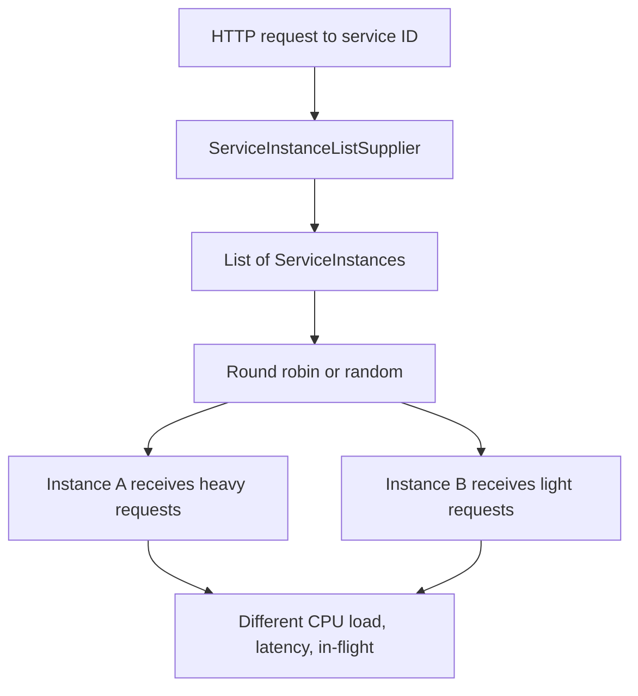

# Why distributing requests evenly does not guarantee distributing load evenly

When load balancing a microservice, we often expect two instances to receive roughly equal numbers of HTTP requests. However, **distributing request counts evenly only balances the number of dispatch turns**; it does not necessarily balance CPU, memory, I/O, in-flight requests, or wait time. A cached lookup request might finish in a few milliseconds; a report export request might execute a complex query and hold a connection for a very long time. Both are still counted as **one request**.

In Spring Cloud LoadBalancer, `RoundRobinLoadBalancer` alternates selecting `ServiceInstance`s from the list supplied by `ServiceInstanceListSupplier`. This algorithm does not automatically measure CPU, active request counts, or latency of each instance before every selection. Consequently, **the same number of selections does not equate to the same amount of work**.

This lesson belongs to the **Selection Algorithms** section of Spring Cloud LoadBalancer. Its goal is to clarify the limits of uniform count-based distribution, teach how to read real load signals, and show how to combine discovery, health checks, routing policies, retries/timeouts, and operational observability.

## 1. Balancing selections differs from balancing load

Three quantities are frequently confused:

| Quantity | Meaning | Why can they differ? |
|---|---|---|
| **Selection/request count** | Number of times LoadBalancer chooses an instance as target or HTTP attempts sent to an instance. | The algorithm mainly governs turn counts and does not know request cost. |
| **In-flight request count** | Number of requests started but not yet finished at a point in time. | Slow requests cause waiting or active work to accumulate. |
| **Resource load** | CPU, memory, GC, DB pool, connection pool, network I/O, queues. | Request types, data, and each instance's capacity differ. |

One must further distinguish a **logical request** (a business intent) from an **HTTP attempt** (a single network dispatch). When retry is enabled, one logical request can produce multiple attempts. LoadBalancer selection counts also depend on where retries sit in the pipeline; you should not automatically treat these three counts as identical.

## 2. Quantitative example: 100 requests per instance, CPU still heavily skewed

Suppose `order-service` calls `inventory-service` through Spring Cloud LoadBalancer. Two instances A and B each have one equivalent CPU core and are both selected 100 times within a 10-second window.

We classify requests into two types by CPU cost:

- **Light:** cached data lookup, averaging `10 ms` CPU/request.
- **Heavy:** requires additional computation or queries, averaging `200 ms` CPU/request.

Suppose the actual mix is as follows:

| Over 10 seconds | Instance A | Instance B |
|---|---:|---:|
| Total requests | 100 | 100 |
| Light requests | 70 | 95 |
| Heavy requests | 30 | 5 |
| CPU for light requests | 70 × 10 ms = 0.70 s | 95 × 10 ms = 0.95 s |
| CPU for heavy requests | 30 × 200 ms = 6.00 s | 5 × 200 ms = 1.00 s |
| **Total CPU consumed** | **6.70 CPU-seconds** | **1.95 CPU-seconds** |
| **Single CPU core utilization, approx.** | **67%** | **19.5%** |

Illustrative calculation:

```text
CPU A = 70 × 0.010 + 30 × 0.200 = 6.70 CPU-seconds
CPU B = 95 × 0.010 +  5 × 0.200 = 1.95 CPU-seconds

CPU A ≈ 6.70 / (10 seconds × 1 core) = 67%
CPU B ≈ 1.95 / (10 seconds × 1 core) = 19.5%
```

This is a hypothetical example ignoring overhead and contention on other resources. It demonstrates that **A consumes more than three times B's CPU despite equal request counts**. Round robin cannot detect this discrepancy on its own without signals about processing cost.

Why do equal selection counts still produce different request mixes? The algorithm does not pre-classify light and heavy requests. If requests arrive periodically and heavy ones happen to align with A's turns, A can absorb most heavy requests while B mostly receives light ones. In real systems, skew also stems from tenants, payload size, cache hits/misses, business branches, and downstream state.

## 3. Different response times lead to different concurrency

Even when two instances complete the exact same number of requests per second, the number of **unfinished** requests can differ dramatically. One way to estimate this is Little's Law in steady state:

```text
L ≈ λ × W

L = average number of requests currently in the system
λ = average throughput, in requests/second
W = time a request spends in the system, in seconds
```

Suppose both instances complete an average of 20 requests/second:

| Metric | Instance A | Instance B |
|---|---:|---:|
| Throughput | 20 requests/s | 20 requests/s |
| Average response time | 50 ms | 400 ms |
| Average in-flight | 20 × 0.05 = **1** | 20 × 0.4 = **8** |

Thus B must hold roughly eight requests in progress or queued, whereas A holds only one. High in-flight counts can stem from CPU, or from waiting on databases, networks, or connection pools. **Concurrency is not CPU utilization**: both must be inspected to understand the bottleneck.

When one replica slows down, growing queues stretch response times further. If requests keep being split evenly, the slow replica can accumulate even more work and increase timeout rates. Round robin does not automatically reduce its selection rate for this replica just because it is busy.

## 4. Causes of load skew even when request counts stay equal

### 4.1. Varying request weight

A `GET /api/items/42` request reading a single record and a `POST /api/reports` request aggregating large datasets both count as one request. Even two requests to the same endpoint can vary in cost due to record counts, query complexity, payload size, or tenant.

### 4.2. Heterogeneous instance capacity

Replicas may differ in CPU quota, memory, worker count, JVM configuration, or connection pool limits. Suppose each instance needs 7 CPU-seconds over 10 seconds:

| Capacity | Work received | Theoretical CPU utilization |
|---|---|---|
| A with 1 CPU core | 7 CPU-seconds | 70% |
| B with 2 CPU cores | 7 CPU-seconds | 35% |

With unequal capacities, **equal work still creates unequal saturation ratios**. If one instance sits closer to its limit, a 50/50 selection split can leave spare capacity unused on the other instance.

### 4.3. Caching, JIT, and startup state

A warmed-up instance with hot caches and JIT optimizations generally responds better than a freshly started replica. Cache misses, garbage collection, or different memory allocation behavior also cause latency and CPU usage to diverge.

### 4.4. DB, network, and downstream services

A request may use very little CPU while waiting on a database, Redis, file system, or another service. While waiting, it still occupies slots, memory, or connections depending on the execution model. An instance with a slower network path or downstream accumulates higher in-flight counts even with identical request counts.

### 4.5. Shared resources and contention

Two replicas may run on different nodes, compete for CPU with co-located workloads, or share a connection-limited database. Load should be evaluated against the **active bottleneck**, not CPU alone.

### 4.6. Retries and timeouts

If A fails or slows down, a single logical request can generate extra attempts. Retries may re-hit A or pick B depending on retry configuration and client integration. Extra attempts add load and can worsen an incident. For `POST`, a timeout does not prove the prior operation failed; retrying without idempotency can cause duplicate execution.

## 5. What do round robin and random actually guarantee?

With a stable `[A, B, C]` list, round robin selects alternately:

```text
Selection turn:  1  2  3  4  5  6  7  8  9
Instance:        A  B  C  A  B  C  A  B  C
```

`RoundRobinLoadBalancer` mainly aims to distribute selection turns nearly evenly, while `RandomLoadBalancer` picks an element from the candidate list at random. With random, counts in small samples can skew, though over large samples they tend toward an even distribution if selection probabilities are equal.

| Criterion | Round robin | Random |
|---|---|---|
| Selection decision | Alternates positions. | Picks a random position. |
| Turns on a fixed list | Nearly even across consecutive turns. | Random fluctuations, especially in small samples. |
| Aware of heavy/light requests? | No. | No. |
| Measures CPU, latency, in-flight? | No. | No. |
| Removes unhealthy instances automatically? | Depends on list source and filters. | Same. |

Switching round robin to random **does not automatically solve CPU or latency imbalances**. Both only know the instances supplied by the supplier.



The list can also change when discovery refreshes, caches expire, or a health/zone/hint filter runs. Over short windows, selection counts need not be equal even when the algorithm is working properly. Multiple callers also keep independent selection states; you should not infer cluster-wide distribution from one caller's logs alone.

## 6. Role of discovery, supplier, and health checks

`ReactorLoadBalancer<ServiceInstance>` chooses from the list supplied by `ServiceInstanceListSupplier`. The supplier can fetch data from discovery and be wrapped with caching or health, zone, and hint filters per configuration.


A health check returning `UP` only reflects the checks implemented by the health endpoint. It **does not inherently prove**:

- Sufficient CPU headroom remains.
- Queues and connection pools are not exhausted.
- p95/p99 latency is healthy.
- Downstream dependencies will respond quickly.

Some systems intentionally reflect overload in readiness/health, but that requires explicit design. Enabling `HealthCheckServiceInstanceListSupplier` does not turn round robin into a CPU-aware algorithm. Caches and discovery also introduce propagation lag, so a transitioning instance can still be selected briefly.

## 7. Solutions when requests must be distributed by actual load

### 7.1. Measure sufficiently before changing the algorithm

Inspect metrics **per instance** alongside caller-side metrics:

| Metric | Question it helps answer |
|---|---|
| Requests/attempts per second | How many calls does each instance receive? Are retries inflating attempts? |
| CPU utilization, CPU throttling | Which instance is hitting CPU/quota limits? |
| Heap, GC pauses, and memory | Is there memory pressure or GC pause contention? |
| In-flight requests, queue length | How much work is waiting to complete? |
| Latency p50, p95, p99 | Are there long-tail requests or saturation symptoms? |
| Thread/DB/HTTP connection pools | Are requests blocked due to connection or worker exhaustion? |
| Errors, timeouts, retry count | Are errors creating extra load and reducing goodput? |
| LoadBalancer selection result | Did selection succeed or fail before transport? |

Do not look only at throughput: an overloaded instance can **complete fewer requests** because many requests sit queued or time out. If tagging metrics with instance ID/host, manage label cardinality when replicas churn frequently.

### 7.2. Standardize and optimize replicas

Check resource limits, worker counts, JVM flags, cache warm-up, networking, and downstream connections across replicas. If heavy requests are due to DB queries, optimize the queries, add caching, paginate, or offload long tasks to async processing. Changing the load-balancing algorithm does not reduce the processing cost of a request.

### 7.3. Weighted distribution

If instances differ in capacity **in a relatively stable manner**, a weighted selection policy can be used. Spring Cloud LoadBalancer includes `WeightedServiceInstanceListSupplier` in supported versions; enable and configure the weighting mechanism appropriate for your version.

Policy example: if A sustains 100 light requests/s and B sustains 200 light requests/s, you can test a target selection ratio A:B around 1:2 and **re-measure** latency, errors, and saturation. This ratio is only an estimate for one workload profile; it is not guaranteed optimal when request costs vary.

Do not assume that merely adding `weight` metadata to an instance makes round robin use it automatically. A weight-aware supplier or strategy is required.

### 7.4. Workload-based routing

If heavy requests are identifiable before dispatch, you can separate instance pools or services for reports, batch jobs, and heavy searches while quick lookups use a dedicated group. Zones, hints, and metadata can restrict the candidate set; round robin or random then selects from the remaining pool.

Core distinction: **the supplier filters who is eligible to receive**, while **the algorithm decides whom among them to pick**. Avoid sticky routing or pinning tenants to one replica without a plan for imbalance and replica failure.

### 7.5. Load-aware control and concurrency protection

If avoiding busy instances is required, you need in-flight, latency, or saturation telemetry paired with a suitable decision policy. Never assume Spring Cloud LoadBalancer provides least-connections or CPU-based selection simply because round robin is enabled. A load-aware approach must consider metric staleness, concurrent callers choosing simultaneously, selection oscillation (herding), and load-signal reliability.

Complementary measures include concurrency limits, rate limiting, bulkheads, bounded queues, and autoscaling on appropriate metrics. These are protective and capacity-scaling measures; they do not replace understanding actual request cost.

## 8. Relation to RestClient, WebClient, and OpenFeign

The same LoadBalancer strategy can be used when integrating `RestClient`, `WebClient`, or OpenFeign with a service ID. The HTTP transport handles connecting and receiving responses; policies such as connect/read timeouts, TLS, and connection pooling belong to the corresponding HTTP client or transport.

Example calling by service ID with `WebClient`:

```java
@Configuration
class HttpClientConfig {
    @Bean
    @LoadBalanced
    WebClient.Builder loadBalancedWebClientBuilder() {
        return WebClient.builder();
    }
}

@Service
class InventoryGateway {
    private final WebClient client;

    InventoryGateway(@LoadBalanced WebClient.Builder builder) {
        this.client = builder.baseUrl("http://inventory-service").build();
    }

    Mono<Inventory> findInventory(String itemId) {
        return client.get()
            .uri("/api/items/{id}", itemId)
            .retrieve()
            .bodyToMono(Inventory.class);
    }
}
```

This example only demonstrates calling a service ID given proper Spring Cloud LoadBalancer/WebClient integration and dependencies; `Inventory` is an application DTO and imports are omitted. **Calling via `@LoadBalanced` does not distribute by CPU automatically.**

Three configuration layers should be separated:

1. **LoadBalancer:** discovery, caching, health, zone/hint, instance selection, and weights when supported.
2. **HTTP client/transport:** connect timeout, read/response timeout, pooling, proxy, TLS.
3. **Resilience/business logic:** total deadline, retry, backoff, circuit breaker, concurrency, and idempotency.

If an instance is already slow while still reporting health `UP`, lowering connect timeout or switching to random is unlikely to resolve it. If a `POST` times out, the server may already have executed the operation; retrying without idempotency can amplify load and duplicate business effects. With retries across multiple layers, total attempts can multiply sharply, so attempt counts and durations must be tightly coordinated.

## 9. Experiment to observe load skew

Prepare two `inventory-service` instances in a test environment under the same service ID, each returning its own instance ID. Create two simulated endpoints with resource bounds:

- `GET /api/work?type=light`: lightweight operation.
- `GET /api/work?type=heavy`: controllably heavier operation.

Run in order:

1. **Baseline:** keep both replicas identically configured and send many `light` requests through a LoadBalancer-enabled client. Track instance ID, request counts, CPU, in-flight, and latency to confirm baseline distribution.
2. **Mixed costs:** keep round robin and the same total request count, generating a `light`/`heavy` mix so cost distribution differs across turns. Tally requests per instance and compare CPU-seconds and p95/p99 latency.
3. **Unequal capacity:** reduce resources on one replica or increase capacity on the other; observe the lower-resource replica approaching saturation sooner despite equal request counts.
4. **Policy change:** if your environment supports weighted selection, test weights based on measured capacity and compare service quality against the baseline.
5. **Controlled faults:** simulate a slow or unreachable instance; distinguish instance-selection errors, transport errors, and HTTP `5xx`; check logical request counts versus HTTP attempts under retry.

Use idempotent endpoints when simulating retries; cap request rate and duration so shared environments are not congested. When evaluating, do not stop at a 50/50 request chart. Check which instance hits saturation first, whether deadlines are met, and whether errors/timeouts improve.

## 10. Checklist before deciding on an algorithm

- Are requests relatively uniform in cost? If so and instances are equivalent, round robin is usually simple and effective enough.
- Do replicas share the same CPU quota, memory, JVM settings, connection pools, data, and network conditions?
- Have HTTP attempts, CPU, p95/p99 latency, in-flight requests, I/O, queues, and error rates been measured per instance?
- How is `ServiceInstanceListSupplier` reading discovery and filtering candidates by health, zone, hint, or cache?
- Do weights reflect real capacity and are they configured in a supported supplier/algorithm?
- Is there a heavy request group that should be isolated into a separate workload or instance pool?
- Do retries live in the HTTP client, LoadBalancer, or application layer; are attempt counts and deadlines bounded?
- When seeing `503`, have you distinguished “no eligible instance” from an upstream `503` response?
- Has the new policy been tested with the same workload and sufficient duration to observe saturation?

## 11. Takeaways

**Distributing request counts evenly does not guarantee distributing load evenly** because requests differ in CPU, memory, I/O, processing time, data, and dependencies; `ServiceInstance`s can also differ in capacity. `RoundRobinLoadBalancer` only balances selection turns over the candidate list, while `RandomLoadBalancer` distributes randomly; neither inherently senses CPU or concurrency. Health checks can filter ineligible instances, but do not automatically detect overload.

When using Spring Cloud LoadBalancer, track **selection counts to verify the algorithm**, then track **latency, in-flight counts, resources, and errors to evaluate real load**. Only from those measurements should you decide whether to optimize the application, adjust capacity, apply weights, route by workload, or combine appropriate limiting and resilience mechanisms.
