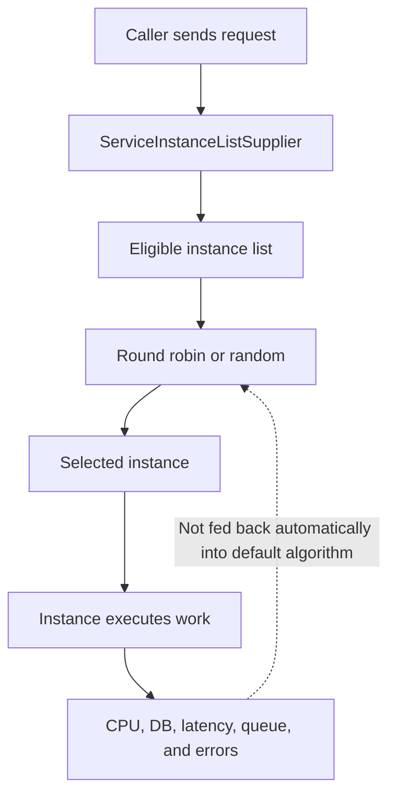
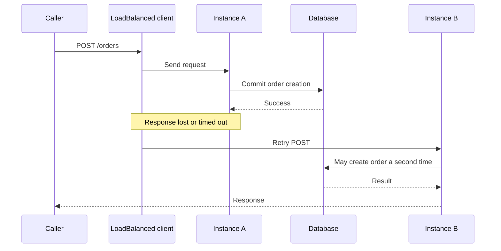
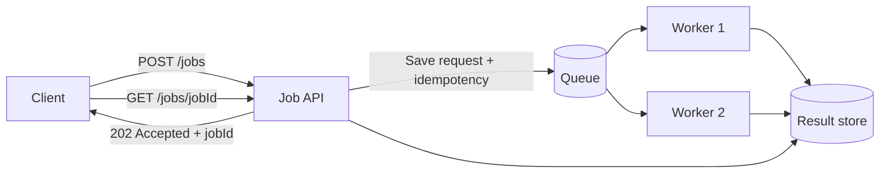
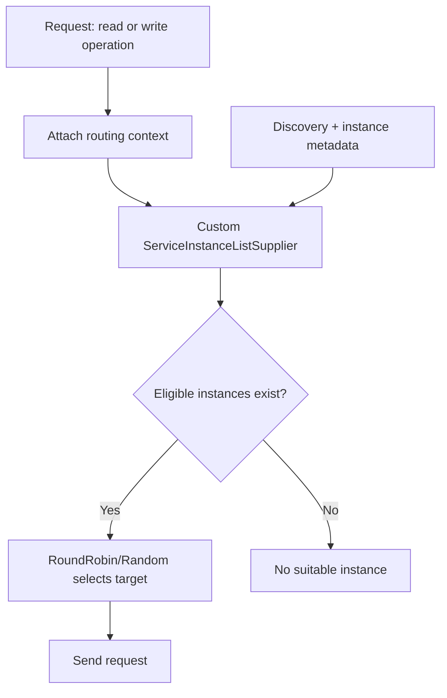

# Varying load across read, write, and long-running requests

A `GET /products/P-1001` request might only read data from cache in a few milliseconds. A `PUT /products/P-1001` request might open a transaction, lock a record, and wait for a database commit. A report-generation request might consume substantial CPU and memory for tens of seconds or longer. Simply counting requests and splitting them evenly across instances does not necessarily divide the **actual amount of work** evenly.

In Spring Cloud LoadBalancer, `RoundRobinLoadBalancer` and `RandomLoadBalancer` pick a `ServiceInstance` from the list provided by `ServiceInstanceListSupplier`. They do not automatically inspect HTTP methods, estimate execution time, know which queries hit cache, or distinguish background work. Understanding the differences across read, write, and long-running workloads is foundational for designing instance pools, selection policies, timeouts, retries, and proper measurements.

## 1. Request count does not equal load

Suppose the same service receives three groups of requests:

| Workload group | Examples | Commonly impacted resources | Key risks |
|---|---|---|---|
| **Read** | `GET /products/{id}`, search, list queries | CPU, cache, DB connections, bandwidth, query latency | Cache misses, heavy queries, stale reads from lagged replicas |
| **Write** | `POST /orders`, `PUT /inventory/{id}` | DB transactions, locks, storage I/O, replication queues | Duplicate writes on retry, update conflicts, consistency requirements |
| **Long-running** | Report export, image processing, data aggregation | CPU/execution time, memory, threads/connections, or worker slots | Prolonged resource retention, timeouts, backlogs, and overload |

These are common characteristics, not absolute rules: a complex read request can be more expensive than a small write; an async write command can reply very fast while generating heavy load on backend workers. Measure real workloads before deciding on distribution.

For example, 1,000 read requests averaging 10 ms/request equal about 10 seconds of sequential processing time—the same as a single 10-second request. If one instance receives 50 fast reads plus one long request, while another receives 50 fast reads, request counts are nearly identical while resource usage can differ vastly.

One intuitive way to describe average load on instance `i` is:

\[
\rho_i \approx \frac{\lambda_i\,\mathbb{E}[S_i]}{c_i}
\]

Where `λᵢ` is the request arrival rate to the instance, `E[Sᵢ]` is the average service time (in the same resource/measurement unit), and `cᵢ` is the effective parallel processing capacity. This is a simplified model showing that **work duration and complexity** also matter, not a direct formula used by Spring Cloud LoadBalancer to select instances.

## 2. What do round robin and random actually balance?

`RoundRobinLoadBalancer` typically alternates selections among the instances currently returned by the supplier. `RandomLoadBalancer` chooses randomly from that list. When all instances are equivalent and every request has roughly similar cost, these strategies are simple, easy to operate, and usually a reasonable starting point.



Limitations to recognize:

- Round robin distributes **selection turns**, rather than directly balancing CPU, open transactions, memory headroom, or remaining task time.
- Random reduces predictability of the selection sequence, but does not guarantee each instance receives the exact share of requests within a short interval.
- An instance can pass health checks while sitting near its CPU, connection pool, or worker slot limits.
- Suppliers may filter the list by zone, health, hint, metadata, or sticky session; in that case, the algorithm only chooses from the **post-filter list**, not the entire registry.
- Retries can generate extra instance selections and increase load; retry is not an automatic system load-shedding mechanism.

Therefore, when two instances have nearly equal request counts yet widely diverging `p99 latency`, inspect request mix, cache miss rate, DB queries, active task count, and instance capacity before concluding the selection algorithm is faulty.

## 3. Read workload characteristics: fast, but not always cheap

Read APIs typically have the advantage of minimal side effects, cacheability, and in some systems, execution against read replicas. However, reading large datasets or running queries with complex joins can generate significant load.

Several factors change read load:

1. **Cache hit/miss:** two requests to the same endpoint can differ manyfold in response time.
2. **Result size:** pagination, very large lists, or streaming can keep connections occupied longer.
3. **Read replica lag:** replicas may return stale data immediately after a write.
4. **Hot key/hot partition:** many requests hitting the same hot data can create bottlenecks in cache or DB.
5. **Consistency requirements:** some reads strictly require reading from the recently written source or primary.

### Read-your-writes and target selection decisions

Suppose a user updates product inventory and immediately reads the stock level back. If the read request goes to a replica that has not yet applied the change, the result may be stale. **LoadBalancer does not automatically guarantee read-your-writes consistency**. This is a data distribution and read-policy concern that must be handled in the service/database or a consistency-aware routing architecture.

Options, depending on business requirements, include reading from the primary after writes, using data versions/consistency tokens, or accepting eventual consistency for views that do not require immediate freshness.

> Do not label every `GET` request as “safe to send to a replica”. The HTTP method describes API semantics, whereas consistency depends on business rules and data storage design.

## 4. Write workload characteristics: bounded by transactions and correctness

Write APIs can involve business validation, locks, transactions, multi-table updates, or event publishing. Adding application instances can increase request-acceptance capacity, but does not automatically eliminate bottlenecks at the primary database or message broker queues.

Questions to answer before choosing a write distribution strategy:

- Do all instances have write privileges and obey the same data synchronization rules?
- Is there a mandatory leader/primary handling a group of operations?
- Can a transaction be safely re-sent after a timeout?
- Is there an idempotency key, request ID, or business deduplication mechanism?
- When multiple writes target the same aggregate/key, does processing order matter?

If a service has only **one valid writer**, do not let round robin route write operations to read-only replicas. Restrict the write flow's target list to valid writers, or have the backend coordinate/forward to the leader with clear business guarantees.

### Retries and the risk of duplicate writes

A write request may already be committed by the database while the response is lost on the return path. If the client retries without idempotency, the operation may execute a second time. This is why retries must not be blindly enabled across all HTTP request types.

Example of a hazardous flow:



To mitigate this risk, use a caller-generated idempotency key, check for duplicates on the backend, and store the outcome alongside the key. Subsequent retries with the same key then return the same logical result or recorded outcome rather than creating new side effects. Idempotency must be implemented in storage/business logic; Spring Cloud LoadBalancer alone does not provide this property for APIs.

## 5. Long-running tasks: resource hold time is the real issue

An endpoint compiling a 60-second report behaves very differently from one returning data in 20 ms. A long request can tie up a servlet thread, connection, or processing slot for its entire execution. With reactive programming, non-blocking I/O uses threads more efficiently, but does not make CPU, memory, bandwidth, or concurrency limits infinite.

When hundreds of long requests arrive concurrently, several problems can emerge:

- Fast requests queue up behind heavy work.
- Thread pools, worker pools, or connection pools become exhausted.
- Memory pressure and garbage collection cause latency spikes.
- Clients/proxies time out before the server finishes processing.
- Retries generate duplicate work, causing the backlog to grow even faster.

For tasks that can be decoupled from the HTTP lifecycle, a more suitable architecture is usually **accepting the job quickly, processing asynchronously, and exposing a status-tracking API**:



In this approach, LoadBalancer balances requests to the **job-submission API**; the queue, scheduler, and worker slot count govern how heavy work is divided. Do not treat round-robin distribution of `POST /jobs` calls as proof that workers are evenly balanced.

If business logic requires long-lived connections such as streaming or long polling, cap active connections, configure timeouts across HTTP client/proxy/server, and monitor concurrent connections per instance. That is a capacity problem separate from choosing an instance when establishing each connection.

## 6. Separating request routing from work scheduling

There are three distinct decision layers:

| Layer | Decision | Components involved |
|---|---|---|
| **HTTP request routing** | Which instance receives the caller's request? | Spring Cloud LoadBalancer, discovery, `ServiceInstanceListSupplier`. |
| **Business and storage** | May the request read a replica, write to primary, lock, or commit? | Service logic, database, transaction manager. |
| **Job scheduling** | Which worker picks up a long-running job, and how many jobs run concurrently? | Queue, worker scheduler, semaphore, consumer concurrency. |

A sound strategy in the first layer does not replace consistency policies in the second or job scheduling in the third. For instance, evenly selecting two API instances cannot fix a situation where one queue worker stays constantly busy while another sits idle.

## 7. Two ways to organize read and write routing

### Option A: same service ID, every instance handles all request types

If every `inventory-service` instance can handle both reads and writes, callers can use a single service ID and a simple instance-selection policy. This works well when workloads are fairly uniform or resource limits are handled internally within the service.

```text
order-service
   |
   +-- GET  http://inventory-service/api/products/P-1001
   |
   +-- PUT  http://inventory-service/api/products/P-1001
                |
                +--> inventory-1
                +--> inventory-2
```

**Limitation:** `RoundRobinLoadBalancer` does not automatically send all `GET`s to read instances and all `PUT`s to write instances. If request type must dictate the target, an appropriate strategy must be added.

### Option B: split logical service IDs by capability group

When the architecture genuinely maintains separate pools, two service IDs can be published:

- `inventory-query`: instances authorized to handle read queries and satisfy corresponding consistency requirements.
- `inventory-command`: instances capable of handling write operations.

```text
order-service
   |
   +-- GET --> inventory-query --> query-1, query-2
   |
   +-- PUT --> inventory-command --> command-1
```

This separates **target pools via discovery**; it does not strictly require splitting into two codebases or two independent deployments. What matters is that instances registered under each service ID are capable of serving the corresponding requests. If `command-1` fails with no other valid writer, LoadBalancer cannot turn a read replica into a writer.

In systems requiring complex data constraints, you can keep one service ID and route in application logic or a custom `ServiceInstanceListSupplier`, but you must clearly design how request context is propagated and how correctness is tested. Do not infer that merely adding `@LoadBalanced` causes Spring Cloud LoadBalancer to inspect HTTP methods on its own.

## 8. Hands-on read/write separation using two service IDs

This example assumes read and write APIs already exist on the corresponding instances. The goal is to illustrate how the caller picks a **service ID** based on request nature, not to build a full CQRS system.

### 8.1. Providing a static instance list during development

In `application.yml`, you can use `SimpleDiscoveryClient`:

```yaml
spring:
  cloud:
    discovery:
      client:
        simple:
          instances:
            inventory-query:
              - uri: http://localhost:8081
              - uri: http://localhost:8082
            inventory-command:
              - uri: http://localhost:8083
```

The example requires `spring-cloud-starter-loadbalancer` and appropriate web/client dependencies. With a real registry, service IDs and instances come from the discovery provider instead of static configuration. The ports are illustrative; servers must actually be running and exposing the corresponding APIs.

### 8.2. Using a LoadBalancer-integrated RestClient

```java
@Configuration(proxyBeanMethods = false)
class HttpClientConfiguration {

    @Bean
    @LoadBalanced
    RestClient.Builder loadBalancedRestClientBuilder() {
        return RestClient.builder();
    }
}
```

```java
@Service
class InventoryGateway {

    private final RestClient restClient;

    InventoryGateway(@LoadBalanced RestClient.Builder builder) {
        this.restClient = builder.build();
    }

    ProductView readProduct(String productId) {
        return restClient.get()
                .uri("http://inventory-query/api/products/{id}", productId)
                .retrieve()
                .body(ProductView.class);
    }

    ProductView updateProduct(String productId, UpdateProduct command) {
        return restClient.put()
                .uri("http://inventory-command/api/products/{id}", productId)
                .body(command)
                .retrieve()
                .body(ProductView.class);
    }
}
```

`ProductView` and `UpdateProduct` are illustrative DTOs. The example assumes the project's Spring Boot/Spring Framework and Spring Cloud versions support `RestClient` integration; older versions may use `RestTemplate`, `WebClient`, or OpenFeign depending on version capabilities. `@LoadBalanced` only ensures the builder is wired with instance selection when appropriate auto-configuration and dependencies are present; it does **not** automatically detect `GET` as read and `PUT` as write. Choosing the logical URI is what separates reads and writes in this example.

If using `WebClient`, a `@LoadBalanced WebClient.Builder` bean is needed; with OpenFeign, you can declare `@FeignClient(name = "inventory-query")` and `@FeignClient(name = "inventory-command")`, then wire each client to its corresponding business call. Each HTTP client type also has its own timeout, retry, and connection configuration to verify.

## 9. What if service IDs cannot be split?

Some systems have only a single service ID due to architectural or registry constraints. In that case, consider designing an instance filter based on metadata and request context.

For example, service discovery supplies metadata `workload=read`, `workload=write`, or `zone=...`. A custom `ServiceInstanceListSupplier` can extract info from the `Request`/context passed in by the HTTP client and return only eligible instances. After filtering, `RoundRobinLoadBalancer` or `RandomLoadBalancer` chooses from the remaining list.



Be cautious on four points:

1. **Request context:** not every RestClient, WebClient, or OpenFeign integration passes the same fields into LoadBalancer in the same way. Filtering by method/header must be verified for your exact client and release train.
2. **Metadata source:** metadata must be tagged and updated accurately to match actual instance capabilities. Stale metadata causes misrouting.
3. **Empty list:** explicitly handle when no writer or eligible instance remains; never silently fall back to an incapable instance just so the request has a target.
4. **Security and correctness:** headers supplied by external callers cannot be trusted by default to grant write privileges. The service layer must still authenticate, authorize, and enforce consistency.

`HintBasedServiceInstanceListSupplier` is a hint/metadata filtering capability in Spring Cloud LoadBalancer on supported versions. However, do not treat it as an automatic HTTP-method router: hints must be passed through a mechanism actually supported by both client and supplier. When requirements get complex, splitting service IDs by capability is usually easier to observe and test.

## 10. When should you choose a strategy based on real load?

If instances have different capacities or request costs vary sharply, a custom policy may be needed. Several common ideas include:

| Idea | Required data | Caveats |
|---|---|---|
| **Weighted distribution** | Capacity weight per instance | Static weights cannot detect an unexpectedly busy instance; useful when machine capacities differ. |
| **Least active requests** | Active requests per instance | Requires reliable, fast-updating telemetry; long requests still carry unequal costs. |
| **Latency-aware routing** | EWMA latency, errors, timeout rate | Sensitive to noise, cache warm-up, or outliers; needs oscillation damping. |
| **Capacity-aware routing** | CPU, memory, queue depth, worker slots | Metrics lag and can raise cardinality; needs fallback when data is missing. |
| **Locality / zone preference** | Zone metadata, locality policy | Proximity preference does not guarantee sufficient capacity or right data. |

**Important:** `RoundRobinLoadBalancer` and `RandomLoadBalancer` are standard built-in strategies. Strategies like least-connections/least-active or dynamic latency-weighted are not turned on automatically just by adding the starter. If needed, you must implement/integrate an appropriate algorithm or supplier and test it separately. Do not assume Spring Cloud LoadBalancer measures CPU by default to pick the idlest machine.

An illustrative scoring model for discussion—**not a built-in framework API or algorithm**:

```text
normalizedUtilization = activeRequests / effectiveConcurrencyLimit
normalizedLatency     = observedP95 / latencyBudget
score                 = normalizedUtilization + k * normalizedLatency

Select among eligible instances with low score,
while applying defined load thresholds and fallback mechanisms.
```

Real-world designs must account for stability under delayed metrics, state retention windows, avoiding herding all traffic onto a single instance, and handling missing/inconsistent data. Never let a single instantaneous metric decide every request.

## 11. Backpressure and concurrency limits before target selection

When all instances approach overload, picking the “least busy” machine creates no new capacity. At that point, accepted requests and active tasks must be bounded:

- **Concurrency limit:** cap concurrent heavy tasks per instance or worker group.
- **Rate limiting:** control request ingress rate per client, tenant, or API.
- **Bounded queues:** absorb short load spikes without letting backlogs grow unbounded.
- **Load shedding:** reject early or return an appropriate status when capacity is exhausted.
- **Deadline budget:** allocate time budgets across discovery, instance selection, connection, response reading, and retries.

Typically `429 Too Many Requests` fits when a client exceeds its quota; `503 Service Unavailable` fits when the system temporarily lacks capacity to serve. Status codes and `Retry-After` decisions belong to the API contract; there is no automatic rule for all services.

For long jobs, cap running consumers/workers and monitor queue depth. When a queue is full, the job-submission API can reject early instead of continuing to allocate resources. For synchronous requests, enforce controlled timeouts and avoid unbounded retries.

## 12. Timeouts, retries, and load multiplication

Suppose each failed request can be retried up to two times. In the worst case, one logical request turns into three attempts. If the service is already overloaded, retries multiply attempts at the exact moment the system is least able to handle them.

```text
1 logical request
   |
   +-- attempt 1 -> timeout
   +-- attempt 2 -> timeout
   +-- attempt 3 -> response/failure

=> Up to 3 attempts for 1 logical request in the example.
```

For idempotent `GET` requests, retries may be more appropriate, yet attempts, total duration, backoff, and retryable error conditions must still be bounded. For `POST` with side effects, require an idempotency key or equivalent guarantee before permitting retries. Do not rely on an HTTP method being `PUT`/`DELETE` to conclude the backend properly implements idempotency under every failure mode.

Regarding timeouts, distinguish:

- **Connect timeout:** time limit to establish a connection to the instance.
- **Read/response timeout:** time limit waiting for data or response per HTTP client.
- **Overall deadline:** maximum duration for the entire logical operation, across multiple attempts or downstream calls.
- **Job execution timeout:** maximum time a worker is allowed to run a background task.

Spring Cloud LoadBalancer selects the instance, while concrete timeouts depend on RestClient, WebClient, OpenFeign, and the underlying transport. LoadBalancer retry configuration does not automatically replace HTTP client or job worker timeouts.

## 13. Measuring to verify configuration effectiveness

Looking solely at instance selection counts is insufficient. Observe metrics by **service ID**, **instance**, and **workload group** with controlled cardinality:

| Metric group | Examples to watch | Meaning |
|---|---|---|
| Request volume | RPS/QPS across read, write, async job submission | Reveals traffic per category and changes over time. |
| Latency | p50/p95/p99 and queue wait time | Detects tail latency and high-cost work. |
| Resource utilization | CPU, memory, DB connections, active workers/threads | Shows which instance actually carries heavy load. |
| Health & errors | 5xx rate, timeouts, health check status | Separates app bugs, load bottlenecks, and unavailable instances. |
| Retry | Attempts per logical request, retry success/failure | Spots load amplification and ineffective retries. |
| Long-running jobs | Queue depth, job age, active jobs, throughput | Measures scheduler/worker capacity outside the HTTP tier. |

Spring Boot Actuator/Micrometer, tracing, and `LoadBalancerLifecycle` can support observing instance selections and request durations depending on starters, configuration, and versions. Ensure HTTP client metrics are genuinely attached to the load-balanced call path. When analyzing, do not blend 100 fast read requests and one report export into a single average latency and conclude load is balanced.

Log/trace fields sufficient for correlation, such as `serviceId`, route pattern, request category, instance ID, attempt number, duration, and result. Avoid putting request bodies, tokens, or high-cardinality identifiers into metric labels.

## 14. Hands-on scenario comparing three workload types

Set up three independent test endpoints runnable across two or more instances of the same service:

1. **Fast read:** `GET /lab/read` returning small JSON; can simulate cache hits and misses.
2. **Controlled write:** `POST /lab/write` writing a test record, supporting an idempotency key, and returning the result.
3. **Long job:** `POST /lab/jobs` accepting a task and returning `202 Accepted` with `jobId`; a separate worker processes it and `GET /lab/jobs/{id}` returns status.

Run sequentially:

- Send equal numbers of read and write requests through a `@LoadBalanced` client; record selection distribution, p95 latency, DB contention, and retry counts.
- Increase reads with cache misses to see that RPS does not directly reflect DB utilization.
- Submit many long jobs concurrently; monitor queue depth and active workers rather than only `POST /lab/jobs` call counts.
- Test one read-only instance and a single writer; verify requests never hit an instance lacking the corresponding capability.
- When shutting down an instance, watch the list returned by the supplier, HTTP errors, and shifts in p95/p99 latency; do not auto-retry unsafe operations.

When comparing, hold instance counts and resource specs fixed across runs while tracking cache state, database data, and startup warm-up. Never use production data or environments to test duplicate-write failure modes that risk corrupting real data.

## 15. Common incidents and diagnostic guidance

| Symptom | Possible cause | Resolution / verification |
|---|---|---|
| Round robin splits requests evenly yet one instance is always slow | Uneven share of heavy requests or unequal instance capacity | Compare CPU, active requests, and latency by request type, not total RPS alone. |
| Data writes fail when routed to a replica | Instance pool contains read-only nodes | Separate writer/reader pools or have the service forward to a valid writer. |
| Users read stale data immediately after a write | Read replica lag or inappropriate consistency policy | Design read-your-writes where needed; do not treat this as a round robin bug. |
| Long jobs cause widespread timeouts | Workers/concurrency/queues saturated or requests hold connections too long | Offload asynchronously, apply backpressure, and set proper deadlines. |
| Retries double order counts | Write side effects lack idempotency | Enforce idempotency keys and backend deduplication; bound retries. |
| Only one instance is ever selected | Supplier filtered down to one instance or sticky policy active | Inspect post-filter instance list, metadata, and request context. |
| Health check says UP while p99 latency spikes | Health checks do not reflect capacity or downstream bottlenecks | Add load, saturation, and queue metrics; tune readiness/backpressure. |
| Split into two service IDs yet routing still goes wrong | Inconsistent discovery registration or logical URLs | Verify registry, URL hostnames, and each instance's capability. |

## 16. Workload-aware policy selection checklist

- [ ] Classified read/write/long-running operations by **actual cost**, not HTTP method alone.
- [ ] Identified consistency requirements and valid writers for write operations.
- [ ] Measured p95/p99 latency, RPS, saturation, and queues per request group.
- [ ] Confirmed which instances `ServiceInstanceListSupplier` returns before target selection.
- [ ] Understood that round robin/random only split selection turns, not work cost.
- [ ] Established a plan for pool separation or custom routing when instance capacities differ.
- [ ] Enforced idempotency and clear retry conditions for requests with side effects.
- [ ] Configured timeouts, concurrency limits, and backpressure for long-running tasks.
- [ ] Verified RestClient/WebClient/OpenFeign and retry behavior on the exact Spring Cloud version.
- [ ] Set up traces/metrics to prove improvements rather than relying on paper configuration.

**Conclusion:** Selecting a `ServiceInstance` is only one part of load distribution. When reads, writes, and long-running tasks differ in cost or correctness guarantees, a resilient solution combines proper target-pool separation, concurrency limits, async processing, safe retries, and workload-aware observability. Spring Cloud LoadBalancer picks an instance by service ID; the application architecture must decide which instances are **permitted** and **capable** of handling that type of work.
