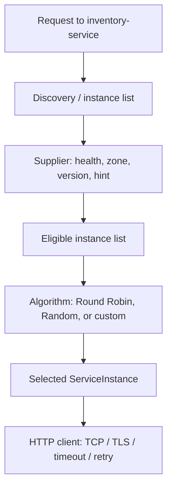
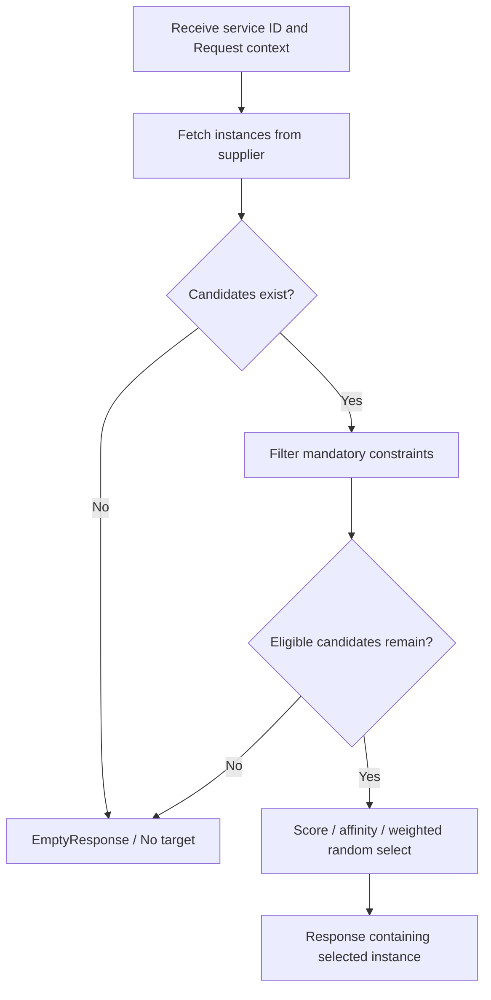

# When a custom algorithm is needed for system characteristics

In Spring Cloud LoadBalancer, how a `ServiceInstance` is selected directly impacts latency, error rate, resource utilization, and load resilience in inter-service communication. For many applications, the default algorithm such as `RoundRobinLoadBalancer` works well: requests are distributed sequentially across instances available in the candidate list. However, when instances differ in processing capacity, deployment zone, load state, or data retention requirements, distributing selection counts evenly may fall short.

This lesson in the **Selection Algorithms** chapter explains **when customization is warranted**, what belongs in `ServiceInstanceListSupplier`, what genuinely demands a new LoadBalancer, and how to implement and verify an affinity-based selection example. The goal is to make decisions backed by operational data and business constraints rather than swapping algorithms simply because traffic grew.

## 1. Distinguishing the candidate list from the selection algorithm

Consider a call from `order-service` to `inventory-service`:

```java
Item item = restClient.get()
        .uri("http://inventory-service/api/items/{id}", 42)
        .retrieve()
        .body(Item.class);
```

A call passes through these steps:

1. The `@LoadBalanced`-integrated client identifies the service ID as `inventory-service`.
2. `ServiceInstanceListSupplier` retrieves and optionally filters the replica list via discovery, caching, health checks, zone, or request info.
3. `ReactorServiceInstanceLoadBalancer` selects one instance from the remaining list.
4. The HTTP client connects to the selected instance's host/port and handles timeouts, responses, and retries per configuration.



**Candidate filtering** answers *which instances are permitted to receive this request?* **The selection algorithm** answers *among permitted instances, which one should be chosen?* This is an essential distinction when designing routing policies.

For example, if `inventory-a` and `inventory-b` are both healthy but only `inventory-b` supports API v2, the policy can filter by metadata `api-version=v2` inside the supplier and keep round-robin over the matching candidates. Writing a new LoadBalancer algorithm is not strictly necessary.

## 2. When are built-in algorithms sufficient?

Before customizing, separate common needs from cases that genuinely require complex selection decisions.

| System characteristic | Option to consider first | Reason |
|---|---|---|
| Instances roughly equivalent in resources, load, and latency | `RoundRobinLoadBalancer` | Simple, predictable, and easy to observe |
| Need to avoid fixed cyclic turns with no other constraints | `RandomLoadBalancer` | Picks randomly among candidates |
| Instances differ in capacity with relatively stable configured weights | `WeightedServiceInstanceListSupplier` | Built-in support for using weights to adjust selection odds |
| Prefer replicas in the same zone as the caller | `ZonePreferenceServiceInstanceListSupplier` | Filters or prioritizes candidates by zone prior to selection |
| Avoid unhealthy instances | `HealthCheckServiceInstanceListSupplier` or discovery with proper health/readiness | Excludes unhealthy candidates from the list |
| Routing based on hints or metadata | Request/hint-handling supplier or decorator | Alters the candidate pool based on request conditions |
| Retries should avoid the previously failed instance | Retry-aware supplier mechanism and HTTP client retries | Avoids repeating a failed target on retry, per policy |

Several components above are **suppliers**, not new instance-selection algorithms. For example, the list from `ZonePreferenceServiceInstanceListSupplier` can continue to be selected via round-robin. Also, `weight` metadata does not make round-robin apply weights on its own; a weight-reading supplier or mechanism must actually be configured.

If the requirement can be solved completely with a built-in supplier, keep the default LoadBalancer. That reduces code needing tests and makes behavior easier to cross-check against Spring Cloud documentation.

## 3. Signs that a custom selection policy is needed

Consider a custom algorithm when **selection depends on state, priority ranking, or a relationship between the request and the instance** that built-in policies cannot express.

| Scenario | Data needed for decision | Solution direction |
|---|---|---|
| Sessions or tenants must stay relatively sticky on one instance | Affinity key and stable instance IDs | Rendezvous/consistent hashing after filtering candidates |
| Some instances handle load markedly better and weights vary over time | Capacity, queue depth, active requests | Weighted/adaptive routing with telemetry and load bounds |
| Latency across instances fluctuates significantly | EWMA latency, error rate, in-flight requests | Latency-aware or least-outstanding, with anti-oscillation safeguards |
| Data region or tenant is strictly restricted in where it can be processed | Allowed regions, access rights, trusted metadata | Mandatory filtering prior to selection; never fall back to forbidden regions |
| Canary requires stable per-user traffic splitting | Cohort key and rollout policy | Deterministic bucketing, then select within bucket |
| Multi-tier preference: same zone, then same region, then remote region | Topology and latency/cost budget | Multi-tier selection policy with explicit fallbacks |
| Specialized instance handles GPU tasks or local data | Capability, locality, or shard ID | Filter by capability, then load-aware selection if needed |

Not every scenario in the table requires writing a custom `ReactorServiceInstanceLoadBalancer`. If the requirement is solely **retaining or excluding** instances by attributes, a custom supplier is usually the better extension point. A new algorithm brings value when scoring, comparing, tracking state, or preserving selection consistency across multiple candidates is needed.

## 4. Measure the problem before deciding to customize

A complex algorithm can make a system harder to operate without improving SLOs. Establish a baseline with round-robin or built-in policies under realistic load.

Useful metrics:

- **p50/p95/p99 latency:** median and tail latency per instance, not just service-wide averages.
- **Error rate:** error rates by instance, error type, and rollout timing.
- **In-flight / active requests:** active calls currently executing on each instance.
- **CPU, memory, queue depth, thread pool saturation:** indicators of actual server bottlenecks.
- **Requests per instance:** distribution skew after accounting for retries and candidate filters.
- **Cross-zone/cross-region traffic:** impact on latency, cost, and data constraints.
- **Connection pool:** connection wait times, active/idle connections, connect or reset errors.

For example, three instances receive equal round-robin selections yet `inventory-c` exhibits long queues and high p99 latency. Before writing a latency-aware algorithm, check whether `inventory-c` is short on CPU, saturating its thread pool, hitting slow storage, or randomly receiving heavy requests. If the root cause is server configuration, tuning the connection pool or fixing the bottleneck can yield better results.

Define concrete evaluation criteria: reducing p99 at the same RPS without increasing errors, maintaining desired traffic ratios during rollout, curbing cross-zone traffic, or minimizing session churn when replicas change.

## 5. Common decision-making scenarios

### 5.1. Unequal instance capacity

Suppose a service runs on two machine sizes:

| Instance | Expected throughput capacity | Illustrative weight |
|---|---:|---:|
| `inventory-small` | 1 unit | 1 |
| `inventory-large` | 3 units | 3 |

Round-robin usually produces equal selection counts. If requests have roughly similar cost, the small machine can saturate early. With weighted selection, expected selection ratios approach:

\[
P(i) = \frac{w_i}{\sum_j w_j}
\]

With weights 1 and 3, expected proportions are roughly 25% and 75% over many selections. These are **expected ratios**, not hard guarantees over small windows or with varying request execution times.

First use `WeightedServiceInstanceListSupplier` if weight calculation can be expressed via instance information. A custom algorithm is worth considering when weights must adapt continuously to remaining capacity, queue length, or request class. In that case, define update cadence, stale-data handling, and how to prevent all traffic from herding onto one instance that just measured low latency.

### 5.2. Locality, zones, and data residency constraints

Suppose the caller is in `zone-a` and instances reside in `zone-a` and `zone-b`. If you only want a **preference** for proximity to the caller, a zone-preference supplier usually suffices; when no local instance exists, fallback to another zone can be allowed.

However, if a tenant may only be processed in `region-a` due to data residency rules, that is a **hard constraint**. The algorithm must filter out every instance outside `region-a` before load balancing. If the region has no healthy instances, report no valid target or follow an approved recovery procedure; never silently route requests to a forbidden region just to raise availability.

Distinguish clearly:

- **Hard constraints:** mandatory conditions, e.g., access permissions, processing capability, allowed region, or compatible API version.
- **Soft preferences:** negotiable preferences, e.g., same zone, low latency, low load, or low network cost.

Usually, hard constraints belong in the supplier, passing eligible candidates to an algorithm that ranks by soft preferences.

### 5.3. Session affinity and consistency when scaling

An application with per-instance local caches or local session state may want requests sharing a key to land on the same replica. Pure round-robin routing cannot satisfy that goal.

One option is **Rendezvous hashing** (highest-random-weight hashing): for each request key, compute a hash score for every instance and pick the instance with the highest score. If the instance list does not change, the same key selects the same target; when adding or removing an instance, most keys keep their existing target.

```text
Key tenant-17
  ├── score(tenant-17, inventory-a) = 0.21
  ├── score(tenant-17, inventory-b) = 0.86  <-- selected
  └── score(tenant-17, inventory-c) = 0.42

Remove inventory-a: tenant-17 still selects inventory-b
Remove inventory-b: tenant-17 moves to inventory-c
```

The scores above are purely illustrative. Use stable instance IDs, a deterministic hash function, and identical rules across callers. If instance IDs change on every deploy, affinity will churn. Affinity does not replace durable session storage: when an instance fails, requests must still be handleable on a fallback target or the system must tolerate losing local cache.

### 5.4. Adaptive routing by latency or load

Least-outstanding picks the instance with the fewest active requests; latency-aware picks based on latency statistics. Both techniques help when processing times fluctuate widely, yet both demand reliable telemetry.

A policy might consider combining:

\[
score(i) = \alpha \cdot EWMA\_latency(i) + \beta \cdot inflight(i) + \gamma \cdot penalty\_errors(i)
\]

Where quantities must be normalized to a shared scale; the coefficients and formula are a **design example**, not a Spring Cloud default formula. Lower scores are preferred after hard constraints have been applied.

Risks of this approach include:

- Delayed telemetry updates cause multiple clients to herd traffic onto the same instance deemed fast.
- Instances with few requests have small sample sizes, yielding noisy latency estimates.
- A few heavy requests can spike latency and cause the algorithm to oscillate targets continuously.
- A client only sees its own traffic share, not total load from other callers.

If implemented, use measurement windows or EWMA, cap max requests, give new instances a floor score, use weighted random selection among top candidates, and decay stale metrics. Measure improvement under load rather than comparing latency over a handful of test requests.

### 5.5. Canary by user or traffic cohort

A 10% canary can mean 10% of requests or 10% of users. These two are not equivalent: a per-request 10% random split can bounce the same user back and forth between stable and canary.

If per-user consistency is needed, compute a bucket by hashing an authenticated key, assign the user to `canary` or `stable`, and have the supplier filter instances by `release-track` metadata. Round-robin remains sufficient within each group. Ensure accurate bucket proportions, rollback capability, and handling when a group has no available instances.

## 6. Design model for a custom algorithm

A target selection algorithm should define a clear contract:



Characteristics to settle before writing code:

| Question | Example decision |
|---|---|
| Where does the list come from? | Discovery + cache + health checks via `ServiceInstanceListSupplier` |
| Where does request data come from? | `RequestDataContext`, hints, or application-supplied context |
| Which data is trustworthy? | Region from authenticated config, never trust raw user-supplied headers |
| What if no eligible candidate exists? | Return `EmptyResponse`; never cross into a forbidden pool |
| What if the affinity key is missing? | Fall back to random/round-robin across eligible candidates |
| What if load state is stale? | Fall back to a simpler algorithm or ignore untrusted scores |
| What happens on retry? | Optionally avoid the failed instance, while accounting for idempotency |
| What needs to be observed? | Candidate count, filter reasons, selected instance, errors, latency |

**Principle:** the selection algorithm should be fast, non-blocking, and never query a database or external service on every selection. Dynamic data like load and health should be collected/updated separately, supplying a snapshot to the selection path.

## 7. Example: customizing affinity selection with Rendezvous hashing

The example below implements `ReactorServiceInstanceLoadBalancer`: it fetches the list via `ServiceInstanceListSupplier`, extracts an affinity key from the HTTP request context, and uses Rendezvous hashing to pick an instance. If no key is present, the algorithm picks randomly from the candidate list. The code uses standard Spring Cloud Commons and Reactor abstractions; adjust imports or bean definitions for your project's Spring Cloud version.

```java
import java.nio.charset.StandardCharsets;
import java.util.List;
import java.util.concurrent.ThreadLocalRandom;

import org.springframework.beans.factory.ObjectProvider;
import org.springframework.cloud.client.ServiceInstance;
import org.springframework.cloud.client.loadbalancer.DefaultResponse;
import org.springframework.cloud.client.loadbalancer.EmptyResponse;
import org.springframework.cloud.client.loadbalancer.Request;
import org.springframework.cloud.client.loadbalancer.RequestDataContext;
import org.springframework.cloud.client.loadbalancer.Response;
import org.springframework.cloud.loadbalancer.core.ReactorServiceInstanceLoadBalancer;
import org.springframework.cloud.loadbalancer.core.ServiceInstanceListSupplier;
import reactor.core.publisher.Mono;

public final class AffinityLoadBalancer
        implements ReactorServiceInstanceLoadBalancer {

    private final ObjectProvider<ServiceInstanceListSupplier> supplierProvider;

    public AffinityLoadBalancer(
            ObjectProvider<ServiceInstanceListSupplier> supplierProvider) {
        this.supplierProvider = supplierProvider;
    }

    @Override
    public Mono<Response<ServiceInstance>> choose(Request request) {
        ServiceInstanceListSupplier supplier = supplierProvider.getIfAvailable();
        if (supplier == null) {
            return Mono.just(new EmptyResponse());
        }

        String affinityKey = readAffinityKey(request);
        return supplier.get(request)
                .next()
                .map(instances -> chooseFrom(instances, affinityKey))
                .defaultIfEmpty(new EmptyResponse());
    }

    private Response<ServiceInstance> chooseFrom(
            List<ServiceInstance> instances, String affinityKey) {

        if (instances.isEmpty()) {
            return new EmptyResponse();
        }

        if (affinityKey == null || affinityKey.isBlank()) {
            int index = ThreadLocalRandom.current().nextInt(instances.size());
            return new DefaultResponse(instances.get(index));
        }

        ServiceInstance best = null;
        long highest = 0;
        for (ServiceInstance instance : instances) {
            long score = score(affinityKey, instance);
            int comparison = Long.compareUnsigned(score, highest);
            if (best == null || comparison > 0
                    || (comparison == 0 && identity(instance)
                            .compareTo(identity(best)) > 0)) {
                best = instance;
                highest = score;
            }
        }
        return new DefaultResponse(best);
    }

    private static String readAffinityKey(Request request) {
        if (request == null || !(request.getContext()
                instanceof RequestDataContext context)) {
            return null;
        }
        if (context.getClientRequest() == null) {
            return null;
        }
        return context.getClientRequest()
                .getHeaders().getFirst("X-Verified-Affinity-Key");
    }

    private static long score(String key, ServiceInstance instance) {
        byte[] bytes = (key + ":" + identity(instance))
                .getBytes(StandardCharsets.UTF_8);

        // FNV-1a 64-bit: illustrative hash function, not for security use.
        long hash = 0xcbf29ce484222325L;
        for (byte b : bytes) {
            hash ^= (b & 0xffL);
            hash *= 0x100000001b3L;
        }
        return hash;
    }

    private static String identity(ServiceInstance instance) {
        String identity = instance.getInstanceId();
        if (identity == null || identity.isBlank()) {
            identity = instance.getUri().toString();
        }
        return identity;
    }
}
```

**Meaning of the example:**

1. `supplier.get(request)` preserves request context when fetching candidates, letting upstream suppliers filter by health/zone/metadata.
2. An empty list yields `EmptyResponse`; the algorithm does not silently expand to instances excluded by mandatory constraints.
3. With a stable key, the same key and same instance ID set choose the same target regardless of list ordering.
4. Without a key, random selection avoids piling all requests onto the first element.
5. 64-bit FNV-1a is purely to illustrate the algorithm. In production, use a well-tested hash with good distribution and consistent key/instance ID normalization across callers; never use this hash for security authentication.

The `X-Verified-Affinity-Key` header here is only an example convention. A gateway or application tier must authenticate the caller, strip untrusted values, and issue a valid affinity key. Blindly trusting a header from the Internet as a tenant or access credential creates a routing vulnerability. If an integration does not populate `RequestDataContext` with headers on the active call path, add compatible context propagation; the example falls back to random when the key is missing.

### 7.1. Registering the algorithm for a service ID

To use the custom algorithm, create a LoadBalancer bean in a per-service-ID configuration:

```java
public class InventoryAffinityConfiguration {

    @Bean
    ReactorLoadBalancer<ServiceInstance> inventoryLoadBalancer(
            Environment environment,
            LoadBalancerClientFactory factory) {

        String serviceId = environment.getProperty(
                LoadBalancerClientFactory.PROPERTY_NAME);

        return new AffinityLoadBalancer(
                factory.getLazyProvider(
                        serviceId, ServiceInstanceListSupplier.class));
    }
}

@SpringBootApplication
@LoadBalancerClient(
        name = "inventory-service",
        configuration = InventoryAffinityConfiguration.class)
public class OrderServiceApplication {
}
```

This snippet follows Spring Cloud LoadBalancer's per-service configuration pattern. `InventoryAffinityConfiguration` and `OrderServiceApplication` belong in separate Java files; imports are omitted for brevity. It requires `spring-cloud-starter-loadbalancer`, a valid `ServiceInstanceListSupplier` source, and matching imports. Place `InventoryAffinityConfiguration` outside normal component scan scope or ensure the bean is not registered into the global context, because configuration inside `@LoadBalancerClient` is intended for that specific service ID's child context.

The HTTP client keeps calling `http://inventory-service/...` as before. The algorithm affects **instance selection**, without changing how `RestClient`, `WebClient`, or OpenFeign establishes TCP/TLS or manages connection pools.

### 7.2. Limitations and upgrade paths

The example intentionally focuses on target selection. A production version may require:

- Bounds on key count, key length, encoding normalization, and a battle-tested stable hash function.
- An instance identity strategy that does not shift unintentionally across scaling or redeploys.
- Separating hard constraints from affinity: unhealthy instances or those unauthorized for a tenant must not enter the scoring list.
- Controlled fallback when a request carries no key or an unverified key.
- Observability for key migration rate when an instance is added or removed.
- Accounting for HTTP/2 connection pooling, retries, and server health, as affinity does not guarantee connections always succeed.

If the system needs unequal weights by instance capacity, this simple Rendezvous implementation does not yet support weighted hashing; do not duplicate an instance in the list to simulate weights because that alters selection properties.

## 8. Relationship between custom algorithms and remaining components

### 8.1. Discovery and health checks

A good algorithm still needs an accurate input list. An instance can appear in the registry while disconnected or not yet ready. Use proper discovery and health/readiness to filter candidates; the algorithm then chooses solely from accepted instances. During cache refresh windows, lists can be stale, so HTTP clients still need timeouts and error handling.

### 8.2. Retries and idempotency

Retrying after a timeout can send the request to a different instance depending on client and retry configuration. With an affinity algorithm, if a retry uses the same key and the list has not changed, it may re-select the exact instance that just failed. To avoid the previous target, combine a retry-aware supplier or pass attempted-instance info into the request context. Avoid accidentally configuring unbounded retries.

A timeout does not prove the server never processed the business operation. For order creation or payments, use an idempotency key and appropriate retry policy to prevent duplicate execution.

### 8.3. RestClient, WebClient, and OpenFeign

All clients integrated with Spring Cloud LoadBalancer can benefit from per-service-ID selection policies. However, how request contexts and headers reach LoadBalancer differs by client and version. When designing algorithms based on headers, hints, or custom context, verify the data actually arrives inside `choose(Request)` and `ServiceInstanceListSupplier.get(Request)` on the active call path.

### 8.4. Observing the selection lifecycle

Use logs and Spring Cloud LoadBalancer's lifecycle/metrics hooks to track service ID, pre/post-filter candidate counts, policy group, selected instance, and call outcome. For adaptive routing, also observe normalized scores and telemetry age.

Avoid putting tenant IDs, session IDs, dynamic URLs, or full headers into metric labels: cardinality explodes and sensitive data may leak. Only record normalized category values, such as `policy=affinity`, `zone=zone-a`, or `fallback=no-key`.

## 9. Testing the algorithm across critical scenarios

Do not judge an algorithm by just a few consecutive requests. Test both correctness and behavior under load.

| Test case | Expectation |
|---|---|
| Empty candidate list | Returns `EmptyResponse`, throws no index error |
| Single valid instance | Selects that sole instance if eligible |
| Missing or null request context | Uses explicit fallback, no bad type casts |
| Same key, stable list and identities | Picks the same instance under affinity |
| Instance order in list changes | Rendezvous outcome stays unchanged if IDs and instance set stay the same |
| Adding or removing an instance | Measure key migration ratio; never routes to removed instance |
| Missing or malformed metadata | Excludes, falls back, or errors per policy |
| Unhealthy instance | Never selected once excluded by health filter |
| Retry after connection failure | No invalid business duplication, no infinite retry, handles failed target per config |
| High load with many clients | Non-blocking, creates no new bottlenecks, p95/p99 and error rates meet targets |

### 9.1. A/B comparison against baseline

A practical workflow might include:

1. Start three `inventory-service` instances and collect p95/p99 latency, error rate, requests/instance, and CPU under round-robin.
2. Generate requests with stable affinity keys; verify Rendezvous repeatedly picks the same target.
3. Scale from three to four instances, measuring key remapping rate and load distribution results.
4. Stop one instance, watching discovery/health filter refresh lag and error volume before the list changes.
5. Increase concurrency, mix in heavy requests, and compare tail latency and distribution fairness.
6. Test rolling back to round-robin and confirm no caller HTTP contract changes.

When rolling out to production, ramp by traffic cohort with automated abort or rollback conditions if error rate, p99, or failed requests exceed thresholds. Never treat low-load test success as proof an algorithm improves a genuinely saturated system.

## 10. Common design mistakes

| Mistake | Consequence | Correction |
|---|---|---|
| Writing a new algorithm solely to filter `zone` or `version` | Duplicates built-in supplier mechanisms | Use a supplier/decorator to filter before selection |
| Trusting tenant/region directly from unverified headers | Callers can force routing to unauthorized pools | Authenticate, authorize, and construct trusted routing context |
| Using unstable instance IDs for affinity | Mass session shifts after every deploy | Normalize IDs and test scaling/restarts |
| Calling synchronous load-measurement APIs inside `choose()` | Adds latency, blocks event loops, triggers cascading failures | Collect telemetry asynchronously; read snapshots in selector |
| Blurring hard constraints and soft preferences | Failover may cross into forbidden regions/versions | Enforce hard filters first; fall back only within eligible pools |
| Optimizing average latency only | p99 and errors under load still degrade | Set SLOs and compare multiple percentiles |
| Shifting traffic per-request based on just-measured samples | Oscillation, herding, and selection thrashing | Use EWMA, rate-limit shifts, and check telemetry freshness |
| Ignoring retries and connection pooling | Observed request distribution diverges from selection distribution | Measure at both LoadBalancer and HTTP client/server layers |

## 11. Decision-making principles

- **Keep the default algorithm** when instances are relatively homogeneous and no data proves target selection is a bottleneck.
- **Prefer built-in suppliers** for health, zone, hint, metadata filtering, or simple weight adjustments.
- **Write a custom LoadBalancer** when scoring or maintaining stable request-to-instance affinity cannot be met by existing policies.
- **Define hard constraints and fallbacks** before optimizing soft preferences like latency or locality.
- **Read telemetry from snapshots**, never make synchronous external calls on the selection path.
- **Test correctness, concurrency, and failure modes**, then prove benefits on p95/p99, error rate, and operational cost.
- **Preserve rollback capability** to round-robin or a proven policy if the custom algorithm misses goals.

A custom algorithm is worthwhile when it solves a specific constraint or improves an identified operational metric. In Spring Cloud LoadBalancer, sound design starts with an **accurate candidate list**, follows with a **selection rule simple enough to verify**, and finishes with **observability, fallbacks, and error handling** as the system evolves.
