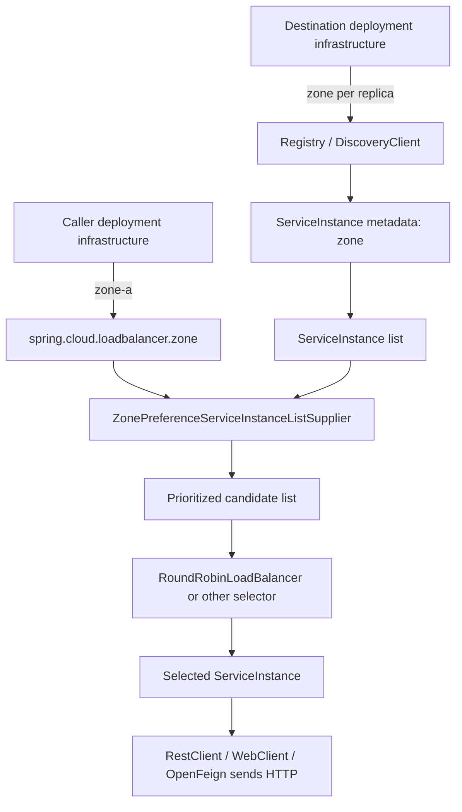

# Zone Information Sources for the Caller and Target Service

In a microservices system, a service can run simultaneously across multiple **deployment zones**, such as `zone-a` and `zone-b`. When `order-service` calls `inventory-service`, Spring Cloud LoadBalancer can prioritize instances in the same zone to reduce latency and traffic crossing network boundaries. To accomplish that, the load balancer side must know both the **caller's zone** and the **zone of each target instance**.

These two sources of information have different origins and scopes. The caller's zone typically comes from the calling application's configuration or deployment environment. A destination instance's zone typically comes from the `ServiceInstance` metadata provided by the service discovery mechanism. This lesson explains how data flows from these two sources to `ZonePreferenceServiceInstanceListSupplier`, cases where zone information is missing or incorrect, and how to inspect routing in Spring Cloud LoadBalancer.

## 1. Understanding the Zone Concept Correctly

Here, a **zone** is a label representing a deployment location or fault domain that the system uses to make routing decisions. The label may correspond to a cloud infrastructure availability zone, cluster, data center, or an organization-defined network partition. Spring Cloud LoadBalancer works only with the **zone values provided by the application**; it does not verify on its own that two identical labels are physically close to each other.

Example:

| Component | Zone | Address |
| --- | --- | --- |
| `order-service` instance O1 | `zone-a` | `10.0.1.5:8080` |
| `inventory-service` instance A | `zone-a` | `10.0.1.11:8080` |
| `inventory-service` instance B | `zone-a` | `10.0.1.12:8080` |
| `inventory-service` instance C | `zone-b` | `10.0.2.21:8080` |
| `inventory-service` instance D | `zone-b` | `10.0.2.22:8080` |

If the zone preference policy is enabled and the candidate list contains A, B, C, and D, caller O1 can receive a prioritized list consisting of A and B. If another `order-service` instance is deployed in `zone-b`, it can prioritize C and D. **The same service ID does not mean every caller receives the same prioritized list.**

Do not equate `zone` with `region`: a region can contain multiple availability zones. Zone labels must be standardized and used consistently between caller and destination; `zone-a`, `Zone-A`, and `az-a` are three distinct strings unless a mapping step exists.

## 2. First Source: Zone of the Calling Service

For the same-zone preference algorithm, the LoadBalancer needs to know **which zone the caller is currently in**. This information belongs to the runtime environment of the calling process, not the target service ID's zone.

### 2.1. Explicit Configuration on the Caller

An easily controlled approach is declaring the `spring.cloud.loadbalancer.zone` property in the **calling service's** configuration:

```yaml
# application.yml of order-service deployed in zone-a
spring:
  application:
    name: order-service
  cloud:
    loadbalancer:
      zone: ${DEPLOYMENT_ZONE:zone-a}
      configurations: zone-preference
```

The `DEPLOYMENT_ZONE` value is an environment variable defined by convention in this example. Deployment infrastructure must supply the right value for each `order-service` replica, such as `zone-a` or `zone-b`. When no environment variable is set, the illustrative default is `zone-a`; in production, consider avoiding defaults that could mask mislabeling.

The `spring.cloud.loadbalancer.zone` property is the zone used by the **LoadBalancer client**. The `spring.cloud.loadbalancer.configurations: zone-preference` setting requests configuring the zone-preference supplier chain in Spring Cloud versions that support this option. If the application already declares a custom supplier chain, inspect the actual configuration rather than assuming this property automatically replaces every existing bean.

An important point: configuring the caller's zone does not change the metadata of `inventory-service` instances. It only provides the **desired value to match against** destination metadata.

### 2.2. Obtaining the Zone from the Deployment Platform

In real systems, the original source of the zone can be:

- Environment variables or configuration for each machine group, container, pod, or deployment.
- A value injected by the deployment tool based on availability zone or node placement.
- Centralized configuration or per-deployment-environment configuration.
- Zone information supplied to the client by a discovery integration, such as certain Eureka configurations, depending on the version and integration setup.

What needs to be observed is the **final value that Spring Cloud LoadBalancer uses**, not merely the label displayed in the infrastructure console. For example, a Kubernetes node having the `topology.kubernetes.io/zone` label does not mean the Java process's `spring.cloud.loadbalancer.zone` property is already set. To use this label, a mechanism is needed to pass or map it into application configuration.

With Eureka, the client's zone mechanism can be inferred from Eureka configuration in some integration versions. To avoid depending on version-specific behavior, this lesson's examples explicitly declare the zone and inspect the effective value at runtime.

## 3. Second Source: Zone of the Target Service

For a service ID like `inventory-service`, discovery returns a list of `ServiceInstance` objects. Each object has a host, port, and optionally a metadata map. An instance's zone is typically represented by the `zone` metadata key:

```text
ServiceInstance A
  serviceId = inventory-service
  host      = 10.0.1.11
  port      = 8080
  metadata  = { zone: zone-a }

ServiceInstance C
  serviceId = inventory-service
  host      = 10.0.2.21
  port      = 8080
  metadata  = { zone: zone-b }
```

`ZonePreferenceServiceInstanceListSupplier` relies on the zone information it receives from the client side and from the `ServiceInstance` objects to determine same-zone candidates. The supplier does not query the physical location of IP addresses or open connections to each instance just to guess the zone.

### 3.1. Metadata Published via Service Discovery

In a system using Eureka, the target service can attach its zone to metadata upon registration:

```yaml
# application.yml of inventory-service running in zone-b
spring:
  application:
    name: inventory-service

eureka:
  instance:
    metadata-map:
      zone: ${DEPLOYMENT_ZONE:zone-b}
```

This example illustrates the metadata field for a registry that supports a metadata map. Complete instance registration and Eureka configuration also depend on dependencies, registry addresses, and the application's Spring Cloud version.

When `inventory-service` runs across two zones, each instance must be labeled with **that specific instance's actual location**. You cannot copy `zone-a` into a shared configuration for the entire group of instances and expect the LoadBalancer to deduce that some replicas are actually in `zone-b`.

Other discovery implementations may obtain metadata from static configuration, workload labels, or platform resources. Key names and mapping mechanisms depend on the implementation; the prerequisite is that the caller side can read an accurate and consistent zone value in the `ServiceInstance` that the supplier actually receives.

### 3.2. Do Not Infer Zone from Host or Service ID

`inventory-service` is the logical name of the **entire service**, not a zone identifier. Two instances belonging to the same service ID can still reside in different zones. A hostname or IP may hint at a subnet, but they should not be used as proof of a zone unless the system has explicitly managed mapping rules.

If metadata does not contain `zone`, the supplier generally cannot match that instance to the caller's zone using normal zone-matching logic. Depending on the policy and remaining list, an instance missing a zone might not appear in the same-zone preferred set, yet may still appear on the fallback path.

## 4. Where Do the Two Zone Sources Meet?

The flow of information for a call through Spring Cloud LoadBalancer can be visualized as follows:



Each component has a distinct responsibility:

| Component | Data Source / Responsibility |
| --- | --- |
| Caller deployment | Determines the calling process's zone and translates it into client configuration |
| Destination deployment | Attaches the correct zone to each running replica |
| Discovery client | Returns the list of instances and published metadata |
| `ServiceInstanceListSupplier` | Provides, caches, or filters the candidate list according to configuration |
| `ZonePreferenceServiceInstanceListSupplier` | Prioritizes the list of instances whose zone matches the caller's zone |
| `RoundRobinLoadBalancer` | Picks an instance from the received candidate list |
| HTTP client | Sends the request to the physical address of the selected instance |

**Discovery knows which replicas are published; zone preference decides which replicas are prioritized; the LoadBalancer algorithm picks one replica for the current call.** Do not conflate these three responsibilities when troubleshooting.

## 5. How Does ZonePreferenceServiceInstanceListSupplier Use Both Sources?

In the typical zone preference mechanism, the supplier matches the caller's zone against the `zone` value in each instance's metadata:

1. Receive the candidate list from the inner supplier, such as a supplier fetching data from discovery.
2. Retrieve the configured caller zone.
3. Find instances whose zone metadata matches the caller's zone.
4. If matching instances exist, prioritize returning the matching subset for the selector to use.
5. If no matching instances exist, **fall back to the original list** in the standard zone preference implementation so requests can still be served cross-zone.

Example with the caller in `zone-a` and discovery returning A, B, C, and D:

| Data Condition | Candidate List After Zone Preference |
| --- | --- |
| A, B have `zone-a`; C, D have `zone-b` | A, B |
| Only B has `zone-a`; A, C, D are in other zones | B |
| No instance has `zone-a` | A, B, C, D (fallback) |
| All instances lack zone metadata | Typically returns the original list because there is no match |
| Discovery list is already empty | List remains empty |

If the final list has A and B, Round Robin can alternate between A and B across requests. If the final list has only B, every valid selection points to B. If no same-zone instances exist, the selection algorithm can receive all cross-zone instances via fallback.

**Zone preference is a soft preference, not a guarantee to select only same-zone instances.** For requirements that must keep data within a single zone due to legal policies, tenant isolation, or security boundaries, stronger enforcement mechanisms and independent access controls are needed; do not rely on the default fallback.

## 6. Synchronized Configuration Example Between Caller and Destination

A two-zone deployment example using Eureka and Spring Cloud LoadBalancer:

**`order-service` in zone-a** declares the caller's zone and enables the zone preference configuration:

```yaml
spring:
  application:
    name: order-service
  cloud:
    loadbalancer:
      zone: zone-a
      configurations: zone-preference
```

**`inventory-service` instance A in zone-a** publishes its own metadata:

```yaml
spring:
  application:
    name: inventory-service
eureka:
  instance:
    metadata-map:
      zone: zone-a
```

**`inventory-service` instance C in zone-b** uses the same service ID but different metadata:

```yaml
spring:
  application:
    name: inventory-service
eureka:
  instance:
    metadata-map:
      zone: zone-b
```

These are configuration snippets for each role; the applications still need the corresponding dependencies, registry connection settings, and HTTP client components. In particular, `spring.cloud.loadbalancer.configurations: zone-preference` is the way to enable the default supplier configuration with zone preference when supported by the version in use. If a custom `@LoadBalancerClient` or `ServiceInstanceListSupplier` configuration already exists for `inventory-service`, verify which chain is actually active.

Example on the caller side using `RestClient` integrated with Spring Cloud LoadBalancer:

```java
import org.springframework.cloud.client.loadbalancer.LoadBalanced;
import org.springframework.context.annotation.Bean;
import org.springframework.context.annotation.Configuration;
import org.springframework.web.client.RestClient;

@Configuration
class InventoryHttpClientConfig {

    @Bean
    @LoadBalanced
    RestClient.Builder loadBalancedRestClientBuilder() {
        return RestClient.builder();
    }
}
```

Business code still calls the logical URL:

```java
var client = loadBalancedRestClientBuilder.build();
String body = client.get()
        .uri("http://inventory-service/api/stocks/BOOK-001")
        .retrieve()
        .body(String.class);
```

The final snippet assumes `loadBalancedRestClientBuilder` has been injected into the consuming class. The zone is not embedded in the URI; the LoadBalancer uses the configuration and metadata when selecting a replica. The same zone-source principle applies to `WebClient` using a `@LoadBalanced` builder and OpenFeign calling by service name, provided those integrations use Spring Cloud LoadBalancer properly.

## 7. Discovery Does Not Guarantee Fresh or Accurate Metadata

The registry only returns values it knows or that applications have published. There are many reasons zone data may not match reality:

| Symptom | Possible Cause | Consequence |
| --- | --- | --- |
| Caller is actually in `zone-b` but configured as `zone-a` | Wrong environment variable or shared config file | Wrong zone prioritized, increasing cross-zone traffic |
| Instance in `zone-b` registers as `zone-a` | Metadata mis-copied during deployment | LoadBalancer treats a remote instance as same-zone |
| Some instances are missing `metadata.zone` | Discovery adapter does not forward label or registry config missing | Excluded from the zone-matched set while same-zone instances exist |
| Zone written as `Zone-A` instead of `zone-a` | Inconsistent naming conventions | Mismatch when comparing zone values |
| Instance recently moved to another zone | Registry or cache not yet refreshed | Selection may rely on stale location |
| Same-zone instance is unresponsive | Health check or process state mismatch | Correct zone prioritized, yet connections still fail |

When a request is routed to the wrong zone, check both ends: the **caller's effective zone value** and the **metadata of each `ServiceInstance` that the supplier actually receives**. Inspecting `application.yml` or the registry in isolation may not be enough if overriding config sources, caches, adapters, or filters are involved.

## 8. Relationship Between Zone Preference, Cache, and Health Check

Zone is a routing attribute; it does not indicate whether an instance is alive or able to handle requests. An instance in the right zone that has stopped functioning can still be prioritized if it remains in the candidate list.

The `ServiceInstanceListSupplier` chain can include caching, health checks, and other filters. Layer configuration and ordering affect the final list:

```text
Discovery: A(zone-a), B(zone-a), C(zone-b)
Health check: A is unhealthy -> remaining B, C
Zone preference for zone-a caller: remaining B
LoadBalancer: selects B
```

If B is also unhealthy and the health check filter removes both A and B, C remains in the list. With zone preference fallback, C can be selected to maintain cross-zone availability.

However, the example above is **one illustrative filtering order**. A differently configured chain can yield different results; do not assume health check, cache, zone preference, or retry-aware suppliers always appear in a fixed order. When designing a custom chain, verify the placement of decorators and the `get(Request)` data path if a filter also depends on the current request.

Regarding caching, caches may exist both in the discovery client and in the LoadBalancer supplier. A long TTL delays zone metadata updates after redeployment; a very short TTL increases queries to the discovery source. Request counts across instances in each zone can therefore shift depending on when topology updates take effect.

## 9. Caller Zone Usually Belongs to Deployment, Unlike Per-Request Hints

`spring.cloud.loadbalancer.zone` describes the location of the **caller process**. Multiple requests from the same `order-service` instance typically share this zone. That differs from a specific HTTP request carrying a header like `X-SC-LB-Hint` to request a different group of instances.

| Need | Appropriate Representation |
| --- | --- |
| Prioritize replicas near where `order-service` runs | Caller zone from deployment configuration |
| Prioritize replicas whose zone metadata matches the caller | Zone preference supplier |
| Select canary or track per request | Per-request hint or context and a correspondingly configured supplier |
| Avoid failed instances on retries | Retry-aware supplier and attempt context |
| Enforce strict data isolation by region | Mandatory routing policies and access controls at appropriate layers |

Adding an arbitrary header to a request **does not automatically change** the caller's configured zone. If routing must follow an end user's region, tenant, or per-request parameter, design a trustworthy context propagation path and appropriate filter. Never treat a hint sent by an external client as proof of regional data access permission.

## 10. Observing Zones in the ServiceInstance List

To inspect the destination data seen by the caller, you can read information from `DiscoveryClient`:

```java
import org.slf4j.Logger;
import org.slf4j.LoggerFactory;
import org.springframework.cloud.client.ServiceInstance;
import org.springframework.cloud.client.discovery.DiscoveryClient;
import org.springframework.stereotype.Component;

@Component
class InventoryZoneInspector {
    private static final Logger log =
            LoggerFactory.getLogger(InventoryZoneInspector.class);

    private final DiscoveryClient discoveryClient;

    InventoryZoneInspector(DiscoveryClient discoveryClient) {
        this.discoveryClient = discoveryClient;
    }

    void logDiscoveredInstances() {
        for (ServiceInstance instance :
                discoveryClient.getInstances("inventory-service")) {
            log.info("serviceId={} instanceId={} host={} port={} zone={}",
                    instance.getServiceId(), instance.getInstanceId(),
                    instance.getHost(), instance.getPort(),
                    instance.getMetadata().get("zone"));
        }
    }
}
```

Example log:

```text
serviceId=inventory-service instanceId=inventory-a host=10.0.1.11 port=8080 zone=zone-a
serviceId=inventory-service instanceId=inventory-c host=10.0.2.21 port=8080 zone=zone-b
```

This snippet observes the **list from discovery**. Results after caching, health checks, or zone preference may differ. To prove the policy is working, also inspect the input and output lists of the relevant suppliers along with the instance actually chosen by the LoadBalancer. When logging, include only necessary metadata and avoid exposing tokens, cookies, or sensitive data.

## 11. Diagnostic Procedure When the Caller Calls the Wrong Zone

Suppose `order-service` is in `zone-a`, yet requests are often sent to C in `zone-b`. You can check in order:

1. **Confirm the caller's actual zone:** in which zone has the scheduler placed this instance?
2. **Read the effective configuration:** is `spring.cloud.loadbalancer.zone` really `zone-a`? Is any property source or environment variable overriding it?
3. **Confirm the active chain:** is `ZonePreferenceServiceInstanceListSupplier` enabled for service ID `inventory-service`?
4. **Read the discovery list:** do A, B, and C have the expected host, port, and `metadata.zone`?
5. **Check zone naming:** do values follow the same convention, case matching, and contain no unintended whitespace?
6. **Inspect cache and filters:** were same-zone instances filtered out by health checks, a stale cache, or another supplier?
7. **Check fallback:** if no same-zone instances remain, is the supplier returning the cross-zone list as the policy expects?
8. **Check the selected instance:** is the LoadBalancer's final selection inside the candidate list provided by the supplier?

Do not conclude Round Robin "chose wrong" when it simply received a post-filter list that already included C. The selection algorithm has no awareness of the caller's location if the list-supplying layer has not applied the zone policy.

An example diagnostic log format:

```text
traceId=ab12... serviceId=inventory-service callerZone=zone-a
discoveredInstances=4 sameZoneCandidates=2 eligibleCandidates=2
selectedInstance=10.0.1.12:8080 selectedZone=zone-a
```

Determine at which layer those counters are collected, since `discoveredInstances` and `eligibleCandidates` can differ depending on the supplier chain. Only generate zone metric labels from a controlled set of values; avoid using arbitrary user-supplied zone strings as high-cardinality labels.

## 12. Cross-Zone Failover Scenarios

Suppose `order-service` is in `zone-a`, and `inventory-service` has A and B in `zone-a`, and C and D in `zone-b`:

| Phase | Assumed Healthy List | Expected Routing Result |
| --- | --- | --- |
| Normal | A, B, C, D | Prioritize A or B |
| A goes down | B, C, D | Prioritize B |
| Both A and B unavailable | C, D | Fall back to C or D if policy allows |
| All replicas unavailable | Empty | No instance to select; caller must handle dependency failure |

Cross-zone failover increases availability but incurs costs: network latency, inter-zone traffic, and potential violations of local-data assumptions. If the target service writes data, replica availability in another zone does not automatically guarantee data has been replicated or that operations maintain the required consistency.

Therefore, zone selection should be paired with replica health, timeouts, bounded retries, and per-instance error observability. Retrying a mutating request after a timeout also requires considering idempotency; switching to another zone does not eliminate the risk that the previous instance already executed the operation.

## 13. Zone Data Source Test Matrix

The following tests help catch configuration issues before broad rollout:

| Case | What to Verify |
| --- | --- |
| Caller `zone-a`, instances in `zone-a` and `zone-b` | Only same-zone instances appear in the prioritized list |
| Caller `zone-b`, same service ID | Prioritized list switches to `zone-b` instances |
| Caller missing zone configuration | Do not assume same-zone filtering occurs; fallback behaves as configured |
| Instance missing `metadata.zone` | Not mistaken for a same-zone instance; handled consistently on the fallback branch |
| Caller configured `zone-a`, instance uses `Zone-A` | Detect inconsistent values |
| Same-zone instances removed by health check | Verify cross-zone fallback under the actual supplier ordering |
| Registry updates an instance's zone | Check cache and topology refresh latency |
| Callers in two zones simultaneously | Each caller uses its own effective zone without config leakage between processes |

Unit tests can supply mock `ServiceInstance` lists and known zone configurations to verify supplier output. Integration tests should verify that the real application obtains its zone from the deployment source and metadata from discovery. When multiple HTTP clients are present, check that RestClient, WebClient, or OpenFeign use the expected configured LoadBalancer and supplier chain.

## 14. Knowledge Check

1. Where does `order-service`'s zone information usually come from? How does it differ from the zone of an `inventory-service` `ServiceInstance`?
2. Why can two replicas with the same service ID still have different zone metadata?
3. When using `spring.cloud.loadbalancer.zone`, should an application set this property on the caller side or only on the destination?
4. How does `ZonePreferenceServiceInstanceListSupplier` prioritize instances when same-zone replicas are present versus absent?
5. Why does a Kubernetes node having a zone label not guarantee Spring Cloud LoadBalancer already knows that zone?
6. If the caller sees `metadata.zone=zone-a` yet requests still go cross-zone, what additional components should be checked?
7. Why cannot zone preference replace access controls or mandatory policies requiring data to stay within one zone?
8. How can caching, health checks, and retries affect zone-based routing outcomes?

In Spring Cloud LoadBalancer, the caller's zone is the **value representing where the caller is running**, while the target service's zone is **each instance's metadata** published by discovery. When both sources are supplied accurately and zone preference is configured, the supplier produces an appropriate candidate list for the LoadBalancer to select from. Understanding data sources, fallback behavior, and observability steps helps build stable routing policies across multiple zones.
