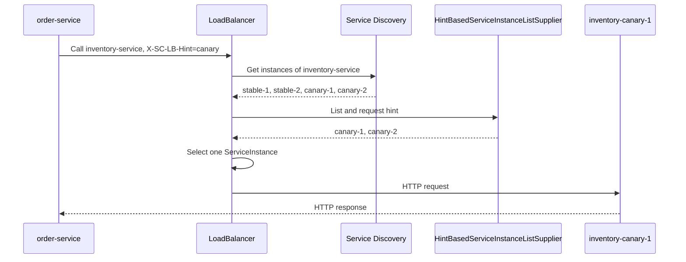

# Routing by Hint and ServiceInstance Metadata

## Objectives

In a microservices system, replicas of the same service can differ in deployment zone, release version, processing capacity, or the traffic segment they are allowed to serve. Spring Cloud LoadBalancer does not only select a `ServiceInstance` via round robin or random; it can also **filter the candidate list using information attached to instances and request context**.

A representative mechanism is **hint-based routing**: the caller sends a hint such as `stable` or `canary`, while each `ServiceInstance` registers corresponding metadata. `HintBasedServiceInstanceListSupplier` finds instances whose metadata matches the hint to include in the selection list. This mechanism can be combined with `zone`, `weight`, or custom filters when more complex policies are required.

After this lesson, you will be able to:

- Distinguish **request hints** from **ServiceInstance metadata**.
- Understand how Spring Cloud LoadBalancer retrieves hints from headers, default configuration, and per-service-ID configuration.
- Enable `HintBasedServiceInstanceListSupplier` using `ServiceInstanceListSupplier.builder()`.
- Practice with `RestClient`, `WebClient`, and OpenFeign when calling services by service ID.
- Explain the exact behavior when a hint is missing, unmatched, or the instance list is empty.
- Combine hints with zone/weight without accidentally routing to the wrong version.
- Build a custom metadata filter when policy requires a mandatory match, as well as test and observe routing effectiveness.

## 1. Real-World Problem: One Service ID, Multiple Instance Groups

Suppose `order-service` needs to call `inventory-service`. The target service currently has four replicas registered under the same service ID:

| Instance ID | Address | `hint` | `zone` | `weight` |
|---|---|---|---|---:|
| `inventory-stable-1` | `10.10.1.11:8080` | `stable` | `zone-a` | 3 |
| `inventory-stable-2` | `10.10.1.12:8080` | `stable` | `zone-b` | 1 |
| `inventory-canary-1` | `10.10.2.21:8080` | `canary` | `zone-a` | 1 |
| `inventory-canary-2` | `10.10.2.22:8080` | `canary` | `zone-b` | 1 |

The stable group serves most traffic. The canary group runs a new deployment that needs controlled verification. The caller can express its preference using a hint:

```text
GET http://inventory-service/api/items/42
X-SC-LB-Hint: stable

GET http://inventory-service/api/items/42
X-SC-LB-Hint: canary
```

Both URLs are identical because both use the service ID `inventory-service`. The difference lies in the request's hint. If the hint supplier is enabled and metadata is registered properly:

- Hint `stable` → list contains the two stable instances.
- Hint `canary` → list contains the two canary instances.
- After filtering, an algorithm such as `RoundRobinLoadBalancer` selects **one** instance from the remaining list.

Hint-based routing requires both sides: **the request supplies the value to look up**, and **the ServiceInstance supplies the label to match against**. Adding only the header to the request or only the metadata to the registry is not enough.

## 2. How Does ServiceInstance Store Metadata?

In Spring Cloud, `org.springframework.cloud.client.ServiceInstance` represents a concrete endpoint of a service. Its key members include:

| Property | Role |
|---|---|
| `getServiceId()` | Logical name of the service, e.g., `inventory-service`. |
| `getInstanceId()` | Replica identifier, useful for logging and observability. |
| `getHost()`, `getPort()`, `isSecure()` | Address and protocol for reaching the instance. |
| `getUri()` | URI constructed from connection details. |
| `getMetadata()` | `Map<String, String>` containing attributes attached to the replica. |

Example metadata of `inventory-canary-1`:

```json
{
  "hint": "canary",
  "zone": "zone-a",
  "weight": "1",
  "release": "2026-11-canary",
  "tier": "internal"
}
```

Metadata is supplied by the discovery provider, service registry, or deployment platform. Spring Cloud LoadBalancer does not automatically recognize `canary` from a pod name, IP, or hostname; a consistent metadata registration convention must be in place.

Three keys frequently used by built-in suppliers:

- `hint`: used by `HintBasedServiceInstanceListSupplier` to match against the request's hint.
- `zone`: used by `ZonePreferenceServiceInstanceListSupplier` to prioritize instances in the same zone as the caller.
- `weight`: used by `WeightedServiceInstanceListSupplier` to compute distribution weights, defaulting to `1` if omitted.

Keys such as `release` or `tier` are purely custom data. They **do not automatically affect the algorithm** unless the application has a corresponding supplier to read and filter by them. Metadata also does not replace health checks and does not prove an instance is ready to serve.

## 3. Registering Metadata on Replicas

### 3.1. Example with Eureka

When using Spring Cloud Netflix Eureka, each instance can declare metadata in `application.yml` or corresponding environment variables. Configuration for a stable replica:

```yaml
spring:
  application:
    name: inventory-service

eureka:
  instance:
    metadata-map:
      hint: stable
      zone: zone-a
      weight: "3"
      release: "stable"
```

The canary replica uses the same `spring.application.name` but different metadata values:

```yaml
spring:
  application:
    name: inventory-service

eureka:
  instance:
    metadata-map:
      hint: canary
      zone: zone-a
      weight: "1"
      release: "2026-11-canary"
```

This is **configuration on the called application**, registered alongside the instance. On the `order-service` side, you need to configure the discovery client to read instances and the LoadBalancer supplier to use that metadata.

With Consul, Kubernetes, or another discovery source, how metadata is registered can differ. What needs to be verified is that calling `ServiceInstance.getMetadata()` on the discovery client actually contains keys such as `hint`, `zone`, and `weight`. Do not assume every Kubernetes label or annotation automatically appears in `ServiceInstance` metadata.

### 3.2. Metadata Conventions

Establish a shared contract between the instance registrar and the caller:

| Convention | Recommended Example | Reason |
|---|---|---|
| Lowercase, fixed keys | `hint`, `zone` | Avoid confusing `Hint` with `hint`. |
| Standardized hint values | `stable`, `canary` | Exact string matching. |
| Weight as a valid number | `"1"`, `"3"` | Supplier can parse it into a number. |
| Consistent zone naming | `zone-a` | Caller and instance must share zone naming. |
| Observability metadata | `release=2026-11-canary` | Makes rollout configuration easy to investigate. |

Do not put tokens, customer information, or secrets into service discovery metadata. The registry is typically accessible to many infrastructure components; metadata should contain low-sensitivity routing information.

## 4. Where Does Spring Cloud LoadBalancer Get the Hint From?

Spring Cloud LoadBalancer supports string hints passed inside the `Request` object. `HintBasedServiceInstanceListSupplier` looks up the hint in the following order:

1. **Outbound request header**, defaulting to `X-SC-LB-Hint`.
2. **Hint configured for the service ID**, when the request provides no hint.
3. **Application default hint**, when no per-service-ID hint is configured.
4. If there is still no hint, no hint filtering is performed.

The header name can be changed with the property:

```yaml
spring:
  cloud:
    loadbalancer:
      hint-header-name: X-SC-LB-Hint
```

Keeping the default name is usually easier to maintain; change it only if your organization already uses another header convention and all involved components support it.

### 4.1. Default Hint and Per-Service-ID Hints

Example configuration in the caller application:

```yaml
spring:
  cloud:
    loadbalancer:
      hint:
        default: stable
        inventory-service: canary
        pricing-service: stable
```

When no hint header is present:

- Requests to `inventory-service` use the configured hint `canary`.
- Requests to `pricing-service` use the configured hint `stable`.
- Any service ID without specific configuration uses the `stable` hint from `default`.

If a request to `inventory-service` **includes** `X-SC-LB-Hint: stable`, the header value takes precedence over the configured `canary` hint. Default configuration is a way to set a fallback choice for requests carrying no hint, not a policy forcing every request to go to the default group.

### 4.2. Matching Against Metadata

When a hint is obtained, `HintBasedServiceInstanceListSupplier` compares that value with `serviceInstance.getMetadata().get("hint")`.

Example:

```text
requestHint = "canary"

instances from discovery:
  inventory-stable-1 { hint: stable }
  inventory-stable-2 { hint: stable }
  inventory-canary-1 { hint: canary }
  inventory-canary-2 { hint: canary }

after hint filter:
  inventory-canary-1
  inventory-canary-2
```

Comparison is string-based, not fuzzy matching or regular expressions. Therefore `canary` and `Canary` are two different values. The metadata key must also be literally `hint` when using the default supplier.

## 5. Distinguishing Hint, Supplier, and Instance Selection Algorithm

In Spring Cloud LoadBalancer, routing proceeds through the following steps:



`HintBasedServiceInstanceListSupplier` **filters the candidate list**, while `RoundRobinLoadBalancer` or `RandomLoadBalancer` **selects one instance** from that list. These are two separate responsibilities:

- Discovery returns the set of instances for the service ID.
- Suppliers may cache, filter by hint, prefer a zone, or apply other metadata policies.
- `ReactorLoadBalancer` decides which instance is chosen from the final candidate set.
- The HTTP client calls the host/port of the chosen instance and handles timeouts, network errors, or retries.

If you only add `hint` metadata without adding the hint-based supplier, instance selection will not change based on the `X-SC-LB-Hint` header. If you only enable the supplier while discovery does not provide the corresponding metadata, no instance matches and the supplier falls back.

## 6. Enabling Hint-Based Routing in the Caller Application

### 6.1. Core Dependencies

In Maven, use a Spring Cloud BOM compatible with your Spring Boot version, then declare the starter:

```xml
<dependency>
    <groupId>org.springframework.cloud</groupId>
    <artifactId>spring-cloud-starter-loadbalancer</artifactId>
</dependency>
```

To fetch instances dynamically, add a suitable discovery provider such as Eureka or Consul. If no registry is available yet, you can use a static instance list in a demo environment, while ensuring metadata is still supplied to the supplier when testing hints.

### 6.2. Creating a Supplier per Service ID

Declare `@LoadBalancerClient` on a Spring-scanned configuration class:

```java
import org.springframework.cloud.loadbalancer.annotation.LoadBalancerClient;
import org.springframework.context.annotation.Configuration;

@Configuration(proxyBeanMethods = false)
@LoadBalancerClient(
        name = "inventory-service",
        configuration = InventoryHintLoadBalancerConfiguration.class
)
class InventoryClientLoadBalancerRegistration {
}
```

Supplier configuration dedicated to `inventory-service`:

```java
import org.springframework.cloud.loadbalancer.core.ServiceInstanceListSupplier;
import org.springframework.context.ConfigurableApplicationContext;
import org.springframework.context.annotation.Bean;

class InventoryHintLoadBalancerConfiguration {

    @Bean
    ServiceInstanceListSupplier inventoryInstanceListSupplier(
            ConfigurableApplicationContext context) {
        return ServiceInstanceListSupplier.builder()
                .withDiscoveryClient()
                .withCaching()
                .withHints()
                .build(context);
    }
}
```

Reading the step order:

1. `withDiscoveryClient()` retrieves the instance list for `inventory-service`.
2. `withCaching()` caches the list returned from discovery using the LoadBalancer caching mechanism.
3. `withHints()` adds `HintBasedServiceInstanceListSupplier` to filter **per request**.

Because hints vary per request, **the cache must sit immediately after the discovery source and before the hint filter**. Do not cache the filtered list keyed solely by service ID, or a `stable` request could cause a subsequent `canary` request to receive the stable instance set.

The `InventoryHintLoadBalancerConfiguration` class intentionally omits `@Configuration`. Classes passed to `@LoadBalancerClient(configuration = ...)` should live outside the component-scan scope or omit `@Configuration` so their dedicated beans are not registered as shared beans for other service IDs.

### 6.3. When Discovery Already Has Caching

Some discovery clients, such as Eureka, maintain their own cache. Spring Cloud recommends considering disabling the LoadBalancer cache to avoid two cache layers and stale instance lists:

```yaml
spring:
  cloud:
    loadbalancer:
      cache:
        enabled: false
```

Even then, preserve the order: discovery source first, hint filter afterward. If a health-check supplier is used to verify readiness, place the health-check supplier immediately after the discovery source and before request-dependent filters; the documentation also advises against arbitrarily combining the health-check supplier with the caching supplier.

## 7. Sending Hints from RestClient, WebClient, and OpenFeign

The examples below assume `inventory-service` is registered in discovery and has the `withHints()` supplier configured as above. The URLs use the **service ID**, so the HTTP client must integrate with Spring Cloud LoadBalancer.

### 7.1. RestClient: Synchronous Calls

Declare a load-balanced builder:

```java
import org.springframework.cloud.client.loadbalancer.LoadBalanced;
import org.springframework.context.annotation.Bean;
import org.springframework.context.annotation.Configuration;
import org.springframework.web.client.RestClient;

@Configuration(proxyBeanMethods = false)
class RestClientConfiguration {

    @Bean
    @LoadBalanced
    RestClient.Builder loadBalancedRestClientBuilder() {
        return RestClient.builder();
    }
}
```

Usage:

```java
import org.springframework.cloud.client.loadbalancer.LoadBalanced;
import org.springframework.stereotype.Component;
import org.springframework.web.client.RestClient;

@Component
class InventoryRestGateway {

    private final RestClient client;

    InventoryRestGateway(@LoadBalanced RestClient.Builder builder) {
        this.client = builder.build();
    }

    String whoAmI(String hint) {
        return client.get()
                .uri("http://inventory-service/whoami")
                .header("X-SC-LB-Hint", hint)
                .retrieve()
                .body(String.class);
    }
}
```

Calling `whoAmI("stable")` requests the stable group. Calling `whoAmI("canary")` requests the canary group. Target instances must implement `GET /whoami` for the example to work.

### 7.2. WebClient: Reactive Calls

Declare the builder:

```java
import org.springframework.cloud.client.loadbalancer.LoadBalanced;
import org.springframework.context.annotation.Bean;
import org.springframework.context.annotation.Configuration;
import org.springframework.web.reactive.function.client.WebClient;

@Configuration(proxyBeanMethods = false)
class WebClientConfiguration {

    @Bean
    @LoadBalanced
    WebClient.Builder loadBalancedWebClientBuilder() {
        return WebClient.builder();
    }
}
```

Calling the service:

```java
import org.springframework.cloud.client.loadbalancer.LoadBalanced;
import org.springframework.stereotype.Component;
import org.springframework.web.reactive.function.client.WebClient;
import reactor.core.publisher.Mono;

@Component
class InventoryReactiveGateway {

    private final WebClient client;

    InventoryReactiveGateway(@LoadBalanced WebClient.Builder builder) {
        this.client = builder
                .baseUrl("http://inventory-service")
                .build();
    }

    Mono<String> whoAmI(String hint) {
        return client.get()
                .uri("/whoami")
                .header("X-SC-LB-Hint", hint)
                .retrieve()
                .bodyToMono(String.class);
    }
}
```

`WebClient` returns a `Mono` and does not execute until the publisher is subscribed to by the application flow. Do not call `block()` inside a reactive event loop.

### 7.3. OpenFeign: Sending Hints via Header

With Spring Cloud OpenFeign enabled via `@EnableFeignClients` and properly configured for load balancing:

```java
import org.springframework.cloud.openfeign.FeignClient;
import org.springframework.web.bind.annotation.GetMapping;
import org.springframework.web.bind.annotation.RequestHeader;

@FeignClient(name = "inventory-service")
interface InventoryFeignClient {

    @GetMapping("/whoami")
    String whoAmI(@RequestHeader("X-SC-LB-Hint") String hint);
}
```

`@FeignClient(name = "inventory-service")` specifies the service ID. The hint is a header on the request sent through Feign; whether the LoadBalancer filter can read that header depends on the Feign/LoadBalancer integration in use. Verify with an integration test on your project's exact Spring Cloud version, especially when custom Feign interceptors or client factories are present.

All three examples use the same routing idea. They do not automatically set timeouts, retries, or health checks: those mechanisms must be configured separately according to the HTTP client and business requirements.

## 8. Mismatch Cases and Fallback Behavior

`HintBasedServiceInstanceListSupplier` has a very important behavior: **a hint is only a preference**, not a strict filtering guarantee.

| Case | Default Result of Hint Supplier |
|---|---|
| Request has hint, instances have matching metadata | Returns matching instances. |
| No header, but hint is configured for service ID | Uses configured hint and filters by that value. |
| No header, no service-specific hint, `hint.default` exists | Uses default hint. |
| No hint from any source | Returns full list from delegate. |
| Hint present, but no instance matches | **Returns full list from delegate**. |
| Discovery returns empty list | Remains empty; no instance to select. |

Suppose only `stable` instances are healthy, yet the caller sends `X-SC-LB-Hint: canary`. Because no instance matches, the hint supplier can return all stable instances and the request is still dispatched. This behavior is designed to prioritize availability, not a sign that the hint was ignored.

Consequences:

- **Do not use default hints as a security boundary** for tenants, data regions, or access permissions.
- **Do not use hints to guarantee strict canary isolation** if the application cannot tolerate falling back to another group.
- If a request must reach a specific version or fail when no matching backend exists, you need a strict filter with clearly defined empty-list/error rules.

Unlike hints, some suppliers that filter by API version may default to returning an empty list when no version-matching instances exist. Therefore, read each supplier's contract instead of assuming all filters fall back the same way.

## 9. Combining Hints with Zone, Weight, and Other Metadata

### 9.1. Zone Preference and Hint

Zone preference prioritizes instances in the same zone as the caller based on the `zone` metadata key. The hint filter matches the `hint` metadata key. Suppliers can be combined:

```java
return ServiceInstanceListSupplier.builder()
        .withDiscoveryClient()
        .withCaching()
        .withZonePreference()
        .withHints()
        .build(context);
```

However, **filter order can change the result**. For example:

| Instance | Zone | Hint |
|---|---|---|
| `stable-zone-a` | `zone-a` | `stable` |
| `canary-zone-b` | `zone-b` | `canary` |

A caller in `zone-a` sends hint `canary`:

1. Zone preference keeps `stable-zone-a` because a same-zone instance exists.
2. The hint filter finds no `canary` in the remaining list.
3. The hint filter falls back to the list from zone preference.
4. The request can go to `stable-zone-a` even though the caller sent hint `canary`.

This is a consequence of combining two preference policies that both fall back. If the deployment requirement is "send canary requests only to canary, even if cross-zone," you must adjust the filter order/policy or use a mandatory release filter. Do not try to solve this merely by increasing the retry count.

### 9.2. Weight and Hint

`WeightedServiceInstanceListSupplier` reads `weight` metadata, defaulting to `1` if missing. For example, after the hint filter selects two stable instances with weights `3` and `1`, the weighted supplier can route more requests to the instance with weight `3`.

```java
return ServiceInstanceListSupplier.builder()
        .withDiscoveryClient()
        .withCaching()
        .withHints()
        .withWeighted()
        .build(context);
```

Weight is a relative ratio, not an exact guaranteed request count. Weight also does not automatically reflect CPU, latency, or in-flight requests unless the system updates metadata or provides a custom `WeightFunction`.

### 9.3. Custom Metadata

You can register additional attributes:

```yaml
eureka:
  instance:
    metadata-map:
      hint: canary
      release: "2026-11"
      tier: internal
      data-region: hcm
```

Spring Cloud LoadBalancer **does not automatically filter** by `release`, `tier`, or `data-region` just because they appear in metadata. If you want to select backends based on these keys, use a supplier that supports them or build a custom `ServiceInstanceListSupplier`.

For critical policies such as data partitioning, combine routing with access control at the backend/gateway. Metadata only describes an instance; it does not replace authentication and authorization.

## 10. Custom Metadata Filter with Mandatory Match Policy

If the requirement is: "When a request carries header `X-Route-Tier: internal`, **only** call instances with metadata `tier=internal`, and fail if no matching instance exists," the default hint supplier will not satisfy it because it falls back to the entire list.

We can create a strict filtering supplier. Illustrative example for applications using compatible Spring Cloud LoadBalancer and Spring Framework versions:

```java
import java.util.List;
import org.springframework.cloud.client.ServiceInstance;
import org.springframework.cloud.client.loadbalancer.Request;
import org.springframework.cloud.client.loadbalancer.RequestDataContext;
import org.springframework.cloud.loadbalancer.core.DelegatingServiceInstanceListSupplier;
import org.springframework.cloud.loadbalancer.core.ServiceInstanceListSupplier;
import reactor.core.publisher.Flux;

final class StrictTierSupplier extends DelegatingServiceInstanceListSupplier {

    StrictTierSupplier(ServiceInstanceListSupplier delegate) {
        super(delegate);
    }

    @Override
    public Flux<List<ServiceInstance>> get() {
        return delegate.get();
    }

    @Override
    public Flux<List<ServiceInstance>> get(Request request) {
        return delegate.get(request).map(instances -> {
            Object context = request.getContext();
            if (!(context instanceof RequestDataContext data)
                    || data.getClientRequest() == null) {
                return instances;
            }

            String tier = data.getClientRequest()
                    .getHeaders()
                    .getFirst("X-Route-Tier");

            if (tier == null || tier.isBlank()) {
                return instances;
            }

            return instances.stream()
                    .filter(instance ->
                            tier.equals(instance.getMetadata().get("tier")))
                    .toList();
        });
    }
}
```

With this code, when the tier header **is present** and no instance matches, the result is an empty list. When the tier header **is absent**, the filter currently allows all instances; if business logic requires the header, modify that branch to return empty or reject early at the authentication/validation layer.

Register the supplier in the dedicated child context for `inventory-service`:

```java
import org.springframework.cloud.loadbalancer.core.ServiceInstanceListSupplier;
import org.springframework.context.ConfigurableApplicationContext;
import org.springframework.context.annotation.Bean;

class InventoryStrictTierConfiguration {

    @Bean
    ServiceInstanceListSupplier inventoryInstanceListSupplier(
            ConfigurableApplicationContext context) {
        ServiceInstanceListSupplier base =
                ServiceInstanceListSupplier.builder()
                        .withDiscoveryClient()
                        .withCaching()
                        .build(context);
        return new StrictTierSupplier(base);
    }
}
```

To use this configuration, change `configuration` on `@LoadBalancerClient(name = "inventory-service")` to `InventoryStrictTierConfiguration.class`. The two example configurations in section 6 and this section are **mutually exclusive alternatives**; do not register two `ServiceInstanceListSupplier` beans for the same role simultaneously in one child context.

Points to check before using a custom-written supplier:

- Does the request context contain a `RequestDataContext` with the header you expect, especially when combined with OpenFeign or a custom client?
- When the header is missing, should all instances, a default set, or an error be used?
- When the header is present but unmatched, should an empty list really be returned?
- Has the header value been validated and authorized at a trusted layer?
- Is the cache placed **before** the filter so different requests do not affect one another?
- Do health status, zone, or API version also need to be evaluated simultaneously?

This snippet demonstrates metadata filtering. It does not turn a header into an authorization mechanism: the backend must still authenticate and enforce data access controls itself. Test the behavior with your project's exact Spring Cloud release train before using it in production.

## 11. Practice: Per-Request Stable/Canary Routing

### Step 1. Prepare Three Instances

Run three replicas of `inventory-service`, each exposing a `GET /whoami` endpoint returning its instance ID. Register metadata:

| Instance | Metadata `hint` | `/whoami` Result |
|---|---|---|
| Instance 1 | `stable` | `inventory-stable-1` |
| Instance 2 | `stable` | `inventory-stable-2` |
| Instance 3 | `canary` | `inventory-canary-1` |

Verify in the service registry or via the discovery client that all three belong to service ID `inventory-service` and `hint` metadata is read properly.

### Step 2. Enable the Hint Supplier

In the caller application, declare `@LoadBalancerClient` and the `.withDiscoveryClient().withCaching().withHints()` supplier as in section 6. You can use `RestClient` or `WebClient` annotated with `@LoadBalanced`.

### Step 3. Send Interleaved Requests

Suppose the caller exposes a test endpoint `/demo/inventory?hint=...` that forwards the query parameter as the outbound `X-SC-LB-Hint` header. Send the requests:

```bash
curl "http://localhost:8080/demo/inventory?hint=stable"
curl "http://localhost:8080/demo/inventory?hint=canary"
curl "http://localhost:8080/demo/inventory?hint=stable"
curl "http://localhost:8080/demo/inventory?hint=canary"
```

The `/demo/inventory` endpoint is an illustrative endpoint you implement on the caller yourself; it does not appear automatically when adding the LoadBalancer starter. In production environments, validate/restrict hints at a trusted layer rather than forwarding arbitrary user-supplied strings directly.

Expected results:

| Request | Prioritized Group | Selected Instance |
|---|---|---|
| `stable` #1 | Stable | `inventory-stable-1` or `inventory-stable-2` |
| `canary` #1 | Canary | `inventory-canary-1` |
| `stable` #2 | Stable | `inventory-stable-1` or `inventory-stable-2` |
| `canary` #2 | Canary | `inventory-canary-1` |

The specific stable instance chosen may vary according to the LoadBalancer's algorithm. Most importantly, canary requests are not affected by the cache/routing result of previous stable requests.

### Step 4. Try a Non-Existent Hint

Send a request with `hint=unknown`. According to `HintBasedServiceInstanceListSupplier`'s default behavior, because no instance has metadata `hint=unknown`, the supplier returns all instances from the delegate. This is a case that must be accounted for in tests and rollout monitoring.

### Step 5. Try Changing Metadata

Switch an instance from `stable` to `canary` in the registry, then observe how long it takes for the caller application to receive the updated list. Timing depends on caches, TTLs, and the discovery provider's update cycle. Do not assume metadata changed in the registry takes effect instantaneously across every caller.

## 12. Observability, Common Issues, and Fixes

Useful signals for verifying routing include service ID, normalized hint, discovered instance count, post-filter instance count, selected instance ID, retry count, and error rate by release group.

| Symptom | Possible Cause | Remediation |
|---|---|---|
| Header is `canary` yet requests still go to stable | Hint supplier not enabled, metadata mismatch, or fallback because no canary found | Check `withHints()`, headers in request context, and `hint` metadata on each instance. |
| Hint works with WebClient but not another client | Request context/headers not propagated to the supplier as expected | Check integration with the specific HTTP client and `ServiceInstanceListSupplier.get(Request)`. |
| Stable requests sent to canary | No matching stable instance caused hint fallback to all, or filter order removed them | Check lists before/after each filter, metadata, health checks, and cache. |
| Hint changed in registry yet has no effect | Discovery cache or LoadBalancer cache still holds an old snapshot | Check TTLs, refresh timing, and registration/deregistration cycles. |
| No instance found | Discovery returned empty, wrong service ID, or strict filtering policy returned empty | Check registry, service ID, and step-by-step filter results. |
| Header present yet wrong-zone instance selected | Hint, zone preference, and fallback interact in an unintended order | Test supplier ordering; determine which policy is mandatory vs. only a preference. |
| Abnormal canary traffic ratio | Caller sends wrong hints, default hint config is wrong, or weights do not match intent | Monitor request ratio by release, header config, metadata, and weights. |

**Security note:** do not log tokens, full cookies, or user-identifying information when troubleshooting. A hint is routing information, not proof that the caller is authorized for a data group. Authenticate, authorize, and validate hint values before turning them into business policy.

## 13. Deployment Checklist

- [ ] Service ID in discovery matches the URL `http://inventory-service` or `@FeignClient(name = ...)`.
- [ ] Instances register the exact `hint` metadata key and consistent values.
- [ ] Caller has a clear hint source: header, per-service-ID configuration, or default.
- [ ] `HintBasedServiceInstanceListSupplier` is enabled via `withHints()`.
- [ ] `CachingServiceInstanceListSupplier` is placed immediately after discovery and before per-request filters.
- [ ] Tested behavior when hint is empty or unmatched; understand that by default the supplier falls back to the delegate list.
- [ ] If mandatory routing is needed, a strict filtering mechanism and empty-list handling exist.
- [ ] When combining zone and hint, tested the case where no instance satisfies both conditions.
- [ ] HTTP client propagates request context and headers properly for the Spring Cloud version in use.
- [ ] Cache/health check/refresh settings do not keep stale metadata around for too long.
- [ ] Logs, metrics, and traces exist to identify which instance actually handled each request.
- [ ] Stable/canary requests are tested interleaved, concurrently, and during rollback.

## Conclusion

Hint-based routing in Spring Cloud LoadBalancer combines **request hints** and **`ServiceInstance` `hint` metadata**. `HintBasedServiceInstanceListSupplier` filters the instance list before the LoadBalancer picks a target; callers can pass hints via `X-SC-LB-Hint` or use per-service-ID default configuration. Keep in mind the fallback behavior that returns the full list when no instance matches. When combining hints with zone, weight, or custom metadata, explicitly decide which policies are merely preferences and which must be strictly enforced, while testing supplier order and observing actual routing outcomes.

## References

- [Spring Cloud Commons — Spring Cloud LoadBalancer, Hints, and Hint-Based Load-Balancing](https://docs.spring.io/spring-cloud-commons/reference/spring-cloud-commons/loadbalancer.html)
- [Spring Cloud Commons — ServiceInstanceListSupplier and LoadBalancerClient Configuration](https://docs.spring.io/spring-cloud-commons/reference/spring-cloud-commons/loadbalancer.html#passing-your-own-spring-cloud-loadbalancer-configuration)
- [Spring Cloud Commons — Configuration Properties](https://docs.spring.io/spring-cloud-commons/reference/configprops.html)
- [Spring Cloud OpenFeign — Client Configuration](https://docs.spring.io/spring-cloud-openfeign/reference/spring-cloud-openfeign.html)
- [Spring Cloud Commons — HintBasedServiceInstanceListSupplier source](https://github.com/spring-cloud/spring-cloud-commons/blob/main/spring-cloud-loadbalancer/src/main/java/org/springframework/cloud/loadbalancer/core/HintBasedServiceInstanceListSupplier.java)
