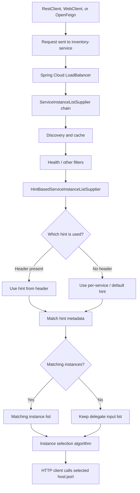

# Default Service Hints and Request Header Hints

In microservices, a service can have multiple replicas (`ServiceInstance`) belonging to different serving groups: `stable`, `canary`, `preview`, or a group categorized by capacity. When calling by service ID, an application sometimes wants to **prioritize a group of instances** while retaining the ability to fall back to the original list if that group has no candidates. Spring Cloud LoadBalancer supports this model through **hint-based load balancing**.

This lesson belongs to the **Zones and Routing** chapter of the `SPRING_CLOUD_SERVICE_COMMUNICATION_LOAD_BALANCING` module. It focuses on how to declare **a default hint for all services or per individual service**, how to pass **hints via request headers**, how to use `HintBasedServiceInstanceListSupplier` to filter candidates, and how to operate alongside discovery, health checks, HTTP clients, retries, and timeouts.

> **Key takeaway:** A hint is a string suggestion used to *preferentially filter* the instance list. In the default implementation of `HintBasedServiceInstanceListSupplier`, if no instance matches the hint, the supplier returns **the entire list provided by the delegate**. Therefore, hints do not inherently create a mandatory routing condition.

## 1. At Which Step Is the Hint Applied?

Suppose `order-service` calls `inventory-service` with three instances:

| Instance | Sample Address | Metadata `hint` |
|---|---|---|
| `inventory-1` | `10.0.1.11:8080` | `stable` |
| `inventory-2` | `10.0.1.12:8080` | `stable` |
| `inventory-3` | `10.0.1.13:8080` | `canary` |

Normal requests prioritize the `stable` group; a test request can pass the `X-SC-LB-Hint: canary` header to prioritize `inventory-3`.

High-level processing chain:



Two responsibilities must be distinguished:

- `HintBasedServiceInstanceListSupplier` **filters the candidate list** based on metadata.
- `RoundRobinLoadBalancer`, `RandomLoadBalancer`, or another implementation **picks one instance** from the remaining list.

A hint does not decide host or port directly. It affects the candidate set before the selection algorithm is invoked.

## 2. Precedence Order: Header, Service ID, Default

Spring Cloud LoadBalancer provides per-service-ID hint configuration and a shared default hint. When `HintBasedServiceInstanceListSupplier` is enabled, the hint source is resolved in the following order:

1. **Request header** if a corresponding hint header is present.
2. **Configuration for the current service ID** if the request has no hint header.
3. **Default configuration** if there is no per-service hint and no hint header.
4. **No hint** if no value is found in any of the sources above.

Key properties:

| Property | Role |
|---|---|
| `spring.cloud.loadbalancer.hint.default` | Default hint when a service declares no specific hint and the request has no hint header. |
| `spring.cloud.loadbalancer.hint.[SERVICE_ID]` | Specific hint for the corresponding service ID. |
| `spring.cloud.loadbalancer.hint-header-name` | Name of the header carrying the hint; defaults to `X-SC-LB-Hint`. |

You can visualize it as:

```text
Has X-SC-LB-Hint header?
    Yes → use header value
    No
      └─ Has per-service-ID hint?
             Yes → use service hint
             No
               └─ Has default hint?
                      Yes → use default
                      No  → do not filter by hint
```

If a header is present but **no instance carries matching metadata**, the supplier falls back to the full input list. It does not retry the service hint or default hint after the header value has already been selected.

This is critical during canary testing: a misspelled hint can cause requests to be distributed across both `stable` and `canary` groups instead of being rejected.

## 3. Configuring Default and Per-Service Hints in YAML

Suppose `order-service` calls two services:

- `inventory-service` wants to default to the `stable` group.
- `catalog-service` wants to default to the `standard` group.
- Services without specific configuration use the `general` hint where appropriate.

Declare in `application.yml`:

```yaml
spring:
  cloud:
    loadbalancer:
      hint:
        default: general
        inventory-service: stable
        catalog-service: standard
      hint-header-name: X-SC-LB-Hint
```

The keys `inventory-service` and `catalog-service` must match the **service ID** requested by the HTTP client. Do not use arbitrary bean names in place of the service ID.

Equivalent properties format:

```properties
spring.cloud.loadbalancer.hint.default=general
spring.cloud.loadbalancer.hint.inventory-service=stable
spring.cloud.loadbalancer.hint.catalog-service=standard
spring.cloud.loadbalancer.hint-header-name=X-SC-LB-Hint
```

These values are illustrative; you can choose strings like `blue`, `green`, or `v2` to fit how instances are organized.

**Note:** Merely declaring these properties does not guarantee hints are applied. The instance list must contain matching metadata, and the supplier chain must include `HintBasedServiceInstanceListSupplier`, such as configuring `withHints()` as shown in the example below.

### 3.1. When Only a Default Hint Is Configured

If the application only configures:

```yaml
spring:
  cloud:
    loadbalancer:
      hint:
        default: stable
```

then services without a specific hint will use `stable` if the request does not carry the header. Services with their own setting will use their own value, so it is unnecessary to repeat the same default configuration under every service.

### 3.2. When No Hints Are Configured

If there is no header, no per-service hint, and no `default`, `HintBasedServiceInstanceListSupplier` keeps the list provided by the delegate unchanged. An algorithm like round robin can select from that set as usual.

## 4. Attaching Hint Metadata to ServiceInstance

The hint mechanism relies on **instance metadata** with the key `hint`. This is server metadata provided by a discovery provider or a `ServiceInstanceListSupplier` source, not a label assigned automatically by Spring Cloud LoadBalancer.

Example:

| Service ID | Instance ID | Metadata |
|---|---|---|
| `inventory-service` | `inventory-1` | `hint=stable` |
| `inventory-service` | `inventory-2` | `hint=stable` |
| `inventory-service` | `inventory-3` | `hint=canary` |
| `catalog-service` | `catalog-1` | `hint=standard` |
| `catalog-service` | `catalog-2` | `hint=preview` |

With an Eureka client, each instance can declare its own metadata. Example configuration for a **stable instance**:

```yaml
spring:
  application:
    name: inventory-service

eureka:
  instance:
    metadata-map:
      hint: stable
```

In the configuration for running the **canary instance**, set:

```yaml
spring:
  application:
    name: inventory-service

eureka:
  instance:
    metadata-map:
      hint: canary
```

Both instances still share the service ID `inventory-service`, yet discovery returns different `hint` metadata. Ensure other registration properties such as the Eureka endpoint, instance ID, host/port, and environment profiles are configured appropriately.

If using Consul, Kubernetes, or a custom instance source, how metadata is declared depends on the specific integration. The final check is whether `ServiceInstance.getMetadata().get("hint")` on the client side contains the expected value.

### 4.1. Do Not Confuse Hint with Zone

`hint=stable` or `hint=canary` is merely a label used for filtering by the hint mechanism. It is not synonymous with zone, region, readiness, or business capability. If the system needs same-zone preference, use the LoadBalancer's zone filtering/preference capability with appropriate zone metadata.

For data residency, tenant isolation, or security requirements, do not rely on a soft hint as the sole barrier.

## 5. Enabling HintBasedServiceInstanceListSupplier

The supplier must be configured to filter the list by hint metadata. Using Spring Cloud LoadBalancer's builder API, for example:

```java
import org.springframework.cloud.loadbalancer.core.ServiceInstanceListSupplier;
import org.springframework.context.ConfigurableApplicationContext;
import org.springframework.context.annotation.Bean;
import org.springframework.context.annotation.Configuration;

@Configuration(proxyBeanMethods = false)
public class HintRoutingConfiguration {

    @Bean
    ServiceInstanceListSupplier serviceInstanceListSupplier(
            ConfigurableApplicationContext context) {

        return ServiceInstanceListSupplier.builder()
                .withDiscoveryClient()
                .withCaching()
                .withHints()
                .build(context);
    }
}
```

Meaning:

- `withDiscoveryClient()` fetches the instance list from the integrated discovery client.
- `withCaching()` adds caching for the instance source.
- `withHints()` adds the hint-filtering layer, reading values from headers or configuration.
- `build(context)` builds the supplier for the current application context.

This order caches the source list first and then applies hints **per request**. If you assemble a different chain, make sure caching does not accidentally store one request's filtered result and apply it to requests with different hints.

This snippet illustrates the mechanism in Spring Cloud release trains that support this builder API. When implementing, use a compatible Spring Boot/Spring Cloud BOM and verify the API signatures in your project's version.

### 5.1. Applying Supplier Configuration to Multiple Services

You can use `@LoadBalancerClients` to provide a default configuration for LoadBalancer child contexts:

```java
import org.springframework.boot.autoconfigure.SpringBootApplication;
import org.springframework.cloud.loadbalancer.annotation.LoadBalancerClients;

@SpringBootApplication
@LoadBalancerClients(
        defaultConfiguration = HintRoutingConfiguration.class
)
public class OrderServiceApplication {
}
```

Then `application.yml` from section 3 determines the default hint, per-service hints, and header name. Contexts can share the same supplier structure while picking up **different hints per service ID**.

Place `HintRoutingConfiguration` **outside the application's default component scan** if it is meant only for LoadBalancer child contexts. If accidentally scanned as a global `@Configuration` in the parent context, the supplier bean may affect multiple clients unexpectedly.

### 5.2. Enabling for Only One Service

If only `inventory-service` needs hint filtering:

```java
@SpringBootApplication
@LoadBalancerClient(
        name = "inventory-service",
        configuration = HintRoutingConfiguration.class
)
public class OrderServiceApplication {
}
```

Then only `inventory-service`'s context is bound to the custom supplier via this annotation. Other services use their own supplier configurations.

Do not define multiple `ServiceInstanceListSupplier` beans in the same client context without clearly defining which bean is primary; duplicate beans can make autoconfiguration and bean selection order unpredictable.

## 6. Passing Hints via Request Headers

The default header name is `X-SC-LB-Hint`. When a client sends a request to a service ID with this header, `HintBasedServiceInstanceListSupplier` can read the value from the request to filter instances.

Example:

```http
GET /api/stock/sku-001 HTTP/1.1
Host: inventory-service
X-SC-LB-Hint: canary
```

If the list contains `hint=canary` instances, candidates are narrowed to that group. If the header is absent, the filter uses the per-service-ID hint or default hint. If the header carries a value that matches no instance, the filter defaults to returning the entire source list.

### 6.1. RestClient

Declare a LoadBalancer-integrated builder:

```java
@Configuration(proxyBeanMethods = false)
class HttpClientConfiguration {

    @Bean
    @LoadBalanced
    RestClient.Builder loadBalancedRestClientBuilder() {
        return RestClient.builder();
    }
}
```

Gateway calling with per-request hints:

```java
@Service
class InventoryGateway {

    private final RestClient client;

    InventoryGateway(
            @Qualifier("loadBalancedRestClientBuilder")
            RestClient.Builder builder) {
        this.client = builder.build();
    }

    String stock(String sku, String hint) {
        return client.get()
                .uri("http://inventory-service/api/stock/{sku}", sku)
                .header("X-SC-LB-Hint", hint)
                .retrieve()
                .body(String.class);
    }

    String stockWithDefaultHint(String sku) {
        return client.get()
                .uri("http://inventory-service/api/stock/{sku}", sku)
                .retrieve()
                .body(String.class);
    }
}
```

- `stock(sku, "canary")` requests prioritizing instances with `hint=canary`.
- `stockWithDefaultHint(sku)` passes no header, so it uses `hint.inventory-service` configuration if present.
- Both methods must use the `@LoadBalanced RestClient.Builder`.

Do not assume headers from an external inbound request are automatically forwarded to outbound requests created by `RestClient`. If you want to use a hint from an inbound request, the gateway must explicitly read, validate, and attach the outbound header.

### 6.2. WebClient

Similarly, use a `@LoadBalanced` builder:

```java
@Configuration(proxyBeanMethods = false)
class WebClientConfiguration {

    @Bean
    @LoadBalanced
    WebClient.Builder loadBalancedWebClientBuilder() {
        return WebClient.builder();
    }
}
```

Call example:

```java
@Service
class InventoryReactiveGateway {

    private final WebClient client;

    InventoryReactiveGateway(
            @Qualifier("loadBalancedWebClientBuilder")
            WebClient.Builder builder) {
        this.client = builder.build();
    }

    Mono<String> stock(String sku, String hint) {
        return client.get()
                .uri("http://inventory-service/api/stock/{sku}", sku)
                .header("X-SC-LB-Hint", hint)
                .retrieve()
                .bodyToMono(String.class);
    }
}
```

For the request header to reach the supplier, `WebClient` must pass through Spring Cloud's LoadBalancer filter. A standalone `WebClient` created via `WebClient.create()` does not automatically receive this configuration.

### 6.3. OpenFeign

With OpenFeign, you can include the header in the interface method:

```java
@FeignClient(name = "inventory-service")
interface InventoryClient {

    @GetMapping("/api/stock/{sku}")
    StockResponse stock(
            @PathVariable("sku") String sku,
            @RequestHeader("X-SC-LB-Hint") String hint);
}
```

When integrated with Spring Cloud LoadBalancer, calling `inventoryClient.stock("sku-001", "canary")` carries the header for the supplier to read. The application must have compatible OpenFeign/LoadBalancer dependencies and a configured instance source. If a Feign client declares a fixed target URL, requests may bypass service-ID instance selection; inspect the actual configuration.

The snippets above show how to pass headers. In complete code, add imports and dependency configuration for your Spring version.

## 7. Decision Table: Which Hint Is Used?

Suppose the configuration is:

```yaml
spring:
  cloud:
    loadbalancer:
      hint:
        default: general
        inventory-service: stable
        catalog-service: standard
```

And `inventory-service` has three instances: `stable-1`, `stable-2`, and `canary-1`, with corresponding `hint` metadata.

| Service ID | `X-SC-LB-Hint` Header | Selected Hint | Post-Filter Candidates |
|---|---|---|---|
| `inventory-service` | None | `stable` (per-service) | `stable-1`, `stable-2` |
| `inventory-service` | `canary` | `canary` (header takes precedence) | `canary-1` |
| `inventory-service` | `unknown` | `unknown` | No match → all three input instances |
| `catalog-service` | None | `standard` (per-service) | Catalog instances with `hint=standard` |
| `catalog-service` | `preview` | `preview` | Catalog instances with `hint=preview`, if any |
| Service with no specific hint | None | `general` (default) | Instances with `hint=general`, if any; no match → input list |
| Any service | None and no hint config | No hint | Keep entire input list |

Notice the `unknown` row: the default supplier **does not return an empty list** simply because no metadata matches. This is fallback behavior to continue routing, suitable for soft-preference traffic but unsuitable for mandatory routing.

### 7.1. Non-Standard Header Values

`hint` metadata values must be named consistently between instance registration and request senders. For example, `canary` and `Canary` should not be treated as equivalent unless an explicit normalization rule is designed.

When clients can send arbitrary values, normalize against an allowlist before passing them into the HTTP client to avoid mismatches causing hard-to-observe fallbacks.

## 8. Hints Are a Soft Preference, Not a Mandatory Filter

By default, the hint-based algorithm performs:

```text
candidates = instancesFromDelegate
hint = headerHint ?: serviceHint ?: defaultHint

if hint is not provided:
    return candidates

matched = candidates with metadata["hint"] == hint

if matched is not empty:
    return matched
else:
    return candidates
```

This is pseudocode conveying the idea, not a copy of the source code. When there is no match, the supplier falls back to the delegate list.

### 8.1. Appropriate Use Cases

Soft hints make sense when:

- Prioritizing the `stable` group while allowing failover to another group.
- Testing canary on selected requests while still wanting backup candidates.
- Choosing an optimal processing group while the other group can still handle requests validly.
- Splitting experimental traffic when fallback behavior is acceptable.

### 8.2. Situations Where Soft Hints Should Not Be the Sole Guarantee

Do not use soft hints as the sole measure when:

- Data must remain within a specific region.
- Requests for one tenant must never reach another tenant's instances.
- One API version is strictly incompatible with another.
- An instance's metadata does not meet mandatory security or processing standards.

In those scenarios, you need a custom supplier with **hard constraints**, or an appropriate infrastructure/application routing policy. If no valid instance exists, return an explicit error and handle it per the API contract; do not allow fallback to an instance violating constraints.

## 9. Combining Hints with Zone, Health Check, Cache, and Retry

Hints should only act on instances **already accepted by preceding conditions**. For complex supplier chains, clearly define the nature of each step:

| Step | Role | Question Answered |
|---|---|---|
| Discovery | Retrieve registered replicas | Which instances exist? |
| Cache | Reduce source queries | Is the snapshot still fresh? |
| Health check | Evaluate readiness | Which instances are healthy? |
| Zone/other metadata filter | Apply routing criteria | Which instances match location/policy? |
| Hint | Prioritize group matching `hint` metadata | Within the delegate list, which group is preferred? |
| Load balancer | Select one instance | Among final candidates, which target is picked? |

**Decorator order affects behavior.** For instance, if hint runs after health check, fallback on a hint mismatch only returns the list health check provided; it does not restore instances eliminated in the prior step. If hint runs before another filter, results can differ. With the builder, follow the order in your release train's documentation and test the actual ordering.

When caching shared data, do not cache a list filtered by the first request's hint and reuse it for requests with different hints. For example, `withDiscoveryClient().withCaching().withHints()` separates caching the source list from per-request filtering.

Retries can re-select an instance when a prior call fails depending on the HTTP client and LoadBalancer configuration. However, retries **do not turn a non-matching hint into mandatory routing**, nor do they guarantee canary receives every hinted request. For write operations, consider idempotency keys, retry limits, and total deadlines.

## 10. External Headers and Trust Policies

A header like `X-SC-LB-Hint` may be sent by internal applications, API gateways, or external clients. If a public endpoint accepts and forwards this header unchecked, callers can deliberately steer traffic to `canary` or experimental groups.

Define which sources are allowed to generate hints:

1. If only internal applications determine routing, **do not forward verbatim** hint headers from external users.
2. Map inbound values onto an allowlisted hint group, such as `stable` or `canary`.
3. Only allow canary for users/tenants/feature flags granted experimental access.
4. Do not use hints to bypass authentication, authorization, or data constraints.
5. Record the requested hint and selected group to detect unexpected fallbacks.

For example: an API receives `X-Experiment-Cohort: beta` from a trusted system, evaluates the feature flag condition, and then **generates** the outbound header `X-SC-LB-Hint: canary`. There is no need to preserve the external request's original header.

### 10.1. Changing the Header Name

If you need to rename the header to match internal conventions:

```yaml
spring:
  cloud:
    loadbalancer:
      hint-header-name: X-Internal-Routing-Hint
```

Afterward, the outbound client must send `X-Internal-Routing-Hint`. Renaming the property does not automatically add the header and does not guarantee secrecy or security; controlling who can supply values remains the responsibility of the application/gateway layer.

## 11. Testing Hint Behavior by Service and Request

Tests must verify the **post-filter candidate list**, not just the count of successful HTTP requests.

### 11.1. Scenarios to Cover

| Input | Expected |
|---|---|
| No header, service has specific hint | Uses the service's specific hint |
| No header, service has no specific hint | Uses `hint.default` |
| Header matches metadata | Keeps only matching instances from the delegate list |
| Header differs from service's configured hint | Header takes precedence |
| Header present, but no instance matches | Returns the full delegate list |
| No header and no configured hint | Returns the full delegate list |
| Some instances lack `hint` metadata | Only matching instances are prioritized; if no match, falls back to delegate |
| Delegate list is empty | Result stays empty; hint does not create instances |
| Delegate emits an error | Source error must be observed; hint does not fix discovery |
| Header via RestClient/WebClient/Feign | Works only when the HTTP client truly has LoadBalancer integration |
| Cached source list | Changing hints between two requests produces separate filtered results |
| Mandatory routing | If fail-closed is needed, a mechanism outside the default hint supplier is required |

### 11.2. Example Testing with Mock Data

One way to build test data using `DefaultServiceInstance`:

```java
import java.util.List;

import org.springframework.cloud.client.ServiceInstance;
import org.springframework.cloud.client.DefaultServiceInstance;

static ServiceInstance instance(
        String id, int port, String hint) {

    DefaultServiceInstance result =
            new DefaultServiceInstance(
                    id,
                    "inventory-service",
                    "127.0.0.1",
                    port,
                    false);

    result.getMetadata().put("hint", hint);
    return result;
}

List<ServiceInstance> candidates = List.of(
        instance("inventory-1", 8081, "stable"),
        instance("inventory-2", 8082, "stable"),
        instance("inventory-3", 8083, "canary"));
```

When building the supplier chain in tests, you can replace discovery with a mock source and issue requests with different hints. Meaningful assertions include:

- No header, default `stable`: list has two instances.
- Header `canary`: only `inventory-3`.
- Header `unknown`: list has all three instances again due to soft fallback.
- Empty delegate list: no instance to select even when a hint is set.

If you only test `RandomLoadBalancer` by counting requests sent to each instance, results can fluctuate and fail to prove the exact filtering rule. Test the supplier in isolation first, then run integration tests to confirm the HTTP client propagates the header into the request context.

### 11.3. Testing in a Live Environment

You can spin up two `inventory-service` instances with `stable` metadata and one `canary` instance. Create an endpoint in `order-service` using load-balanced RestClient/WebClient/Feign and pass the outbound hint from a test parameter.

Send these types of requests from that endpoint:

```text
Request A: no outbound hint passed
  -> expect stable prioritized

Request B: outbound X-SC-LB-Hint: canary passed
  -> expect canary prioritized

Request C: outbound X-SC-LB-Hint: unknown passed
  -> expect fallback to all instances provided by delegate
```

Log the receiving target's instance ID for observation, but do not assume random/round robin always yields one fixed sequence in multi-client or multi-threaded systems.

## 12. Observing Hints and Fallbacks in Production

Useful signals:

| Sample Log/Metric Field | Purpose |
|---|---|
| `serviceId` | Identify the service being called |
| `hintSource` | `HEADER`, `SERVICE_DEFAULT`, `GLOBAL_DEFAULT`, or `NONE` |
| `requestedHint` | The hint chosen from the precedence sources |
| `candidateCountBeforeHint` | Total candidates from delegate |
| `matchedInstanceCount` | Number of instances with matching metadata |
| `fallbackToAll` | Whether it fell back to the input list due to no match |
| `candidateCountAfterHint` | Candidate count after the hint step |
| `selectedInstance` | Final instance selected by the load balancer |
| `requestOutcome` | Success, timeout, 5xx, or no-instance error |

The field names above are **application-defined observability conventions**, not a mandatory default metric suite from Spring Cloud.

Example log for a request with a matching hint:

```text
serviceId=inventory-service
hintSource=HEADER
requestedHint=canary
candidateCountBeforeHint=3
matchedInstanceCount=1
candidateCountAfterHint=1
fallbackToAll=false
```

Example for a non-matching hint:

```text
serviceId=inventory-service
hintSource=HEADER
requestedHint=unknown
candidateCountBeforeHint=3
matchedInstanceCount=0
candidateCountAfterHint=3
fallbackToAll=true
```

Log only what is necessary. Avoid putting unbounded user-provided raw hints, URIs, or instance IDs into metric labels due to high-cardinality risk. If hints originate from users, normalize/allowlist them before putting them into logs or metrics.

A critical metric for canary rollouts is the **fallback rate of canary-hinted requests**: if it spikes suddenly, metadata or canary instance count may have changed. Cross-check health checks and caches before concluding routing is broken.

## 13. Common Pitfalls

| Symptom | Possible Cause | Remediation |
|---|---|---|
| Hint declared in YAML yet requests hit all instances | `withHints()` not enabled or supplier not loaded in client context | Check `@LoadBalancerClient(s)` and the supplier bean |
| `canary` header does not prioritize canary | Header not propagated into request context, wrong header name, or metadata mismatch | Check outbound client, header, and `getMetadata().get("hint")` |
| Service defaults to the wrong group | Service ID in property does not match request ID, or `default` is being used | Compare `hint.[SERVICE_ID]` with the name in the URL or Feign |
| Request has header yet still uses multiple groups | No instance matches; supplier fell back to full delegate | Inspect `matchedInstanceCount` and metadata values |
| Canary request routed to stable | Canary unhealthy or filtered before hint; or no match | Check chain order, list after health/filters, and fallback |
| Different results across requests with the same hint | Instance list changed, cache refreshed, or random selection policy | Record timestamps, candidate count, and selection algorithm |
| External request header has no effect | Application has not attached it to the outbound HTTP request | Propagate hint in a controlled way to RestClient/WebClient/Feign |
| A group is selected despite lacking permission to serve | Soft hint used for a hard business constraint | Design a mandatory supplier/policy and fail closed |
| Other services affected after adding supplier | Dedicated configuration class was component-scanned into parent context | Move configuration outside scan base and verify each client context |
| Retries cause abnormal canary traffic | Multi-layer retries or requests re-selecting instances | Limit retries, set deadlines, and monitor idempotency |

## 14. Implementation and Verification Workflow

When introducing hint routing into a Spring Cloud LoadBalancer project, proceed in order:

1. Define the policy: is the hint a **soft preference** or does business logic genuinely require hard routing?
2. Define the list of valid hint values and `hint` metadata for each instance.
3. Configure `spring.cloud.loadbalancer.hint.default` and any necessary `hint.[SERVICE_ID]` settings.
4. Choose the header name, defaulting to `X-SC-LB-Hint`; specify which applications are allowed to create or forward the header.
5. Enable `HintBasedServiceInstanceListSupplier` in the chain with `withHints()` in the right client context.
6. Ensure the HTTP client uses `@LoadBalanced` or the corresponding OpenFeign integration.
7. Verify the pre-hint and post-hint lists with tests and logs, including the no-match case.
8. Combine health/cache/zone in a sensible order and test when instances change.
9. Configure HTTP client timeouts and retries with a clear time budget.
10. Monitor `fallbackToAll`, candidate counts, selected instances, and connection errors.

**Do not rely on hints to solve every routing need.** Hints fit simple instance-group prioritization. For data constraints, tenant-based routing, incompatible versions, or complex priorities, a dedicated, thoroughly tested supplier or routing policy is needed.

## 15. Summary

Spring Cloud LoadBalancer lets you set a default hint using `spring.cloud.loadbalancer.hint.default` and per-service-ID hints using `spring.cloud.loadbalancer.hint.[SERVICE_ID]`. With `HintBasedServiceInstanceListSupplier`, a request's `X-SC-LB-Hint` header takes precedence over configuration, allowing the same client to target different instance groups per call.

Hints match against `hint` metadata values on `ServiceInstance`. If matching instances exist, the supplier provides only that group to the selection algorithm. If no match exists, the supplier defaults to returning the delegate list, making it a soft preference mechanism. Understanding header precedence, fallback semantics, and request context propagation enables stable integration with RestClient, WebClient, and OpenFeign while avoiding misusing hints for mandatory routing constraints.

**Reference:** [Spring Cloud Commons — Spring Cloud LoadBalancer](https://docs.spring.io/spring-cloud-commons/reference/spring-cloud-commons/loadbalancer.html), sections *Spring Cloud LoadBalancer Hints* and *Hint-Based Load-Balancing*.
