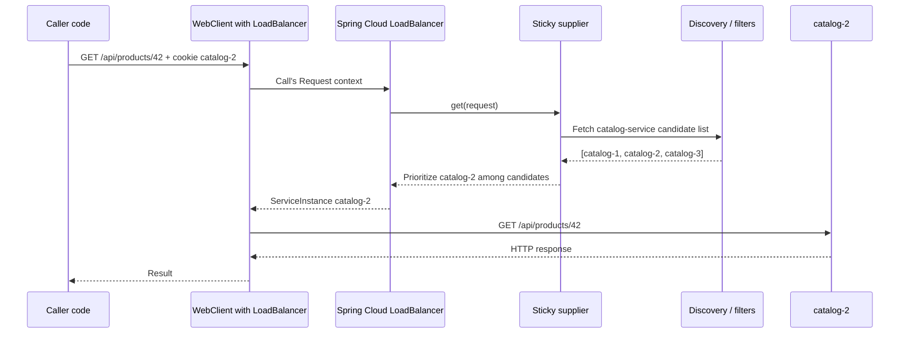
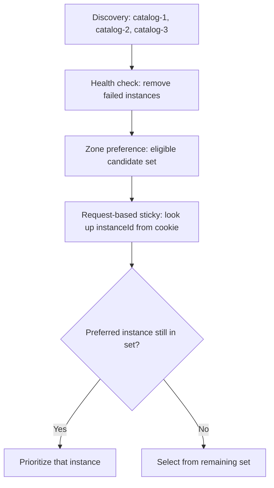

# Maintaining Instance Affinity with Request-Based Sticky Sessions

In an application with multiple instances, Spring Cloud LoadBalancer typically selects a `ServiceInstance` for each HTTP call based on the list supplied by `ServiceInstanceListSupplier`. With round-robin, two consecutive requests from the same user may hit two different instances. This works well for stateless services, yet can be inconvenient when an interactive flow wants to **prefer returning to the previously used instance**.

**Request-based sticky session** lets a request specify its preferred instance. Spring Cloud LoadBalancer provides `RequestBasedStickySessionServiceInstanceListSupplier`: it checks the `instanceId` in a request cookie, prioritizes the corresponding instance if it is still in the candidate list, and allows load balancing to pick another instance when the preferred instance is no longer available. This is a **soft preference (affinity)**, not a guarantee to always route to one instance or an application session-storage mechanism.

This lesson belongs to the **Zones and Routing** section of the Spring Cloud LoadBalancer module. It focuses on configuring and observing the relationships among service ID, request context, instance ID cookie, discovery, health checks, zones, and instance selection when communicating via HTTP clients.

## 1. What Does Request-Based Sticky Session Solve?

Suppose `order-service` calls `catalog-service`, which has three instances:

| Service ID | Instance ID | Zone | Sample Address |
|---|---|---|---|
| `catalog-service` | `catalog-1` | `az-a` | `10.0.1.11:8080` |
| `catalog-service` | `catalog-2` | `az-a` | `10.0.1.12:8080` |
| `catalog-service` | `catalog-3` | `az-b` | `10.0.2.13:8080` |

On the first call to `catalog-service`, the request has no instance-hint cookie yet. The LoadBalancer may select `catalog-2`. On the next call, if the HTTP client passes the cookie `sc-lb-instance-id=catalog-2` and the supplier receives the proper request context, `catalog-2` will be **prioritized** within the eligible instance list.

If `catalog-2` is removed from discovery or eliminated by a health check filter, sticky sessions cannot bring back a vanished instance. The supplier uses the remaining valid instances, such as `catalog-1` and `catalog-3`, so requests continue to be served.

The **meaning of the cookie** here is an instance identifier belonging to a service ID. It is not a user session ID, a JWT, or proof of authentication. A value like `catalog-2` is only meaningful when that instance exists in `catalog-service`'s list; cookies cannot be used to bypass service discovery or access controls.

## 2. Instance Selection Flow Based on Request Information



Steps to distinguish:

1. **The HTTP client** creates a request to the logical URL `http://catalog-service/...`, including the instance ID cookie if preference info is available.
2. **LoadBalancer integration** puts the necessary request data into the `Request` context. The supplier can only read the cookie if the integration actually propagates that context.
3. **The discovery source** supplies the `ServiceInstance` objects for `catalog-service`. Additional steps such as health checks or zone preference may alter the list.
4. **RequestBasedStickySessionServiceInstanceListSupplier** looks up the cookie, matches it against the candidates' instance IDs, and prioritizes the matching instance when possible.
5. **The LoadBalancer** makes the selection; the HTTP client sends the request to the host and port of the chosen instance.

If there is no cookie, the cookie is invalid, the instance has been removed, or no suitable request context is present, the LoadBalancer must rely on the remaining instance set and active selection policy. Sticky sessions do not create a new address and do not guarantee the server stores user state.

## 3. Distinguishing Preference Mechanisms in Spring Cloud LoadBalancer

| Mechanism | Information Used to Prioritize | Scope of Application | Key Takeaway |
|---|---|---|---|
| Round-robin | List order and cyclic selection state | Requests to the same service ID | Does not track users/sessions |
| `SameInstancePreferenceServiceInstanceListSupplier` | Previously selected instance for the client | Tends to prefer the previous instance without tying a separate cookie to each request | May affect multiple requests not in the same session |
| `RequestBasedStickySessionServiceInstanceListSupplier` | `instanceId` read from cookie in request context | Per request carrying preference data | Different users can prefer different instances |
| `ZonePreferenceServiceInstanceListSupplier` | Client zone and instance zone metadata | By configured zone | Prioritizes locality; unaware of user sessions |
| Hint-based filtering | Hint in request/header or configuration | By hint and filter logic | Requires metadata or hint-matching logic |

`SameInstancePreferenceServiceInstanceListSupplier` **is not another name** for request-based sticky sessions. The former relies on the client's previous choice; the latter relies on data carried by each individual request. When a system needs affinity per interactive flow, clearly identify the request context and how cookies are propagated.

## 4. Quick Configuration via Properties

Spring Cloud LoadBalancer supports a built-in configuration via `spring.cloud.loadbalancer.configurations`:

```yaml
spring:
  cloud:
    loadbalancer:
      configurations: request-based-sticky-session
      sticky-session:
        add-service-instance-cookie: true
        instance-id-cookie-name: sc-lb-instance-id
```

In this example:

- `configurations: request-based-sticky-session` activates the supplier configuration supporting request-based affinity.
- `sticky-session.instance-id-cookie-name` specifies the cookie name used to read the instance ID; `sc-lb-instance-id` is the common default.
- `sticky-session.add-service-instance-cookie: true` instructs supporting components to update the cookie value to the newly selected instance, even when the previous instance in the request is no longer eligible. This option defaults to `false`.

**Do not assume the cookie-update option automatically emits `Set-Cookie` back to browsers in every architecture.** This behavior runs within supporting LoadBalancer integrations; the gateway/BFF application or HTTP client must still determine which cookies are passed across hops and how preference data is persisted across subsequent requests.

The properties above enable the built-in configuration, suitable when all involved service IDs share this policy. If only `catalog-service` needs sticky sessions while other services keep their own policies, use `@LoadBalancerClient` as shown in the next section. When combining multiple specialized configurations in one application, review how properties and custom beans take precedence in your Spring Cloud version.

## 5. Dedicated Configuration for a Single Service ID

Suppose `OrderApplication` is in package `com.example.orders`, while the dedicated configuration for `catalog-service` is in `com.example.lb.catalog`, outside the main application's default component scan. This layout prevents `catalog-service`'s supplier bean from accidentally being registered as a shared bean for all services.

**Dedicated LoadBalancer configuration class:**

```java
package com.example.lb.catalog;

import org.springframework.cloud.loadbalancer.core.ServiceInstanceListSupplier;
import org.springframework.context.annotation.Bean;
import org.springframework.context.annotation.Configuration;
import org.springframework.context.ConfigurableApplicationContext;

@Configuration(proxyBeanMethods = false)
public class CatalogStickyLoadBalancerConfiguration {

    @Bean
    ServiceInstanceListSupplier catalogServiceInstanceListSupplier(
            ConfigurableApplicationContext context) {
        return ServiceInstanceListSupplier.builder()
                .withDiscoveryClient()
                .withCaching()
                .withRequestBasedStickySession()
                .build(context);
    }
}
```

`withDiscoveryClient()` supplies instance data; `withCaching()` can reduce repeated queries to the data source; `withRequestBasedStickySession()` adds request-cookie preference selection. **Keep per-request information outside the shared list cache**: place caching before request-dependent filtering steps to avoid reusing results bound to one session for another session. Ordering and combining health checks, zones, or retries must be verified against the API of the version in use.

**Startup class and WebClient builder:**

```java
package com.example.orders;

import com.example.lb.catalog.CatalogStickyLoadBalancerConfiguration;
import org.springframework.boot.SpringApplication;
import org.springframework.boot.autoconfigure.SpringBootApplication;
import org.springframework.cloud.client.loadbalancer.LoadBalanced;
import org.springframework.cloud.loadbalancer.annotation.LoadBalancerClient;
import org.springframework.context.annotation.Bean;
import org.springframework.web.reactive.function.client.WebClient;

@SpringBootApplication
@LoadBalancerClient(
        name = "catalog-service",
        configuration = CatalogStickyLoadBalancerConfiguration.class)
public class OrderApplication {

    public static void main(String[] args) {
        SpringApplication.run(OrderApplication.class, args);
    }

    @Bean
    @LoadBalanced
    WebClient.Builder loadBalancedWebClientBuilder() {
        return WebClient.builder();
    }
}
```

With this setup, `catalog-service`'s child context is bound to its custom supplier. `CatalogStickyLoadBalancerConfiguration` resides outside `com.example.orders`, so Spring Boot does not scan it into the main context merely because of the `@Configuration` annotation.

For this example to run, the application needs the corresponding dependencies for WebClient, Spring Cloud LoadBalancer, and a valid `ServiceInstance` source such as Eureka/Consul or static discovery configuration. `@LoadBalanced` on the builder only enables service-ID resolution; it does not create an instance list on its own.

## 6. Passing the Preference Cookie with WebClient

Spring Cloud LoadBalancer documentation describes request-based sticky sessions through request contexts such as `ClientRequestContext` and `ServerHttpRequestContext` created by exchange filters and corresponding filters. **Documented support applies to WebClient-based call paths.** Do not assume `RestClient` or OpenFeign will pass request cookies into the same context type or exhibit identical sticky behavior; verify the actual integration before adopting it.

Example client calling `catalog-service` with a `@LoadBalanced` builder:

```java
package com.example.orders.client;

import org.springframework.beans.factory.annotation.Qualifier;
import org.springframework.stereotype.Component;
import org.springframework.web.reactive.function.client.WebClient;
import reactor.core.publisher.Mono;

@Component
public class CatalogClient {

    private final WebClient webClient;

    public CatalogClient(
            @Qualifier("loadBalancedWebClientBuilder") WebClient.Builder builder) {
        this.webClient = builder.baseUrl("http://catalog-service").build();
    }

    public Mono<String> getProductFirstTime(String productId) {
        return webClient.get()
                .uri("/api/products/{id}", productId)
                .retrieve()
                .bodyToMono(String.class);
    }

    public Mono<String> getProductWithPreference(
            String productId, String preferredInstanceId) {
        return webClient.get()
                .uri("/api/products/{id}", productId)
                .cookie("sc-lb-instance-id", preferredInstanceId)
                .retrieve()
                .bodyToMono(String.class);
    }
}
```

The first method calls without a sticky cookie; the second sends the preferred value the application saved from an earlier selection. `preferredInstanceId` must come from a trusted, validated source and should not be taken directly from arbitrary user input to make security decisions. This is a **routing hint**, not an authentication or authorization mechanism.

Note two cookie lifecycle issues:

1. **Cookie on which call hop?** The request from a browser into `order-service` is different from the WebClient request from `order-service` to `catalog-service`. WebClient does not automatically copy cookies from the inbound request; the application must explicitly pass the preference info to the appropriate hop.
2. **Where is the cookie stored for the next call?** A mechanism is needed to persist the instance ID per client or session, such as application/gateway session data. The LoadBalancer updating a cookie on an outbound request to a backend does not mean the browser automatically receives a response cookie to send back next time.

If an application calls multiple different service IDs, a single cookie name can cause semantic collisions. Manage affinity per service or per interactive flow and only pass instance identifiers belonging to the target service.

## 7. When the Preferred Instance Is No Longer Available

Suppose a request sends `sc-lb-instance-id=catalog-2`, but `catalog-2` has been deregistered or eliminated by a health filter:

| Case | Candidate List After Discovery/Filters | Expected Behavior |
|---|---|---|
| Cookie `catalog-2`; `catalog-2` still eligible | `[catalog-1, catalog-2, catalog-3]` | Prioritize `catalog-2` |
| No cookie | `[catalog-1, catalog-2, catalog-3]` | Select according to active policy |
| Cookie `catalog-2`; instance removed | `[catalog-1, catalog-3]` | Fall back to another available instance |
| Cookie contains non-existent ID | `[catalog-1, catalog-3]` | Do not cling to invalid cookie value |
| Discovery returns no instances | `[]` | No target address; request may fail at the LoadBalancer layer |

For fallback scenarios, configuring `add-service-instance-cookie: true` can help update the cookie on supported call paths. However, **retry is not a mechanism for preserving affinity**: if a request fails due to a timeout or instance error, retry may re-select an instance under the active retry policy, which may differ from the cookie hint. If the operation mutates data, retries must also account for idempotency to prevent duplicate side effects.

Sticky sessions also do not solve **loss of application state** when an instance is replaced. If session data lives solely in `catalog-2`'s RAM, switching to `catalog-1` can still cause business-level failures. In such cases, consider a shared session store or stateless design. Affinity only reduces instance switching under normal conditions.

## 8. Combining with Zone Routing and Health Checks

Request-based sticky sessions are often discussed alongside zone-based routing, yet they answer two different questions:

- **Zone preference:** which instance is close to the client or belongs to the preferred zone?
- **Request-based sticky session:** which instance ID does the request want to prioritize?

Suppose the client is in `az-a` while the cookie points to `catalog-3` in `az-b`. Define the policy: prefer keeping the same instance across zones, or prefer `az-a` locality? The outcome depends on **supplier ordering** and how suppliers forward `Request` to delegates. If the zone filter narrows the list to `catalog-1` and `catalog-2` before the sticky step, `catalog-3` will no longer be a candidate to prioritize. Conversely, if the setup allows sticky affinity across zones, consider cross-zone latency and traffic costs.



The diagram depicts **one illustrative design policy**, not necessarily the default order pre-configured by Spring Cloud. Design the supplier chain from the discovery source through caching and health checks to steps that consume request context, and specifically test combining zone preference with sticky sessions.

For suppliers that need per-request information, forwarding `get(Request)` through decorator layers is critical. A wrapper that only calls `get()` can prevent cookies/hints from reaching inner suppliers. Across different Spring Cloud versions, verify builder ordering, each supplier's request-forwarding support, and per-service-ID configuration.

## 9. Testing Functionality and Failure Scenarios

A lab exercise can be conducted with `catalog-service` running three instances exposing an endpoint returning `instanceId`, and `order-service` calling via a LoadBalancer-integrated WebClient.

1. **Baseline without cookie:** call multiple times, record the selected `instanceId`, and verify the LoadBalancer still picks valid instances.
2. **Cookie matching a running instance:** send `sc-lb-instance-id=catalog-2` repeatedly, track the percentage of requests reaching `catalog-2`, and cross-check the current candidate list.
3. **Invalid or missing cookie:** send a non-existent ID or omit the cookie; confirm the system still selects from remaining valid instances.
4. **Scale-in:** deregister/stop `catalog-2`, wait for discovery/cache updates; keep sending the old cookie and observe fallback and cookie updates according to the enabled integration.
5. **Health check:** mark an instance unhealthy and check whether the supplier filters it out before applying sticky selection.
6. **Zone routing:** place the client in `az-a` and set a cookie preferring `catalog-3` in `az-b`; observe the actual precedence policy and cross-zone cost.
7. **Retry and timeout:** induce controlled network errors or timeouts and record the instance on each attempt; do not assume retries preserve the same instance.
8. **Request context check:** call the same API via WebClient and then via the system's RestClient/OpenFeign; compare actual behavior rather than assuming every client supports cookie affinity identically.

Results can be recorded as follows:

| Trace | Outbound Cookie | Final Candidates | Selected Instance | HTTP | Notes |
|---|---|---|---|---|---|
| `r-01` | None | `1,2,3` | `2` | `200` | Initial request |
| `r-02` | `2` | `1,2,3` | `2` | `200` | Preference still eligible |
| `r-03` | `2` | `1,3` | `1` | `200` | Fallback after removing `2` |
| `r-04` | `unknown` | `1,3` | `3` | `200` | No matching instance |

Numbers `1`, `2`, `3` in the table abbreviate `catalog-1`, `catalog-2`, `catalog-3`; data is illustrative only. Capture the **preference cookie, candidate list, and actually selected instance** on the same trace to determine whether sticky sessions are working or another policy intervened.

## 10. Observability and Operational Limits

When deploying, include `serviceId`, the request-preferred instance ID, candidate count, selected instance ID, zone, HTTP status, and retry count in logs or traces. You can build metrics such as preferred-instance hit rate, fallback count, and requests with no candidates. Avoid using cookie/trace ID values as high-cardinality metric labels; log only necessary fields with retention limits and access controls.

An instance ID cookie carries no secrecy properties. Users can tamper with cookies, so the server **must never rely on sticky routing for authorization**. Additionally, keeping the same instance can skew load distribution if session counts vary unevenly; monitor request skew across instances and cross-zone latency increases.

When the registry updates slowly or a cache holds stale lists, a dead instance may still be treated as a candidate. Sticky sessions do not replace timeouts, health checks, retries, or graceful shutdown. Combining draining mechanisms, discovery updates, and sensible caching helps reduce errors during deployments or scale-in events.

## 11. Takeaways

`RequestBasedStickySessionServiceInstanceListSupplier` enables **instance preference based on per-request data**, typically the `sc-lb-instance-id` cookie containing `instanceId`. Configure it using `request-based-sticky-session` or the `.withRequestBasedStickySession()` builder; when applying it to a single service, use a dedicated `@LoadBalancerClient` configuration. Affinity only works when the client integration propagates a supported request context, the candidate list still contains the corresponding instance, and health/zone steps permit that selection. Always test fallback, cookies across each HTTP hop, retries/timeouts, and never treat sticky routing as a session-storage or security mechanism.

**References:** [Spring Cloud Commons – Spring Cloud LoadBalancer](https://docs.spring.io/spring-cloud-commons/reference/spring-cloud-commons/loadbalancer.html) and [Spring Cloud Commons – Configuration Properties](https://docs.spring.io/spring-cloud-commons/reference/configprops.html). Cross-check property names and APIs against your active Spring Cloud version before applying in production.
