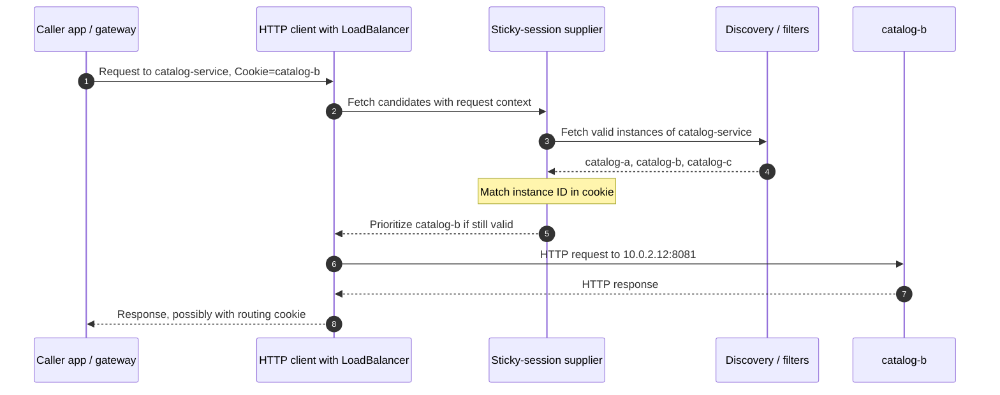

# Instance Identification Cookies and Prerequisites for Sticky Sessions

In Spring Cloud LoadBalancer, a request can normally be sent to any eligible `ServiceInstance` of the same **service ID**. For applications that need continuity across consecutive requests, **sticky sessions** (session affinity) can be used to prefer returning to the replica that served the previous request. One implementation stores the **instance ID** in a cookie and reads that cookie when selecting a replica for the next request.

This cookie is a **routing hint** for the LoadBalancer, not proof that a user is logged in or that a replica is guaranteed to be healthy. For sticky sessions to work properly, the client must send the cookie back, the LoadBalancer integration must see the cookie, and the instance with that ID must remain in the valid candidate list. These conditions matter more than simply toggling a property.

## 1. Service ID, Instance ID, and Cookie Have Different Roles

Suppose `order-service` calls `catalog-service`, while the catalog service has three replicas:

| Property | Example Value | Meaning |
|---|---|---|
| Service ID | `catalog-service` | Logical name of the replica group |
| Instance A | `catalog-a` at `10.0.2.11:8081` | One specific replica |
| Instance B | `catalog-b` at `10.0.2.12:8081` | Second replica |
| Instance C | `catalog-c` at `10.0.2.13:8081` | Third replica |
| Routing cookie | `sc-lb-instance-id=catalog-b` | Hint to continue selecting instance B |

`catalog-service` is used to **find the candidate set**. The value `catalog-b` is used to **identify one element** within that candidate set. The cookie name `sc-lb-instance-id` is the name commonly used in Spring Cloud LoadBalancer's request-based sticky session mechanism; the exact name may vary depending on configuration and the version in use.

For example, two requests to the same logical name:

```http
GET /api/products/42 HTTP/1.1
Host: catalog-service
```

```http
GET /api/products/43 HTTP/1.1
Host: catalog-service
Cookie: sc-lb-instance-id=catalog-b
```

On the first request, there is no instance-identification cookie yet; the LoadBalancer chooses an instance according to its normal policy. If the request goes to `catalog-b` and the client receives the corresponding cookie, the subsequent call can prioritize `catalog-b`, provided this instance remains valid.

**Sticky session is not synonymous with HTTP session.** An HTTP session or login cookie describes user/application session state. An instance-identification cookie only indicates **which instance to route to**; it does not store, replicate, or restore user session data.

## 2. Flow of a Request Carrying a Sticky Cookie

A simplified lifecycle consists of these steps:

1. The client sends a request to `catalog-service` through an HTTP client integrated with Spring Cloud LoadBalancer.
2. `ServiceInstanceListSupplier` retrieves available instances via discovery and relevant filtering layers.
3. If the request carries an instance-identification cookie, a sticky-capable supplier matches the cookie value against the candidates' **instance IDs**.
4. If the instance matches and is still valid, the list can be narrowed so the LoadBalancer prioritizes that instance.
5. If the cookie is missing, does not match, or the instance is no longer in the valid list, selection falls back to the remaining candidates according to the active policy.
6. The client sends the HTTP request to the selected instance's host/port. A mechanism to write the cookie into the response, if enabled and supported by the client integration, can help the client remember the instance ID for the next call.



The diagram illustrates **preference** based on the cookie. If `catalog-b` is stopped, eliminated by health checks, or not returned by discovery, the LoadBalancer should not keep sending requests to the old address just because the client holds a cookie. In that case, fallback must pick another available instance or return an error if the list is completely empty.

## 3. Where Does Spring Cloud LoadBalancer Read the Cookie?

Spring Cloud LoadBalancer provides `RequestBasedStickySessionServiceInstanceListSupplier` to prioritize the replica specified by cookie. This supplier operates on **request data** provided by the LoadBalancer integration. It does not directly access browser cookies, nor does it automatically read HTTP requests from every controller across the application.

The flow depends on the integration layer:

- An HTTP client configured with `@LoadBalanced` or an equivalent mechanism must route requests through the LoadBalancer.
- Cookie information must appear in the **outbound request to the target service** and be placed into the instance-selection context.
- The sticky supplier must be registered in the context of the service ID that needs it.
- The `ServiceInstance` list must have stable, meaningful `instanceId` values for matching.

For example: a browser calls `order-service` and sends a cookie on the inbound request to `order-service`. If `order-service` then calls `catalog-service` with `RestClient`, the inbound cookie **is not necessarily forwarded automatically** to the outbound request to `catalog-service`. The application or gateway must explicitly decide which cookies to forward. For a client calling another service directly, check that client's cookie jar or manual cookie storage/sending logic.

In applications with multiple call hops, monitor **both directions**: whether the outbound request carries the cookie, and whether the response actually supplies the cookie for the client to store for the next turn.

## 4. Configuring a Sticky Supplier for a Specific Service

A common approach is providing a `ServiceInstanceListSupplier` with sticky session handling inside the child `ApplicationContext` of the exact service ID.

Example configuration for `catalog-service`:

```java
package com.example.lbconfig;

import org.springframework.cloud.loadbalancer.core.ServiceInstanceListSupplier;
import org.springframework.context.ConfigurableApplicationContext;
import org.springframework.context.annotation.Bean;
import org.springframework.context.annotation.Configuration;

@Configuration(proxyBeanMethods = false)
public class CatalogStickyLoadBalancerConfiguration {

    @Bean
    ServiceInstanceListSupplier catalogInstanceSupplier(
            ConfigurableApplicationContext context) {
        return ServiceInstanceListSupplier.builder()
                .withDiscoveryClient()
                .withCaching()
                .withRequestBasedStickySession()
                .build(context);
    }
}
```

Then attach the configuration class to the service ID:

```java
package com.example.orders;

import com.example.lbconfig.CatalogStickyLoadBalancerConfiguration;
import org.springframework.boot.SpringApplication;
import org.springframework.boot.autoconfigure.SpringBootApplication;
import org.springframework.cloud.loadbalancer.annotation.LoadBalancerClient;

@SpringBootApplication
@LoadBalancerClient(
        name = "catalog-service",
        configuration = CatalogStickyLoadBalancerConfiguration.class
)
public class OrderApplication {
}
```

`@LoadBalancerClient(name = "catalog-service", ...)` specifies which child context receives the defined supplier. Place `CatalogStickyLoadBalancerConfiguration` in package `com.example.lbconfig`, **outside the component-scan scope** of the main application `com.example.orders`. If this class is accidentally registered in the main context, a supplier meant only for `catalog-service` could affect other service IDs.

In the code snippet, discovery is the instance source, cache sits behind the data source, and sticky is a request-dependent step. This ordering is deliberate: **do not cache a cookie-personalized list as though it were a shared list for all requests**. When adding health checks, zone preference, or metadata filtering, design the supplier order so sticky selection can only prioritize an instance from the set that **has already passed validity conditions**.

This example shows a common way to build a supplier; API names, auto-configuration conditions, and HTTP request integration details should be cross-checked against your project's Spring Cloud version. Having `@LoadBalancerClient` and a supplier bean alone does not mean the client automatically sends cookies in the right direction.

## 5. How Are Cookies Created and Sent Back?

There are two separate things to configure and verify: **reading the inbound cookie to select an instance** and **setting the outbound cookie so the client remembers the chosen instance**.

In Spring Cloud LoadBalancer versions that support it, you can enable adding the instance-identification cookie to responses with the corresponding configuration, for example:

```yaml
spring:
  cloud:
    loadbalancer:
      sticky-session:
        add-service-instance-cookie: true
```

The property above relates to **issuing the cookie**, whereas `RequestBasedStickySessionServiceInstanceListSupplier` relates to **reading the cookie to choose an instance**. Both sides must align with the HTTP client integration. Verify your Spring Cloud version and actual responses before concluding that a browser or client will receive and store the cookie.

An illustrative HTTP cycle:

```http
HTTP/1.1 200 OK
Set-Cookie: sc-lb-instance-id=catalog-b; Path=/; HttpOnly; Secure; SameSite=Lax
```

```http
GET /api/products/43 HTTP/1.1
Host: catalog-service
Cookie: sc-lb-instance-id=catalog-b
```

This is a **protocol example**; the `Path`, `HttpOnly`, `Secure`, and `SameSite` attributes in the example are not a claim that Spring Cloud LoadBalancer sets all of them automatically. Cookies may be issued and adjusted by a gateway, reverse proxy, or the application's HTTP layer. Inspect the actual `Set-Cookie` header to see what name, value, and attributes were sent.

If the client merely sends requests and ignores received cookies, sticky sessions will not persist across subsequent requests. Some HTTP clients do not maintain a cookie jar automatically, so application code or middleware may need to save the value and resend it intentionally.

## 6. Mandatory Conditions for Sticky Sessions to Take Effect

| Condition | When Satisfied | When Not Satisfied |
|---|---|---|
| Request passes through LoadBalancer | Supplier has a chance to use cookie data | Calling IP/host directly may bypass instance selection |
| Cookie is retained and sent back | Subsequent calls have an instance ID to match | Request is handled as having no affinity hint |
| Cookie value matches `instanceId` | Desired instance can be found | Falls back to valid candidate list |
| Instance remains in candidate set | Previous instance can be prioritized | Must re-select or report no instance available |
| Sticky supplier receives request context | Cookie participates in filtering/selection | Even with an HTTP cookie, selection may behave as default |
| Instance list updates accurately | Does not stay pinned to a dead replica | Stale registry/cache may cause selecting a non-serving address |
| Cookie has proper scope | Browser/client sends cookie on required call path | `Domain`, `Path`, `Secure`, `SameSite`, or client policy blocks cookie |

Distinguish three different causes when requests hit multiple instances: the cookie was never saved, the cookie was not attached to the outbound request, or the cookie is present yet the desired instance is no longer in the valid list. Debugging in this order is faster than changing load-balancing algorithms at random.

### Instance ID Must Be Consistent

Sticky sessions match by **instance ID**, not solely by IP address or list index. Therefore:

- Each replica needs a unique instance ID within its service's scope.
- The ID must remain consistent for the replica's lifetime; changing IDs unnecessarily invalidates existing cookies.
- Do not reuse an old ID to arbitrarily represent a different replica holding different session state.
- During redeployments, pod/container replacements, or scale-down, old instance IDs can vanish; fallback must be accepted.

A cookie holding `catalog-b` does not guarantee a replica with that ID will exist forever. The ability to re-select an instance after changes is essential system behavior, not proof that sticky sessions are misconfigured.

### Cookie Belongs to the Right Request and Right Service

When a browser goes through a gateway to call multiple services, using the same cookie name across different routes can cause overwrites. For instance, `catalog-service`'s response writes `catalog-b`, and then `billing-service`'s response writes `billing-a` to a cookie with the same name and scope; the next request to `catalog-service` will carry a value that does not belong to its instance group.

Design **per-route or per-service cookie names/scopes** when maintaining separate affinity across multiple services, or choose to propagate affinity at a single layer. A cookie is merely a client-supplied value; never use it as a target hostname to construct arbitrary URIs. The supplier must match against the instance list supplied by discovery and trusted filters.

## 7. Relationship Between Sticky Sessions, Zones, and Health Checks

Sticky sessions and zone-based routing serve two different goals:

- **Zone preference:** tries to keep requests close to the caller's location, reducing latency or cross-zone traffic.
- **Sticky session:** tries to keep consecutive requests of a session on the same replica.
- **Health filtering:** removes replicas that fail serving criteria.

When used together, define a clear precedence order. A conceptually sound pipeline is:

```text
Service ID
  → Discovery: all registered instances
  → Cache / list refresh
  → Filter by readiness, health, or eligible zone
  → Match sticky cookie among remaining instances
  → Select instance for request
  → Send HTTP request
```

Suppose the cookie asks for `catalog-b` in `zone-b`, while the caller prefers `zone-a`:

| Post-Filter List | Sound Decision |
|---|---|
| `catalog-b` is still eligible and policy permits cross-zone | Can retain affinity to `catalog-b` |
| Policy strictly requires same-zone; `catalog-b` filtered out | Pick an instance in the allowed zone |
| `catalog-b` is no longer healthy | Ignore old cookie and pick another instance |
| No instances remain | Return no-available-replica error |

The exact order is determined by the `ServiceInstanceListSupplier` chain and application policy. Do not treat a sticky cookie as permission to bypass health checks, network security, or mandatory zone constraints.

## 8. Sticky Sessions Do Not Guarantee Server-Side State Preservation

A common use case is an application storing sessions in each instance's memory. When the first request hits `catalog-b`, session data exists only in that instance's memory; subsequent requests need to return to `catalog-b` to read that data.

Affinity reduces unexpected instance switches, yet does not solve three scenarios:

1. **Instance failure:** the cookie still exists, yet in-RAM session data died with the process.
2. **Scale-down or rollout:** subsequent requests are routed to a new replica that lacks the old session.
3. **Cookie not forwarded:** an intermediate gateway or HTTP client drops affinity data.

If business state must survive these events, use a shared session store, appropriate session replication, or a stateless service design. If the use case only needs a hint to "try returning to the previous instance" for cache locality or reducing warm-up cost, sticky sessions can still be useful even without in-RAM HTTP sessions.

Keeping sticky cookies alive too long can skew load: some replicas accumulate many sessions while new replicas receive few requests. Sticky sessions can also reduce the effectiveness of round robin or random because cookie-bearing requests keep favoring one instance. Measure load distribution and tune cookie lifetimes according to real goals.

## 9. Browser, Gateway, and Service-to-Service: Three Different Paths

### Browser Calling an Endpoint Directly

A browser can receive `Set-Cookie` and automatically send the cookie back if `Domain`, `Path`, `Secure`, `SameSite`, and browser security policies are satisfied. For cross-origin requests, cookie transmission also depends on client `credentials` and server CORS configuration. When using `SameSite=None` in modern browsers, cookies generally require `Secure` and HTTPS.

### Browser Calling Through a Gateway

Diagram:

```text
Browser → API Gateway → Spring Cloud LoadBalancer → catalog-service
```

The gateway must receive the cookie on the inbound request, the LoadBalancer integration must have access to the cookie in the forwarded request, and the response must include `Set-Cookie` with a scope the browser can store. If affinity is scoped exclusively to the `catalog-service` route, prevent other routes from overwriting the cookie.

### One Backend Calling Another Backend

Diagram:

```text
Browser → order-service → RestClient/WebClient/OpenFeign → catalog-service
```

A cookie from the browser to `order-service` does not automatically become a cookie on the request from `order-service` to `catalog-service`. Cookie forwarding should be designed selectively, passing only necessary routing info rather than copying all user cookies to every downstream service. If a client uses a connection pool or is shared across multiple users, ensure one session's cookie never leaks into another session's requests.

## 10. Interaction with Retries and Timeouts

Timeouts belong to HTTP client or transport configuration; sticky sessions only affect **instance selection**. If the cookie-specified instance repeatedly errors or times out, sending every retry back to that same instance can increase latency and degrade resilience.

When retries are enabled, check instance re-selection behavior in your integration. Depending on configuration, a retry policy may re-select a replica or reuse the previous selection. If you want to switch to another instance after failure, ensure the retry strategy and sticky logic do not force every attempt back to the failing replica.

For POST or mutating operations, evaluate idempotency before retrying. A request may already have been processed successfully by the first instance while the response was lost; resending it to another instance can create duplicate side effects. Sticky sessions do not guarantee exactly-once processing.

## 11. How to Test Sticky Sessions Meaningfully

To observe clearly, spin up two replicas of `catalog-service` with distinct instance IDs and a `/whoami` endpoint returning the actual instance ID. Have the client call via service ID and capture both request and response headers.

| Scenario | How to Test | What to Verify |
|---|---|---|
| Initial request without cookie | Call `/whoami` without a cookie | An instance is selected per normal policy |
| Receiving routing cookie | Inspect response `Set-Cookie` header | Value matches selected instance ID when cookie issuance is enabled |
| Valid cookie | Send multiple requests with `sc-lb-instance-id` of a healthy instance | Requests prioritize the same instance as configured |
| Invalid cookie | Send a non-existent ID | Falls back to valid candidates; does not connect to arbitrary hosts |
| Instance removed | Stop the cookie-targeted instance, wait for discovery/health update | Stops routing to the removed ID |
| Client drops cookie | Omit cookie from the next request | Sticky supplier no longer has affinity info |
| Multiple services | Interleave calls to two service IDs using cookies | No unintended cookie overwrites occur |
| Cookie dropped through gateway | Use a browser and compare inbound/outbound requests | Pinpoint where the cookie was lost or not issued |

You cannot conclude sticky sessions work merely because two consecutive requests hit the same instance: round robin, random, or a single remaining instance can produce the same result. Cross-check **request cookie**, **current instance list**, and **actually selected instance ID** across multiple calls.

When debugging, log service ID, selected instance ID, fallback reason if any, HTTP status, and processing time. Avoid logging full cookies or authentication tokens. Instance-identification cookies can also expose internal topology details; control their usage scope and never treat cookie contents as trusted data for authorization.

## 12. Pre-Production Checklist

1. Is there a real need for affinity, or is a stateless service with a shared session store sufficient?
2. Does each `ServiceInstance` have a unique ID, and is the ID stable across the instance's lifecycle?
3. Does the HTTP client/gateway actually route requests through Spring Cloud LoadBalancer and place cookies into the request context?
4. Is the sticky supplier configured for the right service ID and placed at the right position in the filter chain?
5. Is there a mechanism to issue cookies, resend cookies, and verify actual `Set-Cookie` headers?
6. Is fallback handled when the ID in the cookie is no longer in the valid list?
7. Are health checks, zone policies, and caching applied in the proper order?
8. Do cookies for different services or routes avoid name and scope collisions?
9. Do browsers, gateways, or backend clients satisfy `Domain`, `Path`, `SameSite`, `Secure`, CORS, and per-user cookie isolation?
10. Have retries, timeouts, and instance failures been tested with write requests and real sessions?

Instance-identification cookies help Spring Cloud LoadBalancer **prefer keeping requests on the same `ServiceInstance`**, provided the cookie reaches the instance selection step and the designated replica remains eligible. By understanding cookie scope, supplier ordering, and fallback behavior, applications can use sticky sessions as a controlled routing policy while still handling scaling, rollouts, and failed instances.
