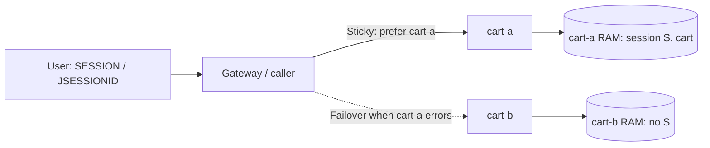
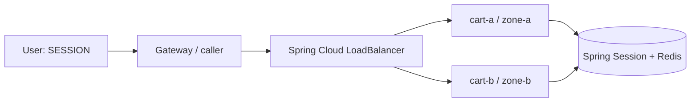
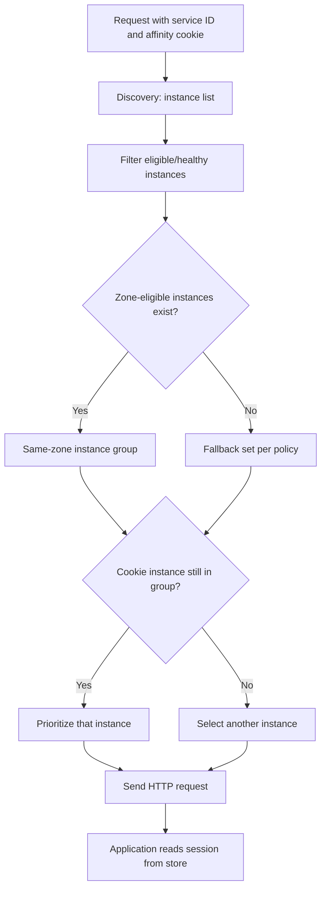

# Distinguishing Stickiness from Session Persistence Guarantees

## 1. Problem: Returning to the Same Instance Does Not Guarantee Keeping the Session

In the **Zones and Routing** chapter of the `SPRING_CLOUD_SERVICE_COMMUNICATION_LOAD_BALANCING` module, Spring Cloud LoadBalancer selects a `ServiceInstance` based on service ID, discovery lists, health checks, and target-selection policies. In some systems, users want consecutive requests to return to the same instance; that is **stickiness** (*session affinity* or *sticky routing*). Yet systems also want session data to survive when an instance stops, restarts, or when requests are routed to another zone; that is **session state persistence and recovery** (*session persistence/durability*).

These two requirements sound similar, yet they operate on **two completely different layers**:

- **Stickiness:** decides **which instance** the next request is sent to.
- **Session persistence:** decides **where session data is written, how it is read back, and which failures it survives**.

**Example:** the `cart-service` application has two instances, `cart-a` and `cart-b`. A user's shopping cart is stored in `cart-a`'s memory. Affinity cookies keep routing subsequent requests to `cart-a`, leading the user to think the cart is stored durably. When `cart-a` restarts or is removed from the healthy list, the LoadBalancer selects `cart-b`; `cart-b`'s memory does not contain that cart. Policy-compliant target selection **does not automatically replicate session state**.

This lesson analyzes the distinction, how to use Spring Cloud LoadBalancer's mechanisms, how to combine zone routing with sticky routing, how to store sessions out-of-process with Spring Session, and how to verify everything through failure experiments. The examples use `order-service` or a gateway as the caller and `cart-service` as the target service; the same principles apply to `RestClient`, `WebClient`, and OpenFeign, though request-based sticky-session support must be checked per HTTP client and Spring Cloud Release Train.

### Learning Objectives

After this lesson, you will be able to:

1. Distinguish **session ID**, **routing cookie**, and **session state**.
2. Explain why hitting the same instance does not guarantee data survives a restart, and why switching instances does not necessarily lose a session when a shared session store is used.
3. Distinguish `SameInstancePreferenceServiceInstanceListSupplier` from `RequestBasedStickySessionServiceInstanceListSupplier`.
4. Design a chain combining zone preference, health checks, and sticky preference while maintaining clear fallback behavior.
5. Set up an experiment with local `HttpSession`, then switch to Spring Session + Redis to prove session continuity.
6. Measure the preferred-instance selection rate separately from the session state recovery rate after rerouting/failures.

## 2. Three Concepts to Separate

| Component | What Does It Contain? | Who Uses It? | What Does It Guarantee? |
|---|---|---|---|
| **Session ID** | Identifier of a logical session, usually in a `JSESSIONID` or `SESSION` cookie depending on the mechanism | Application and session repository | Allows looking up the **session record**; the ID itself does not contain all session data |
| **Affinity cookie / routing hint** | Target instance suggestion, e.g., `sc-lb-instance-id=cart-a` | Gateway/caller/LoadBalancer supporting request-based sticky | Can **prioritize selecting** `cart-a` while it remains in the eligible instance set |
| **Session data** | Login state, temporary cart items, preferences, and `HttpSession` attributes | Application and session storage mechanism | Can be read back using the same session ID **if** the store still holds the data and the app has access |

**Do not equate the two cookies.** The `sc-lb-instance-id` cookie denotes the **preferred instance**; the `SESSION` or `JSESSIONID` cookie identifies the **user's session**. Both can appear on the same request, yet they do not replace each other. Never use an affinity cookie as an authentication token or use a session ID as a target-selection key.

**Do not equate "persistence" with an absolute guarantee.** Data stored in Redis or a shared database can be accessed from multiple replicas, yet actual durability depends on disk-persistence settings, replication, backups, TTLs, regional failure handling, and consistency under concurrent updates.

### 2.1. With Local Sessions Only



The user continues seeing their data as long as requests reach `cart-a` and the process still holds its memory. When requests move to `cart-b` or `cart-a` loses memory, the old data may not be found.

### 2.2. With a Shared Session Store



Both `cart-a` and `cart-b` read from the same session repository using the same session ID. If one instance dies, the remaining instance **can recover session data** without sticky routing, provided the data was saved, the store is available, the client keeps forwarding the right session ID, and there are no data compatibility issues.

**Core difference:** the first diagram gives requests a chance to return to where the data lives; the second makes the data independent of where requests are processed.

## 3. Spring Cloud LoadBalancer's Two "Sticky" Mechanisms

Spring Cloud LoadBalancer provides `ServiceInstanceListSupplier` implementations that customize the candidate list before instance selection. Depending on the sticky preference type, inputs and stickiness scopes differ significantly.

### 3.1. Same Instance Preference: Preferring the Previously Selected Instance

`SameInstancePreferenceServiceInstanceListSupplier` prioritizes the instance the LoadBalancer chose previously **if that instance is still available**.

It can be configured per Spring Cloud Commons guidance:

```yaml
spring:
  cloud:
    loadbalancer:
      configurations: same-instance-preference
```

Or using the builder:

```java
@Bean
ServiceInstanceListSupplier sameInstanceSupplier(
        ConfigurableApplicationContext context) {
    return ServiceInstanceListSupplier.builder()
            .withDiscoveryClient()
            .withSameInstancePreference()
            .build(context);
}
```

The Java snippet is an illustrative supplier configuration; in a real application, scope it per service ID with `@LoadBalancerClient` or an appropriate context configuration.

**Common misconception:** "same instance preference" only remembers the previous selection **within the scope of the associated LoadBalancer/supplier**—it never builds a per-user `userId → instanceId` table. Two users calling through the same caller context can both be steered by the previously selected instance. Multiple caller replicas hold separate selection states; this **is not a per-user session affinity mechanism** with cluster-wide consistency guarantees.

When the old instance disappears, the supplier can pick another instance. That mechanism does not copy `HttpSession` from the old instance to the new one.

### 3.2. Request-Based Sticky Session: Preferring an Instance via Request Cookie

`RequestBasedStickySessionServiceInstanceListSupplier` prioritizes the instance whose `instanceId` is set in a request cookie. This mechanism aligns more closely with per-request-chain affinity:

```text
Request 1: Cookie has no instanceId
  -> selects cart-a
  -> subsequent request carries hint sc-lb-instance-id=cart-a

Request 2: Cookie sc-lb-instance-id=cart-a
  -> prioritizes cart-a, if cart-a is still in the eligible instance set

Request 3: Cookie sc-lb-instance-id=cart-a
  -> cart-a has been removed from the list
  -> selects cart-b per fallback policy
  -> hint needs updating for subsequent calls
```

Spring Cloud Commons documentation describes two ways to register it:

- Set `spring.cloud.loadbalancer.configurations=request-based-sticky-session` if you want to use the built-in configuration in the appropriate scope.
- Or build a dedicated `ServiceInstanceListSupplier` with `.withRequestBasedStickySession()` for a specific service ID.

Example configuration **only for `cart-service`**:

```java
@Configuration(proxyBeanMethods = false)
@LoadBalancerClient(
        name = "cart-service",
        configuration = CartStickyLoadBalancerConfiguration.class)
class CartClientRegistration {

    @Bean
    @LoadBalanced
    WebClient.Builder cartWebClientBuilder() {
        return WebClient.builder();
    }
}

// Do not annotate this class with @Configuration if it sits in component scan;
// @LoadBalancerClient loads the bean into cart-service's child context.
class CartStickyLoadBalancerConfiguration {

    @Bean
    ServiceInstanceListSupplier stickySupplier(
            ConfigurableApplicationContext context) {
        return ServiceInstanceListSupplier.builder()
                .withDiscoveryClient()
                .withRequestBasedStickySession()
                .build(context);
    }
}
```

Required imports belong to Spring Cloud Commons/LoadBalancer, Spring Context, and Spring WebFlux. You need `spring-cloud-starter-loadbalancer`, a `DiscoveryClient` listing `cart-service`, and a compatible HTTP client. If combining health checks or zone filtering, construct an explicitly ordered supplier chain and verify actual behavior for your Release Train.

Spring Cloud Commons 4.3 and 5.0 documentation notes that **request-based sticky-session is currently supported for WebClient-backed load balancing** when requests flow through compatible contexts such as `ClientRequestContext` or `ServerHttpRequestContext`. Do not assume merely adding the supplier makes every `RestClient` or OpenFeign call read and handle cookies identically to `WebClient`. For other clients, verify request context propagation or choose an affinity mechanism that is genuinely supported.

### 3.3. The Routing Cookie and Its Limits

According to the documentation, the default cookie name is `sc-lb-instance-id`. You can ask the LoadBalancer to add the cookie containing the newly selected instance to requests with:

```yaml
spring:
  cloud:
    loadbalancer:
      sticky-session:
        add-service-instance-cookie: true
        instance-id-cookie-name: sc-lb-instance-id
```

**Version note:** documentation mentions the shorthand path `spring.cloud.loadbalancer.instance-id-cookie-name` in places, while the *Configuration Properties* reference in Spring Cloud Commons 4.3/5.0 lists `spring.cloud.loadbalancer.sticky-session.instance-id-cookie-name`. When customizing the cookie name, check the **metadata of the exact version running** and verify binding/behavior; do not rely solely on snippets found online.

The `add-service-instance-cookie` property relates to attaching the selected instance info onto **forwarded requests**. It **does not mean** a browser automatically receives `Set-Cookie` from a gateway and retains affinity across every subsequent request. If the flow starts in a browser, the gateway/caller must pass cookies across request boundaries and, when design requires it, manage response cookies accordingly. Do not blindly copy the entire `Cookie` header across services; pass only necessary data per security policies.

Because cookies can be sent by clients, treat an instance ID inside a cookie as an **untrusted hint for authorization**. The target instance must still be validated against the allowed discovery/health/zone list. User authentication and access control remain the application's responsibility, independent of the routing cookie.

## 4. Stickiness Is a Selection Preference, Not an Absolute Promise

In the following cases, the same session ID can still be sent to a different instance:

1. **Preferred instance is no longer healthy:** discovery or health checks removed it from the list.
2. **Instance scales down / rolling deployment:** the old ID disappears or the new process has a different ID.
3. **Caller restarts or switches replicas:** `SameInstancePreference`'s "previous selection" state does not travel across callers.
4. **Zone preference changes:** the caller shifts zones or the old zone lacks eligible instances.
5. **Retry/fallback:** the HTTP client may retry on a new instance when retry conditions are met.
6. **Cookie fails to cross a hop:** a proxy or API gateway drops/overwrites the cookie; cookie name or domain/path mismatches.
7. **Slow list updates:** caches and discovery still hold a dead instance; the sticky hint can still cause connection errors before removal.

Distinguish **selecting an instance** from **actually serving the request**. The LoadBalancer might select `cart-a` yet the HTTP client fails to connect; in that case, the response cannot tell whether `cart-a`'s RAM data still exists or was lost. Retries do not automatically transfer session state or achieve exactly-once execution.

## 5. Combining Zone Preference and Sticky Routing

Zone preference prioritizes instances in the same zone as the caller. In Spring Cloud LoadBalancer, `ZonePreferenceServiceInstanceListSupplier` uses `ServiceInstance`'s `zone` metadata and the caller's zone; if no instance matches in that zone, the default implementation can return the original instance list. This keeps routing closer, yet does not create a session store.

Suppose a system has four instances:

| Instance | Zone | Status | Session Storage |
|---|---|---|---|
| `cart-a1` | `zone-a` | Healthy | Local RAM or Redis |
| `cart-a2` | `zone-a` | Healthy | Local RAM or Redis |
| `cart-b1` | `zone-b` | Healthy | Local RAM or Redis |
| `cart-b2` | `zone-b` | Healthy | Local RAM or Redis |

A user was previously routed to `cart-a1`. If the caller is in `zone-a`, both zone preference and cookie affinity can point to `cart-a1`. Yet if `cart-a1` fails and requests must move to `cart-a2`, with **local sessions** session data can still be lost. If all of `zone-a` becomes unavailable and requests must go to `zone-b`, data loss becomes even more evident.

### 5.1. Ordering Conditions by Priority

An easy-to-reason-about design usually follows these principles:

1. **Consider only eligible instances** from discovery and required health checks.
2. **Apply zone policies or routing constraints** according to service objectives.
3. **Respect affinity** within the remaining candidate set, when the desired instance is present.
4. **Fall back** when the cookie points to an ineligible instance; choose another instance under the published policy.
5. **Store session data independently** so fallback does not mean losing state.

This is a **recommended logical order**, not a guaranteed default bean order across every Release Train. If you want to prioritize cross-zone affinity over local zone, decide whether increased inter-zone latency and transfer costs are acceptable. If you prioritize zone first, a cookie pointing to another zone may not be honored. You cannot guarantee "always the same instance," "always the same zone," and "automatic failover" simultaneously.

Conceptual decision flow:



Measure **zone hit rate**, **affinity hit rate**, and **session continuity across fallbacks** separately. They are three distinct metrics.

### 5.2. Sticky Routing Can Skew Load

Affinity pulls many requests from the same user to one instance. With heavy-traffic users or long-lived sessions, some instances can become "hot," even though Round Robin initially distributes evenly. Zone preference narrows the candidate set, which can make localized hotspots more pronounced. Monitor in-flight requests, queue depth, CPU, p95/p99 latency, and connection counts per instance rather than counting total requests alone.

## 6. Three State Management Patterns and Guarantee Levels

| Design | When Request Switches Instances | When an Instance Restarts | When Session Store Fails | Trade-offs |
|---|---|---|---|---|
| **Local `HttpSession` + sticky** | May lose session or create a new one | May lose in-RAM data | No external store, yet data depends on process | Initially simple; depends on affinity, hard to scale/failover |
| **Spring Session + shared Redis, no sticky** | Can resume same session if cookie is valid and data exists | Session can continue on another instance | Session read/write errors possible; data lost without proper durability | Adds network overhead, TTLs, Redis ops, HA setup |
| **Spring Session + shared Redis, with sticky** | Can continue when switching instances | Can continue on instance restarts | Still depends on Redis | Reduces some target changes if needed, yet can cause load skew and complexity |
| **Stateless service + business data in DB** | Independent of instance for business state | Can resume after re-authentication if designed appropriately | Depends on DB/identity system and their policies | Suited for critical state; requires clear data/transaction model |

**Out-of-process session storage** solves sharing/recovering sessions across replicas, yet does not automatically guarantee every property of *durability*. If Redis is configured without persistence, loses the entire cluster, or evicts keys, sessions can still be lost. When infrastructure-failure recovery is required, define SLA/RPO/RTO for the store, deploy appropriate replication/failover, persistence, and backups, and periodically test restores.

Do not use sessions to store **confirmed transactions** or business data requiring long-term guarantees (orders, payments, balances). Such data needs durable business storage with proper transaction/idempotency constraints. Sessions typically hold access state and temporary data with TTLs.

### 6.1. An Existing Session ID Does Not Mean the Session Record Still Exists

When a browser still holds a `SESSION` cookie yet the record expired via TTL, was logged out/invalidated, evicted, or wiped after a storage incident, the application must treat it as an invalid session. Do not try to "recover" it by routing the request back to the old instance. Affinity cookies can also linger after an instance is replaced; ensure fallback and appropriate cookie lifetimes exist.

### 6.2. Do Not Confuse HTTP Sessions with Live Connections

WebSockets, long uploads, streaming, or transactions held in memory require separate consideration. A shared HTTP session store lets a new instance read session data back, yet **does not automatically migrate an open TCP/WebSocket connection**, running thread stacks, or uncommitted transactions from a dead process. Those workflows need separate reconnect, resume, checkpoint, or idempotent processing mechanisms.

## 7. Lab A — Observing the Limits of Stickiness with Local HttpSession

### 7.1. Set Up Two cart-service Instances

Run two `cart-service` instances on different ports with the same service ID, each carrying its own identifier:

```yaml
spring:
  application:
    name: cart-service
server:
  port: 8081
app:
  instance-id: cart-a
```

The second process uses `server.port=8082` and `app.instance-id=cart-b`. Both processes use the **default local session** when neither Spring Session nor a shared session repository is configured.

Create an illustrative endpoint that writes a counter into `HttpSession`:

```java
@RestController
class CartSessionDemoController {
    private final Environment environment;

    CartSessionDemoController(Environment environment) {
        this.environment = environment;
    }

    @GetMapping("/demo/session")
    Map<String, Object> visit(HttpSession session) {
        Integer previous = (Integer) session.getAttribute("visitCount");
        int next = previous == null ? 1 : previous + 1;
        session.setAttribute("visitCount", next);

        return Map.of(
                "instance", environment.getProperty("app.instance-id", "unknown"),
                "visitCount", next);
    }
}
```

The example uses Spring MVC `HttpSession` (the Jakarta Servlet API corresponding to the Spring Boot version). The counter is not designed for concurrent updates; for simple verification, send requests sequentially. Do not return the **real session ID** in the response and do not write raw session cookies into operational logs.

### 7.2. Test Three Scenarios

Use a gateway or caller configured with LoadBalancer and ensure the **session cookie is forwarded properly to `cart-service`**. With request-based sticky WebClient, the caller must also receive and forward the affinity cookie when present; verify whether the browser/caller actually preserves that cookie across calls.

1. **Stickiness active:** send multiple consecutive requests with the same session and affinity hint `cart-a`. Observe `instance=cart-a`, counter increments from 1 to 2, 3...
2. **Stop the preferred instance:** stop `cart-a` and wait for discovery/health lists to reflect the failure. Keep the session cookie and send the next request to `cart-b`. With local `HttpSession`, the new instance **does not have `cart-a`'s record**; typically a new session is created and the counter restarts.
3. **Restart the old instance:** start `cart-a` again. If data lived only in RAM, returning to the same instance ID does not bring back lost in-memory data.

To avoid confusion, record `instanceId`, `visitCount`, HTTP status, and request timestamp together. If a proxy switches to another instance or issues a new session ID, log that event. In this experiment, **losing state after restart** is the expected outcome of local in-memory sessions without external replication/persistence.

## 8. Lab B — Decoupling Session Data from Instances with Spring Session

### 8.1. Add a Shared Session Repository

For Spring MVC applications on Spring Boot with compatible Spring Session, you can integrate Redis so both instances read the same `HttpSession`. Example Maven dependencies for a stack using these artifacts:

```xml
<dependency>
    <groupId>org.springframework.session</groupId>
    <artifactId>spring-session-data-redis</artifactId>
</dependency>
<dependency>
    <groupId>org.springframework.boot</groupId>
    <artifactId>spring-boot-starter-data-redis</artifactId>
</dependency>
```

Let the Spring Boot BOM manage compatible versions. In Spring Boot versions that provide the dedicated starter `spring-boot-starter-session-data-redis`, you can use that starter per your version's documentation. Do not arbitrarily mix Spring Boot/Spring Cloud BOMs or artifacts across major versions. Verify that auto-configuration created the corresponding Spring Session repository and filter.

Illustrative configuration, with Redis reachable at hostname `redis` in the lab environment:

```yaml
spring:
  data:
    redis:
      host: redis
      port: 6379
  session:
    redis:
      namespace: demo:cart:session

server:
  servlet:
    session:
      timeout: 30m
```

Both `cart-service` instances must point to the same session repository/namespace and share compatible serialization settings. Data stored in `HttpSession` must be compatible with the active serializer; avoid directly storing live non-serializable objects. To keep this guide independent of a specific patch version, check the Spring Session + Redis documentation for the exact Spring Boot/Spring Session version you use before copying deployment configs.

### 8.2. Verify Session Continuity

1. Start Redis, then run `cart-a` and `cart-b` with Spring Session. Keep the `/demo/session` endpoint unchanged.
2. Send requests with the **same session cookie**; when testing manually, save the cookie from the response and send it back on the next request. With multi-hop gateways, ensure the session cookie reaches the component reading the session.
3. Alternate between `cart-a` and `cart-b` via controlled routing changes. The `visitCount` counter should keep incrementing rather than resetting to 1 once each request completes and writes the session.
4. Stop `cart-a`, keep the session cookie, and route to `cart-b`. While Redis remains reachable and the record has not expired, the counter continues incrementing.
5. Restart `cart-a` and send the same session cookie to the new instance. Verify state is still read from Redis.
6. Stop or simulate a Redis failure in the lab environment to see how the app reports errors or degrades. **Do not** conclude Spring Session guarantees availability when the store itself is unavailable.

Do not use `curl -b`/`-c` to prove stickiness if the gateway does not issue or forward the affinity cookie; those flags only store and resend cookies that actually appear in HTTP responses. For a local scenario, you can run:

```bash
curl -i -c cart-cookies.txt -b cart-cookies.txt http://localhost:8080/demo/session
curl -i -c cart-cookies.txt -b cart-cookies.txt http://localhost:8080/demo/session
```

The `localhost:8080` path in the example is a proxy/gateway configured to forward to `cart-service`. If calling `cart-service` directly, use the corresponding instance port. When bypassing the gateway, you can switch target ports between two calls while keeping the cookie jar to test session sharing, provided the cookie scope/domain is valid and both instances share the session repository.

### 8.3. Testing Durability Beyond Sharing

Proving that `cart-b` reads the session when `cart-a` dies only tests **cross-instance session accessibility**. To claim sessions survive Redis failures or losing an entire zone, you must also test Redis replica/failover settings, persistence policies, backup/restore, expiration, serialization compatibility across deployments, and acceptable data-loss bounds. Those scenarios test storage, not LoadBalancer capabilities.

## 9. Experiment Matrix Distinguishing Both Guarantees

| Scenario | Sticky | Session Store | When Switching from cart-a to cart-b, What to Observe |
|---|---|---|---|
| A. Local RAM, same instance | Yes | Local | Counter usually persists while `cart-a` stays alive; does not prove durability |
| B. Local RAM, forced failover | Yes, but fallback | Local | Counter may reset or a new session is created |
| C. Redis, no sticky | No | Shared Redis | Counter continues if session cookie and data remain |
| D. Redis + sticky | Yes | Shared Redis | Counter persists on same instance and across valid failovers |
| E. Redis cookie present, session TTL expired | Yes or no | Shared Redis | Session is no longer valid; cannot recover via stickiness alone |
| F. Redis outage | Yes or no | Shared Redis failing | Read/write failures may occur; affinity does not fix the outage |
| G. Entire zone-a lost | Cannot keep zone-a instance | Shared store reachable cross-zone | Session can continue in zone-b; inspect latency/consistency |
| H. Rolling deployment changes instance IDs | Old cookie becomes stale | Shared store retains data | Route falls back and keeps reading session; update hint per policy |

For each row, log at minimum: `traceId`, service ID, selected instance ID, zone, health status, test type, HTTP outcome, counter value, retry count, and session repository errors. Never log raw session IDs, auth cookies, or sensitive data.

## 10. Measuring Properly: Stickiness Differs from Session Continuity

### 10.1. Two Non-Interchangeable Metrics

For requests carrying a valid affinity hint while the preferred instance remains in the candidate set:

\[
\text{Affinity hit rate}
=\frac{\text{selections picking the preferred instance}}
{\text{selections with a valid preference while instance remains eligible}}.
\]

For sessions with saved state forced to switch instances:

\[
\text{Session continuity rate}
=\frac{\text{sessions still reading saved state after rerouting}}
{\text{total sessions tested across rerouting}}.
\]

The denominator must be stated clearly so results are not misleading: exclude expired/invalid cookies from the conditional hit rate calculation, yet still report stale cookie counts and fallback rates. `Affinity hit rate=100%` only says the LoadBalancer prioritizes the right instance when conditions allow; it **does not prove** data survives a restart.

### 10.2. Additional Measurements During Zone Shifts and Instance Failures

| Metric | What It Helps Answer |
|---|---|
| `zone_hit_rate` | How many requests go to instances in the preferred zone? |
| `affinity_hit_rate` | How many selections still hit the hinted instance when eligible? |
| `fallback_count` by reason | Why did routing leave the original instance: health, scale-down, stale cookie, or zone? |
| `session_continuity_rate` | How many sessions retain their data when switched to another instance? |
| `session_store_error_rate` | Is Redis/session repository causing read/write failures? |
| `p95/p99 latency` and `cross-zone latency` | What is the performance cost of stickiness or failover? |
| `retry_attempts`, HTTP timeouts, 5xx | Are retries and errors masking true behavior? |

Record each **logical request** and each **HTTP attempt** separately: a single business request with retries may hit multiple instances. LoadBalancer logs reflect instance selection; HTTP/trace logs confirm whether the server processed the request; session repository metrics confirm whether state could be read/written.

### 10.3. Test Conditions to Control

- Use the same service ID and the same registered instance set before changing policies.
- Confirm health checks and discovery have updated before concluding failover occurred.
- Start with retries disabled to clearly see where requests go; then enable bounded retries and test separately.
- Ensure the browser/gateway/caller actually propagates both session cookies and affinity cookies across required hops.
- Keep session TTL longer than the experiment duration; verify clock sync across instances if logic relies on timestamps.
- Do not use concurrent local session counter updates as proof of data correctness: the demo above uses non-atomic updates.
- When switching zones, verify the session store is reachable from the target zone and network/TLS routing is accurate.

## 11. Choosing an Architecture by Operational Requirements

| Requirement | Recommended Design | Reason |
|---|---|---|
| Legacy web app currently holding state in RAM | Sticky can serve as a **temporary measure** while preparing a shared store | Reduces instance switches when stable, yet still risks loss on restarts/failovers |
| Multiple replicas, autoscaling, rolling upgrades | Spring Session + shared store or stateless model | Sessions depend less on instances; easy to scale and replace replicas |
| Multi-zone, requires session failover | Shared store with HA/cross-zone plan; clear routing fallback | Stickiness only affects target selection; cannot save state when a zone is lost |
| API only needs auth, business data in DB | Tokens or opaque session IDs under proper security mechanisms; stateless instances | No need to pin users to a specific replica |
| Orders/payments requiring exact recovery | Persist business data in DB with transactions, idempotency, and recovery mechanisms | Session stores do not replace business data durability |
| WebSockets or long-running in-process work | Design reconnect/resume/checkpointing and state recovery | Stickiness and Redis HttpSession do not migrate live connections |

When using session cookies, configure HTTPS, `Secure`, `HttpOnly`, and `SameSite` appropriately, bound lifetimes, rotate/invalidate sessions on login/logout, and guard against session fixation. Never emit session tokens into logs or metric labels. Routing cookies can be set in requests by clients, so never treat them as proof of authentication or zone access authorization.

## 12. Common Misconceptions to Avoid

1. **"With stickiness enabled, sessions cannot be lost."** False: instance restarts still wipe in-memory state; stickiness neither copies nor persists data.
2. **"Two requests hitting cart-a means the user is pinned exclusively to cart-a."** Not necessarily: `SameInstancePreference` remembers the previously selected instance in the supplier without distinguishing users.
3. **"The sc-lb-instance-id cookie is JSESSIONID."** False: the former is a routing preference, the latter identifies a session.
4. **"Enabling add-service-instance-cookie makes browsers automatically receive Set-Cookie."** Do not assume; verify the hops receiving/returning cookies and WebClient support in your active version.
5. **"Zone preference strictly guarantees same-zone routing."** False: when no matching instance exists, the policy can fall back to another set.
6. **"Putting HttpSession in Redis means data can never be lost."** False: Redis can suffer outages, expirations, evictions, or data loss depending on configuration and failure scenarios.
7. **"Checking HTTP 200 alone is enough."** False: a 200 response may have created a brand-new session and lost old state; verify state continuity.
8. **"Using retries guarantees exactly-once execution."** False: retries can execute a write operation multiple times; idempotency and transaction controls are needed.
9. **"RestClient and OpenFeign support cookie stickiness like WebClient by default."** There is no basis to conclude this from the RequestBasedStickySession documentation; verify how each client passes request context for your Release Train.

## 13. Comprehensive Lab Exercise and Pass Criteria

Deploy `cart-service` in `zone-a` and `zone-b` with two session management modes (local `HttpSession` and Spring Session Redis). Use `order-service`/gateway to call by service ID, enabling Round Robin, Same Instance Preference, and Request-Based Sticky Session (on a supported HTTP client) in turn. Observe via logs/traces and the demo API.

**Lab sequence:**

1. Create a session, increment the counter three times, and record the instance and value.
2. Send the same cookie while forcing routing to a different instance; check state with local RAM.
3. Repeat the test with shared Redis and stickiness disabled; verify state continues across both instances.
4. Enable request-based sticky on WebClient and verify the cookie hint is read and the instance is prioritized when eligible.
5. Stop the preferred instance; wait for discovery/health updates; verify fallback to another instance and explain why the session survived or was lost in each storage mode.
6. Simulate losing an entire zone and verify session readability in the remaining zone.
7. Simulate TTL expiration or a Redis outage; demonstrate that storage failures differ from instance-selection failures.
8. Collect `affinity_hit_rate`, `session_continuity_rate`, fallback counts, HTTP errors, retry counts, and p95 latency; explain what each metric does **not** prove.

**Pass criteria** are met when you can explain the outcome of every test using the right one of three layers: (1) instance lists and routing policies, (2) cookie/session identification and context propagation, (3) session repository and state durability. Additionally, identify failover limitations, Release Train dependencies, and why multi-replica systems generally need a shared session store or stateless architecture for user data.

## References

- [Spring Cloud Commons 4.3 — LoadBalancer](https://docs.spring.io/spring-cloud-commons/reference/4.3/spring-cloud-commons/loadbalancer.html): zone preference, `SameInstancePreferenceServiceInstanceListSupplier`, `RequestBasedStickySessionServiceInstanceListSupplier`, cookies, and HTTP client limitations.
- [Spring Cloud Commons 4.3 — Configuration Properties](https://docs.spring.io/spring-cloud-commons/reference/4.3/configprops.html): `spring.cloud.loadbalancer.sticky-session.*` keys and configuration metadata.
- [Spring Cloud Commons — LoadBalancer (stable)](https://docs.spring.io/spring-cloud-commons/reference/spring-cloud-commons/loadbalancer.html): compare against current stable; always verify the version at the top of the page.
- [Spring Session — HttpSession Integration](https://docs.spring.io/spring-session/reference/http-session.html): shared session storage replacing servlet-container-only sessions.
- [Spring Session — Spring Boot + Redis](https://docs.spring.io/spring-session/reference/guides/boot-redis.html): dependencies, auto-configuration, `SESSION` cookie, and Redis.
- [Redis — Session Store](https://redis.io/docs/latest/develop/use-cases/session-store/): Redis's role in shared session storage, TTLs, and operational considerations.

In real deployments, pin your Spring Boot/Spring Cloud Release Train, verify cookie properties and client limits against the exact version's docs, and use failure tests to prove every guarantee. **Sticky routing decides where a request attempts to go; session storage decides whether state can be read back once it gets there.**
