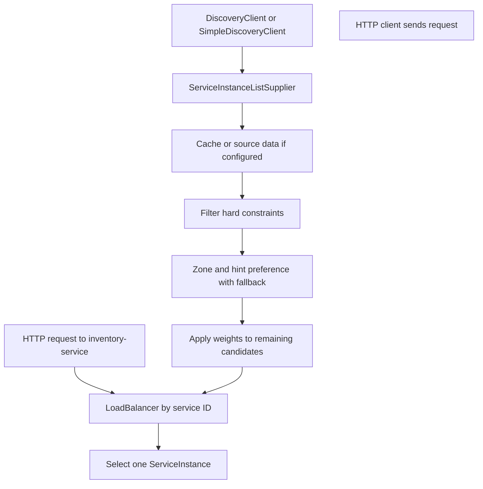
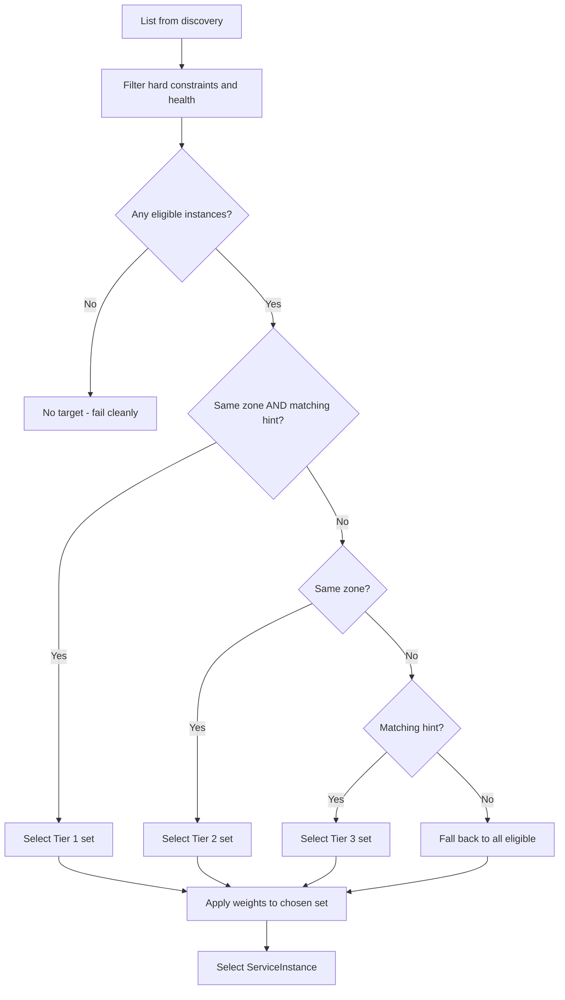

# Combining Zone, Weight, and Routing Hints Without Emptying the List

In Spring Cloud LoadBalancer, choosing a `ServiceInstance` is not merely picking the next element in a list. A system may want to **prioritize same-zone instances** to reduce latency and inter-zone costs, **distribute by weight** to reflect serving capacity, and accept **routing hints** to favor an instance group whose metadata matches the request.

Difficulty arises when all three factors are combined: an instance may match the zone yet not match the hint; the highest-weight instance may sit in another zone; or no instance satisfies all preferences simultaneously. If every criterion is strictly intersected, you easily produce an **empty candidate list**, even though valid instances exist to handle the request. This lesson presents how to design priority ordering, controlled fallback, and applying weights **after** the candidate set is determined.

> Core principle: **Do not unintentionally turn a routing preference into a mandatory condition.** Only relax *soft preferences* when no matching instance exists; **never** relax safety, data, authorization, or health eligibility constraints to fabricate a result.

## 1. Three Routing Signals Serve Three Different Goals

| Signal | Purpose | Typical Data | How It Acts |
|---|---|---|---|
| **Zone** | Prioritize instances close to the client or in the same deployment zone | `zone` metadata, client zone configuration | Filters or prioritizes by zone |
| **Weight** | Increase/decrease selection share of instances by processing capacity | `weight` metadata or weight function | Alters selection probability/frequency within the candidate group |
| **Hint** | Suggest a target group, e.g., `beta`, `stable`, or a routing label | `X-SC-LB-Hint` header or request info, `hint` metadata | Prioritizes instances carrying the corresponding label |

For example, `order-service` deployed in `zone-a` wants to call `inventory-service`. Instances of `inventory-service` provided by discovery are:

| Instance | Host:port | Zone | Hint | Weight |
|---|---|---|---|---:|
| A | `localhost:8091` | `zone-a` | `beta` | 5 |
| B | `localhost:8092` | `zone-a` | `beta` | 1 |
| C | `localhost:8093` | `zone-b` | `beta` | 8 |
| D | `localhost:8094` | `zone-a` | `stable` | 2 |

In this table, A and B share the same zone and the `beta` hint, yet A has a higher weight. C has the largest weight yet sits in a different zone. D is in the client's zone yet does not match hint `beta`.

For a request preferring `zone-a` and hint `beta`, the jointly matching set is **[A, B]**; if weighted selection is applied inside that set, the expected selection frequencies of A and B can follow roughly a **5 : 1** ratio. C's weight of 8 does not let C override zone preference if policy excludes C from the candidate set on that selection turn.

The **service ID** remains `inventory-service` in all cases. Zone, weight, and hint are not three separate service IDs; they are data and target-selection rules for the same logical service.

## 2. Processing Flow: Fetch List, Filter Candidates, Then Pick Target

A common architecture places responsibilities into separate layers:



The diagram shows a **recommended logical order** for reasoning. Specific classes in the `ServiceInstanceListSupplier` chain and cache timing depend on configuration and Spring Cloud version. Distinguish:

- **Discovery** returns the list of instances the client currently sees. This list may be stale due to synchronization lag or caching.
- **Hard constraints** decide which instances are *permitted* to receive the request, such as rejecting instances not in a serving state, with the wrong protocol, wrong tenant, or violating data-residency policies.
- **Soft preferences** decide which instances *should* be selected first within the valid set, such as nearby zone or matching hint.
- **Weight** distributes requests *among the remaining instances*; weight does not replace zone/hint filters or prove an instance is healthy.

Do not cache per-caller request-filtered results as if they were the service ID's shared list: two requests carrying two different hints must be able to see two different candidate sets. Typically, cache request-independent source data and apply request-aware policies in subsequent layers, using the extension points supported by your Spring Cloud version.

## 3. ZonePreferenceServiceInstanceListSupplier and Fallback Principles

Spring Cloud LoadBalancer provides `ZonePreferenceServiceInstanceListSupplier` to prioritize instances in the client's desired zone. Typical client-side zone configuration:

```yaml
spring:
  cloud:
    loadbalancer:
      zone: zone-a
```

For preference to work, instances need corresponding zone info, usually in `zone` metadata provided by discovery. Zone mapping details depend on the discovery system and how instances register.

**Key aspect of zone preference:** if instances exist in the preferred zone, the supplier can provide that zone's instance set; **if no instance matches the zone, it falls back to returning the delegate's list instead of intentionally returning an empty set**. Thus zone preference fits a soft preference where cross-zone fallback is acceptable.

Using the example table:

| Zone Client Requests | Prioritized Instances | What Happens When No Zone Matches |
|---|---|---|
| `zone-a` | A, B, D | No fallback needed since A, B, D exist |
| `zone-b` | C | No fallback needed since C exists |
| `zone-c` | None | Can reuse A, B, C, D from delegate |

This is **not** a promise that a target always exists: if the initial source list is empty or all instances are eliminated by hard constraints, there are no instances to fall back to. A zone forbidden by data constraints also cannot be reopened merely because the desired zone's list is empty.

### Same-Zone Preference Differs from Strict Zone Pinning

If the requirement is "prefer zone-a for latency," falling back to zone-b can make sense. If the requirement is "data must stay within a specific legal region," sending traffic to zone-b may be prohibited; then it is a **hard constraint**, not zone preference. The system should return a controlled error when no eligible instances remain, rather than silently routing requests somewhere that violates policy.

## 4. HintBasedServiceInstanceListSupplier: Suggestion, Not Mandatory by Default

`HintBasedServiceInstanceListSupplier` supports filtering the list by a request hint. In supporting integrations, the hint can be supplied via the default `X-SC-LB-Hint` header; the header name or how hints enter the request context can be configured depending on version and HTTP client type. Instances are matched by `hint` metadata.

Example request:

```http
GET /api/v1/items/42 HTTP/1.1
Host: inventory-service
X-SC-LB-Hint: beta
```

Suppose the source list is [A, B, C, D]; instances matching hint `beta` are **[A, B, C]**. In the hint-preference mechanism, when no instance matches the hint, the supplier can return the unfiltered delegate list. This prevents an unrecognized hint from **automatically turning** the request into a "no instances left" situation.

| Requested Hint | Hint-Matching Set Across Full List | When No Instance Matches |
|---|---|---|
| `beta` | A, B, C | No fallback needed |
| `stable` | D | No fallback needed |
| `canary` | None | Fall back to delegate set if hint is a soft preference |
| No hint | No hint prioritization needed | Use supplied candidate set |

Do not blindly trust an external user's header as a security command: hints must be controlled, normalized, or assigned by a trusted layer. If a request must hit a specific version to preserve data compatibility, express that requirement as a **hard constraint**, not via hint preference's fallback that could silently route to an incompatible version.

## 5. Weight Should Only Be Applied After Determining the Candidate Set

Spring Cloud LoadBalancer includes `WeightedServiceInstanceListSupplier` to apply weights to instances from metadata or a custom weight function. In common configurations, `weight` metadata represents relative weight; verify how missing or invalid values and exact selection mechanics are handled in your active version.

Suppose the already-filtered candidate set is **[A, B]**, with weights 5 and 1 respectively:

\[
P(A) \approx \frac{5}{5+1} = 83.3\%, \qquad
P(B) \approx \frac{1}{5+1} = 16.7\%
\]

This is an **expected ratio across many selections**, not an exact guarantee for every six consecutive requests. The algorithm and implementation can produce a different request sequence, especially under concurrency, retries, or list changes.

If only A remains after filtering, `P(A) = 100\%` within that set regardless of A's weight of 5. If no instances exist in the valid set, weight cannot conjure a new instance.

### Common Mistake: Using Weights Instead of Routing Conditions

With A=5, B=1, C=8 and a request preferring `zone-a` + `beta`, computing proportions across **A+B+C** would cause C (in zone-b) to receive requests more often than A, contradicting the goal of prioritizing zone-a. The right approach for a zone-first policy is:

1. Obtain the valid instance set from discovery and hard constraints.
2. Select the appropriate priority tier by zone/hint.
3. Only then apply weights over the final candidate set.

With a custom weight function, handle missing, zero, negative, excessively large, or unparseable values. Do not let invalid weight values cause custom code to return an empty list or throw cryptic errors. You can substitute a valid default, emit a misconfiguration metric, and fall back to uniform distribution **only within the verified eligible instance set**.

## 6. Why Chaining Suppliers Arbitrarily Can Yield Unexpected Policies

A supplier chain is constructed by wrapping delegates:

```text
Discovery -> Zone preference -> Hint preference -> Weight -> LoadBalancer
```

Here arrows indicate data flowing sequentially through logical steps. Even though each preference filter has its own fallback, **each fallback only sees its own input list**. It does not automatically "remember" instances eliminated by an earlier filter.

Consider a simple case:

| Instance | Zone | Hint |
|---|---|---|
| A | `zone-a` | `stable` |
| B | `zone-a` | `stable` |
| C | `zone-b` | `beta` |

Client prefers `zone-a`, request carries hint `beta`:

- **Zone first, hint second:** zone narrows the set to [A, B]. Hint `beta` matches nothing in [A, B], so hint fallback returns [A, B]. C was eliminated earlier and is never reconsidered.
- **Hint first, zone second:** hint narrows the set to [C]. Zone `zone-a` matches nothing in [C], so zone fallback returns [C]. The result crosses to zone-b to preserve hint `beta`.
- **Hard-filtering both conditions:** requiring `zone-a AND beta` returns an empty list, even though A, B, or C could serve if one preference were relaxed.

There is no single default order suited for every application. **You must decide whether "zone priority" or "hint priority" matters more**, and verify the supplier order actually configured.

| Business Goal | Fallback Order to Consider |
|---|---|
| Minimizing network latency and cross-zone cost is top priority | Zone + hint → zone with any hint → hint in other zones → all eligible instances |
| Version/canary hint takes precedence over distance | Zone + hint → hint in any zone → zone with any hint → all eligible instances |
| Must always match zone or version due to mandatory rules | Filter hard constraints first; if no candidates remain, fail with no target rather than crossing into forbidden zones/versions |

In the first two rows, each tier is used only if **non-empty**. The final tier is the set of instances still valid after hard constraints, not all discovered instances regardless of health/trust.

## 7. Designing Tiered Fallback Without Emptying the Eligible Set

Suppose a product chooses a **zone-first** policy allowing cross-zone fallback to keep the service available. Given the `eligible` set that passed all hard constraints, the order is:

1. **Tier 1:** instances that both match the zone and match the hint.
2. **Tier 2:** if Tier 1 is empty, instances in the same zone, ignoring hint.
3. **Tier 3:** if Tier 2 is empty, instances matching the hint in any zone.
4. **Tier 4:** if Tier 3 is empty, fall back to the entire `eligible` set.
5. **No eligible instances:** report no instance available; never invent targets or violate hard constraints.



**Note when hint or zone is missing:** do not match empty strings as valid metadata labels. If the request has no hint, skip hint matching and use zone preference (if present). If no zone is specified, use hint preference (if present). If neither is present, use all `eligible` instances. Thus missing optional information never prevents selecting an instance.

### Java Example Illustrating Fallback Logic

The snippet below demonstrates **candidate-set selection rules**. It is not a full `ServiceInstanceListSupplier` bean and **does not** perform network calls or weighted random selection. The `eligible` set must be supplied by a layer that has already enforced hard constraints:

```java
import java.util.List;
import org.springframework.cloud.client.ServiceInstance;

final class RouteCandidates {

    static List<ServiceInstance> zoneFirst(
            List<ServiceInstance> eligible,
            String preferredZone,
            String hint) {
        if (eligible == null || eligible.isEmpty()) {
            return List.of();
        }

        boolean hasZone = preferredZone != null
                && !preferredZone.isBlank();
        boolean hasHint = hint != null
                && !hint.isBlank();

        if (hasZone && hasHint) {
            List<ServiceInstance> both = eligible.stream()
                    .filter(i -> matches(i, "zone", preferredZone)
                            && matches(i, "hint", hint))
                    .toList();
            if (!both.isEmpty()) {
                return both;
            }
        }

        if (hasZone) {
            List<ServiceInstance> local = eligible.stream()
                    .filter(i -> matches(i, "zone", preferredZone))
                    .toList();
            if (!local.isEmpty()) {
                return local;
            }
        }

        if (hasHint) {
            List<ServiceInstance> hinted = eligible.stream()
                    .filter(i -> matches(i, "hint", hint))
                    .toList();
            if (!hinted.isEmpty()) {
                return hinted;
            }
        }

        return eligible;
    }

    private static boolean matches(
            ServiceInstance instance, String key, String expected) {
        return expected.equalsIgnoreCase(
                instance.getMetadata().getOrDefault(key, ""));
    }
}
```

Given a non-empty validated list, `zoneFirst` always returns a non-empty list: each tier returns only after a non-empty check, and the final tier returns `eligible` itself. This is a useful **invariant** for writing unit tests.

If you want to prioritize hint over zone, swap the **order of the two single-condition fallback blocks** after the "match both zone and hint" block: try `hinted` before `local`. Do not swap them casually if policy enforces commitments around tenants, data residency, or version compatibility.

### Separating Fallback from Weighted Selection

The function above only returns `List<ServiceInstance>`. The next step reads each element's `weight` and selects an instance under a weighted policy. You can use a properly configured `WeightedServiceInstanceListSupplier` or an application-specific weighted selection strategy. Never apply weights across the entire list before deciding the priority tier, accidentally letting lower-priority-tier instances into the final choice.

When integrating with real Spring Cloud LoadBalancer, implement the appropriate policy via `ServiceInstanceListSupplier` extension points or a custom load balancer for a **specific service ID**, checking the API signatures of your active release train. Do not copy illustrative snippets directly as standalone filters while ignoring request context, concurrency, or supplier lifecycles.

## 8. Practice: Configuring Instance Metadata

In a simple lab, you can use `SimpleDiscoveryClient` as a static instance source to observe zone, hint, and weight. Example configuration in the application **calling** `inventory-service`:

```yaml
spring:
  application:
    name: order-service
  cloud:
    discovery:
      client:
        simple:
          instances:
            inventory-service:
              - uri: http://localhost:8091
                metadata:
                  zone: zone-a
                  hint: beta
                  weight: "5"
              - uri: http://localhost:8092
                metadata:
                  zone: zone-a
                  hint: beta
                  weight: "1"
              - uri: http://localhost:8093
                metadata:
                  zone: zone-b
                  hint: beta
                  weight: "8"
              - uri: http://localhost:8094
                metadata:
                  zone: zone-a
                  hint: stable
                  weight: "2"
    loadbalancer:
      zone: zone-a
```

The URIs above are lab examples when the client app and all four providers run on the same machine. If the client runs inside a container, `localhost` refers to the client container itself, not the host machine or provider containers. Replace them with reachable hostnames on your deployment network.

### 8.1. Connecting the HTTP Client by Service ID

The application uses `spring-cloud-starter-loadbalancer` and a Spring Cloud BOM compatible with Spring Boot. With `RestClient` on Spring Framework 6.1+ and Spring Cloud supporting this integration, declare a `@LoadBalanced` bean:

```java
import org.springframework.cloud.client.loadbalancer.LoadBalanced;
import org.springframework.context.annotation.Bean;
import org.springframework.context.annotation.Configuration;
import org.springframework.web.client.RestClient;

@Configuration
class ClientConfiguration {

    @Bean
    @LoadBalanced
    RestClient.Builder loadBalancedRestClientBuilder() {
        return RestClient.builder();
    }
}
```

Calling by service ID:

```java
import org.springframework.beans.factory.annotation.Qualifier;
import org.springframework.stereotype.Service;
import org.springframework.web.client.RestClient;

@Service
class InventoryGateway {

    private final RestClient client;

    InventoryGateway(
            @Qualifier("loadBalancedRestClientBuilder")
            RestClient.Builder builder) {
        this.client = builder
                .baseUrl("http://inventory-service")
                .build();
    }

    String getItem(String id, String routingHint) {
        return client.get()
                .uri("/api/v1/items/{id}", id)
                .header("X-SC-LB-Hint", routingHint)
                .retrieve()
                .body(String.class);
    }
}
```

The providers on the four ports should expose the same `GET /api/v1/items/{id}` endpoint and return `instanceId`, `zone`, and `hint` for easy verification. To run this code with live hints, besides the `@LoadBalanced` builder, you must enable or register a **hint-supporting supplier** in the LoadBalancer chain for `inventory-service` and verify request context/header propagation for your Spring Cloud version. **Simply adding a header in `RestClient` is not enough to activate `HintBasedServiceInstanceListSupplier` automatically.** Likewise, having `weight` metadata alone does not guarantee weighted selection is enabled.

### 8.2. Configuring the Supplier per Service ID

Components to consider for `inventory-service`:

- Source supplier: retrieves instances from discovery.
- Cache layer (if needed): caches source data with an appropriate refresh policy.
- Health or hard-constraint filtering layer: determines eligible instances.
- Zone and hint preference layer: with fallback in the chosen order.
- Weight layer: applied to the decided candidate set.

Spring Cloud provides suppliers such as `ZonePreferenceServiceInstanceListSupplier`, `HintBasedServiceInstanceListSupplier`, and `WeightedServiceInstanceListSupplier`, configurable via the corresponding version-specific APIs/builders. However, **merely chaining built-in suppliers does not automatically guarantee a multi-tier custom fallback chain** like in section 7. When a specific fallback order is needed, implement a custom supplier or equivalent policy, ensuring outer layers can still access the `eligible` list for the final tier.

Place dedicated configuration inside `inventory-service`'s child context using `@LoadBalancerClient(name = "inventory-service", configuration = ...)`. The dedicated configuration class should sit outside the main application context's normal component scan to avoid leaking policies to other service IDs.

## 9. Testing Preference and Fallback Scenarios

Write tests at the **candidate-selection policy** level before testing network connectivity. Using the A/B/C/D table from section 1:

| Preferred Zone | Requested Hint | Expected Result Set with Zone-First |
|---|---|---|
| `zone-a` | `beta` | [A, B] — matches both |
| `zone-a` | `stable` | [D] — matches both |
| `zone-a` | `unknown` | [A, B, D] — no hint match, keep local |
| `zone-b` | `stable` | [C] — no dual match, prioritize zone-b |
| `zone-c` | `beta` | [A, B, C] — no zone-c, prioritize hint |
| `zone-c` | `unknown` | [A, B, C, D] — fall back to all eligible |
| Not provided | `stable` | [D] — use hint only |
| `zone-a` | Not provided | [A, B, D] — use zone only |
| Not provided | Not provided | [A, B, C, D] — use eligible |
| Any | Any | [] if **input eligible is empty** |

When testing weights, measure only over the selected set; for example, zone-a + beta yields [A, B] with an expected 5:1 ratio. Send many selection turns to observe the distribution trend rather than demanding every six requests produce exactly five A's and one B.

Other critical tests:

1. **Missing metadata:** an instance lacking `zone` or `hint` does not trigger a `NullPointerException`. When no candidates match soft preferences, fallback still works.
2. **Abnormal weights:** empty, non-numeric, zero, or negative `weight` values are handled per documented rules without losing the entire valid set.
3. **Unhealthy instances:** an instance marked ineligible is never resurrected by fallback.
4. **Empty eligible set:** returns a controlled no-target state without bypassing hard constraints.
5. **Multiple clients:** different clients may observe different discovery snapshots; test assertions do not depend on global strict ordering.
6. **Unrecognized request hints:** test `unknown`, empty strings, or labels outside the allowlist to verify fallback and normalization.

## 10. Observability and Troubleshooting in Production Systems

When tracking multi-criteria routing, logging only the selected instance is insufficient. Record the following safely:

| Observation Field | Question to Answer |
|---|---|
| `serviceId` | Which service is being load-balanced? |
| `preferredZone`, `routingHint` | Which soft preferences is the request asking for? |
| `eligibleCount` | How many instances passed hard constraints? |
| `preferredCount` | How many instances satisfied the evaluated priority tier? |
| `fallbackTier` | Did it use "zone+hint", "zone", "hint", or "all eligible"? |
| `selectedInstance`, `selectedZone` | Is the actual target in the expected zone? |
| `weight` or weight bucket | Do selections reflect the expected ratio? |
| `status`, `exception`, `duration` | Did the error occur before or after instance selection? |

Do not log tokens, sensitive data, or metadata that could expose personal information. Use bounded sets of hint/zone values as labels to prevent excessively high metric cardinality.

### Symptoms and Troubleshooting Steps

| Symptom | Possible Cause | What to Check |
|---|---|---|
| No target despite discovery seeing instances | Filters combined via strict intersection, or hard constraint eliminated all | Log list size after each tier; distinguish hard vs. soft |
| Hint does not change target | Hint supplier not registered, request context drops hint, or metadata mismatch | Verify supplier chain and how `X-SC-LB-Hint` is read |
| Always selects nearby zone even when hint exists only in remote zone | Zone-first policy or supplier order dropped remote candidates | Verify business priority and fallback order |
| Selects remote-zone instance despite local-zone instances | Hint-first, wrong zone metadata, or local list was filtered out | Inspect lists at each tier |
| Weight ratios do not match expectations | Weight not enabled, sample too small, pre-filtered, multiple clients, or retries | Count *selection turns*, check final candidate set, and sample many requests |
| New instances unseen after scale-out | Discovery/cache not yet refreshed | Check refresh, TTL, health, and registration info |
| Requests still hit old instance after scale-in | Stale cache/discovery or selected before instance removal | Inspect snapshots, graceful shutdown, and in-flight requests |
| Cross-zone fallback violates policy | Treated a hard constraint as a soft preference | Move that constraint to the eligibility layer; fail closed |

### Recommended Diagnostic Order

1. Identify the service ID and the actual instance snapshot provided by the supplier.
2. Check hard constraints and `eligible` count.
3. Record hint, zone, relevant metadata, and filter tier ordering.
4. Confirm which fallback tier was chosen and the final instance set.
5. Check whether weights were applied after candidate-set selection.
6. If an instance was selected yet the request failed, investigate DNS, connectivity, timeouts, TLS, and provider logs as a separate problem layer.

## 11. Principles to Remember

- **Zone** is a location preference, **hint** is a processing-group suggestion, and **weight** is a selection proportion; they solve three distinct problems.
- Preference suppliers can fall back to their delegate when no element matches, yet **individual supplier fallbacks do not automatically assemble a multi-tier policy**.
- The valid instance set under hard constraints must be determined first. Fallback only relaxes soft preferences, never safety or compliance rules.
- Decide explicitly between **zone-first and hint-first**; the two policies yield different results when zone and hint have an empty intersection.
- Check for a non-empty candidate set at each tier, and use **all eligible** as the final tier when the input set is valid.
- Apply weight **after** deciding the final candidate set; measure expected ratios across many selections and never equate weight with health.
- Observe `eligibleCount`, `fallbackTier`, `selectedInstance`, HTTP errors, and retries to spot discrepancies between intended policy and reality.

Combining zone, hint, and weight properly helps applications prioritize performance and proximity, support group-based rollouts, and distribute requests according to each instance's capacity. The most important design point is preserving the **eligible candidate set** and falling back intentionally: avoid emptying the list simply because a soft preference does not match, yet still fail clearly when no instance satisfies mandatory constraints.
