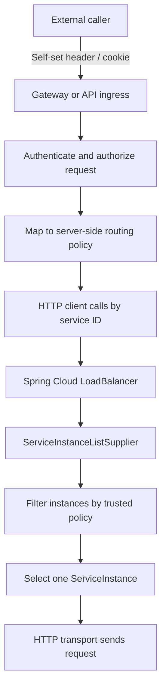
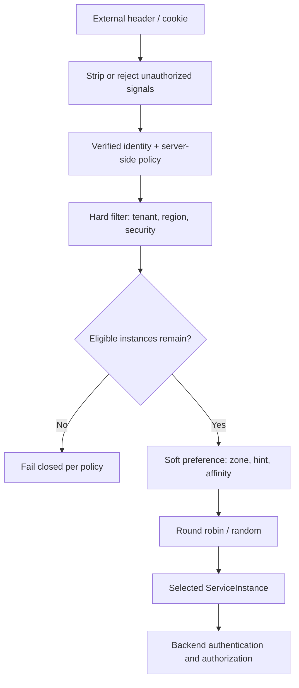

# Risks of Using Caller-Supplied Headers or Cookies

In a system using Spring Cloud LoadBalancer, a request to `http://inventory-service` can have its target selected based on zone, hint, metadata, or a sticky-session mechanism. Leveraging headers and cookies to steer `ServiceInstance` selection provides flexibility: preferring servers close to the user, routing canary tests, or attempting to return to a previous instance. However, **caller-supplied headers and cookies are untrusted data by default**. They can be forged or modified by browsers, scripts, proxies, or a compromised/buggy upstream service.

If an application directly turns a value such as `X-Route-Zone: zone-internal` into an instance-selection decision, callers can manipulate where requests are processed. Consequences can include misrouting across zones, unbalancing load, forcing access to canary groups, crossing tenant boundaries, or leaking data if downstream lacks access controls. This is a **trust boundary** problem between client-suggested information and policies that the system itself must enforce.

This lesson belongs to the **Zones and Routing** chapter of the Spring Cloud LoadBalancer module. Its goal is to understand how to protect zone/hint/stickiness policies in client-side load balancing while coordinating with discovery, health checks, `RestClient`, `WebClient`, OpenFeign, retries/timeouts, and error observability.

## 1. Headers and Cookies Are Signals, Not Authorization to Pick Targets

Suppose `order-service` calls `inventory-service`, which has these replicas:

| Instance | Zone | Sample Metadata | Role |
|---|---|---|---|
| `inventory-a1` | `zone-a` | `release=stable` | Serves normal requests |
| `inventory-a2` | `zone-a` | `release=canary` | Serves controlled experiments |
| `inventory-b1` | `zone-b` | `release=stable` | Serves backup zone |

A caller can deliberately send:

```http
GET /api/items/42 HTTP/1.1
Host: api.example.test
X-Route-Zone: zone-b
X-Release: canary
Cookie: route-affinity=inventory-a2
```

`X-Route-Zone`, `X-Release`, and `route-affinity` in the example are merely application-defined illustrative names, **not mandatory Spring Cloud LoadBalancer defaults**. If the system accepts these raw values to choose an instance, the caller can steer themselves into another zone or straight to an experimental replica.

Separate three concepts:

| Concept | Who Decides? | Is It Sufficient to Grant Access? |
|---|---|---|
| **Routing preference** | Can be a suggestion from the request, if the system permits it. | No; only expresses a wish. |
| **Routing policy** | Gateway, service, or orchestration layer based on configuration and verified identity. | May restrict the target set, yet does not replace access control checks. |
| **Authorization** | Security component and the service owning the resource. | Must independently decide who may act on which data. |

Even if a hint happens to match a valid instance, selecting that instance does not prove the caller has permission to access resources on it.

## 2. Trust Boundaries in the Request Path

An HTTP header has no authenticity merely because of its name. A header starting with `X-Internal-`, `X-Tenant-`, or `X-Forwarded-` does not automatically become trustworthy. When a gateway forwards original headers into internal requests, client-controlled data can continue propagating across multiple services.



At the ingress step, **strip or overwrite unauthorized external routing headers/cookies**, then build internal routing info from verified sources. If routing values are only passed via headers behind the gateway, ensure external callers cannot call backend services directly or spoof those headers. Internal header names are merely conventions; real protection lies in architecture, sender controls, and authentication.

Internally, another service might also forward user-supplied headers without checking them. Therefore, do not blindly treat all internal requests as trusted; each component needs to know where routing signals originate and at which steps they could be altered.

## 3. Specific Risks

### 3.1. Spoofing Zone or Data Region

Suppose a tenant is required to process data within `region-eu`. If zone selection relies solely on a caller-supplied `X-Region`, the caller can change it to `region-us` and cause requests to be routed to instances outside the intended region. This can violate data-residency policies or send data to an inappropriate backend.

Note: `ZonePreferenceServiceInstanceListSupplier` and zone-preference policies are normally used for **preference**, not automatically treated as mandatory isolation mechanisms. Depending on the supplier, decorator order, and version, when no same-zone instance exists, a preference mechanism can use other candidates. A requirement to *strictly process only within allowed regions* must be designed as a hard constraint: if no eligible candidates exist, **never send the request to a forbidden region**.

### 3.2. Reaching the Wrong Tenant, Security Tier, or Canary Version

If metadata such as `tenant=premium`, `release=canary`, or `scope=internal` is used as a filter without access controls, callers can ask to reach instance groups serving other data, privileged groups, or unreleased versions.

**Two layers of defense are needed:** (1) backends must never return another tenant's data simply because the request reached a given instance; (2) routing filters must only accept valid criteria determined server-side. Load-balancing policies do not replace API and data-store authorization.

### 3.3. Pinning to an Instance via Stickiness Cookies

Affinity cookies usually store an instance identifier or hint to return to the previous server. If browser-supplied cookies are used directly, users can modify, retain, or share values:

- **Pinning to a slow replica:** many requests keep targeting one instance, creating a hotspot while other instances sit idle.
- **Reusing stale cookies:** the instance may have been replaced, become unhealthy, or disappeared from discovery.
- **Tracking and information leakage:** cookies or responses containing real instance IDs can reveal topology and extend user-activity correlation.
- **Confusing stickiness with session authorization:** returning to the same replica does not prove identity, protect session state, or prevent cross-tenant access.

Spring Cloud LoadBalancer provides components supporting request-based sticky sessions in corresponding integrated versions; exact behavior depends on supplier, cookies, and configuration. Check the documentation for your active version. Regardless of implementation, a cookie value arriving from a client is a **signal to validate**, never a mandatory command to pick that replica.

Invalid or expired hint cookies should be discarded or handled per policy, switching to another eligible instance when business logic permits. Never prioritize a cookie over hard constraints on region, tenant, access permissions, and health.

### 3.4. Impact on Stability and Availability

If callers can arbitrarily pick hints or zones, some users can concentrate requests on a single replica, zone, or small canary pool. Then round robin only distributes within the filtered subset, unable to cure imbalance across groups.

An automatic fallback policy to all instances when the requested group is empty can also cause issues. For **performance preferences**, fallback may be acceptable. For **security or data-residency constraints**, falling back across boundaries is wrong. Never merge both kinds of conditions into the same default fallback branch.

### 3.5. Duplicate, Ambiguous, or Differently Interpreted Headers

HTTP headers can be sent repeatedly, with differing case, or with invalid values. Multiple layers—proxies, gateways, frameworks, and applications—can normalize or join values differently. For example:

```http
GET /api/items/42 HTTP/1.1
Host: api.example.test
X-Route-Zone: zone-a
x-route-zone: zone-b
```

If a gateway inspects one value while a downstream service uses another, policy enforcement can be bypassed. Establish a single rule: drop or reject ambiguous signals, normalize according to proper HTTP semantics, and regenerate only verified internal values.

Similarly, never blindly trust caller-supplied `X-Forwarded-For`, `X-Forwarded-Host`, or origin/path headers to infer region. They are only trustworthy inside a controlled proxy chain with explicit overwrite rules.

### 3.6. Impact on Logs, Metrics, and System Telemetry

Putting raw arbitrary headers/cookies into metric names, tags, logs, or traces can create unbounded label values (high cardinality), inflating storage costs and hindering investigations. Logs must never dump session cookies, tokens, or sensitive data. When analyzing routing, record standardized states such as `hint_rejected`, `policy_denied`, or `no_eligible_instance` along with the service ID and a bounded label set.

## 4. Distinguishing Hints, Zone Preferences, and Mandatory Constraints

Not all routing signals carry the same trust level or purpose:

| Decision Type | Example | Response When No Instance Matches |
|---|---|---|
| **Soft preference** | Try picking a same-zone replica to reduce latency. | Can pick another zone if policy permits and data is allowed to traverse that region. |
| **Approved canary** | A user group has been assigned to a 5% experiment. | Pick the stable version or return an error per rollout policy; callers cannot self-promote into canary. |
| **Hard constraint** | Tenant may only be processed in `region-eu`. | If no valid instance exists, report unavailable; never silently route to `region-us`. |
| **Soft affinity** | Prefer the same instance to boost cache locality. | Can pick another instance if the cookie is invalid or the target is unavailable. |
| **Authorization** | May the user view order `42`? | Verify at the API/service using authenticated identity; never decide via the LoadBalancer. |

In Spring Cloud LoadBalancer, suppliers such as `ZonePreferenceServiceInstanceListSupplier` or `HintBasedServiceInstanceListSupplier` can serve configured list-preference/filtering policies. **A supplier's name does not prove an access-denial mechanism exists.** If a business requires hard isolation, verify the filtering implementation has no policy-violating fallback and reinforce it with network rules, service permissions, and backend data checks.

## 5. Safe Routing Signal Processing Workflow

A practical flow should have explicit steps:

1. **Receive requests at a trusted ingress point:** never trust headers/cookies where callers claim to be internal; inspect proxy chains and block paths bypassing the gateway where needed.
2. **Authenticate identity:** validate tokens or sessions via trusted authentication; never take tenant or permissions solely from a self-declared `X-Tenant-ID`.
3. **Construct server-side policy:** resolve tenant, allowed regions, rollout cohort, and eligible zones/instance groups from verified claims and authoritative configuration.
4. **Normalize request context:** carry only approved signals into instance selection; strip or overwrite externally supplied routing headers.
5. **Filter candidate list:** apply hard constraints first, then soft preferences such as zone locality or affinity.
6. **Select instance:** apply round robin, random, or configured strategy to the eligible set.
7. **Verify at the backend:** the target service still authenticates, authorizes, and restricts data access, even when the request lands in the right region.
8. **Record outcomes:** log no-candidate reasons, rejected hints, selected targets, and transport errors without exposing sensitive data.



Having no eligible instances may be an availability error rather than a caller authorization error. Depending on the API, return an unavailable response per contract or throw a specialized exception. What matters is **never selecting a target that violates a hard constraint just to push a request through**.

## 6. Example: Self-Declared Requests vs. Verified Policy

Suppose `tenant-17` is configured to be processed only in `zone-a`. A caller sends:

```http
GET /api/inventory/items/42 HTTP/1.1
Host: api.example.test
Authorization: Bearer <access-token>
X-Route-Zone: zone-b
Cookie: route-affinity=inventory-b1
```

At the gateway, the token must be verified via authentication; the tenant and allowed zone are determined from verified claims combined with server-side policy. Caller-sent `X-Route-Zone` and cookies must not override the `zone-a` constraint.

Illustrative Java logic creating the eligible candidate list after authentication and policy resolution:

```java
record VerifiedRoutingPolicy(
    String tenantId,
    Set<String> allowedZones
) {}

List<ServiceInstance> eligibleInstances(
        List<ServiceInstance> discovered,
        VerifiedRoutingPolicy policy) {

    // policy must come from verified identity and server-side configuration.
    return discovered.stream()
        .filter(instance -> policy.allowedZones().contains(
            instance.getMetadata().get("zone")))
        .toList();
}
```

This is an **illustration of filtering rules**, not a complete `ServiceInstanceListSupplier` implementation. Real programs must define trusted metadata sources, rules for missing metadata, refresh/caching behavior, and no-candidate handling. If the post-filter list is empty under a hard policy, never fall back to the full `discovered` list.

Never turn a user-supplied header into a `VerifiedRoutingPolicy` just because a proxy forwarded it. Nor treat `metadata.zone` as proof of authorization; data permissions must still be verified independently. In systems handling sensitive data, network rules, runtime policies, and backend authorization must enforce the desired boundaries together.

## 7. Integration with RestClient, WebClient, and OpenFeign

In client-side load balancing, `RestClient`, `WebClient`, and OpenFeign can use logical service names. The LoadBalancer integration picks a `ServiceInstance` by service ID; the HTTP client handles connections, timeouts, and responses.

Example `WebClient` using `@LoadBalanced`:

```java
@Configuration
class HttpClientsConfig {
    @Bean
    @LoadBalanced
    WebClient.Builder loadBalancedWebClientBuilder() {
        return WebClient.builder();
    }
}

@Service
class InventoryGateway {
    private final WebClient inventoryClient;

    InventoryGateway(@LoadBalanced WebClient.Builder builder) {
        this.inventoryClient = builder
            .baseUrl("http://inventory-service")
            .build();
    }

    Mono<Item> findItem(String itemId) {
        return inventoryClient.get()
            .uri("/api/items/{id}", itemId)
            .retrieve()
            .bodyToMono(Item.class);
    }
}
```

The example omits imports and the application-defined `Item` DTO. It illustrates **calling by service ID**, not configuring zone routing, cookie stickiness, or hard isolation by itself. To use per-request hints/zones, configure suppliers compatible with your Spring Cloud version and establish a trusted hint source. Never automatically forward `X-Route-Zone` headers or affinity cookies from external requests into internal clients and treat them as policy.

With `RestClient`, requirements are similar: a LoadBalancer-integrated builder bean, while the source of routing info must still be controlled. With OpenFeign, the name in `@FeignClient(name = "inventory-service")` typically resolves the service ID when no fixed URL is set; interceptors adding headers should only use vetted data. A `RequestInterceptor` copying all inbound headers onto Feign requests can accidentally carry spoofed routing signals and cookies internally.

What must be verified is **filter/interceptor placement**: filters may only read verified signals, never confusing user-supplied headers with info issued by a trusted gateway or service. Nothing makes a header safe simply because it was added before `choose()` executes.

## 8. Retries, Timeouts, and Fallback When Routing Is Invalid

Retries and failover are where routing policies are easily broken:

| Scenario | Required Behavior |
|---|---|
| Malformed or unauthorized routing header/cookie | Ignore/reject per contract; never use to pick privileged regions or groups. |
| Cookie points to old instance yet valid same-zone instances exist | May select another instance within the **allowed set** if business logic permits. |
| No instances exist in the mandatory region | Return availability error or abort call; never fall back to a forbidden region. |
| Selected instance times out | Handle bounded timeouts; on retry, new selection must still obey all hard constraints. |
| Multi-layer retries enabled | Calculate total attempts and deadlines to prevent load amplification. |
| State-mutating requests (`POST`/`PATCH`) | Retry only with idempotency guarantees or appropriate business safeguards. |

For example, the policy `tenant-17 only in zone-a` must be enforced **on every instance re-selection**, even after the first choice timed out. Never treat failover as an automatic exception to data-residency requirements.

No-server outcomes from the LoadBalancer and genuine HTTP `503` responses from upstream are also two different situations. Depending on the integration, instance-selection failures may map to exceptions or error responses in the caller layer; observe at the exact origin. Changing WebClient's connect timeout cannot fix an empty candidate list caused by a hard filter policy.

## 9. Safe Cookie Configuration When Affinity Is Truly Needed

In many stateless systems, sticky sessions are unnecessary; avoid adding affinity without measurable benefit. When short-term cache or session locality is needed, consider:

- **Include only essential info in cookies**, avoiding exposing hostnames, internal IPs, or replica IDs that aid topology enumeration.
- **Set appropriate protective attributes** such as `Secure`, `HttpOnly`, `SameSite`, `Path`, and expiration; these reduce certain browser risks yet do not make cookies an unconditionally trusted routing source.
- **Protect integrity** of affinity tokens if they carry orchestration data, such as HMAC signing and expiration/version checks; never let callers edit them to arbitrary instances.
- **Bind to server-side policy:** a valid affinity token must still remain subject to zone, tenant, instance health, and active rollout policies.
- **Provide replacement handling:** when an instance vanishes or fails health checks, re-select an eligible candidate and refresh affinity if needed. Do not assume stickiness is always guaranteed.
- **Never equate affinity with authentication:** session IDs and access permissions must be checked independently; signing an affinity cookie does not grant permission to read data.

Browser-sent cookies can be replayed, dropped, cleared, or omitted due to domain/path/SameSite rules. Therefore, critical workflows must not rely on every request always hitting the same JVM. If the application needs session state, consider shared session storage or an appropriate architecture instead of relying solely on LoadBalancer stickiness.

## 10. Security Testing for Zone and Cookie Routing

A small lab can use two instances in `zone-a` and one instance in `zone-b`, each returning `instanceId` and `zone` at a test endpoint.

| Test | Input | Result to Verify |
|---|---|---|
| Spoofed zone header | Caller sends `X-Route-Zone: zone-b` while tenant is restricted to `zone-a`. | Header cannot be used to select an instance in the forbidden zone. |
| Spoofed affinity cookie | Caller sends a `zone-b` instance ID. | Token is rejected/ignored; does not bypass hard filter. |
| Stale cookie | Cookie points to an instance removed from discovery. | Valid re-selection or contract error occurs; does not stay pinned to dead replica. |
| No servers left in mandatory zone | Remove all `zone-a` instances. | Fails closed; does not automatically fall back to `zone-b`. |
| Duplicate headers | Send `X-Route-Zone` twice with different values. | Handled consistently or rejected; gateway and caller never interpret differently. |
| Internal path call | Call service directly attempting to forge internal headers. | Direct bypass blocked or routing context identity/origin verified. |
| Retry after timeout | Slow down an allowed-zone instance and trigger bounded retry. | Every attempt stays within allowed zone; business operation is not duplicated. |
| Spoofed canary | Caller sends `release=canary` request. | Only server-approved cohorts are routed to canary. |

In tests, track **which instance actually received the request**, not only HTTP status codes. If a backend API returns `403` after the request was already dispatched to the wrong zone, the system may still have violated network or processing-zone policies. Prove the policy is enforced **before connecting to a forbidden instance**.

## 11. Observability and Troubleshooting

To explain why a request went to a given instance, record safely at an appropriate level:

| Observation Field | Purpose |
|---|---|
| `serviceId` | Identify the logical service being called. |
| `policySource` | Distinguish policy derived from verified claims/config vs. self-declared preference. |
| `allowedZone`/`allowedRegion` (normalized) | Verify constraints applied during selection. |
| `routingDecision` | `accepted`, `ignored`, `denied`, `no-eligible-instance`, or equivalent reason. |
| Selected instance (where appropriate) | Verify target after supplier/algorithm; avoid leaking topology to callers. |
| Error phase | Distinguish authentication, instance filtering, instance selection, connection, and HTTP response. |
| `traceId`/`correlationId` | Correlate steps across gateway, caller, and upstream. |

Never use raw cookie values, tokens, or unvalidated headers as metric tags; that spikes cardinality and risks leaking data. Security events should be logged according to system retention and log-access policies.

When investigating cross-zone misrouting, inspect both **actual supplier-chain configuration** and discovery metadata. Check which proxy strips/overwrites headers and which interceptor forwards context into RestClient, WebClient, or Feign. Looking only at `@LoadBalanced` or an algorithm name is not enough to conclude requests passed safety constraints.

## 12. Pre-Production Checklist for Header/Cookie-Based Routing

- Clearly identify which headers/cookies originate from clients, proxies, gateways, and internal services.
- Never trust `X-Internal-*`, `X-Forwarded-*`, or `X-Tenant-*` by name alone; verify origin and authentication.
- Strip or overwrite ingress routing headers/cookies before translating them into internal context.
- Determine tenant, allowed zones, and canary cohorts from verified identity and server-side policy.
- Apply **hard filters before soft preferences**; when hard filters yield no instances, never silently fall back to forbidden sets.
- Keep authorization, data access controls, and network policies independent of `ServiceInstance` selection decisions.
- Affinity cookies must have integrity verification, lifetimes, and replacement policies; never use them as authentication proof.
- Test duplicate headers, stale cookies, invalid values, and paths bypassing the gateway.
- Ensure retries, timeouts, and failover never drop region/tenant constraints or duplicate business operations.
- Observe service ID, selection outcome, denial reasons, transport errors, and HTTP status via standardized metrics/logs while minimizing sensitive data.

**Design principle:** caller-supplied headers or cookies may serve as routing *suggestions*, yet the system itself must verify and decide the eligible `ServiceInstance` set. Spring Cloud LoadBalancer helps pick an instance from the candidate set; it does not enforce identity, authorization, or data-residency rules on its own. Zone-based or affinity-based routing is operationally trustworthy only when trust boundaries, hard filters, backend authorization, and retry/failover policies work together properly.
