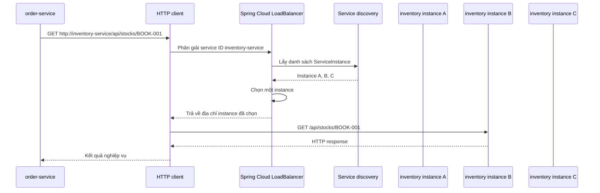

# Mô hình yêu cầu: dịch vụ gọi, dịch vụ đích và nhiều bản sao

Trong kiến trúc microservices, một dịch vụ thường cần gọi API của dịch vụ khác để hoàn thành một nghiệp vụ. Ví dụ, `order-service` cần hỏi `inventory-service` xem một mặt hàng còn đủ số lượng hay không trước khi xác nhận đơn hàng. Khi hệ thống chạy nhiều bản sao của `inventory-service`, phía gọi cần biết cách tìm một bản sao phù hợp cho từng yêu cầu.

Spring Cloud LoadBalancer giải quyết phần lựa chọn bản sao ở phía client. Thay vì gắn cứng địa chỉ IP và cổng của một máy chủ, dịch vụ gọi sử dụng một **service ID** mang tính logic. Spring Cloud LoadBalancer lấy danh sách các instance đang được cung cấp, chọn một instance rồi chuyển yêu cầu HTTP tới địa chỉ thực của instance đó. Cơ chế này giúp dịch vụ gọi tiếp tục sử dụng cùng một địa chỉ logic khi số lượng bản sao hoặc vị trí triển khai thay đổi.

## 1. Ba thành phần trong mô hình giao tiếp

Một yêu cầu đi qua ba thành phần chính:

| Thành phần | Vai trò | Ví dụ |
| --- | --- | --- |
| Dịch vụ gọi (calling service) | Khởi tạo yêu cầu và sử dụng kết quả từ dịch vụ khác | `order-service` |
| Dịch vụ đích (destination service) | Cung cấp API mà dịch vụ gọi cần sử dụng | `inventory-service` |
| Các instance của dịch vụ đích | Những tiến trình đang chạy cùng một dịch vụ, có địa chỉ mạng riêng | `10.0.1.11:8080`, `10.0.1.12:8080`, `10.0.1.13:8080` |

Trong Spring Cloud LoadBalancer, cần phân biệt hai khái niệm:

- **Service ID** là tên logic dùng để xác định dịch vụ cần gọi, chẳng hạn `inventory-service`. Tên này thường xuất hiện trong cấu hình discovery và trong URL mà client sử dụng.
- **ServiceInstance** là một bản sao cụ thể của dịch vụ. Nó chứa thông tin để kết nối tới bản sao đó, thường gồm host, port, trạng thái kết nối bảo mật và metadata đi kèm.

Một service ID có thể ánh xạ tới không, một hoặc nhiều `ServiceInstance`. Danh sách này có thể thay đổi theo quá trình triển khai, mở rộng, thu hẹp hoặc đăng ký và hủy đăng ký dịch vụ.

## 2. Địa chỉ logic và địa chỉ thực

Giả sử `inventory-service` đang chạy ba bản sao:

| Service ID | Instance | Địa chỉ thực |
| --- | --- | --- |
| `inventory-service` | Instance A | `10.0.1.11:8080` |
| `inventory-service` | Instance B | `10.0.1.12:8080` |
| `inventory-service` | Instance C | `10.0.1.13:8080` |

Dịch vụ gọi chỉ cần gửi yêu cầu tới địa chỉ logic:

```text
http://inventory-service/api/stocks/BOOK-001
```

Ở đây, `inventory-service` là service ID. Nó không phải tên máy chủ có thể mặc nhiên phân giải bằng DNS trong mọi môi trường. Client phải được tích hợp với Spring Cloud LoadBalancer để phần tên dịch vụ được phân giải thành một instance cụ thể.

Sau khi chọn instance, địa chỉ đích của yêu cầu có thể trở thành một trong các địa chỉ sau:

```text
http://10.0.1.11:8080/api/stocks/BOOK-001
http://10.0.1.12:8080/api/stocks/BOOK-001
http://10.0.1.13:8080/api/stocks/BOOK-001
```

Mã nghiệp vụ của `order-service` vẫn gọi `inventory-service` bằng service ID. Khi thêm instance D hoặc thay đổi địa chỉ của instance A, dịch vụ gọi không cần sửa URL ở từng nơi sử dụng.

## 3. Một yêu cầu được phân phối như thế nào?

Luồng xử lý thường gồm các bước sau:

1. `order-service` tạo yêu cầu HTTP tới URL chứa service ID `inventory-service`.
2. HTTP client đã tích hợp Spring Cloud LoadBalancer nhận ra đây là yêu cầu cần cân bằng tải.
3. LoadBalancer yêu cầu nguồn cung cấp instance trả về danh sách instance của `inventory-service`. Nguồn này thường lấy dữ liệu từ cơ chế service discovery.
4. Danh sách instance có thể đi qua các bước hỗ trợ như cache hoặc lọc instance theo cấu hình của ứng dụng.
5. Bộ cân bằng tải chọn một instance trong danh sách đủ điều kiện.
6. HTTP client gửi yêu cầu tới host và port thực của instance đã chọn.
7. Instance xử lý yêu cầu và trả kết quả về cho `order-service`.

Sơ đồ dưới đây thể hiện quan hệ giữa dịch vụ gọi, bộ cân bằng tải, discovery và các bản sao của dịch vụ đích:



Trong sơ đồ, instance B chỉ là ví dụ về instance được chọn. Một yêu cầu khác có thể được gửi tới A hoặc C. Dịch vụ gọi không cần tự truy vấn registry rồi tự viết thuật toán chọn máy chủ; phần phân giải và lựa chọn được thực hiện thông qua tích hợp của Spring Cloud LoadBalancer với HTTP client.

## 4. Nhiều bản sao giúp hệ thống xử lý yêu cầu ra sao?

Khi chỉ có một instance, mọi yêu cầu đều đi tới instance đó. Nếu instance dừng hoạt động, dịch vụ gọi không còn bản sao khác để sử dụng. Khi có nhiều instance, LoadBalancer có thể phân phối các yêu cầu tới những bản sao khác nhau, nhờ đó hệ thống có thêm khả năng mở rộng và chịu lỗi.

Spring Cloud LoadBalancer cung cấp thuật toán chọn instance. Cấu hình mặc định thường sử dụng `RoundRobinLoadBalancer`, lần lượt chọn các instance trong danh sách. Với một danh sách ổn định gồm ba instance, một chuỗi yêu cầu có thể được phân phối như sau:

| Yêu cầu | Instance được chọn trong ví dụ |
| --- | --- |
| Request 1 | A |
| Request 2 | B |
| Request 3 | C |
| Request 4 | A |
| Request 5 | B |
| Request 6 | C |

Đây là minh họa cho Round Robin, không phải cam kết rằng số lượng request hoặc tải xử lý tại mọi instance luôn bằng nhau. Mỗi ứng dụng gọi có thể có trạng thái lựa chọn riêng; thời gian xử lý của các request cũng có thể khác nhau. Vì vậy, nhiều instance tạo điều kiện phân phối tải nhưng không bảo đảm tải CPU, bộ nhớ hay số request đang xử lý luôn cân bằng tuyệt đối.

Khi danh sách instance thay đổi, các yêu cầu tiếp theo sẽ được lựa chọn dựa trên danh sách mà nguồn cung cấp instance trả về tại thời điểm đó. Điều này cho phép hệ thống mở rộng hoặc thu hẹp số bản sao mà không phải cập nhật thủ công từng URL ở dịch vụ gọi.

## 5. Service discovery cung cấp danh sách instance

Spring Cloud LoadBalancer cần biết những instance nào có thể nhận yêu cầu. Thông tin này thường đến từ một cơ chế service discovery. Khi khởi động, mỗi instance của dịch vụ đích có thể đăng ký service ID cùng địa chỉ host và port của nó vào registry. Dịch vụ gọi thông qua discovery client để lấy danh sách instance tương ứng với service ID.

Một số nguồn discovery thường gặp trong hệ sinh thái Spring Cloud và môi trường triển khai gồm:

- Eureka hoặc Consul: các dịch vụ đăng ký và tra cứu instance thông qua service registry.
- Kubernetes: thông tin endpoint hoặc service có thể được cung cấp thông qua tích hợp discovery phù hợp.
- Danh sách cấu hình tĩnh: hữu ích cho môi trường thử nghiệm hoặc hệ thống nhỏ chưa dùng registry động.

Vai trò của discovery và LoadBalancer khác nhau:

- Discovery trả lời câu hỏi: **Những instance nào đang được biết đến cho service ID này?**
- LoadBalancer trả lời câu hỏi: **Trong các instance được cung cấp, instance nào sẽ nhận yêu cầu hiện tại?**

LoadBalancer sử dụng các thành phần cung cấp danh sách instance (ServiceInstanceListSupplier). Tùy cấu hình, chuỗi supplier có thể bổ sung cache hoặc lọc instance. Cơ chế kiểm tra sức khỏe cũng có thể được cấu hình để loại instance không đáp ứng điều kiện. Không nên mặc định rằng mọi ứng dụng đều tự động thực hiện health check chủ động; cần kiểm tra cấu hình supplier và nguồn discovery thực tế của ứng dụng.

## 6. Tích hợp mô hình service ID với HTTP client

Để sử dụng service ID trong URL, HTTP client phải được đánh dấu hoặc cấu hình để tích hợp với Spring Cloud LoadBalancer. Ví dụ dưới đây minh họa ba lựa chọn phổ biến. Ứng dụng chỉ cần chọn client phù hợp với cách giao tiếp đang sử dụng.

### 6.1. Sử dụng RestClient

Với Spring Framework có hỗ trợ `RestClient`, khai báo một builder có `@LoadBalanced`:

```java
import org.springframework.cloud.client.loadbalancer.LoadBalanced;
import org.springframework.context.annotation.Bean;
import org.springframework.context.annotation.Configuration;
import org.springframework.web.client.RestClient;

@Configuration
class HttpClientConfiguration {

    @Bean
    @LoadBalanced
    RestClient.Builder loadBalancedRestClientBuilder() {
        return RestClient.builder();
    }
}
```

Sử dụng builder này để tạo client gọi dịch vụ đích bằng service ID:

```java
import org.springframework.stereotype.Component;
import org.springframework.web.client.RestClient;

@Component
class InventoryGateway {

    private final RestClient restClient;

    InventoryGateway(RestClient.Builder loadBalancedRestClientBuilder) {
        this.restClient = loadBalancedRestClientBuilder.build();
    }

    StockResponse getStock(String sku) {
        return restClient.get()
                .uri("http://inventory-service/api/stocks/{sku}", sku)
                .retrieve()
                .body(StockResponse.class);
    }
}
```

Điểm quan trọng là builder được gắn `@LoadBalanced`. Khi client thực hiện request tới `inventory-service`, tích hợp LoadBalancer có thể phân giải service ID và chọn instance tương ứng. Nếu ứng dụng có nhiều builder cùng kiểu, hãy đặt tên bean hoặc dùng `@Qualifier` để bảo đảm gateway nhận đúng builder.

### 6.2. Sử dụng WebClient

Với ứng dụng dùng WebFlux hoặc cần API reactive, có thể khai báo `WebClient.Builder` được cân bằng tải:

```java
import org.springframework.cloud.client.loadbalancer.LoadBalanced;
import org.springframework.context.annotation.Bean;
import org.springframework.context.annotation.Configuration;
import org.springframework.web.reactive.function.client.WebClient;

@Configuration
class ReactiveHttpClientConfiguration {

    @Bean
    @LoadBalanced
    WebClient.Builder loadBalancedWebClientBuilder() {
        return WebClient.builder();
    }
}
```

Ví dụ gọi API:

```java
import org.springframework.stereotype.Component;
import org.springframework.web.reactive.function.client.WebClient;
import reactor.core.publisher.Mono;

@Component
class ReactiveInventoryGateway {

    private final WebClient webClient;

    ReactiveInventoryGateway(WebClient.Builder loadBalancedWebClientBuilder) {
        this.webClient = loadBalancedWebClientBuilder.build();
    }

    Mono<StockResponse> getStock(String sku) {
        return webClient.get()
                .uri("http://inventory-service/api/stocks/{sku}", sku)
                .retrieve()
                .bodyToMono(StockResponse.class);
    }
}
```

### 6.3. Sử dụng OpenFeign

OpenFeign cho phép mô tả API từ xa bằng interface. Khai báo service ID trong `@FeignClient` và không chỉ định URL cố định:

```java
import org.springframework.cloud.openfeign.FeignClient;
import org.springframework.web.bind.annotation.GetMapping;
import org.springframework.web.bind.annotation.PathVariable;

@FeignClient(name = "inventory-service")
interface InventoryClient {

    @GetMapping("/api/stocks/{sku}")
    StockResponse getStock(@PathVariable("sku") String sku);
}
```

Kích hoạt quét Feign client trong ứng dụng:

```java
import org.springframework.cloud.openfeign.EnableFeignClients;
import org.springframework.boot.autoconfigure.SpringBootApplication;

@SpringBootApplication
@EnableFeignClients
class OrderApplication {
}
```

Khi gọi `inventoryClient.getStock("BOOK-001")`, Feign sử dụng tên `inventory-service` để tìm instance. Ứng dụng cần có dependency Spring Cloud OpenFeign và Spring Cloud LoadBalancer phù hợp; dependency discovery tương ứng cũng phải được cấu hình nếu dùng registry.

### 6.4. Các điều kiện tích hợp cần kiểm tra

- Dependency `spring-cloud-starter-loadbalancer` phải có trong ứng dụng sử dụng cơ chế cân bằng tải.
- Phiên bản Spring Cloud cần tương thích với phiên bản Spring Boot của dự án; nên quản lý phiên bản bằng Spring Cloud BOM tương ứng.
- Service ID trong URL hoặc `@FeignClient` phải khớp với tên mà discovery cung cấp.
- Với `RestClient` và `WebClient`, cần dùng builder được đánh dấu `@LoadBalanced`.
- Nếu không dùng registry, phải có nguồn cung cấp danh sách instance khác, chẳng hạn cấu hình instance tĩnh.

Một client HTTP thông thường không tự hiểu `inventory-service` là service ID. Nếu bỏ qua tích hợp LoadBalancer, tên này có thể bị xử lý như hostname thông thường và request thất bại khi DNS không có bản ghi tương ứng.

## 7. Điều gì xảy ra khi instance lỗi?

Việc có nhiều bản sao tạo thêm lựa chọn, nhưng không có nghĩa mọi lỗi đều được tự động khắc phục. Cần phân biệt một số tình huống:

| Tình huống | Điều có thể xảy ra | Hướng xử lý |
| --- | --- | --- |
| Discovery trả về danh sách rỗng | Không có instance để chọn; request không thể được định tuyến tới dịch vụ đích | Kiểm tra đăng ký dịch vụ, service ID, cấu hình discovery và thời điểm khởi động |
| Instance đã dừng nhưng vẫn còn trong danh sách | LoadBalancer có thể chọn instance đó; kết nối thất bại hoặc timeout | Kiểm tra cơ chế cập nhật registry, cache và cấu hình health check |
| Instance dừng sau khi được chọn | Kết nối có thể bị từ chối hoặc bị timeout | Cấu hình timeout và retry phù hợp với loại request |
| Instance trả lỗi nghiệp vụ | Request đã tới được dịch vụ nhưng xử lý không thành công | Xử lý theo mã lỗi và quy tắc nghiệp vụ; không mặc định gửi lại mọi request |

Health check, khi được cấu hình, giúp phát hiện và lọc instance không khỏe trước khi lựa chọn. Tuy vậy, luôn tồn tại khoảng thời gian giữa lúc kiểm tra và lúc gửi request; một instance có thể gặp sự cố ngay sau khi được chọn.

Retry có thể cho phép thử lại request với một lần lựa chọn instance khác, nhưng phải được thiết kế cẩn thận. Với request ghi dữ liệu hoặc tạo đơn hàng, gửi lại có thể tạo tác động trùng lặp nếu dịch vụ đích không hỗ trợ idempotency. Timeout giới hạn thời gian chờ; nó không tự bảo đảm request đã bị hủy ở phía dịch vụ đích.

Để giao tiếp ổn định, cần kết hợp danh sách instance phù hợp, chính sách lựa chọn, timeout, retry có điều kiện và khả năng quan sát. Log hoặc tracing nên giúp xác định service ID, instance thực tế được gọi, thời gian xử lý và nguyên nhân thất bại. Những thông tin này đặc biệt hữu ích khi một số replica hoạt động tốt nhưng một replica liên tục gây lỗi.

## 8. Phân biệt cân bằng tải phía client và phía server

Hai mô hình đều phân phối request giữa nhiều bản sao, nhưng điểm thực hiện lựa chọn khác nhau:

| Tiêu chí | Client-side load balancing | Server-side load balancing |
| --- | --- | --- |
| Nơi chọn instance | Trong ứng dụng gọi, thông qua client và LoadBalancer | Tại proxy hoặc load balancer đứng trước các instance |
| Địa chỉ mà caller sử dụng | Service ID được client phân giải | Địa chỉ của proxy hoặc load balancer |
| Thành phần biết danh sách instance | Discovery và supplier phía client | Proxy hoặc load balancer phía server |
| Ví dụ | Spring Cloud LoadBalancer tích hợp với RestClient, WebClient hoặc OpenFeign | Nginx, HAProxy hoặc một gateway được cấu hình cân bằng tải |

Một hệ thống có thể kết hợp cả hai mô hình ở những chặng giao tiếp khác nhau. Khi phân tích một request, cần xác định thành phần nào thực sự chọn instance để biết nơi cần kiểm tra cấu hình và log.

## 9. Ví dụ tổng hợp: order-service gọi inventory-service

Giả sử hệ thống có một `order-service` và ba bản sao `inventory-service`. Khi khách hàng đặt một sản phẩm, luồng kiểm tra tồn kho diễn ra như sau:

1. `order-service` nhận yêu cầu tạo đơn hàng.
2. `InventoryGateway` tạo request tới `http://inventory-service/api/stocks/BOOK-001`.
3. Spring Cloud LoadBalancer lấy danh sách instance của `inventory-service` từ supplier đã cấu hình.
4. Thuật toán chọn một instance, ví dụ `10.0.1.12:8080`.
5. HTTP client gửi request tới instance B.
6. `inventory-service` trả số lượng tồn kho; `order-service` tiếp tục xử lý nghiệp vụ dựa trên kết quả.

Nếu sau đó hệ thống tăng lên năm bản sao, service ID và cách gọi ở `order-service` vẫn giữ nguyên. Discovery cập nhật danh sách instance và LoadBalancer sử dụng danh sách mới theo cơ chế supplier đang cấu hình.

Điều cần ghi nhớ là service ID đại diện cho dịch vụ, còn instance đại diện cho một tiến trình cụ thể. Service discovery tìm các instance; Spring Cloud LoadBalancer chọn một instance; HTTP client gửi request tới địa chỉ thực của instance đó.

## 10. Tự kiểm tra kiến thức

1. Vì sao `order-service` nên gọi `inventory-service` bằng service ID thay vì lưu cố định IP và port của một replica?
2. Service discovery và Spring Cloud LoadBalancer đảm nhiệm hai trách nhiệm nào khác nhau?
3. Nếu danh sách discovery có ba instance, Round Robin có thể phân phối sáu request liên tiếp như thế nào?
4. Vì sao việc có nhiều replica không bảo đảm mọi request đều thành công?
5. Khi dùng `RestClient` hoặc `WebClient`, thành phần cấu hình nào cho phép client phân giải service ID thông qua Spring Cloud LoadBalancer?

Khi trả lời được các câu hỏi này, bạn đã nắm được mô hình nền tảng của cân bằng tải phía client: caller gửi request tới một tên dịch vụ logic, hệ thống tìm danh sách replica, chọn một instance phù hợp và thực hiện giao tiếp qua địa chỉ mạng thực của instance đó.
