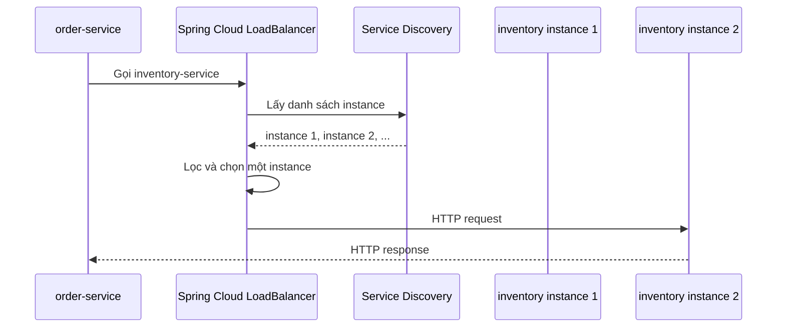
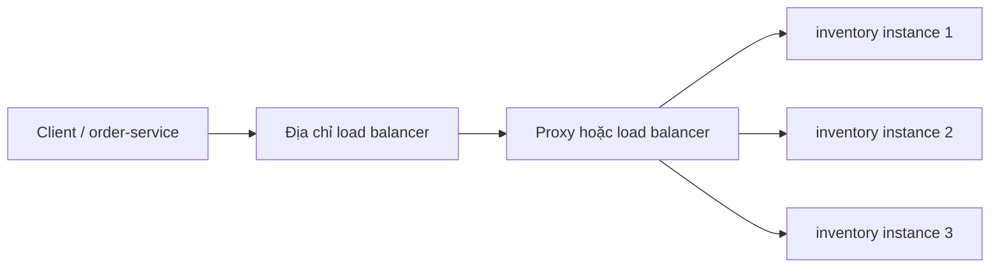

# Cân bằng tải phía máy khách và phía máy chủ

## Mục tiêu

Khi một dịch vụ được triển khai thành nhiều bản sao, ứng dụng gọi dịch vụ cần một cách chọn bản sao phù hợp cho từng yêu cầu. Cân bằng tải (load balancing) phân phối yêu cầu đến các instance để tận dụng tài nguyên, tăng khả năng phục vụ và hạn chế ảnh hưởng khi một instance gặp sự cố.

Trong kiến trúc Spring Cloud, **Spring Cloud LoadBalancer** cung cấp cơ chế cân bằng tải phía máy khách (client-side load balancing). Ứng dụng gọi dịch vụ sử dụng một service ID, lấy danh sách instance từ cơ chế discovery rồi chọn instance để gửi yêu cầu. Cân bằng tải phía máy chủ (server-side load balancing) thực hiện việc lựa chọn ở một thành phần hạ tầng như reverse proxy, load balancer hoặc nền tảng điều phối container.

Sau bài học, bạn có thể:

- Phân biệt vị trí và luồng xử lý của cân bằng tải phía máy khách với phía máy chủ.
- Giải thích vai trò của service ID, service discovery, `ServiceInstanceListSupplier` và bộ chọn instance trong Spring Cloud LoadBalancer.
- Tích hợp cân bằng tải với `RestClient`, `WebClient` và Spring Cloud OpenFeign.
- Chọn chính sách định tuyến phù hợp, kết hợp kiểm tra sức khỏe, timeout và retry.
- Nhận biết các lỗi thường gặp khi danh sách instance không chính xác hoặc không còn instance khả dụng.

## 1. Cân bằng tải giải quyết vấn đề gì?

Giả sử dịch vụ `inventory-service` có ba instance đang chạy. Nếu mọi yêu cầu từ `order-service` đều gọi đến một địa chỉ cố định, instance đó có thể trở thành nút thắt cổ chai trong khi hai instance còn lại ít tải. Nếu instance cố định ngừng hoạt động, các yêu cầu cũng thất bại dù những instance khác vẫn khỏe mạnh.

Cân bằng tải đặt một cơ chế lựa chọn giữa bên gọi và nhóm instance. Cơ chế này phân phối lưu lượng theo một chính sách, đồng thời có thể loại bỏ instance không đáp ứng điều kiện phục vụ.

Ba khái niệm cần phân biệt:

- **Service ID** là tên logic của dịch vụ, chẳng hạn `inventory-service`. Bên gọi sử dụng tên này thay vì gắn cứng IP và port của một máy.
- **Service instance** là một bản triển khai cụ thể của dịch vụ, thường được biểu diễn bằng host, port, metadata và trạng thái bảo mật.
- **Load balancer** là thành phần chọn một instance trong danh sách ứng viên cho mỗi yêu cầu.

Service discovery chịu trách nhiệm tìm và cung cấp danh sách instance. Load balancer sử dụng danh sách đó để lựa chọn. Hai trách nhiệm này liên quan chặt chẽ nhưng không đồng nhất: có danh sách instance chưa có nghĩa là danh sách đó luôn phản ánh chính xác sức khỏe hiện tại của từng instance.

## 2. Cân bằng tải phía máy khách

Với client-side load balancing, thư viện cân bằng tải nằm trong tiến trình của ứng dụng gọi dịch vụ. Ứng dụng gọi đến service ID; thư viện lấy danh sách instance và chọn một địa chỉ đích. Sau đó HTTP client gửi yêu cầu trực tiếp đến instance đã chọn.



Luồng xử lý điển hình gồm các bước:

1. `order-service` tạo yêu cầu đến địa chỉ logic, ví dụ `http://inventory-service/api/items/42`.
2. Thành phần tích hợp load balancer nhận ra `inventory-service` là service ID cần phân giải.
3. `ServiceInstanceListSupplier` cung cấp danh sách instance, thường lấy dữ liệu từ `DiscoveryClient` hoặc `ReactiveDiscoveryClient`.
4. Bộ chọn instance áp dụng chính sách đã cấu hình để chọn một instance phù hợp.
5. HTTP client gửi yêu cầu đến host và port của instance đó.
6. Kết quả được trả về cho ứng dụng gọi. Với yêu cầu tiếp theo, load balancer có thể chọn instance khác.

Spring Cloud LoadBalancer có các thành phần chính sau:

| Thành phần | Trách nhiệm |
|---|---|
| `ServiceInstance` | Mô tả một địa chỉ triển khai cụ thể của dịch vụ. |
| `DiscoveryClient` / `ReactiveDiscoveryClient` | Truy vấn danh sách instance từ hệ thống discovery. |
| `ServiceInstanceListSupplier` | Cung cấp, lưu cache hoặc lọc danh sách instance trước khi lựa chọn. |
| `ReactorLoadBalancer` | Chọn một instance từ danh sách được cung cấp. |
| Tích hợp HTTP client | Chuyển service ID trong URL thành địa chỉ instance được chọn. |

Trong cấu hình thông thường, Spring Cloud LoadBalancer sử dụng `RoundRobinLoadBalancer`. Ứng dụng cũng có thể cấu hình bộ chọn khác, chẳng hạn `RandomLoadBalancer`, hoặc tạo chính sách riêng khi cần tiêu chí định tuyến đặc thù.

### 2.1. Các chính sách chọn instance

Chính sách cân bằng tải quyết định instance nào nhận yêu cầu. Một số cách chọn thường gặp:

- **Round robin**: lần lượt phân phối yêu cầu qua các instance trong danh sách. Cách này dễ hiểu và phù hợp khi các instance có năng lực tương đương. Khi có nhiều yêu cầu đồng thời, thứ tự quan sát được không nhất thiết tạo thành một chuỗi tuần tự tuyệt đối.
- **Random**: chọn ngẫu nhiên một instance. Cách này đơn giản, nhưng không đảm bảo mỗi instance nhận số yêu cầu bằng nhau trong một khoảng thời gian ngắn.
- **Zone preference**: ưu tiên instance ở cùng vùng hoặc vùng được cấu hình ưu tiên để giảm độ trễ và lưu lượng liên vùng.
- **Hint hoặc request-based routing**: sử dụng metadata hay thông tin của yêu cầu để thu hẹp tập instance, ví dụ ưu tiên một nhóm instance dành cho một loại lưu lượng.
- **Weighted routing**: phân phối theo trọng số khi hệ thống có dữ liệu năng lực hoặc trọng số phù hợp. Không nên giả định round robin mặc định tự hiểu năng lực CPU hay tải thực tế của từng instance.

Các supplier có thể được kết hợp để lọc instance theo zone, hint hoặc trạng thái sức khỏe trước khi bộ chọn thực hiện quyết định. Vì vậy, cần xác định rõ danh sách đầu vào của bộ chọn đến từ đâu và được làm mới khi nào.

### 2.2. Service discovery và danh sách instance

Service ID chỉ có ý nghĩa khi có cơ chế phân giải nó thành các instance. Spring Cloud LoadBalancer có thể làm việc với những giải pháp discovery như Eureka, Consul hoặc discovery được cung cấp bởi nền tảng triển khai. Với môi trường học tập hoặc cấu hình tĩnh, có thể dùng `SimpleDiscoveryClient`.

Ví dụ cấu hình hai instance tĩnh cho `inventory-service`:

```yaml
spring:
  cloud:
    discovery:
      client:
        simple:
          instances:
            inventory-service:
              - uri: http://localhost:8081
              - uri: http://localhost:8082
```

Khi ứng dụng gọi `http://inventory-service/...`, danh sách trên cung cấp hai địa chỉ để load balancer lựa chọn. Trong môi trường thực tế, danh sách thường được cập nhật khi instance đăng ký, hủy đăng ký hoặc khi nền tảng discovery phát hiện thay đổi.

Không nên ghi cứng địa chỉ của một instance vào mã nguồn hoặc cấu hình của bên gọi nếu mục tiêu là gọi dịch vụ theo service ID. Cách đó làm mất khả năng lựa chọn động và khiến việc thay đổi số lượng instance trở nên khó khăn.

### 2.3. Kiểm tra sức khỏe instance

Discovery cho biết instance đã đăng ký hoặc được phát hiện. Điều đó chưa chắc chứng minh instance đang xử lý được nghiệp vụ. Một tiến trình có thể vẫn mở cổng mạng nhưng không kết nối được cơ sở dữ liệu hoặc phụ thuộc quan trọng.

Spring Cloud LoadBalancer hỗ trợ xây dựng danh sách ứng viên có xét đến health check thông qua `ServiceInstanceListSupplier`, ví dụ `HealthCheckServiceInstanceListSupplier` trong cấu hình phù hợp. Health check định kỳ gọi endpoint sức khỏe và loại instance không đạt điều kiện khỏi danh sách được chọn. Một số cấu hình discovery hoặc nền tảng cũng có cơ chế health check riêng.

Khi thiết kế health check:

- Dùng endpoint phản ánh trạng thái sẵn sàng phục vụ (readiness) thay vì chỉ kiểm tra tiến trình còn sống (liveness).
- Đặt chu kỳ kiểm tra và thời gian chờ hợp lý; kiểm tra quá dày có thể tạo thêm tải, còn kiểm tra quá thưa làm chậm phát hiện sự cố.
- Đảm bảo endpoint không yêu cầu xác thực hoặc header mà health checker không thể cung cấp, trừ khi đã cấu hình rõ cách truy cập.
- Tránh để một phụ thuộc phụ không thiết yếu khiến mọi instance bị đánh dấu không khỏe.
- Theo dõi thời điểm làm mới danh sách và thời gian cache để hiểu vì sao một instance vừa lỗi vẫn có thể xuất hiện trong một số yêu cầu.

Health check giúp giảm xác suất gửi yêu cầu đến instance lỗi; nó không thay thế timeout, xử lý ngoại lệ hoặc giám sát nghiệp vụ.

## 3. Cân bằng tải phía máy chủ

Với server-side load balancing, bên gọi gửi yêu cầu đến một địa chỉ ổn định như virtual IP, DNS name hoặc endpoint của reverse proxy. Một thành phần hạ tầng nhận yêu cầu, chọn backend instance rồi chuyển tiếp yêu cầu đến instance đó.



Ứng dụng gọi không cần biết toàn bộ địa chỉ backend. Nó chỉ cần biết endpoint của load balancer. Việc discovery, kiểm tra backend và lựa chọn instance được xử lý ở tầng hạ tầng.

Ví dụ về các thành phần có thể đảm nhiệm vai trò này:

- **NGINX hoặc HAProxy**: reverse proxy/load balancer triển khai trước một nhóm backend.
- **Envoy**: proxy có thể thực hiện cân bằng tải, kiểm tra tình trạng upstream và cung cấp telemetry.
- **Kubernetes Service**: cung cấp địa chỉ dịch vụ ổn định và phân phối kết nối đến các endpoint phù hợp trong cluster.
- **Ingress controller hoặc cloud load balancer**: tiếp nhận lưu lượng vào cluster hoặc hệ thống cloud rồi định tuyến đến dịch vụ đích.

Ở tầng mạng, có thể phân biệt hai nhóm chính:

- **Layer 4 (L4)**: quyết định dựa trên thông tin kết nối như IP và TCP/UDP port. Thành phần này không cần phân tích nội dung HTTP.
- **Layer 7 (L7)**: hiểu giao thức ứng dụng như HTTP, có thể định tuyến theo host, path, header hoặc thuộc tính request.

API Gateway có thể tích hợp khả năng cân bằng tải upstream, nhưng gateway còn đảm nhiệm các chức năng như xác thực, giới hạn tốc độ, chuyển đổi request và chính sách API. Vì vậy, không nên xem API Gateway và load balancer là hai khái niệm hoàn toàn giống nhau.

## 4. So sánh hai mô hình

| Tiêu chí | Phía máy khách | Phía máy chủ |
|---|---|---|
| Nơi chọn instance | Trong ứng dụng gọi dịch vụ | Tại proxy hoặc hạ tầng trung gian |
| Địa chỉ bên gọi sử dụng | Service ID được thư viện phân giải | Endpoint ổn định của load balancer |
| Nguồn danh sách backend | Discovery client hoặc supplier | Cấu hình, discovery hoặc control plane của hạ tầng |
| Độ phụ thuộc vào ứng dụng | Cần thư viện và cấu hình tương thích trong client | Client thường chỉ cần gọi endpoint thông thường |
| Đường đi của request | Client gửi trực tiếp đến instance đã chọn | Request đi qua load balancer rồi đến instance |
| Quản lý chính sách | Có thể cấu hình theo từng ứng dụng hoặc service ID | Có thể tập trung tại tầng hạ tầng |
| Rủi ro vận hành | Danh sách discovery/cache ở client có thể cũ hoặc không đồng nhất | Load balancer cần được triển khai dự phòng và giám sát |

**Ưu điểm của client-side load balancing** là giảm một hop proxy trong đường đi giữa hai dịch vụ, cho phép ứng dụng chọn instance theo metadata hoặc ngữ cảnh riêng, và phù hợp với giao tiếp service-to-service trong hệ Spring Cloud. Đổi lại, mỗi ứng dụng cần có thư viện, cấu hình discovery, chính sách timeout/retry và khả năng quan sát tương ứng.

**Ưu điểm của server-side load balancing** là tập trung quản lý backend và chính sách, hỗ trợ nhiều loại client hoặc ngôn ngữ lập trình mà không yêu cầu mỗi client tích hợp thư viện riêng. Đổi lại, request phải đi qua thành phần trung gian; hệ thống cần đảm bảo thành phần đó có tính sẵn sàng cao, đủ năng lực và được giám sát.

Hai mô hình có thể cùng xuất hiện trong một kiến trúc nếu chúng xử lý các chặng khác nhau. Ví dụ, load balancer ở biên tiếp nhận lưu lượng từ Internet, còn các ứng dụng Spring sử dụng client-side load balancing khi gọi những dịch vụ nội bộ. Cần hiểu rõ mỗi lớp đang chọn backend nào để tránh cấu hình nhiều tầng cân bằng tải chồng chéo mà không có mục đích.

## 5. Tích hợp Spring Cloud LoadBalancer với HTTP client

Để dùng client-side load balancing, ứng dụng cần có Spring Cloud LoadBalancer và một nguồn cung cấp instance. Trong Maven, dependency cơ bản là:

```xml
<dependency>
    <groupId>org.springframework.cloud</groupId>
    <artifactId>spring-cloud-starter-loadbalancer</artifactId>
</dependency>
```

Thêm starter discovery tương ứng nếu hệ thống sử dụng Eureka, Consul hoặc một giải pháp discovery khác. Hãy dùng Spring Cloud release train tương thích với phiên bản Spring Boot của ứng dụng; không trộn tùy ý các phiên bản thư viện Spring Cloud.

### 5.1. Dùng RestClient

Với Spring Framework 6.1 trở lên, `RestClient` cung cấp API đồng bộ để gửi HTTP request. Đánh dấu builder bằng `@LoadBalanced` để các URL chứa service ID được xử lý qua load balancer.

```java
import org.springframework.cloud.client.loadbalancer.LoadBalanced;
import org.springframework.context.annotation.Bean;
import org.springframework.context.annotation.Configuration;
import org.springframework.web.client.RestClient;

@Configuration
class HttpClientConfiguration {

    @Bean
    @LoadBalanced
    RestClient.Builder loadBalancedRestClientBuilder() {
        return RestClient.builder();
    }
}
```

Một component có thể inject builder này và gọi dịch vụ bằng service ID:

```java
import org.springframework.cloud.client.loadbalancer.LoadBalanced;
import org.springframework.stereotype.Component;
import org.springframework.web.client.RestClient;

@Component
class InventoryGateway {

    private final RestClient restClient;

    InventoryGateway(@LoadBalanced RestClient.Builder builder) {
        this.restClient = builder.build();
    }

    InventoryResponse find(String sku) {
        return restClient.get()
                .uri("http://inventory-service/api/inventory/{sku}", sku)
                .retrieve()
                .body(InventoryResponse.class);
    }
}
```

Ở đây, `inventory-service` là service ID phải khớp với tên dịch vụ trong discovery. Nếu dùng builder thông thường không có `@LoadBalanced`, HTTP client sẽ không tự biết cách phân giải service ID này thành một instance.

### 5.2. Dùng WebClient

Với ứng dụng reactive, có thể cấu hình `WebClient.Builder` được đánh dấu `@LoadBalanced`:

```java
import org.springframework.cloud.client.loadbalancer.LoadBalanced;
import org.springframework.context.annotation.Bean;
import org.springframework.context.annotation.Configuration;
import org.springframework.web.reactive.function.client.WebClient;

@Configuration
class ReactiveHttpClientConfiguration {

    @Bean
    @LoadBalanced
    WebClient.Builder loadBalancedWebClientBuilder() {
        return WebClient.builder();
    }
}
```

Sử dụng builder để tạo client gọi đến service ID:

```java
import org.springframework.cloud.client.loadbalancer.LoadBalanced;
import org.springframework.stereotype.Component;
import org.springframework.web.reactive.function.client.WebClient;
import reactor.core.publisher.Mono;

@Component
class CatalogGateway {

    private final WebClient webClient;

    CatalogGateway(@LoadBalanced WebClient.Builder builder) {
        this.webClient = builder
                .baseUrl("http://catalog-service")
                .build();
    }

    Mono<CatalogItem> find(String id) {
        return webClient.get()
                .uri("/api/items/{id}", id)
                .retrieve()
                .bodyToMono(CatalogItem.class);
    }
}
```

`WebClient` trả về publisher; ứng dụng cần tiếp tục xử lý kết quả theo mô hình reactive và tránh gọi thao tác blocking trên event-loop.

### 5.3. Dùng Spring Cloud OpenFeign

OpenFeign cho phép khai báo client bằng interface. Khi tích hợp Spring Cloud LoadBalancer, thuộc tính `name` của `@FeignClient` chính là service ID:

```java
import org.springframework.cloud.openfeign.FeignClient;
import org.springframework.web.bind.annotation.GetMapping;
import org.springframework.web.bind.annotation.PathVariable;

@FeignClient(name = "inventory-service")
interface InventoryClient {

    @GetMapping("/api/inventory/{sku}")
    InventoryResponse find(@PathVariable("sku") String sku);
}
```

Ứng dụng cần bật quét Feign client bằng cấu hình `@EnableFeignClients` phù hợp và có dependency Spring Cloud LoadBalancer trên classpath. OpenFeign sẽ dùng tích hợp load balancing để phân giải service ID và chọn instance. Nếu chỉ cấu hình Feign với một URL cố định, ứng dụng đang gọi trực tiếp endpoint đó và không sử dụng discovery theo service ID.

## 6. Retry, timeout và xử lý khi instance lỗi

Cân bằng tải giúp chọn instance, nhưng không đảm bảo request luôn thành công. Instance có thể dừng ngay sau lần health check, mạng có thể mất kết nối, hoặc dịch vụ đích có thể phản hồi quá chậm. Vì vậy, cần phối hợp load balancing với các cơ chế chịu lỗi.

### 6.1. Timeout

Thiết lập timeout kết nối và timeout phản hồi cho HTTP client. Timeout phải phù hợp với SLA của nghiệp vụ và thời gian xử lý bình thường của dịch vụ đích. Nếu timeout quá dài, request lỗi có thể giữ tài nguyên của bên gọi trong thời gian lớn; nếu quá ngắn, request hợp lệ có thể bị hủy sớm.

Timeout của HTTP client và timeout của gateway/proxy là các giới hạn ở những chặng khác nhau. Khi có nhiều tầng, cần cấu hình nhất quán để tầng phía trước không chờ lâu hơn giới hạn của tầng phía sau một cách vô ích.

### 6.2. Retry

Spring Cloud LoadBalancer có hỗ trợ retry và có thể thử lại trên cùng instance hoặc chuyển sang instance khác, tùy cấu hình và loại HTTP client được sử dụng. Retry chỉ nên áp dụng khi lỗi có khả năng tạm thời và thao tác có thể thực hiện lại an toàn.

Ví dụ, một request `GET` đọc dữ liệu thường phù hợp hơn với retry so với thao tác tạo đơn hàng. Nếu retry một thao tác ghi, cần thiết kế idempotency key hoặc cơ chế chống tạo dữ liệu trùng. Cũng cần giới hạn số lần thử và tổng thời gian retry; retry ở nhiều tầng cùng lúc có thể nhân số request lên rất nhanh khi hệ thống đang quá tải.

### 6.3. Khi không còn instance khả dụng

Nếu supplier trả về danh sách rỗng, load balancer không có instance để chọn. Ứng dụng cần xử lý lỗi này như một tình huống dịch vụ không khả dụng: ghi log có ngữ cảnh, trả lỗi phù hợp cho tầng gọi, và để circuit breaker hoặc cơ chế fallback xử lý nếu nghiệp vụ cho phép.

Không nên âm thầm chuyển sang một địa chỉ IP cũ được ghi cứng để né lỗi discovery. Cách đó có thể đưa request đến instance đã bị loại bỏ hoặc không còn an toàn. Hãy kiểm tra nguồn discovery, service ID, trạng thái đăng ký, health check và thời gian cache.

## 7. Quan sát và chẩn đoán

Để vận hành cân bằng tải ổn định, cần theo dõi cả kết quả lựa chọn instance lẫn kết quả HTTP request. Một số tín hiệu hữu ích:

- Tỷ lệ request thành công và thất bại theo service ID.
- Số lỗi không tìm thấy instance khả dụng.
- Timeout kết nối, timeout phản hồi và lỗi DNS/network.
- Số lần retry, số lần retry chuyển sang instance khác và tỷ lệ retry thành công.
- Độ trễ theo dịch vụ hoặc theo instance để phát hiện instance có hành vi bất thường.
- Trạng thái health check, số lượng instance trong danh sách và thời điểm danh sách được làm mới.

Kết hợp log với trace ID để nối request từ bên gọi đến instance đích. Khi cần điều tra một request cụ thể, thông tin service ID và instance được chọn giúp xác định liệu lỗi xuất phát từ lựa chọn instance, kết nối mạng hay xử lý nghiệp vụ. Không ghi token, thông tin xác thực hoặc dữ liệu nhạy cảm của request vào log.

## 8. Chọn mô hình nào cho kiến trúc?

Hãy chọn mô hình dựa trên vị trí của lưu lượng và nơi cần quản lý chính sách:

- Với giao tiếp nội bộ giữa các dịch vụ Spring, client-side load balancing phù hợp khi ứng dụng cần gọi theo service ID, tích hợp discovery và kiểm soát cách chọn instance ngay trong client.
- Với lưu lượng từ trình duyệt, ứng dụng di động hoặc hệ thống bên ngoài, server-side load balancing thường thuận tiện hơn vì bên gọi chỉ cần một endpoint ổn định.
- Với Kubernetes, có thể dùng DNS và Kubernetes Service để nền tảng phân phối kết nối. Chỉ bổ sung client-side load balancing ở tầng ứng dụng khi cần các chính sách lựa chọn riêng hoặc muốn tận dụng danh sách instance theo cách phù hợp với kiến trúc.
- Với hệ thống nhiều ngôn ngữ, một lớp load balancing tập trung có thể giúp thống nhất chính sách mà không yêu cầu mọi client cài cùng thư viện.
- Với yêu cầu định tuyến theo zone, tenant, phiên bản hoặc metadata, cần xác định lớp nào sở hữu chính sách đó và đảm bảo dữ liệu định tuyến được cập nhật nhất quán.

Trong một hệ thống có cả hai mô hình, hãy mô tả rõ từng chặng. Ví dụ: client bên ngoài gọi cloud load balancer; load balancer chuyển đến API Gateway; API Gateway gọi `order-service`; `order-service` dùng Spring Cloud LoadBalancer để chọn một instance của `inventory-service`. Mỗi lớp có một mục tiêu riêng và có thể được quan sát độc lập.

## 9. Checklist khi triển khai

Trước khi đưa cấu hình cân bằng tải vào môi trường chạy thật, hãy kiểm tra:

1. Service ID trong URL hoặc `@FeignClient` khớp với tên được đăng ký trong discovery.
2. Nguồn discovery trả về đúng host, port, scheme và metadata của từng instance.
3. HTTP client thực sự được cấu hình với `@LoadBalanced` khi gọi bằng service ID.
4. Chính sách lựa chọn phù hợp với năng lực instance và mục tiêu định tuyến.
5. Health check kiểm tra readiness, có timeout và chu kỳ hợp lý.
6. Cache danh sách instance không giữ dữ liệu cũ quá lâu so với yêu cầu vận hành.
7. Timeout và retry có giới hạn; thao tác ghi có cơ chế idempotency khi cần retry.
8. Trường hợp danh sách rỗng hoặc mọi instance lỗi có cách xử lý và thông báo rõ ràng.
9. Log, metrics và trace đủ để xác định instance đã nhận request.
10. Các tầng load balancer trong kiến trúc có trách nhiệm rõ ràng, tránh định tuyến vòng lặp hoặc cấu hình chồng chéo.

## Kết luận

Cân bằng tải phía máy khách đưa quyết định chọn instance vào ứng dụng gọi dịch vụ. Spring Cloud LoadBalancer thực hiện việc này bằng cách kết hợp service ID, danh sách instance từ discovery, supplier và bộ chọn instance; nó có thể tích hợp với `RestClient`, `WebClient` và OpenFeign. Cân bằng tải phía máy chủ đặt quyết định ở proxy hoặc hạ tầng trung gian, giúp tập trung quản lý backend và phục vụ nhiều loại client. Lựa chọn phù hợp phụ thuộc vào nơi phát sinh lưu lượng, yêu cầu định tuyến, cách tổ chức discovery và khả năng vận hành của hệ thống. Dù dùng mô hình nào, cần kết hợp health check, timeout, retry có kiểm soát và quan sát đầy đủ để giao tiếp giữa các dịch vụ ổn định.
