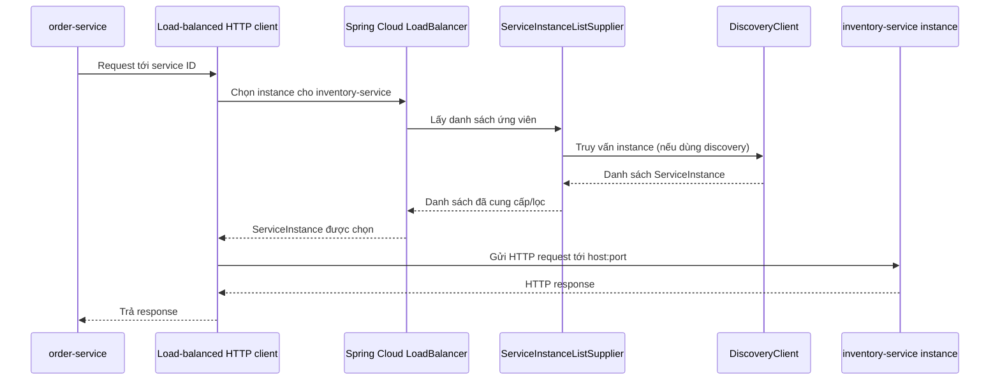

# Vai trò của Spring Cloud Commons và Spring Cloud LoadBalancer

Trong hệ thống microservices, một dịch vụ thường có nhiều instance chạy trên các máy hoặc container khác nhau. Địa chỉ của từng instance có thể thay đổi khi triển khai, mở rộng hoặc khởi động lại. Vì vậy, khi `order-service` cần gọi `inventory-service`, ứng dụng nên gọi theo **service ID** thay vì gắn cứng vào một địa chỉ IP và cổng cụ thể.

Spring Cloud Commons và Spring Cloud LoadBalancer phối hợp để giải quyết bài toán đó ở phía ứng dụng gọi:

- **Spring Cloud Commons** định nghĩa các abstraction và điểm tích hợp chung để những thành phần Spring Cloud có thể làm việc với discovery, service registry và load balancing theo một cách thống nhất.
- **Spring Cloud LoadBalancer** cung cấp cơ chế cân bằng tải phía client: nhận danh sách instance của một service, áp dụng chính sách chọn và trả về instance để HTTP client gửi request.

Hai thành phần có trách nhiệm khác nhau nhưng bổ trợ cho nhau. Commons cung cấp hợp đồng và cách tích hợp; LoadBalancer thực hiện việc lựa chọn instance trong luồng gọi dịch vụ.

## 1. Vì sao cần cân bằng tải phía client?

Giả sử `inventory-service` có ba instance:

| Instance | Địa chỉ minh họa |
|---|---|
| inventory-1 | `10.0.1.11:8080` |
| inventory-2 | `10.0.1.12:8080` |
| inventory-3 | `10.0.1.13:8080` |

Nếu `order-service` gọi trực tiếp `10.0.1.11:8080`, mọi request đều phụ thuộc vào instance đó. Khi instance dừng hoặc địa chỉ thay đổi, cấu hình của dịch vụ gọi cũng phải thay đổi. Những instance còn lại có thể không được sử dụng dù vẫn khỏe mạnh.

Cân bằng tải phía client cho phép `order-service` gửi request đến một tên logic, chẳng hạn:

```text
http://inventory-service/api/items/sku-001
```

Trước khi gửi request, thành phần load balancer tìm các instance hiện có của `inventory-service`, chọn một instance theo chính sách đã cấu hình và thay service ID bằng địa chỉ thực của instance đó. HTTP client sau đó thực hiện kết nối như một request HTTP thông thường.

Cách làm này đem lại một số lợi ích:

- Phân phối request giữa nhiều instance để tận dụng tài nguyên.
- Hạn chế phụ thuộc vào địa chỉ IP và cổng cố định.
- Thích ứng với việc thêm, xóa hoặc thay thế instance khi hệ thống thay đổi.
- Có thể loại bỏ instance không phù hợp khỏi danh sách ứng viên, ví dụ instance không vượt qua health check.
- Cho phép mỗi service sử dụng chính sách lựa chọn phù hợp với yêu cầu vận hành.

Load balancing phía client cũng có giới hạn: nó chỉ điều phối request từ ứng dụng đang gọi. Nó không tự tạo instance, triển khai dịch vụ hoặc thay thế hệ thống service discovery.

## 2. Spring Cloud Commons: lớp abstraction và tích hợp chung

Spring Cloud Commons là module nền tảng cung cấp các abstraction được nhiều dự án Spring Cloud sử dụng. Nhờ có các hợp đồng chung, ứng dụng có thể tích hợp với những hệ thống discovery hoặc service registry khác nhau mà không phải gắn toàn bộ mã nghiệp vụ với API riêng của từng nhà cung cấp.

Trong phạm vi giao tiếp giữa các service, những abstraction quan trọng gồm:

### 2.1. DiscoveryClient

`DiscoveryClient` cung cấp cách truy vấn các service instance theo service ID. Ứng dụng có thể yêu cầu danh sách instance của một dịch vụ hoặc danh sách service đã được đăng ký.

Ví dụ về ý nghĩa của lời gọi:

```java
List<ServiceInstance> instances =
        discoveryClient.getInstances("inventory-service");
```

Đoạn mã trên thể hiện cách truy vấn ở mức abstraction. Trong ứng dụng thực tế, Spring inject implementation phù hợp với discovery provider đang được sử dụng.

Một số hệ thống có thể cung cấp implementation cho abstraction này, chẳng hạn Eureka, Consul hoặc Kubernetes. Nếu không sử dụng một registry bên ngoài, Spring Cloud cũng có lựa chọn discovery đơn giản dựa trên cấu hình tĩnh trong những tình huống phù hợp.

### 2.2. ServiceInstance

`ServiceInstance` biểu diễn một instance cụ thể của service. Thông tin thường được sử dụng gồm:

- Service ID hoặc tên dịch vụ.
- Host và port để tạo địa chỉ kết nối.
- Trạng thái sử dụng kết nối bảo mật.
- URI của instance.
- Metadata bổ sung do hệ thống discovery cung cấp.

Load balancer làm việc với các đối tượng instance này thay vì cần biết trực tiếp cách Eureka, Consul hay một nền tảng khác lưu trữ thông tin đăng ký.

### 2.3. ServiceRegistry

`ServiceRegistry` định nghĩa abstraction cho các thao tác đăng ký và hủy đăng ký service instance. Discovery và registry thường được dùng cùng nhau nhưng có vai trò khác nhau:

- Registry liên quan đến việc công bố hoặc thu hồi thông tin instance.
- Discovery liên quan đến việc truy vấn thông tin các instance đã được công bố.

Một ứng dụng có thể sử dụng cơ chế tự đăng ký của discovery provider hoặc một quy trình đăng ký do nền tảng triển khai quản lý. Việc có abstraction trong Commons không có nghĩa Commons tự vận hành một registry trung tâm.

### 2.4. LoadBalancerClient và các điểm tích hợp

Spring Cloud Commons cung cấp các abstraction và annotation để tích hợp load balancing với client gọi dịch vụ. Một số thành phần thường gặp:

- `LoadBalancerClient`: abstraction theo kiểu imperative để chọn một `ServiceInstance` theo service ID và hỗ trợ thực thi request gắn với instance đã chọn.
- `ReactiveLoadBalancer`: abstraction phục vụ luồng lựa chọn instance theo mô hình reactive.
- `@LoadBalanced`: đánh dấu builder hoặc client cần được bổ sung cơ chế phân giải service ID và cân bằng tải.
- `@LoadBalancerClient` và `@LoadBalancerClients`: khai báo cấu hình load balancer riêng cho một hoặc nhiều service.

Những abstraction này giúp Spring Cloud tích hợp load balancing với nhiều HTTP client. Ứng dụng có thể dùng cùng một service ID trong mã gọi dịch vụ mà không phải tự viết logic chọn host và port cho từng request.

**Điểm cần nhớ:** Spring Cloud Commons định nghĩa hợp đồng và điểm mở rộng. Nó không phải Eureka Server, Consul Server hay một cụm registry; cũng không tự quyết định instance nào sẽ nhận request trong mọi cấu hình.

## 3. Spring Cloud LoadBalancer: bộ chọn instance ở phía client

Spring Cloud LoadBalancer là implementation cân bằng tải phía client của hệ sinh thái Spring Cloud. Nó nhận service ID, lấy danh sách instance ứng viên thông qua nguồn cung cấp instance, rồi chọn một instance theo chiến lược được cấu hình.

Một số thành phần chính trong mô hình của LoadBalancer:

| Thành phần | Vai trò |
|---|---|
| `ReactiveLoadBalancer` | Abstraction thực hiện việc chọn instance và trả kết quả lựa chọn. |
| `ReactorServiceInstanceLoadBalancer` | Hợp đồng cho implementation load balancer theo mô hình Reactor. |
| `RoundRobinLoadBalancer` | Chọn lần lượt các instance trong danh sách ứng viên. |
| `RandomLoadBalancer` | Chọn ngẫu nhiên một instance trong danh sách ứng viên. |
| `ServiceInstanceListSupplier` | Cung cấp danh sách instance cho load balancer; có thể kết hợp các bước lọc hoặc bổ sung dữ liệu. |

Các tên lớp cụ thể giúp định hướng khi đọc log hoặc cấu hình, còn mã nghiệp vụ thường chỉ cần gọi bằng service ID thông qua HTTP client đã được đánh dấu load-balanced.

### 3.1. Chính sách lựa chọn instance

Round robin là chính sách mặc định thường gặp. Với ba instance và danh sách ứng viên không đổi, các request liên tiếp có thể được phân phối lần lượt:

```text
Request 1  -> inventory-1
Request 2  -> inventory-2
Request 3  -> inventory-3
Request 4  -> inventory-1
Request 5  -> inventory-2
```

Round robin dễ hiểu và phù hợp khi các instance có năng lực tương đương. Tuy nhiên, nó không đảm bảo mỗi instance luôn nhận đúng cùng một lượng công việc trong một khoảng thời gian ngắn: request có thể có thời gian xử lý khác nhau, số request đồng thời thay đổi và danh sách instance có thể được cập nhật.

Random chọn một instance ngẫu nhiên trong danh sách ứng viên. Khi cần hành vi khác, có thể cung cấp implementation load balancer tùy chỉnh hoặc cấu hình riêng cho service. Việc chọn thuật toán nên dựa trên đặc điểm tải và yêu cầu của hệ thống, không nên thay đổi chỉ vì một thuật toán nghe có vẻ phức tạp hơn.

### 3.2. ServiceInstanceListSupplier

Load balancer cần một danh sách instance để lựa chọn. `ServiceInstanceListSupplier` chịu trách nhiệm cung cấp danh sách đó và là điểm mở rộng quan trọng trong Spring Cloud LoadBalancer.

Nguồn dữ liệu có thể đến từ discovery client hoặc cấu hình instance tĩnh. Ngoài việc lấy danh sách, supplier còn có thể được kết hợp để thực hiện các tác vụ như:

- Cache danh sách instance nhằm giảm số lần truy vấn discovery.
- Lọc instance theo zone hoặc metadata.
- Kết hợp kết quả health check.
- Áp dụng các quy tắc lựa chọn ứng viên phù hợp với request.

Supplier quyết định **những instance nào được đưa vào danh sách ứng viên**; load balancer quyết định **chọn instance nào trong danh sách đó**. Tách hai trách nhiệm này giúp thay đổi nguồn dữ liệu hoặc quy tắc lọc mà không phải viết lại thuật toán lựa chọn.

## 4. Luồng xử lý từ service ID đến HTTP request

Khi một ứng dụng gửi request đến một service ID, các thành phần phối hợp theo trình tự khái quát sau:

1. Mã ứng dụng tạo request với địa chỉ logic, ví dụ `http://inventory-service/api/items/sku-001`.
2. Load-balanced HTTP client nhận ra request cần được phân giải qua Spring Cloud LoadBalancer.
3. LoadBalancer yêu cầu nguồn cung cấp instance lấy danh sách ứng viên của `inventory-service`.
4. Discovery implementation hoặc nguồn dữ liệu cấu hình trả về thông tin các instance.
5. Supplier có thể cache, lọc hoặc kiểm tra danh sách trước khi chuyển cho load balancer.
6. Chính sách load balancing chọn một `ServiceInstance`.
7. Client thay phần host logic bằng host và port của instance được chọn.
8. HTTP client gửi request đến instance đó và xử lý response như một request HTTP thông thường.

Sơ đồ dưới đây minh họa mối quan hệ giữa các thành phần:



Đây là luồng khái quát. Một số bước có thể được cache hoặc thực hiện bất đồng bộ tùy loại client và cấu hình. Nếu danh sách instance đến từ nguồn tĩnh, bước truy vấn discovery bên ngoài có thể không xuất hiện.

Cần phân biệt ba nhiệm vụ trong luồng này:

- **Service discovery** trả lời câu hỏi: hiện có những instance nào của service?
- **Load balancing** trả lời câu hỏi: trong số các instance phù hợp, request này nên chọn instance nào?
- **HTTP client** chịu trách nhiệm thiết lập kết nối, gửi request, nhận response và áp dụng timeout ở tầng truyền thông.

Một lỗi ở một tầng không nhất thiết có nguyên nhân ở tầng còn lại. Ví dụ, không có instance là vấn đề về dữ liệu discovery hoặc danh sách ứng viên; timeout kết nối có thể liên quan đến mạng hoặc HTTP client dù load balancer đã chọn đúng instance.

## 5. Health check và chất lượng danh sách instance

Một instance có thể vẫn xuất hiện trong discovery registry nhưng không còn xử lý request bình thường. Ví dụ, tiến trình vẫn chạy nhưng ứng dụng chưa sẵn sàng, đang quá tải hoặc không thể truy cập một dependency quan trọng.

Spring Cloud LoadBalancer cho phép xây dựng danh sách ứng viên có xét đến health check. Một supplier có thể định kỳ kiểm tra endpoint sức khỏe của instance và chỉ cung cấp những instance đáp ứng điều kiện đã cấu hình.

Cần hiểu rõ ba khái niệm:

- **Discovery status:** instance đã được hệ thống discovery ghi nhận hay chưa.
- **Application health:** ứng dụng tại instance có đang hoạt động và đáp ứng điều kiện sức khỏe hay không.
- **Readiness:** instance đã sẵn sàng nhận loại traffic đang xét hay chưa.

Một health endpoint chỉ trả HTTP 200 chưa chắc đã chứng minh mọi nghiệp vụ đều hoạt động tốt. Endpoint nên phản ánh đúng mục đích kiểm tra. Ví dụ, readiness phù hợp hơn để quyết định instance có nên nhận request mới hay không; liveness thường phục vụ việc xác định tiến trình có cần được khởi động lại.

Khi bật health check, cần cân nhắc:

- Tần suất kiểm tra và timeout của mỗi lần kiểm tra.
- Số lượng instance và chi phí phát sinh từ các probe.
- Độ trễ giữa thời điểm instance lỗi và thời điểm nó bị loại khỏi danh sách ứng viên.
- Hành vi khi health endpoint tạm thời không truy cập được.
- Khả năng phục hồi và đưa instance trở lại danh sách khi nó khỏe mạnh.

Health check không thay thế monitoring, readiness/liveness probe của nền tảng triển khai hoặc cơ chế xử lý lỗi tại service. Nó bổ sung tín hiệu để load balancer chọn instance tốt hơn.

## 6. Tích hợp với các HTTP client

Ứng dụng thường không gọi trực tiếp API chọn instance. Thay vào đó, Spring Cloud tích hợp cơ chế load balancing vào HTTP client thông qua annotation và các thành phần cấu hình.

### 6.1. RestClient

Với các phiên bản Spring Framework hỗ trợ `RestClient`, có thể khai báo một builder được đánh dấu `@LoadBalanced`:

```java
@Configuration
class HttpClientConfiguration {

    @Bean
    @LoadBalanced
    RestClient.Builder loadBalancedRestClientBuilder() {
        return RestClient.builder();
    }
}
```

Một service có thể dùng builder này để tạo client:

```java
@Service
class InventoryGateway {

    private final RestClient restClient;

    InventoryGateway(RestClient.Builder builder) {
        this.restClient = builder.build();
    }

    InventoryResponse findItem(String sku) {
        return restClient.get()
                .uri("http://inventory-service/api/items/{sku}", sku)
                .retrieve()
                .body(InventoryResponse.class);
    }
}
```

Trong ví dụ, `inventory-service` là service ID. Ứng dụng không phải tự lấy danh sách instance hoặc ghép host và port vào URL. Builder được đánh dấu `@LoadBalanced` giúp request đi qua tích hợp của Spring Cloud LoadBalancer.

Nếu ứng dụng có nhiều `RestClient.Builder` bean, hãy dùng qualifier phù hợp khi inject để tránh lấy nhầm builder không có load balancing.

### 6.2. WebClient

Với ứng dụng reactive, có thể khai báo builder tương tự:

```java
@Configuration
class ReactiveHttpClientConfiguration {

    @Bean
    @LoadBalanced
    WebClient.Builder loadBalancedWebClientBuilder() {
        return WebClient.builder();
    }
}
```

Khi sử dụng builder này, request đến service ID được xử lý qua bộ lọc tích hợp với Spring Cloud LoadBalancer. Ứng dụng vẫn dùng API của `WebClient` để xây dựng request và xử lý response.

Không nên trộn builder load-balanced và builder thông thường một cách tùy tiện. Một WebClient không được cấu hình load balancing sẽ không tự hiểu service ID là tên cần tra cứu instance.

### 6.3. OpenFeign

Với Spring Cloud OpenFeign, tên trong `@FeignClient` có thể đóng vai trò service ID:

```java
@FeignClient(name = "inventory-service")
interface InventoryClient {

    @GetMapping("/api/items/{sku}")
    InventoryResponse findItem(@PathVariable String sku);
}
```

Khi tích hợp Spring Cloud LoadBalancer được đưa vào classpath và cấu hình phù hợp, OpenFeign sử dụng client load-balanced để phân giải tên service và chọn instance. Cần kiểm tra dependency của ứng dụng: việc khai báo OpenFeign không nên được hiểu là mọi cấu hình đều tự động có đủ thành phần discovery và load balancing.

### 6.4. RestTemplate trong ứng dụng hiện hữu

Các ứng dụng đang sử dụng `RestTemplate` có thể tiếp tục tích hợp thông qua một bean được đánh dấu `@LoadBalanced`. Với dự án mới, nên chọn HTTP client phù hợp với phiên bản Spring và kiến trúc hiện tại; không cần chuyển đổi client chỉ để thay đổi thuật toán load balancing.

## 7. Cấu hình theo từng service và khả năng mở rộng

Không phải mọi service đều cần cùng một chính sách. Ví dụ, một service có các instance đồng nhất có thể dùng round robin, trong khi service khác cần lọc theo zone hoặc metadata.

Spring Cloud LoadBalancer hỗ trợ cấu hình theo service thông qua các điểm mở rộng như `@LoadBalancerClient`. Ví dụ về cách khai báo:

```java
@Configuration
@LoadBalancerClient(
        name = "inventory-service",
        configuration = InventoryLoadBalancerConfiguration.class
)
class InventoryClientConfiguration {
}
```

Lớp `InventoryLoadBalancerConfiguration` có thể khai báo các bean tùy chỉnh phục vụ load balancing cho service tương ứng, chẳng hạn một implementation load balancer hoặc supplier riêng. Cấu hình chi tiết cần tuân theo API của phiên bản Spring Cloud đang sử dụng.

Khi tạo cấu hình riêng, cần chú ý phạm vi component scan. Một lớp cấu hình dành riêng cho load balancer không nên vô tình được đăng ký như cấu hình toàn cục nếu mục tiêu là chỉ áp dụng cho một service. Hãy kiểm tra cách tổ chức package và cách Spring khởi tạo các context cấu hình theo service.

Chỉ nên tùy chỉnh khi có yêu cầu rõ ràng, ví dụ:

- Các instance nằm ở nhiều zone và cần ưu tiên instance gần hơn.
- Một số instance có metadata để phân loại năng lực hoặc nhóm xử lý.
- Cần lọc instance theo điều kiện của request.
- Chính sách mặc định không đáp ứng yêu cầu phân phối tải đã đo được.

Mỗi quy tắc tùy chỉnh làm tăng độ phức tạp vận hành. Cần ghi rõ điều kiện lựa chọn, cách xử lý khi không có ứng viên và cách quan sát kết quả.

## 8. Retry, timeout và xử lý lỗi

Load balancing và retry có liên quan nhưng không phải cùng một chức năng.

Load balancer chọn instance cho một lần thử. Retry quyết định có gửi lại request sau một lỗi hay không và, nếu gửi lại, có cần chọn instance khác hay không. Tùy cách tích hợp và cấu hình, Spring Cloud LoadBalancer có thể phối hợp với cơ chế retry của client để thực hiện lựa chọn lại instance.

Timeout thường được cấu hình ở HTTP client hoặc thư viện truyền thông bên dưới. Cần phân biệt:

- **Connection timeout:** thời gian tối đa chờ thiết lập kết nối.
- **Response/read timeout:** thời gian tối đa chờ dữ liệu phản hồi.
- **Overall deadline:** giới hạn tổng thời gian nghiệp vụ cho phép, bao gồm các lần thử lại.

Một request có thể vượt quá thời gian mong muốn nếu mỗi lần retry đều có timeout dài. Vì vậy, cần đặt ngân sách thời gian tổng thể và phân bổ hợp lý cho số lần thử.

Retry cũng cần xét đến tính an toàn của thao tác:

- GET hoặc thao tác đọc thường dễ retry hơn, nhưng vẫn cần đánh giá tác động thực tế.
- Thao tác ghi có thể đã được xử lý ở server dù client không nhận được response. Retry khi đó có thể tạo giao dịch trùng lặp.
- Với thao tác không idempotent, cần thiết kế idempotency key hoặc cơ chế chống xử lý lặp trước khi bật retry rộng rãi.
- Tránh cấu hình retry đồng thời ở nhiều tầng mà không tính tổng số lần thử, vì số request thực tế có thể tăng nhanh khi hệ thống gặp sự cố.

Khi không tìm được instance, ứng dụng cần xử lý lỗi rõ ràng và ghi nhận service ID liên quan. Khi đã chọn được instance nhưng kết nối thất bại, cần quan sát địa chỉ instance, lỗi mạng và timeout để xác định nguyên nhân. Không nên coi mọi lỗi gọi service là lỗi của thuật toán load balancing.

## 9. Quan sát và chẩn đoán khi vận hành

Để đánh giá load balancing có hoạt động đúng hay không, log và metrics cần cho biết đủ thông tin về quyết định chọn instance và kết quả request.

Một số dữ liệu hữu ích:

- Service ID được gọi.
- Số lượng instance trong danh sách ứng viên.
- Instance được chọn, nếu chính sách logging cho phép ghi nhận thông tin đó.
- Thời gian xử lý request và tỷ lệ lỗi theo service hoặc instance.
- Số lần retry và nguyên nhân retry.
- Thời điểm instance được thêm vào hoặc loại khỏi danh sách ứng viên.

Khi chẩn đoán, có thể đi theo thứ tự:

1. Xác nhận service ID trong URL hoặc khai báo client có khớp tên đăng ký trong discovery hay không.
2. Kiểm tra discovery client có trả về instance hay không.
3. Kiểm tra supplier có lọc hết instance vì health check, zone hoặc metadata hay không.
4. Xác nhận HTTP client đang dùng builder được đánh dấu `@LoadBalanced`.
5. Kiểm tra instance được chọn có truy cập được từ network của service gọi hay không.
6. Đối chiếu connection timeout, response timeout, retry và log ở cả hai service.

Một số tình huống thường gặp:

| Hiện tượng | Hướng kiểm tra |
|---|---|
| Không tìm thấy instance | Service ID, đăng ký service, discovery provider và trạng thái instance. |
| Request vẫn gọi vào một địa chỉ cố định | Client có được đánh dấu `@LoadBalanced` không; URL có đang gắn cứng host/port không. |
| Một số instance không nhận request | Danh sách discovery, health check, bộ lọc zone/metadata và cache. |
| Chọn được instance nhưng request timeout | Kết nối mạng, khả năng phục vụ của instance và timeout của HTTP client. |
| Request bị xử lý lặp | Retry ở các tầng, tính idempotent và cơ chế chống trùng lặp của nghiệp vụ. |
| Hành vi khác nhau giữa các môi trường | Phiên bản Spring Boot/Spring Cloud, dependency và cấu hình theo profile. |

Khi bật cache hoặc health check, kết quả quan sát có thể chậm hơn trạng thái thực tế một khoảng thời gian. Cần đối chiếu timestamp và chu kỳ cập nhật trước khi kết luận rằng discovery hoặc load balancer đang sử dụng dữ liệu sai.

## 10. Phụ thuộc và tương thích phiên bản

Để sử dụng load balancing, ứng dụng cần dependency Spring Cloud phù hợp với loại client và nguồn discovery đang dùng. Thông thường, dự án sẽ có starter cho Spring Cloud LoadBalancer, starter cho discovery provider nếu dùng registry, và starter tích hợp HTTP client tương ứng.

Nên quản lý phiên bản Spring Cloud bằng BOM tương thích với phiên bản Spring Boot của dự án. Không nên chọn độc lập một phiên bản LoadBalancer hoặc Commons mà bỏ qua ma trận tương thích của release train. Khi nâng cấp, cần kiểm tra lại:

- Dependency thực tế có chứa Spring Cloud LoadBalancer hay không.
- Discovery provider đã được cấu hình và có thể trả về instance hay chưa.
- HTTP client đang dùng có hỗ trợ tích hợp load balancing ở phiên bản đó hay không.
- Các thuộc tính cấu hình và API tùy chỉnh có thay đổi giữa các release train hay không.

Nếu dùng service ID mà không có discovery provider, cần khai báo nguồn instance phù hợp, chẳng hạn cấu hình discovery tĩnh trong môi trường thử nghiệm. Nếu không có bất kỳ nguồn instance nào, load balancer không thể tự suy ra địa chỉ của dịch vụ đích.

## 11. Phân chia trách nhiệm giữa các thành phần

| Thành phần | Câu hỏi mà thành phần giải quyết | Trách nhiệm chính |
|---|---|---|
| Spring Cloud Commons | Các dự án Spring Cloud tích hợp với discovery và load balancing theo hợp đồng nào? | Cung cấp abstraction, annotation và điểm mở rộng chung. |
| Discovery provider | Những instance nào đã được đăng ký? | Quản lý hoặc cung cấp dữ liệu đăng ký và khám phá service. |
| Spring Cloud LoadBalancer | Request nên chọn instance nào? | Nhận danh sách ứng viên, áp dụng chính sách và chọn instance phía client. |
| ServiceInstanceListSupplier | Những instance nào được đưa vào danh sách ứng viên? | Cung cấp, cache hoặc lọc danh sách instance. |
| HTTP client | Làm thế nào gửi request đến instance đã chọn? | Quản lý kết nối, request/response và timeout truyền thông. |
| Retry/circuit breaker | Ứng dụng phản ứng thế nào khi request thất bại? | Điều phối thử lại hoặc ngăn lời gọi tiếp tục gây áp lực lên hệ thống. |

Có thể ghi nhớ mối quan hệ này bằng một ví dụ: Commons định nghĩa cách ứng dụng yêu cầu một instance; discovery provider cung cấp dữ liệu instance; LoadBalancer chọn một instance; HTTP client gửi request đến địa chỉ đã chọn. Mỗi thành phần giải quyết một phần riêng của quá trình giao tiếp giữa các dịch vụ.

## 12. Kết luận

Spring Cloud Commons và Spring Cloud LoadBalancer là hai phần bổ trợ trong cơ chế cân bằng tải phía client của Spring Cloud. Commons tạo lớp abstraction thống nhất cho discovery, registry và tích hợp load balancing. LoadBalancer sử dụng danh sách instance để lựa chọn đích cho từng request theo chính sách phù hợp.

Khi triển khai, cần bảo đảm ba điều kiện: service ID được phân giải thành danh sách instance hợp lệ, HTTP client thực sự được cấu hình load-balanced và timeout/retry phù hợp với đặc điểm nghiệp vụ. Health check, cache, chính sách theo zone và cấu hình riêng theo service là những điểm mở rộng để hệ thống thích ứng với môi trường vận hành thực tế.

