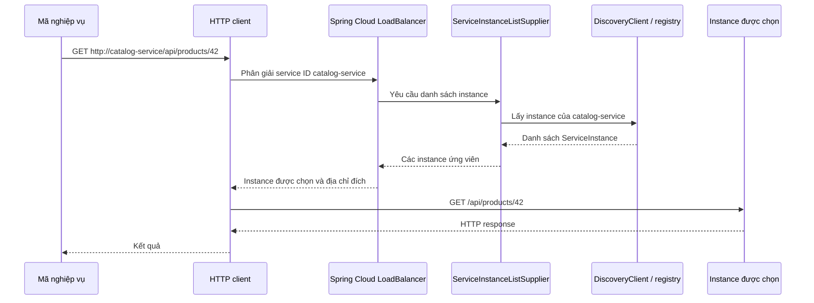

# Quan hệ giữa HTTP client, khám phá dịch vụ và bộ cân bằng tải

Trong một hệ thống Spring Cloud có nhiều instance của cùng một dịch vụ, ứng dụng gọi dịch vụ thường chỉ biết tên logic như `catalog-service` hoặc `payment-service`. Ứng dụng không nên phải tự lưu địa chỉ IP và cổng của từng instance, cũng không nên tự chọn một instance trước mỗi lần gọi. Ba thành phần phối hợp để giải quyết việc này là **HTTP client**, **khám phá dịch vụ (service discovery)** và **bộ cân bằng tải phía client (client-side load balancing)**.

HTTP client tạo và thực thi yêu cầu HTTP. Service discovery tìm các instance đang được đăng ký dưới một service ID. Spring Cloud LoadBalancer chọn một instance từ danh sách đó rồi giúp HTTP client gửi yêu cầu đến địa chỉ cụ thể. Mỗi thành phần có một trách nhiệm riêng; kết hợp chúng giúp mã nghiệp vụ gọi dịch vụ bằng tên ổn định trong khi hạ tầng có thể thêm, bỏ hoặc thay thế instance.

## 1. Vai trò của từng thành phần

### HTTP client: thực hiện giao tiếp HTTP

HTTP client chịu trách nhiệm tạo request, gửi dữ liệu qua mạng và đọc response. Trong Spring, các lựa chọn thường gặp gồm:

- `RestClient`: API gọi HTTP đồng bộ, phù hợp với luồng xử lý yêu cầu thông thường.
- `WebClient`: API hỗ trợ non-blocking và reactive, phù hợp khi ứng dụng cần xử lý bất đồng bộ hoặc luồng dữ liệu.
- Spring Cloud OpenFeign: cho phép khai báo lời gọi HTTP qua interface và annotation.

HTTP client hiểu phương thức HTTP, đường dẫn, header, body và cách giải mã response. Bản thân một HTTP client thông thường không tự biết `catalog-service` đang có những instance nào. Nếu truyền `http://catalog-service/...` cho client không được tích hợp service discovery và load balancing, tên `catalog-service` có thể bị xem như hostname cần phân giải bằng DNS.

### Service discovery: tìm các instance của dịch vụ

Service discovery cung cấp danh sách địa chỉ của các instance thuộc một dịch vụ. Trong môi trường có registry, mỗi instance đăng ký thông tin như service ID, instance ID, host, port, trạng thái và metadata. Ví dụ, ba instance cùng đăng ký dưới tên `catalog-service`:

| Service ID | Instance | Địa chỉ ví dụ |
|---|---|---|
| `catalog-service` | `catalog-1` | `10.0.4.21:8080` |
| `catalog-service` | `catalog-2` | `10.0.4.22:8080` |
| `catalog-service` | `catalog-3` | `10.0.4.23:8080` |

Trong Spring Cloud, ứng dụng có thể lấy danh sách này thông qua abstraction `DiscoveryClient`. Với một service ID, lời gọi `getInstances(serviceId)` trả về các `ServiceInstance` mà implementation discovery hiện tại biết đến. Implementation đó có thể kết nối với Eureka, Consul hoặc một nền tảng khám phá dịch vụ khác. Trong cấu hình đơn giản, danh sách instance cũng có thể được khai báo tĩnh.

Service discovery trả lời câu hỏi **“Có những instance nào của dịch vụ này?”**. Nó không nhất thiết quyết định request hiện tại sẽ đi đến instance nào.

### Spring Cloud LoadBalancer: chọn instance cho từng request

Spring Cloud LoadBalancer nhận service ID và danh sách instance có thể sử dụng, sau đó áp dụng chính sách chọn instance. Trong kiến trúc của nó, `ServiceInstanceListSupplier` cung cấp danh sách ứng viên; một `ReactorLoadBalancer` thực hiện lựa chọn. Cấu hình mặc định thường sử dụng thuật toán round-robin: các request lần lượt được phân phối qua những instance trong danh sách.

LoadBalancer có thể phối hợp với các supplier hoặc cấu hình bổ sung để lọc instance, kiểm tra sức khỏe, xét vùng triển khai (zone), hint hay metadata. Những khả năng này phụ thuộc cấu hình và integration được sử dụng. Không nên giả định rằng mọi ứng dụng đều tự động có health check chủ động hoặc luôn loại bỏ ngay một instance vừa lỗi.

Sau khi chọn được instance, LoadBalancer cung cấp địa chỉ đích cụ thể để HTTP client thực hiện request. Nó quyết định **“Request này nên gọi instance nào?”**, còn việc mở kết nối, gửi HTTP và đọc response vẫn thuộc về HTTP client.

## 2. Ba thành phần phối hợp trong một request

Giả sử service `order-service` cần lấy thông tin sản phẩm từ `catalog-service`. Mã ứng dụng tạo request với URL logic:

```text
GET http://catalog-service/api/products/42
```

Luồng xử lý khái quát như sau:

1. Mã nghiệp vụ gọi một HTTP client bằng service ID `catalog-service`.
2. Tích hợp Spring Cloud LoadBalancer nhận ra request cần được cân bằng tải. Với `RestClient` hoặc `WebClient`, điều này thường được kích hoạt bằng annotation `@LoadBalanced` trên builder; OpenFeign có tích hợp theo tên dịch vụ.
3. LoadBalancer yêu cầu supplier cung cấp các `ServiceInstance` phù hợp với service ID. Supplier lấy dữ liệu từ discovery client hoặc nguồn instance đã cấu hình.
4. LoadBalancer áp dụng chính sách lựa chọn và chọn một instance, ví dụ `10.0.4.22:8080`.
5. URL logic được phân giải thành địa chỉ instance cụ thể. HTTP client gửi request đến địa chỉ đó.
6. HTTP client nhận response và trả kết quả về cho mã nghiệp vụ.



Ví dụ, nếu LoadBalancer chọn `10.0.4.22:8080`, request thực tế được gửi đến:

```text
GET http://10.0.4.22:8080/api/products/42
```

Địa chỉ IP ở đây chỉ minh họa kết quả phân giải. Mã nghiệp vụ tiếp tục sử dụng service ID, vì instance có thể thay đổi sau khi triển khai lại hoặc mở rộng số lượng bản sao.

## 3. Tích hợp với các HTTP client trong Spring

Để các lời gọi theo service ID được xử lý bởi Spring Cloud LoadBalancer, ứng dụng cần dependency `spring-cloud-starter-loadbalancer` và một nguồn cung cấp instance. Nguồn đó thường là discovery client tương ứng với registry của hệ thống. Chỉ thêm một HTTP client vào classpath không tự động biến mọi URL hostname thành service ID.

### Với RestClient

Đánh dấu builder bằng `@LoadBalanced` để Spring Cloud áp dụng cơ chế phân giải và chọn instance cho request dùng service ID:

```java
import org.springframework.cloud.client.loadbalancer.LoadBalanced;
import org.springframework.context.annotation.Bean;
import org.springframework.context.annotation.Configuration;
import org.springframework.web.client.RestClient;

@Configuration
class HttpClientConfiguration {

    @Bean
    @LoadBalanced
    RestClient.Builder loadBalancedRestClientBuilder() {
        return RestClient.builder();
    }
}
```

Một client có thể dùng builder này để tạo `RestClient`:

```java
import org.springframework.beans.factory.annotation.Qualifier;
import org.springframework.stereotype.Component;
import org.springframework.web.client.RestClient;

@Component
class CatalogClient {

    private final RestClient restClient;

    CatalogClient(
            @Qualifier("loadBalancedRestClientBuilder") RestClient.Builder builder) {
        this.restClient = builder.build();
    }

    ProductResponse getProduct(String productId) {
        return restClient.get()
                .uri("http://catalog-service/api/products/{id}", productId)
                .retrieve()
                .body(ProductResponse.class);
    }
}
```

`CatalogClient` chỉ cần biết service ID và API path. Spring Cloud LoadBalancer phối hợp với builder đã đánh dấu để chọn instance khi request được thực hiện. Nếu ứng dụng đồng thời có builder thường và builder load-balanced, nên đặt tên bean và dùng `@Qualifier` rõ ràng để tránh inject nhầm.

### Với WebClient

WebClient cũng có thể dùng service ID khi builder được đánh dấu `@LoadBalanced`:

```java
import org.springframework.cloud.client.loadbalancer.LoadBalanced;
import org.springframework.context.annotation.Bean;
import org.springframework.context.annotation.Configuration;
import org.springframework.web.reactive.function.client.WebClient;

@Configuration
class ReactiveHttpClientConfiguration {

    @Bean
    @LoadBalanced
    WebClient.Builder loadBalancedWebClientBuilder() {
        return WebClient.builder();
    }
}
```

Ví dụ sử dụng trong một client:

```java
import org.springframework.beans.factory.annotation.Qualifier;
import org.springframework.stereotype.Component;
import org.springframework.web.reactive.function.client.WebClient;
import reactor.core.publisher.Mono;

@Component
class CatalogReactiveClient {

    private final WebClient webClient;

    CatalogReactiveClient(
            @Qualifier("loadBalancedWebClientBuilder") WebClient.Builder builder) {
        this.webClient = builder.build();
    }

    Mono<ProductResponse> getProduct(String productId) {
        return webClient.get()
                .uri("http://catalog-service/api/products/{id}", productId)
                .retrieve()
                .bodyToMono(ProductResponse.class);
    }
}
```

`WebClient` vẫn giữ cách xử lý reactive của nó. LoadBalancer chỉ bổ sung bước phân giải service ID và chọn instance trước khi request được gửi đi.

### Với Spring Cloud OpenFeign

OpenFeign cho phép mô tả dịch vụ đích ngay trên interface:

```java
import org.springframework.cloud.openfeign.FeignClient;
import org.springframework.web.bind.annotation.GetMapping;
import org.springframework.web.bind.annotation.PathVariable;

@FeignClient(name = "catalog-service")
interface CatalogFeignClient {

    @GetMapping("/api/products/{id}")
    ProductResponse getProduct(@PathVariable("id") String productId);
}
```

Khi ứng dụng đã bật quét Feign client và có dependency tích hợp Spring Cloud LoadBalancer, tên trong `@FeignClient` được dùng làm service ID. Feign tạo lời gọi theo khai báo interface; integration load balancer tìm và chọn instance. Vì dependency LoadBalancer có thể là dependency tùy chọn trong một số cấu hình OpenFeign, hãy kiểm tra dependency thực tế của ứng dụng thay vì cho rằng chỉ có `spring-cloud-starter-openfeign` là đủ.

Ba cách tích hợp có API khác nhau, nhưng đều dùng cùng ý tưởng: mã nghiệp vụ gọi theo tên dịch vụ, LoadBalancer chọn instance, HTTP client thực hiện request.

## 4. Service ID, instance và địa chỉ đích

Ba khái niệm này cần được phân biệt rõ:

| Khái niệm | Ý nghĩa | Ví dụ |
|---|---|---|
| Service ID | Tên logic đại diện cho một dịch vụ | `catalog-service` |
| Service instance | Một bản chạy cụ thể của dịch vụ | `catalog-2` |
| Địa chỉ đích | Host và port mà client kết nối đến | `10.0.4.22:8080` |

Service ID thường liên quan đến tên ứng dụng mà instance đăng ký, chẳng hạn `spring.application.name: catalog-service`. Discovery client dùng service ID để tìm các instance. LoadBalancer chọn một instance từ kết quả đó. HTTP client cuối cùng cần địa chỉ đích có thể kết nối được.

Vì vậy, tên trong URL phải khớp với service ID mà các instance đã đăng ký hoặc với tên dịch vụ được khai báo trong cấu hình discovery. Sai khác như `catalog-service` và `catalog` có thể khiến danh sách instance rỗng dù các instance vẫn đang chạy.

## 5. Load balancing giải quyết việc gì và không giải quyết việc gì?

Load balancing phía client phân phối các request giữa những instance mà nó nhận được. Với round-robin, mỗi request tiếp theo thường được chuyển sang instance kế tiếp trong danh sách. Cách này đơn giản và hữu ích khi các instance có năng lực tương đương.

Tuy nhiên, round-robin không đo chính xác CPU, số request đang xử lý hay thời gian phản hồi của từng instance. Nếu các instance có năng lực khác nhau, cần cân nhắc chính sách lựa chọn và metadata phù hợp. Health check, lọc instance, retry và zone preference cũng cần được cấu hình theo nhu cầu; không nên xem chúng là hành vi luôn có sẵn trong mọi triển khai.

LoadBalancer cũng không thay thế các cơ chế sau:

- HTTP timeout và connection timeout: cần cấu hình ở HTTP client hoặc request factory phù hợp.
- Retry: cần chính sách giới hạn số lần thử và đánh giá tính an toàn của thao tác. Retry một request ghi dữ liệu có thể tạo tác dụng phụ lặp nếu server đã xử lý request nhưng response bị mất.
- Xử lý lỗi nghiệp vụ: LoadBalancer không sửa được response `4xx` hoặc `5xx` do ứng dụng đích trả về.
- Bảo mật và xác thực: token, TLS, quyền truy cập và kiểm tra dữ liệu vẫn thuộc trách nhiệm của ứng dụng và hạ tầng liên quan.

Nếu discovery trả về danh sách rỗng, LoadBalancer không có instance để chọn. Nếu đã chọn được instance nhưng kết nối thất bại, nguyên nhân có thể nằm ở tiến trình đích, cổng, mạng hoặc dữ liệu discovery cũ. Nếu request đến được ứng dụng và nhận `4xx`/`5xx`, cần kiểm tra response và log của dịch vụ đích. Phân biệt các trường hợp này giúp tìm lỗi đúng tầng.

## 6. Cách kiểm tra luồng gọi dịch vụ

Khi một lời gọi theo service ID không hoạt động như mong đợi, hãy lần lượt kiểm tra:

1. HTTP client có thực sự được tích hợp LoadBalancer không? Với `RestClient` và `WebClient`, kiểm tra builder có `@LoadBalanced`; với Feign, kiểm tra tên client và dependency LoadBalancer.
2. Service ID trong URL hoặc annotation có khớp tên dịch vụ đã đăng ký không?
3. Discovery client có trả về các instance của service ID đó không?
4. Các instance được trả về có host, port và trạng thái phù hợp để kết nối không?
5. LoadBalancer chọn instance nào? Kiểm tra log hoặc quan sát phù hợp để xác định địa chỉ đích.
6. HTTP client có timeout phù hợp và có nhận được response từ instance đã chọn không?

Một phép kiểm tra hữu ích là đối chiếu ba giá trị trong cùng một lần gọi: service ID ứng dụng yêu cầu, danh sách instance discovery cung cấp và instance LoadBalancer đã chọn. Nếu service ID đúng nhưng danh sách rỗng, tập trung vào đăng ký và discovery. Nếu danh sách có instance nhưng kết nối thất bại, kiểm tra địa chỉ, cổng và khả năng truy cập mạng. Nếu request đã đến đích, kiểm tra log và response của ứng dụng đó.

## 7. Ghi nhớ

HTTP client chịu trách nhiệm gửi và nhận HTTP. Service discovery tìm các instance theo service ID. Spring Cloud LoadBalancer chọn một instance và cung cấp địa chỉ đích để HTTP client gọi. Khi tích hợp đúng, mã nghiệp vụ chỉ cần sử dụng tên logic như `catalog-service`; danh sách instance và lựa chọn đích được xử lý ở tầng giao tiếp giữa client và hạ tầng discovery.
