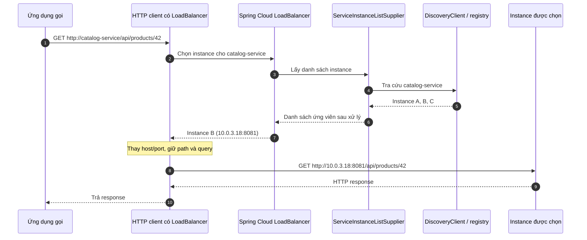

# Luồng một yêu cầu từ tên dịch vụ đến bản sao được chọn

Trong một hệ thống có nhiều bản sao của cùng một dịch vụ, ứng dụng gọi dịch vụ đích bằng một **service ID** ổn định, chẳng hạn `catalog-service`. Ở thời điểm gửi yêu cầu, Spring Cloud LoadBalancer tìm danh sách các bản sao đang được đăng ký, chọn một `ServiceInstance`, rồi chuyển yêu cầu đến địa chỉ mạng cụ thể của bản sao đó.

Đó là cơ chế cân bằng tải phía client: quyết định chọn bản sao diễn ra trong ứng dụng gọi dịch vụ. Ứng dụng không cần biết trước địa chỉ IP hay cổng của từng bản sao; nó chỉ cần biết service ID và có một nguồn cung cấp danh sách instance.

## 1. Service ID đại diện cho dịch vụ logic

Giả sử hệ thống có ba bản sao của dịch vụ danh mục:

| Thành phần | Giá trị ví dụ | Ý nghĩa |
|---|---|---|
| Service ID | `catalog-service` | Tên logic mà ứng dụng dùng để gọi |
| Instance A | `10.0.3.17:8081` | Một tiến trình đang phục vụ `catalog-service` |
| Instance B | `10.0.3.18:8081` | Bản sao thứ hai |
| Instance C | `10.0.3.19:8081` | Bản sao thứ ba |

Khi viết `http://catalog-service/api/products/42`, phần `catalog-service` là tên dịch vụ logic. Với HTTP client đã được tích hợp LoadBalancer, tên này được phân giải thành một instance trước khi HTTP request được gửi đi.

Service ID không phải địa chỉ IP, DNS hostname của máy chủ hay ID của một tiến trình riêng lẻ. Nó là khóa để tra cứu nhóm instance. Một service ID có thể ánh xạ tới nhiều instance và tập hợp đó có thể thay đổi khi dịch vụ scale, khởi động lại hoặc bị loại khỏi registry.

## 2. Một yêu cầu đi qua những thành phần nào?

Luồng tổng quát có thể chia thành các bước sau:

1. **Ứng dụng tạo yêu cầu bằng service ID.** Ví dụ, `RestClient` gửi `GET http://catalog-service/api/products/42`.
2. **Tích hợp LoadBalancer nhận diện địa chỉ logic.** Interceptor hoặc exchange filter được thêm bởi cấu hình `@LoadBalanced` tách service ID khỏi đường dẫn, query và các thông tin còn lại của request.
3. **LoadBalancer yêu cầu danh sách instance.** `ServiceInstanceListSupplier` cung cấp các instance cho service ID đó. Nguồn dữ liệu thường đến từ một `DiscoveryClient`, hoặc từ cấu hình tĩnh trong môi trường đơn giản.
4. **Danh sách ứng viên được xử lý.** Các supplier có thể kết hợp cache, bộ lọc theo vùng triển khai, health check hoặc những quy tắc lựa chọn khác.
5. **Chiến lược cân bằng tải chọn một instance.** Chẳng hạn, `RoundRobinLoadBalancer` luân phiên qua các ứng viên hiện có.
6. **Địa chỉ đích được thay bằng địa chỉ instance.** Host và port của service ID được thay bằng host và port của instance đã chọn; path và query của request được giữ lại.
7. **HTTP client gửi request thật.** Kết nối mạng được thực hiện bởi client nền như HTTP client của `RestClient`, Reactor Netty của `WebClient` hoặc HTTP client được Feign sử dụng.



Sơ đồ mô tả một request thành công. Trong thực tế, cache có thể khiến supplier không phải hỏi registry ở mỗi request; health check có thể loại một instance trước bước chọn; retry có thể kích hoạt một lần chọn khác sau lỗi. Những cơ chế đó làm thay đổi danh sách hoặc số lần chọn, nhưng không thay đổi vai trò chính của service ID.

## 3. Discovery cung cấp danh sách instance

Spring Cloud LoadBalancer chịu trách nhiệm chọn instance. Nó cần một thành phần khác cung cấp thông tin instance. Trong Spring Cloud, `DiscoveryClient` là một trong những abstraction phổ biến để truy vấn các dịch vụ đã đăng ký.

Tùy hạ tầng, dữ liệu discovery có thể đến từ:

- Eureka hoặc Consul khi hệ thống dùng service registry tương ứng.
- Kubernetes discovery khi môi trường triển khai tích hợp discovery của Kubernetes.
- `SimpleDiscoveryClient` khi muốn khai báo danh sách instance tĩnh, thường hữu ích cho thử nghiệm hoặc môi trường nhỏ.

Ví dụ cấu hình tĩnh cho `SimpleDiscoveryClient`:

```yaml
spring:
  cloud:
    discovery:
      client:
        simple:
          instances:
            catalog-service:
              - uri: http://localhost:8081
              - uri: http://localhost:8082
```

Với cấu hình này, service ID `catalog-service` có hai instance để LoadBalancer xem xét. Trong môi trường dùng registry thực, các địa chỉ thường được đăng ký và cập nhật bởi ứng dụng dịch vụ hoặc nền tảng triển khai.

`ServiceInstanceListSupplier` là lớp trung gian cung cấp danh sách cho bộ chọn. Một supplier có thể lấy dữ liệu từ `DiscoveryClient`; supplier khác có thể bọc supplier đó để thêm cache hoặc lọc ứng viên. Vì vậy, cần phân biệt ba trách nhiệm:

- **Discovery** trả lời câu hỏi: những instance nào đang được biết đến cho service ID này?
- **Supplier** trả lời câu hỏi: danh sách instance nào sẽ được đưa cho bộ chọn ở request hiện tại?
- **Load balancer** trả lời câu hỏi: chọn instance nào trong danh sách ứng viên?

Cache giúp giảm số lần truy vấn nguồn discovery, nhưng cũng có thể khiến danh sách ứng viên chậm phản ánh thay đổi trong registry. Thời gian sống của cache và cách cập nhật cần phù hợp với tốc độ thay đổi instance của hệ thống.

### Health check và lọc instance

Một instance có trong registry chưa chắc đang sẵn sàng xử lý request. Registry có thể cập nhật chậm, tiến trình có thể đang khởi động hoặc ứng dụng có thể gặp lỗi sau lần đăng ký gần nhất. Health check supplier có thể kiểm tra tình trạng instance và chỉ đưa các instance đạt điều kiện vào danh sách ứng viên.

Health check cần được cấu hình có chủ đích: endpoint kiểm tra phải phản ánh đúng khả năng phục vụ, chu kỳ kiểm tra không nên tạo tải quá lớn, và trạng thái sẵn sàng của ứng dụng cần được thiết kế nhất quán với nền tảng triển khai. Health check của LoadBalancer là một lớp lọc trong luồng chọn instance; nó không tự thay thế readiness/liveness probe hoặc cơ chế quản lý vòng đời của nền tảng.

Nếu mọi instance đều bị lọc, LoadBalancer không có ứng viên để chọn. Khi điều tra lỗi, hãy kiểm tra cả dữ liệu discovery ban đầu lẫn kết quả sau các supplier và bộ lọc.

## 4. Bộ chọn quyết định bản sao nhận request

Sau khi có danh sách ứng viên, chiến lược cân bằng tải quyết định instance nào sẽ nhận request. Spring Cloud LoadBalancer cung cấp các implementation có sẵn; `RoundRobinLoadBalancer` là lựa chọn mặc định phổ biến khi không cấu hình chiến lược khác.

Với ba instance A, B và C, round robin có thể phân phối các request liên tiếp theo chu kỳ A → B → C → A. Đây là cách phân phối theo lượt, không phải cam kết mỗi instance sẽ nhận chính xác cùng số request trong mọi khoảng thời gian. Lưu lượng đồng thời, instance thay đổi, retry và nhiều client độc lập đều có thể làm quan sát thực tế khác một chu kỳ minh họa.

Một số lựa chọn và điểm cần cân nhắc:

| Chiến lược hoặc cơ chế | Cách hoạt động | Khi cân nhắc |
|---|---|---|
| Round robin | Lần lượt chọn các instance trong danh sách | Các instance có năng lực tương đương và muốn phân phối đơn giản |
| Random | Chọn ngẫu nhiên một instance trong danh sách | Muốn phân phối ngẫu nhiên, không cần thứ tự luân phiên |
| Supplier có bộ lọc | Giới hạn ứng viên trước khi chọn, ví dụ theo zone hoặc health check | Muốn ưu tiên vùng triển khai hoặc loại instance không phù hợp |
| Load balancer tùy chỉnh | Áp dụng quy tắc riêng dựa trên metadata hoặc ngữ cảnh request | Có yêu cầu định tuyến cụ thể và có thể kiểm thử, vận hành quy tắc đó |

Có thể cấu hình LoadBalancer riêng cho một service ID bằng `@LoadBalancerClient`, sau đó cung cấp bean `ReactorLoadBalancer<ServiceInstance>` hoặc supplier phù hợp. Cấu hình riêng nên được giới hạn đúng service cần áp dụng; tránh để lớp cấu hình bị component scan toàn cục ngoài ý muốn, khiến quy tắc tùy chỉnh lan sang các service khác.

Không nên chọn thuật toán chỉ vì tên gọi có vẻ phù hợp. Hãy xem xét sự khác nhau về năng lực instance, trạng thái tải, vị trí mạng, yêu cầu session và khả năng quan sát. Nếu mọi instance không đồng nhất về năng lực, round robin đơn giản có thể không phản ánh đúng dung lượng thực tế.

## 5. Tích hợp với HTTP client

Spring Cloud LoadBalancer có thể được dùng qua nhiều client. Điểm chung là ứng dụng gửi URL chứa service ID và client được đánh dấu/tích hợp với LoadBalancer để phân giải URL đó.

Trước hết, thêm starter LoadBalancer khi cấu hình tích hợp của ứng dụng cần nó và quản lý phiên bản bằng Spring Cloud BOM tương thích với phiên bản Spring Boot đang dùng:

```xml
<dependency>
    <groupId>org.springframework.cloud</groupId>
    <artifactId>spring-cloud-starter-loadbalancer</artifactId>
</dependency>
```

### RestClient

Với Spring Framework hiện đại, `RestClient.Builder` có thể được đánh dấu `@LoadBalanced`:

```java
@Configuration(proxyBeanMethods = false)
class HttpClientConfiguration {

    @Bean
    @LoadBalanced
    RestClient.Builder loadBalancedRestClientBuilder() {
        return RestClient.builder();
    }
}
```

Ứng dụng inject builder đã được đánh dấu và gọi bằng service ID:

```java
@Service
class CatalogClient {

    private final RestClient restClient;

    CatalogClient(@LoadBalanced RestClient.Builder builder) {
        this.restClient = builder.build();
    }

    Product findProduct(String id) {
        return restClient.get()
                .uri("http://catalog-service/api/products/{id}", id)
                .retrieve()
                .body(Product.class);
    }
}
```

Nếu builder không được cấu hình LoadBalancer, `catalog-service` có thể bị HTTP client xem như hostname thông thường và việc phân giải sẽ phụ thuộc DNS. Vì vậy, cần kiểm tra đúng bean được inject khi ứng dụng có nhiều `RestClient.Builder`.

### WebClient

Với ứng dụng reactive, đánh dấu `WebClient.Builder` bằng `@LoadBalanced`:

```java
@Configuration(proxyBeanMethods = false)
class ReactiveHttpClientConfiguration {

    @Bean
    @LoadBalanced
    WebClient.Builder loadBalancedWebClientBuilder() {
        return WebClient.builder();
    }
}
```

Sau đó gọi URL có service ID như một URI thông thường:

```java
@Service
class ReactiveCatalogClient {

    private final WebClient webClient;

    ReactiveCatalogClient(@LoadBalanced WebClient.Builder builder) {
        this.webClient = builder.build();
    }

    Mono<Product> findProduct(String id) {
        return webClient.get()
                .uri("http://catalog-service/api/products/{id}", id)
                .retrieve()
                .bodyToMono(Product.class);
    }
}
```

Trong tích hợp reactive, exchange filter của LoadBalancer tham gia phân giải service ID và chọn instance. Cần giữ lời gọi trong chuỗi reactive để lỗi kết nối và timeout được xử lý đúng theo mô hình reactive của ứng dụng.

### OpenFeign

Với OpenFeign, service ID được khai báo ngay trên `@FeignClient`:

```java
@FeignClient(name = "catalog-service")
interface CatalogFeignClient {

    @GetMapping("/api/products/{id}")
    Product findProduct(@PathVariable("id") String id);
}
```

Feign tạo HTTP client cho interface. Khi tích hợp Spring Cloud LoadBalancer có mặt trên classpath và được bật phù hợp, client của Feign sẽ chọn instance theo tên `catalog-service` trước khi gửi request. Không cần gắn hostname hay port của từng instance vào annotation.

Ba cách tích hợp khác nhau về API và mô hình thực thi, nhưng cùng sử dụng service ID để tìm instance. Chọn client dựa trên kiến trúc ứng dụng: `RestClient` cho lời gọi đồng bộ, `WebClient` cho luồng reactive hoặc non-blocking, và OpenFeign khi muốn khai báo lời gọi HTTP bằng interface.

## 6. Địa chỉ request thay đổi như thế nào?

Giả sử ứng dụng gửi:

```text
GET http://catalog-service/api/products/42?lang=vi
```

Supplier trả về ba instance và bộ chọn chọn instance B:

```text
http://10.0.3.18:8081
```

HTTP client sẽ gửi đến URI đã phân giải:

```text
GET http://10.0.3.18:8081/api/products/42?lang=vi
```

LoadBalancer thay phần authority (host và port) bằng địa chỉ của instance được chọn. Đường dẫn `/api/products/42` và query `lang=vi` tiếp tục đi cùng request. Vì vậy, service ID phải khớp với tên được discovery công bố; còn path phải khớp với endpoint mà ứng dụng đích cung cấp.

Việc chọn instance diễn ra cho từng lần gọi qua client đã tích hợp. Nếu cùng một service ID được gọi nhiều lần, mỗi lần có thể chọn một instance khác, tùy danh sách ứng viên và chiến lược đang dùng. Không nên giả định mọi request trong cùng một phiên sẽ luôn đến cùng một instance trừ khi ứng dụng chủ động cấu hình cơ chế affinity hoặc định tuyến tương ứng.

## 7. Khi request không đến được instance

Lỗi có thể xảy ra ở nhiều giai đoạn của pipeline. Xác định giai đoạn lỗi giúp tránh nhầm vấn đề discovery với vấn đề mạng hoặc xử lý request ở dịch vụ đích.

| Dấu hiệu | Vị trí cần kiểm tra | Hướng xử lý |
|---|---|---|
| Không tìm thấy instance cho service ID | Tên service ID, registry, `DiscoveryClient`, cấu hình static | Đối chiếu chính tả service ID và xác nhận instance đã đăng ký |
| Registry có instance nhưng danh sách chọn rỗng | Cache, supplier, zone filter, health check | Kiểm tra kết quả sau từng lớp lọc và trạng thái endpoint health |
| Đã chọn instance nhưng kết nối thất bại | Host, port, network policy, firewall, TLS và trạng thái tiến trình | Thử kiểm tra khả năng kết nối trực tiếp đến địa chỉ instance |
| Instance trả về 4xx hoặc 5xx | Path, method, quyền truy cập và logic dịch vụ đích | Kiểm tra request cuối cùng và log của instance nhận request |
| Request chậm hoặc hết thời gian chờ | Connect/read/response timeout, tải dịch vụ, retry | Đặt timeout phù hợp và xem retry có làm tăng tải hay không |

LoadBalancer giải quyết việc chọn địa chỉ đích; nó không tự bảo đảm kết nối sẽ thành công hoặc nghiệp vụ sẽ thành công. Timeout thuộc cấu hình HTTP client và các lớp mạng liên quan. Retry có thể yêu cầu chọn lại instance, nhưng hành vi cụ thể phụ thuộc client integration và cấu hình retry của ứng dụng.

Khi bật retry, hãy giới hạn số lần thử và chỉ retry các thao tác có ngữ nghĩa phù hợp. Một thao tác ghi có thể đã được dịch vụ đích xử lý trước khi kết nối bị ngắt; gửi lại không kiểm soát có thể tạo tác dụng phụ lặp. Đồng thời, retry ở nhiều tầng có thể nhân số lần gọi ngoài dự kiến.

Để quan sát luồng request, nên ghi nhận service ID, instance được chọn, thời gian xử lý, kết quả HTTP và nguyên nhân lỗi. Khi debug, đối chiếu log phía client với log phía instance để biết request dừng ở bước chọn, kết nối hay xử lý nghiệp vụ.

## 8. Cách kiểm tra luồng chọn instance

Một bài kiểm tra tích hợp nhỏ có thể xác nhận toàn bộ đường đi:

1. Khai báo hai instance cho cùng service ID bằng discovery thật hoặc `SimpleDiscoveryClient`.
2. Cho mỗi instance trả về một dấu hiệu nhận diện riêng, chẳng hạn `instance=A` và `instance=B`.
3. Gửi nhiều request qua đúng HTTP client có `@LoadBalanced`.
4. Quan sát response hoặc log để xác nhận request đã được chuyển đến các địa chỉ instance.
5. Dừng một instance hoặc làm health check thất bại, sau đó kiểm tra danh sách ứng viên và hành vi khi gọi tiếp.
6. Thử một service ID không tồn tại để xác nhận ứng dụng ghi nhận lỗi không có instance rõ ràng.

Trong lúc kiểm tra, phân biệt kết quả của discovery với kết quả của bộ chọn. Nếu registry trả về hai instance nhưng supplier lọc còn một, việc mọi request đều đến một địa chỉ là hành vi đúng theo danh sách ứng viên hiện tại.

## 9. Những khái niệm cần phân biệt

- **Service ID và instance:** service ID đại diện cho nhóm dịch vụ; instance là một bản sao có địa chỉ cụ thể.
- **Discovery và load balancing:** discovery tìm các instance đã biết; load balancing chọn một instance trong danh sách được cung cấp.
- **Chọn instance và gửi request:** LoadBalancer quyết định đích; HTTP client thực hiện kết nối và trao đổi dữ liệu.
- **Health check và bảo đảm sẵn sàng:** health check giúp loại instance không đạt điều kiện kiểm tra, nhưng vẫn cần readiness, monitoring và quản lý vòng đời ở các lớp khác.
- **Client-side load balancing và gateway:** client-side load balancing chọn đích ngay trong ứng dụng gọi; gateway hoặc proxy tập trung có thể nhận request và định tuyến ở một điểm trung gian.

Khi lần theo một request, hãy bắt đầu từ service ID trong URL, xác nhận nguồn discovery, xem danh sách mà `ServiceInstanceListSupplier` trả về, xác định chiến lược đã chọn instance nào, rồi kiểm tra URI cuối cùng mà HTTP client gửi đi. Chuỗi kiểm tra này cho biết chính xác request đã dừng ở bước nào và giúp khoanh vùng lỗi giữa cấu hình, discovery, lựa chọn instance và kết nối mạng.
