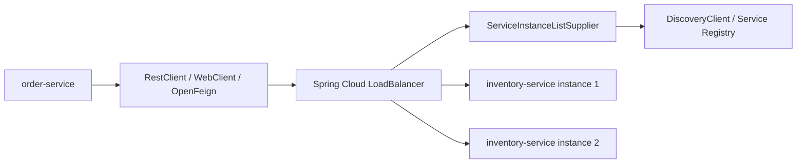

# Lộ trình học và các bài thực hành xuyên suốt

Module `SPRING_CLOUD_SERVICE_COMMUNICATION_LOAD_BALANCING` hướng dẫn cách một dịch vụ chọn instance đích khi gọi dịch vụ khác bằng Spring Cloud LoadBalancer. Bạn sẽ đi từ việc nhận diện service ID và lấy danh sách instance qua discovery, đến lựa chọn instance, tích hợp với `RestClient`, `WebClient`, OpenFeign, rồi cấu hình health check, retry, timeout và quan sát lỗi khi giao tiếp giữa các dịch vụ.

Bài này tổ chức toàn bộ nội dung thành một lộ trình thực hành thống nhất. Các ví dụ dùng `order-service` làm dịch vụ gọi và `inventory-service` làm dịch vụ được gọi. `inventory-service` có ít nhất hai instance cùng đăng ký dưới một service ID. Khi triển khai các bài, bạn có thể dùng Eureka, Consul, Kubernetes hoặc cơ chế discovery phù hợp với môi trường; điều quan trọng là client nhìn thấy một tên dịch vụ logic thay vì phải biết trước địa chỉ của từng instance.

## Kết quả cần đạt

Sau khi hoàn thành lộ trình, bạn cần có khả năng:

- Giải thích được luồng từ URI chứa service ID đến `ServiceInstance` cụ thể mà request được gửi tới.
- Phân biệt service discovery, danh sách instance, chính sách chọn instance và HTTP client.
- Cấu hình Spring Cloud LoadBalancer cho các lời gọi đồng bộ bằng `RestClient`, bất đồng bộ bằng `WebClient` và khai báo client bằng OpenFeign.
- Kiểm tra cách hệ thống phản ứng khi instance khỏe mạnh, instance dừng hoạt động, danh sách discovery thay đổi hoặc dịch vụ không còn instance khả dụng.
- Chọn và cấu hình chính sách phân phối request, health check, retry và timeout theo yêu cầu của ứng dụng.
- Đọc log, metric và trace để xác định service ID, instance được chọn và nguyên nhân request thất bại.

## Mô hình thực hành dùng chung

Trong tất cả các bài, giữ một topology đơn giản để có thể so sánh kết quả giữa các cách cấu hình:

| Thành phần | Vai trò | Ví dụ |
|---|---|---|
| `order-service` | Dịch vụ gọi, chạy các bài thực hành client | Cổng `8080` |
| `inventory-service` instance 1 | Instance xử lý yêu cầu tra cứu tồn kho | Cổng `8081` |
| `inventory-service` instance 2 | Instance thứ hai cùng service ID | Cổng `8082` |
| Service registry | Lưu thông tin các instance đã đăng ký | Eureka, Consul hoặc nền tảng discovery đang dùng |
| Spring Cloud LoadBalancer | Lấy danh sách instance và chọn đích cho mỗi request | Chạy trong tiến trình `order-service` |

Hai instance tồn kho phải có cùng `spring.application.name`, nhưng có địa chỉ mạng hoặc cổng khác nhau. Mỗi instance nên trả về mã nhận diện instance trong response hoặc log, ví dụ `inventory-8081` và `inventory-8082`. Nhờ đó, bạn có thể nhìn thấy request đã đến đâu mà không phải suy đoán từ số lượng request.

Luồng tổng quát của một request:



Khi client gọi `http://inventory-service/...`, `inventory-service` là service ID. Discovery cung cấp các địa chỉ instance đang được biết đến. `ServiceInstanceListSupplier` cung cấp danh sách dùng cho lần chọn đó; danh sách có thể chịu ảnh hưởng của cache, health check hoặc bộ lọc. LoadBalancer áp dụng chính sách chọn instance, sau đó HTTP client gửi request đến địa chỉ thực tế. Việc chọn instance diễn ra ở phía client, tức trong ứng dụng gọi dịch vụ.

## Chuẩn bị môi trường

Trước khi bắt đầu, chuẩn bị các thành phần sau:

1. Một project Spring Boot có Spring Cloud BOM tương thích với phiên bản Spring Boot đang sử dụng. Không chọn phiên bản riêng lẻ của từng thư viện một cách tùy ý; hãy để release train quản lý các phiên bản tương thích.
2. Một service registry hoặc cơ chế discovery mà các ứng dụng có thể truy vấn. Nếu hệ thống đã có discovery, dùng chính cơ chế đó. Với lab độc lập, có thể dựng một registry nhỏ để quan sát quá trình đăng ký và cập nhật instance.
3. Hai tiến trình `inventory-service` chạy đồng thời, cùng service ID và khác cổng. Cả hai cần cung cấp endpoint tra cứu tồn kho và endpoint health.
4. Một `order-service` có thể gọi `inventory-service` bằng service ID. Thêm `spring-cloud-starter-loadbalancer` vào classpath của ứng dụng gọi; bổ sung starter discovery tương ứng với registry đã chọn.
5. Actuator hoặc một cách tương đương để quan sát trạng thái ứng dụng. Ghi log mã instance khi nhận request để kết quả lab có thể kiểm chứng.

Ví dụ cấu hình tên dịch vụ và cổng cho một instance:

```yaml
spring:
  application:
    name: inventory-service

server:
  port: ${SERVER_PORT:8081}
```

Chạy tiến trình thứ hai với `SERVER_PORT=8082`, giữ nguyên `spring.application.name`. Cấu hình đăng ký discovery phải bảo đảm cả hai tiến trình xuất hiện dưới cùng service ID. Với `order-service`, đặt tên ứng dụng riêng, chẳng hạn `order-service`, và dùng URI có host là `inventory-service` khi gọi qua LoadBalancer.

Không đưa địa chỉ `localhost:8081` hoặc `localhost:8082` vào mã nghiệp vụ của `order-service`. Nếu client gọi trực tiếp địa chỉ vật lý, bài thực hành sẽ bỏ qua cơ chế chọn instance mà module đang học.

## Lộ trình học theo từng chặng

| Chặng | Trọng tâm | Bài thực hành | Kết quả cần quan sát |
|---|---|---|---|
| 1. Service ID và discovery | Đăng ký, tra cứu và cập nhật danh sách instance | Khởi động hai instance tồn kho và xác minh registry nhận diện cả hai dưới cùng service ID | Phân biệt được service ID với host và port của instance |
| 2. Chọn instance | Luồng chọn instance và chính sách mặc định | Gửi liên tiếp nhiều request từ `order-service`, ghi lại mã instance xử lý | Xác định được instance được chọn cho từng request và hiểu vai trò của round robin |
| 3. Supplier và sức khỏe instance | `ServiceInstanceListSupplier`, cache, health check và metadata | Dừng một instance, theo dõi thời điểm danh sách sử dụng loại instance đó | Giải thích được độ trễ giữa sự cố, discovery/health check và thay đổi danh sách |
| 4. Tích hợp HTTP client | `RestClient`, `WebClient`, OpenFeign | Thực hiện cùng một thao tác tra cứu bằng ba client | Cả ba client đều gọi bằng service ID và đi qua LoadBalancer |
| 5. Retry và timeout | Xử lý lỗi tạm thời, giới hạn lần thử và thời gian chờ | Tạo tình huống một instance trả lỗi hoặc phản hồi chậm | Phân biệt lỗi chọn instance, lỗi kết nối, timeout và lỗi HTTP |
| 6. Chính sách định tuyến | Zone, hint, metadata và supplier tùy chỉnh | Đánh dấu instance theo zone hoặc metadata rồi kiểm tra lựa chọn | Chứng minh request được lọc/chọn theo chính sách đã cấu hình |
| 7. Quan sát và tổng kết | Log, metric, trace và kiểm thử lỗi | Chạy kịch bản end-to-end, thu thập bằng chứng từ log và công cụ quan sát | Truy vết được request từ service ID đến instance và nguyên nhân lỗi |

### Chặng 1 — Hiểu service ID và service discovery

Mục tiêu đầu tiên là làm rõ ba khái niệm thường bị nhầm lẫn:

- **Service ID** là tên logic mà ứng dụng gọi sử dụng, ví dụ `inventory-service`.
- **ServiceInstance** mô tả một tiến trình cụ thể, thường gồm host, port, thông tin bảo mật và metadata.
- **Service discovery** là cơ chế giúp client hoặc LoadBalancer tìm ra các instance đã đăng ký cho một service ID.

Thực hành:

1. Khởi động hai instance `inventory-service` ở hai cổng khác nhau.
2. Xác minh cả hai đăng ký cùng một service ID trong registry.
3. Tạm dừng một instance, quan sát cách registry đánh dấu hoặc loại bỏ instance theo cơ chế đang dùng.
4. Khởi động lại instance và quan sát quá trình đăng ký trở lại.

Ghi lại service ID, instance ID, host, port và trạng thái mà registry hiển thị. Nếu registry không phân biệt rõ instance, bổ sung instance ID duy nhất cho từng tiến trình. Chặng này đạt yêu cầu khi bạn giải thích được vì sao một service ID có thể đại diện cho nhiều địa chỉ mạng.

### Chặng 2 — Quan sát cách LoadBalancer chọn instance

Khi danh sách instance đã có, gửi request bằng URI chứa service ID. Chính sách mặc định thường dùng round robin: các lựa chọn lần lượt đi qua danh sách instance khả dụng. Spring Cloud LoadBalancer cũng cung cấp chính sách chọn khác, chẳng hạn random, và cho phép thay đổi cấu hình theo service.

Thực hành:

1. Tạo một endpoint trong `order-service` gọi `GET http://inventory-service/api/inventory/{sku}`.
2. Gửi tuần tự khoảng 20 request với cùng một SKU.
3. Để mỗi instance ghi log mã nhận diện của nó và đối chiếu log với response.
4. Thay đổi số lượng instance từ hai lên ba rồi chạy lại.
5. Nếu thay chính sách chọn, ghi lại cấu hình và so sánh kết quả với lần chạy round robin.

Không kết luận rằng mọi instance luôn nhận số request bằng nhau trong mọi tình huống. Kết quả còn phụ thuộc vào số request, tính đồng thời, danh sách instance tại thời điểm chọn, retry và chính sách đang dùng. Với round robin và danh sách ổn định, chuỗi request tuần tự là cách dễ quan sát nhất.

### Chặng 3 — Tìm hiểu supplier, cache và health check

`ServiceInstanceListSupplier` là thành phần cung cấp danh sách instance cho LoadBalancer. Supplier có thể lấy dữ liệu từ discovery, cache danh sách hoặc lọc instance theo điều kiện. Một số cấu hình có thể kiểm tra health endpoint để tránh chọn instance không đáp ứng yêu cầu.

Thực hành:

1. Gọi dịch vụ khi cả hai instance đều khỏe mạnh và lưu lại danh sách instance được dùng.
2. Dừng một instance hoặc làm endpoint health của nó báo trạng thái không khỏe.
3. Theo dõi registry, health check và danh sách instance mà LoadBalancer nhận được.
4. Đo khoảng thời gian từ khi tạo sự cố đến khi request không còn được gửi tới instance đó.
5. Khôi phục instance và xác minh nó được đưa trở lại danh sách.

Phân biệt health check của LoadBalancer với trạng thái đăng ký từ registry. Hai cơ chế có thể cập nhật ở các thời điểm khác nhau. Kết quả cũng phụ thuộc vào chu kỳ kiểm tra, cache, thời gian refresh và cách discovery triển khai. Vì vậy, không nên kỳ vọng một instance vừa dừng sẽ biến mất tức thì khỏi mọi client.

Khi mở rộng bài này, thử supplier có khả năng ưu tiên zone hoặc lọc theo metadata. Chỉ sử dụng health endpoint phản ánh đúng khả năng nhận traffic của ứng dụng; endpoint liveness đơn thuần có thể báo tiến trình còn sống nhưng chưa sẵn sàng phục vụ request.

### Chặng 4 — Tích hợp với RestClient, WebClient và OpenFeign

Mục tiêu là giữ nguyên service ID trong mã gọi, dù ứng dụng dùng kiểu client nào. Các ví dụ dưới đây minh họa cách khai báo builder được đánh dấu `@LoadBalanced`. Chúng yêu cầu các thư viện tương ứng có mặt trên classpath và phiên bản Spring Framework hỗ trợ API đang dùng.

**RestClient — lời gọi đồng bộ**

```java
@Configuration
class InventoryRestClientConfiguration {

    @Bean
    @LoadBalanced
    RestClient.Builder inventoryRestClientBuilder() {
        return RestClient.builder();
    }
}
```

```java
@Service
class InventoryGateway {
    private final RestClient restClient;

    InventoryGateway(@LoadBalanced RestClient.Builder builder) {
        this.restClient = builder.build();
    }

    InventoryDto find(String sku) {
        return restClient.get()
                .uri("http://inventory-service/api/inventory/{sku}", sku)
                .retrieve()
                .body(InventoryDto.class);
    }
}
```

`@LoadBalanced` giúp builder tạo client có khả năng xử lý URI dùng service ID thông qua Spring Cloud LoadBalancer. Nếu ứng dụng có nhiều builder cùng kiểu, giữ qualifier `@LoadBalanced` ở điểm khai báo và inject để tránh lấy nhầm builder không có load balancing.

**WebClient — lời gọi reactive**

```java
@Configuration
class InventoryWebClientConfiguration {

    @Bean
    @LoadBalanced
    WebClient.Builder inventoryWebClientBuilder() {
        return WebClient.builder();
    }
}
```

```java
@Service
class ReactiveInventoryGateway {
    private final WebClient webClient;

    ReactiveInventoryGateway(@LoadBalanced WebClient.Builder builder) {
        this.webClient = builder
                .baseUrl("http://inventory-service")
                .build();
    }

    Mono<InventoryDto> find(String sku) {
        return webClient.get()
                .uri("/api/inventory/{sku}", sku)
                .retrieve()
                .bodyToMono(InventoryDto.class);
    }
}
```

`WebClient` trả về kiểu reactive như `Mono` hoặc `Flux`. Không chặn luồng bằng `block()` trong đường xử lý reactive chỉ để làm cho ví dụ giống `RestClient`; hãy giữ cách xử lý bất đồng bộ xuyên suốt chuỗi gọi.

**OpenFeign — khai báo client bằng interface**

```java
@EnableFeignClients
@SpringBootApplication
class OrderApplication {
}
```

```java
@FeignClient(name = "inventory-service", path = "/api/inventory")
interface InventoryFeignClient {

    @GetMapping("/{sku}")
    InventoryDto find(@PathVariable("sku") String sku);
}
```

OpenFeign lấy `name` làm service ID. Khi Spring Cloud LoadBalancer có trên classpath và được cấu hình trong ứng dụng, Feign client có thể dùng cơ chế này để chọn instance. Bật quét Feign client bằng `@EnableFeignClients` và bảo đảm dependency OpenFeign cùng LoadBalancer đã được thêm vào ứng dụng.

Với cả ba cách tích hợp, kiểm tra URI hoặc annotation có đúng service ID, dependency discovery/LoadBalancer có mặt và request thực sự đến một trong các instance. Nếu request vẫn gọi một host cố định, hãy kiểm tra lại cấu hình builder và nơi tạo HTTP client.

### Chặng 5 — Retry, timeout và xử lý lỗi

LoadBalancer chọn instance; HTTP client thực hiện kết nối và trao đổi dữ liệu. Hai phần liên quan chặt chẽ nhưng có trách nhiệm khác nhau. Retry của LoadBalancer có thể chọn lại cùng instance hoặc thử một instance khác tùy cấu hình. Timeout kết nối và timeout phản hồi thuộc cấu hình client hoặc HTTP transport.

Thực hành theo từng tình huống riêng:

1. **Instance từ chối kết nối:** dừng một tiến trình sau khi registry vẫn còn thông tin cũ, rồi quan sát lỗi và hành vi retry.
2. **Lỗi HTTP tạm thời:** tạo endpoint thử nghiệm trả về một mã lỗi có thể retry, sau đó cấu hình danh sách mã lỗi và số lần thử có giới hạn.
3. **Phản hồi chậm:** tạo endpoint trì hoãn có kiểm soát, cấu hình connect timeout và response/read timeout phù hợp với HTTP client.
4. **Không còn instance:** dừng toàn bộ instance và xác minh ứng dụng trả lỗi có thể quan sát, thay vì chờ vô hạn.
5. **Khôi phục:** bật lại instance và xác minh request hoạt động trở lại sau khi discovery hoặc health supplier cập nhật.

Khi cấu hình retry, kiểm tra riêng số lần thử trên cùng instance và số lần chuyển sang instance tiếp theo. Giới hạn tổng số lần thử để tránh kéo dài thời gian xử lý hoặc khuếch đại tải khi hệ thống đang quá tải. Không retry mù quáng các thao tác ghi có thể tạo tác dụng phụ; chỉ retry khi thao tác có tính idempotent hoặc đã có cơ chế idempotency key và kiểm soát giao dịch phù hợp.

Đặt timeout theo ngân sách thời gian của request đầu cuối. Ví dụ, nếu API của `order-service` chỉ được phép xử lý trong một khoảng thời gian ngắn, tổng thời gian kết nối, phản hồi và retry phải nằm trong ngân sách đó. Cần phân biệt ít nhất connect timeout, response/read timeout và timeout ở tầng gọi API. Một timeout quá dài có thể giữ tài nguyên trong lúc instance đã không còn đáp ứng.

### Chặng 6 — Thử chính sách định tuyến và tùy biến

Round robin phù hợp khi các instance tương đương và mục tiêu là phân phối request đơn giản. Trong hệ thống thực tế, instance có thể thuộc các zone khác nhau, mang metadata khác nhau hoặc phục vụ các nhóm request khác nhau.

Các hướng thực hành:

- **Zone preference:** gắn metadata zone cho instance và ưu tiên instance cùng zone với caller để giảm độ trễ hoặc chi phí liên vùng.
- **Hint hoặc metadata:** truyền thông tin định tuyến có kiểm soát để chọn nhóm instance phù hợp với request.
- **Supplier lọc danh sách:** tạo hoặc cấu hình supplier để loại instance không đáp ứng tiêu chí của một service cụ thể.
- **Chính sách tùy chỉnh:** khi các chính sách có sẵn không đáp ứng yêu cầu, triển khai cấu hình LoadBalancer riêng cho service cần tùy biến và kiểm thử logic chọn instance độc lập.

Thực hành với hai zone, mỗi zone có ít nhất một instance. Gửi request từ caller ở zone A và xác minh chính sách ưu tiên zone A. Sau đó tắt toàn bộ instance ở zone A để kiểm tra hành vi fallback sang zone B. Ghi rõ chính sách khi không có instance phù hợp: chuyển sang zone khác, trả lỗi hay dùng một quy tắc dự phòng đã định nghĩa. Không để hành vi fallback trở thành kết quả ngẫu nhiên khó kiểm soát.

### Chặng 7 — Quan sát và kiểm chứng hành vi

Một bài lab chỉ hoàn thành khi có bằng chứng cho thấy LoadBalancer đã chọn instance và ứng dụng phản ứng đúng trước lỗi. Kết hợp các nguồn quan sát sau:

- **Log ứng dụng:** ghi service ID, instance ID, endpoint, kết quả và correlation ID hoặc trace ID. Tránh ghi dữ liệu nhạy cảm trong log.
- **Actuator và health:** quan sát trạng thái ứng dụng và endpoint health mà supplier hoặc registry sử dụng.
- **Micrometer metrics:** xuất metric qua hệ thống giám sát đang dùng; tìm metric liên quan đến request của LoadBalancer, service ID, kết quả và exception. Tên metric và tag cụ thể có thể khác theo phiên bản Spring Cloud.
- **Distributed tracing:** dùng trace để theo dõi request từ `order-service` sang `inventory-service`, đối chiếu thời gian chờ và instance nhận request.
- **Log của LoadBalancer:** khi cần điều tra, tăng mức log cho package `org.springframework.cloud.loadbalancer` trong môi trường phát triển, sau đó trả về mức log phù hợp khi hoàn tất.

Không chỉ nhìn vào tổng số request thành công. Hãy đối chiếu số lần gọi, instance nhận request, thời gian phản hồi, số lần retry và lỗi theo từng tình huống. Một dashboard hữu ích nên giúp trả lời nhanh: service ID nào đang được gọi, có bao nhiêu instance khả dụng, request đang phân phối ra sao và lỗi xuất hiện ở bước nào.

## Bài thực hành tổng hợp

Sau khi hoàn thành từng chặng, triển khai kịch bản end-to-end sau trong cùng topology:

1. Chạy hai instance `inventory-service` và một `order-service`; xác minh hai instance đã đăng ký dưới cùng service ID.
2. Tạo một thao tác tra cứu tồn kho và gọi nó bằng `RestClient`. Lặp lại bằng `WebClient` và OpenFeign; xác minh cả ba cách đều dùng `inventory-service` làm service ID.
3. Gửi một loạt request tuần tự, lưu log instance để chứng minh chính sách chọn đang hoạt động.
4. Dừng một instance, đo thời gian hệ thống nhận biết và xác minh request tiếp tục được phục vụ bởi instance còn lại sau khi danh sách được cập nhật.
5. Tạo lỗi tạm thời và phản hồi chậm; cấu hình retry cùng timeout có giới hạn. Kiểm tra request không vượt quá ngân sách thời gian đã đặt.
6. Thêm metadata zone cho instance, cấu hình ưu tiên zone và thử tình huống zone ưu tiên không còn instance khỏe mạnh.
7. Thu thập log, metric và trace cho cả trường hợp thành công lẫn thất bại.

**Sản phẩm cần hoàn thành:** cấu hình discovery và LoadBalancer, mã gọi dịch vụ qua ba loại client, cấu hình retry/timeout, một chính sách định tuyến đã kiểm chứng, cùng log hoặc ảnh chụp dashboard chứng minh kết quả. Ghi lại phiên bản Spring Boot và Spring Cloud được sử dụng để người khác có thể tái hiện lab.

## Tiêu chí tự đánh giá

| Tiêu chí | Đạt khi |
|---|---|
| Service discovery | Hai instance cùng service ID xuất hiện trong danh sách discovery và có thể được cập nhật khi dừng/khởi động lại |
| Instance selection | Có log hoặc response chứng minh request được gửi đến instance cụ thể theo chính sách đã cấu hình |
| HTTP client integration | `RestClient`, `WebClient` và OpenFeign đều gọi qua service ID |
| Health handling | Instance không khỏe được loại khỏi lựa chọn theo chu kỳ và cơ chế đã cấu hình |
| Retry và timeout | Số lần thử bị giới hạn, timeout có chủ đích và lỗi được phân loại rõ |
| Routing | Có kiểm chứng cho zone/hint/metadata và hành vi khi không có instance phù hợp |
| Observability | Có thể nối log hoặc trace với instance đích, thời gian phản hồi và nguyên nhân thất bại |

## Lỗi thường gặp cần kiểm tra

- **Gọi thẳng host và port:** URI dùng `localhost:8081` sẽ bỏ qua việc chọn instance theo service ID.
- **Service ID không khớp:** tên trong URI hoặc `@FeignClient` phải khớp tên dịch vụ được đăng ký trong discovery.
- **Thiếu dependency hoặc builder không được đánh dấu:** kiểm tra `spring-cloud-starter-loadbalancer`, starter discovery và `@LoadBalanced` trên builder phù hợp.
- **Chỉ có một instance:** không thể quan sát phân phối tải nếu registry chỉ trả về một instance.
- **Kết luận instance đã bị loại quá sớm:** cache, chu kỳ health check và refresh discovery có thể tạo độ trễ cập nhật.
- **Retry gây lặp thao tác ghi:** đánh giá tính idempotent và giới hạn retry trước khi bật retry cho endpoint thay đổi dữ liệu.
- **Nhầm timeout với retry:** timeout xác định thời gian chờ; retry quyết định có thực hiện lần gọi khác hay không. Cần cấu hình và quan sát cả hai.
- **Không có bằng chứng quan sát:** nếu response không chứa instance ID và log không ghi instance nhận request, kết quả phân phối rất khó xác minh.

Khi hoàn tất lộ trình, bạn có thể giải thích và kiểm chứng toàn bộ quá trình cân bằng tải phía client: từ service ID, discovery và danh sách `ServiceInstance`, qua chính sách chọn và HTTP client, đến cách hệ thống phản ứng trước instance lỗi, retry, timeout và yêu cầu định tuyến. Đây là nền tảng để cấu hình giao tiếp giữa các dịch vụ ổn định và có thể vận hành trong môi trường thực tế.
