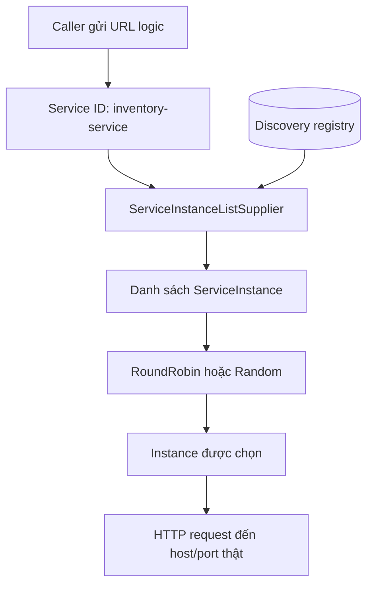
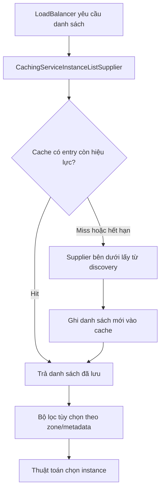
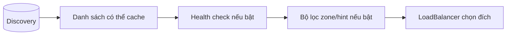

# Mục đích của cache danh sách ServiceInstance

Khi một ứng dụng gọi `http://inventory-service/api/products/P-1001`, Spring Cloud LoadBalancer cần tìm danh sách những instance đang phục vụ `inventory-service`. Danh sách này có thể đến từ Eureka, Consul, một discovery provider khác hoặc nguồn cấu hình tĩnh. Nếu mỗi lần chọn đích đều phải lấy lại danh sách từ xa, số lần truy vấn discovery sẽ tăng theo lưu lượng request, trong khi topology dịch vụ thường không thay đổi nhanh đến mức đó.

**Cache danh sách `ServiceInstance`** cho phép caller tái sử dụng một danh sách instance đã phát hiện trong khoảng thời gian nhất định. Nhờ đó, việc chọn đích ít phụ thuộc vào truy vấn discovery ở mỗi request, tiết kiệm tài nguyên và giảm độ trễ của đường gọi HTTP. Đổi lại, danh sách được lưu có thể tạm thời **cũ hơn trạng thái thực tế** của hệ thống.

Trong chương **Bộ nhớ đệm bản sao**, bài học này trình bày mục đích, vị trí, các đánh đổi và cách kiểm chứng instance cache khi ứng dụng dùng Spring Cloud LoadBalancer cùng RestClient, WebClient hoặc OpenFeign.

## 1. Danh sách ServiceInstance là gì?

Một service ID là tên logic của dịch vụ, chẳng hạn `inventory-service`. Registry có thể cung cấp các instance:

| Instance ID | Host và cổng | Ghi chú |
|---|---|---|
| `inventory-1` | `10.0.10.11:8080` | Instance thứ nhất |
| `inventory-2` | `10.0.10.12:8080` | Instance thứ hai |
| `inventory-3` | `10.0.10.13:8080` | Instance thứ ba |

Mỗi đối tượng `ServiceInstance` biểu diễn một đích có thể kết nối: service ID, host, port, scheme, instance ID và metadata tùy provider. Một `ServiceInstanceListSupplier` cung cấp tập ứng viên này; một `ReactorLoadBalancer<ServiceInstance>`, chẳng hạn round robin hoặc random, chọn một ứng viên để client gửi request.



Đây là **hai công việc khác nhau**: lấy danh sách instance và chọn một instance từ danh sách. Cache tối ưu công việc thứ nhất; nó không phải thuật toán lựa chọn của LoadBalancer.

## 2. Những mục đích quan trọng của instance cache

### 2.1. Giảm số lượt truy vấn nguồn discovery

Giả sử một caller gửi 200 request/giây đến `inventory-service`. Trong 20 giây có 4.000 request. Nếu mỗi lượt chọn instance đều gọi registry, registry có thể chịu hàng nghìn lần truy vấn cho một topology gần như không đổi.

Với cache, một lần lấy danh sách có thể phục vụ nhiều lượt chọn tiếp theo trong khoảng danh sách còn hiệu lực. Số lần truy vấn thực tế còn phụ thuộc việc cache hết hạn, yêu cầu đồng thời, số replica caller và khả năng caching sẵn có của discovery client. Ví dụ chỉ minh họa **sự giảm chi phí tiềm năng**, không có nghĩa cứ đúng 20 giây chỉ xuất hiện một truy vấn.

### 2.2. Giảm độ trễ ở bước chọn đích

Đọc danh sách từ cache cục bộ thường nhanh và ổn định hơn truy vấn registry qua mạng. Điều này đặc biệt hữu ích khi registry có độ trễ biến động hoặc caller cần phát nhiều request liên tiếp. Dù vậy, nó không làm truy vấn database của dịch vụ đích nhanh hơn và không giảm thời gian xử lý nghiệp vụ vốn có.

### 2.3. Bảo vệ control plane khỏi tải thừa

Discovery registry là thành phần dùng chung cho nhiều service. Nếu hàng trăm caller tra cứu lặp lại mỗi khi gọi HTTP, áp lực lên control plane có thể tăng nhanh. Tái sử dụng snapshot instance giúp giảm nhu cầu truy vấn liên tục và làm mức tải lên registry ổn định hơn.

### 2.4. Giảm phụ thuộc tức thời vào discovery

Một snapshot đã cache có thể cho phép caller tiếp tục lựa chọn từ các instance đã biết khi registry bị chậm trong thời gian ngắn, **tùy cách cache và supplier hoạt động**. Nhưng cache không bảo đảm failover: entry có thể hết hạn, rỗng hoặc chỉ chứa instance đã ngừng hoạt động.

## 3. Cache lưu gì và không lưu gì?

| Được lưu ở instance cache | Không phải chức năng của instance cache |
|---|---|
| Danh sách địa chỉ instance ứng với service ID. | Không lưu nội dung JSON trả về từ API nghiệp vụ. |
| Host, port, scheme, instance ID, metadata của các ứng viên. | Không lưu request body, transaction hoặc session. |
| Snapshot đầu vào để lựa chọn đích. | Không thay thế HTTP connection pool. |
| Thông tin có thể được tái sử dụng giữa nhiều request. | Không bảo đảm cùng một instance được chọn lần sau. |
| Danh sách có thể cũ đến khi được làm mới. | Không tự kiểm tra sức khỏe từng instance trước mỗi request. |

Do đó, dù cache hit, một lời gọi `GET /api/products/P-1001` vẫn được gửi tới dịch vụ đích. Đây **không phải HTTP response cache** theo `Cache-Control`, ETag, Redis hay CDN. Không nên kỳ vọng bật `spring.cloud.loadbalancer.cache.enabled` sẽ cache kết quả nghiệp vụ.

## 4. Vị trí của CachingServiceInstanceListSupplier

Spring Cloud LoadBalancer có `CachingServiceInstanceListSupplier`, một supplier đóng vai trò decorator cho supplier lấy instance bên dưới. `LoadBalancerClientFactory` quản lý các child application context theo service ID, và các context này chứa những thành phần như `ServiceInstanceListSupplier` và `ReactorLoadBalancer`.

Luồng khái niệm với cache được kích hoạt:



Khi **cache hit**, danh sách đã lưu được tái sử dụng. Khi **cache miss**, ứng dụng phải lấy lại từ nguồn bên dưới. Khi **entry hết hạn**, việc làm mới thường gắn với lần truy cập tiếp theo hoặc cơ chế refresh của implementation; không mặc nhiên tồn tại một tiến trình đọc registry đều đặn chính xác theo từng TTL.

**Thứ tự supplier chain quan trọng.** Nếu một bộ lọc phụ thuộc request (như hint/zone hay tenant) chạy trước cache, kết quả đã lọc của một request có thể vô tình bị tái sử dụng cho request khác nếu cache không phân biệt đúng ngữ cảnh. Khi cấu hình chuỗi nâng cao, đặt supplier lấy dữ liệu mạng trước, cache và bộ lọc ở vị trí phù hợp theo hướng dẫn của release train, rồi kiểm tra kết quả thực tế.

## 5. TTL và capacity: hai mục tiêu điều chỉnh khác nhau

**Time-to-live (TTL)** giới hạn khoảng thời gian một entry được coi là còn hiệu lực theo cơ chế cache. TTL ngắn giúp dữ liệu được cập nhật sớm hơn nhưng tăng tần suất tra cứu. TTL dài giảm truy vấn discovery nhưng có thể giữ lại thông tin instance đã cũ.

**Capacity** là giới hạn sức chứa entry cache, không phải số lượng request đồng thời hoặc số instance được phép đăng ký. Với nhiều service ID và các entry khác nhau, capacity giúp kiểm soát bộ nhớ và eviction.

Ví dụ cấu hình:

```yaml
spring:
  cloud:
    loadbalancer:
      cache:
        enabled: true
        ttl: 20s
        capacity: 256
```

Trong ví dụ, `20s` và `256` là lựa chọn minh họa; không phải các giá trị được khuyến nghị cố định cho mọi ứng dụng. Giá trị mặc định và chi tiết eviction cần đối chiếu với tài liệu và configuration metadata đúng Spring Cloud release train.

| TTL | Lợi ích thường gặp | Rủi ro cần quan sát |
|---|---|---|
| Ngắn | Sớm thấy instance mới, sớm loại instance bị rút khỏi registry. | Tăng tải và độ trễ discovery. |
| Dài | Ít truy vấn, giảm dao động trong quá trình tra cứu. | Tiếp tục thấy instance cũ hoặc chưa thấy instance mới. |
| Tắt cache tại LoadBalancer | Loại bỏ một lớp snapshot của LoadBalancer. | Có thể tăng truy vấn ở supplier; discovery client vẫn có thể cache riêng. |

Không có TTL tối ưu tuyệt đối. Các hệ thống autoscale thường xuyên cần mức độ mới khác với ứng dụng có nhóm instance ít thay đổi. Đừng tối ưu TTL mà bỏ qua yêu cầu graceful shutdown, health check và retry.

## 6. Điều gì xảy ra khi topology thay đổi?

Giả sử caller lấy danh sách `[inventory-1, inventory-2]` lúc `t=0s` và cache có TTL 30 giây:

| Thời gian | Sự kiện | Danh sách caller có thể dùng |
|---|---|---|
| `t=0s` | Đọc registry và lưu cache. | `[inventory-1, inventory-2]` |
| `t=5s` | `inventory-3` đăng ký vào registry. | Cache cũ chưa chắc chứa `inventory-3`. |
| `t=12s` | `inventory-2` ngừng đột ngột. | Cache có thể vẫn chứa `inventory-2`. |
| `t=31s` | Có truy cập mới, cache hết hạn và registry đã cập nhật. | Có thể lấy `[inventory-1, inventory-3]`. |

**TTL không phải SLA rằng sau đúng 30 giây mọi caller đều biết topology mới.** Registry cần thời gian cập nhật, discovery provider có thể giữ cache hoặc polling riêng, một số caller chưa truy cập lại, và mỗi replica caller có mốc làm đầy cache khác nhau.

Khi **scale up**, instance mới có thể nhận request muộn, làm capacity được bổ sung chậm phát huy tác dụng. Khi **scale down**, caller có thể tiếp tục chọn instance đã rời hệ thống, gây timeout hoặc connect error. Một snapshot cũ không đồng nghĩa LoadBalancer lỗi; cần đánh giá cơ chế refresh của toàn bộ pipeline.

### Cache của các caller không nhất thiết đồng bộ

Nếu `order-service` có ba replica, mỗi replica có thể giữ snapshot riêng. Sau khi registry cập nhật, hai caller có thể thấy danh sách không giống nhau trong một khoảng ngắn. Điều này cần được tính đến khi phân tích sự phân phối tải; số request không đều giữa các instance chưa chắc do round robin sai.

## 7. Cache và health check trả lời hai câu hỏi khác nhau

Cache trả lời: **“Những instance nào đã được phát hiện gần đây?”**

Health check trả lời: **“Trong các instance đã biết, instance nào đạt điều kiện sức khỏe đang kiểm tra?”**

`HealthCheckServiceInstanceListSupplier` có thể kiểm tra và lọc instance theo cơ chế được cấu hình. Tuy nhiên, health check không nhất thiết phản ánh CPU, connection pool, độ trễ p99 hoặc khả năng phục vụ từng API nghiệp vụ. Một instance có health endpoint trả `UP` vẫn có thể quá tải.



Sơ đồ biểu diễn trách nhiệm logic. Khi lắp supplier chain thực tế, cần tuân thủ thứ tự decorator và hướng dẫn của phiên bản đang dùng. Một cache nằm ở vị trí không phù hợp có thể giữ quá lâu đầu ra của bộ lọc health hoặc hint.

Health check có thể phát hiện instance lỗi trước khi registry cập nhật, nhưng cần có chu kỳ kiểm tra và xử lý kết quả phù hợp. Ngược lại, nếu nguồn instance không được làm mới, health check không tự phát hiện instance mới chưa từng xuất hiện trong danh sách.

## 8. Double caching với DiscoveryClient

Một số discovery provider/client tự giữ snapshot hoặc cache danh sách instance. Nếu tiếp tục bọc bằng cache của LoadBalancer, hệ thống có thể có **hai lớp lưu dữ liệu**:

```text
LoadBalancer
  |
  +-- Cache danh sách ở LoadBalancer (nếu bật)
        |
        +-- DiscoveryClient
              |
              +-- Cache/snapshot của provider (nếu có)
                    |
                    +-- Registry
```

Hệ quả có thể gồm danh sách cũ được giữ lâu hơn mong đợi, khó xác định tầng nào chịu trách nhiệm khi scale up/down, và tăng độ phức tạp theo dõi. Vì vậy, nếu discovery client đã có cơ chế caching tốt, nên đánh giá có thực sự cần **thêm** cache của LoadBalancer hay không. Đây là quyết định kiến trúc theo provider và mức tải, không phải quy tắc phải tắt cache ở mọi nơi.

Muốn tắt **chỉ cache của Spring Cloud LoadBalancer**:

```yaml
spring:
  cloud:
    loadbalancer:
      cache:
        enabled: false
```

Property này không tắt cache phía Eureka/Consul, connection pool HTTP hoặc cache dữ liệu nghiệp vụ.

## 9. Caffeine và implementation mặc định

Spring Cloud LoadBalancer có thể sử dụng cache dựa trên **Caffeine** khi thư viện này có trên classpath; nếu không, framework có implementation mặc định riêng tùy release train. Caffeine cung cấp các tùy chọn eviction/expiry nâng cao và phù hợp khi cần điều chỉnh cache cục bộ.

Dependency Maven mẫu, khi dự án quản lý version qua BOM hoặc dependency management phù hợp:

```xml
<dependency>
    <groupId>com.github.ben-manes.caffeine</groupId>
    <artifactId>caffeine</artifactId>
</dependency>
```

Trong các phiên bản hỗ trợ Caffeine spec, ví dụ:

```yaml
spring:
  cloud:
    loadbalancer:
      cache:
        enabled: true
        caffeine:
          spec: expireAfterWrite=20s,maximumSize=256
```

Khi dùng `cache.caffeine.spec`, những thiết lập trong spec có thể thay thế kỳ vọng từ `cache.ttl` và `cache.capacity`. Không nên cấu hình nhiều nhóm thuộc tính mâu thuẫn rồi giả định tất cả cùng được áp dụng; kiểm tra implementation và giá trị hiệu lực.

Đừng chọn Caffeine chỉ vì kỳ vọng cache nhanh hơn khi chưa đo được phần chậm nhất của hệ thống. Đối với danh sách instance, khả năng giữ **đúng** snapshot và cập nhật phù hợp không kém quan trọng so với tốc độ hit.

## 10. Ví dụ tích hợp cache với RestClient

Giả sử ứng dụng `order-service` muốn gọi `inventory-service` bằng `RestClient` có LoadBalancer. Dependency Maven:

```xml
<dependency>
    <groupId>org.springframework.cloud</groupId>
    <artifactId>spring-cloud-starter-loadbalancer</artifactId>
</dependency>
```

Cấu hình instance tĩnh để phát triển và cache:

```yaml
spring:
  cloud:
    discovery:
      client:
        simple:
          instances:
            inventory-service:
              - uri: http://localhost:8081
              - uri: http://localhost:8082
    loadbalancer:
      cache:
        enabled: true
        ttl: 20s
```

Khai báo builder có LoadBalancer:

```java
@Configuration(proxyBeanMethods = false)
class HttpClientConfiguration {

    @Bean
    @LoadBalanced
    RestClient.Builder loadBalancedRestClientBuilder() {
        return RestClient.builder();
    }
}
```

Gateway gọi service ID:

```java
@Service
class InventoryGateway {

    private final RestClient client;

    InventoryGateway(@LoadBalanced RestClient.Builder builder) {
        this.client = builder.build();
    }

    ProductView getProduct(String productId) {
        return client.get()
                .uri("http://inventory-service/api/products/{id}", productId)
                .retrieve()
                .body(ProductView.class);
    }
}
```

`ProductView` là DTO minh họa; server tại 8081 và 8082 phải chạy để thử nghiệm thành công. Ví dụ giả định phiên bản Spring Boot/Spring Framework và Spring Cloud có tích hợp `RestClient` tương ứng. Nếu dùng `WebClient`, cần builder `@LoadBalanced` phù hợp; với OpenFeign, dùng `@FeignClient(name = "inventory-service")` và tích hợp LoadBalancer được hỗ trợ.

Mỗi lần gọi `getProduct` vẫn gửi request đến một instance được chọn. Cache ở đây chỉ tối ưu bước lấy **danh sách** instance; không lưu hoặc tái sử dụng kết quả `ProductView`.

## 11. Cache miss, danh sách rỗng và request thất bại

Cần phân biệt ba tình huống:

1. **Cache miss:** entry không tồn tại hoặc đã hết hiệu lực; supplier bên dưới cần lấy danh sách mới.
2. **Danh sách rỗng:** không có instance hợp lệ cho service ID, nên LoadBalancer không thể chọn đích từ tập rỗng.
3. **Đã chọn instance nhưng HTTP thất bại:** discovery vẫn trả instance, nhưng máy đích có thể bị lỗi kết nối, timeout hoặc trả 5xx.

| Triệu chứng | Bước chẩn đoán đầu tiên |
|---|---|
| Lần gọi đầu sau khi hết TTL chậm | Kiểm tra độ trễ discovery và tần suất cache miss. |
| Không tìm thấy instance của một service ID | Xác minh service ID, registry và supplier chain. |
| Instance đã rút nhưng còn được chọn | Kiểm tra TTL, cache ở provider, health check và cơ chế drain. |
| Instance mới không nhận request | Xác minh registry đã cập nhật, nguồn cache và thời điểm refresh. |
| HTTP lỗi `503` hoặc connect timeout | Phân biệt không chọn được instance với đã chọn nhưng backend không phục vụ. |

Không nên giả định một HTTP lỗi sẽ làm instance bị xóa ngay khỏi cache. Loại bỏ instance hỏng thường phụ thuộc cập nhật discovery, health check hoặc thành phần mở rộng liên quan. Retry có thể làm request thành công sau lỗi tạm thời, nhưng cũng có thể làm hệ thống quá tải hơn.

## 12. Phối hợp cache, timeout và retry

Cache và các cơ chế resilience có nhiệm vụ khác nhau:

- **Cache TTL** quy định vòng đời một snapshot instance tại lớp cache.
- **Connection/response timeout** giới hạn thời gian HTTP client chờ instance.
- **Retry policy** quyết định request có được thử lại không, tối đa bao nhiêu attempt và trong điều kiện nào.
- **Health check, discovery và readiness** quyết định mức độ hợp lệ của các ứng viên qua thời gian.

TTL ngắn không cứu được request đang chờ trên một kết nối; timeout ngắn không làm cache lập tức refresh; retry không sửa dữ liệu discovery cũ. Với các thao tác ghi như tạo order, retry có thể gây tác dụng phụ lặp nếu server đã commit nhưng response bị mất. Cần idempotency key hoặc cơ chế nghiệp vụ tương đương trước khi thử lại những request không an toàn.

## 13. Quan sát cache trong môi trường thực

Để đo instance cache, cần đánh giá cả **hiệu năng** và **rủi ro danh sách cũ**:

| Chỉ số | Câu hỏi cần trả lời |
|---|---|
| Tần suất tra cứu registry theo service ID | Cache có giảm áp lực discovery không? |
| Cache hit/miss/eviction nếu có metric | TTL/capacity có phù hợp không? |
| Thời gian chọn instance và latency HTTP client | Có giảm chi phí trên đường đi request không? |
| Số lần request tới instance đã rút | Cache stale có gây lỗi không? |
| Connect timeout, 503, retry attempt | Danh sách cũ có khuếch đại lỗi không? |
| Thời gian instance mới nhận lưu lượng | Cache ảnh hưởng scale up như thế nào? |
| Khác biệt giữa các replica caller | Các caller đang nhìn topology khác nhau bao lâu? |

Spring Boot Actuator, Micrometer và tracing có thể hỗ trợ quan sát tùy starter, phiên bản và implementation. Không mặc định mọi kiểu cache đều xuất đủ metric hit/miss; có thể cần instrument riêng. Hãy giữ metric labels ở cardinality hợp lý như service ID, route pattern, instance ID và result; tránh token hoặc dữ liệu người dùng nhạy cảm.

Log/tracing có ích khi ghi service ID, instance được chọn, request ID, attempt, duration và status. Để chẩn đoán danh sách stale, đối chiếu các thời điểm này với log registry và sự kiện scale up/down.

## 14. Bài thực hành: thử nghiệm TTL và thay đổi instance

Chuẩn bị hai server trả về `instanceId` khác nhau, chẳng hạn `inventory-1` và `inventory-2`, cùng một API `GET /api/debug/instance`. Caller gửi request qua `@LoadBalanced RestClient` đến `http://inventory-service/api/debug/instance`.

**Bước 1 — Baseline:** Gửi nhiều request trong vài giây khi không thay đổi topology. Quan sát các instance được chọn và số lần đọc discovery nếu có instrumentation. Dù nhiều request dùng một snapshot cache, round robin vẫn có thể luân phiên các đích.

**Bước 2 — Scale up:** Thêm `inventory-3` trong registry thử nghiệm. Ghi lại lúc registry ghi nhận instance mới và lúc caller đầu tiên chọn nó. Nếu caller cập nhật chậm, cần xác định độ trễ ở registry, discovery client hay cache LoadBalancer.

**Bước 3 — Rút instance:** Thực hiện graceful drain hoặc ngừng một instance trong môi trường lab. Ghi số request còn gửi tới instance cũ, connect error, timeout và retry. Không thực hiện thử nghiệm làm gián đoạn hệ thống production.

**Bước 4 — Đổi TTL:** Thử TTL ngắn hơn và dài hơn trong cùng môi trường. So sánh chi phí discovery, thời gian hội tụ topology, request lỗi và p95/p99 latency. Chọn TTL theo mức chấp nhận giữa hiệu năng và độ mới, thay vì chỉ tối thiểu hóa số lượt gọi registry.

## 15. Những hiểu lầm cần tránh

- **“Bật instance cache là cache response của API.”** Sai: chỉ lưu danh sách đích.
- **“Cache hit thì request sẽ dùng lại instance lần trước.”** Sai: thuật toán vẫn chọn từ cùng tập ứng viên.
- **“TTL 20 giây nghĩa là sau đúng 20 giây mọi caller thấy instance mới.”** Sai: còn cache discovery, delay registry và thời điểm refresh.
- **“Cache tự loại instance vừa lỗi kết nối.”** Sai: cần cơ chế discovery, health check hoặc eviction thực sự.
- **“Tắt LoadBalancer cache thì mọi tầng discovery không cache nữa.”** Sai: chỉ tắt một lớp.
- **“Health check UP nghĩa là instance chắc chắn xử lý tốt mọi request.”** Sai: health không đồng nghĩa capacity hoặc sức khỏe nghiệp vụ.
- **“Có caching thì không cần giám sát retry.”** Sai: cache stale có thể làm retry tăng bất thường.

## 16. Checklist trước khi đưa vào vận hành

- [ ] Phân biệt instance cache với HTTP response cache và connection pool.
- [ ] Xác định nguồn discovery cùng các lớp cache/snapshot đang có.
- [ ] Biết vị trí của cache trong `ServiceInstanceListSupplier` chain.
- [ ] Chọn TTL dựa trên độ trễ registry, tần suất autoscaling và rủi ro stale instance.
- [ ] Chọn capacity phù hợp với số service ID và nhu cầu thực tế.
- [ ] Có cơ chế readiness, health check và graceful drain phù hợp.
- [ ] Kiểm tra instance mới và instance đã rút trong bài thử nghiệm scale up/down.
- [ ] Có timeout và retry giới hạn; bảo vệ idempotency đối với request ghi.
- [ ] Theo dõi latency, registry calls, request thất bại và lựa chọn instance theo service ID.
- [ ] Kiểm tra hành vi trên đúng phiên bản Spring Cloud cùng HTTP client đang sử dụng.

**Kết luận:** Cache danh sách `ServiceInstance` giúp Spring Cloud LoadBalancer **tái sử dụng thông tin discovery** để chọn đích hiệu quả hơn và giảm tải control plane. Đánh đổi cốt lõi là danh sách có thể cũ khi instance được thêm, rút hoặc hỏng. Hiểu TTL, cache layers, supplier chain và health check giúp thiết kế một chính sách vừa tiết kiệm truy vấn vừa hạn chế request tới instance không còn phù hợp.
