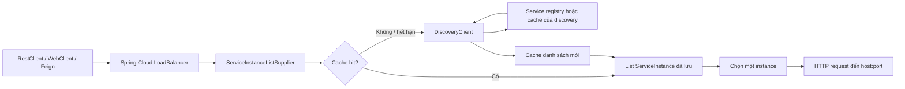
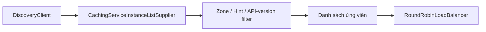
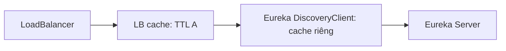

# TTL, dung lượng và đánh đổi giữa độ mới với chi phí tra cứu

Trong Spring Cloud LoadBalancer, một lời gọi tới URL logic như `http://inventory-service/api/items/42` cần tìm được danh sách `ServiceInstance` của `inventory-service` trước khi chọn đích bằng round-robin, random hoặc chính sách khác. Nếu cứ mỗi request đều truy vấn discovery client hoặc registry để lấy lại danh sách, ứng dụng có thể tạo ra chi phí tra cứu không cần thiết. **Bộ nhớ đệm danh sách instance** giúp giảm chi phí đó, nhưng đồng thời có thể khiến client tiếp tục thấy địa chỉ đã lỗi thời sau một lần deploy hoặc scale.

Bài học thuộc chương **Bộ nhớ đệm bản sao** tập trung vào ba biến số: **TTL** (thời gian một bản ghi tồn tại), **capacity** (dung lượng cấp phát/giữ bản ghi) và **độ mới** (mức độ sát với topology thực tế). Bạn sẽ thấy cách cấu hình các biến số trong Spring Cloud LoadBalancer, cách nhận diện double caching với discovery, cũng như cách đo và lựa chọn giá trị phù hợp khi giao tiếp dịch vụ bằng `RestClient`, `WebClient` hoặc OpenFeign.

## 1. Cache trong LoadBalancer lưu điều gì?

Giả sử `order-service` gửi nhiều request tới `inventory-service`:

```text
GET http://inventory-service/api/items/42
GET http://inventory-service/api/items/43
GET http://inventory-service/api/items/44
```

Một danh sách do discovery cung cấp có thể là:

| Service ID | Instance ID | Host | Port | Trạng thái quan sát tại registry |
|---|---|---|---:|---|
| `inventory-service` | `inventory-a` | `10.0.1.10` | 8080 | Có đăng ký |
| `inventory-service` | `inventory-b` | `10.0.1.11` | 8080 | Có đăng ký |

**Cache của Spring Cloud LoadBalancer** giữ kết quả tra cứu danh sách instance theo service để các lần lựa chọn sau có thể tái sử dụng. Cache này không lưu response của endpoint `/api/items/42`, không lưu TCP connection và không lưu kết quả thuật toán round-robin cho từng request. HTTP response cache và connection pool là hai cơ chế khác.



Đây là sơ đồ logic. Một discovery client, chẳng hạn Eureka client, có thể đã tự duy trì cache registry; vì vậy không phải mỗi cache miss tại LoadBalancer đều tạo một request mạng tới registry.

## 2. TTL là gì và thực sự đo thời gian nào?

**TTL (Time To Live)** của LoadBalancer cache là khoảng thời gian từ lúc một bản ghi được **ghi vào cache** cho đến khi bản ghi được xem là hết hạn. Thuộc tính chính là:

```properties
spring.cloud.loadbalancer.cache.ttl=35s
```

Theo tài liệu Spring Cloud Commons, TTL mặc định là **35 giây** trong cấu hình cache thông thường. Giá trị `35s` là khoảng thời gian sau khi ghi (`time after write`), **không phải** 35 giây kể từ lần truy cập cuối cùng. Các lần đọc lại danh sách trong lúc entry còn hiệu lực không tự động làm TTL kéo dài thêm chỉ vì có request mới.

Ví dụ: một instance mới được đưa vào registry tại giây thứ 12, nhưng caller đang giữ một snapshot được cache ở giây 0 với TTL 35 giây:

```text
Thời điểm:       t=0         t=12                    t=35       t=36
                 |-----------|-----------------------|----------|
Cache:          [inventory-a, inventory-b]          hết hạn
Registry:       [a, b]      [a, b, c]              [a, b, c]
Caller thấy:    [a, b]      [a, b]                   [a, b, c]*

* Khi có lượt lấy danh sách sau hết hạn và nguồn đã phản ánh thay đổi.
```

**Hết TTL không đồng nghĩa cache tự đẩy bản danh sách mới tới mọi caller ngay lúc đó.** Với cơ chế cache theo nhu cầu, lần tra cứu tiếp theo mới tạo cơ hội đọc lại nguồn. Nếu discovery client phía dưới còn giữ snapshot cũ, kết quả sau khi LoadBalancer cache hết hạn vẫn có thể chưa mới.

### 2.1. TTL, độ trễ phát hiện thay đổi và khoảng dữ liệu cũ

Một biến động topology có thể đi qua nhiều giai đoạn:

1. Instance đăng ký hoặc bị thu hồi; registry phải nhận ra sự kiện.
2. Discovery client cập nhật dữ liệu của chính nó hoặc đọc lại registry.
3. Bản ghi của LoadBalancer cache hết TTL hoặc bị invalidated theo cơ chế đang dùng.
4. Lần tra cứu tiếp theo lấy snapshot mới và áp dụng các bộ lọc còn lại.

Trong một mô hình lý tưởng, khi registry đã cập nhật và client truy cập thường xuyên, độ trễ chỉ do cache có thể gần từ **0 đến một TTL**, tùy thời điểm thay đổi so với lần ghi gần nhất. Nếu thời điểm thay đổi phân bố tương đối đều và không có lớp cache khác, thời gian chờ trung bình lý thuyết khoảng **TTL/2**. Đây là phép ước lượng để tư duy, không phải SLA hay bảo đảm về hệ thống thực.

Độ trễ quan sát trong production còn phụ thuộc heartbeat, đồng bộ discovery, các lớp cache, thời điểm request tiếp theo và cơ chế health check. Với hai lớp cache có chu kỳ độc lập, độ trễ có thể lớn hơn TTL của một lớp, nhưng cũng không thể đơn giản coi tổng TTL là một thời hạn chắc chắn.

### 2.2. TTL không phải health check và không loại lỗi ngay lập tức

TTL cho biết khi nào **cần lấy lại thông tin**, không đánh giá endpoint còn sống hay không. Một instance có thể vừa chết sau khi cache được ghi; LoadBalancer vẫn có khả năng chọn nó cho tới khi danh sách hoặc chính sách health phản ánh thực tế. Ngược lại, instance khỏe có thể chưa xuất hiện trong danh sách mới do cache chưa cập nhật.

Khi cần phát hiện lỗi nhanh, xem xét readiness/health trong discovery, `HealthCheckServiceInstanceListSupplier` hoặc timeout/retry ở HTTP client. TTL ngắn giúp làm mới thông tin nhanh hơn trong điều kiện nguồn đã biết thay đổi; nó không thay thế các cơ chế này.

## 3. Capacity là gì? Cẩn thận với mặc định 256

Spring Cloud Commons cung cấp:

```properties
spring.cloud.loadbalancer.cache.capacity=256
```

Giá trị mặc định **256** trong tài liệu là **initial cache capacity**: khả năng cấp phát ban đầu cho cache, **không phải** mặc định giới hạn chỉ được giữ 256 instance hay 256 service ID. Đây là điểm rất dễ nhầm.

Nên phân biệt ba đại lượng:

| Đại lượng | Ý nghĩa | Tác động |
|---|---|---|
| **Initial capacity** | Dung lượng cấu trúc dữ liệu được khởi tạo dự kiến | Có thể ảnh hưởng cấp phát bộ nhớ và resize; không nhất thiết giới hạn số mục |
| **Maximum size / eviction policy** | Số mục cache tối đa cho phép trước khi loại bớt | Kiểm soát mức sử dụng cache tùy implementation, đặc biệt khi dùng Caffeine |
| **Instances per service** | Số `ServiceInstance` trong giá trị của một mục cache | Ảnh hưởng kích thước danh sách; không trực tiếp bị chặn bởi `capacity=256` |

Ví dụ, một ứng dụng gọi 20 service ID và mỗi service có 10 instance. Một mô hình cache theo service ID có thể chứa khoảng **20 entry**, trong đó các danh sách chứa tổng cộng 200 mô tả instance. Không được diễn giải `capacity=256` là chỉ cho phép 256 instance trong toàn hệ thống.

Ước tính bộ nhớ cần xét: số entry, kích thước từng danh sách, metadata của instance, object overhead và cơ chế giữ các bản snapshot cũ. Nếu muốn **giới hạn số entry** bằng Caffeine, cần đặt thuộc tính `maximumSize` trong Caffeine specification hoặc dùng chính sách dung lượng được implementation hỗ trợ.

## 4. Những cơ chế cache Spring Cloud LoadBalancer cung cấp

Spring Cloud LoadBalancer có hai cách triển khai cache phổ biến, được chọn theo dependency trong classpath:

| Implementation | Điều kiện sử dụng | Điểm đáng lưu ý |
|---|---|---|
| `DefaultLoadBalancerCache` | Không có Caffeine; được cung cấp cùng starter | Hỗ trợ cấu hình TTL và initial capacity chung |
| Cache dựa trên **Caffeine** | Có dependency `com.github.ben-manes.caffeine:caffeine` | Có thể tùy chỉnh eviction/size/TTL bằng Caffeine specification |

Các cấu hình quan trọng:

| Thuộc tính | Giá trị mặc định theo tài liệu | Ý nghĩa |
|---|---|---|
| `spring.cloud.loadbalancer.cache.enabled` | `true` | Bật cơ chế cache LoadBalancer theo cấu hình đang dùng |
| `spring.cloud.loadbalancer.cache.ttl` | `35s` | Thời gian hết hạn tính từ lúc ghi |
| `spring.cloud.loadbalancer.cache.capacity` | `256` | **Initial** cache capacity, không phải max-size |
| `spring.cloud.loadbalancer.cache.caffeine.spec` | Không đặt | Specification Caffeine tùy chọn |

Các mặc định trên được xác nhận trong tài liệu Spring Cloud Commons; hãy kiểm tra cùng dòng Spring Cloud được dự án khóa bằng BOM, vì tính năng và cấu hình có thể khác theo phiên bản.

### 4.1. Cấu hình TTL và initial capacity thông thường

Ví dụ `application.yml`:

```yaml
spring:
  cloud:
    loadbalancer:
      cache:
        enabled: true
        ttl: 15s
        capacity: 128
```

Ở đây, `ttl=15s` là một lựa chọn thử nghiệm nhằm giảm thời gian dùng snapshot cũ; `capacity=128` là dung lượng khởi tạo, **không giới hạn** cache tối đa 128 entry và cũng không có nghĩa ứng dụng chỉ được sử dụng 128 instance.

Nếu ứng dụng đang dùng nguồn discovery có cache hiệu quả riêng, ví dụ một số thiết lập Eureka, cần kiểm tra trước khi thêm LoadBalancer cache để tránh double caching. Đừng rập khuôn bật thêm cache chỉ vì `enabled=true` là mặc định.

### 4.2. Sử dụng Caffeine khi cần giới hạn kích thước

Khi dự án có Caffeine trên classpath, có thể dùng `caffeine.spec`:

```yaml
spring:
  cloud:
    loadbalancer:
      cache:
        enabled: true
        caffeine:
          spec: "initialCapacity=64,maximumSize=500,expireAfterWrite=15s"
```

Specification trên mô tả **initialCapacity**, **maximumSize** và **expireAfterWrite** của cache Caffeine. `maximumSize=500` giới hạn số entry trong cache theo chính sách eviction của Caffeine, **không giới hạn số instance trong mỗi danh sách**.

**Cảnh báo rất quan trọng:** theo tài liệu Spring Cloud, nếu đã đặt `spring.cloud.loadbalancer.cache.caffeine.spec`, specification đó **ghi đè** các thiết lập cache chung, bao gồm `spring.cloud.loadbalancer.cache.ttl` và `.capacity`. Vì vậy, đừng vừa đặt `caffeine.spec` vừa trông chờ `cache.ttl` hoặc `cache.capacity` có hiệu lực. Trong một cấu hình, nên chọn một cách kiểm soát thống nhất.

Caffeine không tự tạo cơ chế discovery mới và không giúp registry cập nhật nhanh hơn. Nó chỉ là một cách lưu/loại dữ liệu cache. Hãy kiểm tra cả dependency, số service ID thực tế và điều kiện cần eviction trước khi áp dụng.

### 4.3. Tắt cache nhưng không tắt load balancing

```yaml
spring:
  cloud:
    loadbalancer:
      cache:
        enabled: false
```

Cấu hình này tắt cơ chế cache LoadBalancer, **không** đồng nghĩa vô hiệu hóa thuật toán cân bằng tải hay bỏ qua service discovery. Lần lấy danh sách có thể đi qua discovery client cho mỗi lần chọn, nhưng discovery client vẫn có thể đang sử dụng cache của chính nó.

Khi muốn tắt caching vì nghi double caching, cần kiểm tra cấu hình supplier thực tế. Với supplier tùy chỉnh, `enabled=true` không tự bảo đảm mọi chuỗi đều đã có `CachingServiceInstanceListSupplier`; ngược lại, cách bọc supplier và cache provider cần phù hợp với cấu hình toàn hệ thống.

## 5. Cache nên nằm ở đâu trong chuỗi ServiceInstanceListSupplier?

Một cấu hình Spring Cloud LoadBalancer thường sử dụng chuỗi `ServiceInstanceListSupplier`. Nguồn discovery cung cấp danh sách; các decorator có thể cache hoặc lọc theo zone, hint, API version hay các trường của request.



**Nguyên tắc thứ tự:** đặt `CachingServiceInstanceListSupplier` **ngay sau** supplier thực hiện lấy danh sách qua nguồn mạng, **trước** các bộ lọc phụ thuộc request. Đây là khuyến cáo trong tài liệu Spring Cloud.

Vì sao? Giả sử cùng service `inventory-service` có hai phiên bản v1 và v2. Nếu cache bị đặt sau bước lọc theo `X-Api-Version`, kết quả của request v1 có thể được dùng lại cho request v2 trong một cache không phân biệt hai header đó. Cache danh sách gốc theo service ID rồi mới lọc theo request giúp tránh lỗi trộn dữ liệu.

### 5.1. Ví dụ cấu hình với discovery và caching

```java
// Cấu hình riêng cho service ID inventory-service.
public class InventoryLoadBalancerConfiguration {

    @Bean
    ServiceInstanceListSupplier inventorySupplier(
            ConfigurableApplicationContext context) {

        return ServiceInstanceListSupplier.builder()
                .withDiscoveryClient()
                .withCaching()
                .withZonePreference()
                .build(context);
    }
}
```

Gắn cấu hình cho một service cụ thể:

```java
@SpringBootApplication
@LoadBalancerClient(
        name = "inventory-service",
        configuration = InventoryLoadBalancerConfiguration.class)
public class OrderServiceApplication {
}
```

Ví dụ giả định dự án đã có starter LoadBalancer, discovery adapter tương thích và `@LoadBalanced` HTTP client. Lớp `InventoryLoadBalancerConfiguration` nên đặt ngoài phạm vi component scan thông thường, hoặc không đánh dấu bằng `@Configuration` như trên, để bean dành riêng cho service không vô tình đăng ký vào application context chung.

`withDiscoveryClient()` chọn nguồn discovery thích hợp theo cấu hình/framework; `withCaching()` bổ sung decorator cache; `withZonePreference()` là một bộ lọc ở phía sau. Cấu hình không tự bật cache cho một service chưa tồn tại hoặc tự sửa lỗi host/port sai trong registry.

### 5.2. Health check không phải một cache thông thường

`HealthCheckServiceInstanceListSupplier` kiểm tra tình trạng sống của các endpoint và có cơ chế giữ/phát lại kết quả riêng dựa trên Reactor. Tài liệu Spring Cloud khuyến nghị cân nhắc không bọc thêm `CachingServiceInstanceListSupplier` khi dùng health check, đồng thời đặt health-check supplier ngay sau nguồn lấy instance trước các bộ lọc request-based.

Ví dụ thay cho chuỗi caching ở trên:

```java
return ServiceInstanceListSupplier.builder()
        .withDiscoveryClient()
        .withHealthChecks()
        .withZonePreference()
        .build(context);
```

Đây là một phương án khác, **không phải** đề xuất dùng `.withCaching().withHealthChecks()` cùng lúc. Đối với blocking stack, builder cung cấp lựa chọn health check tương ứng cho blocking client, chẳng hạn `.withBlockingHealthChecks()`. Cần lựa chọn đúng với dependencies, khả năng truy cập health endpoint và triển khai thực tế.

## 6. Đánh đổi giữa TTL ngắn và TTL dài

TTL ảnh hưởng **chi phí tra cứu** và **độ trễ dữ liệu** theo hai hướng trái ngược:

| TTL | Lợi ích | Cái giá cần trả | Trường hợp phù hợp |
|---|---|---|---|
| Ngắn, ví dụ `5s` | Nhìn thấy thay đổi topology sớm hơn khi các lớp dưới đã cập nhật | Nhiều cache miss, phải lấy danh sách thường hơn; tăng tải và dao động khi nguồn chậm | Môi trường thay đổi nhanh, nguồn tra cứu rẻ và có năng lực |
| Vừa, ví dụ `15s`–`35s` | Cân bằng chi phí làm mới và độ mới trong nhiều tình huống | Vẫn có cửa sổ dùng instance cũ | Dịch vụ có lượng request đều và topology tương đối ổn định |
| Dài, ví dụ `2m`–`5m` | Giảm số lần refresh, ít áp lực lên nguồn tra cứu | Dễ giữ endpoint không còn hợp lệ sau deploy/scale | Topology rất ổn định và có cơ chế phát hiện lỗi/failover độc lập |

Đây chỉ là **các khoảng giá trị để thử nghiệm**, không phải khuyến nghị mặc định cho mọi dự án. Việc chọn TTL phải dựa vào tần suất thay đổi instance, độ trễ đồng bộ của registry, mức chịu tải của nguồn và SLO lỗi/latency của dịch vụ.

### 6.1. Ước lượng chi phí tra cứu theo service ID

Giả sử một caller có `S` service ID thường xuyên được gọi, mỗi cache entry hết hạn sau `T` giây, nguồn không tự đẩy invalidation và traffic đủ đều để entry được đọc lại ngay sau lúc hết TTL. Số lần cache miss lý tưởng tại **một caller** có thể xấp xỉ:

\[
Q_{miss} \approx \frac{S}{T} \quad \text{lần lấy danh sách/giây}
\]

Với `S = 20` service ID, `T = 20s`:

\[
Q_{miss} \approx \frac{20}{20} = 1 \quad \text{lần/giây trên mỗi caller}
\]

Nếu có 100 caller tương tự, tải tổng lý tưởng ở lớp lấy danh sách có thể khoảng 100 lần/giây. Khi đổi TTL từ 20 giây xuống 5 giây, số lần làm mới trong mô hình này có thể tăng gần bốn lần. Đây **không** phải số lần gọi mạng tới registry, vì discovery client phía dưới có thể cache; cũng không tính invalidation, request không đều, trùng miss cùng thời điểm hoặc thay đổi danh sách service ID hoạt động.

Một cách khác để nhìn hiệu quả là **cache hit ratio**:

\[
HitRatio = \frac{Hits}{Hits + Misses}
\]

Ví dụ 9.800 lượt hit và 200 lượt miss cho tỷ lệ hit 98%. Tuy vậy, hit ratio cao **không tự chứng minh cấu hình tốt**: nếu TTL quá dài, hệ thống có thể đạt 99,9% hit nhưng vẫn gặp lỗi vì giữ instance đã chết. Nên đánh giá hit ratio cùng **tuổi dữ liệu, tốc độ phản ánh topology và error rate**.

### 6.2. Capacity và chi phí bộ nhớ

Initial capacity ảnh hưởng cách cấp phát ban đầu; maximum size hoặc cơ chế eviction ảnh hưởng khả năng giữ nhiều entry. Một cache quá nhỏ so với số service ID thường dùng có thể liên tục loại các entry đang được sử dụng, gây miss lặp lại. Một cache quá lớn hoặc không có giới hạn phù hợp có thể chiếm bộ nhớ nếu service ID được tạo ra vô hạn từ đầu vào thiếu kiểm soát.

Khóa cache thường gắn với nhóm service, nhưng không nên tự tạo service ID theo mỗi người dùng, order ID hoặc request ID. Những khóa có cardinality cao vừa gây tốn cache vừa làm tăng số child context và gánh nặng vận hành. Tên service ID nên đến từ cấu hình hoặc discovery đáng tin cậy và có tập giá trị được quản lý.

Quan trọng: nếu mỗi danh sách chứa hàng nghìn instance hoặc metadata rất lớn, dù số entry ít thì tổng kích thước dữ liệu vẫn đáng kể. `maximumSize` theo số entry không trực tiếp giới hạn kích thước của giá trị danh sách.

## 7. Double caching: vấn đề thường gặp với Eureka và discovery

Một số `DiscoveryClient`, ví dụ Eureka client trong nhiều cấu hình, đã có **local registry cache**. Nếu Spring Cloud LoadBalancer lại thêm cache bên ngoài, hệ thống có thể có hai lớp:



Hãy phân biệt:

- **LB cache hit:** lấy lại danh sách trong memory của LoadBalancer, không gọi supplier gốc.
- **LB cache miss:** gọi discovery client, nhưng discovery client có thể tiếp tục trả local snapshot cũ.
- **Registry đã đổi:** chưa bảo đảm cả hai cache ở client đã được refresh.

Ví dụ, lúc LB cache hết hạn, Eureka client chưa kịp cập nhật registry mới; danh sách cũ có thể bị ghi lại vào LB cache và tồn tại thêm một TTL. Vì thế, giảm TTL của LoadBalancer từ 35 giây xuống 5 giây đôi khi không cải thiện rõ thời gian hội tụ nếu nút thắt nằm ở chu kỳ refresh Eureka.

Tài liệu Spring Cloud đưa ra khuyến cáo: **nếu discovery client đã cache hiệu quả thì nên tắt LB caching để tránh double caching**. Việc tắt bằng `spring.cloud.loadbalancer.cache.enabled=false` không đồng nghĩa phải tắt caching ở Eureka hoặc truy vấn registry qua mạng trên từng request.

Không nên mặc định rằng double caching luôn gây lỗi hay một TTL cụ thể luôn tối ưu. Trước khi thay đổi cấu hình, cần kiểm tra các lớp thực tế của project, tần suất refresh và error rate trong các đợt deploy.

## 8. TTL ảnh hưởng gì khi instance lỗi hoặc khi scale?

### 8.1. Scale-out: replica mới chưa nhận traffic

Tại `t=0`, caller cache danh sách `[inventory-a, inventory-b]`. Đến `t=10`, `inventory-c` đăng ký và ready. Nếu caller chưa làm mới danh sách, `inventory-c` có thể không được chọn dù đã có khả năng phục vụ. TTL ngắn hơn có thể giúp thấy `inventory-c` sớm, **nếu** discovery đã cập nhật và request mới phát sinh.

Triệu chứng thường thấy: replica mới nhận ít request trong thời gian đầu, CPU của replica cũ cao, cân bằng tải không đồng đều ngay sau scale-out. Cần đối chiếu registry, discovery client và danh sách supplier thực sự, không chỉ nhìn dashboard rollout.

### 8.2. Scale-in: replica cũ vẫn bị chọn

Khi `inventory-a` được shutdown, caller có thể còn giữ `[inventory-a, inventory-b]` và tiếp tục định tuyến một số request tới `inventory-a`. Nếu shutdown đột ngột, lỗi connect/reset tăng. Nếu có giai đoạn drain và readiness bị chuyển sang trạng thái không sẵn sàng trước khi dừng, registry/health filter có cơ hội loại instance khỏi tập ứng viên sớm hơn.

Một trình tự triển khai an toàn hơn:

1. Ngừng nhận request mới bằng readiness/draining theo cơ chế hạ tầng.
2. Đợi discovery và các lớp lọc/cache hội tụ trong giới hạn đã thiết kế.
3. Để request đang xử lý kết thúc theo graceful shutdown.
4. Thu hồi instance và đóng process.

Thời gian chờ phù hợp cần tính cả các lớp cache và vòng đời kết nối, không thể lấy duy nhất `cache.ttl` làm thời hạn bảo đảm. HTTP client vẫn cần timeout và retry có điều kiện vì race condition không thể loại bỏ hoàn toàn.

### 8.3. Empty list và tình huống nguồn tra cứu lỗi

Danh sách instance rỗng có thể do registry chưa thấy service, tất cả ứng viên bị loại hoặc tầng discovery chưa sẵn sàng. Cần phân biệt **không có instance hợp lệ** với **lỗi đọc nguồn**; chính sách fail-open/last-known-good hay fail-closed phải được quyết định trước theo yêu cầu nghiệp vụ.

Không nên coi cache stale như chứng cứ instance vẫn khỏe. Nếu dữ liệu liên quan vùng pháp lý, phiên bản API không tương thích hay tenant isolation, không được tự fallback sang đích ngoài danh sách được phép chỉ để tránh lỗi.

## 9. Tác động của cache đến timeout, retry và connection pool

Caching instance list và gửi HTTP là hai pha khác nhau:

| Thành phần | Giải quyết điều gì? | Điều không giải quyết |
|---|---|---|
| LB cache | Giảm số lần lấy danh sách instance | Không xác nhận socket còn kết nối được |
| Health/discovery | Giúp loại các instance không phù hợp hoặc chưa ready | Không bảo đảm request kế tiếp sẽ thành công |
| Connect/response timeout | Giới hạn thời gian đợi kết nối và phản hồi | Không tự cập nhật cache registry |
| Retry | Thử lại request khi lỗi theo chính sách | Không an toàn mặc định cho mọi nghiệp vụ |
| Connection pool | Tái sử dụng kết nối TCP/TLS theo endpoint | Không loại instance stale khỏi danh sách LoadBalancer |

Ví dụ LoadBalancer vẫn chọn `inventory-a` từ danh sách cũ. HTTP client cố tái sử dụng socket hoặc mở kết nối tới endpoint đó rồi gặp `Connection refused`. Retry có thể chọn lại `inventory-a` nếu danh sách và chính sách không đổi; trong một số cấu hình retry-aware supplier có thể tránh instance vừa bị lỗi. Cần kiểm tra cơ chế retry thực tế, không mặc định rằng retry sẽ đổi đích.

Một `POST` tạo đơn hàng có thể đã được server xử lý dù caller nhận timeout. Retry phải gắn với tính idempotent hoặc idempotency key để không tạo tác dụng phụ trùng lặp. Không dùng TTL ngắn làm lý do bỏ timeout hoặc giới hạn retry.

## 10. Cách điều chỉnh TTL và capacity theo dữ liệu vận hành

Không tồn tại một TTL tốt nhất cho mọi service. Có thể bắt đầu từ giá trị mặc định rồi điều chỉnh dựa trên thí nghiệm lặp lại được.

| Quan sát | Giả thuyết | Hành động kiểm tra |
|---|---|---|
| Instance đã bị thu hồi vẫn nhận request lỗi khá lâu | LB cache hoặc discovery client stale | Đo tuổi snapshot, TTL từng lớp và thời gian registry cập nhật |
| Discovery/registry bị tải cao khi tăng concurrency | Cache bị tắt, TTL quá ngắn hoặc nhiều caller refresh đồng thời | Đo số miss/s, active service ID và tải nguồn trước/sau thay đổi |
| Caffeine eviction tăng liên tục | `maximumSize` quá nhỏ so với tập service ID đang dùng | Đo entry count, eviction và số service ID thực hoạt động |
| Heap tăng dù số entry nhỏ | Mỗi entry có danh sách quá lớn hoặc metadata cồng kềnh | Đo số instance per service, kích thước snapshot, object retention |
| Giảm TTL nhưng lỗi deploy không giảm | Discovery cache, readiness hoặc drain mới là nút thắt | Đo chuỗi sự kiện registry → discovery → supplier → request |
| Thêm `caffeine.spec` rồi TTL chung mất tác dụng | Specification override thuộc tính chung | Chọn một phương pháp cấu hình và kiểm tra effective settings |
| Service ID khác nhau cho từng request | Cardinality không được giới hạn | Dùng service ID logic ổn định; không đưa dữ liệu người dùng làm khóa |

### 10.1. Những thước đo nên thu thập

- **Cache hit/miss/eviction:** từ cache provider hoặc instrumentation tự cấu hình; không giả định tất cả meter này được bật mặc định.
- **Cache entry count và snapshot age:** số service ID đã cache, thời gian kể từ lần lấy danh sách thành công.
- **Discovery refresh latency/error:** thời gian và lỗi khi lấy danh sách từ nguồn.
- **Số instance trước/sau lọc:** phân biệt cache stale với health/zone filter loại instance.
- **Thời gian hội tụ topology:** từ lúc instance ready/unready ở registry tới lúc caller thấy thay đổi.
- **Request error rate, p95/p99 latency và retry count:** đo tác động khách hàng thật, không chỉ thống kê cache.
- **Memory và GC:** đánh giá chi phí entry nhiều hoặc danh sách lớn.

Spring Cloud LoadBalancer có thể xuất thống kê request qua Micrometer khi cấu hình và có `MeterRegistry` phù hợp, nhưng các meter request không đồng nghĩa tự động có hit/miss của cache. Tránh gắn request ID, tenant ID, đường dẫn có tham số hoặc instance ID không ổn định vào các label không kiểm soát vì dễ làm tăng cardinality.

### 10.2. Quy trình tuning có thể lặp lại

1. **Ghi nhận baseline:** TTL hiện tại, provider (default hay Caffeine), discovery client, số caller và số service ID hoạt động.
2. **Kiểm tra lớp cache:** xác định có cache trong registry/discovery client hay không và có `CachingServiceInstanceListSupplier` trong chuỗi không.
3. **Đo thời gian hội tụ:** thêm/bỏ một instance trong môi trường test rồi đo khi nào registry, discovery và supplier nhìn thấy thay đổi.
4. **Thay một biến số mỗi lần:** thử TTL ngắn hơn hoặc dài hơn nhưng giữ nguyên workload và cấu hình khác để so sánh.
5. **Đo chi phí:** hit/miss, discovery lookup rate, heap, CPU và thời gian chọn instance.
6. **Đo tác động nghiệp vụ:** error rate, tail latency, retry và thời gian replica mới nhận traffic.
7. **Thiết lập rollback:** nếu registry quá tải hoặc lỗi tăng sau thay đổi, quay lại cấu hình đã ổn định.

## 11. Bài thực hành: quan sát một bản sao bị thu hồi

Chuẩn bị một client `order-service` và hai bản sao `inventory-service`, giả sử đang chạy ở `8081` và `8082`. Sử dụng discovery thực tế hoặc một supplier có thể cập nhật danh sách trong lúc chạy; **không** dùng danh sách hoàn toàn cố định rồi kỳ vọng TTL tự làm nó thay đổi.

Ví dụ cấu hình thử nghiệm:

```yaml
spring:
  cloud:
    loadbalancer:
      cache:
        enabled: true
        ttl: 10s
        capacity: 64
```

Các bước:

1. Đảm bảo HTTP client dùng service ID logic `inventory-service` và có tích hợp LoadBalancer.
2. Gửi request liên tục, ghi nhận instance ID trả về để biết từng request vào bản sao nào.
3. Ghi dấu thời gian registry bắt đầu không còn quảng bá `inventory-a`; xác nhận `inventory-b` vẫn healthy.
4. Quan sát các request còn chọn `inventory-a` và xác định khi nào nó biến mất khỏi danh sách supplier.
5. Đổi TTL từ `10s` sang `30s` trong một lần chạy test tương đương; so sánh thời gian hội tụ, lookup rate và tỷ lệ lỗi.
6. Tắt LoadBalancer cache, giữ nguyên discovery client; lặp lại để phát hiện khả năng double caching.
7. Nếu có Caffeine, thử `maximumSize` nhỏ hơn số service ID hoạt động để quan sát eviction; sau đó tăng kích thước và so sánh hit/miss.

Không nên kết luận từ một lần chạy duy nhất. Hãy thử nhiều thời điểm thu hồi khác nhau trong chu kỳ TTL vì độ trễ quan sát phụ thuộc lúc entry vừa được ghi hay sắp hết hạn. Có thể lặp lại với scale-out để đo thời gian một replica mới bắt đầu nhận traffic.

## 12. Những ngộ nhận cần tránh

| Ngộ nhận | Hiểu đúng |
|---|---|
| “TTL 35 giây nghĩa là sau đúng 35 giây mọi client biết topology mới.” | TTL là tuổi một entry kể từ khi ghi; dữ liệu discovery và lần tra cứu tiếp theo còn ảnh hưởng thời gian hội tụ. |
| “Capacity 256 nghĩa là nhiều nhất 256 instance.” | Theo tài liệu đó là **initial capacity**, không phải giới hạn số instance. |
| “Caffeine tự tăng tốc phát hiện instance chết.” | Caffeine tối ưu cache/eviction; độ mới vẫn phụ thuộc TTL, discovery và health. |
| “Cache hit càng cao càng tốt.” | Hit ratio cao nhưng snapshot quá cũ vẫn có thể gây lỗi request. |
| “TTL nhỏ sẽ luôn tăng tải mạng tới registry.” | Cache miss có thể chỉ đọc local discovery cache; cần đo đúng lớp. |
| “Dùng `caffeine.spec` và `cache.ttl` cùng lúc để tăng hiệu lực.” | Caffeine spec override những thiết lập chung như TTL/capacity. |
| “Health check và cache là cùng một tính năng.” | Health kiểm tra khả năng phục vụ; cache giữ dữ liệu đã lấy. |
| “Tắt LB cache là tắt luôn LoadBalancer.” | Vẫn có thể cân bằng tải và discovery; chỉ bỏ một lớp cache. |

## 13. Checklist vận hành

- Xác nhận nguồn instance đến từ `DiscoveryClient`, `ReactiveDiscoveryClient` hay supplier riêng.
- Xác định **mỗi** lớp cache giữa caller và registry, tránh giữ dữ liệu hai lần ngoài chủ đích.
- Ghi nhận TTL thực tế, cache provider, `initialCapacity` và `maximumSize` nếu có.
- Đặt `CachingServiceInstanceListSupplier` sát nguồn lấy danh sách, trước lọc theo request.
- Không sử dụng TTL để thay thế readiness, health check, timeout hay retry có giới hạn.
- Theo dõi thời gian hội tụ topology cùng số lần miss và tỷ lệ lỗi HTTP.
- Phân biệt số entry cache với số instance trong từng danh sách.
- Không dùng service ID có cardinality cao được tạo từ đầu vào người dùng.
- Kiểm tra cơ chế graceful shutdown và drain khi scale-in.
- Định nghĩa rõ việc giữ snapshot cũ hay fail closed khi discovery không thể lấy dữ liệu mới.
- Triển khai thay đổi TTL/capacity theo từng bước có metric và kế hoạch rollback.

**Kết luận:** TTL và dung lượng chỉ hữu ích khi được đặt trong bức tranh đầy đủ của discovery, chuỗi supplier và HTTP client. TTL ngắn giúp nhìn thấy thay đổi nhanh hơn *nếu nguồn đã cập nhật*, nhưng tăng chi phí refresh. TTL dài giảm refresh nhưng tăng nguy cơ dùng instance lỗi thời. Còn `capacity=256` mặc định của Spring Cloud LoadBalancer là **dung lượng khởi tạo**, không phải giới hạn 256 instance. Quyết định tốt là quyết định dựa trên số liệu hội tụ topology, tải tra cứu, bộ nhớ và SLO của request.

## Tài liệu tham khảo

- [Spring Cloud Commons — Spring Cloud LoadBalancer](https://docs.spring.io/spring-cloud-commons/reference/spring-cloud-commons/loadbalancer.html): các cache implementation, TTL mặc định, initial capacity, Caffeine specification, double caching và thứ tự supplier.
- [Spring Cloud Commons — Configuration Properties](https://docs.spring.io/spring-cloud-commons/reference/configprops.html): danh sách thuộc tính `spring.cloud.loadbalancer.cache.*` và các giá trị mặc định tương ứng.
