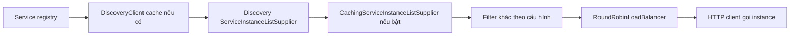
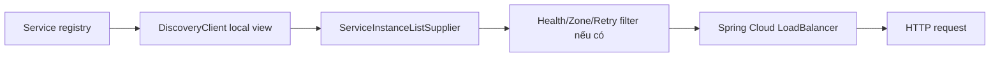
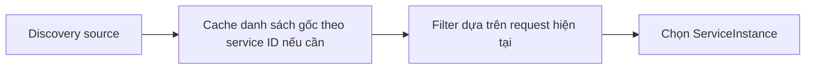

# Tránh lưu đệm trùng ở nhiều lớp

Khi `order-service` gọi `inventory-service` bằng service ID, Spring Cloud LoadBalancer cần một danh sách các `ServiceInstance` để chọn bản sao cho từng request. Truy vấn danh sách này có thể tốn chi phí mạng hoặc tài nguyên của hệ thống khám phá dịch vụ, nên nhiều thành phần hỗ trợ **cache danh sách instance**.

Cache giúp giảm độ trễ và tải lên service registry, nhưng một rủi ro dễ bị bỏ qua là **cùng một danh sách instance có thể bị lưu đệm ở nhiều lớp**: tại discovery client, tại `ServiceInstanceListSupplier` của Spring Cloud LoadBalancer và đôi khi ở những bộ nhớ đệm của nền tảng triển khai. Khi các lớp này làm mới dữ liệu theo lịch riêng, thời điểm một replica mới xuất hiện hoặc replica lỗi bị loại khỏi danh sách có thể chậm hơn mong đợi.

Mục tiêu của bài học là biết **cache nằm ở đâu, cache cái gì, khi nào nên giữ hoặc tắt một lớp cache và cách kiểm chứng danh sách instance thực sự được LoadBalancer sử dụng**. Đây là nền tảng để cân bằng giữa hiệu năng, độ mới của topology và khả năng phục hồi khi một bản sao ngừng hoạt động.

## 1. Cache danh sách instance khác cache HTTP response

Trước tiên cần xác định đối tượng được cache:

| Thành phần | Dữ liệu có thể được lưu đệm | Ví dụ |
| --- | --- | --- |
| Service registry / discovery client | Danh sách bản sao đã đăng ký, trạng thái đăng ký, địa chỉ và metadata | `inventory-service` có A, B, C |
| Spring Cloud LoadBalancer cache | Danh sách `ServiceInstance` dùng làm nguồn ứng viên cho bước lựa chọn | `[A, B, C]` trong một khoảng thời gian |
| HTTP response cache | Nội dung phản hồi của endpoint nghiệp vụ khi ứng dụng/proxy cho phép cache | Kết quả `GET /api/stocks/BOOK-001` |
| HTTP connection pool | Kết nối TCP/TLS có thể tái sử dụng tới một địa chỉ | Connection đang mở tới `10.0.1.12:8080` |
| DNS cache | Kết quả phân giải hostname thành địa chỉ IP | Host `inventory.example` trỏ tới một IP |

Bài học này tập trung vào **cache danh sách `ServiceInstance`**, không phải cache response tồn kho hoặc connection pool. Khi một replica đã bị xóa khỏi danh sách instance, một kết nối TCP cũ vẫn có thể tồn tại trong pool; ngược lại, cache danh sách instance còn A không có nghĩa HTTP connection tới A chắc chắn đang tồn tại hoặc còn dùng được.

Phân biệt đúng từng cache giúp tránh khắc phục nhầm. Ví dụ, điều chỉnh HTTP response cache không giải quyết được việc `RoundRobinLoadBalancer` liên tục chọn một instance đã dừng.

## 2. Hai lớp cache thường gặp trong cùng một đường gọi

Giả sử `inventory-service` có ba instance:

| Instance | Địa chỉ | Trạng thái lúc đầu |
| --- | --- | --- |
| A | `10.0.1.11:8080` | Đang chạy |
| B | `10.0.1.12:8080` | Đang chạy |
| C | `10.0.1.13:8080` | Đang chạy |

Một request từ `order-service` có thể đi qua chuỗi dữ liệu sau:



Các lớp trên có vai trò khác nhau:

1. **Registry** là nguồn thông tin đăng ký instance; bản thân registry cũng có thể duy trì trạng thái và cơ chế hết hạn đăng ký.
2. **Discovery client** của ứng dụng gọi tra cứu instance. Một số implementation, điển hình như Eureka client, duy trì bản sao dữ liệu registry cục bộ và định kỳ đồng bộ.
3. **`ServiceInstanceListSupplier`** chuyển dữ liệu discovery thành danh sách ứng viên cho Spring Cloud LoadBalancer.
4. **`CachingServiceInstanceListSupplier`**, khi có trong chuỗi, lưu danh sách được supplier phía trong cung cấp để các lượt chọn tiếp theo không phải lấy lại danh sách đó ngay lập tức.
5. **LoadBalancer** chọn một instance từ danh sách nhận được. Thuật toán như Round Robin không tự quyết định chu kỳ làm mới dữ liệu discovery.

Không phải ứng dụng nào cũng có đủ hai lớp cache. Một nguồn instance tĩnh hoặc một discovery client truy vấn trực tiếp có thể không có bộ nhớ đệm riêng; một hệ thống khác dùng cơ chế đồng bộ liên tục nên luôn có một local view của registry. Cần kiểm tra implementation và cấu hình thực tế trước khi quyết định thêm hay loại bỏ cache.

## 3. Lưu đệm trùng là gì và vì sao xảy ra?

**Lưu đệm trùng** xảy ra khi hai hay nhiều lớp giữ bản sao của cùng một thông tin discovery, ví dụ danh sách các instance thuộc `inventory-service`, nhưng không có nhu cầu rõ ràng cho việc giữ thêm bản sao tại mỗi lớp.

Ví dụ:

```text
Registry thực tế:           [A, C]      (B đã dừng)
DiscoveryClient cache:      [A, B, C]   (chưa đồng bộ)
LoadBalancer cache:         [A, B, C]   (chưa hết TTL)
RoundRobin ứng viên:        [A, B, C]
```

Ở thời điểm này, một request vẫn có thể bị gửi tới B dù B đã ngừng hoạt động. Lỗi xảy ra không nhất thiết do Round Robin; thuật toán chỉ chọn từ danh sách mà nó nhận được.

Sau khi discovery client cập nhật danh sách `[A, C]`, LoadBalancer cache vẫn có thể giữ `[A, B, C]` cho tới lần làm mới tiếp theo. Như vậy, **đã sửa dữ liệu ở lớp trong chưa có nghĩa lớp ngoài lập tức nhìn thấy thay đổi**.

Những hệ quả phổ biến gồm:

- **Topology chậm cập nhật:** instance mới chưa nhận request dù đã đăng ký vào registry.
- **Bản sao lỗi còn được chọn:** instance đã dừng vẫn xuất hiện trong tập ứng viên, gây connection refused hoặc timeout.
- **Khó chẩn đoán:** registry hiển thị đúng nhưng phía caller vẫn gửi request đến địa chỉ cũ.
- **Tốn tài nguyên không cần thiết:** các bản sao dữ liệu, bộ hẹn giờ và cơ chế invalidation hoạt động ở nhiều lớp.
- **Hành vi khó dự đoán khi cấu hình thay đổi:** TTL ở một lớp đã giảm nhưng lớp khác vẫn giữ dữ liệu cũ.

Không phải mọi trường hợp cache hai lớp đều sai. Một hệ thống có thể cần local registry view để hoạt động ổn định và đồng thời có cache ở một ranh giới khác để hạn chế công việc tính toán nặng. Điều cần tránh là **nhân đôi bộ nhớ đệm mà không biết mỗi lớp phục vụ mục đích gì, có tuổi dữ liệu bao lâu và được làm mới bằng cách nào**.

## 4. Hiệu ứng TTL chồng nhau

**TTL (time to live)** là khoảng thời gian dữ liệu trong một cache có thể được sử dụng trước khi cần làm mới hoặc hết hạn, tùy chính sách cache. TTL ở mỗi lớp không phải bảo đảm về thời điểm replica thật sự ngừng nhận request.

Giả sử discovery client chỉ cập nhật local view theo chu kỳ riêng, còn LoadBalancer cache giữ danh sách ứng viên theo TTL:

```text
T0             T1                  T2                    T3
|--------------|-------------------|---------------------|
B dừng         Discovery client    LB cache hết hạn      Caller nhìn thấy
hoạt động      đã bỏ B             và đọc lại            danh sách mới
               khỏi local view     discovery
```

Trong khoảng từ T0 đến lúc cả hai lớp nhìn thấy dữ liệu mới, caller có thể tiếp tục chọn B. Nếu LoadBalancer cache vừa làm mới từ discovery client **trước khi** discovery kịp loại B, danh sách cũ có thể được giữ thêm một chu kỳ cache nữa.

Một cách ước lượng để phân tích độ trễ cập nhật trong tình huống xấu là xem xét:

```text
Độ trễ nhìn thấy topology mới
    ≈ độ trễ registry/discovery cập nhật
    + thời gian chờ lớp cache LoadBalancer làm mới
    + các độ trễ xử lý hoặc đồng bộ liên quan
```

Đây chỉ là **mô hình tư duy**, không phải công thức TTL cộng cứng được Spring Cloud bảo đảm. Thời điểm cache hết hạn, sự kiện cập nhật, request tiếp theo, chính sách refresh, cache eviction, phát hiện instance chết và độ trễ mạng đều có thể thay đổi kết quả thực tế.

Điểm đáng nhớ là giảm một TTL không bảo đảm hệ thống cập nhật nhanh nếu một lớp khác vẫn trả dữ liệu cũ. Khi đánh giá thời gian hội tụ, phải nhìn **đường đi đầy đủ từ registry tới danh sách ứng viên tại caller**.

## 5. Khi nào nên tắt cache của Spring Cloud LoadBalancer?

Tài liệu Spring Cloud LoadBalancer lưu ý rằng nếu `DiscoveryClient` đã cung cấp cơ chế cache, việc cache thêm ở Spring Cloud LoadBalancer thường không cần thiết. Với các nguồn discovery như Eureka client có local registry cache, có thể ưu tiên **dùng một lớp cache đã được quản lý ở discovery** thay vì giữ thêm bản sao tại supplier.

Cấu hình phía ứng dụng gọi:

```yaml
spring:
  cloud:
    loadbalancer:
      cache:
        enabled: false
```

Cấu hình này yêu cầu **tắt cơ chế cache của Spring Cloud LoadBalancer** trong phạm vi được framework hỗ trợ. Nó **không tắt cache của Eureka hay discovery client**, không xóa cache HTTP response và cũng không buộc registry đẩy danh sách mới ngay lập tức tới caller.

### 5.1. Một sơ đồ kiến trúc sau khi bỏ cache trùng



Trong sơ đồ này, chuỗi LoadBalancer không có thêm cache danh sách instance. Tuy vậy, **discovery client vẫn có thể trả local view chưa được cập nhật**, nên khả năng gặp một instance đã dừng không biến mất hoàn toàn.

### 5.2. Khi nào không nên tắt một cách máy móc?

Nếu nguồn discovery không có cache nội bộ và mỗi lần lấy instance phải thực hiện một truy vấn mạng đắt đỏ, việc tắt cache tại LoadBalancer có thể làm tăng độ trễ hoặc tải lên registry. Trong tình huống đó, giữ một cache có TTL và dung lượng phù hợp có thể là lựa chọn hợp lý.

Quyết định cần dựa trên ba câu hỏi: **Discovery đã cache chưa? Việc truy vấn lại tốn bao nhiêu? Hệ thống cần nhìn thấy thay đổi replica nhanh đến mức nào?** Không có một cấu hình đúng cho mọi loại registry và quy mô traffic.

## 6. Cấu hình cache khi thực sự cần giữ ở LoadBalancer

Khi có lý do giữ cache ở Spring Cloud LoadBalancer, có thể cấu hình các thuộc tính của cache bằng namespace `spring.cloud.loadbalancer.cache`. Ví dụ sau mang tính minh họa, không phải khuyến nghị TTL cố định cho production:

```yaml
spring:
  cloud:
    loadbalancer:
      cache:
        enabled: true
        ttl: 20s
        capacity: 256
```

| Thuộc tính | Ý nghĩa | Điều cần cân nhắc |
| --- | --- | --- |
| `spring.cloud.loadbalancer.cache.enabled` | Bật hoặc tắt cache LoadBalancer | Tránh cache chồng với discovery client khi không cần |
| `spring.cloud.loadbalancer.cache.ttl` | Thời gian sống của entry trong cache mặc định | TTL thấp tăng tần suất làm mới; TTL cao có thể giữ topology cũ lâu hơn |
| `spring.cloud.loadbalancer.cache.capacity` | Dung lượng cache mặc định | Cần xem số lượng service ID và cách implementation quản lý entry |

Một số bản Spring Cloud LoadBalancer dùng TTL mặc định khoảng **35 giây** và capacity mặc định khoảng **256** cho cache của mình. Nên kiểm tra tài liệu của đúng phiên bản hoặc cấu hình hiệu lực của ứng dụng thay vì phụ thuộc một con số mặc định qua mọi bản phát hành.

Khi thư viện Caffeine có mặt trên classpath, Spring Cloud LoadBalancer có thể sử dụng cache dựa trên Caffeine thay vì cache mặc định. Có thể cấu hình thông qua thuộc tính như:

```properties
spring.cloud.loadbalancer.cache.caffeine.spec=maximumSize=256,expireAfterWrite=20s
```

Trong cách cấu hình Caffeine bằng `spec`, các thiết lập nêu trong spec có thể **ghi đè** cách cấu hình `ttl` và `capacity` riêng của LoadBalancer. Cần kiểm tra classpath và cấu hình đang có để biết implementation thực sự được dùng. Không nên đặt đồng thời các giá trị mâu thuẫn rồi giả định framework sẽ áp dụng cả hai.

Lưu ý rằng một TTL ngắn **không phải** cơ chế health check: cache được làm mới chỉ giúp lấy danh sách mới hơn từ nguồn discovery, không tự xác minh từng replica đang nhận kết nối tốt.

## 7. Tránh thêm CachingServiceInstanceListSupplier hai lần trong custom chain

Ngoài cache tự động từ cấu hình của framework, ứng dụng có thể tự xây `ServiceInstanceListSupplier` bằng builder. Khi đó cần kiểm tra xem chain đã có một lớp cache hay chưa trước khi gọi thêm `.withCaching()`.

Một chain minh họa khi **muốn dùng cache của LoadBalancer**:

```java
import org.springframework.cloud.loadbalancer.core.ServiceInstanceListSupplier;
import org.springframework.context.ConfigurableApplicationContext;
import org.springframework.context.annotation.Bean;

class CachedInventorySupplierConfiguration {

    @Bean
    ServiceInstanceListSupplier inventorySupplier(
            ConfigurableApplicationContext context) {

        return ServiceInstanceListSupplier.builder()
                .withDiscoveryClient()
                .withCaching()
                .build(context);
    }
}
```

Một chain minh họa khi **DiscoveryClient đã cache và muốn tránh cache thêm**:

```java
import org.springframework.cloud.loadbalancer.core.ServiceInstanceListSupplier;
import org.springframework.context.ConfigurableApplicationContext;
import org.springframework.context.annotation.Bean;

class DirectInventorySupplierConfiguration {

    @Bean
    ServiceInstanceListSupplier inventorySupplier(
            ConfigurableApplicationContext context) {

        return ServiceInstanceListSupplier.builder()
                .withDiscoveryClient()
                .build(context);
    }
}
```

Đây là **hai phương án thay thế nhau**, không phải hai bean cần đăng ký đồng thời. Khi dùng cấu hình riêng cho service ID, có thể gắn một lớp cấu hình supplier vào `@LoadBalancerClient(name = "inventory-service", configuration = ...)`, bảo đảm cấu hình đó không bị component scan thông thường áp dụng rộng hơn dự định.

Nếu chọn phương án không cache, nên đồng bộ với cấu hình `spring.cloud.loadbalancer.cache.enabled=false` khi phù hợp. Không thêm `.withCaching()` vào một chain rồi kỳ vọng mọi trường hợp tự động bỏ qua lớp này chỉ vì muốn tắt cache. Cách hành xử khi phối hợp cấu hình tự động và bean tùy chỉnh cần được kiểm tra theo phiên bản Spring Cloud đang chạy.

**Không được nhầm hai kiểu trùng lặp:** (1) discovery client đã cache nhưng supplier lại cache tiếp; (2) trong cùng supplier chain có nhiều lớp `CachingServiceInstanceListSupplier`. Cả hai đều cần được phát hiện qua cấu hình thực tế, không chỉ bằng cách nhìn một property.

## 8. Cache danh sách thô, không vô tình cache kết quả lọc theo request

Spring Cloud LoadBalancer còn có các supplier phụ thuộc ngữ cảnh request như hint routing, sticky session hoặc retry-aware filtering. Các bộ lọc này có thể tạo **danh sách ứng viên khác nhau cho cùng một service ID**.

Giả sử discovery có:

```text
inventory-service
  A: zone-a, stable
  B: zone-a, canary
  C: zone-b, stable
  D: zone-b, canary
```

Request X có hint `zone-a` nên cần A, B; request Y có hint `zone-b` nên cần C, D. Nếu một cache dùng khóa chỉ theo service ID lại lưu **kết quả đã lọc của X** rồi dùng cho Y, Y có thể nhận nhầm A, B.

Cách tổ chức an toàn về mặt khái niệm:



Không nên mặc định rằng mọi thứ tự decorator đều tương đương. Spring Cloud LoadBalancer có các khuyến nghị về thứ tự đặt cache và health-check trong chain; với supplier tùy chỉnh, hãy kiểm tra chính xác chiều gọi delegate và dữ liệu được cache. Trong ví dụ minh họa trên, dữ liệu được cache là **danh sách từ nguồn** còn chính sách từng request được áp dụng **sau khi đọc danh sách**.

Tương tự, nếu retry-aware supplier cần loại instance vừa lỗi khỏi attempt tiếp theo, kết quả lọc của attempt trước không nên bị cache rồi chia sẻ cho các request không liên quan. Đây cũng là lý do phải giữ `Request` context qua các lớp decorator bằng đường gọi tương ứng khi supplier phía trong cần dùng nó.

## 9. Cache không thay thế health check và retry

Giả sử replica B ngừng hoạt động trong lúc nó vẫn còn trong cache. Có ba cơ chế khác nhau có thể tham gia phục hồi:

| Cơ chế | Nó giúp gì? | Giới hạn |
| --- | --- | --- |
| Discovery refresh | Cập nhật danh sách các instance còn được registry công bố | Có độ trễ phát hiện và đồng bộ của registry/discovery |
| Cache TTL/eviction | Giới hạn tuổi của danh sách instance mà LoadBalancer giữ | Chỉ làm mới từ nguồn bên dưới; nguồn đó vẫn có thể cũ |
| Health check supplier | Lọc instance không đạt phép kiểm tra sức khỏe được cấu hình | Probe không tức thời và không chứng minh request kế tiếp sẽ thành công |
| Retry policy | Cho phép thử lại request sau một số lỗi nhất định | Có thể tăng tải, gây tác động trùng lặp khi thao tác không idempotent |

Một cache TTL rất ngắn không cứu được request nếu discovery vẫn giữ B trong local view. Ngược lại, discovery đã bỏ B nhưng LoadBalancer cache còn danh sách cũ vẫn có thể tạo lựa chọn sai. Health check giúp thu hẹp danh sách ứng viên không khỏe, nhưng một instance có thể hỏng ngay sau lần probe. Retry có thể đổi instance nhưng không tự bảo đảm an toàn cho request ghi dữ liệu.

Vì vậy, việc bỏ cache trùng là một phần của thiết kế, **không phải phương án thay thế hoàn toàn timeout, retry có giới hạn hay kiểm tra sức khỏe**.

## 10. So sánh ba chiến lược caching

| Chiến lược | Trường hợp phù hợp | Lợi ích | Đổi lại |
| --- | --- | --- | --- |
| Chỉ dùng cache của discovery client | Discovery có local registry view đủ hiệu quả, ví dụ Eureka client | Tránh thêm độ trễ cache ở LoadBalancer; cấu hình đơn giản hơn | Độ mới vẫn bị giới hạn bởi registry/discovery refresh |
| Chỉ dùng cache của Spring Cloud LoadBalancer | Nguồn discovery trả dữ liệu trực tiếp và truy vấn lại có chi phí đáng kể | Giảm số lần lấy danh sách; kiểm soát TTL ở một nơi | Có độ trễ cập nhật topology theo TTL đã đặt |
| Giữ hai lớp cache có chủ đích | Có đặc điểm hiệu năng đặc biệt hoặc lớp cache phục vụ các mục đích khác nhau | Có thể giảm tải trong một số kiến trúc | Khó dự đoán độ mới và invalidation hơn; phải đo lường thực tế |

Lựa chọn nên dựa trên SLA về thời gian phát hiện topology thay đổi, lưu lượng gọi giữa dịch vụ, độ trễ query discovery và khả năng chịu lỗi của ứng dụng. Không nên bật nhiều cache chỉ vì mỗi thành phần đều hỗ trợ một tùy chọn `enabled`.

## 11. Quan sát dữ liệu thực tế: registry, discovery và supplier

Để chứng minh cache trùng đang gây lỗi, cần đối chiếu **ba ảnh chụp danh sách** ở cùng khoảng thời gian:

1. **Registry view:** danh sách instance mà registry hoặc nền tảng hiện cho rằng đã đăng ký.
2. **Discovery client view:** danh sách `DiscoveryClient.getInstances("inventory-service")` của chính caller.
3. **LoadBalancer supplier view:** danh sách thực tế đưa vào thuật toán chọn instance sau cache và các bộ lọc.

Ví dụ khi B vừa dừng:

```text
12:00:00  Registry:             [A, C]
12:00:01  Caller DiscoveryClient: [A, C]
12:00:01  LB Supplier:          [A, B, C]
12:00:02  LoadBalancer selected: B -> Connection refused
12:00:21  LB Supplier:          [A, C]
```

Nếu registry và discovery client đã bỏ B nhưng supplier vẫn trả B, hãy điều tra cache/filter trong LoadBalancer. Nếu cả registry và discovery đều còn B, nguyên nhân có thể là quá trình deregistration, lease/heartbeat, refresh hoặc cơ chế health check của nguồn discovery, không nhất thiết do cache LoadBalancer.

### 11.1. Đọc danh sách từ DiscoveryClient

Ví dụ Java đơn giản để quan sát dữ liệu mà discovery client trong caller nhìn thấy:

```java
import java.util.List;

import org.springframework.cloud.client.ServiceInstance;
import org.springframework.cloud.client.discovery.DiscoveryClient;
import org.springframework.stereotype.Component;

@Component
class InventoryDiscoveryInspector {

    private final DiscoveryClient discoveryClient;

    InventoryDiscoveryInspector(DiscoveryClient discoveryClient) {
        this.discoveryClient = discoveryClient;
    }

    List<ServiceInstance> currentInstances() {
        return discoveryClient.getInstances("inventory-service");
    }
}
```

`currentInstances()` cho biết danh sách của discovery client ở thời điểm gọi; nó **không nhất thiết** là danh sách cuối cùng mà LoadBalancer chọn từ đó nếu còn cache, zone, health check hoặc retry-aware supplier. Để quan sát bước cuối, cần bổ sung log hoặc instrumentation tại supplier chain và ghi nhận instance được chọn.

### 11.2. Log những dữ kiện cần thiết

Các trường hữu ích gồm service ID, thời điểm, tên supplier, số instance trước/sau cache/filter, host/port instance được chọn, exception mạng và trace ID. Nếu có thể, ghi thêm tuổi cache entry hoặc lần cập nhật danh sách gần nhất theo API/metric của implementation đang dùng.

```text
traceId=ab10... serviceId=inventory-service
discoveryCount=2 supplierCount=3 selected=10.0.1.12:8080
error=ConnectException cause=Connection refused
```

Log trên cho thấy dữ liệu giữa discovery và supplier không giống nhau. Cần tìm vị trí cache giữ B hoặc một nguồn dữ liệu khác đang được dùng. Không ghi token, cookie, toàn bộ header hoặc metadata chứa thông tin nhạy cảm; cũng tránh gắn host/instance ID có số lượng thay đổi rất lớn vào nhãn metric không được kiểm soát.

## 12. Quy trình chẩn đoán khi một replica đã dừng vẫn được chọn

Giả sử B đã bị gỡ khỏi hệ thống nhưng các request vẫn thất bại khi chọn địa chỉ `10.0.1.12:8080`. Hãy kiểm tra theo trình tự:

1. **Xác nhận địa chỉ lỗi:** log cho thấy LoadBalancer chọn B hay HTTP client đang dùng kết nối/URI khác? Phân biệt cache instance với connection pool.
2. **Kiểm tra trạng thái đăng ký:** registry hiện có còn B không, B đã deregister chưa hoặc lease đã hết hạn chưa?
3. **Kiểm tra dữ liệu tại caller:** `DiscoveryClient.getInstances("inventory-service")` còn B không?
4. **Liệt kê các lớp supplier:** chain có `CachingServiceInstanceListSupplier`, health check hay bộ lọc tùy chỉnh nào? Có nhiều lớp caching không?
5. **Đọc cấu hình cache hiệu lực:** `spring.cloud.loadbalancer.cache.enabled`, TTL, capacity, Caffeine spec và các cấu hình riêng cho service ID là gì?
6. **Xác định thứ tự decorator:** cache có đặt trên danh sách gốc hay trên kết quả lọc theo request? Có thành phần nào tự cache lần nữa không?
7. **Đo thời gian hội tụ:** so sánh lúc B dừng, registry cập nhật, discovery cập nhật và supplier bỏ B.
8. **Kiểm tra cơ chế phục hồi:** timeout, retry, health check và idempotency đã được thiết kế đúng chưa?

Không nên sửa bằng cách giảm mọi TTL xuống cực nhỏ trước khi tìm đúng lớp gây trễ. Điều đó có thể tạo tải lớn lên registry mà vẫn không khắc phục được nơi cache thực sự đang giữ dữ liệu cũ.

## 13. Các tình huống kiểm thử cần có

Một bài kiểm tra tích hợp có thể triển khai ba instance A, B, C, rồi điều chỉnh topology và đo thời gian phía caller nhận danh sách mới.

| Tình huống | Kỳ vọng cần xác minh |
| --- | --- |
| B ngừng hoạt động và hủy đăng ký | Sau khi các nguồn dữ liệu cập nhật, supplier không tiếp tục chọn B |
| Thêm instance D | Caller có thể thấy và chọn D sau khoảng trễ refresh/cache được chấp nhận |
| Tắt LB cache khi discovery đã cache | Không có thêm tầng danh sách cũ do LB cache tạo ra; discovery vẫn có thể chậm |
| Bật cache LB với nguồn không có cache riêng | Tần suất đọc nguồn giảm, thời gian nhận topology mới phù hợp TTL và SLA |
| Hai request dùng hint khác nhau | Kết quả lọc theo request không bị dùng chung sai qua cache service ID |
| Retry sau lỗi kết nối tới B | Nếu policy cho phép, lần sau có thể tránh B; không nhân số lần retry vô hạn |
| Nhiều caller chạy song song | Mỗi caller có local view và thời điểm cập nhật có thể khác nhau; quan sát độ lệch giữa chúng |

Khi đo, nên ghi rõ mốc thời gian bằng đồng hồ nhất quán trong hệ thống test, số request, trạng thái registry, giá trị TTL và version Spring Cloud. Một kết quả thành công ngẫu nhiên sau khi dừng B chưa đủ chứng minh B đã biến mất khỏi danh sách; Round Robin có thể đơn giản chọn A hoặc C trong lần thử đó.

## 14. Thực hành thiết kế phù hợp

Các nguyên tắc sau giúp giữ cơ chế caching dễ hiểu và dễ vận hành:

1. **Chỉ định lớp sở hữu cache instance chính.** Nếu discovery đã cung cấp local cache đủ tốt, cân nhắc tắt cache LoadBalancer.
2. **Ghi rõ yêu cầu về độ mới của topology.** Thời gian chấp nhận replica mới và thời gian ngừng chọn replica lỗi nên là mục tiêu đo được.
3. **Tránh mặc định nhiều lớp `.withCaching()`** trong custom `ServiceInstanceListSupplier` chain.
4. **Đặt cache và filter theo request đúng thứ tự.** Không chia sẻ một kết quả lọc theo hint/retry giữa các request không liên quan.
5. **Hiểu cấu hình thực tế của Caffeine.** Kiểm tra khi spec thay thế các thuộc tính TTL/capacity khác.
6. **Phân biệt cache với sức khỏe.** TTL hết hạn không xác minh được replica mới đang chạy; health check cũng không làm mới mọi cache ngay lập tức.
7. **Giữ chính sách retry an toàn.** Timeout của request ghi dữ liệu có thể xảy ra sau khi downstream đã xử lý; cân nhắc idempotency key hoặc truy vấn trạng thái.
8. **Quan sát từng tầng.** Registry, discovery client, supplier và instance được chọn phải có thể đối chiếu khi điều tra lỗi.
9. **Ưu tiên cấu hình đơn giản.** Chỉ thêm một lớp cache khi có số liệu chứng minh lợi ích về latency hoặc chi phí truy vấn.

## 15. Tự kiểm tra kiến thức

1. Cache danh sách `ServiceInstance` khác HTTP response cache và connection pool như thế nào?
2. Nếu Eureka client đã có local registry cache, việc thêm `CachingServiceInstanceListSupplier` có thể gây tác dụng phụ gì?
3. Vì sao registry đã bỏ B nhưng `RoundRobinLoadBalancer` vẫn có thể chọn B?
4. `spring.cloud.loadbalancer.cache.enabled=false` có đồng thời tắt cache của discovery client hay không?
5. Khi nào giữ cache của Spring Cloud LoadBalancer lại là lựa chọn hợp lý?
6. Vì sao không nên cache danh sách đã lọc theo request chỉ với khóa service ID?
7. Nếu discovery client thấy `[A, C]` nhưng supplier trả `[A, B, C]`, lớp nào nên được kiểm tra trước?
8. Khi bật Caffeine, cần lưu ý điều gì về `caffeine.spec` so với `ttl` và `capacity`?
9. Vì sao giảm TTL không thể thay thế việc thiết kế health check, timeout và retry?

**Kết luận:** cache danh sách bản sao giúp giảm chi phí lấy dữ liệu discovery, nhưng mỗi lớp cache bổ sung đều làm phức tạp việc xác định danh sách nào đang được dùng và khi nào topology mới được nhìn thấy. Hãy lựa chọn có chủ đích nơi giữ cache, tránh trùng lặp không cần thiết giữa discovery client và Spring Cloud LoadBalancer, đồng thời đo kiểm độ trễ cập nhật instance từ registry đến thời điểm chọn bản sao thực tế.
