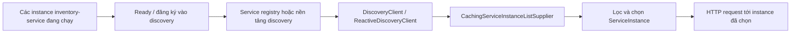
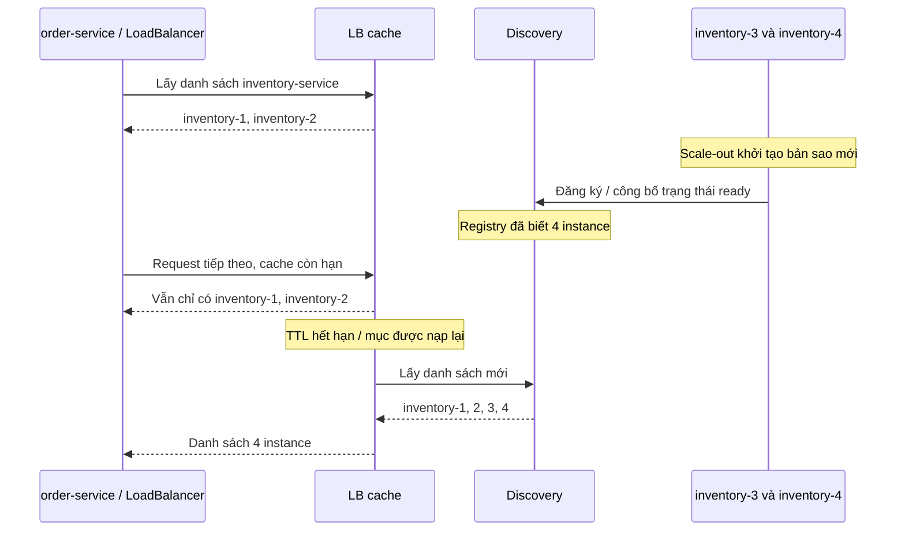
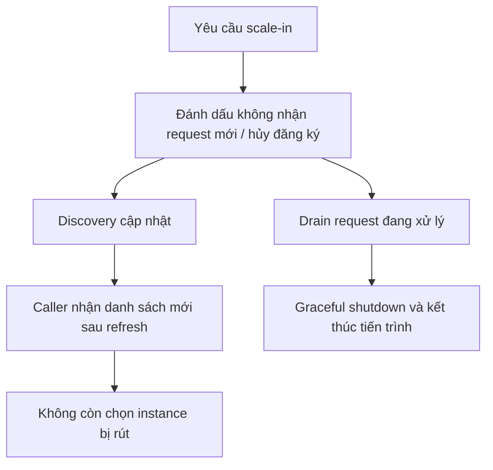
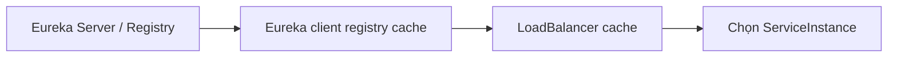

# Ảnh hưởng của cache đến mở rộng và thu hẹp số bản sao

## Mục tiêu

Khi dịch vụ được mở rộng từ hai lên năm bản sao (*scale-out*) hoặc thu hẹp từ năm xuống hai bản sao (*scale-in*), người vận hành thường kỳ vọng lưu lượng thay đổi ngay theo số instance còn hoạt động. Trong hệ thống dùng **Spring Cloud LoadBalancer**, kỳ vọng này có thể không đúng vì danh sách `ServiceInstance` mà client nhìn thấy có thể được cache.

Cache giúp giảm số lần gọi hệ thống service discovery, giảm chi phí lấy danh sách instance và tránh gây tải không cần thiết. Đổi lại, cache tạo ra một khoảng thời gian mà **danh sách trong client khác trạng thái triển khai thực tế**. Khi scale-out, client có thể tiếp tục bỏ qua những instance mới. Khi scale-in, client có thể tiếp tục chọn instance đã ngừng nhận request.

Sau bài học, bạn có thể:

- Mô tả các tầng từ instance đang chạy đến danh sách `ServiceInstance` mà LoadBalancer sử dụng.
- Phân biệt thời điểm instance được tạo, trở nên ready, xuất hiện trong discovery và xuất hiện trong cache.
- Giải thích hậu quả của cache cũ khi scale-out và scale-in.
- Điều chỉnh `spring.cloud.loadbalancer.cache.ttl`, `capacity`, Caffeine hoặc tắt một tầng cache khi cần.
- Thiết kế scale-in an toàn bằng readiness, hủy đăng ký, draining và graceful shutdown.
- Phối hợp health check, timeout, retry và quan sát để giảm lỗi trong giai đoạn thay đổi số bản sao.
- Kiểm thử thời gian nhìn thấy instance mới và thời gian ngừng chọn instance cũ thay vì chỉ đo số replica trên hạ tầng.

## 1. Danh sách bản sao mà client nhìn thấy đến từ đâu?

Giả sử `order-service` gửi HTTP request đến URL logic:

```text
http://inventory-service/api/items/42
```

Với `RestClient`, `WebClient` hoặc OpenFeign được tích hợp Spring Cloud LoadBalancer, tên `inventory-service` là **service ID**. LoadBalancer cần danh sách `ServiceInstance` ứng với service ID đó để chọn host và port cụ thể.

Đường đi khái quát:



Không phải hệ thống nào cũng có đủ mọi tầng. Một số discovery client tự cache dữ liệu registry; một số môi trường gửi request đến Kubernetes Service hoặc reverse proxy để hạ tầng cân bằng tải thay cho client. Trong bài này, ta tập trung vào trường hợp **LoadBalancer phía client thực sự nhìn thấy và lựa chọn nhiều instance**.

Ba trạng thái thường bị nhầm:

| Trạng thái | Ý nghĩa |
|---|---|
| **Đang chạy** | Tiến trình hoặc container đã được tạo, nhưng có thể chưa sẵn sàng phục vụ. |
| **Được discovery công bố** | Nguồn discovery đã biết đến instance và có thể trả instance đó cho client tùy trạng thái/điều kiện. |
| **Được LoadBalancer lựa chọn** | Danh sách mà caller đang dùng đã chứa instance và chính sách lọc/route cho phép chọn nó. |

Việc tăng replica ở Kubernetes, tăng số JVM trên VM hoặc đăng ký thêm bản sao trong Eureka mới chỉ tác động một hoặc vài tầng đầu. Mỗi tầng phía sau có thể cập nhật theo chu kỳ khác nhau.

## 2. Cache của Spring Cloud LoadBalancer lưu gì?

Spring Cloud LoadBalancer cung cấp `CachingServiceInstanceListSupplier`, lấy danh sách từ một supplier khác rồi lưu kết quả để các yêu cầu tiếp theo không phải thực hiện lại việc lấy danh sách qua discovery.

Ví dụ lúc bắt đầu:

```text
discovery result for inventory-service:
  [inventory-1, inventory-2]

LoadBalancer cache:
  key: inventory-service
  value: [inventory-1, inventory-2]
```

Khi yêu cầu tiếp theo đến trước khi mục cache hết hạn, LoadBalancer có thể tiếp tục sử dụng hai instance này dù registry đã thay đổi. Cache không phải bảng kết nối TCP; nó lưu **snapshot của danh sách instance**. Mỗi HTTP request còn chịu ảnh hưởng từ timeout, connection pool, retry và trạng thái thực tế của instance đích.

### 2.1. TTL và dung lượng cache

Theo tài liệu Spring Cloud Commons **5.0.4**, các giá trị mặc định của LoadBalancer cache gồm:

| Property | Mặc định | Ý nghĩa |
|---|---:|---|
| `spring.cloud.loadbalancer.cache.enabled` | `true` | Bật cơ chế cache của LoadBalancer. |
| `spring.cloud.loadbalancer.cache.ttl` | `35s` | Khoảng sống của bản ghi tính từ thời điểm ghi vào cache. |
| `spring.cloud.loadbalancer.cache.capacity` | `256` | **Dung lượng khởi tạo** của cache, không phải 256 instance cho mỗi service. |
| `spring.cloud.loadbalancer.cache.caffeine.spec` | Không đặt | Đặc tả Caffeine tùy chọn, có thể ghi đè các thiết lập chung. |

Ví dụ điều chỉnh cache:

```yaml
spring:
  cloud:
    loadbalancer:
      cache:
        enabled: true
        ttl: 15s
        capacity: 256
```

`ttl: 15s` là một **lựa chọn minh họa**, không phải giá trị chuẩn cho mọi hệ thống. TTL phải được chọn dựa trên tốc độ scale, tần suất thay đổi registry và khả năng chịu lỗi trong lúc danh sách cũ còn tồn tại.

TTL là thời gian hết hạn theo lần ghi cache; nó **không** có nghĩa rằng mọi caller đồng thời cập nhật đúng mỗi 15 giây. Mỗi tiến trình caller có thể nạp cache ở thời điểm riêng, và việc nạp lại còn phụ thuộc request, nguồn discovery, lỗi mạng và cách cấu hình cache.

### 2.2. Default cache và Caffeine

Spring Cloud LoadBalancer có hai lựa chọn cache:

- **DefaultLoadBalancerCache** khi không có Caffeine trên classpath.
- **Caffeine-backed cache** khi dependency `com.github.ben-manes.caffeine:caffeine` có mặt.

Với Maven, có thể thêm Caffeine nếu dự án chọn giải pháp này:

```xml
<dependency>
    <groupId>com.github.ben-manes.caffeine</groupId>
    <artifactId>caffeine</artifactId>
</dependency>
```

Ví dụ cấu hình Caffeine riêng:

```yaml
spring:
  cloud:
    loadbalancer:
      cache:
        caffeine:
          spec: expireAfterWrite=15s,initialCapacity=256,maximumSize=512
```

**Chú ý:** khi đặt `spring.cloud.loadbalancer.cache.caffeine.spec`, đặc tả Caffeine có thể **ghi đè** thiết lập LoadBalancer cache chung như `cache.ttl` và `cache.capacity`. Vì vậy, nếu dự án đặt cả hai, hãy kiểm tra chính sách nào thực sự có hiệu lực.

`maximumSize` trong ví dụ là giới hạn số mục của Caffeine cache, không phải giới hạn số bản sao của `inventory-service`. Không dùng `cache.capacity` để mô tả số replica có thể cân bằng tải.

## 3. Scale-out: tăng bản sao nhưng lưu lượng chưa tăng theo

Giả sử `inventory-service` có hai instance khỏe mạnh: `inventory-1` và `inventory-2`. Khi tải tăng, autoscaler tạo thêm `inventory-3` và `inventory-4`.

### 3.1. Dòng thời gian minh họa



Khi cache còn giữ snapshot hai instance cũ, hai bản sao mới có thể **đã ready nhưng gần như chưa nhận traffic từ caller đó**. Hệ quả:

- Hai instance cũ tiếp tục chịu tải cao dù hệ thống đã cấp thêm CPU và bộ nhớ.
- Autoscaler có thể thấy mức tải chưa giảm như mong đợi, tạo thêm replica hoặc phản ứng chậm.
- Số liệu load balancing bị lệch giữa các caller: caller A đã refresh và chọn bốn instance; caller B còn snapshot hai instance.
- Một nhóm canary mới có metadata đúng nhưng vẫn chưa xuất hiện trong tập ứng viên của client.
- Nếu instance cũ quá tải, request vẫn có thể timeout hoặc bị từ chối trong khi instance mới đang rảnh.

Cache **không làm mất** instance mới; nó chỉ có thể trì hoãn việc instance đó trở thành ứng viên. Khi nguồn discovery và cache đều được cập nhật, thuật toán LoadBalancer có thể chọn các instance mới, trừ khi chúng bị các bộ lọc zone, hint, health check hoặc API version loại khỏi danh sách.

### 3.2. Ví dụ thời gian, chỉ để minh họa

Giả sử:

1. `t=0s`: caller có cache chứa `inventory-1` và `inventory-2`, TTL 35 giây.
2. `t=5s`: `inventory-3` trở nên ready và được registry công bố.
3. `t=12s`: discovery client đã có thể trả đủ ba instance.
4. `t=20s`: caller tiếp tục dùng cache còn hạn nên chỉ chọn instance 1 hoặc 2.
5. `t≈35s` hoặc lần truy cập/nạp lại sau đó: cache hết hạn và có thể nhận danh sách ba instance.

Đây là một kịch bản giả định, **không phải cam kết** rằng mọi hệ thống đều cập nhật sau đúng 35 giây. Nếu discovery chưa đồng bộ khi cache được nạp lại, client có thể ghi tiếp một snapshot cũ rồi phải chờ lượt refresh khác. Nếu có nhiều tầng cache hoặc lỗi discovery, thời gian có thể dài hơn.

Thời gian quan sát được thường phụ thuộc:

```text
Thời điểm sẵn sàng nhận traffic
  -> thời điểm instance được discovery công bố
  -> thời điểm discovery client thấy thay đổi
  -> thời điểm LoadBalancer cache có danh sách mới
  -> thời điểm policy thực sự chọn instance mới
```

Không cộng `TTL discovery + TTL LoadBalancer` rồi coi tổng đó là giới hạn cứng. Nhiều tầng có lịch refresh lệch pha; request, retry, điều kiện health check và trạng thái hạ tầng đều có thể làm kết quả khác ví dụ.

## 4. Scale-in: danh sách cũ có thể gây lỗi nghiêm trọng hơn

Khi giảm replica, vấn đề lớn không chỉ là phân phối không đều. Client có thể **gửi request đến instance đã bị loại khỏi hệ thống**.

Ví dụ ban đầu LoadBalancer cache:

```text
inventory-service = [inventory-1, inventory-2, inventory-3, inventory-4]
```

Nền tảng thu hẹp xuống hai replica, chọn dừng `inventory-3` và `inventory-4`. Registry đã loại hai instance này nhưng caller chưa refresh cache. Trong khoảng đó, LoadBalancer vẫn có thể chọn `inventory-3` hoặc `inventory-4`.

Hậu quả có thể gồm:

- `Connection refused` vì cổng dịch vụ không còn lắng nghe.
- `Connect timeout` hoặc lỗi mạng vì pod/VM đã biến mất hoặc đường kết nối bị đóng.
- `Read timeout` hoặc response bị cắt nếu instance nhận request rồi dừng khi chưa trả lời.
- Tăng retry, làm tải dồn sang những instance còn lại và có thể khuếch đại sự cố.
- Tỷ lệ HTTP 5xx tăng dù còn những instance khỏe mạnh khác.

### 4.1. Tác động của thời điểm shutdown



Trong quy trình an toàn, **việc ngừng chọn instance để nhận request mới nên xảy ra trước khi tiến trình hoàn toàn mất khả năng phục vụ**, đồng thời cần thời gian hoàn thành các request đã nhận. Nhưng hai nhánh discovery/cache và xử lý request cũ có thể diễn ra song song, không có bảo đảm mọi caller đều cập nhật đồng thời.

Nếu stop instance ngay sau khi xóa khỏi registry, những caller còn cache cũ có thể vẫn gửi request vào địa chỉ không còn hoạt động. Nếu giữ instance sống thêm một khoảng thời gian draining hợp lý, hệ thống có cơ hội xử lý các kết nối còn tồn tại trong lúc các lớp discovery/cache cập nhật.

**Điều quan trọng:** việc dừng **nhận request mới** còn phụ thuộc cách proxy, client và ứng dụng xử lý connection. Chỉ thay đổi trạng thái readiness hoặc xóa registry entry không tự động xóa địa chỉ khỏi cache của mọi caller lập tức.

### 4.2. Graceful shutdown và readiness

Với Spring Boot, nên bật graceful shutdown và định thời gian chờ theo đặc thù nghiệp vụ:

```yaml
server:
  shutdown: graceful

spring:
  lifecycle:
    timeout-per-shutdown-phase: 30s
```

Cấu hình này cho phép Spring Boot cố gắng hoàn tất những request đang xử lý trong thời gian chờ shutdown. Nó **không trực tiếp quyết định** TTL của LoadBalancer cache ở caller, cũng không bảo đảm mọi caller ngừng chọn instance trước khi JVM dừng.

Với Kubernetes, readiness probe và cơ chế EndpointSlice giúp loại endpoint đang terminating khỏi luồng Service traffic thông thường. Tuy nhiên:

- Phải xác định caller đang gọi **Kubernetes Service IP** hay đang chọn **từng pod bằng Spring Cloud LoadBalancer**.
- Nếu caller có danh sách IP của pod được cache qua một discovery provider, chỉ đánh dấu EndpointSlice readiness không nhất thiết làm sạch snapshot đó ngay.
- `terminationGracePeriodSeconds` và `preStop` có thể tham gia draining, nhưng thời gian phù hợp phải tính cả thời gian xử lý request và độ trễ cập nhật/loại khỏi danh sách.
- Đừng dùng `preStop` như một khoản sleep cố định tùy ý rồi coi đó là bảo đảm an toàn. Cần đo thời gian propagation và kiểm thử dưới tải thật.

Nếu dùng Eureka, xác minh ứng dụng được đánh dấu không sẵn sàng hoặc hủy đăng ký đúng cách trước khi tắt. Quá trình client thấy danh sách cập nhật vẫn bị chi phối bởi registry fetch, trạng thái instance và các tầng cache.

## 5. Hai tầng cache: discovery cache và LoadBalancer cache

Spring Cloud LoadBalancer không phải nơi duy nhất giữ danh sách instance. Một discovery client như `EurekaDiscoveryClient` có thể đã cache registry.



Với Eureka, tài liệu Spring Cloud Netflix ghi nhận `eureka.client.registry-fetch-interval-seconds` mặc định là **30 giây**. Spring Cloud LoadBalancer có `cache.ttl` mặc định **35 giây**. Hai chu kỳ này **không đồng bộ**, vì vậy có thể xảy ra tình huống:

1. Eureka client vừa nạp một danh sách cũ.
2. LoadBalancer cache hết hạn và hỏi Eureka client.
3. Eureka client trả snapshot cũ, LoadBalancer lại cache snapshot đó.
4. Sau đó Eureka client mới nhận thay đổi, nhưng LoadBalancer cache vẫn có thể giữ danh sách cũ đến đợt nạp lại tiếp theo.

Đây là hiện tượng **double caching**, khiến việc scale-out/scale-in hiển thị chậm hơn và khó dự đoán. Tài liệu Spring Cloud khuyến nghị **tắt LoadBalancer cache nếu discovery client đã thực hiện caching**, ví dụ Eureka:

```yaml
spring:
  cloud:
    loadbalancer:
      cache:
        enabled: false
```

Tắt một tầng cache không có nghĩa ứng dụng lúc nào cũng truy vấn registry server qua mạng trên từng request. Nếu discovery client đã duy trì cache nội bộ, `DiscoveryClient` có thể trả từ cache của chính nó. Hãy xem hiệu năng thực tế của discovery implementation trước khi thay đổi production.

### 5.1. Khi nào nên giữ LoadBalancer cache?

Giữ LoadBalancer cache thường phù hợp khi nguồn discovery không tự cache hoặc chi phí lấy danh sách cao. Cần đo:

- Số request gọi discovery trước/sau khi bật cache.
- Độ trễ phát hiện instance mới và loại instance cũ.
- Tỷ lệ request thất bại khi scale-in.
- Chỉ số CPU/memory/tần suất request của các instance sau scale-out.
- Số lần registry bị quá tải trong giai đoạn autoscaling hoặc rollout.

**TTL thấp hơn** thường giúp giảm thời gian dùng danh sách cũ, nhưng có thể tăng tải lên nguồn discovery; **TTL cao hơn** thường giảm chi phí lấy danh sách, nhưng tăng nguy cơ chọn nhầm instance trong giai đoạn thay đổi. Không có một giá trị TTL tối ưu cho mọi service.

### 5.2. Cấu hình riêng cho từng service

Spring Cloud LoadBalancer hỗ trợ nhiều property riêng theo service ID qua namespace `spring.cloud.loadbalancer.clients.<serviceId>`, song **`spring.cloud.loadbalancer.cache.enabled` là cổng bật/tắt toàn cục**. Khi cache toàn cục bật, một service cụ thể có thể bỏ `CachingServiceInstanceListSupplier` khỏi chuỗi supplier riêng của mình. Không thể bật cache riêng cho một service khi cổng toàn cục đã tắt.

Ví dụ tạo chuỗi supplier riêng không có cache cho `inventory-service`:

```java
import org.springframework.cloud.loadbalancer.annotation.LoadBalancerClient;
import org.springframework.cloud.loadbalancer.core.ServiceInstanceListSupplier;
import org.springframework.context.ConfigurableApplicationContext;
import org.springframework.context.annotation.Bean;
import org.springframework.context.annotation.Configuration;

@Configuration(proxyBeanMethods = false)
@LoadBalancerClient(
        name = "inventory-service",
        configuration = InventorySupplierConfiguration.class
)
class InventoryLoadBalancerRegistration {
}

// Không gắn @Configuration để tránh component scan từ parent context.
class InventorySupplierConfiguration {

    @Bean
    ServiceInstanceListSupplier inventoryInstanceListSupplier(
            ConfigurableApplicationContext context) {
        return ServiceInstanceListSupplier.builder()
                .withDiscoveryClient()
                .build(context);
    }
}
```

Cấu hình trên giúp riêng `inventory-service` lấy danh sách qua discovery supplier, **không thêm LoadBalancer caching supplier**. Nó phù hợp để minh họa khi Eureka discovery đã cache hoặc cần đo ảnh hưởng của việc bỏ một tầng cache. Nếu cần zone, hint hoặc chính sách khác, hãy thêm supplier tương ứng sau nguồn discovery.

Lớp cấu hình dành riêng cho `@LoadBalancerClient` cần nằm ngoài phạm vi quét chung hoặc không được khai báo như một `@Configuration` toàn cục. Nếu không, bean cho một service ID có thể bị áp dụng cho nhiều service.

## 6. Health check không thay thế phát hiện topology mới

`HealthCheckServiceInstanceListSupplier` có thể kiểm tra sức khỏe các instance được delegate cung cấp, định kỳ lọc những instance không đáp ứng yêu cầu.

Nhưng cần phân biệt hai câu hỏi:

1. **Instance đã biết còn khỏe không?** Health check có thể giúp trả lời.
2. **Có instance mới chưa được danh sách hiện tại biết đến không?** Health check không tự tìm được instance mới nếu upstream supplier không làm mới danh sách.

Nếu delegate không phát danh sách mới khi topology thay đổi, Spring Cloud hỗ trợ:

```yaml
spring:
  cloud:
    loadbalancer:
      health-check:
        refetch-instances: true
        refetch-instances-interval: 20s
        interval: 10s
```

Các giá trị `20s` và `10s` là ví dụ. Cấu hình trên **chỉ có tác dụng khi health-check supplier được kích hoạt** trong chuỗi. Theo tài liệu Spring Cloud Commons 5.0.4, `refetch-instances` mặc định là `false`; `refetch-instances-interval` mặc định `25s`. Khi bật refetch, supplier có thể truy vấn lại upstream để nhận danh sách thay đổi.

Ví dụ supplier dùng health check thay cho caching supplier:

```java
return ServiceInstanceListSupplier.builder()
        .withDiscoveryClient()
        .withHealthChecks()
        .build(context);
```

Với ứng dụng blocking, có thể chọn `withBlockingHealthChecks()` theo HTTP stack tương ứng. `HealthCheckServiceInstanceListSupplier` có cơ chế lưu/phát lại kết quả riêng dựa trên Reactor `Flux.replay()`; vì vậy tài liệu Spring Cloud khuyến nghị cân nhắc **không** bọc thêm `CachingServiceInstanceListSupplier`.

Một chi tiết quan trọng: `HealthCheckServiceInstanceListSupplier` mặc định **trả lại toàn bộ danh sách đã lấy nếu không có instance nào vượt qua health check**. Vì thế, đây không phải cơ chế tuyệt đối để cấm chọn instance đang không khỏe. Cần xử lý timeout, lỗi kết nối, giới hạn retry và tình huống không còn backend khả dụng.

Không nên bật health check chỉ để khắc phục cache stale mà chưa xác định chính xác nguồn stale là registry, discovery client hay LoadBalancer cache. Nếu registry đã quản lý readiness tốt, thêm nhiều probe từ mọi caller có thể làm tăng tải không cần thiết.

## 7. Retry và timeout khi giảm số bản sao

Ngay cả khi cache đã được điều chỉnh hợp lý, một request có thể đang trên đường đến instance vừa bắt đầu shutdown. Bên gọi vẫn cần xử lý lỗi có kiểm soát.

### 7.1. Retry có giới hạn

Spring Cloud LoadBalancer hỗ trợ retry theo cấu hình và loại HTTP client được dùng. Ví dụ:

```yaml
spring:
  cloud:
    loadbalancer:
      retry:
        enabled: true
        max-retries-on-same-service-instance: 0
        max-retries-on-next-service-instance: 1
        avoid-previous-instance: true
```

Với thao tác đọc an toàn như `GET /api/items/42`, việc chọn instance khác để thử lại có thể hữu ích nếu instance cũ đang shutdown. Tuy nhiên:

- Retry trên một **danh sách cũ** vẫn có thể chọn các instance sắp bị dừng; retry không cập nhật discovery một cách thần kỳ.
- Nếu số lần retry quá nhiều, những instance còn hoạt động có thể bị tăng tải đột biến đúng lúc scale-in.
- Một yêu cầu đã có tác dụng phụ ở service đích có thể không an toàn để thực thi lại.
- Spring Cloud OpenFeign, `RestClient` và `WebClient` có các tích hợp retry khác nhau; cần kiểm thử chính sách theo đúng HTTP client và phiên bản thư viện.

Với các thao tác `POST`/`PUT` thay đổi trạng thái, cần xem xét idempotency key, cơ chế chống xử lý trùng và ngân sách retry tổng thể trước khi bật tự động thử lại.

### 7.2. Timeout hợp lý

Timeout kết nối và timeout phản hồi là trách nhiệm của HTTP client tương ứng. Spring Cloud LoadBalancer chọn instance; nó không thay thế cấu hình timeout của `RestClient`, Reactor Netty/`WebClient` hoặc OpenFeign.

Đặt timeout quá dài khiến request treo trên instance đã dừng và giữ tài nguyên. Đặt timeout quá ngắn có thể làm thất bại request hợp lệ đang xử lý chậm trong giai đoạn scale. Hãy chọn timeout theo SLA, độ trễ thông thường, tải tối đa và khả năng phục hồi của hệ thống.

## 8. Kịch bản thực hành: đo độ trễ khi scale-out/scale-in

Bài thực hành nên sử dụng một discovery provider có thể thay đổi danh sách runtime, ví dụ Eureka hoặc giải pháp discovery phù hợp trong môi trường thử nghiệm. **Chỉ sửa `application.yml` của `SimpleDiscoveryClient` trong lúc ứng dụng đang chạy thường không đủ để bảo đảm danh sách được refresh**.

### Bước 1. Chuẩn bị ứng dụng

Cấu hình ba thành phần:

- **Caller:** `order-service`, dùng `@LoadBalanced RestClient.Builder` hoặc `WebClient.Builder` để gọi `inventory-service`.
- **Discovery:** Eureka server hoặc nguồn discovery động có thể công bố/hủy đăng ký instance.
- **Backend:** hai instance `inventory-service` ban đầu, mỗi instance có endpoint `GET /whoami` trả về instance ID.

Ví dụ Java cho caller:

```java
import org.springframework.cloud.client.loadbalancer.LoadBalanced;
import org.springframework.context.annotation.Bean;
import org.springframework.context.annotation.Configuration;
import org.springframework.web.client.RestClient;

@Configuration(proxyBeanMethods = false)
class ClientConfiguration {
    @Bean
    @LoadBalanced
    RestClient.Builder loadBalancedRestClientBuilder() {
        return RestClient.builder();
    }
}
```

Một gateway đơn giản:

```java
import org.springframework.cloud.client.loadbalancer.LoadBalanced;
import org.springframework.stereotype.Component;
import org.springframework.web.client.RestClient;

@Component
class InventoryGateway {
    private final RestClient client;

    InventoryGateway(@LoadBalanced RestClient.Builder builder) {
        this.client = builder.build();
    }

    String whoAmI() {
        return client.get()
                .uri("http://inventory-service/whoami")
                .retrieve()
                .body(String.class);
    }
}
```

Expose một endpoint `GET /demo/inventory` tại caller trả lại kết quả của `whoAmI()` để chạy phép đo. Endpoint này do bạn tự triển khai; starter LoadBalancer không tự tạo nó.

### Bước 2. Thiết lập hai biến thể cache

Lần thử A, bật cache với TTL khá dài để thấy rõ độ trễ:

```yaml
spring:
  cloud:
    loadbalancer:
      cache:
        enabled: true
        ttl: 60s
```

Lần thử B, giảm TTL hoặc bỏ **LoadBalancer cache** nếu discovery provider đã tự cache:

```yaml
spring:
  cloud:
    loadbalancer:
      cache:
        enabled: false
```

Không thay đổi đồng thời cấu hình refresh của discovery giữa hai lần đo nếu muốn phân biệt tác động riêng của LoadBalancer cache. Nếu thay đổi property cần khởi động lại caller hoặc dùng cơ chế refresh cấu hình được dự án hỗ trợ; không giả định chỉnh file YAML trên đĩa sẽ tự tác động ngay tới tiến trình đang chạy.

### Bước 3. Làm nóng cache

Gọi endpoint của caller nhiều lần để chắc chắn nó đã có snapshot danh sách:

```bash
curl "http://localhost:8080/demo/inventory"
curl "http://localhost:8080/demo/inventory"
curl "http://localhost:8080/demo/inventory"
```

Ghi thời điểm, instance ID trả về và số lượng instance được discovery cung cấp nếu có khả năng quan sát.

### Bước 4. Scale-out

Tăng backend từ hai lên bốn instance. Chỉ bắt đầu tính thời gian từ khi instance mới **ready và đã được discovery công bố**, không tính từ lúc hệ thống nhận lệnh tạo replica.

Gọi lặp lại `/demo/inventory` và ghi:

- `T_ready`: instance mới đã sẵn sàng.
- `T_discovered`: caller/discovery trả về danh sách chứa instance mới.
- `T_seen`: request load balanced đầu tiên thực sự chọn instance mới.
- `T_seen - T_ready`: độ trễ nhìn thấy ở phía request, có thể bị ảnh hưởng bởi thuật toán chọn instance.

Lưu ý: ngay cả khi cache đã được refresh và danh sách chứa bốn instance, vài request đầu có thể **chưa chọn** instance mới do xác suất hoặc chính sách. Nên đo cả danh sách ứng viên lẫn kết quả request; đừng coi “chưa thấy instance mới trong 5 request” là bằng chứng cache chưa cập nhật.

### Bước 5. Scale-in

Giảm backend từ bốn xuống hai instance, dùng quy trình deregister/readiness và graceful shutdown phù hợp. Tiếp tục gọi `/demo/inventory`, ghi:

- `T_unready`: instance được rút không còn được coi là ready/được đăng ký theo chính sách.
- `T_removed`: danh sách discovery client không còn chứa instance đó.
- `T_last_selected`: lần cuối LoadBalancer còn chọn instance bị rút.
- Số lỗi kết nối, timeout, retry và độ trễ giữa các giai đoạn.

Một kết quả cần điều tra là `T_last_selected` xảy ra **sau** `T_removed`: khả năng cao còn cache cũ hoặc supplier/connection path khác cần kiểm tra. Nếu request vẫn đến instance đã draining, xác minh proxy và connection reuse chứ không chỉ xem cache TTL.

### Bước 6. So sánh các lần đo

| Tình huống | TTL dài, thêm LoadBalancer cache | TTL ngắn hoặc bỏ tầng cache thừa |
|---|---|---|
| Scale-out | Instance mới có thể xuất hiện trong lựa chọn chậm hơn | Thường giảm thời gian nhìn thấy thay đổi |
| Scale-in | Có nguy cơ giữ instance đã rút lâu hơn | Thường giảm thời gian tiếp tục chọn instance đã rút |
| Tải discovery | Thường ít lần lấy danh sách hơn | Có thể tăng nếu nguồn discovery chưa tự cache |
| Độ ổn định khi registry chập chờn | Có thể giữ snapshot cũ tạm thời | Phụ thuộc độ sẵn sàng của discovery provider |

Đây là xu hướng cần **đo trong hệ thống cụ thể** chứ không phải giá trị đảm bảo. Nếu nguồn discovery đã cache lâu, việc giảm TTL ở LoadBalancer có thể mang lại rất ít cải thiện.

## 9. Kubernetes Service và client-side LoadBalancer: tránh nhầm hai cơ chế

Trong Kubernetes, một ứng dụng có thể gọi `http://inventory-service` thông qua DNS và **Kubernetes Service**. Khi đó việc chọn backend thường được thực hiện bởi lớp mạng/Service của Kubernetes, không nhất thiết bởi Spring Cloud LoadBalancer trên danh sách từng pod.

Ngược lại, nếu ứng dụng dùng Spring Cloud Kubernetes DiscoveryClient để lấy danh sách các pod/endpoint và `ServiceInstanceListSupplier` chọn trực tiếp một pod, cache của Spring Cloud LoadBalancer sẽ có vai trò rõ ràng trong việc cập nhật tập ứng viên.

Do đó, trước khi chẩn đoán “cache của LoadBalancer chưa thấy pod mới”, hãy hỏi:

1. Caller có thực sự dùng `@LoadBalanced` hoặc tích hợp OpenFeign LoadBalancer?
2. Discovery trả về **một Service VIP** hay từng instance/pod?
3. Request được cân bằng ở phía client, tại Kubernetes Service, tại service mesh hay cả nhiều tầng?
4. Tầng nào đang cache danh sách endpoint và tầng nào chịu trách nhiệm draining?

Nếu ứng dụng đang gửi đến ClusterIP qua Kubernetes Service thông thường, điều chỉnh `spring.cloud.loadbalancer.cache.ttl` trong ứng dụng có thể **không tác động** đến cách Kubernetes cân bằng kết nối. Cần kiểm tra chính xác đường đi trước khi thay đổi cấu hình.

## 10. Vận hành và quan sát khi autoscaling

Để tách được lỗi cache khỏi lỗi discovery hoặc backend, nên thu thập các tín hiệu sau:

| Tín hiệu | Ý nghĩa |
|---|---|
| Số replica được điều phối | Cho biết hạ tầng dự định chạy bao nhiêu instance. |
| Số instance `ready` | Cho biết số backend sẵn sàng nhận request theo readiness. |
| Số instance được registry/discovery công bố | Cho biết caller có thể lấy danh sách gì từ discovery. |
| Số instance trong supplier sau cache | Cho biết dữ liệu LoadBalancer đang giữ đã mới chưa. |
| Instance ID được chọn | Cho biết request thực sự được đưa tới backend nào. |
| Error rate / timeout / retry | Cho biết scale-in hay mất kết nối gây lỗi đến mức nào. |
| CPU, latency, throughput theo instance | Giúp phát hiện tình huống scale-out tạo thêm replica nhưng lưu lượng chưa phân phối. |
| Số lần truy vấn discovery và cache hit/miss | Giúp đánh giá lợi ích chi phí của cache. |

Trong môi trường debug, có thể ghi log ngắn:

```text
serviceId=inventory-service
discovered=4
loadBalancerCandidates=2
selected=inventory-1
```

Nếu `discovered=4` nhưng `loadBalancerCandidates=2`, cần xét cache và các supplier lọc zone/hint/health check. Nếu `discovered=2` trong khi hạ tầng đã có bốn pod ready, cần kiểm tra registry, discovery refresh và đường đi qua Kubernetes Service. Đừng suy ra chắc chắn lỗi cache chỉ từ một con số.

Không ghi token, cookie hoặc thông tin cá nhân vào log. Với metrics, tránh dùng instance ID quá biến động hoặc request path có giá trị duy nhất làm tag không giới hạn vì có thể gây cardinality cao.

## 11. Các lỗi thường gặp

| Triệu chứng | Nguyên nhân có thể | Hướng kiểm tra |
|---|---|---|
| Tăng replica nhưng instance mới không nhận request | Discovery chưa công bố hoặc LoadBalancer cache chưa refresh | So sánh thời điểm ready, registry, snapshot supplier và instance ID được chọn. |
| Giảm replica làm tăng connection refused | Caller còn cache địa chỉ instance đã dừng hoặc shutdown quá nhanh | Kiểm tra TTL, trạng thái deregister, readiness, graceful shutdown và timeout. |
| Giảm TTL nhưng không cải thiện nhiều | Eureka/discovery client đã giữ snapshot cũ | Kiểm tra double caching và registry fetch interval. |
| TTL đặt trong `cache.ttl` không có hiệu lực | Có `cache.caffeine.spec` ghi đè | Xem Caffeine spec và cấu hình thực tế. |
| Bật health check nhưng không thấy instance mới | Supplier không refetch danh sách discovery | Kiểm tra `health-check.refetch-instances` và nguồn danh sách. |
| Health check không loại được mọi instance lỗi | Supplier fallback về toàn bộ danh sách khi không instance nào khỏe | Xác minh policy, timeout/retry và tình trạng discovery. |
| Rollout canary sai tỷ lệ | Cache chưa có instance mới hoặc hint/weight lọc khác kỳ vọng | Xem metadata, thứ tự supplier, cache và số request quan sát. |
| Dừng pod nhưng còn request đang xử lý | Connection/request in-flight, drain chưa hoàn tất | Kiểm tra termination grace, shutdown phase và connection reuse. |
| Không nhìn thấy tác động TTL trong Kubernetes | Caller đang dùng Kubernetes Service cân bằng tải ở tầng mạng | Xác định loại discovery và đường đi request thực tế. |

## 12. Checklist trước khi scale trong production

- [ ] Xác định chính xác tầng nào cung cấp instance và tầng nào cache danh sách.
- [ ] Kiểm tra `spring.cloud.loadbalancer.cache.enabled`, `ttl` và `caffeine.spec`.
- [ ] Tránh double caching khi discovery client đã tự cache và có chu kỳ refresh phù hợp.
- [ ] Đặt `CachingServiceInstanceListSupplier` sát nguồn discovery, trước các supplier lọc theo request.
- [ ] Chọn TTL dựa trên tốc độ scale, chi phí discovery và khả năng chịu stale instance.
- [ ] Kiểm thử scale-out: instance mới thực sự xuất hiện trong ứng viên và nhận request.
- [ ] Kiểm thử scale-in: instance bị rút không còn được chọn sau khi danh sách cập nhật.
- [ ] Có readiness, deregistration và graceful shutdown phù hợp với cơ chế triển khai.
- [ ] Đặt timeout và retry có giới hạn; bảo đảm tính idempotent khi retry thao tác ghi.
- [ ] Khi bật health check, hiểu cơ chế refetch và fallback nếu không có instance khỏe.
- [ ] So sánh số replica ready, danh sách discovery, ứng viên LoadBalancer và instance thực sự được chọn.
- [ ] Đã xác minh ứng dụng dùng client-side load balancing hay Kubernetes Service/mesh/proxy.

## Kết luận

Cache giúp Spring Cloud LoadBalancer giảm chi phí lấy danh sách `ServiceInstance`, nhưng làm tăng độ trễ nhìn thấy thay đổi topology. Khi **scale-out**, instance mới có thể chưa được dùng dù đã sẵn sàng; khi **scale-in**, client có thể tiếp tục chọn instance đã bị rút và gây lỗi kết nối. Giải pháp không chỉ là giảm TTL: cần hiểu discovery cache, tránh double caching, bố trí supplier đúng thứ tự, phối hợp readiness/draining/graceful shutdown và kiểm thử thực tế từ phía caller. Những con số như TTL mặc định 35 giây chỉ là một phần của chuỗi cập nhật, không phải bảo đảm thời gian toàn hệ thống nhìn thấy thay đổi.

## Tài liệu tham khảo

- [Spring Cloud Commons 5.0.4 — Spring Cloud LoadBalancer Caching](https://docs.spring.io/spring-cloud-commons/reference/spring-cloud-commons/loadbalancer.html)
- [Spring Cloud Commons — Configuration Properties](https://docs.spring.io/spring-cloud-commons/reference/configprops.html)
- [Spring Cloud Commons — Instance Health-Check for LoadBalancer](https://docs.spring.io/spring-cloud-commons/reference/spring-cloud-commons/loadbalancer.html#instance-health-check-for-loadbalancer)
- [Spring Cloud Netflix — Eureka và độ trễ đăng ký/registry cache](https://docs.spring.io/spring-cloud-netflix/reference/spring-cloud-netflix.html)
- [Spring Cloud Netflix — Eureka Configuration Properties](https://docs.spring.io/spring-cloud-netflix/reference/configprops.html)
- [Kubernetes — Termination of Pods và EndpointSlice readiness](https://kubernetes.io/docs/concepts/workloads/pods/pod-termination/)
