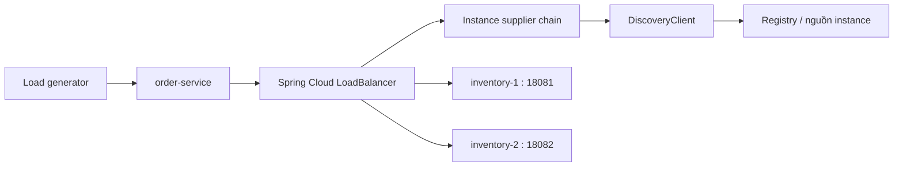
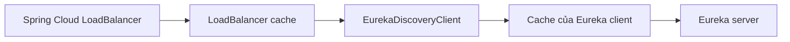

# Kịch bản đo số lần tra cứu trước và sau khi bật cache

Khi `RestClient`, `WebClient` hoặc OpenFeign gọi một service bằng tên logic như `inventory-service`, Spring Cloud LoadBalancer cần danh sách `ServiceInstance` trước khi chọn host và port. Danh sách này được cung cấp bởi `ServiceInstanceListSupplier`, có thể thông qua `DiscoveryClient` và nhiều lớp lọc. Nếu mỗi lần chọn đều phải truy vấn lại nguồn, số lần tra cứu tăng mạnh theo lưu lượng. **Cache danh sách instance** giúp giảm việc đọc nguồn lặp lại, nhưng đổi lại có nguy cơ chậm cập nhật khi instance được thêm, gỡ hoặc thay đổi trạng thái.

Bài thuộc chương **Bộ nhớ đệm bản sao** của module `SPRING_CLOUD_SERVICE_COMMUNICATION_LOAD_BALANCING`. Mục tiêu là thiết kế **phép đo có thể lặp lại**: giữ nguyên số request, service ID, tập instance và thời gian thử nghiệm; chỉ thay đổi trạng thái cache; sau đó so sánh số lần tra cứu nguồn trước và sau khi bật cache.

Những câu hỏi cần trả lời:

- Một request HTTP có đồng nghĩa với một lần gọi discovery không?
- Đặt bộ đếm ở đâu để biết supplier thực sự đọc nguồn bao nhiêu lần?
- Cache lạnh, cache ấm và TTL hết hạn cho kết quả khác nhau thế nào?
- Vì sao đếm request mạng tới Eureka/Consul không luôn phản ánh hiệu quả của LoadBalancer cache?
- Làm thế nào xác nhận cache giảm tải mà vẫn phát hiện instance thay đổi kịp thời?

## 1. Ba loại số đếm cần phân biệt

Giả sử `order-service` gửi 100 request HTTP liên tiếp tới `inventory-service`:

```text
100 request từ order-service
    ↓
100 lần client yêu cầu chọn ServiceInstance
    ↓
Spring Cloud LoadBalancer
    ↓
ServiceInstanceListSupplier chain
    ↓
[LoadBalancer cache, nếu bật]
    ↓
Nguồn DiscoveryClient / supplier gốc
    ↓
Cache nội bộ của discovery provider hoặc registry
```

Có **ba chỉ số khác nhau**:

| Chỉ số | Đo ở đâu? | Trả lời câu hỏi |
|---|---|---|
| `httpRequests` | Client phát sinh lời gọi tới service đích | Đã có bao nhiêu request nghiệp vụ? |
| `sourceLookups` | Supplier nguồn hoặc `DiscoveryClient.getInstances(serviceId)` | LoadBalancer phải lấy lại danh sách từ tầng nguồn bao nhiêu lần? |
| `registryNetworkCalls` | Client SDK, discovery server hoặc hệ thống mạng | Có bao nhiêu request mạng thực sự gửi tới registry? |

**Mục tiêu chính của thí nghiệm là `sourceLookups`.** Đây là phép đo trực tiếp hiệu quả tránh đọc lại delegate của `CachingServiceInstanceListSupplier`.

Ví dụ, `EurekaDiscoveryClient` có thể trả dữ liệu được Eureka client giữ trong bộ nhớ. Một lần gọi `getInstances()` của ứng dụng không nhất thiết dẫn tới một HTTP request mới tới Eureka server. Vì vậy, giảm `getInstances()` từ 100 lần xuống 1 lần **không đồng nghĩa** đã giảm đúng 99 request mạng tới registry.

### 1.1. Công thức cơ bản

Đặt:

- `N`: số lần yêu cầu chọn instance trong một cửa sổ đo.
- `R_off`: số lần nguồn được đọc với cache LoadBalancer tắt.
- `R_on`: số lần nguồn được đọc khi cache bật.

Tỷ lệ giảm:

```text
reduction(%) = (1 - R_on / R_off) × 100
```

Ví dụ mô hình tuần tự có 100 lần chọn cùng service ID, tập instance cố định và không có TTL expiry:

```text
R_off = 100
R_on  =   1

reduction = (1 - 1/100) × 100 = 99%
```

Đây là **kỳ vọng của bài test có kiểm soát**, không phải số đo thực tế từ production. Ở hệ thống thật, background refresh, discovery cache, concurrent misses, nhiều service ID và health check có thể làm kết quả khác đi.

## 2. Thiết kế phép đo công bằng

Chỉ nên thay đổi **một biến độc lập**: cache của Spring Cloud LoadBalancer OFF hay ON.

| Điều kiện | Lượt A: cache OFF | Lượt B: cache ON |
|---|---|---|
| Service ID | `inventory-service` | `inventory-service` |
| Số yêu cầu chọn instance | 100 | 100 |
| Tập instance | Hai instance cố định | Cùng hai instance |
| Tải | Tuần tự, một client | Tuần tự, một client |
| Thuật toán chọn | Round robin mặc định | Round robin mặc định |
| Discovery/supplier nguồn | Cùng loại implementation | Cùng loại implementation |
| Health/zone/hint filters | Tắt phần không dùng hoặc giữ giống nhau | Giống lượt A |
| TTL | Không áp dụng | Dài hơn thời gian thử nghiệm |
| Bộ đếm | Đếm source reads | Đếm source reads |
| Trạng thái ban đầu | Nguồn/counter mới | Cache lạnh/counter mới |

**Vì sao đo tuần tự?** Nếu nhiều request đồng thời truy cập một cache lạnh, nhiều yêu cầu có thể gặp cache miss trước khi một yêu cầu ghi entry. Phép đo tuần tự giúp xác nhận nguyên lý “đọc nguồn một lần rồi tái sử dụng” trước khi thử tải đồng thời.

Không so sánh một lượt 100 request trong 3 giây với một lượt kéo dài 60 giây trong khi TTL đặt 35 giây: hai cửa sổ có số lần hết hạn cache khác nhau.

## 3. Cấu hình cache trong Spring Cloud LoadBalancer

Spring Cloud LoadBalancer hỗ trợ `CachingServiceInstanceListSupplier`. Các implementation cache thông dụng:

1. **Cache mặc định** đi cùng `spring-cloud-starter-loadbalancer` khi không có Caffeine trên classpath.
2. **Cache dựa trên Caffeine** khi có dependency `com.github.ben-manes.caffeine:caffeine` và auto-configuration phù hợp.

Các thuộc tính trong tài liệu Spring Cloud Commons:

| Property | Vai trò | Mặc định trong tài liệu tham chiếu |
|---|---|---|
| `spring.cloud.loadbalancer.cache.enabled` | Bật/tắt LoadBalancer cache | `true` |
| `spring.cloud.loadbalancer.cache.ttl` | Thời gian sống tính từ lúc ghi entry | `35s` |
| `spring.cloud.loadbalancer.cache.capacity` | Dung lượng khởi tạo | `256` |
| `spring.cloud.loadbalancer.cache.caffeine.spec` | Cấu hình theo Caffeine spec | Tùy ứng dụng |

Lưu ý `capacity` là **initial capacity**, không tự mặc định có nghĩa số entry tối đa. Khi áp dụng cần đối chiếu release train Spring Cloud đang dùng.

### 3.1. Lượt A — tắt cache

Đặt trong profile thí nghiệm:

```yaml
spring:
  cloud:
    loadbalancer:
      cache:
        enabled: false
```

Chạy ở một tiến trình ứng dụng riêng. Không thay property ở runtime rồi mặc định cache manager/supplier đã khởi tạo tự thay đổi trạng thái.

### 3.2. Lượt B — bật cache

Giữ mọi thứ khác như lượt A, thay cấu hình:

```yaml
spring:
  cloud:
    loadbalancer:
      cache:
        enabled: true
        ttl: 30s
        capacity: 256
```

Gửi 100 request trong thời gian **ngắn hơn 30 giây** để tách cache hit khỏi hiệu ứng TTL expiry. Nếu ứng dụng có supplier chain tùy chỉnh, phải kiểm tra chain thực sự chứa caching supplier, chứ không chỉ nhìn `enabled: true`.

### 3.3. Vị trí cache trong supplier chain

Với cấu hình riêng, nên đặt caching supplier **ngay sau nguồn lấy instance**, trước các bộ lọc phụ thuộc request.

```java
@Configuration(proxyBeanMethods = false)
public class InventorySupplierConfiguration {

    @Bean
    ServiceInstanceListSupplier inventorySupplier(
            ConfigurableApplicationContext context) {

        return ServiceInstanceListSupplier.builder()
                .withDiscoveryClient()
                .withCaching()
                .withZonePreference()
                .build(context);
    }
}
```

- `withDiscoveryClient()` cung cấp danh sách từ nguồn discovery.
- `withCaching()` lưu snapshot nguồn.
- `withZonePreference()` xử lý ưu tiên zone trên danh sách delegate.

Đây là ví dụ cấu hình chain, không phải lời khẳng định mọi dự án đều cần cả caching và zone preference. Khi dùng `@LoadBalancerClient` theo từng service, hãy đặt class cấu hình riêng ngoài phạm vi component scan mặc định để không ảnh hưởng nhầm các client context khác.

Đặc biệt, với supplier định tuyến theo header hoặc hint, không nên cache kết quả **sau khi lọc theo request** bằng khóa chỉ chứa service ID. Request có hint khác có thể nhận nhầm tập instance của request trước đó.

## 4. Unit test đếm số lần đọc nguồn trước và sau cache

Trước khi đo HTTP thật, có thể xây một test độc lập registry nhằm xác minh cơ chế: supplier gốc cung cấp danh sách cố định và tăng bộ đếm mỗi lần có subscriber thực sự đọc nguồn.

Bài test dùng:

- Hai `DefaultServiceInstance` cùng service ID.
- `CountingSupplier` trả `Flux` bằng `Flux.defer` để đếm **subscription**.
- `CachingServiceInstanceListSupplier` cho nhánh có cache.
- `CacheManager` mới cho nhánh có cache, tránh nhiễm entry cũ.
- 100 lượt đọc snapshot **tuần tự** ở mỗi nhánh.

### 4.1. Mã JUnit minh họa

```java
import java.time.Duration;
import java.util.List;
import java.util.Objects;
import java.util.concurrent.atomic.AtomicInteger;

import org.junit.jupiter.api.Test;
import org.springframework.cache.concurrent.ConcurrentMapCacheManager;
import org.springframework.cloud.client.DefaultServiceInstance;
import org.springframework.cloud.client.ServiceInstance;
import org.springframework.cloud.loadbalancer.core.CachingServiceInstanceListSupplier;
import org.springframework.cloud.loadbalancer.core.ServiceInstanceListSupplier;

import reactor.core.publisher.Flux;

import static org.junit.jupiter.api.Assertions.assertEquals;

class InstanceCachingExperimentTest {

    private static final int REQUESTS = 100;

    @Test
    void countReadsWithAndWithoutCache() {
        List<ServiceInstance> instances = List.of(
                new DefaultServiceInstance(
                        "inventory-1", "inventory-service",
                        "127.0.0.1", 18081, false),
                new DefaultServiceInstance(
                        "inventory-2", "inventory-service",
                        "127.0.0.1", 18082, false));

        // A: Đọc trực tiếp từ supplier gốc.
        CountingSupplier withoutCache =
                new CountingSupplier("inventory-service", instances);

        repeatSnapshots(withoutCache, REQUESTS);
        assertEquals(REQUESTS, withoutCache.sourceReads());

        // B: Dùng nguồn và CacheManager hoàn toàn mới.
        CountingSupplier sourceForCache =
                new CountingSupplier("inventory-service", instances);

        ConcurrentMapCacheManager manager =
                new ConcurrentMapCacheManager(
                        CachingServiceInstanceListSupplier
                                .SERVICE_INSTANCE_CACHE_NAME);

        ServiceInstanceListSupplier withCache =
                new CachingServiceInstanceListSupplier(
                        sourceForCache, manager);

        repeatSnapshots(withCache, REQUESTS);
        assertEquals(1, sourceForCache.sourceReads());
    }

    private static void repeatSnapshots(
            ServiceInstanceListSupplier supplier, int count) {

        for (int i = 0; i < count; i++) {
            List<ServiceInstance> result =
                    Objects.requireNonNull(
                            supplier.get()
                                    .next()
                                    .block(Duration.ofSeconds(2)));

            assertEquals(2, result.size());
        }
    }

    private static final class CountingSupplier
            implements ServiceInstanceListSupplier {

        private final String serviceId;
        private final List<ServiceInstance> instances;
        private final AtomicInteger counter = new AtomicInteger();

        private CountingSupplier(
                String serviceId, List<ServiceInstance> instances) {

            this.serviceId = serviceId;
            this.instances = List.copyOf(instances);
        }

        @Override
        public String getServiceId() {
            return serviceId;
        }

        @Override
        public Flux<List<ServiceInstance>> get() {
            return Flux.defer(() -> {
                counter.incrementAndGet();
                return Flux.just(instances);
            });
        }

        int sourceReads() {
            return counter.get();
        }
    }
}
```

Các điểm cần chú ý:

1. Bộ đếm nằm **trong `Flux.defer`**. Tăng counter ngay khi tạo publisher có thể đếm số lần dựng chuỗi thay vì số lần đọc nguồn khi subscription.
2. Lượt A dùng nguồn trực tiếp; mỗi subscription gọi nguồn và tăng counter.
3. Lượt B dùng caching decorator. Với một service ID, dữ liệu không đổi, cache không bị evict và request tuần tự, lần đầu đọc nguồn; các lần tiếp theo sử dụng entry cache.
4. `ConcurrentMapCacheManager` chỉ nhằm kiểm tra **cache hit trong dữ liệu ổn định**. Nó không tự áp dụng `ttl` của LoadBalancer auto-configuration; test này **không chứng minh TTL expiry**.
5. Không cần registry hay HTTP server, vì mục tiêu chỉ là đo số lần supplier gốc được subscribe.

Đây là ví dụ cho các phiên bản Spring Cloud có constructor và API tương ứng. Khi đưa vào dự án, kiểm tra dependency JUnit/Spring Cloud LoadBalancer/Reactor theo Spring Cloud BOM tương thích với Spring Boot.

### 4.2. Bảng kỳ vọng từ unit test

| Phép đo | Không cache | Có cache |
|---|---:|---:|
| Số lần đọc snapshot bên ngoài | 100 | 100 |
| Số lần subscribe nguồn `CountingSupplier` | 100 | 1 |
| Số instance mỗi snapshot | 2 | 2 |
| Mức giảm đọc nguồn | — | 99% |

Đây là **kết quả kỳ vọng của mô hình đơn giản**, không phải benchmark production. Nó chứng minh khác biệt giữa *số lần hỏi supplier ngoài cùng* và *số lần supplier nguồn thực sự thực thi*.

## 5. Kịch bản tích hợp: cùng một luồng HTTP với cache OFF/ON

Unit test chứng minh cơ chế ở mức supplier. Thử nghiệm tiếp theo phải xác minh ứng dụng thật có đi qua đúng chain không.

### 5.1. Dựng môi trường



Môi trường kiểm thử có:

- Một `order-service` dùng client `@LoadBalanced` và endpoint thử nghiệm `/probe/inventory`. Mỗi lần gọi endpoint này thực hiện **một lần chọn instance** để gọi `inventory-service`.
- Hai instance `inventory-service` với endpoint phản hồi đơn giản và in ra instance ID.
- Discovery provider hoặc nguồn instance cố định không thay đổi trong cửa sổ đo.
- Bộ đếm số lần gọi `DiscoveryClient.getInstances("inventory-service")` hoặc số lần supplier nguồn truy vấn dữ liệu.
- Log/metric số request thành công, số lỗi, số lần chọn instance và retry.

`/probe/inventory` là **endpoint giả định cần tự tạo cho bài thực hành**, không phải endpoint Spring Cloud cung cấp sẵn.

### 5.2. Đặt counter tại nguồn

Có thể dùng wrapper quanh `DiscoveryClient` ở môi trường test:

```java
import java.util.List;
import java.util.concurrent.atomic.AtomicLong;

import org.springframework.cloud.client.ServiceInstance;
import org.springframework.cloud.client.discovery.DiscoveryClient;

final class CountingDiscoveryClient implements DiscoveryClient {

    private final DiscoveryClient delegate;
    private final AtomicLong counter = new AtomicLong();

    CountingDiscoveryClient(DiscoveryClient delegate) {
        this.delegate = delegate;
    }

    @Override
    public List<ServiceInstance> getInstances(String serviceId) {
        counter.incrementAndGet();
        return delegate.getInstances(serviceId);
    }

    @Override
    public List<String> getServices() {
        return delegate.getServices();
    }

    @Override
    public String description() {
        return delegate.description();
    }

    long lookupCount() {
        return counter.get();
    }
}
```

Wrapper trên là **cấu trúc instrument dành cho test**. Không đăng ký nó tùy ý thành bean `@Primary` cạnh tranh hoặc tự wrap chính nó vì có thể gây vòng phụ thuộc. Cần nối wrapper tại một điểm xác định của test context và bảo đảm mọi source lookup cần đo đi qua đó. Nếu dùng `ReactiveDiscoveryClient`, cách đếm phải xét thời điểm subscribe của luồng reactive.

Bộ đếm này đo lần gọi **API discovery phía client**, chưa chắc là HTTP call đến registry. Muốn đo network call thực tế, phải quan sát discovery SDK hoặc registry server riêng.

### 5.3. Hai lượt chạy độc lập

**Lượt A — cache OFF**

1. Khởi động ứng dụng với `spring.cloud.loadbalancer.cache.enabled=false`.
2. Xác nhận context `inventory-service` không chứa caching decorator đang hoạt động.
3. Ghi counter đầu kỳ hoặc reset tại thời điểm bắt đầu.
4. Gửi 100 request **tuần tự**.
5. Ghi tổng request, source lookup, lỗi HTTP và thời gian cửa sổ đo.
6. Dừng tiến trình trước lượt B.

**Lượt B — cache ON**

1. Khởi động một tiến trình mới với `cache.enabled=true` và `ttl=30s`, giữ tất cả thiết lập khác.
2. Xác nhận supplier chain có caching decorator và cache lạnh.
3. Ghi counter đầu kỳ.
4. Gửi 100 request tuần tự trong thời gian **ngắn hơn TTL**.
5. Ghi cùng các chỉ số.
6. Đối chiếu `R_off` và `R_on`.

Ví dụ gửi request bằng Windows PowerShell:

```powershell
1..100 | ForEach-Object {
    Invoke-WebRequest -Uri "http://localhost:8080/probe/inventory" -UseBasicParsing | Out-Null
}
```

Lệnh chỉ là ví dụ cho môi trường thử nghiệm đã triển khai endpoint `/probe/inventory`; nó không tự tạo endpoint hoặc bộ đếm.

**Chú ý:** nếu client được tạo trực tiếp và không có tích hợp Spring Cloud LoadBalancer, kết quả sẽ không kiểm tra được hành vi cache mong muốn.

## 6. Bảng kết quả mẫu và cách diễn giải

Một bảng tổng hợp sau đo có thể có dạng:

| Chỉ số | Cache OFF | Cache ON | Lưu ý |
|---|---:|---:|---|
| HTTP request tới endpoint thử nghiệm | 100 | 100 | Cùng số request |
| Lượt chọn instance | 100 | 100 | Mỗi request một lần chọn |
| Source lookup hoặc `getInstances` | 100 | 1 | Mô hình tuần tự, TTL chưa hết |
| HTTP request thực sự tới registry | Chưa đo | Chưa đo | Đo độc lập ở SDK/server |
| HTTP response thành công | 100 | 100 | Hai instance đều khỏe |
| Instance trong danh sách | 2 | 2 | Dữ liệu nguồn cố định |
| Tỷ lệ giảm source lookup | — | 99% | Theo công thức ở mục 1 |

**Các số trên là minh họa**, không phải số đã thu được từ một ứng dụng cụ thể.

Cách diễn giải các kết quả khác dự đoán:

- `R_off≈100` và `R_on≈1`: cache giảm số lần supplier đọc nguồn.
- `R_on≈R_off`: kiểm tra cache có nằm trong chain không, TTL có quá ngắn không, service ID có thay đổi không, hoặc entry có bị evict không.
- Cả `R_off` và `R_on` đều thấp: có thể đang đếm ở tầng registry network trong khi SDK cache, hoặc endpoint không đi qua LoadBalancer.
- `R_on` cao hơn 1 nhưng vẫn thấp hơn `R_off`: xét TTL expiry, concurrent misses, background refresh và nhiều cache keys.
- Cache ON giảm lookup nhưng làm tăng lỗi kết nối: cần kiểm tra độ mới của danh sách instance và cơ chế health/refresh.

Giảm lookup không có nghĩa độ trễ HTTP giảm cùng tỷ lệ. Thời gian response còn phụ thuộc network, ứng dụng đích, pool kết nối, serialization và retry.

## 7. Cold cache và warm cache

- **Cold cache:** chưa có entry hợp lệ cho `inventory-service`; lần đọc đầu có thể phải gọi nguồn.
- **Warm cache:** entry đã có và chưa hết hạn; các lần chọn tiếp theo có thể dùng snapshot.

Ví dụ:

```text
Cache OFF:
  request #1    -> source lookup #1
  request #2    -> source lookup #2
  ...
  request #100  -> source lookup #100

Cache ON, cold start:
  request #1    -> cache miss -> source lookup #1
  request #2    -> cache hit
  ...
  request #100  -> cache hit
```

Nếu muốn đo **warm window**, hãy thực hiện một request khởi động để cache có entry, sau đó mới ghi số counter đầu kỳ và gửi 100 request mới. Trong mô hình ổn định, nhánh cache ON có thể có **0 source lookup** trong cửa sổ warm, dù nguồn đã được đọc một lần trước cửa sổ.

Không thể đồng thời tính một lần cache miss đầu tiên vào cold-run và gọi cửa sổ đó là warm-run. Ghi phương pháp warm-up rõ ràng để tránh kết luận sai.

## 8. Đo thêm tác động của TTL

TTL quy định thời gian sau khi ghi entry mà cache coi entry hết hạn. Theo tài liệu tham chiếu, `spring.cloud.loadbalancer.cache.ttl` mặc định là `35s`; có thể cấu hình giá trị khác.

Thử nghiệm riêng với TTL ngắn:

```yaml
spring:
  cloud:
    loadbalancer:
      cache:
        enabled: true
        ttl: 5s
```

Trên ứng dụng hoặc cache manager **thực sự hỗ trợ TTL**:

1. Khởi động cache lạnh, gửi request đầu tiên; kỳ vọng có source lookup.
2. Trong hai giây tiếp theo, gửi 19 request tuần tự; phần lớn là cache hit.
3. Chờ ít nhất sáu giây tính từ lần ghi entry.
4. Gửi request thứ 21; cache hết hạn nên có thể đọc nguồn lần nữa.
5. Kiểm tra bộ đếm và thời gian cập nhật entry.

| Mốc | Tổng số request | Source lookup kỳ vọng |
|---|---:|---:|
| Sau request 1 | 1 | 1 |
| Sau request 20, chưa hết TTL | 20 | 1 |
| Sau đợi TTL và request 21 | 21 | 2 |

TTL hết hạn không nhất thiết khiến cache **chủ động gửi network request ngay thời điểm hết hạn**. Thông thường lần truy cập sau khi hết hạn mới gây cache miss/đọc nguồn, trừ khi có refresh riêng.

Bài test dùng `ConcurrentMapCacheManager` ở mục 4 không tự kiểm tra TTL; không dùng kết quả của nó để kết luận `ttl: 5s` hoạt động.

## 9. Cache Caffeine và tác động tới phép đo

Khi Caffeine có mặt trên classpath, Spring Cloud LoadBalancer có thể dùng Caffeine-backed cache.

Ví dụ:

```yaml
spring:
  cloud:
    loadbalancer:
      cache:
        enabled: true
        caffeine:
          spec: maximumSize=500,expireAfterWrite=30s
```

**Cảnh báo:** thuộc tính `spring.cloud.loadbalancer.cache.caffeine.spec` có thể **ghi đè cấu hình cache tổng quát** như `ttl` và `capacity`. Không nên đặt `ttl: 10s` rồi kỳ vọng giá trị đó thắng `expireAfterWrite=30s` trong spec.

Khi kiểm thử, kiểm tra:

- Dependency `com.github.ben-manes.caffeine:caffeine` thực sự có mặt.
- Cache manager được auto-configure như mong đợi.
- Caffeine spec parse thành công.
- Cache entry có thể bị evict trước TTL vì giới hạn dung lượng.
- Số lần đọc nguồn được lấy từ đúng vị trí, không nhầm với cache của provider khác.

Không cần thêm Caffeine chỉ để chứng minh nguyên lý giảm source read; cache mặc định hoặc unit test đủ cho mục tiêu cơ bản.

## 10. Thử nhiều service ID

Thêm `catalog-service` cùng `inventory-service`:

```text
10 request tới inventory-service
10 request tới catalog-service
10 request nữa tới inventory-service
10 request nữa tới catalog-service
```

Trong mô hình ổn định, hai service có hai cache entry riêng:

| Cấu hình | Tổng lần chọn | Source read kỳ vọng |
|---|---:|---:|
| Không cache | 40 | 40 |
| Có cache | 40 | 2 |

Lý do: một source read đầu tiên cho mỗi service ID; các request sau có thể dùng snapshot tương ứng.

Nếu ứng dụng có nhiều instance `order-service`, cache phía client thường nằm trong **mỗi JVM**. Không giả định một instance chia sẻ entry với instance khác nếu dự án không có cơ chế cache chia sẻ được thiết kế riêng.

## 11. Đo độ mới khi danh sách instance thay đổi

Giảm lookup có thể khiến client chọn instance đã dừng do snapshot cũ.

Ví dụ:

```text
t0:
  inventory-service -> [inventory-1, inventory-2]

t1:
  inventory-2 dừng
  inventory-3 đăng ký

Registry hiện tại:
  inventory-service -> [inventory-1, inventory-3]

Cache cũ của client có thể vẫn là:
  inventory-service -> [inventory-1, inventory-2]
```

Một request chọn `inventory-2` từ cache cũ có thể thất bại vì connection refused hoặc timeout. Khi cache refresh, client có thể đọc danh sách mới, nhưng thời gian cập nhật còn phụ thuộc cache của discovery SDK, registry và health check.

Nên đo thêm:

| Chỉ số | Mục tiêu |
|---|---|
| `sourceLookupCount` | Chi phí đọc nguồn |
| `instanceChangeDetectedAt` | Thời điểm client thấy bản sao mới |
| `staleSelectionCount` | Số lần chọn bản sao đã dừng |
| `clientErrorRate` | Tỷ lệ lỗi kết nối/timeout |
| `timeToConverge` | Thời gian từ cập nhật registry tới khi client có danh sách mới |

Một thí nghiệm bổ sung:

1. Đăng ký hai instance và làm ấm cache.
2. Đăng ký instance thứ ba; ghi thời điểm registry xác nhận.
3. Gửi request đều đặn và ghi lần đầu client thấy instance mới.
4. Gỡ instance thứ hai; quan sát khi nào client ngừng chọn nó.
5. Lặp lại với cache OFF, giữ cùng discovery provider và điều kiện tải.

Không chọn TTL chỉ dựa trên tỷ lệ cache hit. TTL dài có thể giảm lookup nhưng tăng thời gian nhìn thấy scale up/down, nhất là khi discovery provider cũng có cache.

## 12. Double caching với discovery provider

Một số discovery client đã giữ danh sách instance trong bộ nhớ. Ví dụ, Eureka client có cache/chu kỳ đồng bộ của riêng mình; tài liệu Spring Cloud khuyến nghị tắt LoadBalancer cache nếu discovery client đã cache để tránh **double caching**.



Khi cả hai lớp đều bật, lợi ích giảm source read cần cân bằng với độ trễ cập nhật danh sách. Không thể mặc định cộng hai TTL thành thời gian stale chính xác: thời điểm refresh, truyền sự kiện và truy cập khác nhau. Nhưng nhiều lớp cache có thể làm khó xác định khi nào dữ liệu thực sự đổi.

Cần trả lời:

- Discovery client có cache cục bộ không?
- Cache đó làm mới theo lịch hay mỗi request?
- Lời gọi `getInstances` có tạo network call không?
- Bật thêm LoadBalancer cache giảm CPU/source read có đáng kể không?
- Khi rolling deployment, snapshot cũ tạo thêm bao nhiêu lỗi?

Nếu discovery provider tự cache hiệu quả, bật thêm LoadBalancer cache có thể chỉ mang lại lợi ích nhỏ. Khi đó nên ưu tiên đo freshness, độ trễ và khuyến nghị provider.

## 13. Ảnh hưởng của health check, zone, hint và retry

Khi supplier chain có nhiều decorator, kết quả đo có thể bị thay đổi:

- **Health check:** có thể chạy theo chu kỳ độc lập với request; cần phân biệt lookup do request và hoạt động nền.
- **Zone preference:** lọc danh sách đầu vào; thay đổi số ứng viên cuối nhưng không đồng nghĩa cache miss.
- **Hint từ header:** nếu cache nằm sau bộ lọc theo request, dữ liệu của request `canary` có thể bị dùng lại cho `stable`. Cache dữ liệu nguồn trước các bộ lọc request-aware.
- **Retry:** một HTTP request có thể dẫn đến nhiều lần chọn instance. Khi đó `httpRequests` không còn bằng `selectionCount`.
- **Timeout:** request timeout không chứng minh source lookup chưa xảy ra; cần đo tại source.

Để kiểm chứng cơ chế cache trước tiên, nên giữ chain đơn giản và tắt retry tự động. Sau đó thêm từng điều kiện để đo ảnh hưởng thực tế.

## 14. Các phép đo thường bị diễn giải sai

| Hiện tượng | Kết luận vội vàng | Cách kiểm tra |
|---|---|---|
| 100 HTTP request, 0 registry network call | Không cần LoadBalancer cache | SDK có thể tự cache; đo thêm `getInstances`/source publisher |
| Cache ON vẫn đọc nguồn 100 lần | Cache lỗi | Kiểm tra supplier chain, TTL, service ID, eviction |
| Cache ON đọc nguồn 2–3 lần | Cache không hiệu quả | Có thể TTL expiry, concurrent misses hoặc background refresh |
| Một ứng dụng cache hit, ứng dụng khác cache miss | Config sai | Mỗi process/JVM thường có cache riêng |
| Sau scale down còn request tới instance cũ | Thuật toán chọn sai | Kiểm tra freshness danh sách và health check |
| P95 giảm sau bật cache | Latency giảm đúng tỷ lệ lookup | Đo riêng discovery latency, selection latency và HTTP đích |
| Source count bằng 0 sau warm-up | Ứng dụng không dùng LoadBalancer | LoadBalancer vẫn chọn từ cache; đo riêng selection count |
| Caffeine spec có TTL khác property | TTL bị bỏ qua ngẫu nhiên | Kiểm tra spec có override general settings không |

Nên thu thập **lượt chọn instance** và **lượt đọc nguồn** riêng. Chênh lệch giữa chúng phản ánh mức tái sử dụng snapshot trong mô hình kiểm soát, nhưng không nên gọi là “cache hit rate chính thức” nếu không lấy dữ liệu trực tiếp từ cache manager.

## 15. Ghi log và metric

Ví dụ log tổng hợp một cửa sổ đo:

```text
experiment=lb-instance-cache
serviceId=inventory-service
cacheEnabled=true
requestMode=sequential
selectionCount=100
sourceLookupCount=1
sourceReadFailures=0
selectedInstanceCount=2
windowDurationMs=3200
```

Ví dụ đo TTL:

```text
experiment=lb-instance-cache-ttl
serviceId=inventory-service
cacheEnabled=true
cacheTtl=5s
selectionCount=21
sourceLookupCount=2
expiredEntryObserved=true
```

Các trường này là **quy ước instrument do ứng dụng thiết kế**, không phải toàn bộ metric LoadBalancer tự công bố. Trong production có thể dùng Micrometer để đếm tại điểm đọc source, với tag `serviceId` thuộc tập tên service đã kiểm soát.

Không dùng instance ID, raw URI hoặc request ID làm metric tag nếu cardinality lớn. Chi tiết có thể đưa vào trace/log có kiểm soát theo chính sách dữ liệu.

Khi lưu kết quả thí nghiệm, ghi đủ phiên bản Spring Boot/Spring Cloud, cấu hình TTL và Caffeine, số service ID, số instance, thời gian, phương pháp warm-up, số lần chọn, source lookup, network call tới registry (nếu đo), lỗi và retry.

## 16. Tiêu chí hoàn thành kịch bản

Kịch bản được xem là thực hiện tốt khi có bằng chứng cho các bước:

1. Hai lượt chạy có cùng số request, cùng service ID và cùng nguồn instance.
2. HTTP client thực sự đi qua Spring Cloud LoadBalancer.
3. Counter được đặt tại nguồn đúng và đo thời điểm source thực thi.
4. Cache ON làm giảm source lookup trong cửa sổ tuần tự, ổn định.
5. Có phân biệt cold cache và warm cache.
6. TTL expiry được xác minh trên cache manager có hỗ trợ TTL.
7. Đã thử ít nhất một thay đổi instance để đánh giá freshness.
8. Đã xác định discovery provider có cache riêng hay không.
9. Đã theo dõi song song lỗi kết nối/timeout và tỷ lệ thành công.
10. Cấu hình và thời gian thử nghiệm được ghi lại để có thể lặp lại.

Nếu chỉ báo “cache OFF: 100, cache ON: 1” mà không mô tả vị trí counter, số liệu chưa đủ để kết luận về request mạng registry hoặc độ trễ end-to-end.

## 17. Kết luận

Khi đo cache của Spring Cloud LoadBalancer, cần tách **số request nghiệp vụ**, **số lần chọn `ServiceInstance`** và **số lần supplier nguồn được gọi**. Với cùng service ID, danh sách cố định, các request tuần tự và cache chưa hết TTL, số lần đọc nguồn có thể giảm từ `N` xuống gần một lần trong cửa sổ cold-start và về gần không trong cửa sổ warm-cache.

Để biến kỳ vọng thành kết luận đáng tin cậy, phải kiểm tra supplier chain, đặt counter sát nguồn, chạy hai cấu hình độc lập, kiểm thử TTL và quan sát freshness khi instance thay đổi. Hiệu quả của cache không chỉ là số lookup giảm, mà còn là khả năng cân bằng giữa **giảm tải discovery**, **độ mới của danh sách** và **tính ổn định khi gọi service**.

### Tài liệu tham khảo

- [Spring Cloud Commons — Spring Cloud LoadBalancer: Caching](https://docs.spring.io/spring-cloud-commons/reference/spring-cloud-commons/loadbalancer.html) — cache mặc định/Caffeine, TTL, capacity, vị trí caching supplier và cảnh báo double caching.
- [Spring Cloud Commons — Configuration Properties](https://docs.spring.io/spring-cloud-commons/reference/configprops.html) — `spring.cloud.loadbalancer.cache.enabled`, `ttl`, `capacity` và `caffeine.spec`.

